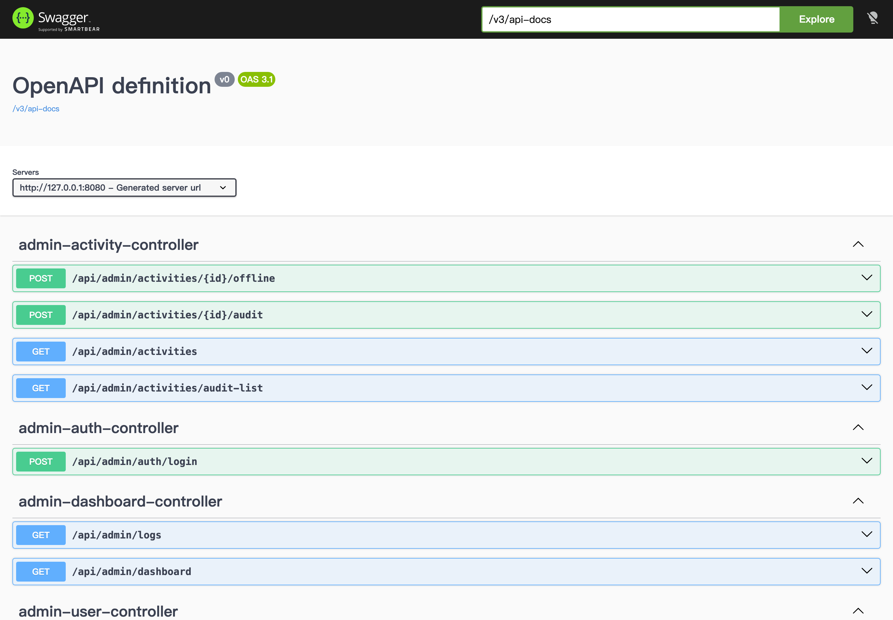
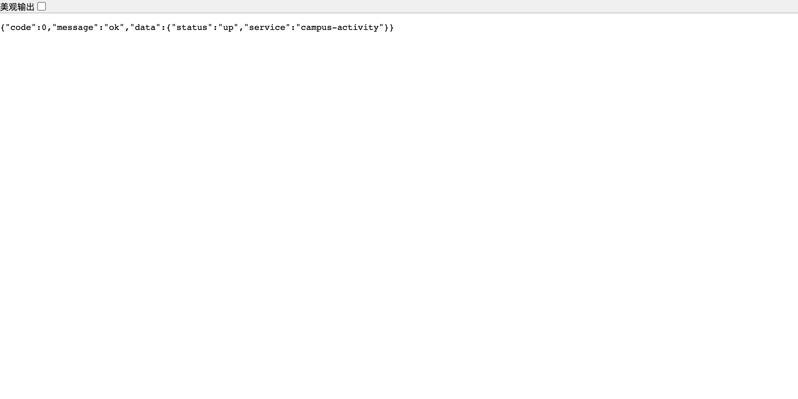

# 第 1 次课 · 从零启航：环境搭建、云效立项与后端跑通

> **教案 + 教程二合一**：课中按第 4 章时间表授课，课后按第 7 章步骤复现。结构按 [07-附录-可复现事实清单与验收表](07-附录-可复现事实清单与验收表.md)（下称“事实清单”）第 9 节 12 章模板编写；版本、端口、账号、命令、数量口径一律以事实清单为准，本文不另立口径。
>
> 教师课前读第 2、3、4、9 章；学生课中跟第 7 章；助教巡场用第 9.2 节；验收人员用第 10 章与第 7.13 节。引用项目文件用相对路径；截图在 `../screenshots/`。
>
> 若需要从空项目开始跟着敲，见 [从零构建教程](从零构建/README.md) 对应轨道（01 后端 / 02 小程序 / 03 后台 / 04 联调上线）。

## 1 封面信息表

| 项 | 内容 |
| --- | --- |
| 课次 | 第 1 次课（4 学时，180 分钟教学 + 2 次 10 分钟课间） |
| 主题 | 从零启航——环境搭建、云效立项、后端与数据库跑通 |
| 适用对象 | 软件工程/计算机相关专业本科三年级，4 人一组；已修 Java 与数据库 |
| 云效里程碑 | 建组织/项目/迭代、建代码库、需求拆解 ≥24 条、首次 MR |
| 课内产出物 | 环境就绪报告（5 项）、项目看板（24 条）、`/api/ping` 通过截图、首个已合并 MR |
| 课后任务 | 补全 Sprint 1 任务与个人开发环境，提交 1 个 MR（第 11 章） |
| 对应项目文档 | [03 概要设计](../项目文档/03-概要设计说明书.md)、[05 接口设计](../项目文档/05-接口设计说明书.md)、[12 功能扩展](../项目文档/12-功能扩展说明.md)、[README](../../README.md) |
| 下次课衔接 | 第 2 次课直接用本课的后端与数据库跑业务闭环，并接入 Spring Security 与 Redis |
| 编写/核对 | 教学包编写组；最后核对日期：2026-11-11 |

### 1.1 四次课中的位置

| 课次 | 主题 | 云效里程碑 | 与本课关系 |
| --- | --- | --- | --- |
| 第 1 次（本课） | 环境搭建与后端跑通 | 建项目/迭代、拆需求、首次 MR | 打地基 |
| 第 2 次 | 核心业务与安全缓存 | Sprint 1 执行、任务认领、代码评审、缺陷单 | 在跑通的后端上做业务与安全 |
| 第 3 次 | 双端前端与扩展能力 | Sprint 2 联调、缺陷闭环、测试用例入库 | 前端联调与扩展能力收尾 |
| 第 4 次 | 测试、流水线与部署答辩 | Testhub、Flow、v1.0.0 发布 | 测试、部署与答辩 |

### 1.2 本课“一页纸”目标（当场可演示）

1. `curl -s http://127.0.0.1:8016/api/ping` 返回 `{"code":0,"message":"ok","data":{"service":"campus-activity","status":"up"}}`。
2. 云效项目 `CA-<组号>-校园活动` 的 Sprint 1 看板有 **24 条**需求/任务，均带负责人与验收标准。
3. 组内至少 1 个 `feat/<任务号>-<简述>` 分支通过 MR 评审并合入 `develop`。

## 2 教学目标与重难点

### 2.1 教学目标

| 维度 | 目标（可观察、可验收） | 验证方式 |
| --- | --- | --- |
| 知识 | 说出三端架构（`server`/`app`/`admin`）职责、端口与接口分组；解释前后端分离“契约先行” | 第 9.1 节提问 |
| 知识 | 说出 Spring Boot 分层与 MyBatis-Plus 职责；对照 `schema.sql` 讲清 12 张表关系 | 随堂问答、表清单标注 |
| 能力 | 在 macOS 或 Windows WSL2 装好 JDK 21/Maven/Node/pnpm/MySQL 8/Redis 并自检 | 环境就绪报告（5 项） |
| 能力 | 建库并按顺序导入 `schema.sql`/`data.sql`，用 SQL 核验 12 张表与演示数据 | 第 7.4 节核验 SQL |
| 能力 | 编译、启动后端，用 `curl` 与 Swagger 验证接口 | `ping` 截图、Swagger 截图 |
| 能力 | 云效建项目/迭代/代码库，拆 ≥24 条任务，走完“分支→MR→评审→合并” | 看板截图、MR 链接 |
| 素养 | “先环境后代码、先契约后实现、先评审后合并”；能记录报错并独立排障 | 环境问题记录、组内互评 |

### 2.2 重点与难点

| 类型 | 内容 | 突破策略 |
| --- | --- | --- |
| 重点 | 版本一致性：JDK 21 + Maven 3.9 + MySQL 8 + Redis 6.2+/7 + Node 18+ | 第 3.3 节六项自检命令与期望输出，逐项打勾再进入下一步 |
| 重点 | 数据库初始化顺序与字符集 | 第 7.4 节拆成“建库→建表→导数据→核验”4 步，每步给 SQL 与期望行数 |
| 重点 | 分层与接口契约 | 用“一次请求的旅行”讲 6 层，再让学生把 44 个接口按前缀填进分组表 |
| 难点 | 前后端分离与无状态鉴权心智模型 | 先讲“前端只认 JSON”，用 `curl` 与 Swagger 代替浏览器；JWT 留到第 2 次课 |
| 难点 | 云效协作流程 | 第 7.12 节拆成 6 步，每步给“完成标志” |
| 难点 | 环境故障独立定位 | 第 8 章 12 条错误 + 第 9.3 节“5 分钟原则” |

### 2.3 与考核对应

本课过程分落点为“环境就绪、看板与 MR 建立”（事实清单第 12 节；00 号手册 6.8 节建议权重 **8 分**），拆分见第 10.3 节。

## 3 课前准备

### 3.1 教师清单（课前 1 天完成）

| # | 事项 | 完成标志 |
| --- | --- | --- |
| T1 | 在教师演示机完整走一遍第 7 章 | 从零到 `ping` 通过 ≤ 40 分钟 |
| T2 | 离线兜底：预热 `~/.m2`、准备 `node_modules` 缓存或镜像源 | 断网也能编译后端 |
| T3 | 云效准备组织邀请与“模板项目” | 学生一个页面内完成加入 |
| T4 | 预置教师演示库（提前导好 `campus_activity`） | `SELECT COUNT(*) FROM activity` = 4 |
| T5 | 打印/投影检查点清单（7.13）与评分表（第 10 章） | 检查点贴纸或在线表格就绪 |
| T6 | 准备 24 条任务清单电子版（6.2） | 组长 10 分钟内能复制建任务 |

### 3.2 学生清单

| # | 事项 | 完成标志 |
| --- | --- | --- |
| S1 | 安装配置 JDK 21/Maven/Node/pnpm/MySQL 8/Redis | 3.3 节六项自检符合期望 |
| S2 | 阿里云账号已加入课程云效组织 | 能看到组织与项目列表 |
| S3 | 配置 Git `user.name`、`user.email` | `git config --global --list` 可查 |
| S4 | 下载项目到本地 | `ls` 看到 `server/ app/ admin/ scripts/` |
| S5 | 读 [README](../../README.md) 快速开始与 [12 功能扩展](../项目文档/12-功能扩展说明.md) 第 1 章 | 能说出 8016 端口与 Redis database 11 |

### 3.3 环境自检命令与预期版本

```bash
java -version          # 期望 21.x（实测 21.0.12.1 LTS）
mvn -v                 # 期望 3.9.x（实测 3.9.11）
node -v && pnpm -v     # 期望 Node 18+ / pnpm 8+（实测 v24.20.0 / 12.14.0）
mysql --version        # 期望 8.0+（实测 8.4.6）
redis-server --version # 期望 6.2+（实测 8.2.2）
git --version          # 期望 2.30+（分支与 MR 流程用）
```

| 检查项 | 期望输出特征 | 实际输出 | 通过 |
| --- | --- | --- | --- |
| JDK | 版本号以 `21` 开头 | | ☐ |
| Maven | `Apache Maven 3.9.x` | | ☐ |
| Node | `v18` 及以上 | | ☐ |
| pnpm | `8` 及以上 | | ☐ |
| MySQL | 8.0+ 且能 `mysql -uroot -p123456 -e "SELECT VERSION()"` | | ☐ |
| Redis | 6.2+ 且 `redis-cli -a abc123 --no-auth-warning -n 11 ping` 返回 `PONG` | | ☐ |

### 3.4 课前 10 分钟巡台

| 动作 | 观察点 | 处理 |
| --- | --- | --- |
| 看窗口布局 | 是否同时打开项目根、`server`、浏览器 | 统一“三窗口工作法” |
| 抽查 3 人 `java -version` | 是否 21 | 不是按 8.1 条处理 |
| 抽查 2 人 Redis | `PING` 是否 `PONG` | 失败按 8.4 条，记入问题墙 |
| 确认云效登录 | 是否已加入组织 | 未加入统一走 T3 邀请 |

## 4 课堂 4 学时时间表（精确到分钟）

> 口径：4 × 45 = **180 分钟教学**，另设 2 次各 10 分钟课间，**课堂总跨度 200 分钟**；“累计分钟”从上课铃响记 0。

| 学时 | 累计分钟 | 时长 | 环节 | 教师活动 | 学生活动 | 产出 |
| --- | --- | --- | --- | --- | --- | --- |
| 第 1 学时 | 0–5 | 5′ | 开场与课程地图 | 亮四次课路线、考核构成、本课成果；演示最终系统 | 打开云效/终端/浏览器；记路线 | 路线图笔记 |
| 第 1 学时 | 5–15 | 10′ | 情境导入 | 讲校团委真实需求与“4 次课上线一个平台”；抛 Q1–Q3 | 小组讨论并复述“一句话需求” | 需求复述 |
| 第 1 学时 | 15–30 | 15′ | 知识精讲 1：三端架构与前后端分离 | 讲三端、端口、44 接口分组；打开 Swagger 概览 | 架构图标注“谁调用谁” | 架构图标注 |
| 第 1 学时 | 30–38 | 8′ | 任务发布 | 发 24 条任务清单，讲评分点；宣布分组角色 | 分工、认领任务 | 角色表 |
| 第 1 学时 | 38–45 | 7′ | **检查点 1：环境自检** | 抽查 2 组、登记未通过项 | 提交六项自检截图 | 环境自检表 |
| — | 45–55 | 10′ | **课间 1** | 个别答疑 | 休息 | — |
| 第 2 学时 | 55–70 | 15′ | 知识精讲 2：分层 + 12 张表 | 讲分层与一次请求链路；对 `schema.sql` 讲 12 张表与关系 | 在库表清单上圈“关系表” | 分层图 + 标注 |
| 第 2 学时 | 70–80 | 10′ | 现场演示：建库导入 | 演示建库、导入两脚本、跑核验 SQL；强调顺序与字符集 | 记录命令 | 演示笔记 |
| 第 2 学时 | 80–95 | 15′ | 小组实操 1：数据库初始化 | 巡场，重点看 8.3、8.6 条 | 按 Step 6 建库导数据、跑核验 SQL | 12 表 + 演示数据 |
| 第 2 学时 | 95–100 | 5′ | **检查点 2：12 表与数据** | 快速核对 3 组 | 提交核验 SQL 截图 | 核验截图 |
| — | 100–110 | 10′ | **课间 2** | 处理问题墙 | 休息 | — |
| 第 3 学时 | 110–118 | 8′ | 现场演示：后端编译启动 | 演示编译、启动、`curl /api/ping`；讲端口占用 | 记录启动日志关键字 | 演示笔记 |
| 第 3 学时 | 118–132 | 14′ | 小组实操 2：后端跑通 | 巡场；用“读日志顺序法”定位失败组 | 按 Step 7–9 编译、启动、curl | 后端监听 8016 |
| 第 3 学时 | 132–140 | 8′ | 小组实操 2 续：接口与 Swagger | 指导分类接口、Swagger 44 接口核对 | `curl` 分类；打开 Swagger 数分组 | ping / 分类 / Swagger 截图 |
| 第 3 学时 | 140–148 | 8′ | 云效实操 1：项目/迭代/24 条任务 | 演示建项目、建 Sprint 1、批量建任务 | 建项目、建迭代、录 24 条 | 看板 24 条 |
| 第 3 学时 | 148–155 | 7′ | **检查点 3：ping + 看板** | 抽查 2 组并记录 | 提交 ping 与看板截图 | 两张截图 |
| 第 4 学时 | 155–165 | 10′ | 云效实操 2：代码库/首次 push/feat 分支 | 演示建库、保护分支、push、`feat/CA-12-...` | 组长建库并 push；组员拉分支 | 代码库 + feat 分支 |
| 第 4 学时 | 165–168 | 3′ | **检查点 4：MR 合并** | 检查 MR 是否关联任务、是否有评审 | 提交 MR 并完成 1 次互评 | 已合并 MR |
| 第 4 学时 | 168–180 | 12′ | 组间演示 | 主持 3 组 × 3 分钟演示 + 点评 | 演示环境与看板；其余组互评 | 演示评分表 |
| 第 4 学时 | 180–188 | 8′ | 复盘与答疑 | 从问题墙挑 Top5 讲共性 | 记录待办 | 共性问题清单 |
| 第 4 学时 | 188–195 | 7′ | 课后任务发布 | 讲第 11 章模板、截止时间、检查方式 | 领取云效任务 | 任务已认领 |
| 第 4 学时 | 195–200 | 5′ | 积分榜与收尾 | 公布过程分；预告第 2 次课 | 组内互评 | 积分榜 |

**时间红线**：单次讲授 ≤15 分钟；每个 45 分钟必须有产出；检查点超时 2 分钟即转“课后补交 + 记录扣分”，不拖堂。

## 5 知识精讲

> 一页一个概念，配表或代码；每 10–15 分钟插 1 个提问（见 9.1）。

### 5.1 情境导入：校团委的真实需求

校团委老师现在的做法是：活动发在几十个群里、报名收 Excel、签到用纸质表、统计靠人工汇总。结果是**学生找不到活动、组织者管不清名额、团委看不到数据**。我们的挑战是：用 4 次课、4 人一组，上线一个“发现—报名—签到—统计”闭环的校园活动平台。

| 角色 | 现在的痛点 | 平台上线后 |
| --- | --- | --- |
| 学生 | 活动分散、报名靠抢、签到排队 | 小程序浏览/报名/扫码签到/消息提醒 |
| 组织者（学生会/社团） | 报名靠表格、名额靠猜、现场靠喊 | 发布活动、审核报名、动态签到码、统计到场率 |
| 团委（审核员/管理员） | 活动没人审、数据拿不到 | 后台审核、下架、用户与日志管理 |

> 提问 Q1：只做一个“网页”够不够？为什么需要“小程序 + 管理后台 + 后端”三端？

### 5.2 三端架构：一个后端、两个客户端

| 端 | 目录 | 技术栈 | 端口 | 使用者 |
| --- | --- | --- | --- | --- |
| 后端 | `server/` | Spring Boot 4.1.1 + MyBatis-Plus 3.5.18.1 + Spring Security 7 + Spring Data Redis | **8016** | 所有端 |
| 小程序 | `app/` | uni-app 3 + Vue3 + TypeScript | H5 预览 **5174** | 学生、组织者 |
| 管理后台 | `admin/` | Vue3 + Vite + Element Plus | **5173** | 审核员、管理员 |
| 数据库 | MySQL | 8.0+ | 3306 | 仅后端 |
| 缓存 | Redis | 6.2+（实测 8.2.2） | 6379，密码 `abc123`，database 11 | 仅后端 |

> 提问 Q2：小程序能直接连 MySQL 吗？为什么不能？（口令泄露、规则无法统一、数据无法约束。）

### 5.3 前后端分离与“契约先行”

1. 后端先按 [05 接口设计](../项目文档/05-接口设计说明书.md) 定好 44 个接口的路径/方法/入参/出参/错误码。
2. 前端按契约并行开发，用假数据也能先画页面；联调只验证“契约是否实现”。

| 约定项 | 内容 | 本课验证 |
| --- | --- | --- |
| 统一前缀 | `/api` | 所有 `curl` 带 `/api` |
| 接口分组 | app 19 / org 11 / admin 11 / files 2 / ping 1 = **44** | Swagger 控制器分组 + `/v3/api-docs` 计数 |
| 统一响应 | `{"code":0,"message":"ok","data":...}` | `curl /api/ping` |
| 鉴权头 | `Authorization: Bearer <token>` | 第 2 次课深入 |
| 时间格式 | `yyyy-MM-dd HH:mm:ss` | 活动数据与接口返回 |
| 错误码 | 0 / 10xxx 认证 / 20xxx 活动 / 30xxx 报名 / 40xxx 签到 / 50xxx 通用 / 60xxx 短信 / 70xxx 文件 | 第 2 次课逐段验证 |

### 5.4 Spring Boot 分层：一次请求的旅行

```text
com.campus.activity
├── controller  app(7)/admin(4)/org(1)/Ping(1)/file(1)  ← 路由、参数校验、鉴权、包装
├── service     8 个服务类                                ← 业务规则、事务、计数
├── mapper      12 个 Mapper（继承 BaseMapper）           ← 单表 CRUD、条件更新
├── entity      12 个实体（与 12 张表一一对应）
├── dto/vo      10 个请求对象（record）/ 9 个响应对象
├── common      统一响应、异常、错误码、UserContext
├── security    JWT、过滤器、JSON 处理器、黑名单（8）
├── config      属性绑定、MyBatis-Plus、Redis、Security、短信配置
├── sms / file  短信（8）/ 文件上传（12）
├── support     RedisCache / RedisKeys / RedisLock
├── job         ActivityStatusJob（每 5 分钟推进状态）
└── enums       ActivityStatus / SignupStatus
```

一次 `GET /api/app/activities` 的旅行：Vite 代理或直连 8016 → Spring Security 过滤器链（公开接口放行）→ `AppActivityController` → `ActivityService` → `ActivityMapper` → MySQL → `ActivityItemVO` → `Result.ok(data)` → JSON。

**分层红线**：Controller 不写事务、不直接调 Mapper；Service 不返回 `Result`、不感知 HTTP；入参 DTO、出参 VO；手写 SQL 只在 Mapper。

### 5.5 MyBatis-Plus 与 12 张表

| 编号 | 表名 | 中文 | 主键/唯一键要点 |
| --- | --- | --- | --- |
| T-01 | `sys_user` | 用户（四类角色共用） | `uk_open_id`、`uk_username` |
| T-02 | `student_profile` | 学籍档案 | 主键即 `user_id`；`uk_student_no` |
| T-03 | `student_whitelist` | 学籍白名单 | `uk_student_no`；绑定后 `used_flag=1` |
| T-04 | `organization` | 组织 | `idx_type` |
| T-05 | `org_member` | 组织成员 | `uk_org_user` |
| T-06 | `activity_category` | 活动分类（6 条种子） | `uk_code` |
| T-07 | `activity` | 活动（7 状态） | `idx_status_start`、`idx_org`、`idx_category` |
| T-08 | `activity_signup` | 报名（7 状态） | `uk_activity_user`、`uk_signup_no` |
| T-09 | `activity_checkin` | 签到 | `uk_signup`（防重复签到） |
| T-10 | `activity_favorite` | 收藏 | `uk_activity_user` |
| T-11 | `sys_notice` | 站内消息 | `idx_user_read` |
| T-12 | `audit_record` | 审计 | `idx_biz` |

关系速记：用户—学籍 1:0..1；用户—组织 N:M（`org_member`）；组织—活动 1:N；分类—活动 1:N；用户—报名 1:N（同活动唯一）；报名—签到 1:0..1；用户—收藏 N:M。

| MyBatis-Plus 约定 | 值 | 影响 |
| --- | --- | --- |
| 主键策略 | `assign_id`（雪花 ID，应用层生成） | 种子数据手工指定 ID（用户 1–5、组织 2001–2003、活动 3001–3004） |
| 字段映射 | `map-underscore-to-camel-case=true` | `open_id` ↔ `openId` |
| 逻辑删除 | `deleted`（1 删 / 0 正常） | 仅 `sys_user`、`organization`、`activity` |
| 分页插件 | `maxLimit=50` | 前端 `size` 再大也只返回 50 条 |
| SQL 日志 | `StdOutImpl` | 控制台可见 `==> Preparing:`，排障利器 |

### 5.6 Swagger / OpenAPI：44 个接口的活文档

- 访问 `http://127.0.0.1:8016/swagger-ui.html`，按 `/api/app`、`/api/org`、`/api/admin`、`/api/files`、`/api/ping` 分组浏览。
- 本课只验证公开接口：`GET /api/ping`、`GET /api/app/categories`、`GET /api/app/activities`；需登录的接口第 2 次课验证。
- 接口与代码对应：14 个控制器见 [03 概要设计](../项目文档/03-概要设计说明书.md) 表 3-7；逐接口见 [05 接口设计](../项目文档/05-接口设计说明书.md) 附录 A。



### 5.7 Git 分支模型与云效约定

| 分支 | 命名 | 合并去向 | 保护规则 |
| --- | --- | --- | --- |
| `main` | 固定 | — | 禁止直接 push，只接受评审通过合并 |
| `develop` | 固定 | `main`（里程碑） | 禁止直接 push |
| 任务分支 | `feat/<任务号>-<简述>`（如 `feat/CA-12-signup-waitlist`） | `develop` | ≥1 人评审 |
| 缺陷分支 | `fix/<缺陷号>-<简述>` | `develop` | ≥1 人评审 |

提交信息 `类型(范围): 描述`，类型取 `feat/fix/docs/refactor/test/chore`，范围取 `server/app/admin/scripts/docs/db`：

```text
feat(server): 报名满员后进入候补队列
docs: 补充第 1 次课环境自检命令
```

云效约定：每组一个 Scrum 项目 `CA-<组号>-校园活动`；代码库 `campus-activity-<组号>`；迭代 `Sprint 1`（第 1–2 次课）/`Sprint 2`（第 3–4 次课）；至少 24 条需求/任务 + 8 条缺陷预案；任务关联需求，MR 关联任务号；流水线 `campus-activity-ci`（第 4 次课用）。

### 5.8 统一响应与错误码（先建立印象）

```json
// 成功
{"code":0,"message":"ok","data":{"status":"up","service":"campus-activity"}}
// 业务失败（HTTP 200，由 code 区分）
{"code":20001,"message":"活动不存在","data":null}
// 未登录（HTTP 401）  / 角色不足（HTTP 403）
{"code":10001,"message":"未登录或登录已过期","data":null}
{"code":10002,"message":"没有操作权限","data":null}
```

> 普通接口的空 `data` 会被 Jackson `non_null` 省略（如登出成功返回 `{"code":0,"message":"ok"}`）；401/403 是安全层直写的固定 JSON，`data` 一定存在。第 2 次课解释。

## 6 分组实操与云效任务

### 6.1 角色分工（4 人组）

| 角色 | 职责 | 本课产出 |
| --- | --- | --- |
| 组长（项目负责人） | 建项目/迭代、拆任务、跟踪看板、组织评审 | 看板 24 条、MR 记录 |
| 后端 | 数据库、接口、业务规则、鉴权、缓存 | 本地后端 8016 跑通 |
| 前端 | 小程序 14 页 + 后台 7 视图 | 仓库结构速览、页面清单 |
| 测试/文档 | 冒烟、缺陷、文档与截图 | 验收清单、截图归档 |

> 4 人组标配；5 人组时测试与 DevOps 分开，3 人组时组长兼后端、测试文档成员兼部分联调，角色职责不变。

### 6.2 24 条云效需求/任务清单（可直接照抄）

> 用法：在云效 Projex 逐条新建任务，“任务名”作标题，“验收标准”进描述，“关联需求”填字段或描述首行；分支列为建议 `feat/` 分支名。
> 需求编号见 [02 需求规格](../项目文档/02-需求规格说明书.md)（FR-S/FR-O/FR-A/FR-SYS），扩展能力见 [12 功能扩展](../项目文档/12-功能扩展说明.md)。

| 任务号 | 任务名 | 关联需求 | 负责角色 | 验收标准 | 建议分支 |
| --- | --- | --- | --- | --- | --- |
| CA-01 | 项目初始化与数据库脚本 | 基础 | 后端 | 12 张表建成；两脚本可重复导入；核验 SQL 与 7.4 节一致 | `feat/CA-01-db-init` |
| CA-02 | 统一响应、异常与错误码 | FR-SYS-05 | 后端 | `Result`/`PageResult`/`ResultCode`/`BizException`/全局异常就绪；业务异常 200+code，校验失败 400+50001 | `feat/CA-02-result-error` |
| CA-03 | 小程序登录与 JWT 签发 | FR-S-01 | 后端 | dev 登录返回 token/needBind/user；禁用 10006；JWT 含 sub/role/orgId/nickname/jti | `feat/CA-03-login-jwt` |
| CA-04 | 学号绑定与白名单校验 | FR-S-02 | 后端 | 不在名单 10004；已绑定 10005；成功写 `student_profile` 并置 `used_flag=1` | `feat/CA-04-bind` |
| CA-05 | 分类、列表与详情 | FR-S-03/04/05 | 后端 | 分类 6 条升序；列表支持筛选排序；详情浏览量 +1 且返回 `actionText` | `feat/CA-05-activity-query` |
| CA-06 | 收藏切换与计数 | FR-S-06 | 后端 | 收藏幂等；`favorite_count` 不为负；未登录 401 | `feat/CA-06-favorite` |
| CA-07 | 组织者活动创建/编辑/提审/取消 | FR-O-03～06 | 后端 | 时间校验 20004；状态机迁移正确；已发布编辑回 PENDING；非本人 20003 | `feat/CA-07-org-activity` |
| CA-08 | 管理端审核、下架与日志 | FR-A-03/04/05/06/10 | 后端 | 通过写 `publish_time`、驳回写原因；审计可查；下架写 CANCEL | `feat/CA-08-admin-audit` |
| CA-09 | 报名分流与名额占位 | FR-S-07/08 | 后端 | 未绑定 10003；满员未开候补 30001；条件 UPDATE 不超卖；重复 30002 | `feat/CA-09-signup-seat` |
| CA-10 | 候补队列与转正 | FR-S-07 | 后端 | 满员且开候补进 WAITLIST 取 `max(seq)+1`；释放后队首转正；占位失败保持候补 | `feat/CA-10-waitlist-promote` |
| CA-11 | 取消报名与释放名额 | FR-S-10 | 后端 | 超截止 30004；状态不允许 30006；成功释放并触发转正 | `feat/CA-11-signup-cancel` |
| CA-12 | 报名名单与批量审核 | FR-O-07/08 | 后端 | 名单关联学籍；批量通过逐条占位、名额不足整批回滚 | `feat/CA-12-signup-audit` |
| CA-13 | 动态签到码 | FR-O-09 + FR-SYS-01 | 后端 | `activityId.slice.signature`，30 秒轮换、容错 2 片；伪造 40001 | `feat/CA-13-checkin-token` |
| CA-14 | 扫码签到、补签与统计 | FR-S-11 + FR-O-10/11 | 后端 | 校验顺序按 BR-10；重复 40003；定位 200 米；统计口径正确 | `feat/CA-14-checkin-stat` |
| CA-15 | 站内消息与未读数 | FR-S-12 + FR-SYS-04 | 后端 | 报名/审核/候补/取消触发消息；未读数、标记已读可用 | `feat/CA-15-notice` |
| CA-16 | 定时任务推进与未到场 | FR-SYS-02/03 | 后端 | 每 5 分钟推进状态；结束时 SUCCESS→NO_SHOW；幂等 | `feat/CA-16-status-job` |
| CA-17 | Spring Security 全量接入 | 12 第 3 章 | 后端 | 无状态链 + `@PreAuthorize`；401/403 统一 JSON；后台登录走 `AuthenticationManager` | `feat/CA-17-security` |
| CA-18 | Redis 缓存与分布式锁 | 12 第 4 章 | 后端 | 分类/热门缓存命中；写操作失效热门榜；任务锁 `SET NX EX` | `feat/CA-18-redis-cache` |
| CA-19 | 短信验证码登录 | 12 第 5 章 | 后端 | Mock 返回 `mockCode`；60 秒限流 60002；日限 10；错 5 次作废 | `feat/CA-19-sms-login` |
| CA-20 | 文件上传与静态访问 | 12 第 6 章 | 后端 | 70001/70002/70003；返回 `/uploads/...` 可匿名访问；非法 bizType 50001 | `feat/CA-20-file-upload` |
| CA-21 | 小程序学生端页面 | FR-S-03～13 | 前端 | 14 页注册；首页/列表/详情/报名/消息/我的/绑定/扫码可用 | `feat/CA-21-app-student` |
| CA-22 | 小程序组织者端页面 | FR-O-01～11 | 前端 | 工作台、发布、名单、核销 4 页可用；签到码 30 秒轮询 | `feat/CA-22-app-org` |
| CA-23 | 管理后台视图与联调 | FR-A-01～10 | 前端 | 7 视图；登录守卫、401 跳登录 | `feat/CA-23-admin` |
| CA-24 | 冒烟脚本与项目文档 | 验收 | 测试/文档 | `./scripts/smoke.sh` 33 项全过；13 份文档与 32 张截图归档 | `feat/CA-24-smoke-docs` |

> CA-17～CA-20 对应四项扩展能力（Security/Redis/短信/文件），第 2–3 次课动手；本课只建任务。
>
> 8 条缺陷预案在第 2 次课“缺陷狩猎赛”中创建并流转（场景清单见 [02-第2次课](02-第2次课-核心业务与安全缓存.md) 6.3 节）。


### 6.3 任务卡模板（贴进云效任务描述）

```text
【背景】对应需求 FR-XX；对应接口 API-XX；关联文档 05/12 对应章节。
【做什么】一句话写实现范围（不写“优化一下”这种模糊描述）。
【验收标准】1) 命令/操作 + 期望输出；2) 异常分支预期（如 401/30001）；3) 产出物（MR/截图/执行记录）。
【参考】代码路径、接口文档章节、设计图编号。
【预估工时】2h / 4h / 8h。
【截止】Sprint 1 结束（第 2 次课下课前）。
```

### 6.4 本课提交物与验收标准

| 提交物 | 验收标准 | 提交方式 |
| --- | --- | --- |
| 环境就绪报告 | 六项中 ≥5 项通过，附截图 | 云效任务附件/共享目录 |
| 数据库截图 | 12 张表；行数符合 7.4 节 | 同上 |
| `/api/ping` 截图 | `code=0` 且 `service=campus-activity` | 同上 |
| Swagger 截图 | 能打开并看到 14 个控制器分组（5 个路径前缀）、44 个接口 | 同上 |
| 看板截图 | `Sprint 1` 24 条，均有负责人与验收标准 | 云效看板链接 |
| MR 记录 | `feat/` 分支、关联任务、≥1 评审、已合并 | 云效 Codeup MR 链接 |

## 7 完整复现步骤（Step 0–13）

> 约定：命令在项目根目录执行（能看到 `server/ app/ admin/ scripts/`）。双路径：macOS 用 `# macOS` 段，Windows 用 `# WSL2` 段（在 Ubuntu 终端执行）；未标注平台的命令两平台相同。

### Step 0 确认项目位置

```bash
pwd && ls
```

预期：列出 `server app admin scripts docs README.md`。失败：不在仓库根就 `cd` 到 `campus-activity/`；没下载先 `git clone`。

✅ 检查点：路径包含 `campus-activity`。

### Step 1 安装 JDK 21

```bash
# macOS
brew install openjdk@21
echo 'export PATH="/opt/homebrew/opt/openjdk@21/bin:$PATH"' >> ~/.zshrc && source ~/.zshrc

# WSL2
sudo apt update && sudo apt install -y openjdk-21-jdk

# 两平台相同
java -version
```

预期：`openjdk version "21.0.12.1" ... LTS`（版本以 21 开头）。
失败：① 显示 17/25 → `which java` 找旧路径，把 21 的 `bin` 放 PATH 前面；② WSL2 多版本 → `sudo update-alternatives --config java` 选 21；③ brew 慢 → 换镜像或用教师安装包。

✅ 检查点：`java -version` 显示 21。

### Step 2 安装 Maven 3.9

```bash
# macOS
brew install maven
# WSL2
sudo apt install -y maven
# 两平台相同
mvn -v
```

预期首行 `Apache Maven 3.9.11 ...`，且 `Java version: 21`。失败：apt 版本过低用 sdkman/官方二进制装 3.9.x；`mvn -v` 里 Java 不是 21 回 Step 1。

✅ 检查点：Maven 3.9.x 且使用 JDK 21。

### Step 3 安装 Node 18+ 与 pnpm 8+

```bash
# macOS
brew install node pnpm
# WSL2
curl -fsSL https://deb.nodesource.com/setup_22.x | sudo -E bash - && sudo apt install -y nodejs
sudo corepack enable && corepack prepare pnpm@latest --activate
# 两平台相同
node -v && pnpm -v
```

预期：`v24.20.0`（或任意 v18+）、`12.14.0`（或任意 8+）。
失败：Node 过低用 NodeSource/nvm 升级；`pnpm` 找不到先 `corepack enable` 再重开终端；网络慢配 registry 镜像。

✅ 检查点：Node ≥18、pnpm ≥8。

### Step 4 安装并启动 MySQL 8

```bash
# macOS
brew install mysql && brew services start mysql
mysql -uroot -e "ALTER USER 'root'@'localhost' IDENTIFIED BY '123456';"
# WSL2
sudo apt install -y mysql-server && sudo service mysql start
sudo mysql -e "ALTER USER 'root'@'localhost' IDENTIFIED WITH caching_sha2_password BY '123456';"
# 两平台相同
mysql -uroot -p123456 -e "SELECT VERSION();"
```

预期：`8.4.6`（8.0+）。失败：`Access denied` → mac 用 `mysql -uroot`、WSL2 用 `sudo mysql` 进后台重设密码；3306 被占用 → 停旧实例；服务没起 → `brew services list` / `sudo service mysql status`。

✅ 检查点：`SELECT VERSION()` 成功。

### Step 5 安装并启动 Redis 6.2+

```bash
# macOS
brew install redis
redis-server --port 6379 --requirepass abc123 --daemonize yes
# WSL2
sudo apt install -y redis-server redis-tools
sudo sed -i 's/^# requirepass .*/requirepass abc123/' /etc/redis/redis.conf
sudo service redis-server restart
# 两平台相同
redis-cli -a abc123 --no-auth-warning -n 11 ping
```

预期：`PONG`。失败：`NOAUTH` → 密码未生效，检查 `requirepass abc123` 并重启；连接被拒 → 服务未启动；6379 被占 → `redis-cli -p 6379 ping` 确认后停旧实例。

✅ 检查点：database 11 返回 `PONG`。

### Step 6 建库、建表与导入演示数据

```bash
# 6.1 建库（utf8mb4 是中文不乱码的前提）
mysql -uroot -p123456 -e "CREATE DATABASE IF NOT EXISTS campus_activity DEFAULT CHARSET utf8mb4"
# 6.2 建表（12 张）
cd server/src/main/resources/db
mysql -h127.0.0.1 -P3306 -uroot -p123456 campus_activity < schema.sql
# 6.3 导入演示数据
mysql -h127.0.0.1 -P3306 -uroot -p123456 campus_activity < data.sql
cd ../../../../..
```

预期：三条命令无报错（`schema.sql` 内含 `DROP TABLE IF EXISTS`、`data.sql` 先 `DELETE` 再插入，均可重复执行）。

核验 SQL（结果截图作为检查点 2）：

```sql
SELECT COUNT(*) AS table_count FROM information_schema.tables
 WHERE table_schema='campus_activity' AND table_type='BASE TABLE';
SELECT 'sys_user' AS t, COUNT(*) AS n FROM sys_user
UNION ALL SELECT 'activity_category', COUNT(*) FROM activity_category
UNION ALL SELECT 'organization', COUNT(*) FROM organization
UNION ALL SELECT 'activity', COUNT(*) FROM activity
UNION ALL SELECT 'student_whitelist', COUNT(*) FROM student_whitelist
UNION ALL SELECT 'student_profile', COUNT(*) FROM student_profile;
```

预期：`table_count=12`；行数 `sys_user=5`（1 管理员+1 组织者+3 学生）、`activity_category=6`、`organization=3`、`activity=4`、`student_whitelist=5`、`student_profile=0`（跑过冒烟后会新增，属正常）。
失败：表数不对 → `SELECT DATABASE();` 确认库名；乱码 → 建库/连接字符集都要 `utf8mb4`；导入报错 → 先重跑 `schema.sql` 再导 `data.sql`。

✅ 检查点：12 张表 + 上表行数一致。

### Step 7 编译后端

```bash
cd server
mvn -DskipTests compile        # 第一次需要联网，不要加 -o
mvn -o -DskipTests compile     # 依赖缓存后离线编译
```

预期：`[INFO] BUILD SUCCESS`。失败：第一次加 `-o` 报缺依赖 → 去掉 `-o` 联网下载；`release version 21 not supported` → 回 Step 1；报错集中在某类 → `git status` 看是否误改文件。

✅ 检查点：`BUILD SUCCESS`。

### Step 8 启动后端（监听 8016）

```bash
cd server
mvn -o spring-boot:run
```

预期关键行：`Tomcat started on port 8016 (http)`、`Started CampusActivityApplication in X.XXX seconds`（数值因机器而异）。启动前确认 MySQL 与 Redis 可用。
失败：`Port 8016 was already in use` → `lsof -i :8016` 找 PID 后结束；`Communications link failure` → MySQL 未起/密码不对；`Unable to connect to Redis` → Redis 未起/密码不对；启动即退出 → 往上翻第一个 `Caused by`，对照第 8 章。

✅ 检查点：日志出现 `Started CampusActivityApplication`，终端保持运行。

### Step 9 验证健康检查与公开接口

另开终端（保持后端运行），项目根目录执行：

```bash
BASE=http://127.0.0.1:8016/api
curl -s "$BASE/ping"                                    # 健康检查
curl -s "$BASE/app/categories"                          # 分类，6 条
curl -s "$BASE/app/activities?page=1&size=2"            # 活动列表分页
curl -s -o /dev/null -w '%{http_code}\n' "$BASE/app/user/profile"   # 未登录 → 401
curl -s "$BASE/app/user/profile"                        # {"code":10001,...}
```

预期：

```json
{"code":0,"message":"ok","data":{"service":"campus-activity","status":"up"}}
{"code":0,"message":"ok","data":[{"id":1001,"name":"文体活动","code":"SPORT","icon":"#2563eb","sort":1,"status":1}, ...共 6 条]}
{"code":0,"message":"ok","data":{"records":[...],"total":4,"page":1,"size":2}}
401
{"code":10001,"message":"未登录或登录已过期","data":null}
```

> 列表 `total` 取决于演示数据当前状态（dev 模式启动会平移过期活动），结构正确即可；分类 6 条是固定口径。

失败：`Connection refused` → 后端未启动/端口不对；分类 500 → Redis 未启动（分类带注解缓存）；profile 返回 200 → 检查是否误删 `config/SecurityConfig.java`。

✅ 检查点：`ping`=0、分类 6 条、未登录 profile=401+10001。



### Step 10 Swagger 核对 44 个接口

浏览器打开 `http://127.0.0.1:8016/swagger-ui.html`。页面按**控制器**分组展示，按路径前缀统计的接口数如下（用于核对总量，不是界面分组）：

| 路径前缀 | 接口数 | 本课可验证的公开接口 |
| --- | --- | --- |
| `/api/app` | 19 | `GET /categories`、`GET /activities`、`GET /activities/{id}` |
| `/api/org` | 11 | 需组织者 token（第 2 次课） |
| `/api/admin` | 11 | 需管理员 token（第 2 次课） |
| `/api/files` | 2 | 需登录（第 3 次课） |
| `/api/ping` | 1 | 本课已验证 |

核对技巧：浏览器打开 `http://127.0.0.1:8016/v3/api-docs`，搜索 `"operationId"` 的总数即接口总数（期望 44）；也可以逐个展开 14 个控制器数方法。

失败：404 → 确认 `springdoc` 依赖与路径；空白 → 强刷缓存；打不开但 ping 正常 → 检查安全链放行 `/swagger-ui/**`、`/v3/api-docs/**`（见 12 表 12-7）。

✅ 检查点：能打开 Swagger，`/v3/api-docs` 统计接口总数为 44。

### Step 11 前端仓库结构速览（本课不要求跑通）

| 端 | 关键目录 | 说明 | 本课动作 |
| --- | --- | --- | --- |
| 小程序 | `app/src/pages/`（14 页） | 首页/活动/报名/消息/我的/绑定/手机号登录/扫码/组织者 4 页 | 打开 `pages.json` 数页面与 4 个 tabBar |
| 小程序 | `app/src/utils/request.ts`、`api.ts`、`auth.ts` | 请求封装、接口方法、登录态 | 知道 H5 的 `BASE_URL` 是 `/api`（走代理） |
| 管理后台 | `admin/src/views/`（7 视图） | 登录/工作台/审核/活动/用户/日志/素材上传 | 打开 `router/index.ts` 看登录守卫 |
| 代理 | `app/vite.config.ts`、`admin/vite.config.ts` | `/api`、`/uploads` → `127.0.0.1:8016` | 确认 5174/5173 与代理目标 |

可选：`cd app && pnpm install && pnpm dev:h5`（5174）、`cd admin && pnpm install && pnpm dev`（5173）。本课不把前端跑通作为硬验收，网络差或时间不足由教师演示。

### Step 12 云效实操：从组织到首个 MR

> 云效界面与免费权益可能随平台更新变化，以下按“在云效控制台…”描述，**以当前界面为准**；教师课前用教师账号走一遍。

**12.1 加入组织与登录**：阿里云账号登录 `https://devops.aliyun.com/` → 接受组织邀请（或教师“组织管理→成员”添加）→ 完成标志：左上角能看到课程组织，能进入 Projex。

**12.2 建项目与 Sprint 1**：Projex → 新建项目 → **Scrum 模板** → 名称 `CA-<组号>-校园活动` → 迭代 → 新建 `Sprint 1`（覆盖第 1–2 次课，目标“后端跑通 + 业务主链路可演示”）→ 完成标志：项目首页能看到 Sprint 1 且成员已加入。

**12.3 录入 24 条需求/任务**：按 6.2 表逐条新建任务（可先建需求再拆任务，任务必须关联需求），填标题、负责人、验收标准（6.3 模板）、关联需求、预估工时、Sprint 1。完成标志：Sprint 1 筛选下共 24 条，均有负责人与验收标准。效率技巧：先批量复制再补字段，命名统一 `CA-` 开头。

**12.4 新建代码库与保护分支**：Codeup → 新建代码库 `campus-activity-<组号>`（Java，初始化 README 与 `.gitignore`）→ 保护 `main`、`develop`（禁止直接 push，合并需 1 人评审）。完成标志：可见 `main` 与保护规则。

**12.5 首次 push**：

```bash
git init
git remote add origin <云效代码库地址>
git add .
git commit -m "chore: 初始化课程项目仓库"
git branch -M main
git push -u origin main
```

预期：`main -> main` 推送成功。失败：被保护分支拒绝 → 首次由管理员临时放行；认证失败 → 用云效 HTTPS 令牌或 SSH Key；大文件被拒 → 确认未提交 `node_modules/`、`target/`。

**12.6 feat 分支 + 首个 MR + 评审合并**：

```bash
git checkout -b feat/CA-12-signup-audit
# 做一个小改动（如 README 补本组信息）
git add . && git commit -m "docs: 补充 CA-12 任务说明"
git push -u origin feat/CA-12-signup-audit
```

云效 Codeup 创建 MR：源 `feat/CA-12-signup-audit` → 目标 `develop`；描述写“关联任务 CA-12、改了什么、怎么验证”；指定 1 名组员评审 → 通过 → 合并 → 删除源分支。完成标志：`develop` 有合并记录，任务状态变为已完成。失败：选不到 `develop` → 先从 `main` 拉出；冲突 → 本地同步 `develop` 解决后再推；无评审人 → 组内交叉评审。

**12.7 更新看板**：已完成拖“已完成”、进行中拖“进行中”，补预估/实际工时。完成标志：看板列与任务状态一致，24 条均有负责人。

### Step 13 本课验收清单

| # | 验收项 | 判定标准 | 证据 | 通过 |
| --- | --- | --- | --- | --- |
| 1 | 环境自检 | 六项中 ≥5 项通过 | 命令输出截图 | ☐ |
| 2 | 数据库 | 12 张表；行数符合 Step 6 | 核验 SQL 截图 | ☐ |
| 3 | 后端 | `/api/ping` 返回 `code=0` | curl 截图 | ☐ |
| 4 | 接口文档 | Swagger 可打开，14 个控制器分组（5 个路径前缀）、44 接口 | 页面截图 | ☐ |
| 5 | 公开接口 | 分类 6 条、列表分页结构正确 | curl 输出 | ☐ |
| 6 | 云效看板 | Sprint 1 共 24 条，含负责人与验收标准 | 看板截图 | ☐ |
| 7 | 代码库 | `main`/`develop` 存在且保护 | 分支设置截图 | ☐ |
| 8 | MR | ≥1 个 feat 分支 MR，关联任务、≥1 评审、已合并 | MR 链接 | ☐ |

## 8 常见错误与排错

> 排错口诀：**先看版本 → 再看服务是否在跑 → 再看端口/密码 → 最后看日志第一个 `Caused by`**。

| # | 现象 | 常见原因 | 解决办法 | 教师处理建议 |
| --- | --- | --- | --- | --- |
| 1 | `mvn` 报 `release version 21 not supported` | `JAVA_HOME`/PATH 指向 JDK 17/25 | 把 JDK 21 的 `bin` 放 PATH 前；`mvn -v` 确认 `Java version: 21` | 全班统一执行 `mvn -v` 并投影 |
| 2 | `mvn -o` 报“找不到依赖” | 本地仓库没缓存 | 第一次去掉 `-o` 联网下载，成功后再用 `-o` | 检查是否有人没联网就加 `-o` |
| 3 | MySQL `Access denied for user 'root'@'localhost'` | 密码不是 `123456` 或未设置 | mac 用 `mysql -uroot`、WSL2 用 `sudo mysql` 进后台 `ALTER USER ... IDENTIFIED BY '123456'` | 统一密码口径 |
| 4 | Redis `NOAUTH Authentication required` | 没配 `requirepass abc123` | 启动参数加 `--requirepass abc123` 或改 `redis.conf` 后重启 | 课前抽查 `redis-cli ... ping` |
| 5 | `Port 8016 was already in use` | 上次后端未关/被占用 | `lsof -i :8016` 找 PID 后结束 | 教“一端口一进程”习惯 |
| 6 | 数据库中文乱码 | 建库/连接字符集不是 `utf8mb4` | 重建库 `DEFAULT CHARSET utf8mb4`；JDBC 保持 `characterEncoding=utf8` | 看 `SHOW CREATE DATABASE campus_activity` |
| 7 | `pnpm install` 超时 | 网络/镜像源问题 | 配 registry 镜像；或用教师离线缓存/已构建产物 | 本课前端非硬验收，超时就演示 |
| 8 | Swagger 404/空白 | `springdoc` 依赖/路径问题；安全链未放行 | 确认依赖存在；放行 `/swagger-ui/**`、`/v3/api-docs/**` | 对比 `config/SecurityConfig.java` |
| 9 | 表数量不是 12 | 连错库、导入顺序颠倒 | `SELECT DATABASE();` 确认；先 `schema.sql` 再 `data.sql` | 投屏核验 SQL |
| 10 | `curl` 返回 `Connection refused` | 后端没起/端口不对 | 确认日志有 `Started CampusActivityApplication`；URL 是 8016 | 先看服务日志再看客户端 |
| 11 | Windows 下 `curl` JSON 单引号失效 | PowerShell/CMD 转义不同 | 统一用 WSL2 执行；或把 JSON 写文件用 `-d @body.json` | 建议全班用 WSL2 |
| 12 | 云效首次 push 被拒 | `main` 保护分支禁止直接提交 | 管理员临时放行，或先推 `develop`/`feat` 再走 MR | 课前配好保护策略 |

> 未覆盖的报错：把**完整报错首行 + 命令 + 已尝试**贴到云效缺陷单/问题墙（第 11 章模板），按 9.3 节 5 分钟原则处理。

## 9 教师引导策略

### 9.1 提问链（≥5，按课堂顺序）

| # | 问题 | 期望回答要点 | 追问 |
| --- | --- | --- | --- |
| Q1 | 校团委的真实痛点是什么？只做“一个网页”够不够？ | 活动分散、报名靠表格、签到靠纸质；需要学生端+组织者端+审核后台 | 谁审核？谁看统计？ |
| Q2 | 三端为什么不共用一个前端？小程序能直连 MySQL 吗？ | 用户/设备/交互不同；客户端不能存数据库口令，规则必须收口在服务端 | 前端怎么知道字段名？ |
| Q3 | 前后端分离后靠什么并行开发？ | 接口契约（05 文档 + Swagger）先定；前端按契约并行 | 后端改字段名会怎样？ |
| Q4 | 12 张表里哪几张是关系表？`sys_user` 为什么存四类角色？ | `org_member`、`activity_signup`、`activity_favorite` 等；四类角色共享身份字段用 `role` 区分 | 拆表会多什么成本？ |
| Q5 | 报名名额为什么不能“先查再减”？ | 并发下先查后写会超卖；条件 UPDATE 由数据库行锁保证原子性 | 第 2 次课在 `SignupService` 里看实现 |
| Q6 | 44 个接口为什么按 `/app`、`/org`、`/admin` 分组？ | 按调用方分组便于鉴权与前端复用，一眼看出权限边界 | 哪些接口公开？ |
| Q7 | 云效里“需求”和“任务”为什么分开？MR 为什么必须关联任务号？ | 需求说“做什么”，任务说“谁何时做完哪块”；关联 MR 才能追溯 | 一个人开发还要 MR 吗？ |
| Q8 | 分支为什么不能直接 push 到 `main`？ | 保护基线可运行，每次改动可评审可追溯 | 出问题怎么回滚？ |

> 用法：先小组 30 秒讨论，再点 1–2 组回答；教师只补“为什么”，不重复念稿。

### 9.2 巡场检查点（4 个）

| 检查点 | 时间 | 内容 | 通过标准 | 未通过处理 |
| --- | --- | --- | --- | --- |
| CP1 | 第 1 学时末 | 六项自检 | ≥5 项通过 | 记问题墙，课后补交；课上用教师演示机继续 |
| CP2 | 第 2 学时末 | 12 表 + 演示数据 | 行数与 Step 6 一致 | 现场重导两脚本；仍失败用教师库演示 |
| CP3 | 第 3 学时末 | ping + Swagger + 看板 | ping 200；Swagger 44；看板 24 条 | 看板不足课后补齐并扣过程分 |
| CP4 | 第 4 学时中 | MR 合并 | 关联任务、≥1 评审、已合并 | 现场补评审；仍不通过课后补交 |

巡场路线：优先“环境未就绪 → 数据库未通过 → 看板未建”的组，不平均分配时间。

### 9.3 时间控制与“5 分钟原则”

| 规则 | 做法 |
| --- | --- |
| 5 分钟原则 | 同一环境问题学生自行排查超过 5 分钟 → 举手；教师/助教 2 分钟内只给“下一步动作”，不给整套答案；仍不通则记录问题墙，先用备选路径继续 |
| 讲授不超 15 分钟 | 每段切成“讲 8–12 分钟 + 提问/演示 3–5 分钟” |
| 检查点硬截止 | 到点 2 分钟内收证据，未交记“课后补交”，不拖堂 |
| 演示只演示一次 | 演示后学生照着做，不重复第二遍；改用组内互助 |

### 9.4 降级预案

| 风险 | 触发条件 | 降级方案 |
| --- | --- | --- |
| Maven 依赖下不来 | Step 7 超过 10 分钟 | 拷贝教师预热 `~/.m2`；或用已有缓存机器演示，学生课后补 |
| MySQL 装不上 | Step 4 失败且 5 分钟无进展 | 用教师预置数据库（临时指向教师机）；或装 Docker 后 `docker run mysql:8` 兜底 |
| Redis 起不来 | Step 5 失败 | 本课只影响分类接口（`@Cacheable`），改验证 `ping` 与 Swagger；Redis 课后补，第 2 次课必须就绪 |
| 云效不可用 | 登录或建项目失败 | 用本地 Markdown/白板看板记 24 条，截图课后补录；评分以补录截图为准 |
| 前端依赖失败 | `pnpm install` 超时 | 改为仓库结构速览 + 教师演示，第 3 次课解决 |
| 时间不足 | 第 3 学时末仍未 ping | 砍 Step 10/11，保 Step 12（看板）与检查点 |

### 9.5 分层任务

| 层次 | 任务 | 验收 |
| --- | --- | --- |
| 基础（必须） | 环境自检、12 表、`/api/ping`、看板 24 条 | 第 13 章 1–3、6 项 |
| 进阶（多数组） | Swagger 44 核对、分类/列表接口验证、首个 MR 合并 | 第 13 章 4、5、8 项 |
| 挑战（快组） | 查出“每个分类的活动数”“每个组织的活动数”；给 README 补一节并走 MR | 两个查询截图 + 1 个额外 MR |
| 兜底（慢组） | 教师机演示 + 组内结对，先保 ping 与看板，数据库课后补 | 问题墙记录，48 小时内补交 |

## 10 成果展示与评分

### 10.1 组间演示流程（3 组 × 3 分钟）

| 顺序 | 内容 | 时间 | 要点 |
| --- | --- | --- | --- |
| 1 | 一句话介绍项目与分工 | 20″ | 组号、4 人角色 |
| 2 | 现场演示 `/api/ping` 与分类接口 | 40″ | 用自己机器，不播录像 |
| 3 | 展示云效看板与首个 MR | 60″ | 24 条、负责人、评审记录 |
| 4 | 讲一个踩过的坑与解决方式 | 30″ | 真实、可复现 |
| 5 | 回答 1 个提问 | 30″ | 教师或他组提问 |

### 10.2 组间互评表

| 维度 | 权重 | 1 分 | 3 分 | 5 分 |
| --- | --- | --- | --- | --- |
| 环境与跑通 | 30% | 均未通 | 部分通 | 全部当场可演示 |
| 看板质量 | 30% | 不足 12 条 | 12–23 条 | 24 条且标准具体 |
| 协作与 MR | 20% | 无 MR | 有 MR 无评审 | MR 评审合并完整 |
| 讲解与排错 | 20% | 说不清 | 能说现象 | 能说原因与验证 |

### 10.3 本课评分点（过程分 8 分）

| 评分项 | 分值 | 评分依据 | 对应过程分构成 |
| --- | --- | --- | --- |
| 环境就绪 | 3 | 6 项通过 5 项得 2 分、6 项得 3 分 | 课堂参与与组内互评 |
| 数据库与后端 | 2.5 | 12 表核验 + ping + 分类接口 | 课堂参与与组内互评 |
| 云效看板 | 1.5 | 24 条且有负责人、验收标准 | 云效协作 |
| MR 与评审 | 0.5 | 首个 MR 关联任务并完成 1 次评审 | 代码贡献 |
| 演示/互评 | 0.5 | 组间互评得分折算 | 课堂参与 |

> 总评 100 = 过程 40（云效协作 15 + 代码贡献 10 + 课堂参与与组内互评 15）+ 成果 40 + 答辩 20；四次课过程分落点建议 8/12/12/8（00 号手册 6.8 节），本课为第一次落点；个人得分 = 小组得分 × 互评系数（0.8–1.2）。

### 10.4 常见扣分点

| 扣分点 | 扣分 | 规避 |
| --- | --- | --- |
| 看板任务无验收标准 | 每缺 3 条扣 0.2 | 按 6.3 模板填 |
| MR 未关联任务号 | 每次 0.2 | 分支名与 MR 标题带 `CA-xx` |
| 用录像/截图代替现场演示 | 本项 0 分 | 用自己机器现场执行 |
| 环境靠别人代做、自己讲不出 | 环境项最多 1 分 | 课前自检、课上自己动手 |
| 直接 push `main`/`develop` | 本项 0 分并恢复分支 | 走 MR 流程 |

## 11 课后任务

### 11.1 云效任务描述模板（可直接复制）

```text
标题：CA-25 个人环境整备与验收证据
背景：第 1 次课完成环境搭建与后端跑通，补齐个人环境证据，供第 2 次课直接做业务实验。
验收标准：
1) 六项自检命令输出截图，至少 5 项符合事实清单版本要求；
2) curl -s http://127.0.0.1:8016/api/ping 返回 code=0 的截图；
3) mvn -o -DskipTests compile 出现 BUILD SUCCESS 的截图；
4) 一份《环境问题记录》：至少 1 条“报错 → 原因 → 解决方式”，贴到任务评论。
参考：README.md、server/src/main/resources/db/schema.sql、本文件第 7 章
预估工时：2h
截止：第 2 次课上课前（建议课前一天 22:00 前）
```

```text
标题：CA-26 Sprint 1 任务补全与看板更新
验收标准：1) 24 条任务均有负责人、预估工时、验收标准、关联需求；2) 看板状态与真实进度一致；3) 至少 1 条任务本周完成并关联 MR。
参考：本文件第 6.2 节任务清单 | 预估工时：1.5h | 截止：第 2 次课上课前
```

```text
标题：CA-27 提交第 1 个个人 MR
验收标准：1) 分支 feat/CA-27-<简述>；2) 提交信息符合“类型(范围): 描述”；3) MR 关联任务、≥1 评审、已合并 develop；4) 描述含“改了什么、为什么、怎么验证”。
参考：本文件第 12.6 节 | 预估工时：1h | 截止：第 2 次课上课前
```

### 11.2 截止时间与检查方式

| 项 | 要求 |
| --- | --- |
| 截止时间 | 第 2 次课上课前完成；第 2 次课课初 5 分钟看板抽查 |
| 检查方式 | 云效任务状态 + 评论附件；课初随机抽 3 人现场执行 `java -version` 与 `ping`；核对 MR 链接 |
| 未完成处理 | 记入“云效协作”扣分；第 2 次课实操前 10 分钟补齐，仍不行由组内结对帮扶 |
| 补交截止 | 第 2 次课下课后 48 小时内，逾期不计分 |

### 11.3 课后任务清单

| # | 任务 | 类型 | 耗时 | 检查方式 |
| --- | --- | --- | --- | --- |
| 1 | 补全 Sprint 1 24 条任务与看板（CA-26） | 云效协作 | 1.5h | 看板截图 |
| 2 | 个人环境整备与证据（CA-25） | 环境 | 2h | 截图 + 评论 |
| 3 | 提交 1 个 MR（CA-27） | 代码贡献 | 1h | MR 链接 + 评审 |
| 4 | 预习：02 文档第 5 章、12 文档第 3–5 章 | 预习 | 1h | 课初提问抽查 |

## 12 附录

### 12.1 本课命令速查（完整示例见第 7 章）

```bash
# 环境自检
java -version; mvn -v; node -v; pnpm -v; mysql --version; redis-server --version
# 数据库
mysql -uroot -p123456 -e "CREATE DATABASE IF NOT EXISTS campus_activity DEFAULT CHARSET utf8mb4"
cd server/src/main/resources/db && mysql -h127.0.0.1 -P3306 -uroot -p123456 campus_activity < schema.sql
mysql -h127.0.0.1 -P3306 -uroot -p123456 campus_activity < data.sql && cd ../../../../..
# 后端
cd server && mvn -DskipTests compile && mvn -o -DskipTests compile && mvn -o spring-boot:run
# 接口验证（另开终端）
BASE=http://127.0.0.1:8016/api
curl -s "$BASE/ping"; curl -s "$BASE/app/categories"; curl -s "$BASE/app/activities?page=1&size=2"
# Redis
redis-cli -a abc123 --no-auth-warning -n 11 ping
```

### 12.2 本课涉及文件

| 文件/目录 | 用途 | 本课动作 |
| --- | --- | --- |
| `server/src/main/resources/db/schema.sql` | 12 张表建表脚本 | 导入 |
| `server/src/main/resources/db/data.sql` | 演示数据（5 用户/6 分类/3 组织/4 活动） | 导入 |
| `server/src/main/resources/application.yml` | 数据源、Redis、dev-mode、端口 | 只读 |
| `server/pom.xml` | Boot 4.1.1、MyBatis-Plus 3.5.18.1 等 | 只读 |
| `server/src/main/java/com/campus/activity/config/SecurityConfig.java` | 安全过滤器链（第 2 次课详解） | 只需知道 ping 放行 |
| `scripts/smoke.sh` | 33 项端到端断言（第 2 次课运行） | 本课不运行 |
| `app/`、`admin/` | 两端前端源码 | 结构速览 |
| `README.md` | 快速开始与演示账号 | 课前阅读 |
| `docs/项目文档/05-接口设计说明书.md` | 44 个接口契约 | 课后阅读 |
| `docs/项目文档/12-功能扩展说明.md` | 四项扩展能力 | 预习第 3–5 章 |

### 12.3 云效字段速查

| 字段 | 填法 |
| --- | --- |
| 工作项类型 | 任务（或需求 + 任务） |
| 标题 | `CA-xx <任务名>`（与 6.2 一致） |
| 负责人 | 组内具体成员，不写“全组” |
| 关联需求 | FR-S/FR-O/FR-A/FR-SYS 编号 |
| 迭代 | `Sprint 1` |
| 预估工时 | 2h/4h/8h |
| 验收标准 | 用 6.3 模板，含命令与期望输出 |
| 标签 | `server/app/admin/scripts/docs/db` |
| MR 关联 | 分支名与 MR 标题带任务号 |

### 12.4 参考链接

| 资源 | 链接/路径 |
| --- | --- |
| 云效产品概览 | https://help.aliyun.com/zh/yunxiao/product-overview/what-is-cloud-effect |
| 云效 Java 构建部署 ECS | https://help.aliyun.com/zh/yunxiao/user-guide/build-and-deploy-a-java-application-to-an-ecs-host |
| 云效 YAML 流水线 | https://help.aliyun.com/zh/yunxiao/user-guide/yaml-preliminary-experience |
| Spring Boot 官方文档 | https://docs.spring.io/spring-boot/ |
| MyBatis-Plus 官方文档 | https://baomidou.com/ |
| MySQL 8 文档 | https://dev.mysql.com/doc/ |
| Redis 文档 | https://redis.io/docs/ |
| uni-app 文档 | https://uniapp.dcloud.net.cn/ |
| Element Plus 文档 | https://element-plus.org/ |
| 事实清单 | [07-附录-可复现事实清单与验收表](07-附录-可复现事实清单与验收表.md) |
| 下次课教程 | [02-第2次课-核心业务与安全缓存](02-第2次课-核心业务与安全缓存.md) |

> 外部链接仅作学习参考；云效界面与权限以当前控制台为准，版本以事实清单第 2 节为准，不引用未验证的版本号与截图。

**最后核对日期：2026-11-11；核对人：教学包编写组**
