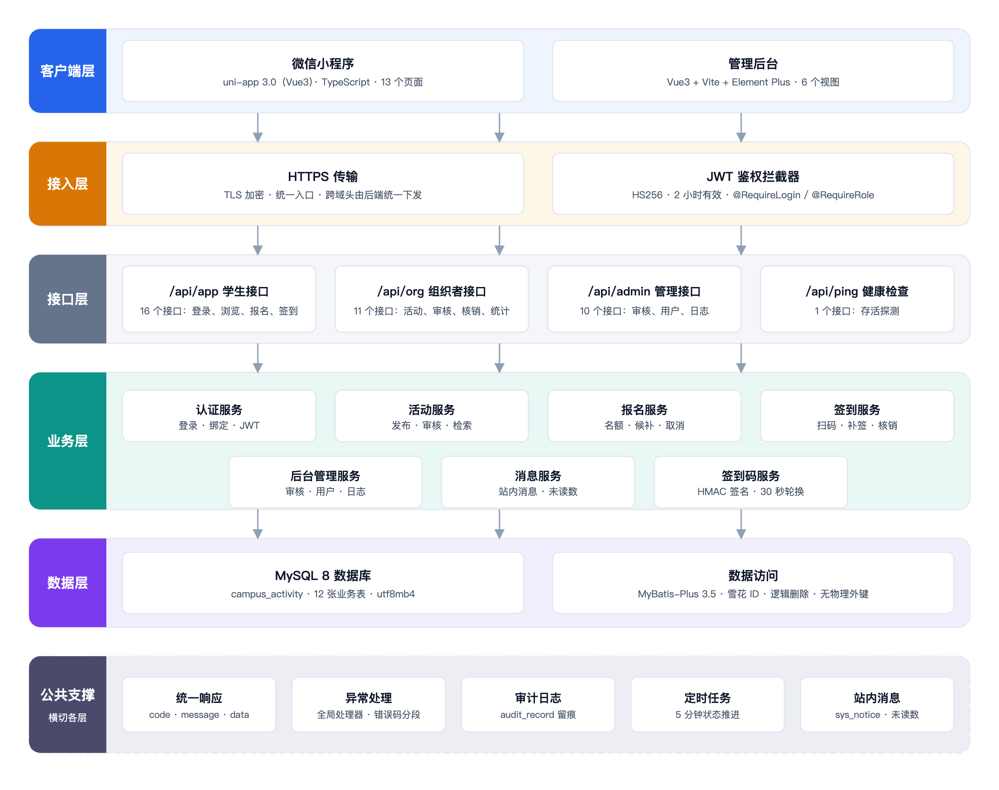

# 校园活动管理平台项目概述与可行性分析报告

| 项 | 内容 |
| --- | --- |
| 文档编号 | CA-DOC-01 |
| 文档名称 | 项目概述与可行性分析报告 |
| 版本 | v1.0 |
| 日期 | 2026-11-09 |
| 对应阶段 | 立项与可行性分析 |
| 编写 | xxx |
| 审核 | 组长 |
| 状态 | 定稿 |

## 版本记录

| 版本 | 日期 | 修订人 | 修订说明 |
| --- | --- | --- | --- |
| v1.0 | 2026-11-09 | 项目组 | 首次编写，覆盖背景、目标、角色、可行性、总体方案、交付验收与风险 |

## 1 背景与痛点

本章回答"为什么要建设校园活动管理平台"。

### 1.1 项目背景

结论：校园活动长期依赖群聊、问卷与纸质表格组织，信息分散、名额与到场情况难以校验，建设一套轻量平台具备明确的现实需求。

高校校园活动由学生会、社团、院系与行政部门分别组织，数量多、周期短、参与人分散。常见组织方式是在班级群或社团群发通知，用群接龙或在线问卷收集报名，用纸质签到表记录到场，再由组织者手工汇总人数。

这种方式在活动规模较小时可以运转。当活动数量增加、名额有限、需要审核与统计时，组织成本与出错概率同步上升：报名名单与签到表对不上、满员后无法排队、补签没有记录、活动发布前缺少统一审核。

V1 的目标不是替代学校的全部活动管理系统，而是用课程设计可完成的规模，把"发现—报名—签到—统计"这条最短闭环跑通，并保留审核、候补、动态签到码等关键机制。

### 1.2 现状与痛点

结论：学生、组织者、管理方三方的痛点集中在信息、名额、到场与数据四个环节。

​											表 1-1 校园活动管理现状与痛点

| 角色 | 现状做法 | 主要痛点 | 影响 |
| --- | --- | --- | --- |
| 学生 | 群通知、群接龙、问卷报名 | 活动分散在多个群；名额是否已满不透明；报名后无凭证 | 错过活动、重复询问 |
| 组织者 | 手工收集名单、纸质签到表 | 名单与签到表对不上；满员后无法排队；补签无记录 | 统计耗时、易出错 |
| 团委/审核方 | 线下报批、事后汇总 | 活动内容无留痕；发布前缺少统一审核；数据口径不一 | 监管与统计成本高 |

### 1.3 建设必要性

结论：统一平台可以同时降低三方成本，并形成可追溯的数据链路。

- 对学生：一个入口完成发现、报名、签到与消息接收，报名状态、名额进度与签到凭证可见。
- 对组织者：在线发布、提交审核、审核报名、动态签到码核销、自动统计，减少手工表格。
- 对管理方：活动发布前统一审核，审核、下架、补签、角色变更留痕，工作台提供汇总指标。

## 2 建设目标与边界

本章回答"V1 做到什么程度、哪些明确不做"。

结论：V1 以"一条完整链路可运行、可演示、可验收"为目标，主动收敛范围，明确 5 项不做。

### 2.1 建设目标

结论：目标按链路、名额、签到、权限、三端五个方面设定，逐项可验证。

​												表 2-1 V1 建设目标

| 编号 | 目标 | 说明 | 验证方式 |
| --- | --- | --- | --- |
| G1 | 全链路闭环 | 学生发现、报名、签到；组织者发布、审核报名、核销；团委审核、统计 | 20 项冒烟断言 |
| G2 | 名额与并发正确 | 条件 UPDATE 占名额，满员转候补，取消后队首转正 | 断言 10～12、18～20 |
| G3 | 签到可验证 | 动态签到码 30 秒轮换，支持扫码、定位校验与手动补签 | 断言 13～17 |
| G4 | 权限与留痕 | 4 类角色按注解与归属校验；关键操作写审计记录 | 权限检查与操作日志 |
| G5 | 三端可运行 | 小程序 13 页、后台 6 视图、后端 38 接口 | 三端启动与冒烟脚本 |

### 2.2 建设边界

结论：以下 5 项明确不在 V1 范围内，避免课程设计范围失控。

​											表 2-2 V1 不做事项与替代做法

| 不做事项 | 原因 | V1 替代做法 |
| --- | --- | --- |
| 支付 | 课程设计不涉及收费活动，接入支付需要商户资质 | 线下缴费或第三方链接，在活动简介中说明 |
| 场地审批 | 学校场地系统不对外开放，审批流程因校而异 | 组织者线下借用场地，在 `location_name`、`address` 填写 |
| 多校区 | 数据模型与权限需按校区隔离，超出本期规模 | 单校区建模，组织与地址为文本字段 |
| 文件上传 | 需要对象存储、鉴权与容量治理 | `cover_url` 仅保存外链字符串，不提供上传接口 |
| 微信订阅消息 | 需要小程序模板 ID 与用户授权 | 仅站内消息；`NoticeSender` 预留出口，未接入模板 ID |

### 2.3 范围小结

结论：V1 范围可概括为：一个后端服务、三个前端入口、12 张数据表、38 个 REST 接口、40 项功能、18 条业务规则，以 20 项端到端断言作为功能验收底线。

## 3 用户与角色

本章回答"谁在使用系统、各自能做什么、权限如何划分"。

结论：系统设 4 类角色，一个用户只持一个角色，权限由入口、注解与数据归属三层共同约束。

### 3.1 角色定义

结论：4 类角色对应三个入口，职责与认证方式各不相同。

​												表 3-1 角色定义

| 角色 | 入口 | 认证方式 | 核心诉求 |
| --- | --- | --- | --- |
| STUDENT 学生 | 小程序 | 微信登录（dev 模式使用 mock openid） | 发现活动、报名、取消、签到、消息 |
| ORGANIZER 组织者 | 小程序 | 同学生，角色为 ORGANIZER 且绑定组织 | 发布本组织活动、审核报名、核销、统计 |
| REVIEWER 审核员 | 管理后台 | 账号密码 | 审核活动、管理活动、查看日志与工作台 |
| ADMIN 管理员 | 管理后台 | 账号密码 | 全部后台能力，含用户角色变更与组织列表 |

### 3.2 权限边界

结论：角色权限按能做与不能做划清边界，越权操作由接口层与服务层双重拦截。

​												表 3-2 角色权限边界

| 角色 | 能做 | 不能做 |
| --- | --- | --- |
| 学生 | 浏览、报名、取消、签到、消息、收藏 | 发布活动、审核、登录后台 |
| 组织者 | 本组织活动增删改、提审、报名审核、签到核销、统计 | 审核活动发布、管理用户 |
| 审核员 | 活动审核、活动管理、查看日志与工作台 | 修改用户角色 |
| 管理员 | 全部后台能力，含角色变更、组织列表 | — |

### 3.3 账号形态与角色关系

结论：学生与组织者共用一张用户表，审核员与管理员使用后台账号，角色变更由管理员执行并留痕。

- `sys_user` 承载 4 类角色，`role` 字段区分；后台账号的 `open_id` 以 `admin:<username>` 占位。
- 组织者通过 `org_id` 绑定组织；未绑定组织的账号不能发布活动（返回 10002）。
- 角色变更仅管理员可执行（API-10），写入 `audit_record`（`USER` / `ROLE_CHANGE`）。
- 权限实现为 `@RequireLogin` 校验登录、`@RequireRole` 校验角色，服务层再校验"活动创建人 = 当前用户或管理员"。

## 4 可行性分析

本章回答"技术上能否实现、成本与进度是否可接受"。

结论：技术、经济、操作、进度四个维度均可行，主要风险集中在演示环境与数据时间基准。

### 4.1 技术可行性

结论：技术栈均为成熟开源方案，版本已在工程中固定，具备实现与调试条件。

​											表 4-1 技术栈与版本

| 组件 | 版本 | 用途 | 可行性说明 |
| --- | --- | --- | --- |
| JDK | 21 | 运行后端 | Spring Boot 4 要求 17 以上，本机满足 |
| Spring Boot | 4.1.1 | 后端框架 | 提供 Web、参数校验、事务、定时任务 |
| MyBatis-Plus | 3.5.18.1 | 持久层 | 使用 `mybatis-plus-spring-boot4-starter` 适配 Boot 4 |
| MySQL | 8.0+ | 数据库 | 本机 3306，库名 `campus_activity`，utf8mb4 |
| uni-app | 3.0.0-5020620260917001 | 小程序 | Vue3 版，一套代码可输出微信小程序与 H5 |
| TypeScript | 5.9 | 前端类型 | 使用 `vue-tsc` 做类型检查 |
| Vue3 + Vite + Element Plus | — | 管理后台 | 组件库覆盖表格、表单等后台常用场景 |
| Node.js | 18+（实测 22） | 前端构建 | 依赖使用 pnpm 安装 |
| JWT（HS256） | 有效期 2 小时 | 鉴权 | 无状态令牌，适合三端共用同一后端 |
| springdoc OpenAPI | — | 接口文档 | 访问 `/swagger-ui.html` 查看全部接口 |

技术风险点已识别并有对应措施：Spring Boot 4 与 MyBatis-Plus 的 starter 必须匹配，工程采用官方 Boot 4 适配包；微信登录在 dev 模式下用 mock openid 绕过真实 AppID，降低课堂演示的外部依赖。

### 4.2 经济可行性

结论：增量成本接近零，主要投入为开发人力与已有设备。

​												表 4-2 成本构成

| 成本项 | 说明 | 增量成本 |
| --- | --- | --- |
| 开发设备 | 使用现有笔记本电脑 | 0 |
| 软件许可 | JDK、Spring Boot、MySQL、Vue、uni-app 等均为开源 | 0 |
| 数据库 | 本机 MySQL 实例，无需云数据库 | 0 |
| 小程序账号 | 开发与课堂演示使用 dev 模式，不依赖真实 AppID | 0 |
| 部署 | 本机或校内服务器即可运行 | 0（设备已有） |

### 4.3 操作可行性

结论：三端操作路径短，学生与组织者无需专门培训即可完成核心动作。

​												表 4-3 关键操作路径

| 角色 | 关键操作 | 路径 | 说明 |
| --- | --- | --- | --- |
| 学生 | 报名 | 首页/活动列表 → 活动详情 → 确认报名 | 有自定义表单时进入填写页 |
| 学生 | 签到 | 我的 → 扫码签到 → 扫描签到码 | 也可在签到核销页复制签到码 |
| 组织者 | 发布活动 | 工作台 → 发布活动 → 填写信息 → 提交审核 | 保存后为草稿，需提审 |
| 审核员 | 审核活动 | 活动审核 → 通过/驳回 | 驳回需填写理由 |
| 管理员 | 角色变更 | 用户管理 → 选择角色/组织 | 组织者必须选择组织 |

### 4.4 进度可行性

结论：按两周课程设计周期安排，关键路径为"数据库与后端主链路 → 前端联调 → 冒烟验收"。

​													表 4-4 阶段计划

| 阶段 | 主要工作 | 里程碑 | 计划日期 |
| --- | --- | --- | --- |
| 需求分析 | 流程调研、角色与范围、功能清单、业务规则 | M1 需求基线冻结 | 11-09 ~ 11-10 |
| 概要/详细设计 | 架构、模块、12 表、38 接口、关键流程 | M2 设计评审通过 | 11-10 ~ 11-12 |
| 编码实现 | 后端接口与业务规则、小程序 13 页、后台 6 视图 | M3 主链路联调通过 | 11-12 ~ 11-17 |
| 联调测试 | 端到端联调、20 项冒烟、并发与安全专项 | M4 冒烟 20 项全部通过 | 11-18 ~ 11-19 |
| 文档与答辩 | 文档定稿、图表终检、答辩演练 | M5 文档定稿与答辩 | 11-18 ~ 11-20 |
| 合计 | — | — | 2026-11-09 ~ 11-20（10 个工作日） |

### 4.5 可行性结论

结论：四个维度均可行，V1 可以进入设计阶段。

​												表 4-5 可行性结论

| 维度 | 结论 | 关键依据 |
| --- | --- | --- |
| 技术 | 可行 | 版本固定、开源成熟、已有接口冒烟测试与端到端脚本 |
| 经济 | 可行 | 无增量采购，使用现有设备与开源软件 |
| 操作 | 可行 | 三端路径短，演示账号与白名单已预置 |
| 进度 | 可行 | 两周（10 个工作日）内可完成，关键路径清晰，阶段里程碑可检查 |

## 5 总体方案

本章回答"系统由哪些部分组成、如何支撑业务链路"。

结论：系统采用"一个后端服务、三个前端入口"的形态，38 个接口、12 张表支撑一条完整业务链路。

### 5.1 总体架构

结论：系统采用五层结构，客户端为微信小程序与管理后台，学生端与组织者端共用小程序。

系统分为接入层、接口层、业务层、数据层与公共支撑五部分。三个入口共享同一套接口、表与权限：微信小程序承载学生端与组织者工作台，Web 管理后台承载审核员与管理员。总体架构如图 1-1 所示。

​													图 1-1 系统总体架构图

图中自上而下依次为客户端层（小程序、管理后台）、接入层、接口层、业务层与数据层，公共支撑（鉴权、统一响应、异常处理、定时任务、审计与消息）由接口层与业务层共同复用。

​														表 5-1 分层职责

| 层次 | 职责 | 代表实现 |
| --- | --- | --- |
| 接入层 | 小程序、管理后台、接口调试入口 | 13 个小程序页面、6 个后台视图、Swagger UI |
| 接口层 | 路由、参数校验、权限注解、统一响应 | `controller/**`、`Result`、`PageResult` |
| 业务层 | 业务规则、状态流转、事务、审计与消息 | `service/**`、`enums/**`、`job/**` |
| 数据层 | 表映射、分页、条件更新、逻辑删除 | `mapper/**`、`schema.sql` |
| 公共支撑 | JWT 鉴权、全局异常、时间格式、配置 | `security/**`、`common/**`、`config/**` |

### 5.2 功能组成

结论：40 项功能归入 4 组：学生端 13 项、组织者端 11 项、管理后台 10 项、系统级 6 项。

​													表 5-2 功能组成

| 功能组 | 功能编号区间 | 数量 | 承载入口 |
| --- | --- | --- | --- |
| 学生端 | FR-S-01～FR-S-13 | 13 | 微信小程序 |
| 组织者端 | FR-O-01～FR-O-11 | 11 | 小程序组织者工作台 |
| 管理后台 | FR-A-01～FR-A-10 | 10 | Web 管理后台 |
| 系统级 | FR-SYS-01～FR-SYS-06 | 6 | 后端定时任务与公共组件 |
| 合计 | — | 40 | — |

功能明细、业务规则与验收标准见 [02 需求规格说明书](02-需求规格说明书.md)。

### 5.3 关键设计决策

结论：V1 的 6 项关键决策围绕"名额不超卖、签到不可伪造、状态不靠人工"展开。

​												表 5-3 关键设计决策

| 决策 | 做法 | 解决的问题 |
| --- | --- | --- |
| 名额占用 | 单条条件 UPDATE `signed_count < capacity`，影响行数为 0 即满员 | 避免"先查后写"导致超卖 |
| 重复报名 | `uk_activity_user` 唯一索引 + 状态判断双重拦截 | 并发重复提交 |
| 动态签到码 | `HMAC-SHA256(activityId:slice)` 取前 16 位，30 秒一片，容错 2 片，不落库 | 截图转发与串码 |
| 状态推进 | 7 态枚举 + 每 5 分钟定时任务，结束后自动标记未到场 | 减少人工改状态 |
| 主键与删除 | 雪花 ID（`assign_id`）+ 逻辑删除（`deleted`） | 分布式唯一 ID、数据可追溯 |
| 统一契约 | `Result{code,message,data}` + 分段错误码 + 全局异常处理 | 三端一致的错误处理 |

### 5.4 规模与工作量

结论：V1 规模在课程设计可交付范围内，后端 83 个 Java 文件、前端 5438 行。

​												表 5-4 项目规模

| 指标 | 数值 | 口径 |
| --- | --- | --- |
| 后端 Java 主代码 | 83 个文件 | `server/src/main/java` |
| 后端测试类 | 1 个 | `ApiSmokeTest` |
| REST 接口 | 38 个 | 5 个控制器组 |
| 数据表 | 12 张 | `schema.sql` |
| 实体 / Mapper / DTO / VO / Service | 12 / 12 / 10 / 9 / 8 | 按包内文件数 |
| 小程序页面 | 13 个 | `app/src/pages.json` |
| 管理后台视图 | 6 个 | `admin/src/views` |
| 前端 TS/Vue 代码 | 5438 行 | `app/src` + `admin/src` |
| 角色 / 活动状态 / 报名状态 | 4 / 7 / 7 | 枚举与字典 |
| 冒烟断言 | 20 项 | `scripts/smoke.sh` |
| 项目文档 / 图 | 12 份 / 20 张 | `docs/项目文档/`、`docs/diagrams/` |

## 6 交付物与验收

本章回答"交付什么、怎样判定验收通过"。

结论：交付物由代码、数据库脚本、文档与图、冒烟脚本四部分组成，以 20 项断言作为功能验收底线。

### 6.1 交付物清单

结论：交付物分为代码、数据脚本、文档与图、验证脚本四类。

​											表 6-1 交付物清单

| 类别 | 内容 | 数量与位置 |
| --- | --- | --- |
| 后端源码 | Spring Boot 工程 | 83 个 Java 文件，`server/` |
| 数据库脚本 | 建表脚本与演示数据 | `schema.sql`、`data.sql` |
| 小程序 | 学生端与组织者工作台 | 13 页，`app/src` |
| 管理后台 | 审核、活动、用户、日志 | 6 视图，`admin/src` |
| 项目文档 | 00～11 共 12 份 | `docs/项目文档/` |
| 设计图 | D01～D20 | 20 张，`docs/diagrams/out/` |
| 运行截图 | 05/07/08/09 的真实运行截图 | 27 张，`docs/screenshots/` |
| 界面截图 | 学生端、组织者端、管理后台实际界面 | 19 张界面 PNG + 4 张联调 webp，`docs/screenshots/` |
| 冒烟脚本 | 端到端断言 | 20 项，`scripts/smoke.sh` |

### 6.2 验收标准

结论：功能验收以 20 项冒烟断言为唯一可执行底线，全部通过视为主链路达标。

运行方式：后端启动后直接执行 `./scripts/smoke.sh`。脚本默认地址为 `http://127.0.0.1:8016/api`，与服务端口一致；换端口时用 `BASE=http://127.0.0.1:<端口>/api ./scripts/smoke.sh` 覆盖。

​												表 6-2 20 项冒烟断言

| 序号 | 断言 | 预期结果 | 覆盖功能/规则 |
| --- | --- | --- | --- |
| 1 | 学生 A 登录拿到 token | true | FR-S-01 |
| 2 | 学生 A 绑定学号 | 0 | FR-S-02 |
| 3 | 学生 B 登录拿到 token | true | FR-S-01 |
| 4 | 学生 B 绑定学号 | 0 | FR-S-02 |
| 5 | 创建活动返回 id | 0 | FR-O-03 |
| 6 | 提交审核 | 0 | FR-O-05 |
| 7 | 管理员登录 | true | FR-A-01 |
| 8 | 待审核列表包含新活动 | 待审核 | FR-A-03 |
| 9 | 审核通过 | 0 | FR-A-04 |
| 10 | 学生 A 报名成功 | 报名成功 | FR-S-07 |
| 11 | 学生 A 重复报名被拒绝 | 30002 | BR-06 |
| 12 | 学生 B 名额满后进入候补 | 候补中 | BR-04 |
| 13 | 获取签到码 | 0 | FR-O-09 |
| 14 | 签到码轮换周期 30 秒 | 30 | FR-SYS-01 |
| 15 | 学生 A 签到成功 | 0 | FR-S-11 |
| 16 | 重复签到被拒绝 | 40003 | BR-11 |
| 17 | 伪造签到码被拒绝 | 40001 | BR-17 |
| 18 | 已签到人数为 1 | 1 | FR-O-11 |
| 19 | 候补人数为 1 | 1 | FR-O-11 |
| 20 | 到场率 100 | 100 | FR-O-11 |

### 6.3 验收判定

结论：满足以下 4 条即判定 V1 验收通过。

1. 功能：20 项冒烟断言全部通过。
2. 数据：`schema.sql` 与 `data.sql` 按顺序可重复导入，12 张表结构一致。
3. 三端：后端可启动、小程序 H5 正常渲染、管理后台可登录并展示后端真实数据。
4. 文档：12 份文档齐全，图引用路径有效，数字、接口与状态与写作基线一致。

以下内容不纳入 V1 验收：支付、场地审批、多校区、文件上传、微信订阅消息。

## 7 风险与对策

本章回答"项目存在哪些风险、如何应对"。

结论：V1 风险总体可控，需重点管理进度、演示环境、并发正确性与数据时间基准。

​												表 7-1 风险登记

| 编号 | 风险 | 类别 | 概率 | 影响 | 对策 |
| --- | --- | --- | --- | --- | --- |
| R-01 | 课程设计周期紧张，前后端联调延期 | 进度 | 中 | 高 | 先完成后端主链路与冒烟脚本，前端按页面分批联调 |
| R-02 | 微信登录依赖真实 AppID 与备案域名 | 技术 | 中 | 中 | dev 模式使用 mock openid；生产切换 `jscode2session`，代码已预留 |
| R-03 | 并发抢名额导致超卖 | 技术 | 低 | 高 | 条件 UPDATE 占位 + 唯一索引 + 事务，不做先查后写 |
| R-04 | 签到码被截图转发代签 | 安全 | 中 | 中 | 30 秒轮换、容忍 2 片；类型 2 叠加 200 米定位校验 |
| R-05 | 演示数据时间过期，活动状态不符合预期 | 数据 | 高 | 中 | `data.sql` 以执行当天为基准，演示前重新导入 |
| R-06 | Spring Boot 4 与 MyBatis-Plus 版本不匹配 | 技术 | 低 | 中 | 使用 `mybatis-plus-spring-boot4-starter` 3.5.18.1 |
| R-07 | 文档与源码口径不一致 | 管理 | 中 | 中 | 以写作基线为唯一事实源，交付前统一核对数字、接口与状态 |
| R-08 | 学籍白名单维护依赖人工 SQL | 运维 | 中 | 低 | V1 由 `data.sql` 预置；后台导入能力列入待确认事项 |

## 8 待确认事项

本章回答"还有哪些事项需要确认与后续明确"。

1. 微信订阅消息模板 ID 与正式 AppID、AppSecret 尚未配置。V1 仅站内消息，`NoticeSender` 为预留出口，未接入模板 ID。
2. 生产环境部署参数（域名、HTTPS 证书、MySQL 账号与备份策略）尚未确定。
3. 学籍白名单目前由 `data.sql` 预置或运维直接导入；`schema.sql` 注释提及"管理员 Excel 导入"，V1 未提供后台导入接口，后续是否补充需确认。
