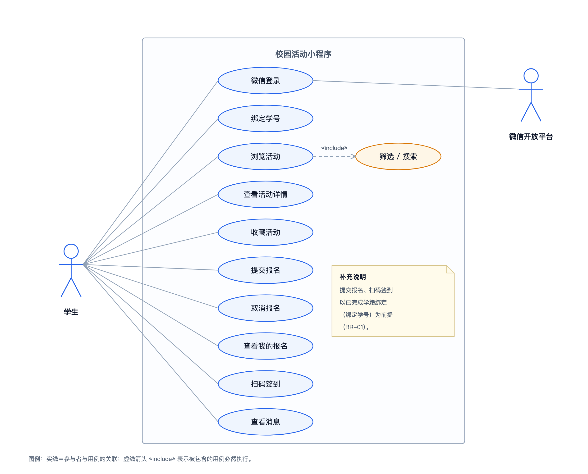
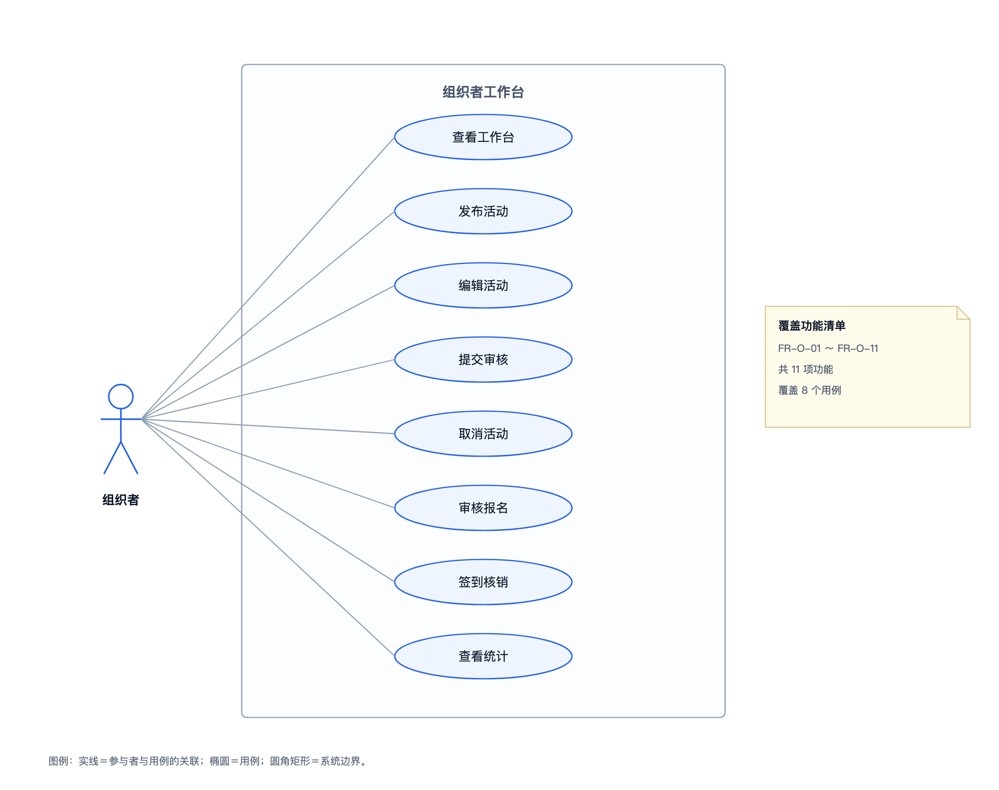
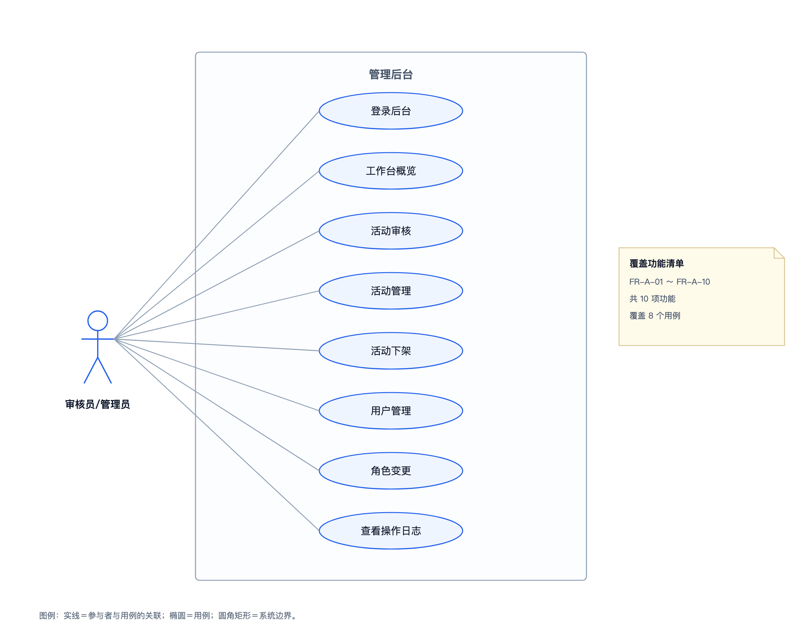
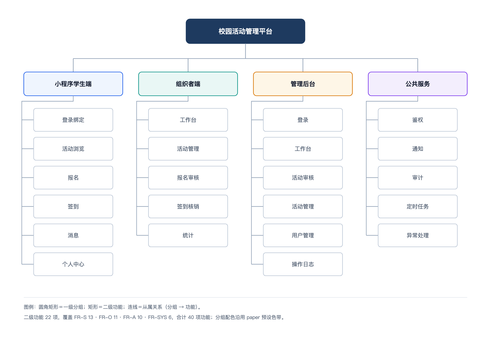
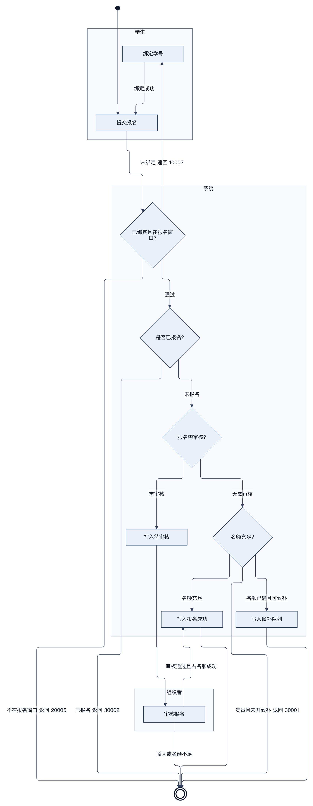

# 校园活动管理平台需求规格说明书

| 项 | 内容 |
| --- | --- |
| 文档编号 | CA-DOC-02 |
| 文档名称 | 需求规格说明书 |
| 版本 | v1.0 |
| 日期 | 2026-11-20 |
| 对应阶段 | 需求分析 |
| 编写 | 项目组 |
| 审核 | 指导教师 |
| 状态 | 定稿 |

## 版本记录

| 版本 | 日期 | 修订人 | 修订说明 |
| --- | --- | --- | --- |
| v1.0 | 2026-11-20 | 项目组 | 首次编写，覆盖 4 类角色、40 项功能、18 条规则、非功能需求、数据与接口需求及验收标准 |

## 1 引言

本章回答"本文档写什么、依据什么、给谁看、用什么术语"。

### 1.1 编写目的

结论：本文档定义校园活动管理平台 V1 的功能边界、业务规则、质量要求、数据与接口需求及验收口径，作为设计、实现、测试与验收的共同依据。

具体用途包括：为概要设计与详细设计提供输入；为接口设计提供功能到接口的映射；为测试报告提供用例与断言来源；为验收提供可执行标准。文档中的编号（功能 `FR-*`、规则 `BR-*`、接口 `API-*`、数据表 `T-*`）在全套文档中唯一且固定。

### 1.2 文档范围

结论：本文档覆盖 V1 全部已实现需求，不覆盖 5 项明确排除的内容。

覆盖范围：学生端 13 项（FR-S-01～FR-S-13）、组织者端 11 项（FR-O-01～FR-O-11）、管理后台 10 项（FR-A-01～FR-A-10）、系统级 6 项（FR-SYS-01～FR-SYS-06），共 40 项功能；18 条业务规则；12 张数据表；38 个 REST 接口；20 项验收断言。

不覆盖范围：支付、场地审批、多校区、文件上传、微信订阅消息。该 5 项在 [01 项目概述与可行性分析报告](01-项目概述与可行性分析报告.md) 第 2.2 节已说明原因与替代做法，本文档不再展开。

### 1.3 读者对象

结论：不同读者按职责关注不同章节，无需通读全文。

表 1-1 读者与关注点

| 读者 | 关注内容 | 建议章节 |
| --- | --- | --- |
| 指导教师/评审 | 需求是否完整、边界是否清晰、验收是否可执行 | 1、2、3、8 |
| 后端开发 | 功能流程、业务规则、接口与数据约束 | 3、4、6、7 |
| 前端开发 | 角色功能、页面承载、交互与异常提示 | 3、5、7 |
| 测试人员 | 业务规则、状态字典、验收断言与追踪关系 | 4、6、7、8 |
| 文档维护者 | 编号体系、术语与事实口径 | 1.4、4、6 |

### 1.4 术语与缩略语

结论：全文术语以写作基线为准，同一概念不混用同义词。

表 1-2 术语表

| 术语 | 英文/代码 | 含义 |
| --- | --- | --- |
| 用户 | `sys_user` | 学生、组织者、后台账号共用一张表，用 `role` 区分 |
| 学籍档案 | `student_profile` | 绑定成功后写入的学号、姓名、学院、年级、专业 |
| 学籍白名单 | `student_whitelist` | 管理员预置的学号名单，绑定校验依据 |
| 组织 | `organization` | 社团、院系、部门，活动主办方 |
| 活动 | `activity` | 一次可报名的校园活动，含时间、场地、名额、签到方式 |
| 报名记录 | `activity_signup` | 一个用户对一场活动的唯一报名记录 |
| 签到记录 | `activity_checkin` | 一次实际签到，与报名记录一对一 |
| 名额占用 | `signed_count` | 活动已占用的名额数，报名成功、已签到、未到场均占用 |
| 候补 | waitlist | 满员后按序号排队，有人取消时队首转正 |
| 签到码 | checkin token | HMAC 签名的动态二维码内容，30 秒轮换，不落库 |
| 核销 | check-in | 组织者展示签到码、学生扫码或组织者手动补签的过程 |
| 未到场 | `NO_SHOW` | 活动结束后，报名成功但未签到的记录 |
| 时间片 | slice | 签到码的 30 秒有效期单位 |
| 逻辑删除 | `deleted` | 0 正常、1 删除，MyBatis-Plus 自动过滤 |
| 雪花 ID | `assign_id` | 应用层生成的 BIGINT 主键，非自增 |
| 审计记录 | `audit_record` | 审核、下架、补签、角色变更等操作的留痕 |

### 1.5 参考资料

结论：参考资料以写作基线为核心，源码与脚本用于核对事实口径。

表 1-3 参考资料

| 编号 | 名称 | 位置 | 用途 |
| --- | --- | --- | --- |
| R-01 | 项目文档写作基线 v1.0 | `docs/项目文档/_写作基线.md` | 数字、接口、状态、术语的唯一事实来源 |
| R-02 | 项目文档总览与图表索引 | `docs/项目文档/00-文档总览与图表索引.md` | 文档体系与图索引 |
| R-03 | 数据库结构与演示数据 | `server/src/main/resources/db/schema.sql`、`data.sql` | 12 张表字段与种子数据 |
| R-04 | 后端配置 | `server/src/main/resources/application.yml` | 端口、数据源、JWT、签到参数 |
| R-05 | 项目说明 | `README.md` | 技术版本、启动方式、演示账号 |
| R-06 | 端到端冒烟脚本 | `scripts/smoke.sh` | 20 项验收断言 |
| R-07 | 项目概述与可行性分析报告 | `docs/项目文档/01-项目概述与可行性分析报告.md` | 背景、边界与总体方案 |

## 2 总体描述

本章回答"产品是什么形态、谁在使用、在哪运行、受哪些约束"。

### 2.1 产品视角

结论：产品是"一个后端服务 + 三个前端入口"的校园活动管理平台，三端共享同一套账号、权限、数据与业务规则。

三个入口分别是：微信小程序学生端（浏览、报名、签到、消息）、同一小程序内的组织者工作台（发布、审核报名、核销、统计）、Web 管理后台（审核活动、管理活动与用户、查看日志）。后端对外提供 38 个 REST 接口，数据落在 MySQL 的 12 张表中。

系统外部依赖只有两项：微信登录接口（生产环境走 `jscode2session`，开发模式用 mock openid 绕过）与 MySQL 数据库。系统不依赖支付平台、场地系统、对象存储或第三方消息服务。

表 2-1 三个入口

| 入口 | 使用者 | 核心能力 | 认证方式 |
| --- | --- | --- | --- |
| 微信小程序学生端 | 学生 | 浏览、报名、取消、收藏、扫码签到、消息、个人中心 | 微信登录后签发 JWT |
| 小程序组织者工作台 | 组织者 | 工作台、活动增删改、提审、报名审核、签到码、补签、统计 | 同学生，角色为 ORGANIZER |
| Web 管理后台 | 审核员、管理员 | 登录、工作台、活动审核、活动管理、用户管理、操作日志 | 账号密码 + BCrypt |

### 2.2 用户特征

结论：四类用户的身份来源、使用频次与技能假设差异明显，需求按角色分层设计。

表 2-2 用户特征

| 角色 | 身份来源 | 使用频次 | 技能假设 | 关键诉求 |
| --- | --- | --- | --- | --- |
| 学生 | 微信登录后绑定学籍 | 高，活动季集中 | 会使用小程序、会扫码 | 快速找到活动并完成报名、拿签到凭证 |
| 组织者 | 学生骨干、社团或院系负责人 | 中，活动前后集中 | 能填写表单、查看名单 | 少手工表格、能控名额、能核销与统计 |
| 审核员 | 团委老师或学生干部 | 低，按提交节奏 | 熟悉后台表格操作 | 快速审核、留痕、可追溯 |
| 管理员 | 团委或信息化管理人员 | 低，按需 | 熟悉账号与角色管理 | 统一管理用户角色与组织归属 |

### 2.3 运行环境

结论：后端、小程序、管理后台各自有明确的运行环境与版本要求，开发与演示可全部在本机完成。

表 2-3 运行环境

| 端 | 运行环境 | 关键要求 |
| --- | --- | --- |
| 后端 | JDK 21、Spring Boot 4.1.1、MyBatis-Plus 3.5.18.1 | MySQL 8.0+，库名 `campus_activity`，utf8mb4 |
| 小程序 | uni-app 3.0 + Vue3 + TypeScript 5.9 + Vite | H5 预览端口 5174；微信开发者工具可调试 |
| 管理后台 | Vue3 + Vite + Element Plus | 端口 5173；Chrome/Edge 等现代浏览器 |
| 数据库 | MySQL 8.0+ | 本机 3306，字符集 utf8mb4，无物理外键 |
| 构建与联调 | Node.js 18+（实测 22）、pnpm | 前端依赖用 pnpm 安装 |

部署拓扑、启动命令与环境变量见 [08 部署与运维手册](08-部署与运维手册.md)；接口调试入口为 `http://127.0.0.1:8016/swagger-ui.html`。

### 2.4 约束与假设

结论：V1 的可用性依赖 6 条前提，超出前提的场景不在本期需求内。

表 2-4 约束与假设

| 编号 | 约束/假设 | 影响 |
| --- | --- | --- |
| C-01 | 单校区、统一使用 `Asia/Shanghai` 时区 | 不做校区隔离，时间统一按服务器时间判断 |
| C-02 | 学籍白名单由管理员预置，一个学号只能绑定一个微信 | 绑定校验依赖白名单，未在名单内的学号无法报名 |
| C-03 | 活动归属组织，组织者账号必须绑定 `org_id` | 未绑定组织的账号不能发布活动 |
| C-04 | 报名窗口、取消截止、签到窗口均以服务器时间为准 | 客户端时间不参与判断 |
| C-05 | 不提供支付、场地审批、多校区、文件上传、订阅消息 | 相关字段只保留文本或外链，不提供对应接口 |
| C-06 | 开发与演示使用 dev 模式 mock openid，生产需配置 AppID/AppSecret | 生产登录链路的联调需真实小程序资质 |

## 3 功能需求

本章回答"系统有哪些功能、由谁触发、需要什么前置条件、主流程与异常如何处理"。

### 3.1 角色-功能矩阵

结论：功能按角色划分清晰，学生与组织者在小程序内完成活动侧操作，审核员与管理员在后台完成审核与治理。

表 3-1 角色-功能矩阵（✓ 表示可用，— 表示不可用）

| 功能域 | STUDENT 学生 | ORGANIZER 组织者 | REVIEWER 审核员 | ADMIN 管理员 |
| --- | --- | --- | --- | --- |
| 浏览、搜索、活动详情 | ✓ | ✓ | ✓ | ✓ |
| 收藏活动 | ✓ | ✓ | — | — |
| 报名、取消报名 | ✓ | ✓ | — | — |
| 扫码签到 | ✓ | — | — | — |
| 消息、个人资料 | ✓ | ✓ | — | — |
| 活动发布、编辑、提审、取消 | — | ✓ | — | ✓（跨组织管理） |
| 报名名单、报名审核 | — | ✓ | — | ✓（跨组织管理） |
| 签到码、手动补签、活动统计 | — | ✓ | — | ✓（跨组织管理） |
| 活动审核、活动下架 | — | — | ✓ | ✓ |
| 后台工作台、操作日志 | — | — | ✓ | ✓ |
| 用户列表、角色变更 | — | — | — | ✓ |
| 组织列表 | — | — | — | ✓ |

注：管理员可跨组织管理活动，但新建活动仍要求账号绑定组织（`org_id` 为空返回 10002）。

### 3.2 学生端功能需求（FR-S-01～FR-S-13）

结论：学生端 13 项功能构成"登录绑定—发现活动—报名—签到—消息"的完整闭环。

学生端由微信小程序承载，13 项功能覆盖 10 个用例。用例之间的关系与系统边界如图 2-1 所示。



图 2-1 学生用例图

图中学生与"浏览活动、报名活动、取消报名、签到、查看消息、收藏"等用例交互，报名与签到依赖"绑定学号"用例，体现先绑定后参与的业务前提。

表 3-2 学生端功能需求

| 编号 | 功能 | 触发者 | 前置条件 | 主流程 | 异常与处理 |
| --- | --- | --- | --- | --- | --- |
| FR-S-01 | 微信登录 | 未登录用户 | 小程序启动或触发需登录的操作 | 提交 `devOpenId`（生产为微信 `code`）→ 按 openid 查询用户，不存在则创建 STUDENT 账号 → 校验账号状态 → 签发 2 小时 JWT → 返回 token、needBind 与用户信息 | 10006 账号禁用；50001 缺少参数；生产模式微信接口失败返回 10001 |
| FR-S-02 | 学号绑定 | 已登录学生 | 登录返回 needBind=true，且学号存在于白名单 | 输入学号 → 与白名单比对 → 校验该学号未被其他微信绑定 → 写入学籍档案（缺省字段取白名单）→ 白名单 `used_flag=1` | 10004 学号不在名单；10005 学号已被绑定 |
| FR-S-03 | 首页 | 学生/访客 | 打开小程序首页 | 并行获取活动分类（API-14）、热门活动（API-16）、即将开始列表（API-15）→ 渲染问候语、分类入口、热门活动与即将开始 | 请求失败展示空列表，可下拉刷新重试 |
| FR-S-04 | 活动列表 | 学生/访客 | 进入全部活动页 | 按分类、关键字、时间范围（今天/本周/本月/已结束）与热度排序组合查询 → 分页返回 | 无匹配返回空分页；50001 参数错误 |
| FR-S-05 | 活动详情 | 学生/访客 | 从列表或首页进入详情 | 查询活动详情与分类名、组织名 → 浏览量 +1 → 登录用户附带我的报名状态、是否收藏与按钮文案（`actionText`） | 20001 活动不存在 |
| FR-S-06 | 收藏/取消收藏 | 已登录学生 | 已登录并打开活动详情 | 按活动与用户查询收藏 → 不存在则插入并 `favorite_count+1`，存在则删除并 `favorite_count-1` → 返回当前收藏状态 | 20001 活动不存在；并发重复插入由唯一索引兜底 |
| FR-S-07 | 提交报名 | 已登录学生 | 已绑定学籍；活动为 PUBLISHED 且在报名窗口内 | 校验绑定与活动状态 → 查询历史报名，已取消或审核未通过可重新报名 → 需审核则置 PENDING；否则条件 UPDATE 占名额成功置 SUCCESS，满员且开启候补置 WAITLIST → 生成 `signup_no`、保存 `form_data` → 发站内消息 | 10003 未绑定；20001/20005；30002 重复报名；30001 满员且未开候补；并发由唯一索引兜底 |
| FR-S-08 | 报名结果 | 已登录学生 | 报名提交完成 | 返回报名状态与状态文案；学生可在"我的报名"查看；同时写入报名成功、待审核或候补消息 | 同 FR-S-07 |
| FR-S-09 | 我的报名 | 已登录学生 | 进入"我的报名" | 按状态筛选分页查询本人报名 → 关联活动信息 → 展示状态与签到凭证号 `signup_no` | 无记录返回空分页 |
| FR-S-10 | 取消报名 | 已登录学生 | 报名状态为 PENDING/SUCCESS/WAITLIST，且未超过取消截止时间 | 校验记录归属与状态 → 校验 `cancel_deadline` → 置 CANCELLED 并记录 `cancel_time` → 占用名额则释放并触发候补转正 → 发消息 | 30003 记录不存在；30006 状态不支持；30004 超过取消截止 |
| FR-S-11 | 扫码签到 | 已登录学生 | 处于签到窗口（开始前 30 分钟至结束后 30 分钟） | 提交签到码与定位 → 校验 token 与时间片 → 活动存在且非"仅手动" → 已报名、未签到、状态为 SUCCESS → 类型 2 校验 200 米范围 → 写签到记录并将报名置为 CHECKED_IN | 40001/40004/40002/40003/40005 |
| FR-S-12 | 消息 | 已登录用户 | 进入消息页 | 分页查询本人消息 → 查询未读数 → 标记已读（传 ids 部分已读，不传表示全部已读） | 无消息返回空列表；10001 未登录 |
| FR-S-13 | 个人中心 | 已登录用户 | 进入"我的" | 返回昵称、角色、学籍信息与组织名；提供我的报名、扫码签到、消息入口；组织者额外显示工作台入口；支持切换测试身份 | 10001 未登录；未绑定时提示前往绑定 |

### 3.3 组织者端功能需求（FR-O-01～FR-O-11）

结论：组织者端 11 项功能覆盖活动全生命周期管理、报名审核、签到核销与统计。

组织者工作台位于同一小程序内，11 项功能覆盖 8 个用例。组织者与系统的交互边界如图 2-2 所示。



图 2-2 组织者用例图

图中组织者可发布与编辑本组织活动、提交审核、审核报名、展示签到码、手动补签并查看统计，所有写操作均受"活动创建人 = 当前用户"的归属校验约束。

表 3-3 组织者端功能需求

| 编号 | 功能 | 触发者 | 前置条件 | 主流程 | 异常与处理 |
| --- | --- | --- | --- | --- | --- |
| FR-O-01 | 工作台 | 组织者/管理员 | 进入组织者工作台 | 查询当前用户创建的活动（最多 100 条）→ 统计活动总数、已发布数、待审核数、报名合计 → 返回概览 | 无活动时各项为 0 |
| FR-O-02 | 活动列表 | 组织者/管理员 | 进入活动管理 | 按状态分页查询当前用户创建的活动，按创建时间倒序 | 空分页 |
| FR-O-03 | 新建活动 | 组织者/管理员 | 账号已绑定组织（`org_id` 非空） | 校验标题与时间：开始早于结束、报名开始不晚于报名结束且报名结束不晚于活动开始、取消截止不晚于活动开始（缺省开始前 2 小时）→ 存为草稿 DRAFT，自动写入创建人与组织 | 10002 未绑定组织；20004 时间不合理；50001 参数错误 |
| FR-O-04 | 编辑活动 | 组织者/管理员 | 自己创建的活动，且不为 FINISHED/CANCELLED | 校验归属与状态 → 重新校验时间 → 更新字段 → 原为 PUBLISHED/ONGOING 时回到 PENDING | 20003 非本人活动；20002 状态不支持 |
| FR-O-05 | 提交审核 | 组织者/管理员 | 活动为 DRAFT 或 REJECTED | 校验归属与状态 → 置 PENDING，清空驳回原因 | 20002 状态不支持；20003 非本人活动 |
| FR-O-06 | 取消活动 | 组织者/管理员 | 自己创建的活动且未取消 | 置 CANCELLED、记录原因 → 写审计记录（ACTIVITY/CANCEL） | 20002 活动已取消；20003 非本人活动 |
| FR-O-07 | 报名名单 | 组织者/管理员 | 自己创建的活动 | 按状态、姓名或学号关键字分页查询 → 关联学籍档案展示姓名、学号、学院、年级 → 返回名单 | 20003 非本人活动 |
| FR-O-08 | 报名审核 | 组织者/管理员 | 活动开启报名审核，且存在 PENDING 记录 | 批量通过或驳回 → 通过时逐个条件占名额，名额不足抛错并整批回滚 → 驳回写入原因 → 发送审核结果消息 | 30001 名额不足；20003 非本人活动 |
| FR-O-09 | 签到码 | 组织者/管理员 | 自己创建的活动 | 生成动态签到码（30 秒轮换）→ 返回已报名人数、已签到人数与最近 5 条到场记录 | 20003 非本人活动 |
| FR-O-10 | 手动补签 | 组织者/管理员 | 报名状态为 SUCCESS（尚未签到） | 校验活动归属与报名归属 → 写签到记录（type=3，记录操作人）→ 报名置 CHECKED_IN → 写审计记录 | 30003 记录不存在；40003 已签到；20003 非本人活动 |
| FR-O-11 | 活动统计 | 组织者/管理员 | 自己创建的活动 | 统计待审核、候补、已签到、已取消、未到场、报名成功与报名总数 → 计算到场率 = 已签到 ÷（已签到 + 未到场 + 报名成功） | 20003 非本人活动 |

### 3.4 管理后台功能需求（FR-A-01～FR-A-10）

结论：管理后台 10 项功能覆盖登录、工作台、活动审核与下架、用户角色治理与审计查询。

审核员与管理员共用 Web 管理后台，10 项功能覆盖 8 个用例。两类后台角色与系统的交互边界如图 2-3 所示。



图 2-3 管理员用例图

图中审核员与管理员共同使用活动审核、活动管理与日志查询；用户角色变更与组织列表仅管理员可用，体现代码中 API-09～API-11 的 ADMIN 权限限制。

表 3-4 管理后台功能需求

| 编号 | 功能 | 触发者 | 前置条件 | 主流程 | 异常与处理 |
| --- | --- | --- | --- | --- | --- |
| FR-A-01 | 后台登录 | 审核员/管理员 | 打开管理后台登录页 | 提交账号密码 → BCrypt 校验 → 校验角色为 ADMIN/REVIEWER → 更新最近登录时间 → 签发 JWT | 10007 账号或密码错误；10006 账号禁用；10002 无后台登录权限 |
| FR-A-02 | 工作台 | 审核员/管理员 | 登录后进入工作台 | 统计用户总数、学生总数、活动总数、已发布数、待审核数、报名总数、签到总数 → 查询热门活动 Top5 | 10001 未登录；10002 无权限 |
| FR-A-03 | 待审核列表 | 审核员/管理员 | 打开活动审核页 | 查询 PENDING 状态活动，按创建（提交）时间升序分页 | 无数据返回空列表 |
| FR-A-04 | 活动审核 | 审核员/管理员 | 目标活动为 PENDING | 通过则置 PUBLISHED 并记录 `publish_time`；驳回则置 REJECTED 并写驳回原因 → 写审计记录（APPROVE/REJECT） | 20001 活动不存在；20002 不在待审核状态 |
| FR-A-05 | 活动管理 | 审核员/管理员 | 打开活动管理页 | 按关键字、状态筛选分页，展示全部活动 | 空分页；50001 参数错误 |
| FR-A-06 | 活动下架 | 审核员/管理员 | 目标活动存在且未取消 | 置 CANCELLED、记录原因 → 写审计记录（ACTIVITY/CANCEL） | 20001 活动不存在；20002 活动已取消 |
| FR-A-07 | 用户列表 | 管理员 | 打开用户管理页 | 按关键字（昵称/账号）、角色筛选分页 → 关联学籍档案与组织名 | 空分页 |
| FR-A-08 | 角色变更 | 管理员 | 已选中用户 | 校验角色属于 4 类之一 → ORGANIZER 必须提供 `orgId`，其他角色清空 `org_id` → 更新用户 → 写审计记录（USER/ROLE_CHANGE） | 50001 未知角色；用户不存在 |
| FR-A-09 | 组织列表 | 管理员 | 角色变更需要选择组织 | 返回启用状态的组织列表，按 id 升序 | 空列表 |
| FR-A-10 | 操作日志 | 审核员/管理员 | 打开操作日志页 | 按创建时间倒序分页查询审计记录 | 空分页 |

### 3.5 系统级功能需求（FR-SYS-01～FR-SYS-06）

结论：6 项系统级功能为业务功能提供签到码、状态推进、消息、异常与审计等公共能力。

表 3-5 系统级功能需求

| 编号 | 功能 | 触发者 | 前置条件 | 主流程 | 异常与处理 |
| --- | --- | --- | --- | --- | --- |
| FR-SYS-01 | 动态签到码 | 系统（组织者取码、学生验码时） | 服务已配置签到密钥与时间片长度 | 按 `activityId + "." + slice + "." + HMAC-SHA256(activityId:slice) 前 16 位` 生成；每 30 秒轮换一片；校验接受最近 3 片；不落库 | 40001 签到码无效或已过期 |
| FR-SYS-02 | 活动状态推进 | 定时任务（每 5 分钟） | 服务运行 | 到达开始时间，PUBLISHED → ONGOING；到达结束时间，PUBLISHED/ONGOING → FINISHED | 单次执行异常记录日志，下个周期继续 |
| FR-SYS-03 | 未到场标记 | 定时任务（活动结束时） | 活动被推进为 FINISHED | 将该活动下 SUCCESS 状态的报名批量更新为 NO_SHOW | 同 FR-SYS-02 |
| FR-SYS-04 | 站内消息 | 业务事件 | 报名、审核、候补、取消等事件触发 | 写 `sys_notice`（SIGNUP/AUDIT/REMIND/CANCEL/WAITLIST）→ 调用 `NoticeSender`，订阅消息仅打印预留日志 | 消息写入与业务处于同一事务，失败随业务回滚 |
| FR-SYS-05 | 统一异常 | 任意请求 | 发生异常 | `BizException` 返回 HTTP 200 + 业务码；参数校验返回 400 + 50001；未处理异常返回 500 + 50000 | 由全局异常处理器统一兜底 |
| FR-SYS-06 | 审计留痕 | 关键操作 | 活动审核、取消、补签、角色变更 | 按 `biz_type` 与 `action` 写 `audit_record`，记录操作人、前后状态与备注 | 审计写入与业务处于同一事务 |

### 3.6 功能结构总览

结论：40 项功能归入学生端、组织者端、管理后台、系统支撑 4 组模块，模块与子模块构成如图 2-4 所示。

功能模块按角色与公共支撑划分：学生端模块面向参与者，组织者端模块面向活动主办方，管理后台模块面向审核与治理，系统支撑模块为前三者提供签到码、状态推进、消息、异常与审计能力。功能模块划分如图 2-4 所示。



图 2-4 功能模块图

图中四组模块共包含 40 项功能，模块之间的调用关系以系统支撑模块为基础，避免学生端与组织者端重复实现公共能力。

表 3-6 功能模块与编号

| 模块 | 功能编号 | 数量 | 主要承载页面/接口 |
| --- | --- | --- | --- |
| 学生端 | FR-S-01～FR-S-13 | 13 | 小程序 9 个学生页面，API-12～API-27 |
| 组织者端 | FR-O-01～FR-O-11 | 11 | 小程序 4 个组织者页面，API-28～API-38 |
| 管理后台 | FR-A-01～FR-A-10 | 10 | 后台 6 个视图，API-02～API-11 |
| 系统支撑 | FR-SYS-01～FR-SYS-06 | 6 | 定时任务、签到码服务、消息与异常公共组件 |
| 合计 | — | 40 | — |

### 3.7 核心业务流程

结论：一次活动从发布到到场跨组织者、审核员、学生与系统四类参与者，存在发布审核与报名分流两个关键判断点。

流程主线为：组织者创建活动并提交审核 → 审核员通过后活动发布 → 学生在报名窗口内报名，按"需审核/有余额/可候补"分流 → 组织者展示动态签到码 → 学生扫码签到 → 活动结束后系统标记未到场并生成统计。报名阶段的跨角色流程如图 2-5 所示。



图 2-5 报名业务流程活动图

图中学生提交报名后先判断活动是否需要审核，再判断名额是否充足与是否开启候补，三个分支分别对应待审核、报名成功与候补中三种结果，异常分支返回名额已满或不可报名提示。

表 3-7 流程关键判断点

| 判断点 | 判断条件 | 成立时 | 不成立时 |
| --- | --- | --- | --- |
| 是否需报名审核 | `audit_required = 1` | 报名置 PENDING，等待组织者审核 | 进入名额判断 |
| 名额是否充足 | 条件 UPDATE 占位成功 | 报名置 SUCCESS | 进入候补判断 |
| 是否开启候补 | `waitlist_enabled = 1` | 报名置 WAITLIST，取最大序号 +1 | 返回 30001 名额已满 |
| 是否在签到窗口 | 服务端时间在开始前 30 分钟至结束后 30 分钟 | 允许签到 | 返回 40004 |

## 4 业务规则

本章回答"功能执行受哪些规则约束、违反规则时系统如何响应"。

结论：18 条业务规则分为资格与窗口、名额与排队、状态与归属、数据与安全四类，是功能需求与接口校验的共同约束。

表 4-1 业务规则

| 编号 | 规则 | 约束对象 | 违反时表现 |
| --- | --- | --- | --- |
| BR-01 | 报名前必须已绑定学籍（`student_profile` 存在） | 报名 | 返回 10003 |
| BR-02 | 仅 PUBLISHED 状态的活动可报名，且须落在 `[signup_start_time, signup_end_time]` 窗口内 | 报名 | 返回 20005 |
| BR-03 | 名额占用用单条条件 UPDATE：`capacity = 0 OR signed_count < capacity`；影响行数为 0 即满员，不做"先查后写" | 名额 | 满员触发候补或 30001 |
| BR-04 | 满员时若开启候补，进入 WAITLIST 并取 `max(waitlist_seq)+1`；未开启返回 30001 | 名额与候补 | 30001 名额已满 |
| BR-05 | 取消报名释放名额后，按 `waitlist_seq` 取队首候补，占位成功才转正，转正发消息 | 候补 | 占位失败则保持候补 |
| BR-06 | 同一活动同一用户唯一（`uk_activity_user`）；已取消或审核未通过可重新报名，其余状态重复提交返回 30002 | 报名 | 30002 已报名 |
| BR-07 | 活动开启报名审核时先进入 PENDING；组织者通过时逐个占名额，名额不足则整批报错 | 报名审核 | 30001 |
| BR-08 | PENDING/SUCCESS/WAITLIST 可取消；超过 `cancel_deadline` 拒绝；SUCCESS/CHECKED_IN/NO_SHOW 占用名额 | 取消与名额 | 30006 或 30004 |
| BR-09 | 签到窗口为活动开始前 30 分钟至结束后 30 分钟，可配置 | 签到 | 40004 不在签到时间 |
| BR-10 | 扫码签到校验顺序：签到码有效 → 活动存在 → 非"仅手动" → 在窗口内 → 已报名 → 未签到 → 状态为 SUCCESS → 定位 ≤200 米（`checkin_type=2`） | 签到 | 40001～40005 |
| BR-11 | 重复签到由 `uk_signup` 唯一索引与状态判断双重拦截 | 签到 | 40003 已签到 |
| BR-12 | 时间约束：活动开始早于结束；报名开始不晚于报名结束且报名结束不晚于活动开始；取消截止不晚于活动开始（缺省为开始前 2 小时） | 活动创建与编辑 | 20004 或 50001 |
| BR-13 | 状态推进：到开始时间 PUBLISHED → ONGOING；到结束时间 PUBLISHED/ONGOING → FINISHED，同时 SUCCESS → NO_SHOW | 活动状态 | 由定时任务自动执行 |
| BR-14 | 已发布或进行中的活动被编辑后回到 PENDING，防止绕过审核修改时间地点 | 活动编辑 | 状态自动回到 PENDING |
| BR-15 | 组织者只能操作自己创建的活动（`creator_id` 校验），管理员可跨组织操作 | 活动与报名管理 | 20003 只能操作本组织活动 |
| BR-16 | 学号绑定：学号须在白名单内，一个学号只能绑定一个微信，绑定后白名单 `used_flag=1` | 学籍绑定 | 10004 或 10005 |
| BR-17 | 签到码为 `activityId.slice.HMAC-SHA256(activityId:slice) 前 16 位`，不落库；服务端接受最近 3 个时间片 | 签到码 | 40001 签到码无效 |
| BR-18 | 逻辑删除仅用于 `sys_user`、`organization`、`activity` 三张表（`deleted` 字段，MyBatis-Plus 自动过滤）；其余 9 张表无删除字段，不做逻辑删除 | 数据查询 | 已逻辑删除数据不参与业务 |

补充说明：BR-03 与 BR-11 不只依赖应用层判断，分别由条件 UPDATE 与唯一索引在数据库层兜底，因此并发请求下仍能保持名额与签到记录的唯一性。BR-10 的定位校验仅在 `checkin_type=2` 时执行，类型 1 为普通扫码，类型 3 为仅组织者手动。

## 5 非功能需求

本章回答"除功能之外，系统还需要满足哪些质量目标"。

结论：V1 的性能、安全、可用性、兼容性、可维护性与数据一致性要求均按课程设计规模设定，性能数值为设计目标而非实测值。

### 5.1 性能需求（设计目标）

结论：性能目标以"交互无明显等待、关键操作在规定窗口内完成"为标准，全部标注为设计目标。

表 5-1 性能设计目标

| 指标 | 设计目标 | 说明 |
| --- | --- | --- |
| 单接口响应时间 | ≤ 500 ms | 常规分页、详情类接口，设计目标 |
| 首页首屏 | ≤ 2 s | 分类、热门、即将开始 3 个请求并行，设计目标 |
| 分页默认大小 | 每页 10 条 | 列表与报名默认；后台日志默认 20 条 |
| 签到码轮换周期 | 30 秒 | 由配置 `slice-seconds` 控制 |
| 签到码容错 | 最近 3 个时间片 | 即当前片与前 2 片，容忍 2 片 |
| 活动状态推进 | 每 5 分钟一次 | 定时任务周期，最长延迟 5 分钟 |
| 冒烟断言通过率 | 20/20 | 验收目标 |

### 5.2 安全需求

结论：安全要求覆盖认证、授权、数据归属、签到防伪与审计五个层面。

表 5-2 安全需求

| 安全项 | 要求 | 实现方式 |
| --- | --- | --- |
| 身份认证 | 登录后签发令牌，有效期 2 小时 | JWT（HS256）；解析失败按未登录处理 |
| 密码存储 | 后台密码不得明文存储 | BCrypt 哈希（`password_hash`） |
| 接口授权 | 未登录不能访问需登录接口，角色不符不能访问后台接口 | `@RequireLogin` / `@RequireRole` + 拦截器；未登录 401/10001，角色不符 403/10002 |
| 数据归属 | 组织者只能操作自己创建的活动 | 服务层校验 `creator_id`，不符返回 20003 |
| 签到防伪 | 签到码不可预测、可轮换 | HMAC-SHA256 签名，30 秒一片，不落库，仅验最近 3 片 |
| 位置校验 | 定位签到需在活动地点附近 | Haversine 距离 ≤ 200 米（`checkin_type=2`） |
| 重复提交 | 同一报名、同一签到只能存在一条 | 唯一索引 `uk_activity_user`、`uk_signup` |
| 参数校验 | 非法参数被拦截并给出统一错误码 | `@Valid` + 全局异常处理器，400/50001 |
| 数据删除 | 删除不物理清除，保留追溯能力 | 逻辑删除 `deleted`，查询自动过滤 |
| 操作审计 | 关键操作可追溯 | `audit_record` 记录业务类型、动作、操作人、前后状态 |
| 配置安全 | 数据库与微信凭据不写死在代码 | 环境变量 `MYSQL_USERNAME`、`MYSQL_PASSWORD`、`WX_APPID`、`WX_SECRET` |

### 5.3 可用性需求

结论：可用性要求集中在"错误可理解、操作可重试、状态可自愈"三点。

表 5-3 可用性需求

| 方面 | 要求 |
| --- | --- |
| 错误提示 | 业务错误统一使用分段错误码与中文提示，前端直接展示 `message` |
| 操作重试 | 列表页支持下拉刷新；签到码页面支持倒计时自动刷新与手动刷新 |
| 状态自愈 | 活动状态由定时任务推进，异常中断后下个周期继续，不依赖人工修复 |
| 幂等处理 | 收藏为切换语义；重复报名、重复签到由状态判断与唯一索引拦截 |
| 友好降级 | 活动无封面时展示分类占位；无数据时展示空态文案 |

### 5.4 兼容性需求

结论：三端在主流环境可运行，后端与数据库版本固定。

表 5-4 兼容性需求

| 对象 | 支持范围 |
| --- | --- |
| 小程序 | 微信小程序；H5 预览（uni-app 3.0） |
| 管理后台浏览器 | Chrome、Edge 等现代浏览器 |
| 后端运行时 | JDK 21 |
| 数据库 | MySQL 8.0+ |
| 构建环境 | Node.js 18+（实测 22），包管理器 pnpm |
| 字符集 | utf8mb4，中文与 emoji 可正常存储 |

### 5.5 可维护性需求

结论：代码与文档均要求可读、可查、可重复执行。

表 5-5 可维护性需求

| 方面 | 要求 |
| --- | --- |
| 分层结构 | Controller / Service / Mapper / Entity 分层，DTO 与 VO 隔离 |
| 状态管理 | 活动与报名状态使用枚举，数据库存 code，接口返回 label |
| 统一契约 | 统一响应 `Result`、统一分页 `PageResult`、统一异常处理 |
| 接口文档 | springdoc OpenAPI 自动生成，路径 `/swagger-ui.html` |
| 数据初始化 | `schema.sql`、`data.sql` 可重复执行，便于演示与测试 |
| 自动化验收 | `scripts/smoke.sh` 可重复运行，覆盖主链路 20 项断言 |
| 文档一致 | 数字、接口、状态与写作基线保持一致，变更时同步更新 |

### 5.6 数据一致性与并发需求

结论：名额、报名与签到的一致性由"数据库约束 + 条件更新 + 事务"共同保证。

表 5-6 数据一致性与并发要求

| 场景 | 要求 | 实现方式 |
| --- | --- | --- |
| 抢名额 | 不得超卖 | 单条条件 UPDATE，影响行数为 0 即失败，不先查后写 |
| 重复报名 | 同一活动同一用户仅一条 | 唯一索引 `uk_activity_user`，插入冲突按 30002 处理 |
| 重复签到 | 同一报名仅一条签到 | 唯一索引 `uk_signup` + 状态判断 |
| 候补转正 | 必须占位成功才能转正 | 释放名额后按序号取队首，条件占位成功再更新状态 |
| 批次审核 | 名额不足时整批不生效 | 整批操作在同一事务内，名额不足抛异常回滚 |
| 状态推进 | 结束后报名成功记录统一标记未到场 | 定时任务批量更新，单事务执行 |
| 审计一致 | 审计与业务同时成功或同时失败 | 审计写入与业务操作处于同一事务 |

## 6 数据需求

本章回答"系统需要保存哪些数据、如何组织与约束"。

结论：12 张表覆盖用户、学籍、组织、活动、报名、签到、收藏、消息与审计，采用雪花 ID、逻辑删除与无物理外键的设计。

### 6.1 数据表概览

结论：12 张表按用户学籍、组织活动、报名签到、消息审计四类组织。

表 6-1 数据表概览（T-01～T-12）

| 编号 | 表名 | 中文 | 主键 | 关键索引/约束 | 说明 |
| --- | --- | --- | --- | --- | --- |
| T-01 | `sys_user` | 用户 | id | `uk_open_id`、`uk_username`、`idx_role_org` | 4 类角色共用，后台账号用 `admin:<name>` 占位 openid |
| T-02 | `student_profile` | 学籍档案 | user_id | `uk_student_no` | 与用户一对一 |
| T-03 | `student_whitelist` | 学籍白名单 | id | `uk_student_no` | 绑定校验依据，`used_flag` 标记已用 |
| T-04 | `organization` | 组织 | id | `idx_type` | 社团、院系、部门 |
| T-05 | `org_member` | 组织成员 | id | `uk_org_user`、`idx_user` | 组织与用户多对多 |
| T-06 | `activity_category` | 活动分类 | id | `uk_code` | 6 个演示分类 |
| T-07 | `activity` | 活动 | id | `idx_status_start`、`idx_org`、`idx_category` | 冗余 `signed_count`、`signup_count`、`view_count`、`favorite_count` |
| T-08 | `activity_signup` | 报名记录 | id | `uk_activity_user`、`uk_signup_no`、`idx_user_status` | 唯一约束兜底重复报名 |
| T-09 | `activity_checkin` | 签到记录 | id | `uk_signup`、`idx_activity` | 与报名记录一对一 |
| T-10 | `activity_favorite` | 收藏 | id | `uk_activity_user` | 幂等切换 |
| T-11 | `sys_notice` | 站内消息 | id | `idx_user_read` | 5 种消息类型 |
| T-12 | `audit_record` | 审计记录 | id | `idx_biz` | 审核、取消、补签、角色变更留痕 |

字段类型、长度与完整约束以 [schema.sql](../../server/src/main/resources/db/schema.sql) 为准，数据库设计说明见 [04 数据库设计说明书](04-数据库设计说明书.md)。

### 6.2 状态与字典

结论：活动与报名各有 7 个状态，其他业务字典共 7 组，状态迁移与字典取值在全部文档中统一。

表 6-2 活动状态 `activity.status`（7 态）

| code | 枚举 | 中文 | 学生可见 | 说明 |
| --- | --- | --- | --- | --- |
| 0 | DRAFT | 草稿 | 否 | 新建未提交 |
| 1 | PENDING | 待审核 | 否 | 已提交，等待团委审核 |
| 2 | REJECTED | 已驳回 | 否 | 审核不通过，可修改后重新提交 |
| 3 | PUBLISHED | 已发布 | 是 | 审核通过，报名窗口内可报名 |
| 4 | ONGOING | 进行中 | 是 | 到达开始时间自动推进 |
| 5 | FINISHED | 已结束 | 是 | 到达结束时间自动推进，未签到标记未到场 |
| 6 | CANCELLED | 已取消 | 否 | 组织者或管理员取消 |

表 6-3 报名状态 `activity_signup.status`（7 态）

| code | 枚举 | 中文 | 占名额 | 可取消 | 说明 |
| --- | --- | --- | --- | --- | --- |
| 0 | PENDING | 待审核 | 否 | 是 | 活动开启报名审核时进入 |
| 1 | SUCCESS | 报名成功 | 是 | 是 | 已占名额，等待签到 |
| 2 | WAITLIST | 候补中 | 否 | 是 | 满员且开启候补，按 `waitlist_seq` 排队 |
| 3 | CHECKED_IN | 已签到 | 是 | 否 | 签到完成 |
| 4 | CANCELLED | 已取消 | 否 | 否 | 用户主动取消 |
| 5 | REJECTED | 审核未通过 | 否 | 否 | 组织者驳回，可重新报名 |
| 6 | NO_SHOW | 未到场 | 是 | 否 | 活动结束仍未签到 |

表 6-4 其他业务字典

| 字段 | 取值 | 含义 |
| --- | --- | --- |
| `activity.checkin_type` | 1 / 2 / 3 | 扫码 / 扫码 + 定位 / 仅组织者手动 |
| `sys_user.role` | STUDENT / ORGANIZER / REVIEWER / ADMIN | 学生 / 组织者 / 审核员 / 管理员 |
| `organization.type` | 1 / 2 / 3 | 社团 / 院系 / 部门 |
| `sys_notice.type` | SIGNUP / AUDIT / REMIND / CANCEL / WAITLIST | 报名 / 审核 / 提醒 / 取消 / 候补 |
| `audit_record.biz_type` | ACTIVITY / SIGNUP / CHECKIN / USER | 业务类型 |
| `audit_record.action` | APPROVE / REJECT / CANCEL / MANUAL_CHECKIN / ROLE_CHANGE | 操作动作 |
| `sys_user.status` | 1 / 0 | 正常 / 禁用 |
| `student_whitelist.used_flag` | 0 / 1 | 未绑定 / 已绑定 |

### 6.3 数据约束与初始化

结论：数据结构约束在应用层与数据库层同时体现，演示数据可重复导入。

- 主键：全部使用应用层雪花 ID（`assign_id`），BIGINT 非自增，种子数据手工指定。
- 删除：业务表统一使用 `deleted` 逻辑删除，查询自动附加 `deleted = 0`。
- 外键：不使用物理外键，引用完整性由应用逻辑与索引保证。
- 字符集：库、表、连接统一 utf8mb4，时区 `Asia/Shanghai`。
- 种子数据：6 个活动分类、3 个组织、5 个账号（1 管理员、1 组织者、3 学生）、5 条学籍白名单、1 条组织成员记录与 4 个示例活动。
- 时间基准：`data.sql` 中的活动时间以执行当天为基准，落在白天时段；演示前需重新导入，避免活动时间过期。

## 7 接口需求

本章回答"系统对外提供哪些接口、统一约定是什么、错误如何编码"。

结论：38 个 REST 接口按控制器职责分为 5 组，统一 JSON 响应，错误码按业务域分段。

### 7.1 接口分组

结论：38 个接口按控制器职责分为 5 组，组间权限边界清晰。

表 7-1 接口分组

| 组 | 控制器职责 | 接口编号 | 数量 | 主要功能 |
| --- | --- | --- | --- | --- |
| 公共 | 探活 | API-01 | 1 | 健康检查 |
| 管理端认证与活动 | 后台认证、活动审核、工作台 | API-02～API-08 | 7 | 待审核列表、审核、活动管理、下架、登录、工作台、操作日志 |
| 管理端用户与组织 | 后台用户管理 | API-09～API-11 | 3 | 用户分页、角色变更、组织列表 |
| 小程序端 | 小程序认证、活动、报名、签到、消息、用户 | API-12～API-27 | 16 | 登录、绑定、分类、列表、热门、详情、收藏、签到、消息、报名、资料 |
| 组织者端 | 组织者工作台 | API-28～API-38 | 11 | 活动管理、名单、报名审核、签到码、补签、统计、工作台 |
| 合计 | 5 组 | API-01～API-38 | 38 | — |

接口路径、请求参数与响应字段的完整定义见 [05 接口设计说明书](05-接口设计说明书.md)；接口编号与路径以写作基线第 7 节为准。

### 7.2 统一响应

结论：所有接口返回同一外层结构，前端按 `code` 判断成功与否，分页数据统一使用 `records/total/page/size`，其中 `page` 从 1 开始。

```json
{
  "code": 0,
  "message": "ok",
  "data": {}
}
```

分页响应示例：

```json
{
  "code": 0,
  "message": "ok",
  "data": { "records": [], "total": 0, "page": 1, "size": 10 }
}
```

表 7-2 响应场景与状态码

| 场景 | HTTP 状态 | 响应 `code` | 说明 |
| --- | --- | --- | --- |
| 成功 | 200 | 0 | `message` 为 `ok`，`data` 为业务数据或空 |
| 业务异常 | 200 | 10xxx～50xxx | 由 `BizException` 抛出，前端按 `code` 处理，避免误判为网络故障 |
| 参数校验失败 | 400 | 50001 | 校验注解或时间格式错误 |
| 未登录或令牌失效 | 401 | 10001 | 由鉴权拦截器直接写出响应体 |
| 角色不符 | 403 | 10002 | 由鉴权拦截器直接写出响应体 |
| 未处理异常 | 500 | 50000 | 全局异常处理器兜底 |

### 7.3 错误码分段

结论：错误码按"认证与权限、活动、报名、签到、通用"五段划分，段内预留扩展空间。

表 7-3 错误码分段

| 区间 | 含义 | 代表错误码 |
| --- | --- | --- |
| 0 | 成功 | 0 ok |
| 10xxx | 认证与权限 | 10001 未登录、10002 无权限、10003 未绑定、10004 学号不在名单、10005 学号已绑定、10006 账号禁用、10007 登录失败 |
| 20xxx | 活动 | 20001 不存在、20002 状态不支持、20003 非本组织、20004 时间不合理、20005 未开放报名 |
| 30xxx | 报名 | 30001 名额已满、30002 已报名、30003 记录不存在、30004 超过取消截止、30005 审核未通过、30006 状态不支持 |
| 40xxx | 签到 | 40001 签到码无效、40002 未报名、40003 已签到、40004 不在签到时间、40005 超出范围 |
| 50xxx | 通用 | 50000 系统繁忙、50001 参数错误 |

### 7.4 认证与权限要求

结论：接口按公开、登录、角色三类权限控制，小程序查询类接口允许匿名访问以支持未登录浏览。

表 7-4 接口权限要求

| 权限级别 | 接口范围 | 说明 |
| --- | --- | --- |
| 公开 | API-01、API-06、API-12、API-14～API-17 | 健康检查、后台登录、小程序登录、分类与活动查询 |
| 登录 | API-13、API-18～API-27 | 需携带 `Authorization: Bearer <token>` |
| ORGANIZER/ADMIN | API-28～API-38 | 组织者工作台全部接口 |
| REVIEWER/ADMIN | API-02～API-05、API-07、API-08 | 活动审核、活动管理、工作台、日志 |
| ADMIN | API-09～API-11 | 用户分页、角色变更、组织列表 |

`/api/app/**` 的查询接口允许匿名访问；携带令牌时额外返回"我的报名状态""是否收藏"等个性化字段，未携带时这些字段为空。

### 7.5 通用接口约定

结论：接口在数据格式、分页参数与幂等语义上保持统一，降低三端对接成本。

- 请求格式：写操作用 `POST` 或 `PUT`，请求体为 `application/json`。
- 时间格式：请求与响应统一为 `yyyy-MM-dd HH:mm:ss`；入参兼容 `yyyy-MM-dd HH:mm` 与 ISO 带 `T` 的格式。
- 分页参数：`page` 默认 1，`size` 默认 10（后台日志默认 20）。
- 排序约定：待审核列表按提交时间升序；活动管理与日志按创建时间倒序；学生端默认按开始时间升序，热度排序按累计报名数倒序。
- 幂等语义：收藏为切换；重复报名、重复签到由状态判断与唯一索引拦截，返回对应业务码。
- 令牌传递：需要登录的接口统一使用 `Authorization: Bearer <token>` 请求头。

## 8 验收标准

本章回答"怎样判定需求已经实现并可以交付"。

结论：验收以可执行的 20 项冒烟断言为主、文档一致性检查为辅，全部满足即判定 V1 通过。

### 8.1 验收方式

结论：验收以可执行脚本与可重复初始化为主，辅以文档一致性核对。

表 8-1 验收方式

| 方式 | 内容 | 判定 |
| --- | --- | --- |
| 端到端断言 | `BASE=http://127.0.0.1:8016/api ./scripts/smoke.sh` | 20 项全部通过 |
| 数据初始化 | 依次导入 `schema.sql`、`data.sql` | 可重复执行，12 张表建成 |
| 三端启动 | 后端、小程序 H5、管理后台 | 均可启动并完成核心操作 |
| 文档一致性 | 数字、接口、状态、图路径 | 与写作基线一致 |

说明：冒烟脚本默认地址已统一为 `http://127.0.0.1:8016/api`，与后端默认端口一致，按 README 直接运行即可；换端口时用 `BASE` 覆盖。

### 8.2 冒烟断言与需求映射

结论：20 项断言覆盖登录绑定、发布审核、报名候补、签到与统计五个环节。

表 8-2 20 项冒烟断言映射

| 序号 | 断言 | 预期结果 | 覆盖功能 | 覆盖接口 | 关联规则 |
| --- | --- | --- | --- | --- | --- |
| 1 | 学生 A 登录拿到 token | true | FR-S-01 | API-12 | — |
| 2 | 学生 A 绑定学号 | 0 | FR-S-02 | API-13 | BR-16 |
| 3 | 学生 B 登录拿到 token | true | FR-S-01 | API-12 | — |
| 4 | 学生 B 绑定学号 | 0 | FR-S-02 | API-13 | BR-16 |
| 5 | 创建活动返回 id | 0 | FR-O-03 | API-29 | BR-12 |
| 6 | 提交审核 | 0 | FR-O-05 | API-31 | — |
| 7 | 管理员登录 | true | FR-A-01 | API-06 | — |
| 8 | 待审核列表包含新活动 | 待审核 | FR-A-03 | API-02 | — |
| 9 | 审核通过 | 0 | FR-A-04 | API-03 | — |
| 10 | 学生 A 报名成功 | 报名成功 | FR-S-07 | API-23 | BR-01、BR-03 |
| 11 | 学生 A 重复报名被拒绝 | 30002 | FR-S-07 | API-23 | BR-06 |
| 12 | 学生 B 名额满后进入候补 | 候补中 | FR-S-07 | API-23 | BR-03、BR-04 |
| 13 | 获取签到码 | 0 | FR-O-09 | API-35 | BR-17 |
| 14 | 签到码轮换周期 30 秒 | 30 | FR-SYS-01 | API-35 | BR-17 |
| 15 | 学生 A 签到成功 | 0 | FR-S-11 | API-19 | BR-10 |
| 16 | 重复签到被拒绝 | 40003 | FR-S-11 | API-19 | BR-11 |
| 17 | 伪造签到码被拒绝 | 40001 | FR-S-11 | API-19 | BR-17 |
| 18 | 已签到人数为 1 | 1 | FR-O-11 | API-37 | — |
| 19 | 候补人数为 1 | 1 | FR-O-11 | API-37 | BR-04 |
| 20 | 到场率 100 | 100 | FR-O-11 | API-37 | BR-13 |

### 8.3 验收判定

结论：以下 4 类验收项全部满足，需求方可判定为完成。

表 8-3 验收判定表

| 验收项 | 判定标准 | 不通过处理 |
| --- | --- | --- |
| 功能断言 | 20 项冒烟断言全部通过 | 定位失败断言对应的功能编号与接口，修复后重跑 |
| 数据初始化 | `schema.sql` 与 `data.sql` 可重复导入 | 检查建表顺序、字符集与时间基准 |
| 三端可用 | 后端启动、小程序 H5 渲染、后台登录展示真实数据 | 检查端口、接口地址与环境变量 |
| 文档一致 | 数字、接口、状态、图引用与写作基线一致 | 以基线为唯一事实源修订 |

不纳入验收的内容：支付、场地审批、多校区、文件上传、微信订阅消息。

### 8.4 需求追踪

结论：功能、规则、接口与验收断言之间可双向追踪，任一断言失败可定位到对应需求编号。

表 8-4 需求追踪矩阵

| 需求组 | 功能编号 | 接口范围 | 主要规则 | 验收断言序号 |
| --- | --- | --- | --- | --- |
| 学生端 | FR-S-01～FR-S-13 | API-12～API-27 | BR-01、BR-02、BR-06、BR-08、BR-09、BR-10、BR-11、BR-16、BR-17 | 1～4、10、11、15～17 |
| 组织者端 | FR-O-01～FR-O-11 | API-28～API-38 | BR-03、BR-04、BR-05、BR-07、BR-12、BR-14、BR-15、BR-17 | 5、6、13、18～20 |
| 管理后台 | FR-A-01～FR-A-10 | API-02～API-11 | BR-13、BR-15 | 7～9 |
| 系统支撑 | FR-SYS-01～FR-SYS-06 | — | BR-11、BR-13、BR-17、BR-18 | 8、12、14、16、17、20 |

## 9 待确认事项

本章回答"还有哪些事项未确定、需在后续阶段明确"。

1. 微信订阅消息模板 ID 与正式 AppID、AppSecret 未配置。V1 仅站内消息，`NoticeSender` 只打印预留日志，未接入模板。
2. 学籍白名单的日常维护方式未定。V1 由 `data.sql` 预置或运维直接导入，`schema.sql` 注释提及"管理员 Excel 导入"，但本期未提供导入接口。
3. 生产部署参数未定，包括域名、HTTPS 证书、MySQL 正式账号与备份策略；08 文档仅给出本机部署口径。
4. 演示数据的时间基准未固化。`data.sql` 以执行当天为基准，跨天演示时需重新导入，是否改为固定排期需确认。
