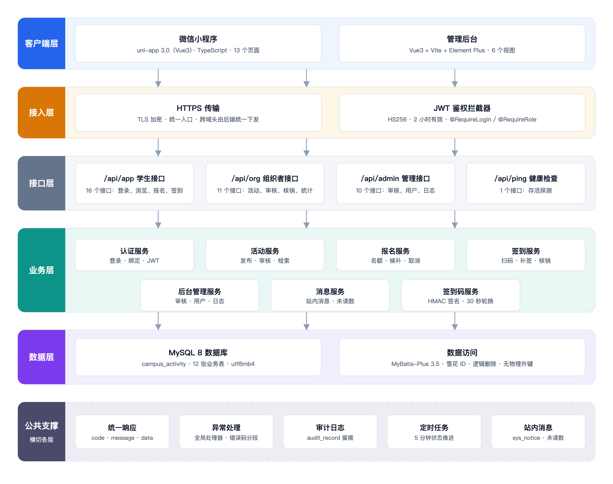
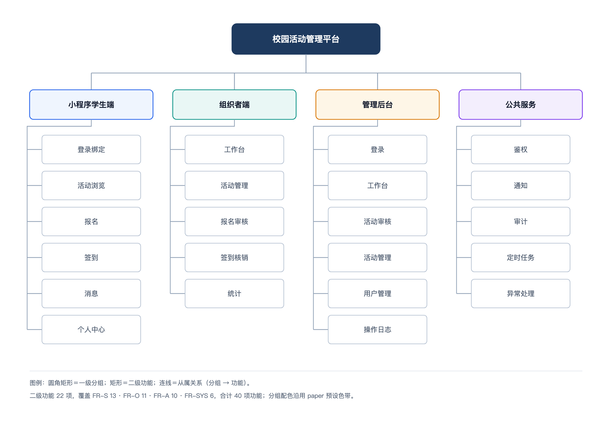
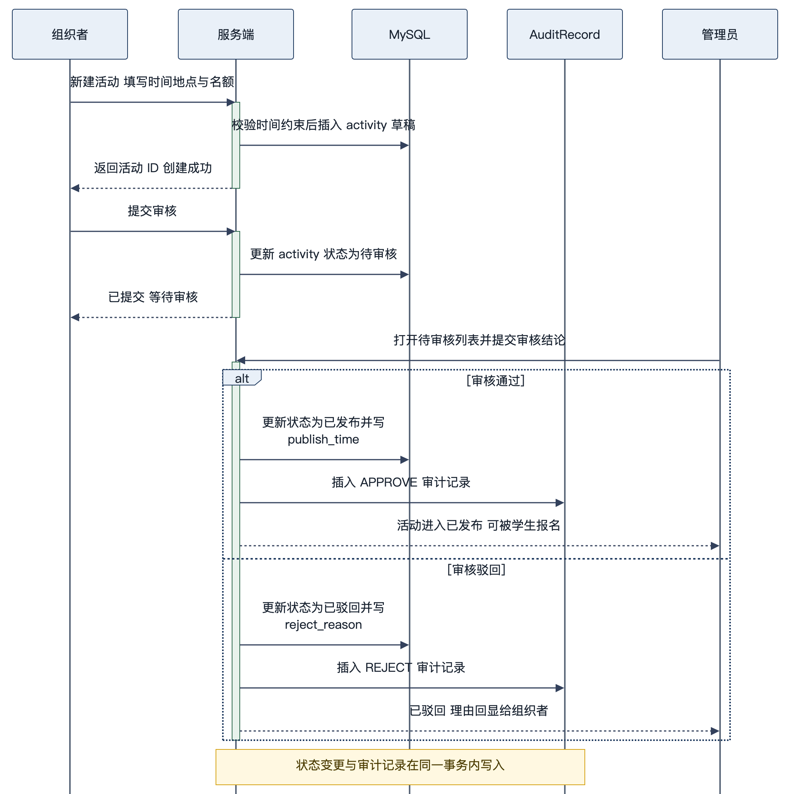
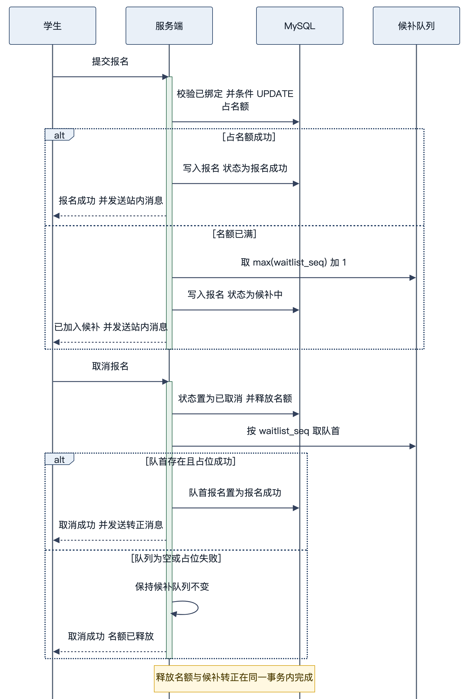

# 校园活动管理平台 · 概要设计说明书

| 项 | 内容 |
| --- | --- |
| 文档编号 | CA-DOC-03 |
| 文档名称 | 概要设计说明书 |
| 版本 | v1.1 |
| 日期 | 2026-11-20 |
| 对应阶段 | 概要设计 |
| 编写 | 项目组 |
| 审核 | 指导教师 |
| 状态 | 定稿 |

## 版本记录

| 版本 | 日期 | 修订人 | 修订说明 |
| --- | --- | --- | --- |
| v1.0 | 2026-11-20 | 项目组 | 首次编写，覆盖架构、模块、流程、接口、数据、安全、部署与设计权衡 |
| v1.1 | 2026-11-20 | 项目组 | 增补 Spring Security、Redis、短信验证码、文件上传四项扩展能力，同步安全、配置与接口统计口径 |

## 1 引言与设计目标

本章回答“系统为什么这样分层、要达成哪些设计目标、受到哪些现实约束”。

### 1.1 编写目的

本文档在 [02 需求规格说明书](02-需求规格说明书.md) 的基础上，把“要做什么”转成“怎么组织实现”。它面向三类读者：指导教师用于检查架构合理性与设计完整性；开发人员用于明确分层边界、模块职责与关键流程；测试人员用于理解异常分支与状态迁移的触发点。接口的字段级定义见 [05 接口设计说明书](05-接口设计说明书.md)，类与算法级细节见 [06 详细设计说明书](06-详细设计说明书.md)，本文只做到“模块—流程—接口约定”的粒度。

### 1.2 设计目标

表 3-1 设计目标

| 编号 | 目标 | 验收口径 |
| --- | --- | --- |
| DG-01 | 分层清晰、依赖单向 | Controller 不直接访问 Mapper，业务规则集中在 Service |
| DG-02 | 接口风格统一 | 44 个 REST 接口统一返回 `Result`，分页统一 `PageResult` |
| DG-03 | 并发下不超卖 | 名额占用由单条条件 UPDATE 完成，影响行数为 0 即满员 |
| DG-04 | 状态可闭环 | 活动 7 态、报名 7 态的每次迁移都有明确入口与校验 |
| DG-05 | 可演示、可验收 | dev 模式 mock 登录，`mvn test` 20 个用例与 `scripts/smoke.sh` 33 项断言可跑 |
| DG-06 | 可演进 | 模块边界清晰、无物理外键，便于后续拆分服务与加索引 |

### 1.3 设计约束

表 3-2 设计约束

| 约束 | 内容 | 影响 |
| --- | --- | --- |
| 技术栈固定 | Spring Boot 4.1.1 + MyBatis-Plus 3.5.18.1 + MySQL 8 + Spring Security 7 + Spring Data Redis + JDK 21 | 不引 MQ；Redis 为必需中间件，短信与 OSS 为可选通道 |
| 单机部署 | 后端 8016、管理后台 5173、H5 5174、MySQL 3306、Redis 6379 | 定时任务用 Redis 分布式锁保证多实例只执行一次 |
| 无物理外键 | 12 张表均不建 FOREIGN KEY | 完整性由应用层、事务与唯一索引保证 |
| 范围边界 | 无支付、无地图选点；支持本地/OSS 文件上传与短信验证码登录 | 支付与地图仍只做字段预留 |
| 消息通道 | V1 只落 `sys_notice` 站内消息 | 订阅消息仅预留 `NoticeSender` |
| 时区 | 服务端 `Asia/Shanghai`，接口时间用字符串 | 避免前后端时区换算歧义 |

### 1.4 事实口径

本文接口数量（44）、数据表（12）、角色（4）、状态（活动 7 / 报名 7）、后端 Java 文件（113）、小程序页面（13）、后台视图（6）、前端代码行（5438）、冒烟断言（33）以当前源码为准；四项扩展能力的口径见 [12-功能扩展说明](12-功能扩展说明.md)，表结构以 `server/src/main/resources/db/schema.sql` 为准。

## 2 设计原则

本章回答“哪些原则贯穿全局，它们分别落在代码的什么位置”。

### 2.1 分层设计

系统按“接口层—业务层—数据层”三层组织，依赖方向自上而下且不反向。接口层（`controller`、`file.controller`）只做参数绑定、注解鉴权与结果包装；业务层（`service`、`sms`、`file.service`）承担校验、状态迁移、事务与计数维护；数据层（`mapper` + `entity`）只负责单表 CRUD 与少量条件更新。`common`、`security`、`config`、`job`、`enums`、`support`、`file` 作为公共支撑被各层引用，但不反向依赖业务层。这样划分的现实收益是：新增一个查询接口通常只需要在控制器中拼装已有 Service 方法，改动面小；替换持久化实现时只需重写 Mapper 与自定义 SQL。

### 2.2 单一职责

每个类只承担一类变化原因。以报名链路为例：`SignupService` 负责报名、取消、候补转正与组织者审核；`ActivityMapper` 负责名额占用的原子 SQL；`NoticeService` 负责消息落库；`CheckinService` 负责签到校验。名额占用的 SQL 不散落在 Service 中，通知发送不散落在 Controller 中。控制器按端拆分（`controller/app`、`controller/admin`、`controller/org`），同一端内再按资源拆分，避免出现一个“万能控制器”。

### 2.3 无状态鉴权

登录成功后签发 JWT（HS256，有效期 2 小时），令牌中携带 `sub`（用户 ID）、`role`、`orgId`、`nickname`、`jti` 等声明；服务端不保存会话，`JwtAuthenticationFilter` 每次请求解析令牌并同时写入 `SecurityContext` 与业务代码沿用的 `UserContext`（ThreadLocal），请求结束后清理。无状态带来两个直接好处：后端可水平扩容而无需会话共享；小程序与管理后台可共用同一套鉴权代码。令牌在过期前可主动吊销：登出时把 `jti` 写入 Redis 黑名单（TTL 等于剩余有效期），之后同一 token 一律按未登录处理；Redis 不可用时黑名单查询降级为放行。

### 2.4 条件更新占位

名额占用是本系统并发风险最高的写操作。设计上不做“先查名额再更新”，而是把判断条件写进 UPDATE 的 WHERE 子句，由数据库的行锁保证原子性：`WHERE id = ? AND (capacity = 0 OR signed_count < capacity)`，影响行数为 1 表示占位成功，为 0 表示满员。这样既避免了应用层竞态，也不需要引入分布式锁。这条原则同样用于释放名额（`CASE WHEN signed_count > 0` 防止减成负数）与收藏计数。

### 2.5 逻辑删除

需要保留历史意义的表使用 `deleted` 字段（0 正常、1 删除），MyBatis-Plus 全局配置 `logic-delete-field: deleted` 后自动在查询中追加 `deleted = 0`。`schema.sql` 中实际带 `deleted` 字段的只有 `sys_user`、`organization`、`activity` 三张表，实体类上以 `@TableLogic` 标注；其余 9 张表通过唯一索引、状态字段与审计记录控制生命周期，不做逻辑删除，与需求文档 BR-18 的口径一致。

### 2.6 统一约定

统一响应体（`Result`）、统一分页（`PageResult`）、统一异常（`BizException` + `GlobalExceptionHandler`）、统一错误码（`ResultCode` 分段）、统一时间格式（`DateTimes` 支持三种输入格式）、统一主键策略（雪花 ID，`id-type: assign_id`）。约定集中管理后，新增接口无需重复决定错误码与返回结构，测试脚本也只需要一套断言模式。

## 3 总体架构

本章回答“系统由哪些部分组成、一次请求如何从端上流转到数据库”。

### 3.1 逻辑架构

系统采用“一个后端服务、两个客户端”的形态：微信小程序（学生与组织者共用）、管理后台（审核员与管理员）；后端按调用方划分三组业务接口（`/api/app`、`/api/org`、`/api/admin`）加健康检查接口与文件接口，另提供 Swagger/OpenAPI 文档页供开发调试。后端内部按接口层、业务层、数据层划分，公共支撑横跨各层。

如图 3-1 所示，架构自上而下为：客户端层（小程序、管理后台）→ 接入层（HTTPS、Spring Security 过滤器链与 JWT）→ 接口层（4 组接口，共 14 个控制器）→ 业务层（7 个服务块，覆盖 8 个 Service 类及短信/文件扩展服务）→ 数据层（MySQL 8，12 张表）→ 公共支撑（统一响应、异常、鉴权、配置、定时任务、Redis、枚举）；文件上传额外落到本地磁盘或阿里云 OSS，短信可选接容联云通道。



图 3-1 说明：图中不含 IP 与端口，端口信息只出现在部署图（见 [08 部署与运维手册](08-部署与运维手册.md) 图 8-1）。接口层与业务层之间是方法调用，业务层与数据层之间是 MyBatis-Plus 的 Mapper 调用；小程序与管理后台不直接访问数据库或微信服务器，所有业务写入都经过后端。

### 3.2 分层职责

表 3-3 分层职责

| 层 | 组成 | 职责 | 禁止事项 |
| --- | --- | --- | --- |
| 接入层 | Nginx / Vite 代理、CORS 配置 | 静态资源、反向代理、跨域头 | 不做业务判断 |
| 接口层 | `controller.app`（7）、`controller.admin`（4）、`controller.org`（1）、`PingController`（1）、`file.controller.FileController`（1） | 路由、参数绑定与校验、方法级鉴权、结果包装 | 不写事务、不直接调 Mapper |
| 业务层 | `service` 包 8 个类 + `sms` 包 2 个服务 + `file` 包 1 个服务 | 业务规则、状态迁移、事务、计数维护、消息发送、短信与文件处理 | 不返回 `Result`，不感知 HTTP |
| 数据层 | 12 个 Mapper、12 个实体、`schema.sql` | 单表 CRUD、8 条自定义 SQL、分页 | 不写业务判断 |
| 公共支撑 | `common`（8）、`security`（8）、`config`（6）、`job`（1）、`enums`（2）、`support`（3） | 统一响应、异常、上下文、JWT 与 Security 过滤器、Redis 工具、配置、状态推进、状态枚举 | 不反向依赖具体业务 |

### 3.3 请求处理链路

一次带鉴权的请求按以下顺序处理：

1. 客户端在 `Authorization` 头携带 `Bearer <token>`，请求到达 Nginx（生产）或 Vite 代理（开发）。
2. 请求进入 Spring Security 过滤器链，`JwtAuthenticationFilter` 解析 JWT；验签通过且 `jti` 未被拉黑时，同时写入 `SecurityContext` 与 `UserContext`。
3. 令牌缺失、无效或已拉黑时不直接报错，只按匿名继续；路径级规则由 `SecurityFilterChain` 判断，`/api/admin/**`、`/api/org/**` 分别限制 REVIEWER/ADMIN、ORGANIZER/ADMIN，`/api/files/**` 要求登录。
4. 路径规则拒绝时由 `JsonAuthenticationEntryPoint` / `JsonAccessDeniedHandler` 返回 401 + 10001 或 403 + 10002；方法级 `@PreAuthorize` 拒绝时由 `SecurityExceptionAdvice` 输出同样的 JSON。
5. 参数绑定与 Bean Validation 校验；校验失败由 `GlobalExceptionHandler` 返回 400 + 50001。
6. 控制器调用 Service，Service 内完成业务校验、事务与数据访问；查询类接口可能命中 Redis 注解缓存，写操作按需失效缓存。
7. 返回值经 `Result` 包装为 `{code, message, data}`，HTTP 状态通常为 200；业务异常也返回 200，由 `code` 区分。
8. 请求结束时清理 `UserContext`，避免线程复用导致身份串号。

### 3.4 事务边界

事务以 Service 的公开业务方法为边界：报名、取消、候补转正、审核、签到、补签、活动创建/编辑/提审/取消、绑定、角色变更均标注 `@Transactional`。一个事务内通常包含“主表状态更新 + 关联表写入 + 计数字段更新 + 消息落库”。查询类方法不开事务。定时任务整批处理放在一个事务中，失败则整批回滚，下一轮（5 分钟后）重新扫描。

## 4 技术选型

本章回答“关键组件选了什么版本、为什么选、有哪些备选方案”。

### 4.1 选型原则

优先选择课程设计场景下“能跑通、易演示、依赖少”的组合；版本以 `pom.xml` 与仓库锁定为准，不追新；每一层只引入一个主框架，避免同类组件并存造成配置冲突。

### 4.2 后端技术选型

表 3-4 后端技术选型

| 组件 | 实际版本 | 用途 | 选型理由 | 替代方案 |
| --- | --- | --- | --- | --- |
| JDK | 21 | 运行环境 | Boot 4 要求 JDK 17+，21 为 LTS | JDK 17 |
| Spring Boot | 4.1.1 | Web、参数校验、定时任务、配置绑定 | 生态完整，课程常用 | Spring Boot 3.x |
| MyBatis-Plus | 3.5.18.1 | ORM、分页、逻辑删除、雪花 ID | 单表 CRUD 零 SQL，条件更新可写注解 SQL | MyBatis、JPA |
| MyBatis-Plus JSqlParser | 3.5.18.1 | 分页插件依赖 | 3.5.9 起分页拆包，必须显式引入 | 手写分页 SQL |
| MySQL | 8.x | 关系存储 | 事务与索引满足需求，部署简单 | PostgreSQL |
| mysql-connector-j | Boot 管理版本 | JDBC 驱动 | 官方驱动，`runtime` 作用域 | MariaDB 驱动 |
| JJWT | 0.13.0 | JWT 签发与校验 | API 简洁，支持 HS256；新增 `jti` 支撑登出黑名单 | java-jwt、Nimbus |
| Spring Security | 7.x（Boot 4.1.1 管理） | 过滤器链、方法级鉴权、认证管理器、BCrypt | 统一 401/403 JSON、登录认证与授权模型，替代自研拦截器 | 自研拦截器 + `spring-security-crypto` |
| Spring Data Redis | 4.x（Boot 4.1.1 管理） | 注解缓存、验证码、黑名单、分布式锁 | 一套客户端覆盖四类场景，Lettuce 连接池 | Jedis、Caffeine 本地缓存 |
| Redis | 6.2+/7.x | 缓存与协调服务 | 缓存、短信状态、令牌黑名单、任务锁共用实例，database 11 隔离 | 无（单机内存） |
| 容联云短信 SDK | 1.0.4 | 真实短信通道 | 国内短信服务，Mock 可本地关闭 | 阿里云短信、腾讯云短信 |
| 阿里云 OSS SDK | 3.18.5 | 对象存储 | 与本地存储同接口切换 | MinIO、七牛云 |
| springdoc-openapi | 3.2.0 | OpenAPI 文档 | 注解零侵入，可在线调试 | Knife4j |
| Lombok | Boot 管理版本 | 减少样板代码 | 实体/配置类简洁 | 手写 getter/setter |
| Maven | 打包工具 | 依赖管理与构建 | 课程环境默认 | Gradle |

### 4.3 前端技术选型

表 3-5 前端技术选型

| 组件 | 实际版本 | 用途 | 选型理由 | 替代方案 |
| --- | --- | --- | --- | --- |
| uni-app | 3.0（Vue3） | 小程序与 H5 双端 | 一套代码同时出小程序与 H5，便于课堂演示 | 原生小程序、Taro |
| TypeScript | 5.9 | 类型约束 | 接口字段较多，类型可减少联调错误 | JavaScript |
| Vite | 构建工具 | 开发服务器与打包 | 启动快，H5 端口 5174 | Webpack |
| Vue 3 + Vue Router | 3.x / 4.x | 管理后台框架与路由 | 组合式 API，生态成熟 | React |
| Element Plus | 2.x | 后台组件库 | 表格、表单、弹窗齐全 | Ant Design Vue |
| Pinia | 2.x | 后台状态管理 | 轻量，仅存用户与 token | Vuex |

### 4.4 版本兼容说明

Spring Boot 4 与 MyBatis-Plus 的 starter 存在强绑定：必须使用 `mybatis-plus-spring-boot4-starter`，不能使用面向 Boot 3 的 `mybatis-plus-spring-boot3-starter`；分页插件已从核心包拆到 `mybatis-plus-jsqlparser`，不引入会在运行期找不到 `PaginationInnerInterceptor`。测试侧 Boot 4 把 `@AutoConfigureMockMvc` 拆到 `spring-boot-starter-webmvc-test`。Spring Boot 4 默认使用 Jackson 3，因此鉴权失败响应由 `JsonAuthenticationEntryPoint` / `JsonAccessDeniedHandler` 直接拼装固定 JSON，不依赖 Jackson 版本；Redis 值序列化使用 Boot 4 提供的 `GenericJacksonJsonRedisSerializer`。

### 4.5 未引入组件及原因

表 3-6 未引入组件及原因

| 未引入 | 原因 | 替代做法 |
| --- | --- | --- |
| 消息队列 | 无异步削峰需求，站内消息同步落库 | 同步写 `sys_notice` |
| 微服务注册中心/网关 | 单体应用职责清晰，课程规模无需拆分 | Nginx 反向代理 + Spring Security 过滤器链 |
| 分布式缓存集群 | 单实例 Redis 已覆盖缓存、短信、黑名单与任务锁 | 单实例 Redis（database 11） |
| 对象存储（默认） | 本地磁盘即可满足演示，OSS 作为可选通道 | `LocalStorageService`，可切 `AliyunOssStorageService` |
| 短信真实通道（默认） | 课堂演示不需要真实计费短信 | `MockSmsSender`，可切 `CloopenSmsSender` |
| Flyway / Liquibase | 表结构由 `schema.sql` 手工维护，变更频率低 | 脚本版本化 + 备份 |
| ELK | 课程规模日志量小 | 应用日志 + `logging.level` |

## 5 模块划分

本章回答“代码按什么粒度组织、每个模块具体负责什么”。

### 5.1 后端包结构

```
com.campus.activity
├── CampusActivityApplication
├── common       统一响应、异常、错误码、上下文、时间工具（8）
├── config       属性绑定、MyBatis-Plus、Redis、Security、短信配置、演示数据（6）
├── controller   app（7）/ admin（4）/ org（1）/ 健康检查（1）
├── dto          10 个请求对象
├── entity       12 个实体
├── enums        ActivityStatus / SignupStatus（2）
├── file         文件上传配置、控制器、服务、存储抽象（12）
├── job          ActivityStatusJob（1）
├── mapper       12 个 Mapper
├── security     JWT、过滤器、认证服务、JSON 处理器、黑名单（8）
├── service      8 个服务类
├── sms          短信通道、验证码、手机号登录（8）
├── support      RedisCache / RedisKeys / RedisLock（3）
└── vo           9 个响应对象
```

各包文件数与当前源码一致，合计 113 个 Java 主代码文件。

### 5.2 功能模块划分

功能层面分为学生端、组织者端、管理后台、系统支撑四组。如图 3-2 所示，学生端覆盖浏览、报名、签到、消息、个人中心；组织者端覆盖活动维护、报名审核、签到核销、统计；管理后台覆盖审核、活动管理、用户管理、日志；系统支撑提供鉴权、状态推进、消息与审计。



图 3-2 说明：模块图与 [02 需求规格说明书](02-需求规格说明书.md) 的功能清单一一对应，同一功能在小程序与后台可能由不同控制器承载（如“活动列表”学生看已发布/进行中，后台看全量）。

### 5.3 控制器模块职责

表 3-7 控制器模块职责

| 分组 | 类 | 职责 | 接口数 |
| --- | --- | --- | --- |
| 认证组 | `AppAuthController`、`AdminAuthController`、`SmsAuthController` | 小程序登录/绑定/登出、后台登录/登出、短信验证码发送与登录 | 7 |
| 学生业务组 | `AppActivityController`、`AppSignupController`、`AppCheckinController`、`AppNoticeController`、`AppUserController` | 分类、活动浏览、收藏、报名、签到、消息、资料 | 14 |
| 组织者组 | `OrgController` | 活动增改提审取消、报名名单与审核、签到码与补签、统计、工作台 | 11 |
| 管理后台组 | `AdminActivityController`、`AdminDashboardController`、`AdminUserController` | 审核、活动管理、工作台指标、日志、用户与角色、组织列表 | 9 |
| 文件组 | `FileController` | 文件上传、存储方式查询 | 2 |
| 系统组 | `PingController` | 健康检查 | 1 |

控制器共 14 个类、44 个接口（7 + 14 + 11 + 9 + 2 + 1）。其中后台登录与登出（`AdminAuthController`）归入认证组，因此按路径前缀统计的 `/api/admin` 为 11 个接口（见 7.7 节）。路径级角色规则由 `SecurityFilterChain` 统一配置，`AdminDashboardController` 与 `AdminUserController` 都挂 `/api/admin` 前缀，但类级 `@PreAuthorize` 不同（前者 REVIEWER/ADMIN，后者仅 ADMIN），方法级注解优先于路径级粗粒度规则。

### 5.4 服务层模块职责

表 3-8 服务层模块职责

| 服务类 | 核心职责 | 依赖的 Mapper |
| --- | --- | --- |
| `AuthService` | 小程序登录建号、后台登录、学号绑定、当前用户信息 | `SysUserMapper`、`StudentProfileMapper`、`StudentWhitelistMapper`、`OrganizationMapper` |
| `ActivityService` | 学生端查询与详情、组织者活动增改提审取消、审核、收藏、管理端活动分页 | `ActivityMapper`、`ActivityCategoryMapper`、`OrganizationMapper`、`ActivitySignupMapper`、`ActivityFavoriteMapper`、`AuditRecordMapper` |
| `SignupService` | 报名分流、取消、候补转正、我的报名、报名名单、报名审核 | `ActivityMapper`、`ActivitySignupMapper`、`StudentProfileMapper` |
| `CheckinService` | 核销台数据、扫码签到（含定位校验）、手动补签、活动统计 | `ActivityMapper`、`ActivitySignupMapper`、`ActivityCheckinMapper`、`StudentProfileMapper`、`AuditRecordMapper` |
| `CheckinTokenService` | 动态签到码生成与校验（HMAC-SHA256、30 秒时间片、容错 2 片） | 无（纯计算） |
| `NoticeService` | 站内消息落库、分页、未读数、标记已读 | `SysNoticeMapper` |
| `NoticeSender` | 微信订阅消息出口（V1 仅打日志） | 无（静态工具类） |
| `AdminService` | 后台工作台指标、用户分页、角色变更、审计日志分页 | `SysUserMapper`、`StudentProfileMapper`、`OrganizationMapper`、`ActivityMapper`、`ActivitySignupMapper`、`ActivityCheckinMapper`、`AuditRecordMapper` |
| `SmsCodeService`（`sms` 包） | 验证码生成、发送、校验与发送间隔/日限/错误次数控制 | 无（依赖 `RedisCache` 与 `SmsSender`） |
| `SmsAuthService`（`sms` 包） | 手机号验证码登录、首次登录自动建号、签发 JWT | `SysUserMapper`、`StudentProfileMapper`、`OrganizationMapper` |
| `FileService`（`file` 包） | 上传校验、objectKey 生成、存储方式信息查询 | 无（依赖 `StorageService`） |

`NoticeSender` 是 `service` 包下的 `final` 工具类而非 Spring Bean，与 `NoticeService` 拆分是为了让“站内消息”与“外部订阅消息”各自演进：接入模板 ID 时只改 `NoticeSender`，调用方不动。

### 5.5 数据访问层

12 个 Mapper 均继承 `BaseMapper<T>`，其中 2 个定义了自定义 SQL：`ActivityMapper` 有 6 条（占位、释放、浏览量、收藏增减 2 条、候补最大序号），`ActivitySignupMapper` 有 2 条（按状态计数、候补队首）。其余 10 个仅使用 MyBatis-Plus 通用方法。分页统一走 `PaginationInnerInterceptor`，并设置 `maxLimit=50`，防止前端传入超大 `size` 拖垮查询。

### 5.6 公共支撑模块

表 3-9 公共支撑模块

| 模块 | 内容 | 作用 |
| --- | --- | --- |
| `common` | `Result`、`PageResult`、`ResultCode`、`BizException`、`GlobalExceptionHandler`、`LoginUser`、`UserContext`、`DateTimes` | 统一返回、错误码、异常转换、登录上下文、时间解析 |
| `security` | `JwtUtil`、`JwtAuthenticationFilter`、`SysUserDetails`、`SysUserDetailsService`、`TokenBlacklistService`、`JsonAuthenticationEntryPoint`、`JsonAccessDeniedHandler`、`SecurityExceptionAdvice` | 令牌签发/解析、Spring Security 过滤器、方法级鉴权兜底、登出黑名单 |
| `config` | `CampusProperties`、`MybatisPlusConfig`、`SecurityConfig`、`RedisConfig`、`SmsProperties`、`DevDataInitializer` | 配置绑定、分页插件、Security 过滤器链、缓存管理器、短信参数、演示数据保鲜 |
| `support` | `RedisCache`、`RedisKeys`、`RedisLock` | Redis 读写封装、key 常量、分布式锁 |
| `file` | `FileController`、`FileService`、`FileTypeDetector`、`StorageService`、`LocalStorageService`、`AliyunOssStorageService`、`LocalResourceConfig`、`AliyunOssConfig`、`FileProperties` 等 | 上传接口、校验、本地/OSS 存储与静态映射 |
| `sms` | `SmsSender`、`MockSmsSender`、`CloopenSmsSender`、`SmsCodeService`、`SmsAuthService`、`SmsSendVO`、`dto` | 短信通道抽象、Mock/容联云实现、验证码与手机号登录 |
| `job` | `ActivityStatusJob` | 每 5 分钟推进活动状态、标记未到场 |
| `enums` | `ActivityStatus`、`SignupStatus` | 状态码与中文标签、可见性/占位/可取消判断 |

### 5.7 模型类

实体 12 个与 12 张表一一对应；DTO 13 个（根 `dto` 包 10 个：登录、绑定、活动保存、审核、报名、报名审核、取消、签到、补签、后台登录；`sms.dto` 2 个：发送验证码、验证码登录；`file.dto` 1 个：上传结果）；VO 9 个（登录结果、用户、活动列表项、活动详情、报名、报名详情、签到结果、签到码、活动统计）。模型分离的意义是：数据库字段变化不一定穿透到接口契约，接口字段调整也不污染实体。

### 5.8 前端模块

小程序 13 个页面按“首页—活动—报名—签到—消息—我的—组织者工作台”组织，`pages.json` 中配置 4 个 tabBar 页（首页、活动、消息、我的）；管理后台 6 个视图（登录、工作台、活动审核、活动管理、用户管理、操作日志），路由采用 hash 模式并在全局前置守卫中按 token 跳转登录页。前端只负责展示与交互，业务判断以后端返回的 `actionText`、状态码与错误码为准。

## 6 关键流程设计

本章回答“五条关键业务链路怎么走、每一步产生什么数据变化、异常如何分支”。

### 6.1 登录与学号绑定

**参与角色**：小程序用户、后端 `AuthService`、微信 `jscode2session`（生产）、MySQL。

**前置条件**：无。dev 模式下直接使用前端传入的 `devOpenId`。

**主流程**：

1. 小程序调用 `POST /api/app/auth/login`，dev 模式传 `devOpenId`，生产模式传 `code`。
2. 后端按 `open_id` 查询 `sys_user`；不存在则创建（默认角色 `STUDENT`、状态 1），存在则更新 `last_login_time`，并校验账号未被禁用。
3. 后端查询 `student_profile` 判断是否需要绑定：学生角色且无学籍档案时 `needBind=true`。
4. 签发 JWT，返回 `{token, needBind, user}`。
5. 需要绑定时小程序跳转绑定页，调用 `POST /api/app/auth/bind`，提交学号、姓名及可选的学院/年级/专业。
6. 后端用学号查 `student_whitelist`，命中后查 `student_profile` 判断该学号是否已被其他用户绑定。
7. 写入学籍档案（用户 ID 为主键，存在则更新），并把白名单 `used_flag` 置 1。
8. 返回最新用户资料，前端刷新登录态。

**异常分支**：

表 3-10 登录与绑定异常分支

| 场景 | 错误码 | 返回位置 |
| --- | --- | --- |
| 未携带或过期令牌访问需登录接口 | 10001 | Spring Security 授权层 HTTP 401 |
| 学号不在白名单 | 10004 | 绑定接口 |
| 学号已被其他微信绑定 | 10005 | 绑定接口 |
| 账号被禁用 | 10006 | 登录接口 |
| 后台账号密码错误 | 10007 | 后台登录 |
| 后台账号非 ADMIN/REVIEWER | 10002 | 后台登录 |
| dev 模式未传 `devOpenId`、时间/参数格式错误 | 50001 | 全局异常处理 |

**数据变化**：`sys_user` 新增或更新 `last_login_time`；`student_profile` 新增或更新；`student_whitelist.used_flag` 0→1；不修改用户角色。登录时序图见 [06 详细设计说明书](06-详细设计说明书.md) 图 6-1。

另有手机号验证码登录链路：`POST /api/app/auth/sms/send-code` 生成验证码写入 Redis（`campus:sms:code:<phone>`，300 秒），`POST /api/app/auth/sms/login` 校验通过后按手机号查 `sys_user`，不存在则自动建号（`open_id=phone:<手机号>`、角色 `STUDENT`），随后复用同一套 JWT 签发逻辑，详见 [12-功能扩展说明](12-功能扩展说明.md) 第 5 章。登出时把当前令牌的 `jti` 写入 Redis 黑名单，旧 token 立即失效。

### 6.2 活动发布与审核

**参与角色**：组织者、团委审核员（REVIEWER/ADMIN）、后端、MySQL。

**前置条件**：组织者已登录且 JWT 中 `orgId` 非空。

**主流程**：组织者新建活动→后端校验时间约束→保存为草稿→提交审核→团委审核→通过发布或驳回修改。如图 3-3 所示。



图 3-3 说明：审核动作是唯一能把活动从“待审核”推进到“已发布”的入口；组织者侧的“编辑”对被驳回的草稿直接生效，对已发布/进行中的活动则会把状态打回待审核，防止绕过审核修改时间地点（BR-14）。审核与下架都会写 `audit_record`，形成可追溯链路。

**步骤与数据变化**：

表 3-11 活动发布与审核步骤

| 步骤 | 操作 | 校验 | 数据变化 |
| --- | --- | --- | --- |
| 1 | `POST /api/org/activities` 新建 | 登录、角色 ORGANIZER/ADMIN、`orgId` 非空 | `activity` 插入，`status=0`，计数置 0 |
| 2 | 后端时间校验 | 开始<结束；报名开始≤报名结束；报名结束≤开始；取消截止≤开始（缺省开始前 2 小时） | 不通过抛 20004 |
| 3 | `POST /api/org/activities/{id}/submit` 提审 | 归属校验（creator_id 或 ADMIN）；状态须为草稿/已驳回 | `status=1`，`reject_reason=null` |
| 4 | `GET /api/admin/activities/audit-list` 待审列表 | REVIEWER/ADMIN | 只读，按 `create_time` 升序 |
| 5 | `POST /api/admin/activities/{id}/audit` 审核 | 状态须为待审核；`pass` 非空 | 通过：`status=3`、首次发布写 `publish_time`；驳回：`status=2`、写 `reject_reason`；写 `audit_record`（APPROVE/REJECT） |
| 6 | `POST /api/admin/activities/{id}/offline` 下架 | 管理员权限 | `status=6`，写 `audit_record`（CANCEL） |

**异常分支**：非本组织活动（20003）、活动不存在（20001）、状态不支持（20002）、时间不合理（20004）、参数错误（50001）。归属校验在服务层完成：`requireOwnActivity` 比较 `creator_id` 与当前用户，ADMIN 例外。

**补充说明**：审核通过后活动进入 `PUBLISHED`，学生端立即可见（`visibleToStudent` 返回 true）；活动是否开放报名仍取决于当前时间是否落在报名窗口内。

### 6.3 报名与候补

**参与角色**：学生、后端 `SignupService`、MySQL。

**前置条件**：已登录、已绑定学籍、活动为 `PUBLISHED` 且在报名窗口内。

**主流程与分流**：报名请求先做四类校验，再根据活动配置决定写入哪种状态。如图 3-4 所示。



图 3-4 说明：图中“占位”一步对应单条条件 UPDATE，返回受影响行数，而不是先查询 `signed_count` 再判断。分流顺序为“需审核 → 占位成功 → 可候补 → 满员”。取消报名时若原状态占用名额，则先释放再取候补队首，队首占位成功才转正并发送消息。

**步骤与数据变化**：

表 3-12 报名与候补步骤

| 步骤 | 操作 | 校验 | 数据变化 |
| --- | --- | --- | --- |
| 1 | 提交报名 | 学籍档案存在（否则 10003） | 无 |
| 2 | 活动校验 | 存在（20001）；状态 PUBLISHED（20005）；当前在 `[signup_start_time, signup_end_time]`（20005） | 无 |
| 3 | 重复报名校验 | 查 `uk_activity_user`；状态不是已取消/审核未通过则 30002 | 无 |
| 4 | 分流 | `audit_required=1` → 待审核；否则 `occupySeat` 成功 → 成功；失败且 `waitlist_enabled=1` → 候补；否则 30001 | 写入/更新报名记录占位，`signup_count+1` |
| 5 | 候补序号 | 取 `MAX(waitlist_seq)+1`（仅当次状态为候补） | `waitlist_seq` 赋值 |
| 6 | 消息 | 按三种结果分别发 SIGNUP/WAITLIST 消息 | `sys_notice` 插入 |
| 7 | 取消 | 状态须可取消（PENDING/SUCCESS/WAITLIST，否则 30006）；未超过 `cancel_deadline`（否则 30004） | `status=4`、`cancel_time`；若原状态占名额则 `releaseSeat`，再 `promoteWaitlist` |
| 8 | 候补转正 | 取队首；`occupySeat` 成功才转正 | 队首 `status=1`，发 WAITLIST 消息 |
| 9 | 审核通过 | 组织者批量通过时逐个 `occupySeat`，名额不足整批报错 30001 | `status=1`、`audit_user_id`、`audit_time`，发 AUDIT 消息 |

**异常分支**：名额已满（30001）、重复报名（30002）、记录不存在（30003）、超过取消截止（30004）、审核未通过（30005）、状态不支持（30006）、并发重复提交由 `uk_activity_user` 与 `DuplicateKeyException` 转换为 30002。

**关键设计**：报名记录重新报名时复用原行（`exist != null` 时 `updateById`），而不是插入新行，因此同一用户同一活动始终只有一行；`signup_count` 是“累计报名数（含取消）”，与占用名额的 `signed_count` 含义不同。

### 6.4 扫码签到

**参与角色**：组织者（出码）、学生（扫码）、后端 `CheckinTokenService` / `CheckinService`、MySQL。

**前置条件**：活动处于可签到时间窗内；学生报名状态为 SUCCESS。

**主流程**：

1. 组织者打开核销台，`GET /api/org/activities/{id}/checkin-qr` 返回动态 `token`、轮换周期 `refreshSeconds`、已报名数、已签到数、最近 5 条到场记录。
2. 前端按 `refreshSeconds` 定时刷新，或在签到动作前刷新。
3. 学生扫码，`POST /api/app/checkin` 提交 `token` 与可选经纬度。
4. 服务端校验顺序：签到码有效 → 活动存在 → 非“仅组织者手动”→ 在签到窗口内 → 已报名 → 未签到 → 状态为 SUCCESS → 若 `checkin_type=2` 则 Haversine 距离 ≤200 米。
5. 写入 `activity_checkin`（`uk_signup` 兜底一对一），并把报名状态改为 `CHECKED_IN`、写 `checkin_time`。
6. 返回活动标题、签到时间与姓名。

**异常分支**：

表 3-13 扫码签到异常分支

| 场景 | 错误码 |
| --- | --- |
| 二维码过期、签名错误、格式错误 | 40001 |
| 活动不存在 | 20001 |
| 未报名 | 40002 |
| 已签到（含唯一索引冲突） | 40003 |
| 不在签到时间窗 / 该活动仅手动签到 | 40004 |
| 超出 200 米范围 | 40005 |

**数据变化**：`activity_checkin` 插入一条（扫码类型 1 或 2）；`activity_signup.status` 3、`checkin_time` 更新；`signed_count` 不变（签到不改变占位）。手动补签写入 `checkin_type=3`、`operator_id`、`remark`，并写 `audit_record`（MANUAL_CHECKIN）。

### 6.5 状态推进

**参与角色**：`ActivityStatusJob`（每 5 分钟）、MySQL。

**主流程**：

1. 扫描 `status=3 AND start_time <= now` 的活动，置为 `ONGOING(4)`。
2. 扫描 `status IN (3,4) AND end_time <= now` 的活动，置为 `FINISHED(5)`。
3. 对每场刚结束的活动，把该活动下 `status=1(SUCCESS)` 的报名记录批量更新为 `NO_SHOW(6)`。
4. 记录日志（开始/结束场次、标记未到场条数）。

**异常与边界**：整个方法在一个事务内，失败整批回滚并在下一轮重试；任务执行前先用 Redis 分布式锁 `campus:lock:activity-status-job`（租期 120 秒）抢占执行权，抢不到说明其他实例正在跑，直接跳过本次，保证多实例部署时同一时刻只有一个实例推进状态。`NO_SHOW` 在需求上占用名额，刷新时不回退 `signed_count`。状态迁移图见 [06 详细设计说明书](06-详细设计说明书.md) 图 6-2、图 6-3。

## 7 接口与通信设计

本章回答“接口长什么样、鉴权怎么加、错误怎么表达、分页与时间怎么约定”。

### 7.1 通信风格

前后端采用 REST + JSON，统一前缀 `/api`，按端分五个路径段：`/api/app/**`（小程序）、`/api/org/**`（组织者）、`/api/admin/**`（管理后台）、`/api/files/**`（文件上传与存储信息）、`/api/ping`（健康检查）。资源用名词复数，动作型操作以子路径表达（`/submit`、`/cancel`、`/audit`、`/offline`、`/checkin/manual`、`/read`、`/logout`、`/send-code`）。查询参数用于筛选与分页，写操作使用 JSON 请求体；文件上传例外，使用 `multipart/form-data`。

### 7.2 统一响应

所有接口返回 `Result<T>`。成功 `code=0`、`message="ok"`；业务失败返回分段错误码；业务异常保持 HTTP 200，便于前端统一按 `code` 处理，只有鉴权失败（401/403）与校验失败（400）、未知异常（500）使用非 200 状态码。

```java
public record Result<T>(int code, String message, T data) {
    public static <T> Result<T> ok(T data) {
        return new Result<>(0, "ok", data);
    }
    public static <T> Result<T> fail(int code, String message) {
        return new Result<>(code, message, null);
    }
}
```

### 7.3 分页约定

分页统一返回 `PageResult<T>`，字段为 `records`（当前页数据）、`total`（总条数）、`page`（当前页）、`size`（每页条数）。请求参数统一 `page`（默认 1）、`size`（默认 10，后台日志默认 20），服务端把单页上限限制为 50。

### 7.4 鉴权规则与过滤器顺序

表 3-14 鉴权组件与规则

| 组件 | 作用范围 | 行为 |
| --- | --- | --- |
| `JwtAuthenticationFilter` | 所有请求，位于 `UsernamePasswordAuthenticationFilter` 之前 | 解析令牌、查黑名单、写 `SecurityContext` 与 `UserContext`；令牌无效不直接报错 |
| `SecurityFilterChain` 路径规则 | `OPTIONS /**`、`/api/ping`、`/api/app/auth/login`、`/api/app/auth/sms/**`、`/api/admin/auth/login`、`/error`、`/uploads/**`、Swagger 路径 | 放行 |
| `SecurityFilterChain` 路径规则 | `/api/admin/**` | `hasAnyRole("REVIEWER","ADMIN")` |
| `SecurityFilterChain` 路径规则 | `/api/org/**` | `hasAnyRole("ORGANIZER","ADMIN")` |
| `SecurityFilterChain` 路径规则 | `/api/files/**` | `authenticated` |
| `@PreAuthorize` | 方法或类 | `isAuthenticated()`、`hasAnyRole('...')`；拒绝时由 `SecurityExceptionAdvice` 兜底 |
| `JsonAuthenticationEntryPoint` / `JsonAccessDeniedHandler` | 鉴权失败 | 返回 401 + 10001 或 403 + 10002 的统一 JSON |
| `/error` | 路径规则 | 放行，避免参数校验的 400 被覆盖成 401 |

方法级规则优先于路径级粗粒度规则；未标注的公开查询接口也允许携带 token，用于返回“我的报名状态”“是否收藏”等个性化字段。鉴权只做“登录/角色”两级判断，细粒度的归属校验（是否活动创建人、报名记录是否属于自己）在服务层完成，避免注解无法表达的数据相关权限。失败响应不走 Jackson，直接拼装固定 JSON，保证 401/403 在序列化链路异常时仍可返回。

```java
// 路径级：SecurityConfig 中按前缀配置
.requestMatchers("/api/admin/**").hasAnyRole("REVIEWER", "ADMIN")
.requestMatchers("/api/org/**").hasAnyRole("ORGANIZER", "ADMIN")
.requestMatchers("/api/files/**").authenticated()
.anyRequest().permitAll()

// 方法级：Controller 上的注解
@PreAuthorize("hasAnyRole('ORGANIZER', 'ADMIN')")
```

### 7.5 权限矩阵

表 3-15 权限矩阵

| 路径前缀 | 匿名 | STUDENT | ORGANIZER | REVIEWER | ADMIN |
| --- | --- | --- | --- | --- | --- |
| `/api/ping` | 允许 | 允许 | 允许 | 允许 | 允许 |
| `/api/app/auth/login`、`/api/app/auth/sms/**` | 允许 | 允许 | 允许 | 允许 | 允许 |
| `/api/app/auth/bind`、`/api/app/auth/logout` | 拒绝 | 允许 | 允许 | 允许 | 允许 |
| `/api/app/**` 其余 | 查询类允许，写操作需登录 | 允许 | 允许 | 允许 | 允许 |
| `/api/org/**` | 拒绝 | 拒绝 | 允许 | 拒绝 | 允许 |
| `/api/admin/auth/logout` | 拒绝 | 拒绝 | 拒绝 | 允许 | 允许 |
| `/api/admin/**` 其余 | 拒绝 | 拒绝 | 拒绝 | 允许（除用户管理） | 允许 |
| `/api/files/**` | 拒绝 | 允许 | 允许 | 允许 | 允许 |
| `/uploads/**` | 允许 | 允许 | 允许 | 允许 | 允许 |

### 7.6 错误码分段

表 3-16 错误码分段

| 区间 | 含义 | 代表错误码 |
| --- | --- | --- |
| 0 | 成功 | 0 |
| 10xxx | 认证与权限 | 10001 未登录、10002 无权限、10003 未绑定、10004 学号不在名单、10005 学号已绑定、10006 账号禁用、10007 登录失败 |
| 20xxx | 活动 | 20001 不存在、20002 状态不支持、20003 非本组织、20004 时间不合理、20005 未开放报名 |
| 30xxx | 报名 | 30001 名额已满、30002 已报名、30003 记录不存在、30004 超过取消截止、30005 审核未通过、30006 状态不支持 |
| 40xxx | 签到 | 40001 签到码无效、40002 未报名、40003 已签到、40004 不在签到时间、40005 超出范围 |
| 50xxx | 通用 | 50000 系统繁忙、50001 参数错误 |
| 60xxx | 短信与验证码 | 60001 手机号格式、60002 发送频繁、60003 当日上限、60004 已失效、60005 验证码错误、60006 错误过多、60007 已使用、60008 发送失败 |
| 70xxx | 文件 | 70001 空文件、70002 超大小、70003 类型不允许、70004 存储失败、70005 文件不存在 |

### 7.7 接口分组统计

表 3-17 接口分组统计

| 分组 | 前缀 | 数量 | 说明 |
| --- | --- | --- | --- |
| 小程序端 | `/api/app` | 19 | 登录绑定与登出 3、短信 2、活动 5、报名 4、签到 1、消息 3、资料 1 |
| 组织者端 | `/api/org` | 11 | 活动 5、报名审核 2、签到 2、统计 1、工作台 1 |
| 管理后台 | `/api/admin` | 11 | 登录登出 2、审核与活动 4、工作台与日志 2、用户与组织 3 |
| 文件 | `/api/files` | 2 | 上传、存储信息 |
| 系统 | `/api/ping` | 1 | 健康检查 |
| 合计 | — | 44 | 与 05 接口设计说明书一致 |

### 7.8 参数与格式约定

- 请求体：`application/json`，字段名小驼峰；时间字段用字符串，支持 `yyyy-MM-dd HH:mm:ss`、ISO `yyyy-MM-ddTHH:mm:ss`、`yyyy-MM-dd HH:mm` 三种格式。
- 响应日期：Jackson 统一格式化为 `yyyy-MM-dd HH:mm:ss`，时区 `Asia/Shanghai`，空字段不输出（`non_null`）。
- 分页：`page` 从 1 开始；`size` 上限 50。
- 排序：学生端活动列表默认按开始时间升序，`HOT` 按 `signup_count` 降序；已结束按开始时间降序。

### 7.9 幂等与重试

表 3-18 幂等策略

| 操作 | 幂等策略 |
| --- | --- |
| 收藏切换 | 查存在则删、不存在则插；并发插入冲突时回滚为“已收藏” |
| 报名提交 | `uk_activity_user` 唯一索引 + 状态判断；重复提交返回 30002 |
| 取消报名 | 状态校验不可取消即报 30006，重复取消不会二次释放名额 |
| 扫码签到 | `uk_signup` 唯一索引 + 状态判断，冲突返回 40003 |
| 消息已读 | 不传 `ids` 表示全部已读，重复执行结果一致 |
| 状态推进 | 只更新满足时间条件的行，重复执行不会回退状态 |
| 登出 | 写入 `campus:auth:blacklist:<jti>` 是幂等的，重复登出结果一致 |
| 短信验证码 | 同一验证码校验通过后状态置为已使用，重复提交返回 60007 |
| 文件上传 | 每次生成新的 UUID objectKey，重复上传会产生多个文件，不做去重 |

## 8 数据设计概要

本章回答“数据如何组织、表之间是什么关系、主键与删除策略是什么”。

### 8.1 数据表清单

表 3-19 数据表清单

| 编号 | 表名 | 中文 | 主键 | 关键索引 |
| --- | --- | --- | --- | --- |
| T-01 | `sys_user` | 用户 | id | `uk_open_id`、`uk_username`、`idx_role_org` |
| T-02 | `student_profile` | 学籍档案 | user_id | `uk_student_no` |
| T-03 | `student_whitelist` | 学籍白名单 | id | `uk_student_no` |
| T-04 | `organization` | 组织 | id | `idx_type` |
| T-05 | `org_member` | 组织成员 | id | `uk_org_user`、`idx_user` |
| T-06 | `activity_category` | 活动分类 | id | `uk_code` |
| T-07 | `activity` | 活动 | id | `idx_status_start`、`idx_org`、`idx_category` |
| T-08 | `activity_signup` | 报名记录 | id | `uk_activity_user`、`uk_signup_no`、`idx_user_status` |
| T-09 | `activity_checkin` | 签到记录 | id | `uk_signup`、`idx_activity` |
| T-10 | `activity_favorite` | 收藏 | id | `uk_activity_user` |
| T-11 | `sys_notice` | 站内消息 | id | `idx_user_read` |
| T-12 | `audit_record` | 审计记录 | id | `idx_biz` |

### 8.2 关系概要

表 3-20 关系概要

| 关系 | 基数 | 实现方式 |
| --- | --- | --- |
| 用户—学籍档案 | 1:0..1 | `student_profile.user_id` 主键即外键语义 |
| 用户—组织 | N:M | `org_member` 中间表 |
| 组织—活动 | 1:N | `activity.org_id` |
| 用户—活动（创建） | 1:N | `activity.creator_id` |
| 分类—活动 | 1:N | `activity.category_id` |
| 用户—报名 | 1:N | `activity_signup.user_id`，`uk_activity_user` 保证同一活动唯一 |
| 活动—报名 | 1:N | `activity_signup.activity_id` |
| 报名—签到 | 1:0..1 | `activity_checkin.signup_id` 唯一 |
| 用户—活动（收藏） | N:M | `activity_favorite` 中间表 |
| 用户—消息 | 1:N | `sys_notice.user_id` |
| 用户—审计 | 1:N | `audit_record.operator_id`（业务对象用 `biz_type + biz_id` 弱关联） |

### 8.3 主键与逻辑删除

所有表主键为 `BIGINT`，由 MyBatis-Plus 的雪花算法在应用层生成（`id-type: assign_id`），非数据库自增；种子数据手工指定固定 ID（如用户 1–5、组织 2001–2003、活动 3001–3004）以便演示与联调。逻辑删除只作用于 `sys_user`、`organization`、`activity` 三张表，查询自动过滤 `deleted=1`；其余表不使用逻辑删除。

### 8.4 冗余计数字段

表 3-21 冗余计数维护

| 字段 | 所在表 | 含义 | 更新点 |
| --- | --- | --- | --- |
| `signed_count` | `activity` | 已占名额 | 报名/审核通过占位 +1；取消/释放 -1；签到、未到场不变 |
| `signup_count` | `activity` | 累计报名数（含取消） | 每次提交报名 +1，用于热度排序 |
| `view_count` | `activity` | 浏览量 | 详情接口每次访问 +1 |
| `favorite_count` | `activity` | 收藏数 | 收藏 +1、取消收藏 -1（不低于 0） |
| `waitlist_seq` | `activity_signup` | 候补序号 | 进入候补时取当前最大值 +1 |

计数字段是为了避免列表页频繁 `COUNT(*)` 而做的适度反范式，代价是必须在所有写路径同步维护，具体一致性讨论见 [04 数据库设计说明书](04-数据库设计说明书.md) 第 7 章。

## 9 安全设计

本章回答“身份怎么证明、权限怎么校验、关键业务如何防作弊、操作如何留痕”。

### 9.1 威胁与对策总览

表 3-22 安全威胁与对策

| 威胁 | 对策 | 落点 |
| --- | --- | --- |
| 伪造身份 | JWT HS256 签名，密钥长度 ≥32 字符 | `JwtUtil` |
| 越权访问后台 | Spring Security 路径规则 + `@PreAuthorize` 校验 REVIEWER/ADMIN；用户管理仅 ADMIN | `SecurityConfig`、各 Admin 控制器 |
| 越权操作他人活动 | 服务层比较 `creator_id`，ADMIN 例外 | `ActivityService`、`CheckinService`、`SignupService` |
| 令牌被盗用后仍有效 | 登出把 `jti` 写入 Redis 黑名单，TTL 取剩余有效期 | `AuthService`、`TokenBlacklistService` |
| 报名作弊/冒用签到码 | 动态 HMAC 签到码 + 时间窗 + 报名状态 + 定位 | `CheckinTokenService`、`CheckinService` |
| 重复报名/重复签到 | 唯一索引兜底 + 状态判断 | `uk_activity_user`、`uk_signup` |
| 密码泄露 | BCrypt 加盐哈希，不存明文 | Spring Security `PasswordEncoder` |
| 短信刷码/撞码 | 发送间隔、当日上限、错误次数三条防线 | `SmsCodeService` |
| 伪装文件上传 | 扩展名白名单 + 文件头魔数 + 图片类型一致性校验 | `FileService`、`FileTypeDetector` |
| 文件目录穿越 | objectKey 由服务端生成，读写前 normalize 并校验仍落在根目录 | `LocalStorageService` |
| 操作不可追溯 | 审核、取消、补签、角色变更写审计 | `audit_record` |
| 参数注入 | MyBatis-Plus 参数绑定，无字符串拼 SQL | Mapper |

### 9.2 认证

JWT 载荷包含 `sub`（用户 ID）、`role`、`orgId`、`nickname`、`jti`、签发时间与过期时间；有效期取配置 `campus.jwt.access-token-hours`（默认 2 小时）。解析失败（签名不符、过期、格式错误）统一返回 `null`，由 `JwtAuthenticationFilter` 按匿名处理。登出后 `jti` 进入 Redis 黑名单（TTL 等于剩余有效期），黑名单查询异常时降级为放行；账号被禁用后，已签发令牌在过期前仍可使用，V1 接受这一窗口。

### 9.3 授权

授权分三级：路径级由 `SecurityFilterChain` 做粗粒度守门（`/api/admin/**`、`/api/org/**`、`/api/files/**`）；方法级用 `@PreAuthorize` 声明“需要登录/需要角色”；数据级在服务层校验归属。角色共 4 个：STUDENT、ORGANIZER、REVIEWER、ADMIN。组织者发布活动时，`org_id` 取自 JWT 而非请求体，避免伪造组织；`ActivitySaveRequest` 中虽保留 `orgId` 字段，但服务层未使用（待确认是否移除）。

### 9.4 密码存储

后台账号（ADMIN/REVIEWER）使用 BCrypt 哈希存于 `sys_user.password_hash`，登录时由 `DaoAuthenticationProvider` + `BCryptPasswordEncoder` 校验；小程序端不涉及密码。演示数据中的哈希为固定值，对应基线中的演示口令。账号禁用状态映射为 `SysUserDetails.isEnabled()=false`，登录时抛 `DisabledException` 并返回 10006。

### 9.5 签到码

签到码结构为 `activityId + "." + slice + "." + HMAC-SHA256(activityId:slice) 前 16 位十六进制`，时间片长度 30 秒，服务端接受当前片及前 2 片（共 3 片，约 60–90 秒），密钥来自配置 `campus.checkin.secret`，不落库。二维码被截图转发最多在容忍窗口内有效；由于签名绑定活动 ID 与时间片，无法跨活动复用。

### 9.6 越权与数据暴露

所有“我的”数据查询都以 `UserContext` 中的用户 ID 作为过滤条件，不信任前端传入的 `userId`；报名详情、取消、签到等操作先查记录再比对归属。错误提示不返回 SQL 或堆栈，未知异常统一返回 50000。列表接口只返回必要字段（VO 裁剪），避免泄露手机号等非必要信息。

### 9.7 审计

`audit_record` 记录活动审核（APPROVE/REJECT）、活动取消与下架（CANCEL）、手动补签（MANUAL_CHECKIN）、角色变更（ROLE_CHANGE），字段包含业务类型、业务 ID、操作人、前后状态与备注。后台提供分页查询接口。审计只做追加，不提供修改与删除入口。

### 9.8 传输与配置

生产环境由 Nginx 终止 HTTPS 并同域反向代理，跨域配置只在本地调试打开（`SecurityConfig.corsConfigurationSource()`）；数据库账号密码通过环境变量 `MYSQL_USERNAME` / `MYSQL_PASSWORD` 注入，微信 AppID/Secret 通过 `WX_APPID` / `WX_SECRET` 注入，Redis 通过 `REDIS_HOST` / `REDIS_PORT` / `REDIS_PASSWORD` / `REDIS_DATABASE` 注入，容联云短信与 OSS 分别通过 `CLOOPEN_*`、`OSS_*` 注入。dev 模式（`campus.dev-mode=true`）、短信 Mock 与 `campus.sms.expose-code=true` 仅用于本地与课堂演示，上线必须关闭；文件上传目录 `./uploads` 需纳入备份。

### 9.9 未覆盖项

后台登录失败锁定、图形/滑块验证码、密钥轮换、敏感字段脱敏、CSRF 防护（后台使用 Bearer 头而非 Cookie，风险较低）均未实现；短信侧已有发送间隔、日限与错误次数限制，文件侧已有大小、扩展名与文件头校验，但都没有病毒扫描与内容审查。上述能力作为后续改进方向，本文不虚构。

## 10 部署架构

本章回答“系统部署成什么形态、开发与生产环境有什么区别”。

### 10.1 逻辑部署

系统由五个可部署单元组成：微信小程序（运行在微信客户端）、管理后台静态资源（浏览器加载）、后端 Spring Boot 应用（可执行 JAR）、MySQL 数据库、Redis。开发环境中前端分别由 Vite 提供热更新服务（管理后台 5173、H5 5174）并代理 `/api` 到后端 8016；生产环境中前端构建为静态文件由 Nginx 托管，`/api` 反向代理到后端 8016，MySQL 监听 3306，Redis 监听 6379；文件默认落本地 `./uploads` 由后端静态直出，切 OSS 时由对象存储提供访问地址。部署图见 [08 部署与运维手册](08-部署与运维手册.md) 图 8-1。

### 10.2 开发环境

表 3-23 开发环境进程

| 进程 | 端口 | 说明 |
| --- | --- | --- |
| 后端 | 8016 | `mvn spring-boot:run` 或 IDE 启动，dev 模式 mock 登录 |
| 管理后台 | 5173 | Vite dev server，代理 `/api` |
| 小程序 H5 | 5174 | H5 端走 `/api` 代理；微信开发者工具需勾选“不校验合法域名” |
| MySQL | 3306 | 库名 `campus_activity`，`schema.sql` + `data.sql` 初始化 |
| Redis | 6379 | database 11，密码默认 `abc123`，缓存/短信/黑名单/任务锁共用 |

### 10.3 生产环境

单机部署即可满足课程规模：Nginx 托管前端并反向代理 API，后端单实例连接 MySQL 单实例与 Redis 单实例；短信与 OSS 为可选外部服务。因为鉴权无状态，后端具备横向扩容前提；状态推进任务已用 Redis 分布式锁保证同一时刻只有一个实例执行，扩容时不再需要单独改造定时任务。Redis 目前是单点，生产需一并纳入备份与监控。

### 10.4 配置项

表 3-24 配置项

| 配置 | 默认值 | 说明 |
| --- | --- | --- |
| `server.port` | 8016 | 后端端口 |
| `spring.datasource.url` | `jdbc:mysql://127.0.0.1:3306/campus_activity...` | 库名固定，时区 Asia/Shanghai |
| `spring.data.redis.host` / `port` / `password` / `database` | `127.0.0.1` / `6379` / `abc123` / `11` | 可用 `REDIS_*` 覆盖 |
| 缓存 TTL / key 前缀 / null 缓存 | 10 分钟 / `campus:cache:` / 开启 | 在 `RedisConfig` 中定义，`application.yml` 不写 `spring.cache.*` |
| `spring.servlet.multipart.max-file-size` | `10MB` | multipart 单文件上限 |
| `campus.dev-mode` | true | 开发模式，允许 mock openid |
| `campus.jwt.secret` | 示例密钥（≥32 字符） | 生产必须替换 |
| `campus.jwt.access-token-hours` | 2 | 令牌有效期 |
| `campus.checkin.secret` | 示例密钥 | 签到码 HMAC 密钥 |
| `campus.checkin.slice-seconds` | 30 | 签到码轮换周期 |
| `campus.checkin.tolerance-slices` | 2 | 容错时间片数 |
| `campus.checkin.open-before-minutes` | 30 | 签到窗口提前量 |
| `campus.checkin.close-after-minutes` | 30 | 签到窗口延后量 |
| `campus.sms.provider` | `mock` | 短信通道；`cloopen` 为真实通道 |
| `campus.sms.expose-code` | true | 演示回传 `mockCode`，生产必须 false |
| `campus.file.storage-type` | `local` | 文件存储；`oss` 为阿里云 OSS |
| `campus.file.local.base-dir` | `./uploads` | 本地落盘目录 |
| `campus.file.oss.endpoint` / `bucket-name` / `domain` | 空 | OSS 节点、Bucket、自定义域名 |
| `campus.sms.cloopen.account-sid` / `account-token` / `app-id` | 空 | 容联云账号，环境变量注入 |

### 10.5 可用性与扩展

V1 未做高可用：数据库与 Redis 单点、后端单实例、无健康检查探针（只有 `/api/ping` 供人工探测）。若要提升可用性，优先顺序为：数据库主从与定期备份、Redis 持久化与主从、后端多实例 + Nginx 负载、日志集中化。扩展顺序与依据见第 11 章。

## 11 设计权衡

本章回答“关键方案之间如何取舍，为什么当前选择更适合课程设计场景”。

### 11.1 条件 UPDATE 与加锁

表 3-25 名额占用方案对比

| 方案 | 优点 | 缺点 | 本系统结论 |
| --- | --- | --- | --- |
| 先查后写 | 逻辑直观 | 并发下超卖，需额外锁 | 不采用 |
| 悲观锁 `SELECT ... FOR UPDATE` | 语义强 | 持锁时间长、需事务包裹、易死锁 | 不采用 |
| 单条条件 UPDATE | 原子、无额外组件、影响行数即结果 | 成功后仍需处理业务分支 | 采用（BR-03） |
| Redis 分布式锁 | 可跨服务 | 引入中间件与锁续期问题 | 名额占用不采用；定时任务状态推进采用（`RedisLock`） |

### 11.2 定时任务与延迟队列

活动状态推进采用每 5 分钟一次的 `@Scheduled` 轮询，而不是延迟队列或定时消息。理由是：状态迁移的最长延迟 5 分钟在校园活动场景可接受；无 MQ 依赖；实现与排查成本最低。代价是精度不足（活动开始后最多 5 分钟才变“进行中”）。多实例场景用 Redis 分布式锁保证同一时刻只有一个实例真正执行，其余实例直接跳过；Redis 故障时本轮任务失败，下一轮重试。若将来对实时性有要求，可改为在查询时按时间动态计算状态，或用延迟队列触发。

### 11.3 签到码不落库与落库

签到码采用 HMAC 动态生成、不落库，服务端只保存密钥。相比“生成随机码存库并设过期时间”，不落库方案的优点是无写入、无状态、天然防重放（时间片推进后旧码自动失效）、横向扩容无需共享存储；缺点是无法主动作废某个码、日志中无法审计具体码值、密钥泄露后所有历史码可被伪造。课程场景选择不落库。

### 11.4 单表用户与分表

学生、组织者、审核员、管理员共用 `sys_user` 一张表，用 `role` 区分，后台账号额外使用 `username`/`password_hash`，小程序账号使用 `open_id`。单表方案的优点是登录查询简单、角色变更只改一行、无需跨表联查；缺点是字段存在互斥空值（学生无 `username`，后台账号无 `open_id`），且角色语义靠字符串约束。课程设计的数据规模下无需分表，角色变更（如学生升为组织者）在单表下成本最低。

### 11.5 其他权衡

表 3-26 其他权衡

| 决策 | 选择 | 理由 | 代价 |
| --- | --- | --- | --- |
| 物理外键 | 不建 | 便于演示数据导入、避免删除顺序约束 | 完整性靠应用层与唯一索引 |
| 站内消息 | 同步落库 | 实现简单、消息必达 | 写接口耗时略增 |
| 逻辑删除范围 | 仅 3 表 | 其余表靠状态与唯一索引控制 | 已与需求文档统一 |
| 时间格式 | 字符串传输 | 跨端一致、避免时区问题 | 服务端需解析与容错 |
| 分页上限 | 50 | 防止恶意大分页 | 导出类场景需另行设计 |
| Redis 注解缓存 | 分类与热门榜 10 分钟 TTL | 读多写少，减少数据库压力 | 写操作需主动失效，存在短暂不一致 |
| 文件存储默认本地 | `./uploads` + 静态直出 | 零外部依赖、演示成本低 | 单机、无配额，生产建议切 OSS |
| 短信默认 Mock | 日志 + `mockCode` 回传 | 课堂演示不需要真实短信 | 生产必须切真实通道并关闭回传 |

## 待确认事项

1. **活动保存请求中的 `orgId`**：`ActivitySaveRequest` 保留了 `orgId` 字段，但 `ActivityService.create` 取 JWT 中的组织，未使用该字段，属于冗余参数，是否移除待确认。
2. **真机调试地址**：`app/src/utils/request.ts` 非 H5 分支的 `BASE_URL` 已统一为 `http://127.0.0.1:8016/api`；微信真机调试需改为后端所在机器的局域网 IP 或正式 HTTPS 域名，排期未定。
3. **定时任务多实例**：状态推进已加 Redis 分布式锁（`campus:lock:activity-status-job`，租期 120 秒），多实例部署时同一时刻只有一个实例执行；Redis 故障时本轮任务因抢锁异常失败，恢复后下一轮继续，是否需要补偿执行待定。
4. **签到窗口与状态推进的边界**：`ActivityStatusJob` 把已结束活动置为 `FINISHED` 后，签到窗口仍允许在结束后 30 分钟内签到（`CheckinService` 只校验时间窗与报名状态，不校验活动状态），是否需要限制待确认。
5. **短信与文件的可选通道**：容联云模板 ID、OSS Bucket 读写策略与自定义域名未最终确定，默认 Mock/本地存储只适合演示；生产切换步骤见 [12-功能扩展说明](12-功能扩展说明.md)。
6. **前端已接入扩展接口**：小程序已接入手机号验证码登录、登出（`POST /api/app/auth/logout`）、活动封面上传与管理后台素材上传页，登出会先调后端接口拉黑 token 再清本地；接入点见 [12-功能扩展说明](12-功能扩展说明.md) 9.4 节，剩余为微信真机与 OSS 模式联调排期。
