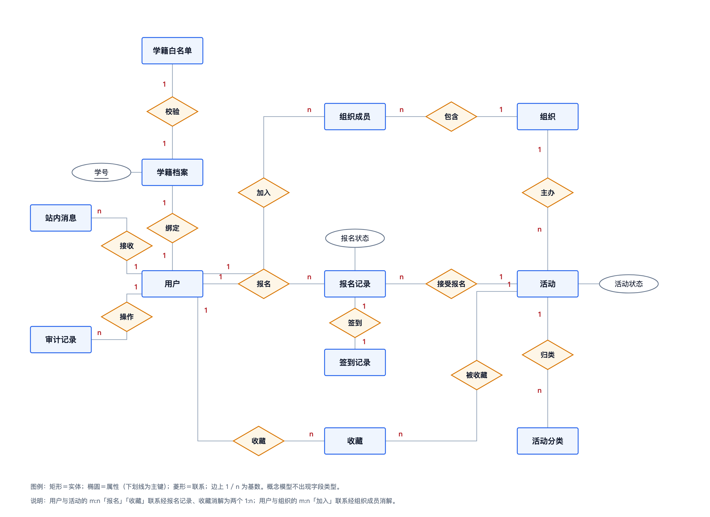
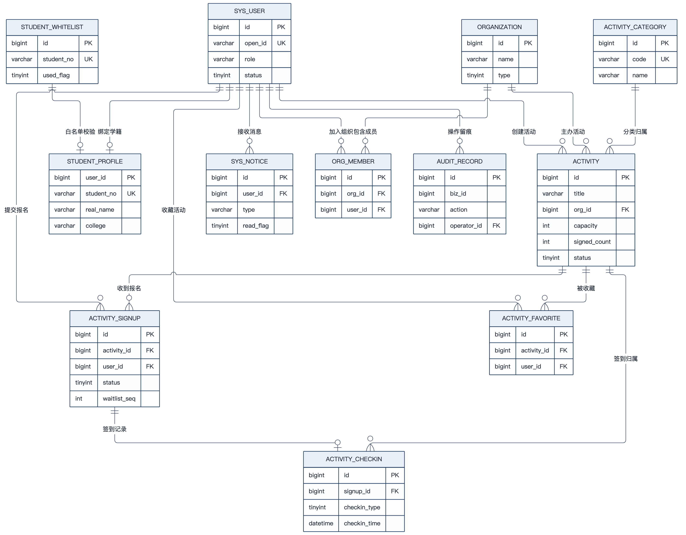

# 校园活动管理平台 · 数据库设计说明书

| 项 | 内容 |
| --- | --- |
| 文档编号 | CA-DOC-04 |
| 文档名称 | 数据库设计说明书 |
| 版本 | v1.0 |
| 日期 | 2026-11-20 |
| 对应阶段 | 数据库设计 |
| 编写 | 项目组 |
| 审核 | 指导教师 |
| 状态 | 定稿 |

## 版本记录

| 版本 | 日期 | 修订人 | 修订说明 |
| --- | --- | --- | --- |
| v1.0 | 2026-11-20 | 项目组 | 首次编写，覆盖概念模型、逻辑模型、12 张表物理设计、字典、索引、并发与容量估算 |

## 1 引言与设计原则

本章回答“数据库按什么原则设计、环境与命名有哪些约定、本文以什么为准”。

### 1.1 编写目的与范围

本文档定义校园活动管理平台的数据库设计，包括概念模型、逻辑模型、12 张表的物理结构、状态字典、索引与查询映射、并发一致性方案、初始化数据与容量估算。读者为后端开发、测试与部署人员。接口字段定义见 [05 接口设计说明书](05-接口设计说明书.md)，模块与流程背景见 [03 概要设计说明书](03-概要设计说明书.md)。

本设计的唯一事实来源是 `server/src/main/resources/db/schema.sql`；种子数据以 `server/src/main/resources/db/data.sql` 为准。本文不新增任何 schema 中不存在的表、字段或索引。

### 1.2 设计原则

表 4-1 数据库设计原则

| 原则 | 落点 | 收益 |
| --- | --- | --- |
| 先满足第三范式，再适度反范式 | 12 张表按职责拆分；`activity` 保留计数冗余 | 避免大范围联查，同时控制更新复杂度 |
| 不使用物理外键 | 所有表 `SET FOREIGN_KEY_CHECKS = 0`，无 `FOREIGN KEY` 定义 | 演示数据可整表覆盖；不影响逻辑正确性 |
| 应用层生成主键 | `BIGINT` 主键 + MyBatis-Plus `assign_id` 雪花算法 | 主键全局唯一，便于将来分库分表 |
| 状态用 `TINYINT` | `activity.status`、`activity_signup.status` 等 | 存储紧凑、比较高效，中文标签由枚举维护 |
| 时间用 `DATETIME` | 全部时间字段 | 不受时区转换影响，直接对应 `LocalDateTime` |
| 统一 `utf8mb4` | 所有表 `DEFAULT CHARSET = utf8mb4` | 支持 emoji 与多语言 |
| 逻辑删除只用于需保留历史的主表 | `sys_user`、`organization`、`activity` 三表含 `deleted` | 查询自动过滤，避免误用 |
| 关键唯一性用唯一索引兜底 | `uk_open_id`、`uk_activity_user`、`uk_signup_no`、`uk_signup` | 并发下由数据库保证不重复 |
| 审计只追加 | `audit_record` 无更新/删除入口 | 操作可追溯 |

### 1.3 数据库环境与约定

表 4-2 数据库环境与命名约定

| 项 | 约定 |
| --- | --- |
| 数据库 | MySQL 8.0+，库名 `campus_activity` |
| 引擎 / 字符集 / 排序 | InnoDB / `utf8mb4` / 默认 |
| 库连接 | `jdbc:mysql://127.0.0.1:3306/campus_activity...&serverTimezone=Asia/Shanghai` |
| 表名 | 小写下划线，单数，如 `activity_signup` |
| 字段名 | 小写下划线，如 `signup_start_time` |
| 主键 | 统一 `id BIGINT`（`student_profile` 以 `user_id` 为主键） |
| 唯一索引 | `uk_` 前缀；普通索引 `idx_` 前缀 |
| 时间字段 | `create_time`、`update_time`、业务时间；`update_time` 带 `ON UPDATE CURRENT_TIMESTAMP` |
| 布尔语义 | `TINYINT`，1 是 / 0 否，不建 `BOOLEAN` |
| JSON 字段 | `form_fields`（活动自定义字段定义）、`form_data`（报名答案） |
| 金额 | 无（V1 无支付，不设计金额字段） |

### 1.4 数量口径

共 12 张表（T-01 ~ T-12）；实体 12 个、Mapper 12 个；活动状态 7 个、报名状态 7 个、角色 4 个、消息类型 5 个、审计业务类型 4 个、审计动作 5 个。数字与 [_写作基线.md](_写作基线.md) 第 2、6、9 节一致。

## 2 概念模型

本章回答“系统有哪些实体、实体之间是什么联系、基数如何”。

### 2.1 实体识别

表 4-3 实体清单

| 实体 | 对应表 | 说明 |
| --- | --- | --- |
| 用户 | `sys_user` | 学生、组织者、审核员、管理员四种角色共用 |
| 学籍档案 | `student_profile` | 绑定后写入的学号、姓名、学院、年级、专业 |
| 学籍白名单 | `student_whitelist` | 管理员预置的学号名单，绑定校验依据 |
| 组织 | `organization` | 社团、院系、部门 |
| 组织成员 | `org_member` | 用户与组织的多对多关系 |
| 活动分类 | `activity_category` | 6 个演示分类 |
| 活动 | `activity` | 可报名的一次校园活动 |
| 报名记录 | `activity_signup` | 一个用户对一场活动的唯一报名 |
| 签到记录 | `activity_checkin` | 一次实际签到，与报名一对一 |
| 收藏 | `activity_favorite` | 用户与活动的多对多收藏关系 |
| 站内消息 | `sys_notice` | 报名、审核、候补等通知 |
| 审计记录 | `audit_record` | 审核、取消、补签、角色变更留痕 |

### 2.2 联系与基数

表 4-4 联系与基数

| 编号 | 联系 | 参与实体 | 基数 | 说明 |
| --- | --- | --- | --- | --- |
| R-01 | 拥有学籍 | 用户—学籍档案 | 1:0..1 | 学生绑定后才有档案；后台账号无档案 |
| R-02 | 加入 | 用户—组织 | N:M | 通过 `org_member` 实现，`uk_org_user` 防重复 |
| R-03 | 主办 | 组织—活动 | 1:N | 一个组织可办多场活动 |
| R-04 | 创建 | 用户—活动 | 1:N | 组织者创建活动，`creator_id` 记录归属 |
| R-05 | 归类 | 分类—活动 | 1:N | 每个活动属于一个分类 |
| R-06 | 报名 | 用户—活动 | N:M | 通过 `activity_signup` 实现，同一活动同一用户唯一 |
| R-07 | 签到 | 报名—签到 | 1:0..1 | 报名成功后最多一条签到，`uk_signup` 保证 |
| R-08 | 收藏 | 用户—活动 | N:M | 通过 `activity_favorite` 实现 |
| R-09 | 接收 | 用户—消息 | 1:N | 消息按用户投递 |
| R-10 | 操作 | 用户—审计 | 1:N | 审计记录操作人；业务对象用 `biz_type + biz_id` 弱关联 |

### 2.3 E-R 概念图

如图 4-1 所示，概念模型用 Chen 记号表达实体、属性与联系，只体现业务语义，不出现字段类型。核心链路是“组织主办活动 → 学生报名活动 → 报名产生签到”，收藏、消息、审计、白名单作为外围实体存在。



图 4-1 说明：用户与学籍档案是 1:0..1（学生绑定后才有档案）；用户与活动之间有“报名”和“收藏”两个不同语义的多对多联系；报名与签到是 1:0..1；组织与用户通过“加入”联系形成多对多。概念图不表达具体表名与外键，逻辑模型见第 3 章。

### 2.4 概念模型要点

1. **用户单实体多角色**：四类角色共用“用户”实体，通过角色属性区分，避免“学生、组织者、管理员”三个实体之间的重复属性与登录分裂。
2. **报名与签到分离**：报名是意愿与名额占用的记录，签到是到场事实；二者分离后可以表达“报名成功但未到场（`NO_SHOW`）”，也便于统计到场率。
3. **审计多态弱关联**：审计对象可能是活动、报名、签到或用户，因此不用单一外键指向某张表，而用 `biz_type + biz_id` 弱关联。
4. **组织成员独立成联系**：用户与组织多对多，且成员有“负责人/成员”角色，因此把联系提升为实体 `org_member`。

## 3 逻辑模型

本章回答“概念模型如何落到 12 张关系表、表之间如何关联、为什么不建外键”。

### 3.1 关系模式

12 个关系模式如下（主键加下划线，唯一键标注 `UK`，普通索引标注 `IDX`）：

1. `sys_user`(_id_, open_id UK, nickname, avatar_url, phone, role, org_id, username UK, password_hash, status, last_login_time, create_time, update_time, deleted)
2. `student_profile`(_user_id_, student_no UK, real_name, college, grade, major, create_time, update_time)
3. `student_whitelist`(_id_, student_no UK, real_name, college, grade, major, used_flag, create_time)
4. `organization`(_id_, name, type IDX, logo_url, description, contact, status, create_time, update_time, deleted)
5. `org_member`(_id_, org_id, user_id, title, create_time, (org_id, user_id) UK, user_id IDX)
6. `activity_category`(_id_, name, code UK, icon, sort, status)
7. `activity`(_id_, title, cover_url, category_id IDX, org_id IDX, creator_id, summary, content, start_time, end_time, signup_start_time, signup_end_time, cancel_deadline, location_name, address, latitude, longitude, capacity, signed_count, waitlist_enabled, audit_required, checkin_type, form_fields, status, reject_reason, view_count, favorite_count, signup_count, publish_time, create_time, update_time, deleted, (status, start_time) IDX)
8. `activity_signup`(_id_, activity_id, user_id, signup_no UK, status, waitlist_seq, form_data, audit_user_id, audit_time, cancel_time, checkin_time, create_time, update_time, (activity_id, user_id) UK, (user_id, status) IDX)
9. `activity_checkin`(_id_, activity_id IDX, signup_id UK, user_id, checkin_type, operator_id, latitude, longitude, remark, checkin_time, create_time)
10. `activity_favorite`(_id_, activity_id, user_id, create_time, (activity_id, user_id) UK)
11. `sys_notice`(_id_, user_id, type, title, content, biz_id, read_flag, create_time, (user_id, read_flag) IDX)
12. `audit_record`(_id_, biz_type, biz_id, action, operator_id, operator_name, before_status, after_status, remark, create_time, (biz_type, biz_id) IDX)

### 3.2 关系说明

逻辑模型中没有物理外键，表间关联依靠字段语义与应用层保证：

表 4-5 逻辑表间关联

| 关系 | 关联字段 | 关联方向 | 应用层操作 |
| --- | --- | --- | --- |
| 用户—学籍 | `student_profile.user_id` → `sys_user.id` | 1:1 | 按主键查询、按学号校验 |
| 用户—组织 | `sys_user.org_id` → `organization.id`；`org_member` | N:1 / N:M | 组织名展示、角色变更时校验组织 |
| 活动—组织/分类/创建人 | `activity.org_id`、`category_id`、`creator_id` | N:1 | `selectById` 取名称、归属校验 |
| 报名—活动/用户 | `activity_signup.activity_id`、`user_id` | N:1 | 按活动分页、按用户分页、唯一索引防重 |
| 签到—报名/活动/用户 | `activity_checkin.signup_id`、`activity_id`、`user_id` | N:1 | 唯一索引保证一对一，按活动统计到场 |
| 收藏—活动/用户 | `activity_favorite.activity_id`、`user_id` | N:M | 唯一索引保证幂等切换 |
| 消息—用户 | `sys_notice.user_id` | N:1 | 按用户分页、未读数统计 |
| 审计—业务 | `audit_record.biz_type` + `biz_id` | 多态 | 按业务类型与 ID 追溯 |

### 3.3 物理模型图

如图 4-2 所示，物理模型给出 12 张表的字段与主键/外键关系（图中外键连线表示逻辑关联，数据库未建约束）。



图 4-2 说明：物理模型中的连线是“语义外键”，便于理解表间关系；实际建表语句不含 `FOREIGN KEY`。`activity_signup` 是报名链路的中心表，向上关联 `activity` 与 `sys_user`，向下被 `activity_checkin` 一对一引用。该图信息密度较高，打印时建议横向或放大查看；每个字段的类型、约束与索引以 4.1～4.12 节的表格为准。

### 3.4 无物理外键的取舍

表 4-6 物理外键取舍

| 维度 | 建物理外键 | 不建物理外键（本系统） |
| --- | --- | --- |
| 数据完整性 | 数据库强约束 | 应用层校验 + 唯一索引 + 事务 |
| 演示数据导入 | 需严格按父表顺序，或先关检查 | 可先删子表再删父表，脚本简单 |
| 删除与分库 | 受约束限制，分库困难 | 无约束负担，便于拆分 |
| 索引 | 自动创建外键索引 | 手工按查询建索引，更可控 |
| 排查成本 | 违反约束时报错清晰 | 脏数据需靠巡检与测试发现 |

结论：课程设计场景优先保证“可演示、可迁移、索引可控”，因此不建物理外键；完整性由以下手段保证：写入顺序固定（先主表后子表）、事务包裹、唯一索引兜底、查询时用主键/唯一键回查、逻辑删除过滤。

## 4 物理设计

本章回答“12 张表每张有哪些字段、类型、约束、默认值与索引”。

以下字段表均按 `schema.sql` 顺序与定义整理；“可空”为“否”表示 `NOT NULL`。所有表的存储引擎为 InnoDB、字符集 `utf8mb4`。

### 4.1 用户表 `sys_user`（T-01）

表 4-7 用户表字段定义

| 字段 | 类型 | 可空 | 默认 | 说明 |
| --- | --- | --- | --- | --- |
| id | BIGINT | 否 | 无 | 主键，雪花 ID |
| open_id | VARCHAR(64) | 否 | 无 | 微信 openid；后台账号用 `admin:<username>` 占位 |
| nickname | VARCHAR(64) | 是 | NULL | 昵称 |
| avatar_url | VARCHAR(500) | 是 | NULL | 头像 URL |
| phone | VARCHAR(20) | 是 | NULL | 手机号 |
| role | VARCHAR(20) | 否 | 'STUDENT' | STUDENT / ORGANIZER / REVIEWER / ADMIN |
| org_id | BIGINT | 是 | NULL | 组织者所属组织 |
| username | VARCHAR(50) | 是 | NULL | 后台登录名，仅后台账号使用 |
| password_hash | VARCHAR(100) | 是 | NULL | BCrypt 密码，仅后台账号使用 |
| status | TINYINT | 否 | 1 | 1 正常、0 禁用 |
| last_login_time | DATETIME | 是 | NULL | 最近登录时间 |
| create_time | DATETIME | 否 | CURRENT_TIMESTAMP | 创建时间 |
| update_time | DATETIME | 否 | CURRENT_TIMESTAMP，更新时自动刷新 | 更新时间 |
| deleted | TINYINT | 否 | 0 | 逻辑删除，0 正常、1 删除 |

索引：`PRIMARY KEY (id)`；`UNIQUE uk_open_id (open_id)`；`UNIQUE uk_username (username)`；`KEY idx_role_org (role, org_id)`。

设计说明：单表承载四类角色，学生/组织者用 `open_id` 登录，后台账号用 `username + password_hash` 登录，两组字段互斥为空；`uk_username` 允许多行 NULL，因此学生账号不受影响；`deleted` 由 `@TableLogic` 自动过滤。

### 4.2 学籍档案表 `student_profile`（T-02）

表 4-8 学籍档案表字段定义

| 字段 | 类型 | 可空 | 默认 | 说明 |
| --- | --- | --- | --- | --- |
| user_id | BIGINT | 否 | 无 | 主键，同时是用户 ID |
| student_no | VARCHAR(32) | 否 | 无 | 学号 |
| real_name | VARCHAR(50) | 否 | 无 | 姓名 |
| college | VARCHAR(60) | 是 | NULL | 学院 |
| grade | VARCHAR(20) | 是 | NULL | 年级，如 2023 |
| major | VARCHAR(60) | 是 | NULL | 专业 |
| create_time | DATETIME | 否 | CURRENT_TIMESTAMP | 创建时间 |
| update_time | DATETIME | 否 | CURRENT_TIMESTAMP，更新时自动刷新 | 更新时间 |

索引：`PRIMARY KEY (user_id)`；`UNIQUE uk_student_no (student_no)`。

设计说明：以 `user_id` 作主键，天然保证用户与档案一对一；`uk_student_no` 保证一个学号只能绑定一个账号（BR-16）；该表无 `deleted`，绑定是覆盖更新而非删除。

### 4.3 学籍白名单表 `student_whitelist`（T-03）

表 4-9 学籍白名单表字段定义

| 字段 | 类型 | 可空 | 默认 | 说明 |
| --- | --- | --- | --- | --- |
| id | BIGINT | 否 | 无 | 主键，雪花 ID |
| student_no | VARCHAR(32) | 否 | 无 | 学号 |
| real_name | VARCHAR(50) | 否 | 无 | 姓名 |
| college | VARCHAR(60) | 是 | NULL | 学院 |
| grade | VARCHAR(20) | 是 | NULL | 年级 |
| major | VARCHAR(60) | 是 | NULL | 专业 |
| used_flag | TINYINT | 否 | 0 | 是否已被绑定，0 未绑定、1 已绑定 |
| create_time | DATETIME | 否 | CURRENT_TIMESTAMP | 创建时间 |

索引：`PRIMARY KEY (id)`；`UNIQUE uk_student_no (student_no)`。

设计说明：白名单由管理员预置，绑定时按学号精确匹配；`used_flag` 仅作管理展示，真正的唯一性由 `student_profile.uk_student_no` 保证，二者互为冗余校验。

### 4.4 组织表 `organization`（T-04）

表 4-10 组织表字段定义

| 字段 | 类型 | 可空 | 默认 | 说明 |
| --- | --- | --- | --- | --- |
| id | BIGINT | 否 | 无 | 主键，雪花 ID |
| name | VARCHAR(80) | 否 | 无 | 组织名称 |
| type | TINYINT | 否 | 1 | 1 社团、2 院系、3 部门 |
| logo_url | VARCHAR(500) | 是 | NULL | 组织 Logo |
| description | VARCHAR(300) | 是 | NULL | 组织简介 |
| contact | VARCHAR(50) | 是 | NULL | 联系人 |
| status | TINYINT | 否 | 1 | 1 正常、0 停用 |
| create_time | DATETIME | 否 | CURRENT_TIMESTAMP | 创建时间 |
| update_time | DATETIME | 否 | CURRENT_TIMESTAMP，更新时自动刷新 | 更新时间 |
| deleted | TINYINT | 否 | 0 | 逻辑删除 |

索引：`PRIMARY KEY (id)`；`KEY idx_type (type)`。

设计说明：`idx_type` 为按类型筛选预留，当前代码未使用（见 6.3 节）；`status` 用于组织列表只返回启用组织。

### 4.5 组织成员表 `org_member`（T-05）

表 4-11 组织成员表字段定义

| 字段 | 类型 | 可空 | 默认 | 说明 |
| --- | --- | --- | --- | --- |
| id | BIGINT | 否 | 无 | 主键，雪花 ID |
| org_id | BIGINT | 否 | 无 | 组织 ID |
| user_id | BIGINT | 否 | 无 | 用户 ID |
| title | VARCHAR(30) | 是 | '成员' | 负责人 / 成员 |
| create_time | DATETIME | 否 | CURRENT_TIMESTAMP | 加入时间 |

索引：`PRIMARY KEY (id)`；`UNIQUE uk_org_user (org_id, user_id)`；`KEY idx_user (user_id)`。

设计说明：`uk_org_user` 保证同一用户在同一组织只有一条记录；`idx_user` 支持按用户反查所属组织。当前业务以 `sys_user.org_id` 为主，`org_member` 仅作扩展与组织成员展示。

### 4.6 活动分类表 `activity_category`（T-06）

表 4-12 活动分类表字段定义

| 字段 | 类型 | 可空 | 默认 | 说明 |
| --- | --- | --- | --- | --- |
| id | BIGINT | 否 | 无 | 主键，雪花 ID |
| name | VARCHAR(30) | 否 | 无 | 分类名 |
| code | VARCHAR(30) | 否 | 无 | 英文编码 |
| icon | VARCHAR(50) | 是 | NULL | 图标名或颜色值 |
| sort | INT | 否 | 0 | 排序值，升序 |
| status | TINYINT | 否 | 1 | 1 启用、0 停用 |

索引：`PRIMARY KEY (id)`；`UNIQUE uk_code (code)`。

设计说明：分类数据量小、变更少，无时间字段；`uk_code` 防止编码重复；演示数据中 `icon` 存放十六进制颜色值（如 `#2563eb`），前端直接用于分类标识。

### 4.7 活动表 `activity`（T-07）

表 4-13 活动表字段定义

| 字段 | 类型 | 可空 | 默认 | 说明 |
| --- | --- | --- | --- | --- |
| id | BIGINT | 否 | 无 | 主键，雪花 ID |
| title | VARCHAR(60) | 否 | 无 | 标题 |
| cover_url | VARCHAR(500) | 是 | NULL | 封面 URL（V1 无上传，可留空） |
| category_id | BIGINT | 否 | 无 | 分类 ID |
| org_id | BIGINT | 否 | 无 | 主办组织 ID |
| creator_id | BIGINT | 否 | 无 | 创建人（组织者）ID |
| summary | VARCHAR(200) | 是 | NULL | 简介 |
| content | TEXT | 是 | NULL | 详情正文 |
| start_time | DATETIME | 否 | 无 | 活动开始 |
| end_time | DATETIME | 否 | 无 | 活动结束 |
| signup_start_time | DATETIME | 否 | 无 | 报名开始 |
| signup_end_time | DATETIME | 否 | 无 | 报名结束 |
| cancel_deadline | DATETIME | 是 | NULL | 取消报名截止（缺省开始前 2 小时） |
| location_name | VARCHAR(120) | 否 | 无 | 场地名称 |
| address | VARCHAR(200) | 是 | NULL | 详细地址 |
| latitude | DECIMAL(10,7) | 是 | NULL | 纬度 |
| longitude | DECIMAL(10,7) | 是 | NULL | 经度 |
| capacity | INT | 否 | 0 | 容量，0 表示不限 |
| signed_count | INT | 否 | 0 | 已占名额 |
| waitlist_enabled | TINYINT | 否 | 0 | 是否开启候补 |
| audit_required | TINYINT | 否 | 0 | 报名是否需审核 |
| checkin_type | TINYINT | 否 | 1 | 1 扫码、2 扫码+定位、3 仅手动 |
| form_fields | JSON | 是 | NULL | 自定义报名字段定义 |
| status | TINYINT | 否 | 0 | 0 草稿、1 待审核、2 已驳回、3 已发布、4 进行中、5 已结束、6 已取消 |
| reject_reason | VARCHAR(300) | 是 | NULL | 驳回原因 / 取消原因 |
| view_count | INT | 否 | 0 | 浏览量 |
| favorite_count | INT | 否 | 0 | 收藏数 |
| signup_count | INT | 否 | 0 | 累计报名数（含取消），用于热度排序 |
| publish_time | DATETIME | 是 | NULL | 首次审核通过时间 |
| create_time | DATETIME | 否 | CURRENT_TIMESTAMP | 创建时间 |
| update_time | DATETIME | 否 | CURRENT_TIMESTAMP，更新时自动刷新 | 更新时间 |
| deleted | TINYINT | 否 | 0 | 逻辑删除 |

索引：`PRIMARY KEY (id)`；`KEY idx_status_start (status, start_time)`；`KEY idx_org (org_id)`；`KEY idx_category (category_id)`。

设计说明：这是字段最多的表，承载活动全生命周期。四个计数（`signed_count`、`signup_count`、`view_count`、`favorite_count`）为列表页与热度排序服务；`status` 与 `start_time` 组成联合索引，覆盖学生端列表的“可见状态 + 时间排序”场景；`form_fields` 以 JSON 存字段定义，避免为自定义表单建附表。

### 4.8 报名记录表 `activity_signup`（T-08）

表 4-14 报名记录表字段定义

| 字段 | 类型 | 可空 | 默认 | 说明 |
| --- | --- | --- | --- | --- |
| id | BIGINT | 否 | 无 | 主键，雪花 ID |
| activity_id | BIGINT | 否 | 无 | 活动 ID |
| user_id | BIGINT | 否 | 无 | 报名用户 ID |
| signup_no | VARCHAR(32) | 否 | 无 | 签到凭证号 |
| status | TINYINT | 否 | 1 | 0 待审核、1 成功、2 候补、3 已签到、4 已取消、5 审核未通过、6 未到场 |
| waitlist_seq | INT | 否 | 0 | 候补序号，非候补状态为 0 |
| form_data | JSON | 是 | NULL | 自定义表单答案 |
| audit_user_id | BIGINT | 是 | NULL | 报名审核人 |
| audit_time | DATETIME | 是 | NULL | 审核时间 |
| cancel_time | DATETIME | 是 | NULL | 取消时间 |
| checkin_time | DATETIME | 是 | NULL | 签到时间 |
| create_time | DATETIME | 否 | CURRENT_TIMESTAMP | 创建时间 |
| update_time | DATETIME | 否 | CURRENT_TIMESTAMP，更新时自动刷新 | 更新时间 |

索引：`PRIMARY KEY (id)`；`UNIQUE uk_activity_user (activity_id, user_id)`；`UNIQUE uk_signup_no (signup_no)`；`KEY idx_user_status (user_id, status)`。

设计说明：`uk_activity_user` 保证同一用户同一活动只有一行，重复报名在并发下由唯一索引拦截；`signup_no` 是给学生出示的签到凭证号，格式为 `C + 毫秒时间戳 + 3 位随机数`；取消后重新报名复用同一行（更新状态与 `signup_no`），因此不会出现多行历史；`waitlist_seq` 只在候补状态有意义。

### 4.9 签到记录表 `activity_checkin`（T-09）

表 4-15 签到记录表字段定义

| 字段 | 类型 | 可空 | 默认 | 说明 |
| --- | --- | --- | --- | --- |
| id | BIGINT | 否 | 无 | 主键，雪花 ID |
| activity_id | BIGINT | 否 | 无 | 活动 ID |
| signup_id | BIGINT | 否 | 无 | 报名记录 ID |
| user_id | BIGINT | 否 | 无 | 签到用户 ID |
| checkin_type | TINYINT | 否 | 1 | 1 扫码、2 定位、3 补签 |
| operator_id | BIGINT | 是 | NULL | 补签操作人 |
| latitude | DECIMAL(10,7) | 是 | NULL | 签到纬度 |
| longitude | DECIMAL(10,7) | 是 | NULL | 签到经度 |
| remark | VARCHAR(200) | 是 | NULL | 备注（补签原因） |
| checkin_time | DATETIME | 否 | CURRENT_TIMESTAMP | 签到时间 |
| create_time | DATETIME | 否 | CURRENT_TIMESTAMP | 创建时间 |

索引：`PRIMARY KEY (id)`；`UNIQUE uk_signup (signup_id)`；`KEY idx_activity (activity_id)`。

设计说明：`uk_signup` 保证一条报名最多一条签到记录，是“重复签到”的最终防线；`idx_activity` 支持核销台按活动取最近 5 条到场记录与统计；报名表上也有 `checkin_time`，与签到表形成“状态 + 明细”的双记录，前者用于列表筛选，后者用于轨迹与审计。

### 4.10 收藏表 `activity_favorite`（T-10）

表 4-16 收藏表字段定义

| 字段 | 类型 | 可空 | 默认 | 说明 |
| --- | --- | --- | --- | --- |
| id | BIGINT | 否 | 无 | 主键，雪花 ID |
| activity_id | BIGINT | 否 | 无 | 活动 ID |
| user_id | BIGINT | 否 | 无 | 用户 ID |
| create_time | DATETIME | 否 | CURRENT_TIMESTAMP | 收藏时间 |

索引：`PRIMARY KEY (id)`；`UNIQUE uk_activity_user (activity_id, user_id)`。

设计说明：收藏是典型的多对多关系表，唯一索引让“收藏/取消收藏”可以幂等切换；取消收藏为物理删除，不保留历史，因此无 `deleted`。

### 4.11 站内消息表 `sys_notice`（T-11）

表 4-17 站内消息表字段定义

| 字段 | 类型 | 可空 | 默认 | 说明 |
| --- | --- | --- | --- | --- |
| id | BIGINT | 否 | 无 | 主键，雪花 ID |
| user_id | BIGINT | 否 | 无 | 接收用户 ID |
| type | VARCHAR(30) | 否 | 无 | SIGNUP / AUDIT / REMIND / CANCEL / WAITLIST |
| title | VARCHAR(80) | 否 | 无 | 标题 |
| content | VARCHAR(500) | 是 | NULL | 内容 |
| biz_id | BIGINT | 是 | NULL | 关联业务 ID（如活动 ID） |
| read_flag | TINYINT | 否 | 0 | 0 未读、1 已读 |
| create_time | DATETIME | 否 | CURRENT_TIMESTAMP | 创建时间 |

索引：`PRIMARY KEY (id)`；`KEY idx_user_read (user_id, read_flag)`。

设计说明：消息只追加不修改（已读标记除外）；`idx_user_read` 同时服务消息分页（按 `user_id`）与未读数统计（`user_id + read_flag=0`）；`biz_id` 只存关联 ID，不区分业务类型，前端按 `type` 决定跳转目标。

### 4.12 审计记录表 `audit_record`（T-12）

表 4-18 审计记录表字段定义

| 字段 | 类型 | 可空 | 默认 | 说明 |
| --- | --- | --- | --- | --- |
| id | BIGINT | 否 | 无 | 主键，雪花 ID |
| biz_type | VARCHAR(30) | 否 | 无 | ACTIVITY / SIGNUP / CHECKIN / USER |
| biz_id | BIGINT | 否 | 无 | 业务对象 ID |
| action | VARCHAR(30) | 否 | 无 | APPROVE / REJECT / CANCEL / MANUAL_CHECKIN / ROLE_CHANGE |
| operator_id | BIGINT | 否 | 无 | 操作人用户 ID |
| operator_name | VARCHAR(50) | 是 | NULL | 操作人昵称快照 |
| before_status | VARCHAR(30) | 是 | NULL | 变更前状态 |
| after_status | VARCHAR(30) | 是 | NULL | 变更后状态 |
| remark | VARCHAR(300) | 是 | NULL | 备注（理由） |
| create_time | DATETIME | 否 | CURRENT_TIMESTAMP | 操作时间 |

索引：`PRIMARY KEY (id)`；`KEY idx_biz (biz_type, biz_id)`。

设计说明：`operator_name` 冗余昵称快照，避免用户改名后历史审计失真；`before_status/after_status` 用字符串而非数字，便于同时记录活动状态、报名状态与角色值；审计只追加，不更新不删除。

### 4.13 字段类型约定

表 4-19 字段类型与长度约定

| 类型 | 使用场景 | 说明 |
| --- | --- | --- |
| BIGINT | 主键、外键语义字段、业务 ID | 雪花 ID 为 19 位，`BIGINT` 足够 |
| TINYINT | 状态、开关、标记 | 取值范围小，避免 `VARCHAR` 状态 |
| INT | 计数、容量、排序 | 容量与计数不超过 21 亿 |
| DECIMAL(10,7) | 经纬度 | 精度约 1.1 cm，满足 200 米签到判定 |
| VARCHAR(30/32/50/60/64/80/120/200/300/500) | 文本类字段 | 按业务上限设定，不用 `TEXT` 替代 |
| TEXT | 活动详情正文 | 长度不可控，不参与索引 |
| JSON | 自定义表单定义与答案 | MySQL 8 原生 JSON，应用层以字符串读写 |
| DATETIME | 全部时间 | 与 Java `LocalDateTime` 直接映射，无时区转换 |

## 5 状态与字典

本章回答“各状态字段的取值、含义与迁移由谁触发”。

### 5.1 活动状态 `activity.status`

表 4-20 活动状态字典（7 态）

| code | 枚举 | 中文 | 学生可见 | 进入条件 | 可离开到 |
| --- | --- | --- | --- | --- | --- |
| 0 | DRAFT | 草稿 | 否 | 组织者新建 | 1（提审） |
| 1 | PENDING | 待审核 | 否 | 草稿/已驳回提交；已发布活动被编辑 | 3（审核通过）、2（驳回） |
| 2 | REJECTED | 已驳回 | 否 | 审核不通过 | 1（重新提审）、可编辑 |
| 3 | PUBLISHED | 已发布 | 是 | 审核通过 | 4（到开始时间）、5（到结束时间）、6（取消） |
| 4 | ONGOING | 进行中 | 是 | 定时任务推进 | 5（到结束时间） |
| 5 | FINISHED | 已结束 | 是 | 定时任务推进 | 不可再变更（编辑被拒） |
| 6 | CANCELLED | 已取消 | 否 | 组织者取消或管理员下架 | 不可再变更（编辑被拒） |

活动状态的迁移入口集中在 `ActivityService`：`create`（→0）、`submit`（→1）、`audit`（→3/2）、`update`（3/4 编辑后回 1）、`cancelByOrg`/`offline`（→6），以及 `ActivityStatusJob`（3→4→5）。

### 5.2 报名状态 `activity_signup.status`

表 4-21 报名状态字典（7 态）

| code | 枚举 | 中文 | 占名额 | 可取消 | 进入条件 |
| --- | --- | --- | --- | --- | --- |
| 0 | PENDING | 待审核 | 否 | 是 | 活动开启报名审核 |
| 1 | SUCCESS | 报名成功 | 是 | 是 | 不需要审核且占位成功；审核通过；候补转正 |
| 2 | WAITLIST | 候补中 | 否 | 是 | 满员且开启候补 |
| 3 | CHECKED_IN | 已签到 | 是 | 否 | 扫码签到或组织者补签 |
| 4 | CANCELLED | 已取消 | 否 | 否 | 用户主动取消 |
| 5 | REJECTED | 审核未通过 | 否 | 否 | 组织者驳回 |
| 6 | NO_SHOW | 未到场 | 是 | 否 | 活动结束后仍为 SUCCESS |

报名状态的迁移入口集中在 `SignupService`（报名分流、取消、候补转正、报名审核）与 `CheckinService`（扫码/补签），以及 `ActivityStatusJob`（SUCCESS→NO_SHOW）。已取消与审核未通过可以重新报名；其余状态重复提交返回 30002。

### 5.3 其他字典

表 4-22 其他字段字典

| 字段 | 取值 | 含义 |
| --- | --- | --- |
| `activity.checkin_type` | 1 / 2 / 3 | 扫码 / 扫码 + 定位 / 仅组织者手动 |
| `activity.waitlist_enabled` | 0 / 1 | 未开启 / 开启候补 |
| `activity.audit_required` | 0 / 1 | 报名无需审核 / 需审核 |
| `sys_user.role` | STUDENT / ORGANIZER / REVIEWER / ADMIN | 学生 / 组织者 / 审核员 / 管理员 |
| `sys_user.status` | 1 / 0 | 正常 / 禁用 |
| `organization.type` | 1 / 2 / 3 | 社团 / 院系 / 部门 |
| `organization.status` | 1 / 0 | 正常 / 停用 |
| `sys_notice.type` | SIGNUP / AUDIT / REMIND / CANCEL / WAITLIST | 报名 / 审核 / 提醒 / 取消 / 候补 |
| `sys_notice.read_flag` | 0 / 1 | 未读 / 已读 |
| `activity_checkin.checkin_type` | 1 / 2 / 3 | 扫码 / 定位 / 补签 |
| `audit_record.biz_type` | ACTIVITY / SIGNUP / CHECKIN / USER | 业务类型 |
| `audit_record.action` | APPROVE / REJECT / CANCEL / MANUAL_CHECKIN / ROLE_CHANGE | 操作动作 |
| `student_whitelist.used_flag` | 0 / 1 | 未绑定 / 已绑定 |
| `deleted` | 0 / 1 | 正常 / 删除（仅 3 张表） |

### 5.4 字典实现方式

状态与字典在数据库中存 `code`，中文标签由 `ActivityStatus`、`SignupStatus` 两个枚举维护，其余字符串字典由服务层常量或枚举常量约束（如 `AdminService.ROLES` 的白名单校验）。`schema.sql` 未使用 `CHECK` 约束或外键字典表，非法值由应用层拦截；这样便于扩展取值，代价是数据库层面不做强校验。

## 6 索引设计与查询映射

本章回答“12 张表有哪些索引、每个索引服务哪条查询、哪些索引尚未被使用”。

### 6.1 索引清单

表 4-23 索引清单

| 表 | 索引 | 类型 | 字段 |
| --- | --- | --- | --- |
| sys_user | PRIMARY | 主键 | id |
| sys_user | uk_open_id | 唯一 | open_id |
| sys_user | uk_username | 唯一 | username |
| sys_user | idx_role_org | 普通 | role, org_id |
| student_profile | PRIMARY | 主键 | user_id |
| student_profile | uk_student_no | 唯一 | student_no |
| student_whitelist | PRIMARY | 主键 | id |
| student_whitelist | uk_student_no | 唯一 | student_no |
| organization | PRIMARY | 主键 | id |
| organization | idx_type | 普通 | type |
| org_member | PRIMARY | 主键 | id |
| org_member | uk_org_user | 唯一 | org_id, user_id |
| org_member | idx_user | 普通 | user_id |
| activity_category | PRIMARY | 主键 | id |
| activity_category | uk_code | 唯一 | code |
| activity | PRIMARY | 主键 | id |
| activity | idx_status_start | 普通 | status, start_time |
| activity | idx_org | 普通 | org_id |
| activity | idx_category | 普通 | category_id |
| activity_signup | PRIMARY | 主键 | id |
| activity_signup | uk_activity_user | 唯一 | activity_id, user_id |
| activity_signup | uk_signup_no | 唯一 | signup_no |
| activity_signup | idx_user_status | 普通 | user_id, status |
| activity_checkin | PRIMARY | 主键 | id |
| activity_checkin | uk_signup | 唯一 | signup_id |
| activity_checkin | idx_activity | 普通 | activity_id |
| activity_favorite | PRIMARY | 主键 | id |
| activity_favorite | uk_activity_user | 唯一 | activity_id, user_id |
| sys_notice | PRIMARY | 主键 | id |
| sys_notice | idx_user_read | 普通 | user_id, read_flag |
| audit_record | PRIMARY | 主键 | id |
| audit_record | idx_biz | 普通 | biz_type, biz_id |

共 12 个主键、10 个唯一索引、10 个普通索引，与 `schema.sql` 完全一致，无额外索引。

### 6.2 索引与查询映射

表 4-24 索引与查询映射

| 索引 | 对应查询 | 命中方式 |
| --- | --- | --- |
| `activity.idx_status_start` | 学生端活动列表：`WHERE status IN (3,4) AND start_time >= ? AND start_time < ? ORDER BY start_time`；已结束列表 `status=5 ORDER BY start_time DESC`；定时任务 `status=3 AND start_time <= now`、`status IN (3,4) AND end_time <= now`；后台工作台统计各状态数 | 联合索引最左 `status` 等值/IN，`start_time` 范围与排序 |
| `activity.idx_org` | 按主办组织筛选（当前代码未使用，保留扩展） | 等值 |
| `activity.idx_category` | 学生端按分类筛选 `category_id = ?` | 等值（与 status 条件并存时由优化器选择） |
| `activity_signup.uk_activity_user` | 报名前查重、活动详情查“我的报名状态”、扫码签到时按活动+用户取报名、并发重复报名兜底 | 唯一等值，覆盖两列 |
| `activity_signup.uk_signup_no` | 签到凭证号唯一性校验（当前按 ID 查详情，未按凭证号查询） | 唯一等值 |
| `activity_signup.idx_user_status` | 我的报名分页：`WHERE user_id = ? [AND status = ?] ORDER BY create_time DESC` | `user_id` 等值，`status` 可选；排序需额外排序 |
| `activity_checkin.uk_signup` | 防止同一报名重复签到（插入冲突即 40003） | 唯一等值 |
| `activity_checkin.idx_activity` | 核销台最近 5 条到场记录：`WHERE activity_id = ? ORDER BY checkin_time DESC LIMIT 5`；活动到场统计 | 等值，排序在内存完成 |
| `activity_favorite.uk_activity_user` | 收藏/取消收藏查询、活动详情判断是否收藏 | 唯一等值，覆盖两列 |
| `sys_user.uk_open_id` | 小程序登录按 openid 查用户 | 唯一等值 |
| `sys_user.uk_username` | 后台登录按账号查用户 | 唯一等值 |
| `sys_user.idx_role_org` | 后台用户列表按角色筛选 `WHERE role = ?` | 最左 `role` 等值 |
| `student_profile.uk_student_no` | 绑定时校验学号是否已被绑定 | 唯一等值 |
| `student_whitelist.uk_student_no` | 绑定校验学号是否在白名单 | 唯一等值 |
| `activity_category.uk_code` | 分类编码唯一性（当前按 sort/status 查询全集，未按 code 过滤） | 唯一等值 |
| `organization.idx_type` | 按组织类型筛选（当前未使用，保留扩展） | 等值 |
| `org_member.uk_org_user`、`idx_user` | 组织成员关系唯一性、按用户查组织（当前未使用，保留扩展） | 唯一等值 / 等值 |
| `sys_notice.idx_user_read` | 消息分页 `WHERE user_id = ? ORDER BY create_time DESC`；未读数 `user_id = ? AND read_flag = 0`；全部已读更新 | `user_id` 等值；未读数两列全命中 |
| `audit_record.idx_biz` | 按业务对象追溯审计（当前日志页为全表分页，未按业务过滤） | 联合等值 |

### 6.3 索引取舍与缺失索引

1. **学生端列表**：`status + start_time` 联合索引可同时服务状态过滤与时间排序；当 `category_id` 也参与条件时，优化器可能选择 `idx_category` 再回表过滤状态。数据量小时两种路径差异可忽略。
2. **我的报名**：`idx_user_status` 覆盖 `user_id` 与可选的 `status`，但 `ORDER BY create_time DESC` 无法用同一索引完成排序，会产生 `filesort`；若后续数据量大，可扩展为 `(user_id, status, create_time)` 或 `(user_id, create_time)`。
3. **组织者活动列表**：`ActivityService.pageForOrg` 以 `creator_id = ? ORDER BY create_time DESC` 查询，`schema.sql` 中没有 `creator_id` 索引，当前依赖全表扫描 + 排序；课程数据量下可接受，建议后续补 `idx_creator_create (creator_id, create_time)`。
4. **后台活动管理 / 待审核列表**：`adminPage` 与 `auditList` 以 `ORDER BY create_time` 为主，缺少 `create_time` 索引；数据量增长后建议补 `idx_create_time`。
5. **审计日志**：后台日志页为全表按 `create_time` 倒序分页，`idx_biz` 当前未被该查询使用；若按业务追溯增多，可保留 `idx_biz` 并补 `create_time` 索引。
6. **未被使用的索引**：`activity.idx_org`、`organization.idx_type`、`org_member` 两个索引、`activity_category.uk_code`、`activity_signup.uk_signup_no`（查询侧）、`audit_record.idx_biz` 在当前代码路径中未直接命中，属于唯一性约束或为后续功能预留，不建议在 V1 删除。
7. **分页上限**：MyBatis-Plus 分页插件设置 `maxLimit=50`，避免深分页带来的扫描放大；这是应用层保护，不是数据库索引设计。

## 7 并发与一致性

本章回答“高并发写入点如何保证不超卖、不重复、不丢计数”。

### 7.1 名额占用：条件更新

报名、报名审核通过、候补转正三处都调用同一个 SQL 占名额，判断条件在 `WHERE` 中完成：

```sql
UPDATE activity
   SET signed_count = signed_count + 1
 WHERE id = #{activityId}
   AND deleted = 0
   AND (capacity = 0 OR signed_count < capacity)
```

返回 1 表示占位成功，返回 0 表示名额已满或活动不存在；调用方据此分流为“报名成功”“候补”或抛 30001。释放名额用 `CASE WHEN signed_count > 0 THEN signed_count - 1 ELSE 0 END`，防止并发取消把计数减成负数。该方案依赖 InnoDB 行锁，`WHERE` 命中主键，锁粒度最小；无需应用层锁与重试循环。

### 7.2 唯一索引兜底

表 4-25 唯一索引与冲突处理

| 约束 | 防止的问题 | 冲突时的处理 |
| --- | --- | --- |
| `uk_activity_user`（报名） | 同一用户并发重复报名 | 捕获 `DuplicateKeyException`，返回 30002 |
| `uk_activity_user`（收藏） | 并发重复收藏 | 捕获冲突，视为已收藏返回 true |
| `uk_signup`（签到） | 并发重复签到、补签与扫码同时发生 | 捕获冲突，返回 40003 |
| `uk_open_id` / `uk_username` | 同一微信/账号重复建号 | 登录先查后插；并发极低，冲突由唯一索引拦截 |
| `uk_student_no`（档案） | 一个学号绑定多个账号 | 绑定时先查重，冲突时返回 10005 语义 |

### 7.3 候补序号

进入候补时取 `SELECT COALESCE(MAX(waitlist_seq), 0) FROM activity_signup WHERE activity_id = ? AND status = 2` 再加 1。并发报名可能读到相同最大值，从而出现重复序号；取队首时按 `waitlist_seq ASC, create_time ASC` 排序，重复序号由 `create_time` 兜底，转正顺序仍近似先到先得。该方案未加锁、无额外唯一约束，代价是极端并发下序号不严格唯一；若要严格化，可增加 `(activity_id, waitlist_seq)` 唯一索引并用重试补偿。

### 7.4 候补转正

取消报名释放名额后立即调用转正：取队首 → 尝试占位 → 占位成功才把状态改为 SUCCESS 并发送转正消息。两个并发取消可能同时触发转正：若只有一个空位，两个线程的占位 UPDATE 只有一个成功，另一个返回 0 后直接结束，不会重复转正；若空位足够，则各自转正不同的队首，符合预期。转正消息可能因事务边界外的异常丢失（消息在事务内写库，异常会回滚），不会出现“已转正但无消息”的永久不一致。

### 7.5 签到幂等

扫码签到与手动补签都先查报名状态，再插入签到记录，最后更新报名状态；两步之间由 `uk_signup` 兜底。即使两个请求同时通过状态检查，只有一个能插入成功，另一个收到唯一键冲突并返回 40003。签到场次（活动 + 报名）由 `uk_signup` 唯一确定，不存在同一报名两条签到记录。

### 7.6 计数字段一致性

表 4-26 计数字段维护点

| 字段 | 增加 | 减少 | 不变量 |
| --- | --- | --- | --- |
| `activity.signed_count` | 报名占位成功、审核通过占位、候补转正占位 | 取消报名且原状态占名额 | `0 <= signed_count`；容量 > 0 时 `signed_count <= capacity` |
| `activity.signup_count` | 每次提交报名（含重新报名） | 从不减少 | 累计口径，允许大于 `signed_count` |
| `activity.view_count` | 每次详情访问 | 从不减少 | 仅展示 |
| `activity.favorite_count` | 收藏成功 | 取消收藏（不低于 0） | 与 `activity_favorite` 行数一致（异常时可能短暂偏差） |
| `activity_signup.waitlist_seq` | 进入候补 | 转正后保留原值（不再使用） | 候补状态内递增 |

计数维护与主记录写入在同一事务内，主记录失败则计数回滚；但计数与明细表之间没有数据库级约束，若绕过服务层直接改库会造成偏差，因此不提供后台直接改数的入口。

### 7.7 事务与一致性边界

报名链路的事务包含“占位 UPDATE + 报名 insert/update + 计数 + 消息插入”，任一失败整体回滚，名额自动归还。签到链路包含“签到 insert + 报名状态更新”，同样原子。状态推进任务在单事务内批量处理，失败整批回滚并在 5 分钟后重试；由于更新条件带时间判断，重试不会产生错误迁移。消息发送在事务内落库，微信订阅消息在事务外的日志出口打印，V1 不保证外部通道必达。

### 7.8 隔离级别与锁

使用 MySQL 默认的 `REPEATABLE READ`。条件更新与唯一索引冲突都在行锁层面解决，不需要显式 `SELECT ... FOR UPDATE`，也不存在跨表死锁路径（写入顺序固定：先 `activity` 后 `activity_signup` 再 `activity_checkin`）。批量审核按传入顺序逐条处理，锁持有时间随批量大小线性增长，V1 未限制单批数量，建议前端每次不超过 50 条。

## 8 初始化与演示数据

本章回答“数据库如何初始化、演示数据包含什么、过期后如何刷新”。

### 8.1 初始化流程

1. 创建数据库：`CREATE DATABASE campus_activity DEFAULT CHARACTER SET utf8mb4;`
2. 执行 `server/src/main/resources/db/schema.sql`：先按反向依赖 `DROP TABLE`（audit_record → sys_user），再依次建 12 张表，最后恢复 `FOREIGN_KEY_CHECKS = 1`。
3. 执行 `server/src/main/resources/db/data.sql`：按反向顺序清空 12 张表，再插入分类、组织、账号、白名单、组织成员与示例活动。
4. 启动后端（`campus.dev-mode=true`），`DevDataInitializer` 检查示例活动是否全部过期；若全部过期则整体平移到未来，避免隔天演示时全是“已结束”。

### 8.2 演示数据规模

表 4-27 演示数据规模

| 数据 | 数量 | 说明 |
| --- | --- | --- |
| 活动分类 | 6 | 文体活动、学术讲座、志愿服务、社团招新、创新创业、社会实践 |
| 组织 | 3 | 计算机学院学生会、青年志愿者协会、摄影协会 |
| 账号 | 5 | 1 管理员、1 组织者、3 学生 |
| 学籍白名单 | 5 | 2023001–2023003、2024001、2024002 |
| 组织成员 | 1 | 组织者 2 属于组织 2001 |
| 示例活动 | 4 | 3 场已发布、1 场待审核 |
| 报名 / 签到 / 消息 / 审计 | 0 | 演示时由界面操作产生 |

### 8.3 分类种子

表 4-28 活动分类种子数据

| id | name | code | icon | sort | status |
| --- | --- | --- | --- | --- | --- |
| 1001 | 文体活动 | SPORT | #2563eb | 1 | 1 |
| 1002 | 学术讲座 | LECTURE | #7c3aed | 2 | 1 |
| 1003 | 志愿服务 | VOLUNTEER | #059669 | 3 | 1 |
| 1004 | 社团招新 | CLUB | #d97706 | 4 | 1 |
| 1005 | 创新创业 | INNOVATE | #dc2626 | 5 | 1 |
| 1006 | 社会实践 | PRACTICE | #0891b2 | 6 | 1 |

### 8.4 组织与账号种子

表 4-29 组织种子数据

| id | name | type | contact | status |
| --- | --- | --- | --- | --- |
| 2001 | 计算机学院学生会 | 2（院系） | 张老师 | 1 |
| 2002 | 青年志愿者协会 | 1（社团） | 李同学 | 1 |
| 2003 | 摄影协会 | 1（社团） | 王同学 | 1 |

表 4-30 账号种子数据

| id | open_id | nickname | role | org_id | username | 说明 |
| --- | --- | --- | --- | --- | --- | --- |
| 1 | admin:admin | 系统管理员 | ADMIN | NULL | admin | 后台密码 Admin@123，BCrypt 存储 |
| 2 | mock-organizer-1 | 计院学生会 | ORGANIZER | 2001 | org2001 | 后台密码 Org@123 |
| 3 | mock-student-1 | 张小明 | STUDENT | NULL | NULL | 小程序 dev 登录 |
| 4 | mock-student-2 | 李小红 | STUDENT | NULL | NULL | 小程序 dev 登录 |
| 5 | mock-student-3 | 王大力 | STUDENT | NULL | NULL | 小程序 dev 登录 |

账号 ID 手工指定为 1–5，便于演示脚本与文档引用；后台账号的 `open_id` 用 `admin:<username>` 占位，满足 `NOT NULL` 与唯一约束。

### 8.5 白名单与示例活动种子

表 4-31 学籍白名单种子数据

| id | student_no | real_name | college | grade | major | used_flag |
| --- | --- | --- | --- | --- | --- | --- |
| 4001 | 2023001 | 张小明 | 计算机学院 | 2023 | 软件工程 | 0 |
| 4002 | 2023002 | 李小红 | 计算机学院 | 2023 | 计算机科学与技术 | 0 |
| 4003 | 2023003 | 王大力 | 软件工程学院 | 2024 | 软件工程 | 0 |
| 4004 | 2024001 | 赵静 | 软件工程学院 | 2024 | 人工智能 | 0 |
| 4005 | 2024002 | 陈晨 | 计算机学院 | 2024 | 网络工程 | 0 |

表 4-32 示例活动种子数据

| id | 标题 | 分类 | 组织 | 报名/审核 | 容量 | 候补 | 签到方式 | 状态 |
| --- | --- | --- | --- | --- | --- | --- | --- | --- |
| 3001 | 春季校园歌手大赛初赛 | 1001 文体活动 | 2001 | 无需审核 | 50 | 开启 | 扫码 | 3 已发布 |
| 3002 | 周末栖霞山环保志愿行 | 1003 志愿服务 | 2002 | 需审核 | 30 | 开启 | 扫码+定位 | 3 已发布 |
| 3003 | 人工智能前沿讲座：大模型与教育 | 1002 学术讲座 | 2001 | 无需审核 | 120 | 不开启 | 扫码 | 3 已发布 |
| 3004 | 迎新晚会节目征集（待审核示例） | 1001 文体活动 | 2001 | 无需审核 | 0（不限） | 不开启 | 扫码 | 1 待审核 |

时间字段全部以 `CURDATE()` 为基准计算并落在白天时段（08:00–22:00）：活动 3001 在 3 天后开始、报名窗口为前 2 天至前 1 天；3002 在 6 天后、报名已开放；3003 在 8 天后；3004 在 15 天后且处于待审核。执行 `data.sql` 当天数据即为“可演示”状态，跨天后由 `DevDataInitializer` 平移。

### 8.6 重置与保鲜

- 重置：重新执行 `schema.sql` + `data.sql` 即可，脚本自带 `DROP TABLE` 与 `DELETE`，幂等可重复。
- 保鲜：`DevDataInitializer` 只在 dev 模式生效，判断“所有已发布/进行中/已结束活动都已过期”时，把开始、结束、报名起止、取消截止整体平移，并把状态改回 PUBLISHED；生产模式不执行。
- 注意：`data.sql` 中后台密码为固定 BCrypt 哈希，对应演示口令；生产环境必须替换。

## 9 备份迁移与容量估算

本章回答“数据如何备份恢复、表结构如何演进、容量如何估算”。

### 9.1 备份策略

表 4-33 备份策略

| 项 | 内容 |
| --- | --- |
| 全量备份 | 每日 02:00 执行 `mysqldump --single-transaction --routines --triggers campus_activity > backup_$(date +%F).sql` |
| 增量备份 | 开启 binlog（`log_bin`），保留 7 天，用于时间点恢复 |
| 保留周期 | 日备保留 7 天、周备保留 4 周（课程环境可只保留最近 3 份） |
| 备份校验 | 每月随机抽取一份在测试库 `mysql < backup.sql` 恢复验证 |
| 备份位置 | 本机目录 + 一份异机/网盘副本，避免单盘故障 |

### 9.2 恢复流程

1. 停止后端服务，确认无写入。
2. `CREATE DATABASE campus_activity DEFAULT CHARACTER SET utf8mb4;`
3. `mysql campus_activity < 全量备份.sql`。
4. 如需时间点恢复，再回放 binlog 到故障前一刻。
5. 启动后端，用 `/api/ping` 与冒烟脚本确认数据可用。
6. 恢复后核对关键计数：`activity.signed_count` 与报名状态统计是否一致。

### 9.3 迁移策略

V1 未引入 Flyway/Liquibase，表结构由 `schema.sql` 手工版本化，迁移流程为五步：

1. 在开发库修改 `schema.sql`（新增字段/索引），同步更新 `04 数据库设计说明书`。
2. 编写对应的 `ALTER TABLE` 变更脚本，并在测试库执行验证。
3. 备份目标库，按“先加字段（可空/带默认）→ 回填数据 → 加约束”的顺序执行变更。
4. 发布后端代码，验证新字段读写与旧接口兼容。
5. 保留旧结构说明与回滚脚本；回滚只回代码，不回删字段（避免数据丢失）。

后续若引入迁移工具，建议以现有 `schema.sql` 为基线生成 `V1__init.sql`，再以增量脚本管理；注意 `schema.sql` 的 `DROP TABLE` 顺序必须与依赖相反（先删审计、消息、收藏、签到、报名，再删活动、分类、成员、组织、白名单、档案、用户）。

### 9.4 容量估算

以下为课程规模下的**估算**（非实测），口径为：年活动 500 场，每场平均报名 200 人，签到率 70%，每场平均产生审计 3 条、消息 300 条。

表 4-34 年数据增量估算

| 表 | 年行数（估算） | 单行估算 | 年数据量（估算） |
| --- | --- | --- | --- |
| `activity` | 500 | 约 2 KB（含正文） | 约 1 MB |
| `activity_signup` | 100,000 | 约 300 B | 约 30 MB |
| `activity_checkin` | 70,000 | 约 150 B | 约 10.5 MB |
| `activity_favorite` | 20,000 | 约 60 B | 约 1.2 MB |
| `sys_notice` | 150,000 | 约 500 B | 约 75 MB |
| `audit_record` | 1,500 | 约 300 B | 约 0.5 MB |
| `sys_user` / `student_profile` | 各 2,000 | 约 200 B | 各约 0.4 MB |
| 其余字典表 | 少量 | — | 约 1 MB |

合计年增量约 120 MB；按索引与页开销 1.3 倍估算约 156 MB/年，3 年约 470 MB，单库单机可承载。单表最大为 `sys_notice`（3 年约 45 万行）与 `activity_signup`（3 年约 30 万行），远低于单表千万级的运维阈值；`activity_signup` 在百万行以内无需分表，超过后可按活动时间归档或按活动 ID 分片。

### 9.5 归档与清理

- `sys_notice`：已读且创建超过 1 年的消息可按年归档到历史表或导出后删除。
- `audit_record`：按年归档，保留最近 2 年在线可查。
- `activity_checkin`：随活动结束归档，与报名记录保持同批次，避免统计口径断裂。
- 逻辑删除的 `sys_user`、`organization`、`activity` 不物理删除；若确需清理，先处理关联的报名、签到与收藏，再物理删除主表记录。

## 待确认事项

1. **缺失索引**：`activity.creator_id`、`activity.create_time` 无索引，`ActivityService.pageForOrg` 与后台活动/日志分页依赖全表扫描排序；数据量大时需补索引，V1 不修改 schema。
2. **候补序号并发**：`waitlist_seq` 由 `MAX + 1` 生成，无唯一约束，极端并发下可能重复；当前用 `create_time` 兜底排序，是否加 `(activity_id, waitlist_seq)` 唯一索引待定。
3. **逻辑删除与唯一索引冲突**：`sys_user` 逻辑删除后 `open_id` 仍占用唯一索引，同一微信再次登录时“查不到旧行 + 插入冲突”；当前系统不提供删除用户入口，风险不触发，若后续开放删除需改为“删除时改写 open_id”或使用部分索引方案。
4. **组织相关表的实际使用度**：`org_member`、`idx_org`、`organization.idx_type` 在当前代码路径中未被使用，属于扩展预留；是否保留待确认。
5. **容量估算口径**：第 9.4 节数值为按假设口径的估算，不是实测；若课程验收要求真实数据，需在演示环境导入压测数据后重新测算。
6. **审计索引**：`audit_record.idx_biz` 与后台日志页查询不匹配（日志页按 `create_time` 排序），是否需要新增 `idx_create_time` 待定。
