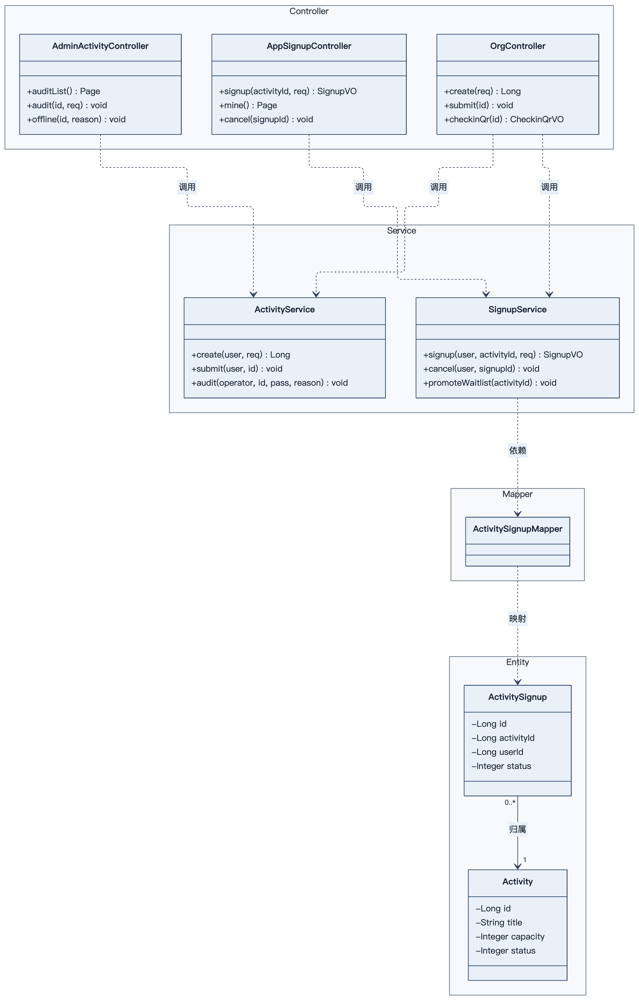
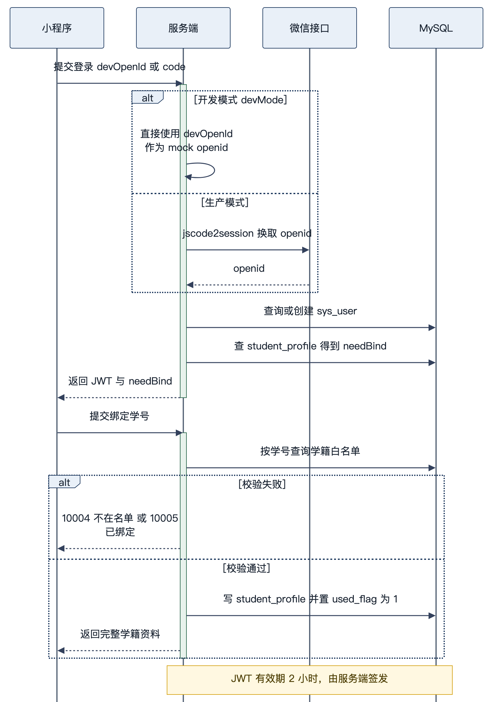
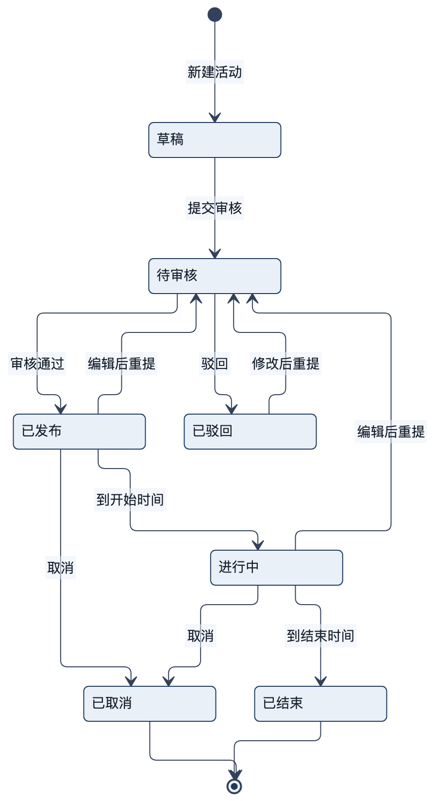
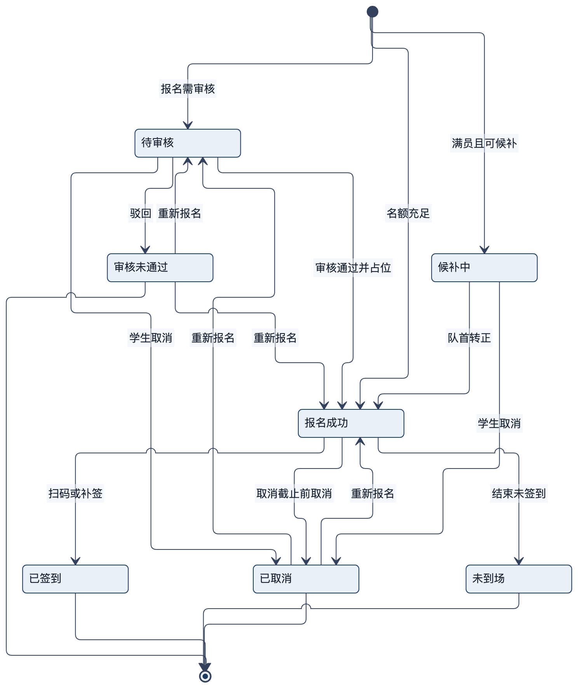
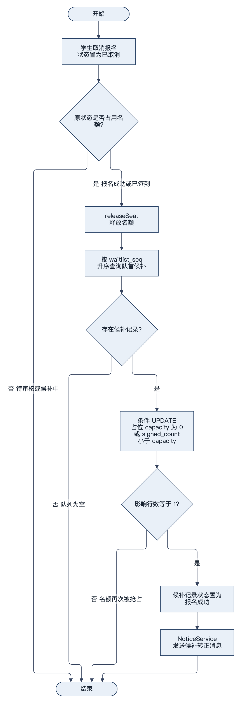
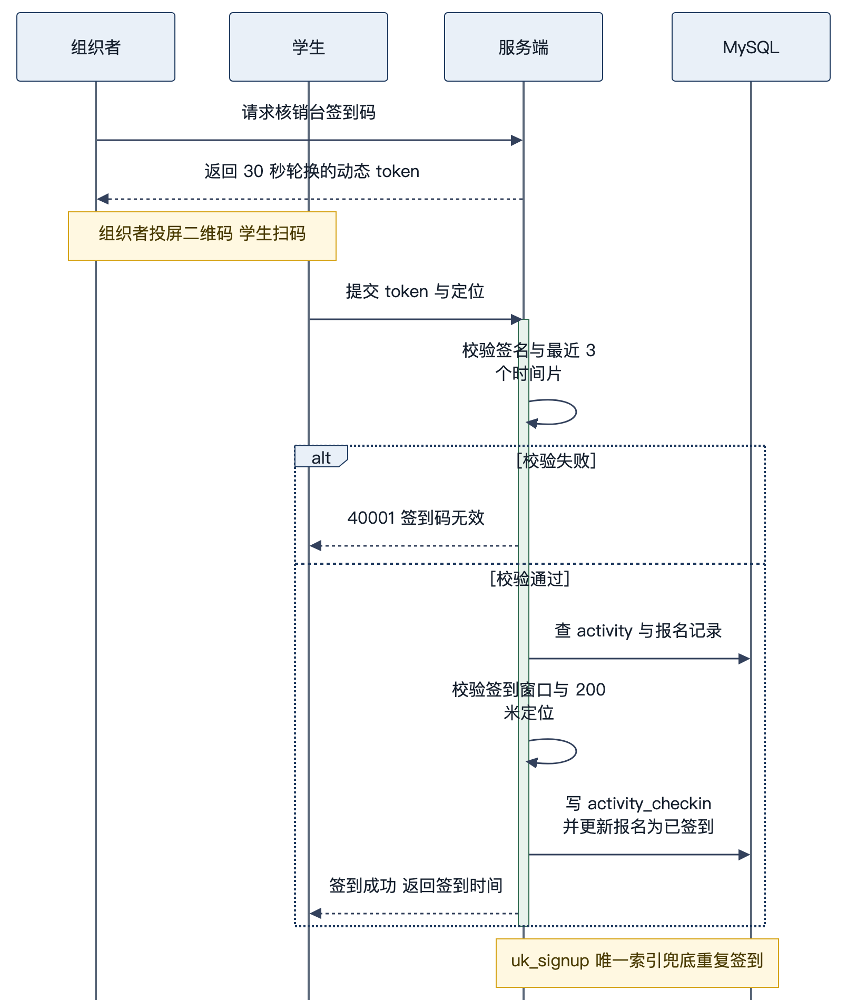
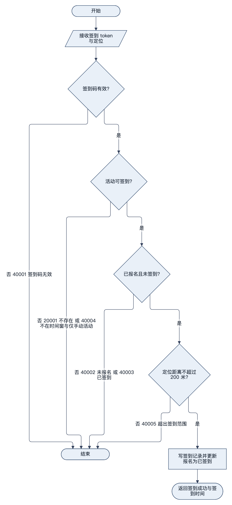

# 校园活动管理平台 详细设计说明书

| 项 | 内容 |
| --- | --- |
| 文档编号 | CA-DOC-06 |
| 文档名称 | 详细设计说明书 |
| 版本 | v1.1 |
| 日期 | 2026-11-20 |
| 对应阶段 | 详细设计 |
| 编写 | 项目组 |
| 审核 | 指导教师 |
| 状态 | 定稿 |

**版本记录**

| 版本 | 日期 | 修订人 | 修订说明 |
| --- | --- | --- | --- |
| v1.0 | 2026-11-20 | 项目组 | 首次编写，覆盖后端 12 个包、前端三端与 7 张设计图 |
| v1.1 | 2026-11-20 | 项目组 | 增补 Spring Security、Redis 缓存与分布式锁、短信验证码、文件上传的实现小节，同步包结构与测试口径 |

> 本文档回答"每个模块内部怎么实现"：代码如何分层、公共能力如何复用、认证/活动/报名/签到/消息/后台/定时任务的关键算法与事务边界、前端页面与请求封装，以及异常、日志、审计与性能取舍。所有类名、方法名、字段名、状态码均取自 `server/`、`app/`、`admin/` 源码，图号与《项目文档写作基线》第 11 节一致。

---

## 1 代码结构

本章回答"工程由哪些文件组成、按什么规则分层、依赖方向是什么"。后端 113 个 Java 主代码文件，前端为 uni-app 小程序与管理后台两个独立工程。

### 1.1 后端包结构与文件统计

| 包 | 文件数 | 代表类 | 职责 |
| --- | --- | --- | --- |
| `com.campus.activity` | 1 | `CampusActivityApplication` | 启动类，`@MapperScan` + `@EnableScheduling` |
| `controller` | 13 | `PingController`、`SmsAuthController`、`App*Controller`、`OrgController`、`Admin*Controller` | 接收 HTTP、参数绑定、调用 Service、包装 `Result` |
| `service` | 8 | `AuthService`、`ActivityService`、`SignupService`、`CheckinService`、`CheckinTokenService`、`AdminService`、`NoticeService`、`NoticeSender` | 业务规则、事务、状态机、算法 |
| `mapper` | 12 | `ActivityMapper`、`ActivitySignupMapper` 等 | MyBatis-Plus `BaseMapper`，少量手写 SQL |
| `entity` | 12 | `Activity`、`ActivitySignup`、`SysUser` 等 | 与 12 张表一一对应 |
| `dto` | 10 | `ActivitySaveRequest`、`SignupRequest`、`CheckinRequest` 等 | 入参，均为 record |
| `vo` | 9 | `ActivityItemVO`、`ActivityDetailVO`、`SignupVO` 等 | 出参，控制字段暴露范围 |
| `common` | 8 | `Result`、`PageResult`、`ResultCode`、`BizException`、`GlobalExceptionHandler`、`DateTimes`、`LoginUser`、`UserContext` | 跨模块公共能力 |
| `security` | 8 | `JwtUtil`、`JwtAuthenticationFilter`、`SysUserDetails`、`SysUserDetailsService`、`TokenBlacklistService`、`JsonAuthenticationEntryPoint`、`JsonAccessDeniedHandler`、`SecurityExceptionAdvice` | 认证与鉴权 |
| `enums` | 2 | `ActivityStatus`、`SignupStatus` | 状态码与中文标签、状态能力判断 |
| `job` | 1 | `ActivityStatusJob` | 定时推进活动状态，Redis 锁保证单实例执行 |
| `config` | 6 | `CampusProperties`、`MybatisPlusConfig`、`SecurityConfig`、`RedisConfig`、`SmsProperties`、`DevDataInitializer` | 配置绑定、分页插件、Security 过滤器链、缓存管理器、短信参数、演示数据保鲜 |
| `support` | 3 | `RedisCache`、`RedisKeys`、`RedisLock` | Redis 读写封装、key 常量、分布式锁 |
| `file` | 12 | `FileController`、`FileService`、`FileTypeDetector`、`LocalStorageService`、`AliyunOssStorageService`、`LocalResourceConfig`、`AliyunOssConfig`、`FileProperties`、`StorageType`、`StorageService`、`StoredObject`、`FileUploadResult` | 文件上传、校验、本地/OSS 存储与静态映射 |
| `sms` | 8 | `SmsSender`、`MockSmsSender`、`CloopenSmsSender`、`SmsCodeService`、`SmsAuthService`、`SmsSendVO`、`SmsLoginRequest`、`SmsSendCodeRequest` | 短信通道、验证码、手机号登录 |

合计 113 个 `.java` 文件；实体、Mapper、DTO（根包）、VO、Service（根包）数量分别为 12 / 12 / 10 / 9 / 8，另有 `sms` 与 `file` 子包内的 3 个 DTO/结果对象。

### 1.2 控制器与接口分布

| 控制器 | 接口数 | 说明 |
| --- | --- | --- |
| `PingController` | 1 | 健康检查 |
| `AppAuthController` | 3 | 小程序登录、学号绑定、登出 |
| `SmsAuthController` | 2 | 发送短信验证码、手机号验证码登录 |
| `AppActivityController` | 5 | 分类、列表、热门、详情、收藏 |
| `AppCheckinController` | 1 | 扫码签到 |
| `AppNoticeController` | 3 | 消息列表、未读数、已读 |
| `AppSignupController` | 4 | 报名、我的报名、报名详情、取消 |
| `AppUserController` | 1 | 当前用户资料 |
| `FileController` | 2 | 文件上传、存储方式查询 |
| `OrgController` | 11 | 组织者全部能力 |
| `AdminAuthController` | 2 | 后台登录、登出 |
| `AdminActivityController` | 4 | 待审核、审核、活动管理、下架 |
| `AdminDashboardController` | 2 | 工作台、操作日志 |
| `AdminUserController` | 3 | 用户、角色变更、组织列表 |

控制器共 14 个类、44 个接口。控制器只做三件事：用 `@Valid` 触发 DTO 校验、从 `UserContext` 取当前登录身份、把 Service 返回值包成 `Result.ok(...)`；鉴权交给 Spring Security 的路径规则与方法级 `@PreAuthorize`。没有业务分支、没有事务注解、没有直接访问 Mapper 的逻辑（`AdminUserController.organizations()` 是唯一例外，直接查询 `OrganizationMapper`）。

### 1.3 分层依赖与后端分层类图

依赖方向严格自上而下：Controller → Service → Mapper → Entity/MySQL；横切能力（common、security、config）被各层引用，但不反向依赖业务 Service。整体关系如图 6-1 所示。

> 说明：图号按正文出现顺序编号，本图（D18 后端分层类图）为图 6-1。



图中按分层选取代表类示意依赖关系：上半部分为三个控制器组（管理后台、小程序、组织者），中间为 `ActivityService` 与 `SignupService` 两个核心服务，下层为 `ActivitySignupMapper` 与 `ActivitySignup`、`Activity` 两个实体，完整类清单见表 6-1～表 6-3。实际代码中 8 个 Service 都保持同一依赖方向，12 个 Mapper 均继承 `BaseMapper<T>`，其中 `ActivityMapper`、`ActivitySignupMapper` 追加了手写 SQL 方法；`common` 与 `security` 为横切依赖，被 Controller 与 Service 共同使用。

### 1.4 小程序工程结构

| 目录/文件 | 内容 |
| --- | --- |
| `app/src/pages/` | 13 个页面，按 `pages.json` 注册 |
| `app/src/pages.json` | 页面清单、`globalStyle`、`tabBar`（首页/活动/消息/我的 4 个入口） |
| `app/src/utils/request.ts` | `uni.request` 封装、令牌存取、统一错误处理 |
| `app/src/utils/api.ts` | 按学生端/组织者端分组的方法集合与状态文案字典 |
| `app/src/utils/auth.ts` | 登录、`ensureLogin`、本地用户缓存、退出 |
| `app/src/types.ts` | 接口数据结构与状态类型 |
| `app/src/main.js`、`App.vue`、`uni.scss` | 入口、应用生命周期、全局样式 |

### 1.5 管理后台工程结构

| 目录/文件 | 内容 |
| --- | --- |
| `admin/src/views/` | 6 个视图：登录、工作台、活动审核、活动管理、用户管理、操作日志 |
| `admin/src/router/index.ts` | hash 路由与登录守卫 |
| `admin/src/api/request.ts` | axios 实例、令牌注入、响应拆包、401 跳登录 |
| `admin/src/api/index.ts` | 11 个接口封装函数 |
| `admin/src/components/ActivityDetailDrawer.vue` | 活动详情抽屉，审核页与活动管理页复用 |
| `admin/src/layout/index.vue` | 侧边栏 + 顶栏布局 |
| `admin/src/utils/dict.ts` | 状态、角色、审计动作的中文与标签色映射 |

### 1.6 命名与分层约束

| 约束 | 说明 |
| --- | --- |
| Entity 与表同名 | `@TableName("activity_signup")` 等，字段下划线转驼峰由 `map-underscore-to-camel-case` 完成 |
| 入参用 DTO record | `ActivitySaveRequest`、`CheckinRequest` 等不可变，校验注解直接写在组件上 |
| 出参用 VO | 不直接返回 Entity，避免把 `deleted`、`password_hash` 暴露给前端 |
| 状态码用 Integer | 数据库存 code，枚举只做 `of(code)` 转换与能力判断 |
| 事务在 Service | `@Transactional` 只出现在 Service 的写方法上，Controller 无事务 |
| 手写 SQL 只在 Mapper | 条件更新、候补队首、计数等放在 `ActivityMapper`、`ActivitySignupMapper` |

---

## 2 公共层设计

本章回答"统一响应、错误码、时间、登录上下文、JWT、拦截器、MyBatis-Plus 与配置这些横切能力如何实现"。

### 2.1 Result 与 PageResult

`Result` 为 `record`，保证响应体结构唯一；`PageResult` 也是 `record`，把 MyBatis-Plus 的 `IPage` 转换为前端约定的结构。两者都提供静态工厂，Service 不需要 `new`。

| 组件 | 关键点 |
| --- | --- |
| `Result.ok(data)` | `code=0`、`message="ok"` |
| `Result.ok()` | 无数据，`data=null`，序列化时因 non_null 被省略 |
| `Result.fail(code, message)` | 业务失败，`data=null` |
| `PageResult.of(IPage)` | 直接映射 records/total/page/size |
| `PageResult.of(IPage, mapper)` | 实体分页转 VO 分页，避免 Controller 转换 |
| `PageResult.empty(page, size)` | 空页兜底 |

### 2.2 ResultCode、BizException 与全局异常

错误码集中在 `ResultCode` 枚举，每项含 `code` 与默认 `message`，分段为 0 / 10xxx / 20xxx / 30xxx / 40xxx / 50xxx，与《接口设计说明书》第 2 章一致。业务代码抛出 `BizException` 时可直接使用枚举的默认文案，也可在构造器里传入更具体的文案（如 `new BizException(ResultCode.ACTIVITY_TIME_INVALID, "报名截止时间不能晚于活动开始时间")`）。

`GlobalExceptionHandler` 的映射关系：

| 异常 | HTTP | 返回 | 日志级别 |
| --- | --- | --- | --- |
| `BizException` | 200 | 原样 code + message | `warn`，记录 code 与 message |
| `MethodArgumentNotValidException` | 400 | 50001 + 第一个字段错误 | 无 |
| `IllegalArgumentException` | 400 | 50001 + 异常消息 | 无 |
| 其他 `Exception` | 500 | 50000 | `error`，打印堆栈 |

把业务异常保持为 HTTP 200 是有意为之：前端只按 `code` 判断业务结果，网络层 4xx/5xx 另有语义（未登录、无权限、参数格式、服务故障），二者不混用。

### 2.3 DateTimes 时间工具

| 方法 | 行为 |
| --- | --- |
| `parse(String)` | 空值返回 null；长度 16 用 `yyyy-MM-dd HH:mm`；含 `T` 用 ISO 格式；否则用 `yyyy-MM-dd HH:mm:ss`；解析失败抛 50001 |
| `format(LocalDateTime)` | `yyyy-MM-dd HH:mm:ss`，用于报名、签到、审计 |
| `formatMinute(LocalDateTime)` | `yyyy-MM-dd HH:mm`，用于活动列表与详情 |

工具类为 `final` 且私有构造，避免实例化。时间字段在 VO 中已是字符串，因此 Jackson 的 `date-format` 只对未转换的 `LocalDateTime` 生效，接口口径由 `DateTimes` 单点控制。

### 2.4 LoginUser 与 UserContext

`LoginUser` 是 `record(Long id, String role, Long orgId, String nickname)`，提供 `isStudent()`、`isOrganizer()`、`isReviewer()`、`isAdmin()`、`canManageActivity()` 等判断，业务代码不直接比较字符串。`UserContext` 用 `ThreadLocal<LoginUser>` 保存当前请求身份，写入发生在拦截器，清理发生在 `afterCompletion`，因此同一线程的后续请求不会串号。

| 方法 | 用途 |
| --- | --- |
| `set(user)` / `get()` | 拦截器写入、业务读取完整身份 |
| `userId()` | 允许为空，用于公开接口的"可选登录" |
| `requireUserId()` | 为空抛 10001，用于必须登录的场景 |
| `isAdmin()` | 简化管理员判断 |
| `clear()` | 请求结束清理 |

### 2.5 JwtUtil

令牌签发与解析集中在 `JwtUtil`。构造器校验密钥长度 ≥ 32 字符，否则应用启动即失败，避免弱密钥上线；签发时写入 `sub`、`role`、`orgId`、`nickname`，有效期取 `campus.jwt.access-token-hours`（默认 2 小时）。

```java
public String generate(SysUser user) {
    Instant now = Instant.now();
    return Jwts.builder()
            .id(UUID.randomUUID().toString())   // jti，登出时写入 Redis 黑名单
            .subject(String.valueOf(user.getId()))
            .claim("role", user.getRole())
            .claim("orgId", user.getOrgId())
            .claim("nickname", user.getNickname() == null ? "" : user.getNickname())
            .issuedAt(Date.from(now))
            .expiration(Date.from(now.plus(hours, ChronoUnit.HOURS)))
            .signWith(key)
            .compact();
}
```

解析失败统一返回 null 而不是抛异常，好处是公开接口带过期令牌仍能正常返回公共数据；坏处是调用方必须自己判断是否为空，这一点由 Spring Security 的路径规则与 `@PreAuthorize` 承担。`parse` 返回 `TokenClaims(user, jti, expiresAt)`，`jti` 供登出黑名单使用，`expiresAt` 决定黑名单 TTL。

### 2.6 Spring Security 过滤器链与方法级鉴权

安全配置的唯一入口是 `config/SecurityConfig`，标注 `@EnableWebSecurity`、`@EnableMethodSecurity`。过滤器链的关键配置为：CSRF 关闭、`formLogin`/`httpBasic`/默认 `logout` 关闭、Session 策略 `STATELESS`、跨域交给 `corsConfigurationSource`、`JwtAuthenticationFilter` 放在 `UsernamePasswordAuthenticationFilter` 之前。请求处理顺序为：

1. `JwtAuthenticationFilter` 读取 `Authorization: Bearer <token>`，用 `JwtUtil.parse` 解析，查 `TokenBlacklistService.isBlocked(jti)`；
2. 验签通过且未拉黑时，把身份写入 `SecurityContext`（权限 `ROLE_<role>`）与 `UserContext`；令牌无效只清空上下文，不直接报错；
3. 路径规则由 `authorizeHttpRequests` 判断：`/api/admin/**` 要求 REVIEWER/ADMIN、`/api/org/**` 要求 ORGANIZER/ADMIN、`/api/files/**` 要求登录，公开路径与 `/uploads/**`、Swagger、`/error` 放行；
4. 路径规则拒绝时走 `ExceptionTranslationFilter` → `JsonAuthenticationEntryPoint` / `JsonAccessDeniedHandler`；
5. 方法级 `@PreAuthorize` 在 Controller 调用栈内生效，拒绝时 `AccessDeniedException` 由 `SecurityExceptionAdvice`（最高优先级）转成同样的 401/403 JSON，避免被 `GlobalExceptionHandler` 兜底成 500；
6. 请求结束在过滤器 `finally` 中清理 `UserContext`。

| 组件 | 生效位置 | 语义 |
| --- | --- | --- |
| `SecurityFilterChain` 路径规则 | URL 前缀 | 粗粒度守门，避免公开查询接口被迫登录 |
| `@PreAuthorize("isAuthenticated()")` | 方法或类 | 必须有有效令牌 |
| `@PreAuthorize("hasAnyRole('ORGANIZER','ADMIN')")` | 方法或类 | 令牌中的 role 命中任一值；未登录返回 401 |
| `JsonAuthenticationEntryPoint` / `JsonAccessDeniedHandler` | 鉴权失败 | 直接写固定 JSON，不经过 Jackson |

鉴权失败响应体固定为 `{"code":10001,"message":"未登录或登录已过期","data":null}` 或 `{"code":10002,"message":"没有操作权限","data":null}`；`data` 字段在这里显式写出，与普通接口 `non_null` 省略空值的策略不同。

`WebMvcConfig` 删除后，跨域由 `SecurityConfig.corsConfigurationSource()` 承担，`/uploads/**` 静态映射由 `file/config/LocalResourceConfig` 承担。原 `AuthInterceptor`、`@RequireLogin`、`@RequireRole` 已删除，替换关系见 [12-功能扩展说明](12-功能扩展说明.md) 第 3.7 节。

### 2.7 MyBatis-Plus 配置

| 配置 | 值 | 影响 |
| --- | --- | --- |
| 主键策略 | `assign_id` | 雪花 ID，应用层生成，不用自增 |
| 逻辑删除 | `deleted`，1 删除 / 0 正常 | 所有查询自动追加 `deleted = 0`，手写 SQL 需自己带 |
| 字段映射 | `map-underscore-to-camel-case=true` | 表字段与实体属性自动对应 |
| 分页插件 | `PaginationInnerInterceptor(DbType.MYSQL)` | `maxLimit=50`、`overflow=false` |
| SQL 日志 | `StdOutImpl` | 开发期把 SQL 打到控制台，便于核对条件更新 |
| Mapper XML | `classpath*:/mapper/**/*.xml` | 当前无 XML，全部用注解 SQL |

### 2.8 CampusProperties 配置项

| 前缀 | 字段 | 默认/当前值 | 用途 |
| --- | --- | --- | --- |
| `campus` | `dev-mode` | `true` | 开启 mock openid 登录与演示数据平移 |
| `campus.jwt` | `secret` | 32 位以上字符串 | HS256 密钥，生产必须替换 |
| `campus.jwt` | `access-token-hours` | 2 | 令牌有效期 |
| `campus.wechat` | `app-id`、`app-secret` | 环境变量注入，默认空 | 生产登录取 code2session |
| `campus.checkin` | `secret` | 字符串 | 签到码 HMAC 密钥 |
| `campus.checkin` | `slice-seconds` | 30 | 签到码时间片长度 |
| `campus.checkin` | `tolerance-slices` | 2 | 允许的过期时间片数量 |
| `campus.checkin` | `open-before-minutes` | 30 | 签到窗口提前量 |
| `campus.checkin` | `close-after-minutes` | 30 | 签到窗口延后量 |
| `campus.sms` | `provider` / `expose-code` / `code-expire-seconds` / `send-interval-seconds` / `send-daily-limit` / `max-fail-count` | `mock` / `true` / 300 / 60 / 10 / 5 | 短信通道与验证码策略 |
| `campus.sms.cloopen` | `server-ip` / `port` / `account-sid` / `account-token` / `app-id` / `template-id` | `app.cloopen.com` / 8883 / 环境变量 / 环境变量 / 环境变量 / 1 | 容联云真实通道 |
| `campus.file` | `storage-type` / `max-file-size` / `date-pattern` / `allowed-extensions` | `local` / 10MB / `yyyy/MM/dd` / 17 种 | 文件存储与校验 |
| `campus.file.local` | `base-dir` / `url-prefix` | `./uploads` / `/uploads` | 本地存储 |
| `campus.file.oss` | `endpoint` / `access-key-id` / `access-key-secret` / `bucket-name` / `dir` / `domain` | 环境变量 / 环境变量 / 环境变量 / 环境变量 / `files` / 环境变量 | 阿里云 OSS |

`SmsProperties` 与 `FileProperties` 分别绑定 `campus.sms` 与 `campus.file` 前缀，与 `CampusProperties` 平级；`RedisConfig` 不通过配置类绑定，而是直接读 `spring.data.redis` 自动配置。开发配置通过环境变量 `MYSQL_USERNAME`、`MYSQL_PASSWORD`、`WX_APPID`、`WX_SECRET`、`REDIS_*`、`CLOOPEN_*`、`OSS_*` 覆盖敏感项，避免把生产口令写进仓库。

### 2.9 DevDataInitializer 演示数据保鲜

仅当 `campus.dev-mode=true` 时注册为 `ApplicationRunner`。启动时查出 `PUBLISHED/ONGOING/FINISHED` 的活动，若全部已过期，则按"距今天数 + 2"整体平移开始时间、结束时间、报名窗口与取消截止，并把状态重置为 `PUBLISHED`，避免隔天打开演示数据全是"已结束"。该逻辑只影响演示数据，生产模式不加载。

---

## 3 认证与绑定

本章回答"用户如何登录、令牌如何产生、学号如何绑定、后台账号如何校验"。登录与绑定是一条连续链路，如图 6-2 所示。

### 3.1 登录绑定时序

从扫码到拿到 token、再到绑定学籍，完整交互如图 6-2 所示。



时序说明：小程序启动调用 `uni.login` 获取 `code`（H5 与开发模式改用 `devOpenId`），请求 `POST /api/app/auth/login`；`AuthService.login` 先解析 openid，再按 `open_id` 查 `sys_user`；不存在则插入一条 `role=STUDENT`、`status=1` 的新用户；存在则校验是否禁用并更新 `last_login_time`；随后查询学籍档案计算 `needBind`，签发 JWT 并通过 `LoginVO` 返回。前端若拿到 `needBind=true` 跳转绑定页，请求 `POST /api/app/auth/bind`，服务端比对白名单、校验学号归属、upsert 学籍档案并把白名单标记为已用，返回绑定后的 `UserVO`。

### 3.2 openid 解析的双模式

| 模式 | 条件 | 行为 | 失败返回 |
| --- | --- | --- | --- |
| 开发模式 | `campus.dev-mode=true` | 直接使用请求体 `devOpenId`，不请求微信 | 未传 → 50001"开发模式需要传 devOpenId" |
| 生产模式 | `dev-mode=false` | `RestClient` 调 `https://api.weixin.qq.com/sns/jscode2session` | 缺 code → 50001；未配 AppID → 50000；微信无 openid → 10001 |

两种模式最终都归一为 `openId` 字符串，后续建号、登录、绑定逻辑完全一致，这是"开发不依赖微信环境"的关键设计。

### 3.3 建号与登录态更新

| 分支 | 处理 |
| --- | --- |
| 新用户 | 插入 `open_id`、昵称（缺省"微信用户"）、头像、`role=STUDENT`、`status=1`、`last_login_time` |
| 老用户且 `status=0` | 抛 10006 账号已被禁用 |
| 老用户正常 | 仅更新 `last_login_time`，不覆盖昵称/头像/角色 |
| `needBind` 计算 | `student_profile` 不存在且 `role=STUDENT` |

后台账号使用 `username` 登录，`open_id` 以 `admin:<name>` 占位，因此同一张 `sys_user` 表可同时容纳三端账号，不需要分表。

### 3.4 学号绑定规则

绑定规则对应 BR-16，实现顺序为：查白名单（不存在 → 10004）→ 查学籍档案（已属于他人 → 10005）→ 组装档案（姓名取白名单，学院/年级/专业为空时回退白名单）→ 存在则 `updateById`、不存在则 `insert` → 白名单 `used_flag=1` → 返回 `UserVO`。由于 `student_profile` 主键就是 `user_id`，一个用户只会有一条档案；`uk_student_no` 保证一个学号只能绑一个微信。

| 场景 | 结果 |
| --- | --- |
| 学号不在白名单 | 10004 |
| 学号已被其他微信绑定 | 10005 |
| 同一用户重复绑定同一学号 | 幂等更新，成功 |
| 同一用户改绑其他学号 | 以 `user_id` 覆盖档案，白名单只标记新学号（旧学号不会回退 `used_flag`，见待确认事项） |

### 3.5 后台登录与角色限制

`adminLogin` 不再手工查库比对密码，而是调用 `AuthenticationManager.authenticate`（`DaoAuthenticationProvider` + `SysUserDetailsService` + `BCryptPasswordEncoder`）。账号不存在、密码为空、密码不匹配统一抛 `BadCredentialsException` 并返回 10007，避免账号枚举；账号禁用抛 `DisabledException` 返回 10006。认证通过后从 `SysUserDetails.getUser()` 取角色，仅 `ADMIN`、`REVIEWER` 可登录后台，其他角色返回 10002"该账号没有后台登录权限"。登录成功只更新 `last_login_time`，不改变角色与组织。

### 3.6 认证失败路径汇总

| 触发点 | 现象 | 前端处理 |
| --- | --- | --- |
| 未带令牌访问受保护接口 | 401 + 10001（路径级 `JsonAuthenticationEntryPoint` 或方法级 `SecurityExceptionAdvice`） | 清空令牌、提示重新登录、跳登录页 |
| 令牌过期/签名错误/已登出 | 同上 | 同上 |
| 角色不符 | 403 + 10002 | 提示无权限，不跳转 |
| 小程序用户未绑定就报名 | 200 + 10003 | 跳绑定页 |
| 后台账号被禁用 | 200 + 10006 | 提示账号禁用 |
| 访问 `/uploads/**` | 直接返回文件，不校验令牌 | 无需处理 |

---

## 4 活动模块

本章回答"活动的 7 个状态如何流转、发布与审核如何校验、学生看到什么、计数如何维护"。核心类为 `ActivityService`，状态机如图 6-3 所示。

### 4.1 活动状态机

7 个状态以及它们之间的迁移条件如图 6-3 所示。



图中共 7 个状态：草稿（0）、待审核（1）、已驳回（2）、已发布（3）、进行中（4）、已结束（5）、已取消（6）。学生端只能看到 3/4/5 三个状态，其余状态仅在组织者与后台可见。

| 迁移 | 触发 | 代码位置 |
| --- | --- | --- |
| DRAFT → PENDING | 组织者提交审核 | `ActivityService.submit` |
| PENDING → PUBLISHED | 团委审核通过 | `ActivityService.audit` |
| PENDING → REJECTED | 团委审核驳回，写 `reject_reason` | `ActivityService.audit` |
| REJECTED → PENDING | 修改后重新提交，清空驳回原因 | `ActivityService.submit` |
| PUBLISHED → ONGOING | 到开始时间，定时任务推进 | `ActivityStatusJob.advanceStatus` |
| ONGOING → FINISHED | 到结束时间，定时任务推进 | `ActivityStatusJob.advanceStatus` |
| PUBLISHED/ONGOING → FINISHED | 结束时任务同时覆盖两种状态 | `ActivityStatusJob.advanceStatus` |
| PUBLISHED/ONGOING → PENDING | 编辑已发布/进行中的活动后自动重审 | `ActivityService.update` |
| 任意非 CANCELLED → CANCELLED | 组织者取消或管理员下架 | `cancelInternal` |

编辑限制：`FINISHED`、`CANCELLED` 不可编辑（20002）；取消接口只拦"已取消"，因此已结束活动仍可被取消，这是当前实现的宽松点（见待确认事项）。取消不级联处理报名记录，报名状态保持原样，学生端通过活动状态与详情页判断活动已取消。

### 4.2 创建活动与时间校验

`ActivityService.create` 先校验当前用户的 `orgId` 非空，再 `applyRequest` 做统一校验与字段填充，最后写入草稿。时间校验的完整顺序为：

| 校验 | 失败返回 |
| --- | --- |
| 开始、结束、报名开始、报名结束任一为空 | 50001"活动与报名时间不能为空" |
| 开始时间不早于结束时间 | 20004 |
| 报名开始晚于报名结束 | 20004 |
| 报名结束晚于活动开始 | 20004"报名截止时间不能晚于活动开始时间" |
| 取消截止为空 | 自动取活动开始前 2 小时 |
| 取消截止晚于活动开始 | 20004"取消报名截止时间不能晚于活动开始时间" |

字段缺省规则：`categoryId` 缺省 1001、`capacity` 缺省 0（不限人数）、`waitlistEnabled`/`auditRequired` 缺省 0、`checkinType` 缺省 1；`creatorId`、`orgId`、计数类字段全部由服务端赋值，不信任前端。`formFields` 原样存 JSON 字符串，前端自行解析渲染动态表单。

### 4.3 编辑、提审与重新审核

编辑复用 `applyRequest`，因此时间校验与创建完全一致。`update` 在保存前判断原状态：已发布或进行中的活动修改后强制回到 `PENDING`，防止组织者通过"先发布再改时间地点"绕过审核（BR-14）；草稿与已驳回保持原状态。`submit` 只接受 `DRAFT` 与 `REJECTED`，提交时清空 `reject_reason`，避免历史驳回原因影响审核页。

### 4.4 审核、取消与下架

`audit` 仅处理 `PENDING`，记录 `beforeStatus` 后按 `pass` 写入 `PUBLISHED` 或 `REJECTED`；首次通过时写 `publish_time`，驳回时写 `reject_reason`；随后插入 `audit_record`（`biz_type=ACTIVITY`、`action=APPROVE/REJECT`、前后状态、操作人、原因）。`cancelByOrg` 与 `offline` 共用 `cancelInternal`：前者先做归属校验，后者不做，因此审核员也能下架任意活动；取消时写 `action=CANCEL` 的审计记录。

### 4.5 学生端查询与按钮文案

`pageForStudent` 的查询条件按参数分支：默认 `PUBLISHED/ONGOING` 按开始时间升序；`timeScope=ENDED` 改为 `FINISHED` 降序；`TODAY/WEEK/MONTH` 用开始时间区间过滤；`sort=HOT` 按 `signup_count` 降序。分类与关键字在最后追加，关键字对标题与简介做 `like` 组合。

`detail` 每次调用把 `view_count` 加 1，带令牌时补查报名记录与收藏记录。`actionText` 由 `actionText(activity, myStatus)` 统一生成，优先级为：已取消 → 已结束 → 有报名记录（待审核/已报名/候补中/已签到，其余落到"是否可报名"）→ 报名未开始 → 报名已结束 → 名额已满（开候补时提示"名额已满，可候补"）→ 立即报名。前端详情页只按 `actionText === '立即报名'` 判断可报名，其余文案直接 toast 或跳"我的报名"，因此服务端文案就是交互契约。

### 4.6 收藏与计数

`toggleFavorite` 先查 `activity_favorite`：存在则删除并把 `favorite_count` 减 1（不低于 0），不存在则插入并把计数加 1；插入并发冲突（`uk_activity_user`）时直接返回 true，避免前端报错。`view_count`、`favorite_count`、`signup_count` 是活动表上的冗余计数，分别由详情访问、收藏切换、报名提交维护；`signed_count` 由占位/释放维护，与 `signup_count` 含义不同（前者是当前占用，后者是累计报名）。

---

## 5 报名模块

本章回答"报名状态如何迁移、名额如何并发占用、候补如何转正、组织者如何审核报名"。核心类为 `SignupService`，状态图如图 6-4 所示。

### 5.1 报名状态机

报名记录在 7 个状态之间迁移，迁移触发与名额影响如图 6-4 所示。



7 个状态：待审核（0）、报名成功（1）、候补中（2）、已签到（3）、已取消（4）、审核未通过（5）、未到场（6）。`SignupStatus` 用 `occupiesSeat()` 与 `cancellable()` 两个能力方法集中表达"是否占名额、能否取消"：`SUCCESS/CHECKED_IN/NO_SHOW` 占名额，`PENDING/SUCCESS/WAITLIST` 可取消。

| 迁移 | 触发 | 名额变化 |
| --- | --- | --- |
| 无记录 → PENDING | 活动开启报名审核 | 不占 |
| 无记录 → SUCCESS | 条件占位成功 | +1 |
| 无记录 → WAITLIST | 占位失败且开启候补 | 不占，取 `waitlist_seq` |
| PENDING → SUCCESS | 组织者审核通过 | +1 |
| PENDING → REJECTED | 组织者审核驳回 | 不占 |
| SUCCESS → CHECKED_IN | 扫码或补签 | 不变（仍占） |
| SUCCESS/WAITLIST/PENDING → CANCELLED | 用户取消 | SUCCESS 释放 -1 |
| SUCCESS → NO_SHOW | 活动结束定时任务 | 不变（仍占） |
| CANCELLED/REJECTED → 重新报名 | 用户再次提交 | 走全新分流 |

### 5.2 提交报名的判定顺序

`signup` 依次执行：学籍校验（10003）→ 活动存在（20001）→ 状态为 `PUBLISHED`（20005）→ 报名窗口（20005，附具体文案）→ 已有记录且状态不是 `CANCELLED/REJECTED`（30002）→ 分流。分流逻辑是：`auditRequired=1` 直接落 `PENDING`；否则尝试条件占位，成功落 `SUCCESS`；占位失败且 `waitlistEnabled=1` 落 `WAITLIST` 并取 `maxWaitlistSeq+1`；否则 30001。

已取消或审核未通过的用户再次报名时复用原记录（`exist != null` 走 `updateById`），而不是插入新行，这样 `uk_activity_user` 始终只有一条记录，同时重置 `audit_user_id`、`audit_time`、`cancel_time`、`checkin_time`。成功后统一把 `signup_count` 加 1，并按目标状态发送不同站内消息。

### 5.3 并发占位算法

占名额不使用"先查后写"，而是把判断写进 `UPDATE` 的 `WHERE`，由 InnoDB 行锁保证原子性：

```java
@Update("""
        UPDATE activity
           SET signed_count = signed_count + 1
         WHERE id = #{activityId}
           AND deleted = 0
           AND (capacity = 0 OR signed_count < capacity)
        """)
int occupySeat(@Param("activityId") Long activityId);
```

调用方只判断影响行数：等于 1 表示占位成功，等于 0 表示名额已满，转入候补或报 30001。`capacity=0` 表示不限人数，因此条件写成"不限或未满"。释放同理，用 `CASE WHEN signed_count > 0 THEN signed_count - 1 ELSE 0 END` 保证不会出现负数。

### 5.4 候补队列与转正

候补序号取 `SELECT COALESCE(MAX(waitlist_seq), 0) FROM activity_signup WHERE activity_id = ? AND status = 2` 再加 1，同一活动的候补按序号排队。取消报名释放名额后调用转正：

```java
/** 候补队列转正：按序号取队首，占位成功才转正 */
@Transactional
public void promoteWaitlist(Long activityId) {
    ActivitySignup next = signupMapper.findFirstWaitlist(activityId);
    if (next == null) {
        return;
    }
    if (activityMapper.occupySeat(activityId) != 1) {
        return;
    }
    next.setStatus(SignupStatus.SUCCESS.getCode());
    signupMapper.updateById(next);

    Activity activity = activityMapper.selectById(activityId);
    noticeService.send(next.getUserId(), "WAITLIST", "候补转正成功",
            "「" + (activity == null ? "活动" : activity.getTitle()) + "」已为你转正，请按时到场。", activityId);
}
```

队首查询为 `WHERE activity_id = ? AND status = 2 ORDER BY waitlist_seq ASC, create_time ASC LIMIT 1`，即先比序号、再比创建时间。转正的关键约束是"占位成功才改状态"：若占位失败（例如释放的名额被并发报名抢走），候选记录保持 `WAITLIST`，不会出现"已转正但没名额"的脏数据。并发下两个线程可能取到同一队首，只有先占位成功的线程会改状态，另一线程占位失败直接返回。候补转正流程如图 6-5 所示。



图中从左到右为"取消报名 → 释放名额 → 取队首 → 条件占位 → 成功则改状态并发消息 / 失败则保持候补"的判定路径，与 `promoteWaitlist` 的分支一一对应。

### 5.5 取消报名

`cancel` 先校验记录归属（不属于当前用户按 30003 处理，避免暴露他人记录），再判断 `cancellable()`（否则 30006），再比较 `cancel_deadline`（超过返回 30004），然后置 `CANCELLED` 并写 `cancel_time`。只有原状态占用名额时才调用 `releaseSeat` 并触发候补转正；`PENDING`、`WAITLIST` 取消不释放名额，因为本就没占。最后给本人发"已取消报名"消息。

### 5.6 组织者审核报名

`auditByOrg` 在一个事务里遍历 `signupIds`：记录不存在或不属于该活动则跳过；状态不是 `PENDING` 则跳过；通过时逐条 `occupySeat`，任一失败立即抛 30001"名额不足，无法通过全部报名"，整个事务回滚，不会出现"通过了一半"；驳回时置 `REJECTED` 并带上原因。每条记录写 `audit_user_id`、`audit_time`，并给对方发审核结果消息。方法返回实际处理条数，前端据此提示。

批量通过时的名额顺序是"逐条占位、先到先得"：如果 5 条待审核但只剩 3 个名额，前 3 条占位成功、第 4 条抛异常，事务回滚后 5 条都保持 `PENDING`，组织者可减少勾选后重试。这保证了数据一致性，但要求前端在报错后刷新列表。

### 5.7 查询与凭证号

"我的报名"按用户与状态分页，并批量加载活动信息避免 N+1；`SignupVO` 里计算 `canCancel`（可取消且未过截止）与 `canCheckin`（状态为 `SUCCESS`）。组织者名单 `pageByActivity` 先做归属校验，再批量加载学籍档案，`keyword` 在内存按姓名/学号过滤（见接口文档待确认事项）。`signupNo` 形如 `C` + 毫秒时间戳 + 3 位随机数，`uk_signup_no` 保证唯一，展示为"签到凭证号"。

### 5.8 未到场标记

未到场不在报名模块内主动触发，而由定时任务在活动结束时批量执行：把该活动下所有 `SUCCESS` 的报名改为 `NO_SHOW`。`NO_SHOW` 仍占名额，但此时活动已结束，名额不再有实际意义，保留占位是为了统计与审计口径一致。

---

## 6 签到模块

本章回答"动态签到码如何生成与校验、扫码签到如何判定、定位距离如何计算、补签如何留痕"。核心类为 `CheckinService` 与 `CheckinTokenService`。

### 6.1 扫码签到时序

组织者出码、学生扫码、服务端校验并落库的交互如图 6-6 所示。



时序说明：组织者打开核销页，`GET /api/org/activities/{id}/checkin-qr` 先做归属校验，再由 `CheckinTokenService.generate` 用当前时间片生成令牌，同时返回报名成功数、已签到数与最近 5 条到场姓名；前端按 `refreshSeconds` 倒计时刷新。学生扫码后拿到令牌，`POST /api/app/checkin` 携带令牌与定位，服务端依次校验令牌、活动、签到方式、时间窗、报名记录、报名状态、定位距离，全部通过后写签到记录并更新报名状态，返回签到结果。

### 6.2 签到码生成与校验算法

签到码不落库，服务端只保存密钥。令牌由三段组成：`activityId.slice.signature`，签名取自 `HMAC-SHA256(activityId + ":" + slice)` 十六进制前 16 位。

```java
public String generate(Long activityId) {
    long slice = currentSlice();
    return activityId + "." + slice + "." + sign(activityId, slice);
}

public Long verify(String token) {
    // …格式与数字解析省略，失败均抛 40001
    long now = currentSlice();
    for (int i = 0; i <= toleranceSlices; i++) {
        long candidate = now - i;
        if (candidate == slice && sign(activityId, candidate).equals(parts[2])) {
            return activityId;
        }
    }
    throw new BizException(ResultCode.CHECKIN_TOKEN_INVALID);
}

private long currentSlice() {
    return System.currentTimeMillis() / 1000 / sliceSeconds;
}
```

时间片为 `当前毫秒 / 1000 / 30`，即每 30 秒一个整数；校验时从当前片向前遍历 `toleranceSlices`（默认 2）个片，因此网络延迟或扫码瞬间跨片不会误判，最多容忍约 90 秒。由于签名包含 `activityId`，令牌天然绑定活动，伪造其他活动的令牌同样验不过；密钥只在服务端，客户端无法自行签发。

### 6.3 签到码校验流程

从 token 到活动 ID 的完整判定路径如图 6-7 所示。



流程图为令牌校验的判定顺序：空值 → 分段数不为 3 → 数字解析失败 → 时间片与签名不匹配，全部落到 40001；命中任一允许时间片则返回 `activityId`。校验通过后的业务校验在 `CheckinService.checkin` 中按 BR-10 的顺序执行：

| 顺序 | 校验 | 失败码 |
| --- | --- | --- |
| 1 | 令牌有效 | 40001 |
| 2 | 活动存在 | 20001 |
| 3 | `checkin_type != 3`（非仅手动） | 40004 + "该活动由组织者统一签到，无需扫码" |
| 4 | 当前时间在 `[开始-30min, 结束+30min]` | 40004 |
| 5 | 存在报名记录 | 40002 |
| 6 | 状态不是 `CHECKED_IN` | 40003 |
| 7 | 状态是 `SUCCESS` | 40002 + "报名未成功，无法签到" |
| 8 | 签到方式为 2 时距离 ≤ 200 米 | 40005 |

顺序有意义：先判令牌避免无意义查库，再判状态避免重复写签到，最后判定位，避免把"没报名"的用户误报成"不在范围"。

### 6.4 Haversine 距离与 200 米阈值

```java
private double distanceMeters(BigDecimal lat1, BigDecimal lon1, BigDecimal lat2, BigDecimal lon2) {
    if (lat1 == null || lon1 == null || lat2 == null || lon2 == null) {
        return 0;
    }
    double radLat1 = Math.toRadians(lat1.doubleValue());
    double radLat2 = Math.toRadians(lat2.doubleValue());
    double deltaLat = radLat2 - radLat1;
    double deltaLon = Math.toRadians(lon2.doubleValue() - lon1.doubleValue());
    double a = Math.sin(deltaLat / 2) * Math.sin(deltaLat / 2)
            + Math.cos(radLat1) * Math.cos(radLat2) * Math.sin(deltaLon / 2) * Math.sin(deltaLon / 2);
    return 2 * EARTH_RADIUS_METERS * Math.asin(Math.sqrt(a));
}
```

地球半径取 6 371 000 米，阈值 `MAX_DISTANCE_METERS = 200`。该方法只对 `checkin_type=2` 生效；`checkin_type=1` 不校验定位，`checkin_type=3` 禁止学生扫码。缺少任一坐标时返回 0，等价于"距离合格"——这是当前实现的宽松处理，避免活动未录坐标时把学生挡在门外（见待确认事项）。

### 6.5 签到落库与幂等

通过校验后组装 `ActivityCheckin`：活动、报名、用户、签到方式（方式 2 记 2，其余记 1）、经纬度、`checkin_time`。插入捕获 `DuplicateKeyException`（`uk_signup` 唯一索引）转成 40003；插入成功后把报名状态改为 `CHECKED_IN` 并写 `checkin_time`。两步在同一事务中，插入失败不会留下"报名已签到但无签到记录"的状态。

### 6.6 手动补签与审计

`manualCheckin` 面向现场异常：先校验活动归属，再按 `signupId` 查报名并确认属于该活动，已签到返回 40003；随后写一条 `checkin_type=3` 的签到记录，带 `operator_id` 与 `remark`，把报名置为 `CHECKED_IN`，最后插入 `audit_record`（`biz_type=CHECKIN`、`action=MANUAL_CHECKIN`、操作人、原因），并打 `info` 日志。补签不校验签到时间窗，这是它的业务意义；但补签也不校验活动状态，已结束活动同样可补签，用于事后修正。

### 6.7 活动统计

`stat` 先归属校验，再用 `countByStatus` 分别统计 6 类状态人数，`totalSignup` 为六者之和；到场率公式为 `已签到 / (已签到 + 未到场 + 报名成功)`，四舍五入到 1 位小数，分母为 0 时返回 0。`CheckinQrVO` 中的 `signedCount`、`checkedInCount` 只统计 `SUCCESS`、`CHECKED_IN` 两类，用于核销页实时概览。

---

## 7 消息模块

本章回答"哪些业务事件会给用户发消息、消息如何存储与已读、微信订阅消息为何只留出口"。

### 7.1 存储与发送

`NoticeService.send(userId, type, title, content, bizId)` 写一条 `sys_notice`（`read_flag=0`），随后调用 `NoticeSender.sendWechatSubscribeMessage`。后者是静态工具方法，V1 只打印"[订阅消息预留]"日志，不请求微信服务器；接入模板 ID 后只需改这一个方法，调用方无需变动。消息类型字典为 `SIGNUP / AUDIT / REMIND / CANCEL / WAITLIST`，当前实际使用 `SIGNUP`、`AUDIT`、`WAITLIST` 三种。

### 7.2 触发点矩阵

| 业务事件 | 接收人 | type | 标题 | 触发代码 |
| --- | --- | --- | --- | --- |
| 报名成功（占位成功） | 报名学生 | SIGNUP | 报名成功 | `SignupService.signup` |
| 报名需审核 | 报名学生 | SIGNUP | 报名已提交 | `SignupService.signup` |
| 满员进入候补 | 报名学生 | WAITLIST | 已加入候补 | `SignupService.signup` |
| 取消报名 | 报名学生 | SIGNUP | 已取消报名 | `SignupService.cancel` |
| 候补转正 | 候补学生 | WAITLIST | 候补转正成功 | `promoteWaitlist` |
| 报名审核通过 | 报名学生 | AUDIT | 报名审核通过 | `SignupService.auditByOrg` |
| 报名审核驳回 | 报名学生 | AUDIT | 报名审核未通过 | `SignupService.auditByOrg` |

活动审核结果、活动取消目前不经过 `NoticeService` 发给学生，只在后台写审计记录；这是 V1 的简化，补充通知需要新增触发点。

### 7.3 查询与已读

消息列表按用户分页、创建时间降序；未读数统计 `read_flag=0`；`markRead` 在 `ids` 为空时把该用户全部未读置 1，否则只更新指定 ID，且始终带 `user_id` 条件，防止横向越权。前端消息页 `onShow` 拉取列表后调用 `markRead(null)` 实现"进页即清红点"。

---

## 8 管理后台

本章回答"后台登录后能做哪些事、指标如何统计、角色变更如何留痕、日志从哪来"。

### 8.1 页面与接口对应

| 视图 | 路由 | 主要接口 | 交互 |
| --- | --- | --- | --- |
| 登录 | `/login` | API-06 | 账号密码，成功后写 localStorage 并跳工作台 |
| 工作台 | `/dashboard` | API-07 | 6 个指标卡 + 热门活动 Top5 表格 |
| 活动审核 | `/audit` | API-02、API-03 | 列表 + 详情抽屉 + 通过/驳回弹窗 |
| 活动管理 | `/activity` | API-04、API-05 | 关键字/状态筛选，下架确认 |
| 用户管理 | `/user` | API-09、API-10、API-11 | 角色筛选、角色变更弹窗（组织者选组织） |
| 操作日志 | `/log` | API-08 | 审计记录分页表格 |

### 8.2 工作台指标口径

`AdminService.dashboard` 用 7 次 `count` 查询（用户、学籍、活动、已发布、待审核、报名、签到），再查 `PUBLISHED/FINISHED` 中 `signup_count` 降序前 5 条活动。指标都是全表口径，不按组织或时间过滤，适合课程演示的"总量看板"；若数据量增长，需要改成聚合查询或缓存（见第 12 章）。

### 8.3 活动审核与下架

审核页默认展示 `PENDING` 且按提交时间升序，保证先提交先处理。审核通过/驳回都写 `audit_record`，`before_status`/`after_status` 记录状态迁移，驳回必须填理由（前端表单校验）。下架调用 API-05，状态置 `CANCELLED` 并写审计；下架不校验活动创建人，因此审核员可以处理任意组织的违规活动。

### 8.4 角色变更与组织绑定

角色变更只允许 `ADMIN`。服务端校验角色枚举，设置 `ORGANIZER` 时写入 `orgId`，其他角色清空 `orgId`；每次变更写 `audit_record`，`before_status` 存旧角色、`after_status` 存新角色。前端在角色选择为组织者时强制要求选择组织（表单项必填），但服务端未校验 `orgId` 非空，直接调接口可以把组织者改成无组织状态（见待确认事项）。

### 8.5 操作日志

日志来自 `audit_record`，按创建时间降序分页，全量展示。当前写入点有 4 类：活动审核（APPROVE/REJECT）、活动取消/下架（CANCEL）、手动补签（MANUAL_CHECKIN）、角色变更（ROLE_CHANGE）。`biz_type` 对应 ACTIVITY / CHECKIN / USER，`biz_id` 指向业务主键，`operator_name` 冗余存储操作人昵称，避免日志查询再关联用户表。

### 8.6 前端复用与字段口径

`ActivityDetailDrawer` 是审核页与活动管理页共用的详情组件，它调用的是小程序侧公开接口 `GET /app/activities/{id}`，而不是管理端接口，因此不需要额外开发详情 API；抽屉把 `formFields` JSON 文本、时间、名额、经纬度、浏览量、收藏数以 `el-descriptions` 展示。`admin/src/utils/dict.ts` 统一维护活动状态、报名状态、角色、审计动作的中文与标签色，避免各页面各写一套。

---

## 9 定时任务

本章回答"活动状态如何自动推进、未到场如何自动标记、任务重复执行是否安全"。

### 9.1 调度配置

启动类标注 `@EnableScheduling`，任务类 `ActivityStatusJob` 用 `@Scheduled(cron = "0 */5 * * * ?")` 每 5 分钟执行一次，方法加 `@Transactional` 保证"改活动状态 + 标记未到场"在同一事务。cron 的秒位为 0、分位为每 5 分钟，即整点 00、05、10… 触发。执行前先抢 Redis 分布式锁 `campus:lock:activity-status-job`（租期 120 秒），抢不到直接跳过本轮。

### 9.2 推进逻辑

```java
List<Activity> started = activityMapper.selectList(Wrappers.<Activity>lambdaQuery()
        .eq(Activity::getStatus, ActivityStatus.PUBLISHED.getCode())
        .le(Activity::getStartTime, now));
for (Activity activity : started) {
    activity.setStatus(ActivityStatus.ONGOING.getCode());
    activityMapper.updateById(activity);
}
```

第一步查"状态为已发布且开始时间已到"的活动，逐条改为进行中。第二步查"状态为已发布或进行中且结束时间已到"的活动，改为已结束，并把该活动下所有 `SUCCESS` 报名批量改为 `NO_SHOW`（`signupMapper.update` 带活动与状态条件），影响行数大于 0 时打日志。第三步统计本轮开始/结束数量，仅在有变化时输出，避免日志噪音。

### 9.3 幂等性与边界

任务是幂等的：已推进的活动不再满足查询条件，重复执行不会重复改状态；`NO_SHOW` 更新只命中 `SUCCESS`，已签到、已取消、候补都不会被误改。时间判断使用 `le`（小于等于），活动结束时间恰好等于当前分钟时也会被推进。若服务器时钟回拨，可能出现状态提前推进，属于单机部署的可接受风险。

### 9.4 多实例与数据保鲜

状态推进任务用 Redis 分布式锁 `RedisLock` 协调：`tryLock` 用 `SET NX EX` 抢锁，锁值为随机 UUID；未抢到直接跳过并记录 info 日志；执行结束在 `finally` 中用 Lua 脚本"比对持有者再删除"释放锁，租期 120 秒兜底进程崩溃。这样多实例部署时同一时刻只有一个实例真正推进状态，Redis 故障时本轮任务失败、下一轮重试。`DevDataInitializer` 在 dev 模式启动时平移过期演示数据，与定时任务互补：任务负责"时间到了推进"，初始化器负责"隔天演示数据别全过期"。

---

## 10 前端详细设计

本章回答"小程序 13 个页面与后台 6 个视图各做什么、请求如何封装、登录态如何维护、前后端字段如何对齐"。

### 10.1 小程序页面职责

| 页面 | 路由 | 调用的接口 | 主要交互 |
| --- | --- | --- | --- |
| 首页 | `pages/index/index` | API-14、16、15 | 问候、分类入口、热门活动、即将开始；下拉刷新；分类点击带筛选跳活动列表 |
| 全部活动 | `pages/activity/list` | API-14、15 | 搜索、分类、今天/本周/本月/已结束筛选，触底加载更多 |
| 活动详情 | `pages/activity/detail` | API-17、18、23 | 名额进度、收藏、报名；按 `actionText` 决定跳转或直接报名 |
| 填写报名 | `pages/activity/signup` | API-17、23 | 解析 `formFields` 渲染动态表单，必填校验后提交 `formData` |
| 消息 | `pages/message/list` | API-20、21、22 | 列表、进页全部已读、下拉刷新 |
| 我的 | `pages/mine/index` | API-27 | 资料、我的报名/组织者工作台入口、切换测试身份 |
| 我的报名 | `pages/mine/signups` | API-24、26 | 状态 tab、签到凭证号、取消报名、去扫码 |
| 绑定学号 | `pages/auth/bind` | API-13 | 学号/姓名/学院/年级/专业表单 |
| 扫码签到 | `pages/checkin/scan` | API-19 | `uni.scanCode` 取令牌、`uni.getLocation` 取坐标（H5 改为粘贴令牌） |
| 组织者工作台 | `pages/org/index` | API-38、28、31 | 概览、按状态筛选活动、提交审核、进入名单/核销 |
| 发布活动 | `pages/org/edit` | API-14、29 | 标题/分类/时间/地点/名额/候补/审核/签到方式表单，保存草稿或保存并提审 |
| 报名名单 | `pages/org/signups` | API-33、34、36、17 | 状态筛选、通过/驳回、手动补签 |
| 签到核销 | `pages/org/checkin` | API-35 | 展示签到码文本、30 秒倒计时自动刷新、复制令牌、到场概览 |

`pages.json` 注册 14 页（含手机号验证码登录页），`tabBar` 为首页、活动、消息、我的四个入口；组织者页面不在 tabBar，从"我的 → 组织者工作台"进入。当前"发布活动"页只调用 `createActivity`（API-29），`api.ts` 中虽封装了 `updateActivity`、`cancelActivity`，但页面未使用，编辑与取消入口尚未接线（见待确认事项）。

### 10.2 request 封装与登录态

`app/src/utils/request.ts` 用 `uni.request` 做统一封装：

| 能力 | 实现 |
| --- | --- |
| BASE_URL | H5 为 `/api`（走 Vite 代理），非 H5 为 `http://127.0.0.1:8016/api`（与后端端口一致；真机调试需改为局域网 IP） |
| 请求头 | 固定 `Content-Type: application/json`；登录接口可通过 `auth: false` 跳过令牌 |
| 令牌存取 | `campus_token`、`campus_user` 两个 storage key；`getToken/setToken/clearToken` |
| 状态码 | 401 清令牌并提示重新登录；403 提示无权限 |
| 业务码 | `body.code === 0` resolve `data`，否则 toast `message` 并 reject |
| 网络异常 | toast"网络异常，请检查后端是否启动" |
| 查询串 | `buildQuery` 过滤 undefined/null/空串后 `encodeURIComponent` |

`app/src/utils/auth.ts` 的 `ensureLogin` 是页面通用入口：已有令牌且本地有用户缓存则直接返回；否则执行 `login()`（微信端 `uni.login` 取 code，H5 与开发环境用 `mock-student-1`），写入令牌与用户缓存；若 `needBind` 为 true 跳绑定页。退出时清空令牌与缓存并 `reLaunch` 回首页。"我的"页的"切换测试身份"通过修改 `campus_dev_openid` 并清缓存实现，便于课堂演示三种角色。

### 10.3 管理后台路由与请求封装

- 路由使用 `createWebHashHistory`，`/login` 标记 `public`，其余路由在 `beforeEach` 中校验 `getToken()`，未登录跳 `/login?redirect=...`，已登录访问登录页则跳 `/dashboard`。
- `admin/src/api/request.ts` 创建 axios 实例，`baseURL='/api'`、超时 15 秒；请求拦截器注入 `Authorization`；响应拦截器调用 `unwrapResponse`：有 `code` 字段时 `code===0` 返回 `data`，否则 `ElMessage.error` 并抛错；401 清空令牌并跳登录；其他网络错误统一提示。
- 令牌与用户分别存 `campus_admin_token`、`campus_admin_user`，与小程序 key 区分，避免同域调试互相覆盖。

### 10.4 前后端字段对齐注意事项

| 事项 | 说明 |
| --- | --- |
| 时间格式 | 活动列表/详情为 `yyyy-MM-dd HH:mm`，报名/签到为 `yyyy-MM-dd HH:mm:ss`；前端直接展示字符串，不 `new Date()` 解析 |
| 空字段 | 后端 non_null 省略 null，TS 类型统一声明为可选（`?:`） |
| ID | 后端返回数字，前端类型为 `number`；雪花 ID 精度问题见待确认事项 |
| 状态 | 前端用 `ACTIVITY_STATUS`、`SIGNUP_STATUS` 字典把 code 转中文，不硬编码 if/else |
| 分页 | `PageResult` 的 `page` 字段回显当前页，前端以"已加载条数 < total"判断是否还有下一页 |

---

## 11 异常、日志与审计

本章回答"异常如何分层处理、日志打在哪些点、哪些操作必须留痕、安全底线在哪"。

### 11.1 异常分层

| 层 | 异常/处理 | 结果 |
| --- | --- | --- |
| 拦截器 | 未登录、角色不符 | 直接写 401/403 JSON，不进入 Controller |
| 参数绑定 | `@Valid` 失败、类型转换失败 | 400 + 50001，取第一条字段错误 |
| Service | 业务规则不满足 | 抛 `BizException`，HTTP 200 + 对应业务码 |
| 兜底 | 未预期异常 | 500 + 50000，`log.error` 打印堆栈 |

分层原则：能在 Service 用业务码表达的错误不抛到框架层；框架层异常统一由 `GlobalExceptionHandler` 收口；拦截器错误不依赖 Jackson，避免序列化链路出问题时连错误响应都写不出去。

### 11.2 日志打点

| 位置 | 级别 | 内容 |
| --- | --- | --- |
| `GlobalExceptionHandler.handleBiz` | warn | `code` 与 `message` |
| `GlobalExceptionHandler.handleOther` | error | 未处理异常堆栈 |
| `CheckinService.manualCheckin` | info | 活动、报名、操作人、补签原因 |
| `ActivityStatusJob` | info | 本轮开始/结束场次、未到场条数 |
| `NoticeSender` | info | 订阅消息预留内容 |
| `AuthService.resolveOpenId` | warn | 微信登录失败的响应体 |
| MyBatis-Plus | stdout | 全部 SQL 与参数（`log-impl=StdOutImpl`），仅开发期 |

### 11.3 审计留痕矩阵

| 业务 | bizType | action | before/after | 附加信息 |
| --- | --- | --- | --- | --- |
| 活动审核通过 | ACTIVITY | APPROVE | 1 → 3 | 操作人、备注 |
| 活动审核驳回 | ACTIVITY | REJECT | 1 → 2 | 驳回原因 |
| 组织者取消活动 | ACTIVITY | CANCEL | 原状态 → 6 | 取消原因 |
| 管理员下架 | ACTIVITY | CANCEL | 原状态 → 6 | 下架原因 |
| 手动补签 | CHECKIN | MANUAL_CHECKIN | 无 | 报名 ID、补签原因、操作人 |
| 角色变更 | USER | ROLE_CHANGE | 旧角色 → 新角色 | 操作人 |

审计记录不随业务表逻辑删除，作为独立留痕表保存；`operator_name` 冗余存储，即使操作人后续被禁用也能还原现场。

### 11.4 安全设计要点

- 口令只存 BCrypt 哈希，`UserVO` 不包含 `password_hash`、`open_id` 等敏感字段。
- JWT 密钥启动期校验长度，签到码使用独立密钥，两类密钥不共用；JWT 带 `jti`，登出后立即进入 Redis 黑名单。
- 越权防护分两层：Spring Security 路径规则与 `@PreAuthorize` 校验登录/角色，Service 校验资源归属（活动创建人/报名归属/消息归属）。
- 文件上传由服务端生成 objectKey，校验扩展名、文件头与图片类型一致性，本地路径 normalize 后确认仍落在上传根目录内。
- 短信验证码有发送间隔、日限与错误次数三条防线；`expose-code` 只允许在 Mock 通道的演示环境打开。
- 所有查询默认带逻辑删除条件，手写 SQL 显式写 `deleted = 0`。
- 演示账号与密码只用于课程环境，生产必须替换 `campus.jwt.secret`、`campus.checkin.secret`、数据库口令、Redis 密码，并关闭 `campus.dev-mode` 与 `campus.sms.expose-code`。

---

## 12 性能与并发

本章回答"当前实现靠什么支撑并发、索引怎么用、哪些优化没做、边界在哪"。

### 12.1 索引使用

| 表 | 索引 | 支撑的查询 |
| --- | --- | --- |
| `activity` | `idx_status_start(status, start_time)` | 学生列表按状态 + 开始时间排序/区间 |
| `activity` | `idx_org(org_id)`、`idx_category(category_id)` | 组织与分类筛选 |
| `activity_signup` | `uk_activity_user(activity_id, user_id)` | 重复报名兜底、按活动+用户查询 |
| `activity_signup` | `uk_signup_no(signup_no)` | 凭证号唯一 |
| `activity_signup` | `idx_user_status(user_id, status)` | 我的报名按状态分页 |
| `activity_checkin` | `uk_signup(signup_id)` | 重复签到兜底、按报名唯一 |
| `activity_checkin` | `idx_activity(activity_id)` | 核销页最近到场、统计 |
| `activity_favorite` | `uk_activity_user` | 收藏幂等切换 |
| `sys_notice` | `idx_user_read(user_id, read_flag)` | 消息列表、未读数 |
| `audit_record` | `idx_biz(biz_type, biz_id)` | 按业务追溯 |
| `sys_user` | `uk_open_id`、`uk_username`、`idx_role_org` | 登录、角色筛选 |
| `student_whitelist` / `student_profile` | `uk_student_no` | 绑定校验 |

### 12.2 并发控制手段

| 场景 | 手段 | 说明 |
| --- | --- | --- |
| 名额占用 | 单条条件 UPDATE | 行锁 + 影响行数判断，避免"先查后写"竞态 |
| 重复报名 | 唯一索引 `uk_activity_user` | 并发提交由数据库兜底 |
| 重复签到 | 唯一索引 `uk_signup` + 状态判断 | 双保险 |
| 候补转正 | 条件占位成功才改状态 | 避免无名额转正 |
| 批量审核 | 事务 + 整批回滚 | 避免部分通过 |
| 状态推进 | 定时任务查询条件天然幂等 + Redis 分布式锁 | 重复执行无副作用，多实例只跑一个 |
| 缓存一致性 | 写操作 `@CacheEvict` 清空热门榜 | 分类数据无写接口，只靠 TTL 过期 |
| 短信发送限流 | `SET NX EX` 占位 + `INCR` 计数 | 冷却期与日限由 Redis 原子操作保证 |
| 文件并发写 | objectKey 含 UUID，目录按日期分片 | 天然避免同名覆盖 |

### 12.3 事务边界

写操作的事务集中在 Service：报名（占位+落库+计数+消息）、取消（状态+释放+转正+消息）、批量审核（多条+消息）、签到（签到记录+报名状态）、补签（记录+状态+审计）、活动审核（状态+审计）、角色变更（用户+审计）、定时任务（状态+未到场）。事务内不做远程调用；微信登录的 `RestClient` 在非事务方法里执行，避免长事务占用连接。

### 12.4 当前未做的优化

| 项 | 现状 | 影响与建议 |
| --- | --- | --- |
| 缓存 | 分类与热门榜使用 Redis 注解缓存（TTL 10 分钟）；活动详情仍查库 | 详情页浏览量每次 +1，缓存收益有限；量大时可对详情加短 TTL 缓存 |
| 限流 | 短信有发送间隔、日限、错误次数限制；后台登录与签到接口无限流 | 可加网关或注解限流 |
| 分布式锁 | 仅定时任务使用（`RedisLock`） | 名额占用仍靠数据库条件更新；候补转正等场景未加锁 |
| 消息队列 | 未使用 | 站内消息同步写库；量大时可异步化 |
| 搜索 | MySQL `like` | 无全文索引/ES；数据量大时性能下降 |
| 分页深度 | 普通 offset 分页 | 深页性能一般；可改游标分页 |
| SQL 日志 | 开发期 stdout | 生产应关闭 `StdOutImpl` |
| 监控 | 仅应用日志 | 无指标采集与告警；Redis 故障只能靠日志发现 |

### 12.5 设计目标与验证口径

课程设计阶段以"功能正确 + 并发不超卖"为目标，不做吞吐量承诺：名额不超卖由条件更新与唯一索引保证，重复签到由 `uk_signup` 保证，候补不丢单由"占位成功才转正"保证，短信与文件由 Redis 限流和上传校验兜底。验证分两层：`mvn test` 5 个测试类 20 个用例覆盖鉴权、缓存、短信、文件与基础接口；`scripts/smoke.sh` 用 33 项断言覆盖端到端关键路径（重复报名 30002、重复签到 40003、伪造签到码 40001、到场率 100、短信登录、登出黑名单、文件上传等）。本节不写实测 QPS、响应时间等未采集数据，具体结果见《测试报告》。

---

## 13 扩展能力实现

本章回答"Spring Security、Redis、短信、文件四块扩展在实现上如何落地，关键算法与失败边界是什么"。配置项、接口示例与部署切换方法见 [12-功能扩展说明](12-功能扩展说明.md)。

### 13.1 Redis 缓存与分布式锁

`config/RedisConfig` 标注 `@EnableCaching`，同时提供 `RedisTemplate<String,Object>` 与 `RedisCacheManager`：

| 项 | 实现 |
| --- | --- |
| 缓存值序列化 | `GenericJacksonJsonRedisSerializer`，开启类型信息但只允许 `com.campus.`、`java.lang.`、`java.util.`、`java.math.` 子类型 |
| key 前缀 | `computePrefixWith(name -> "campus:cache:" + name + "::")`，得到 `campus:cache:categories::all`、`campus:cache:activity-hot::5` |
| TTL | 10 分钟（`Duration.ofMinutes(10)`） |
| 写入策略 | `RedisCacheWriter.create(..., immediateWrites().collectStatistics())`，避免 Spring Data Redis 4 的延迟写导致"写完读不到" |
| null 缓存 | `enableSpringCacheNullValueSupport()`，由 `RedisConfig` 单独开启 |

`application.yml` 不写 `spring.cache.*`，以上缓存参数（TTL、前缀、null 缓存、写入策略）只在 `RedisConfig` 中定义，避免与 Boot 自动配置出现两套口径。

缓存注解集中在 `ActivityService`：`categories()` 使用 `@Cacheable(cacheNames="categories", key="'all'")`；`hot(limit)` 使用 `@Cacheable(cacheNames="activity-hot", key="#limit")`；`create`、`update`、`cancelByOrg`、`offline`、`audit` 五个写方法使用 `@CacheEvict(cacheNames="activity-hot", allEntries=true)` 清空热门榜。分类当前没有写接口，靠 TTL 过期。

手动读写统一走 `support/RedisCache`（`StringRedisTemplate` 封装）与 `support/RedisKeys`（key 常量），短信验证码、发送间隔、日限、错误次数、黑名单、任务锁都用字符串或 Hash，便于 `redis-cli` 直接排查。

分布式锁 `support/RedisLock` 的算法：

1. `tryLock(key, leaseSeconds)`：生成随机 UUID 作为持有者 token，`SET key token NX EX leaseSeconds`，成功返回 token，失败返回 `null`；
2. `unlock(key, token)`：执行 Lua `if redis.call('get', KEYS[1]) == ARGV[1] then return redis.call('del', KEYS[1]) else return 0 end`，只删除自己持有的锁；
3. 调用方 `ActivityStatusJob` 在 `finally` 中释放锁，租期 120 秒兜底进程崩溃。

Redis 不可用时：注解缓存请求失败返回 500 + 50000；黑名单查询捕获异常后按未拉黑处理；短信与登出写操作直接失败；任务抢锁异常导致本轮执行失败，下一轮重试。

### 13.2 短信验证码

类协作关系为：`SmsAuthController` → `SmsAuthService` → `SmsCodeService` → `SmsSender`（`MockSmsSender` / `CloopenSmsSender` 由 `@ConditionalOnProperty` 条件装配），验证码状态存 Redis。

发送流程：

1. 校验手机号格式（`^1[3-9]\d{9}$`），不合法抛 60001；
2. `SET NX EX` 占 `campus:sms:interval:<phone>`（60 秒），占不到抛 60002；
3. `INCR campus:sms:daily:<phone>`，首次自增时设置 24 小时过期，超过 10 抛 60003；
4. `SecureRandom` 生成 6 位数字并用 `%06d` 补零，先调 `SmsSender.send`，成功后才写 `campus:sms:code:<phone>` Hash（`code`、`status=0`，TTL 300 秒）；发送失败删除冷却 key 允许重试；
5. Mock 通道日志格式为 `[短信模拟] 向 138****0003 发送验证码：123456`；`Mock + expose-code=true` 时把验证码放入 `SmsSendVO.mockCode`。

校验流程：

1. 校验手机号与验证码非空，读 `campus:sms:code:<phone>` Hash，空则抛 60004；
2. `status=1` 抛 60007；验证码不一致时 `INCR campus:sms:fail:<phone>`，达到 5 次删除验证码并抛 60006，未达到抛 60005；
3. 校验通过把 `status` 改为 `1` 并保留到 TTL 过期，删除错误计数，随后 `SmsAuthService` 按手机号查/建用户并签发 JWT。

真实通道 `CloopenSmsSender` 使用容联云 `CCPRestSmsSDK`，账号缺失时抛 60008 并提示配置 `CLOOPEN_ACCOUNT_SID` / `CLOOPEN_ACCOUNT_TOKEN` / `CLOOPEN_APP_ID`；状态码 `000000` 视为成功。

### 13.3 文件上传

`FileController` 只负责接收 multipart 参数，业务在 `FileService`：

| 步骤 | 实现 |
| --- | --- |
| 校验 | 空文件 70001 → 大小 70002 → 扩展名白名单 70003 → 文件头可执行检测 70003 → 图片扩展名与真实类型一致 70003 |
| bizType | 只允许 `activity-cover` / `org-logo` / `avatar` / `common`，缺省 `common`，非法值抛 50001 |
| objectKey | `<bizType>/<yyyy/MM/dd>/<UUID 去横线 32 位>.<ext>`，日期格式取 `campus.file.date-pattern` |
| 存储 | `StorageService.write(objectKey, file)`，实现由 `campus.file.storage-type` 条件装配 |
| 返回 | `FileUploadResult(objectKey, originalName, url, size, contentType, storage)` |

`LocalStorageService` 把 `baseDir` 转绝对路径并 `normalize`，确认目标仍以根目录开头，防止 `../` 穿越；写入前 `Files.createDirectories` 建日期目录；删除后向上清理空目录。`LocalResourceConfig` 把 `baseDir` 挂到 `url-prefix/**`，并在启动时 `mkdirs`，因此上传后可直接用 `/uploads/...` 访问，`/uploads/**` 在安全链中放行。

`AliyunOssStorageService` 在 objectKey 前拼 `campus.file.oss.dir`（默认 `files`），写入时设置 `Content-Disposition: attachment`；`url()` 优先使用 `domain`，否则用 `https://<bucket>.<endpoint>` 拼接；`presignedUrl` 已实现但当前没有 Controller 暴露。`AliyunOssConfig` 在 `storage-type=oss` 时启动即校验 endpoint、AccessKey、Bucket，缺失直接失败。

`FileTypeDetector` 读取前 12 字节识别 jpeg/png/gif/bmp/webp/pdf/zip（docx/xlsx/pptx 视为 zip）、rar/7z/gzip/exe/elf；只对图片扩展名强制类型一致，文本类与 Office 旧格式识别为 `unknown` 也允许上传。

### 13.4 登出与 JWT 黑名单

`JwtUtil.generate` 在签发时写入随机 `jti`（`id(UUID)`），`parse` 返回 `TokenClaims(LoginUser user, String jti, Instant expiresAt)`。登出接口从请求头取 token，解析出 `jti` 后：

1. 计算 `Duration.between(Instant.now(), claims.expiresAt())`；
2. `TokenBlacklistService.block(jti, ttl)` 写 `campus:auth:blacklist:<jti>` = `1`，TTL 等于剩余有效期；
3. 后续请求在 `JwtAuthenticationFilter` 中查 `isBlocked(jti)`，命中则清空上下文按匿名处理；
4. Redis 查询异常时记录 `warn` 并返回未拉黑，避免 Redis 故障拖垮全部请求；登出写入异常则不捕获，返回 500 + 50000。

黑名单粒度为 token，同一账号在其他设备上的 token 不受影响；如需"全端下线"需按用户维度维护令牌版本，当前未实现。

---

## 待确认事项

1. **已结束活动仍可取消**：`cancelInternal` 只拦截"已取消"，未限制 `FINISHED`，组织者/管理员仍可取消已结束活动；是否需要收紧为仅 `DRAFT/PENDING/REJECTED/PUBLISHED/ONGOING` 待确认。
2. **缺坐标即放行**：`distanceMeters` 在任一坐标为空时返回 0，定位签到会直接通过；是否需要改为"缺坐标判定失败"待确认。
3. **绑定改绑白名单不回退**：同一用户改绑新学号时，旧学号的 `used_flag` 不会恢复为 0；是否需要在改绑时回退旧白名单待确认。
4. **组织者角色缺组织**：服务端角色变更只校验角色枚举，未强制 `ORGANIZER` 必须带 `orgId`，直接调接口可产生无组织组织者；建议服务端补校验。
5. **页面接线缺口**：小程序 `api.ts` 已封装 `updateActivity`、`cancelActivity`，但"发布活动"页只调用新建接口，编辑（API-30）与取消（API-32）没有页面入口；基线将"发布活动"页描述为新建/编辑，需在后续版本补齐。
6. **真机调试地址**：`app/vite.config.ts`、`admin/vite.config.ts` 的代理目标与小程序 `request.ts` 的 `BASE_URL` 已统一为 `8016`；微信真机调试仍需把非 H5 的 `BASE_URL` 改为后端所在机器的局域网 IP 或正式域名。
7. **雪花 ID 精度**：后端 BIGINT 以 JSON 数字返回，前端用 `number` 接收，19 位 ID 可能丢精度；演示数据 ID 较小未暴露，是否改为字符串序列化待确认。
8. **后台组织者统计与名单过滤**：API-38 只统计最近 100 条活动，API-33 的关键字为内存过滤，数据量增大后口径会偏差，是否改为聚合查询/数据库过滤待确认。
9. **前端已接入扩展能力**：小程序已调用短信登录、登出、活动封面上传接口，管理后台已调用真实登出与素材上传页相关接口（`/api/admin/auth/logout`、`/api/files/upload`、`/api/files/storage`），接入点见 [12-功能扩展说明](12-功能扩展说明.md) 9.4 节；微信真机与 OSS 模式联调排期待定。
10. **Redis 单点与故障降级**：缓存、短信、黑名单、任务锁共用一个 Redis 实例，没有哨兵/集群；当前只有黑名单查询做了降级，缓存与短信在 Redis 故障时直接报错，是否补熔断/本地缓存待确认。
11. **短信与文件的生产参数**：容联云模板 ID、OSS Bucket 读写策略与自定义域名未确定，`expose-code` 只适合演示；生产切换清单见 [12-功能扩展说明](12-功能扩展说明.md) 第 10 章。