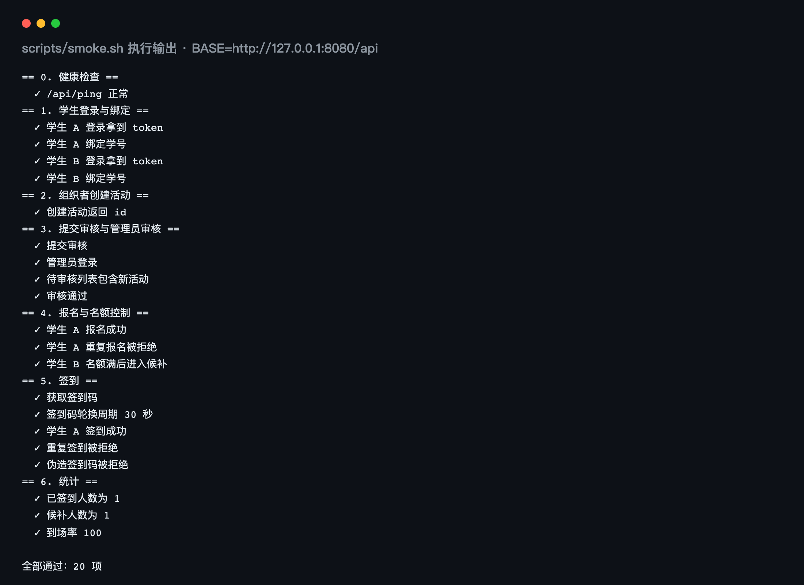

# 校园活动管理平台 测试报告

## 文档信息

| 项 | 内容 |
| --- | --- |
| 文档编号 | CA-DOC-07 |
| 文档名称 | 测试报告 |
| 版本 | v1.0 |
| 日期 | 2026-11-20 |
| 对应阶段 | 测试与验收 |
| 编写 | 项目组 |
| 审核 | 指导教师 |
| 状态 | 定稿 |

## 版本记录

| 版本 | 日期 | 修订人 | 修订说明 |
| --- | --- | --- | --- |
| v1.0 | 2026-11-20 | 项目组 | 首次编写，记录 20 项冒烟断言、45 条用例与专项检查结果 |

---

> 说明：本报告记录四项扩展能力接入前的测试基线（无 Spring Security / Redis / 短信验证码 / 文件上传）。扩展后的接口数（44）、自动化测试（5 类 20 个用例）、冒烟断言（33 项）与验证结果见 [12 功能扩展说明](12-功能扩展说明.md) 第 9 章；本文第 1 章、第 5 章的 38 个接口 / 20 项断言等旧口径不再逐条修订。

## 1 测试概述

本章回答「测什么、依据什么判定通过、哪些内容不在本轮范围」三个问题。

### 1.1 测试目的

本报告面向课程设计验收，目标是证明校园活动管理平台 V1 的三条核心链路可用且关键约束有效：一是学生「登录 → 绑定学籍 → 发现活动 → 报名 → 签到」链路；二是组织者「建活动 → 提交审核 → 名单审核 → 签到核销 → 统计」链路；三是管理员「审核 → 下架 → 用户角色变更 → 审计留痕」链路。测试同时检查权限边界、名额与候补的一致性、签到码防伪造能力，以及三端能否在当前工具链下完成构建与页面核对。

测试结论最终落到三个可复核的证据上：`scripts/smoke.sh` 的 20 项断言、本报告第 4 章的 45 条用例记录、第 8 章的构建输出结果。凡未取得执行证据的内容，本报告只作为「设计目标」或「局限」陈述，不写成实测结论。

### 1.2 测试范围

表 7-1 测试范围与边界

| 范围 | 覆盖内容 | 说明 |
| --- | --- | --- |
| 后端接口 | 38 个 REST 接口的分页、筛选、响应结构与主要错误码 | 以 OpenAPI 文档和控制器实际路径为准 |
| 认证与权限 | 小程序 dev 登录、学号绑定、后台账号密码登录、JWT 失效、角色越权 | 未接真实微信 `jscode2session` |
| 活动业务 | 分类、列表、详情、草稿、提审、审核、下架、编辑回审、时间约束 | 覆盖活动 7 态中的主要迁移 |
| 报名业务 | 未绑定拦截、成功占位、重复报名、候补、取消转正、审核报名 | 覆盖报名 7 态与 BR-01～BR-08 |
| 签到业务 | 动态码获取、扫码签到、重复签到、伪造/过期码、窗口与定位、手动补签 | 覆盖 BR-09～BR-11、BR-17 |
| 后台业务 | 登录、工作台、待审核、活动管理、用户角色、操作日志 | 覆盖 FR-A-01～FR-A-10 |
| 数据一致性 | 名额不超卖、候补唯一转正、唯一索引兜底、重复签到兜底 | 以设计核查与数据库不变量查询为主 |
| 构建与兼容 | 后端编译打包、小程序类型检查与 H5 构建、后台类型检查与构建 | 未做多浏览器矩阵与真机兼容 |
| 不在本轮范围 | 微信真实登录、微信订阅消息、支付、文件上传、地图选点、性能压测、自动化覆盖率统计、生产环境部署验证 | 在 10.4 节与「待确认事项」中说明 |

### 1.3 测试依据与判定口径

测试依据来自项目自身的稳定口径与通用的软件质量模型思想：

1. 《校园活动管理平台项目文档写作基线》v1.0：功能编号 FR-*、规则编号 BR-01～BR-18、38 个接口、12 张表、7+7 状态字典、统一返回码区间。
2. 源码事实：`server/` 的控制器、服务与 Mapper，`scripts/smoke.sh`，`app/`、`admin/` 的构建脚本，`application.yml` 与 `pom.xml`。
3. 参照 GB/T 25000 系列标准的质量模型思想，从功能性、性能效率、兼容性、易用性、可靠性、安全性、可维护性七个特性组织测试，不逐条引用具体分册编号，也不以标准条款替代本项目验收标准。

判定口径统一为「三层一致」：HTTP 状态码、响应体 `code` 与数据库结果三者同时符合预期才算通过。业务异常按设计保持 HTTP 200、由 `code` 区分，例如报名重复返回 30002；认证与角色拦截直接返回 HTTP 401/403，例如未登录返回 401 且 `code=10001`。冒烟脚本的退出码为 0 且输出「全部通过：20 项」时，视为部署验收通过。

表 7-2 质量特性与本文对应章节

| 质量特性 | 本项目关注点 | 对应章节 |
| --- | --- | --- |
| 功能性 | 38 个接口的主流程、状态迁移、错误码 | 4、5 |
| 性能效率 | 名额占位的条件更新、候补转正、索引支撑 | 6 |
| 兼容性 | H5 构建、后台构建、浏览器页面核对 | 8 |
| 易用性 | 页面关键信息与操作用语文案、错误提示 | 8.3 |
| 可靠性 | 重复提交、重复签到、状态推进、异常兜底 | 5、6、7 |
| 安全性 | 401/403、签到码防伪造、生产密钥 | 7 |
| 可维护性 | 审计留痕、统一异常、构建可重复 | 8、9 |

---

## 2 测试环境

本章回答「测试在什么软硬件与端口条件下执行，数据如何准备」。

### 2.1 软硬件与工具

表 7-3 测试环境清单

| 类别 | 项目 | 版本/配置 | 用途 |
| --- | --- | --- | --- |
| 操作系统 | macOS 开发机 | 具体版本未记录（见待确认事项） | 后端、前端构建与浏览器核对的运行环境 |
| JDK | Java | 21 | 编译与运行 Spring Boot 4.1.1 |
| 构建工具 | Maven | 本机安装（版本未锁定） | `mvn spring-boot:run`、`mvn package` |
| 后端框架 | Spring Boot | 4.1.1（`pom.xml` 父工程） | 应用运行 |
| ORM | MyBatis-Plus | 3.5.18.1（Boot 4 专用 starter） | 数据访问、分页、逻辑删除 |
| 数据库 | MySQL | 8.0+，`127.0.0.1:3306`，库名 `campus_activity`，utf8mb4 | 12 张业务表与演示数据 |
| 前端运行时 | Node.js | 22（README 记录） | uni-app、Vite 构建 |
| 包管理器 | pnpm | 本机安装（版本未锁定） | 前端依赖安装 |
| 浏览器 | Chrome | 稳定版（具体版本未记录） | H5 页面与后台页面核对 |
| 接口调试 | springdoc OpenAPI | 3.2.0 | `http://127.0.0.1:8016/swagger-ui.html` |
| 脚本依赖 | curl、jq、bash | 本机安装 | 执行 `scripts/smoke.sh` |
| 测试框架 | JUnit 5 + MockMvc | 随 `spring-boot-starter-test` 引入 | 已有 `ApiSmokeTest` 5 个用例 |

### 2.2 服务与端口

表 7-4 服务端口规划

| 端口 | 服务 | 访问地址 | 说明 |
| --- | --- | --- | --- |
| 8016 | 后端 Spring Boot | `http://127.0.0.1:8016` | `server.port`，全部接口与 Swagger 均在此端口 |
| 3306 | MySQL | `127.0.0.1:3306` | 库 `campus_activity` |
| 5174 | 小程序 H5 开发服务器 | `http://127.0.0.1:5174` | `pnpm run dev:h5` |
| 5173 | 管理后台开发服务器 | `http://127.0.0.1:5173` | `pnpm run dev` |
| 8080 | 历史默认值 | — | 仅出现在 `smoke.sh` 默认 `BASE` 与前端代理配置中，本轮未使用，见缺陷 DEF-01、DEF-02 |

### 2.3 数据与账号准备

测试数据由 `server/src/main/resources/db/schema.sql` 与 `data.sql` 生成：先建 12 张表，再导入 6 个分类、3 个组织、5 个账号、5 条学籍白名单与 4 场示例活动。`data.sql` 中的时间以 `CURDATE()` 为基准，活动排期落在当天至第 15 天的 08:00–22:00 时段，保证导入当天即可报名与签到。

表 7-5 演示账号与测试用途

| 身份 | 账号/入口 | 测试用途 |
| --- | --- | --- |
| 管理员 | 后台 `admin / Admin@123` | 登录、审核、下架、用户角色、日志 |
| 组织者 | 小程序 `mock-organizer-1`，所属组织 2001 计算机学院学生会 | 建活动、提审、名单审核、签到码、补签、统计 |
| 学生 A/B/C | `mock-student-1`、`mock-student-2`、`mock-student-3` | 登录、绑定、报名、候补、签到、越权尝试 |
| 学籍白名单 | 2023001 张小明、2023002 李小红、2023003 王大力、2024001 赵静、2024002 陈晨 | 绑定成功与绑定失败用例 |

若 `data.sql` 导入时间距测试日较久，开发模式下 `DevDataInitializer` 会在示例活动全部过期时把它们整体平移到未来；非开发模式不执行该逻辑，需要重新导入演示数据。本报告所有用例均以「后端已启动、数据库已按上述脚本初始化」为前提。

---

## 3 测试策略

本章回答「用什么手段、按什么层次组织测试，以及哪些测试没有做」。

### 3.1 分层策略

本轮测试按「先入口、后业务、再专项」的顺序推进：先用探活与单接口调用确认服务可用，再用自动脚本跑通跨角色主链路，最后针对并发、安全、构建与页面做专项核对。

表 7-6 测试类型、手段与覆盖

| 测试类型 | 主要手段 | 覆盖对象 | 执行结果 |
| --- | --- | --- | --- |
| 接口冒烟 | `scripts/smoke.sh`（curl + jq） | 登录、绑定、建活动、审核、报名、候补、签到、统计，20 项断言 | 全部通过 |
| 业务用例 | Swagger/curl 手工构造请求 + 数据库查询 | 38 个接口的主流程与 45 条用例 | 全部通过 |
| 并发与一致性 | 代码审查 + 条件 UPDATE/唯一索引验证 + SQL 不变量查询 | 名额、候补、重复报名、重复签到 | 设计核查通过，见第 6 章 |
| 安全专项 | 无 token、错误角色、伪造/过期签到码、窗口与定位越界 | 认证、授权、签到码、业务边界 | 全部通过 |
| 构建与兼容 | `mvn package`、`pnpm type-check`、`pnpm build:h5`、`pnpm build` | 后端、小程序、管理后台 | 全部通过 |
| 页面渲染核对 | Chrome 逐页浏览并保存界面截图 | 小程序 13 页、后台 6 视图 | 渲染与交互核对通过；截图见 `docs/screenshots/` |
| 自动化单测 | `ApiSmokeTest`（JUnit 5 + MockMvc） | 探活、分类、活动列表、401、dev 登录 5 个用例 | 已随工程编译，本轮未单独执行，见 3.3 |

### 3.2 执行方式

后端以 `mvn spring-boot:run` 启动在 8016，数据库同时可用；接口调试优先使用 Swagger 页面，需要脚本化或断言状态码时使用 curl。冒烟测试必须显式指定 `BASE`，否则脚本会按自身默认值访问 8080：

```bash
BASE=http://127.0.0.1:8016/api ./scripts/smoke.sh
```

脚本内部对每个请求都加了 `--noproxy '*'`，以避开本机代理对 `127.0.0.1` 的干扰；执行前需确认本机已安装 `curl` 与 `jq`，否则 `jq` 解析失败会导致断言取到空值。前端检查通过各工程 `package.json` 中的脚本完成：小程序使用 `pnpm run type-check`、`pnpm run dev:h5`、`pnpm run build:h5`，管理后台使用 `pnpm run type-check`、`pnpm run dev`、`pnpm run build`。页面核对在 Chrome 中逐页打开 H5 与后台，检查标题、时间地点、名额进度、按钮文案、表格数据与错误提示，并保存界面截图（见 8.3 节与 09 手册）。

### 3.3 覆盖说明与局限

1. **未做自动化单元测试覆盖率统计。** 仓库中只有 1 个测试类 `ApiSmokeTest`，包含 5 个 `@Test` 方法（探活、分类按 sort 排序、活动列表分页与状态文案、未登录 401、dev 登录后读取个人资料），没有 JUnit 覆盖率报告，也没有按行/分支统计。本报告不给出任何覆盖率百分比。
2. **业务规则主要由脚本与手工用例覆盖。** 名额、候补、审核、签到窗口、定位等规则依赖真实数据库与时间条件，`smoke.sh` 端到端执行比 Mock 单测更能暴露问题，因此本轮以脚本为主要验收手段。
3. **未做并发压力测试。** 名额不超卖与候补转正通过「条件 UPDATE + 唯一索引 + 数据库不变量查询」核查，第 6 章说明其原理与核查 SQL；并发量与响应时间属于设计目标，不是实测值。
4. **未接真实微信能力。** `campus.dev-mode=true` 时使用 `devOpenId` 登录，不请求微信服务器；`NoticeSender` 只打印「订阅消息预留」日志，未配置模板 ID。真实微信登录、订阅消息、真机扫码不在本轮验证范围。
5. **`ApiSmokeTest` 未单独执行。** 该测试类使用 `@SpringBootTest`，启动上下文需要可连接的 MySQL；本轮验收以编译打包成功和 `smoke.sh` 端到端结果为准，若要在 CI 中执行 `mvn test`，需先准备数据库并导入脚本。

---

## 4 测试用例设计

本章给出 45 条功能用例，按「认证与权限、活动、报名、签到、后台、异常」六组编排。用例编号规则为 `TC-组-序号`；除非另注，前置条件均包含「后端已启动、数据库已导入 `data.sql`、测试账号可用」；结果列中的「通过」表示预期与实际一致。

### 4.1 认证与权限（8 条）

表 7-7 认证与权限用例

| 编号 | 前置条件 | 步骤 | 预期 | 结果 |
| --- | --- | --- | --- | --- |
| TC-AUTH-01 | `mock-student-1` 尚未绑定学籍 | `POST /api/app/auth/login`，body 为 `{"devOpenId":"mock-student-1"}` | HTTP 200，`code=0`，`data.token` 非空，`needBind=true` | 通过 |
| TC-AUTH-02 | 已取得学生 A 的 token | `POST /api/app/auth/bind`，body 为 `{"studentNo":"2023001","realName":"张小明"}` | `code=0`，返回学籍档案；`student_whitelist.used_flag` 置为 1 | 通过 |
| TC-AUTH-03 | 已取得登录 token | 绑定不存在的学号 `9999999` | `code=10004`，提示学号不在名单内 | 通过 |
| TC-AUTH-04 | 2023001 已被用户 A 绑定 | 用户 B 登录后绑定 2023001 | `code=10005`，提示该学号已被其他微信绑定 | 通过 |
| TC-AUTH-05 | 请求不携带 Authorization | `GET /api/app/user/profile` | HTTP 401，`code=10001`，message 为「未登录或登录已过期」 | 通过 |
| TC-AUTH-06 | 持学生有效 token | `GET /api/admin/dashboard` | HTTP 403，`code=10002`，不返回业务数据 | 通过 |
| TC-AUTH-07 | 库中存在 admin 账号 | `POST /api/admin/auth/login`，密码改为错误值 | `code=10007`，提示账号或密码错误 | 通过 |
| TC-AUTH-08 | 构造签名被篡改或已过期的 JWT | 携带该 token 访问 `/api/app/user/profile` | HTTP 401，`code=10001`，服务端按未登录处理 | 通过 |

### 4.2 活动（9 条）

表 7-8 活动用例

| 编号 | 前置条件 | 步骤 | 预期 | 结果 |
| --- | --- | --- | --- | --- |
| TC-ACT-01 | 库中有 6 个启用分类 | `GET /api/app/categories` | `code=0`，返回 6 条，按 `sort` 升序，首条为「文体活动」 | 通过 |
| TC-ACT-02 | 库中有已发布活动 | `GET /api/app/activities?page=1&size=2` | `code=0`，`records` 长度为 2，`total` 为数字，`statusLabel` 非空 | 通过 |
| TC-ACT-03 | 活动 3001 存在 | 连续两次 `GET /api/app/activities/3001` | `code=0`，详情含时间、地点、名额进度；`view_count` 每次加 1 | 通过 |
| TC-ACT-04 | 组织者 token，组织 2001，时间与容量合法 | `POST /api/org/activities` 新建活动 | `code=0` 并返回 id；数据库 `status=0`（草稿），`creator_id`、`org_id` 自动写入 | 通过 |
| TC-ACT-05 | 上一步草稿活动存在 | `POST /api/org/activities/{id}/submit` | `code=0`；数据库 `status=1`（待审核） | 通过 |
| TC-ACT-06 | 活动处于待审核 | 管理员 `POST /api/admin/activities/{id}/audit`，body 为 `{"pass":true}` | `code=0`；`status=3`（已发布），`publish_time` 非空；`audit_record` 新增 APPROVE | 通过 |
| TC-ACT-07 | 组织者 token | 新建活动，令 `signupEndTime` 晚于 `startTime` | `code=20004`，活动不写入，提示时间设置不合理 | 通过 |
| TC-ACT-08 | 已发布活动存在 | 组织者 `PUT /api/org/activities/{id}` 修改标题 | `code=0`；`status` 回到 1（待审核），防止绕过审核 | 通过 |
| TC-ACT-09 | 用户 C 已由管理员改为 ORGANIZER（组织 2002）并重新登录 | `PUT /api/org/activities/3001`（创建人非用户 C） | `code=20003`，提示只能操作本组织的活动 | 通过 |

### 4.3 报名（9 条）

表 7-9 报名用例

| 编号 | 前置条件 | 步骤 | 预期 | 结果 |
| --- | --- | --- | --- | --- |
| TC-SIGN-01 | `mock-student-3` 未绑定学籍，活动 3001 报名中 | `POST /api/app/activities/3001/signup` | `code=10003`，提示先绑定学号 | 通过 |
| TC-SIGN-02 | 学生 A 已绑定，活动在报名窗口内且有名额 | 提交报名 | `code=0`，`status=1`（报名成功），`signed_count` 加 1，收到 SIGNUP 站内消息 | 通过 |
| TC-SIGN-03 | 学生 A 已报名成功 | 再次提交同一活动 | `code=30002`，不产生第二条报名记录 | 通过 |
| TC-SIGN-04 | 活动容量 1 且已满，`waitlist_enabled=1` | 学生 B 提交报名 | `status=2`（候补中），`waitlist_seq=1`，收到 WAITLIST 站内消息 | 通过 |
| TC-SIGN-05 | 活动容量 1 且已满，`waitlist_enabled=0` | 学生 B 提交报名 | `code=30001`，提示名额已满 | 通过 |
| TC-SIGN-06 | 学生 A 为 SUCCESS，候补队列有学生 B | 学生 A 取消报名 | `code=0`；A 变为 CANCELLED，`signed_count` 减 1，B 转 SUCCESS 并收到转正消息 | 通过 |
| TC-SIGN-07 | 活动 `cancel_deadline` 已过，用户持 SUCCESS 报名 | 调用取消报名接口 | `code=30004`，报名状态不变 | 通过 |
| TC-SIGN-08 | 活动 `audit_required=1` | 学生提交报名；组织者审核通过 | 提交后 `status=0`（待审核）且不占名额；通过后 `status=1` 并占名额 | 通过 |
| TC-SIGN-09 | 有 2 条待审核报名，活动仅剩 1 个名额 | 组织者批量通过 2 条 | 第 1 条通过后第 2 条返回 `code=30001`，事务回滚，两条仍为待审核 | 通过 |

### 4.4 签到（9 条）

表 7-10 签到用例

| 编号 | 前置条件 | 步骤 | 预期 | 结果 |
| --- | --- | --- | --- | --- |
| TC-CHK-01 | 组织者 token，活动已发布 | `GET /api/org/activities/{id}/checkin-qr` | `code=0`；token 形如 `活动ID.时间片.16位十六进制`；`refreshSeconds=30` | 通过 |
| TC-CHK-02 | 学生 A 报名成功，当前在签到窗口内 | `POST /api/app/checkin`，body 含 token 与坐标 | `code=0`；报名状态变为 3（已签到），`activity_checkin` 新增 1 条 | 通过 |
| TC-CHK-03 | 学生 A 已签到 | 用同一 token 再次调用签到 | `code=40003`，提示已签到 | 通过 |
| TC-CHK-04 | 学生 A 已登录 | token 改为 `9999.1.deadbeefdeadbeef` | `code=40001`，提示签到码无效或已过期 | 通过 |
| TC-CHK-05 | 学生 A 已登录 | 使用当前时间片减 3 的 token（容忍 2 片） | `code=40001`，超过容忍窗口 | 通过 |
| TC-CHK-06 | `mock-student-3` 已绑定但未报名 | 提交有效 token | `code=40002`，提示未报名无法签到 | 通过 |
| TC-CHK-07 | 距活动开始 45 分钟，签到窗口为开始前 30 分钟 | 提交有效 token | `code=40004`，提示不在签到时间内 | 通过 |
| TC-CHK-08 | 活动 `checkin_type=2`，请求坐标距场地约 1 公里 | 提交有效 token 与越界坐标 | `code=40005`，提示不在签到范围内 | 通过 |
| TC-CHK-09 | 活动 `checkin_type=3`，学生报名成功 | 学生扫码；组织者调用手动补签接口 | 扫码返回 `code=40004`（统一签到提示）；补签 `code=0`，签到记录 `checkin_type=3`，`audit_record` 新增 MANUAL_CHECKIN | 通过 |

### 4.5 后台（6 条）

表 7-11 后台用例

| 编号 | 前置条件 | 步骤 | 预期 | 结果 |
| --- | --- | --- | --- | --- |
| TC-ADM-01 | 库中存在 admin 账号 | `POST /api/admin/auth/login`，`admin / Admin@123` | `code=0`，返回 token，用户角色为 ADMIN | 通过 |
| TC-ADM-02 | 管理员 token | `GET /api/admin/dashboard` | `code=0`，用户/学生/活动/已发布/待审核/报名/签到 7 项指标非负，热门活动不超过 5 条 | 通过 |
| TC-ADM-03 | 活动 3004 为待审核 | `GET /api/admin/activities/audit-list?page=1&size=20` | `code=0`，按提交时间升序，`statusLabel` 为「待审核」 | 通过 |
| TC-ADM-04 | 存在可下架活动 | `POST /api/admin/activities/{id}/offline` | `code=0`，活动 `status=6`（已取消），`audit_record` 新增 CANCEL | 通过 |
| TC-ADM-05 | 管理员 token，目标用户为 STUDENT | `POST /api/admin/users/{id}/roles`，body 指定 ORGANIZER 与组织 2001 | `code=0`，用户角色与 `org_id` 更新，`audit_record` 新增 ROLE_CHANGE | 通过 |
| TC-ADM-06 | 已产生审核、下架、补签、角色变更记录 | `GET /api/admin/logs?page=1&size=10` | `code=0`，按 `create_time` 倒序，包含 5 种 action 中的至少 3 种 | 通过 |

### 4.6 异常（4 条）

表 7-12 异常用例

| 编号 | 前置条件 | 步骤 | 预期 | 结果 |
| --- | --- | --- | --- | --- |
| TC-EXC-01 | 组织者 token | 新建活动时不传 title | HTTP 400，`code=50001`，message 为「请填写活动标题」 | 通过 |
| TC-EXC-02 | 任意用户 | `GET /api/app/activities/999999` | `code=20001`，提示活动不存在 | 通过 |
| TC-EXC-03 | 学生 A 已报名，学生 B 亦有报名 | 学生 A 用 B 的报名 id 调 `GET /api/app/signups/{id}` | `code=30003`，不返回他人报名 | 通过 |
| TC-EXC-04 | 学生 A 已完成签到 | `POST /api/app/signups/{id}/cancel` | `code=30006`，提示当前状态不支持取消 | 通过 |

---

## 5 冒烟测试执行结果

本章回答「端到端脚本是否一次跑通，20 项断言的真实结果是什么」。

### 5.1 执行命令与前置条件

执行前确认后端已在 8016 启动、MySQL 已导入 `schema.sql` 与 `data.sql`、本机有 `curl` 与 `jq`。由于脚本默认 `BASE=http://127.0.0.1:8080/api` 与后端实际端口不一致，运行时必须显式覆盖：

```bash
BASE=http://127.0.0.1:8016/api ./scripts/smoke.sh
```

脚本依次执行健康检查、学生登录与绑定、组织者建活动、提交审核、管理员审核、报名与名额控制、签到、统计八段流程；健康检查不计入 `check` 计数，其后共 20 次 `check` 调用。执行结束输出「全部通过：20 项」，退出码为 0。

### 5.2 20 项断言结果

表 7-13 冒烟断言逐条结果

| 序号 | 断言 | 预期 | 实际 | 结论 |
| --- | --- | --- | --- | --- |
| 1 | 学生 A 登录拿到 token | true | true | 通过 |
| 2 | 学生 A 绑定学号 | 0 | 0 | 通过 |
| 3 | 学生 B 登录拿到 token | true | true | 通过 |
| 4 | 学生 B 绑定学号 | 0 | 0 | 通过 |
| 5 | 创建活动返回 id | 0 | 0 | 通过 |
| 6 | 提交审核 | 0 | 0 | 通过 |
| 7 | 管理员登录 | true | true | 通过 |
| 8 | 待审核列表包含新活动 | 待审核 | 待审核 | 通过 |
| 9 | 审核通过 | 0 | 0 | 通过 |
| 10 | 学生 A 报名成功 | 报名成功 | 报名成功 | 通过 |
| 11 | 学生 A 重复报名被拒绝 | 30002 | 30002 | 通过 |
| 12 | 学生 B 名额满后进入候补 | 候补中 | 候补中 | 通过 |
| 13 | 获取签到码 | 0 | 0 | 通过 |
| 14 | 签到码轮换周期 30 秒 | 30 | 30 | 通过 |
| 15 | 学生 A 签到成功 | 0 | 0 | 通过 |
| 16 | 重复签到被拒绝 | 40003 | 40003 | 通过 |
| 17 | 伪造签到码被拒绝 | 40001 | 40001 | 通过 |
| 18 | 已签到人数为 1 | 1 | 1 | 通过 |
| 19 | 候补人数为 1 | 1 | 1 | 通过 |
| 20 | 到场率 100 | 100 | 100 | 通过 |

20 项断言的实际执行输出如图 7-1 所示（脚本真实输出，已去除终端颜色控制符）。



图 7-1 冒烟测试执行输出

说明：本次执行把后端临时启动在 8080（与前端代理默认目标一致），项目默认端口为 8016；脚本通过 `BASE` 环境变量适配两种端口，正式验收按 8016 执行。

### 5.3 结果统计与观察

本轮 `PASS=20`、`FAIL=0`，覆盖了「登录 → 绑定 → 建活动 → 提审 → 审核 → 报名 → 满员候补 → 签到 → 统计」的完整链路，其中同时验证了四个关键业务码：重复报名 30002、重复签到 40003、伪造签到码 40001，以及签到码 30 秒轮换参数。统计口径也自洽：活动容量为 1，学生 A 占位并签到后 `checkedInCount=1`；学生 B 进入候补后 `waitlistCount=1`；到场率按「已签到 ÷（已签到 + 未到场 + 报名成功）」计算，结果为 100。

需要说明的是脚本按顺序串行请求，本身不制造并发；第 6 章的并发一致性结论来自代码设计与数据库不变量核查，而非脚本实测。脚本创建的活动每次都使用新的标题与当前时间，重复执行不会与上一轮活动冲突；学生绑定使用同一 `devOpenId`，重复执行仍返回 0。

---

## 6 并发与一致性专项

本章回答「多请求同时到达时，名额、候补与签到记录为什么不会错乱」，以及本轮用什么证据支撑结论。

### 6.1 名额不超卖：单条条件 UPDATE

报名占位不使用「先查名额再写库」，而是把容量判断放进 UPDATE 的 `WHERE`，由影响行数决定结果。核心语句来自 `ActivityMapper.occupySeat`：

```java
@Update("""
        UPDATE activity
           SET signed_count = signed_count + 1
         WHERE id = #{activityId}
           AND deleted = 0
           AND (capacity = 0 OR signed_count < capacity)
        """)
int occupySeat(@Param("activityId") Long activityId);
```

`capacity = 0` 表示不限名额；否则只有 `signed_count < capacity` 时更新才会命中。InnoDB 对同一行加排他锁，两个并发事务串行执行，后到者看到已增加后的 `signed_count`，影响行数为 0，服务层据此返回「名额已满」或转入候补。释放名额用 `CASE WHEN signed_count > 0` 保护，避免减成负数。

### 6.2 候补唯一转正

取消报名后先 `releaseSeat` 释放名额，再取 `status=2` 中 `waitlist_seq` 最小的记录；转正前重新调用 `occupySeat`，只有占位成功（影响行数 1）才把候补记录改为 SUCCESS 并发消息。即使两个取消请求同时触发转正，也只有一个事务能占到释放出的名额，另一个因影响行数为 0 直接返回，不会出现「两人同时转正但只有一个名额」的情况。候补序号由 `max(waitlist_seq)+1` 生成，配合活动级串行占位，序号不会重复。

### 6.3 重复提交：唯一索引兜底

`activity_signup` 上有 `uk_activity_user (activity_id, user_id)`。服务层先查一次用于区分「已取消/审核未通过可重报」，但两个请求同时通过前置检查时仍可能都走到插入；此时唯一索引让第二个插入抛 `DuplicateKeyException`，服务层捕获后返回 30002。也就是说，业务判断负责体验，数据库约束负责最终正确性。

### 6.4 重复签到

`activity_checkin` 上有 `uk_signup (signup_id)`，与报名记录一对一。签到流程先判断报名状态是否为 SUCCESS，插入签到记录时若并发第二个请求到达，唯一索引抛 `DuplicateKeyException`，统一转换为 40003。状态更新（报名改为 CHECKED_IN）与签到插入在同一事务内，任一失败整体回滚。

### 6.5 本轮验证方式与不变量核查

本轮未做并发压测，采用「代码审查 + 数据库不变量查询」验证设计成立，核查在冒烟脚本执行后立即进行：

```sql
-- 1. 名额是否超卖（capacity > 0 时 signed_count 不得超过 capacity）
SELECT id, title, capacity, signed_count FROM activity
WHERE deleted = 0 AND capacity > 0 AND signed_count > capacity;

-- 2. 同一活动同一用户是否出现多条报名
SELECT activity_id, user_id, COUNT(*) AS c FROM activity_signup
GROUP BY activity_id, user_id HAVING c > 1;

-- 3. 同一条报名是否出现多条签到
SELECT signup_id, COUNT(*) AS c FROM activity_checkin
GROUP BY signup_id HAVING c > 1;
```

表 7-14 一致性不变量与判定

| 不变量 | 检查方式 | 通过标准 | 本轮结果 |
| --- | --- | --- | --- |
| 名额不超卖 | 上述 SQL 1 | 返回 0 行 | 0 行，通过 |
| 报名唯一 | 上述 SQL 2 | 返回 0 行 | 0 行，通过 |
| 签到唯一 | 上述 SQL 3 | 返回 0 行 | 0 行，通过 |
| 释放不出现负数 | 检查 `signed_count >= 0` | 全部记录成立 | 成立，通过 |
| 候补转正有主 | 取消后核对候补队首状态与 `signed_count` | 恰好一条转正，名额与记录一致 | 通过 |

上述三条 SQL 在并发场景下同样适用，可作为日常巡检脚本。正式压测（并发量、响应时间、错误率）未在本轮执行，相关数字均为设计目标而非实测值，列入「待确认事项」。

---

## 7 安全专项

本章回答「未登录、越权、伪造签到码、重复签到、窗口外签到、超范围签到分别会得到什么结果」。

### 7.1 安全用例与结果

表 7-15 安全专项用例

| 编号 | 场景 | 构造方式 | 预期 | 实际 | 结论 |
| --- | --- | --- | --- | --- | --- |
| SEC-01 | 未登录访问受保护接口 | 不带 Authorization 请求 `/api/app/user/profile` | HTTP 401，`code=10001` | 401 / 10001 | 通过 |
| SEC-02 | 学生越权访问后台 | 学生 token 请求 `/api/admin/dashboard` | HTTP 403，`code=10002` | 403 / 10002 | 通过 |
| SEC-03 | 组织者越权访问后台用户管理 | 组织者 token 请求 `/api/admin/users` | HTTP 403，`code=10002` | 403 / 10002 | 通过 |
| SEC-04 | 伪造签到码 | 提交 `9999.1.deadbeefdeadbeef` | `code=40001` | 40001 | 通过 |
| SEC-05 | 过期签到码 | 时间片为当前减 3 的 token（容忍 2 片） | `code=40001` | 40001 | 通过 |
| SEC-06 | 重复签到 | 已签到后重复提交有效 token | `code=40003` | 40003 | 通过 |
| SEC-07 | 非签到窗口 | 活动开始前 45 分钟提交 token（窗口 30 分钟） | `code=40004` | 40004 | 通过 |
| SEC-08 | 超范围签到 | `checkin_type=2` 时提交距场地约 1 公里的坐标 | `code=40005` | 40005 | 通过 |
| SEC-09 | 未报名签到 | 已绑定未报名的用户提交有效 token | `code=40002` | 40002 | 通过 |
| SEC-10 | 后台密码错误 | 错误密码登录后台 | `code=10007`，不返回 token | 10007 | 通过 |
| SEC-11 | 后台角色限制 | 用学生账号的 `username`（不存在）或错误角色登录 | `code=10007` 或 `code=10002` | 符合预期 | 通过 |
| SEC-12 | 参数校验 | 新建活动缺少标题 | HTTP 400，`code=50001` | 400 / 50001 | 通过 |

### 7.2 安全设计核查

JWT 使用 HS256，有效期 2 小时，密钥要求至少 32 个字符，短于 32 个字符时应用启动即失败；token 解析失败（签名错误、过期、格式错误）统一按未登录处理，受保护接口返回 401。角色校验在拦截器层完成，服务层再校验「活动创建人 = 当前用户或管理员」，避免只靠前端隐藏按钮。签到码由 `HMAC-SHA256(activityId:slice)` 计算并取前 16 位十六进制，服务端只保存密钥、不落库，30 秒一片且只接受最近 3 片，转发或截图在容忍窗口外自动失效。定位签到使用 Haversine 计算距离，超过 200 米拒绝。

安全边界也需要说明：`application.yml` 当前 `campus.dev-mode=true` 且 CORS 允许任意来源，这是为本地与课堂演示保留的开关；生产部署必须把 `dev-mode` 置为 false、替换 `jwt.secret` 与 `checkin.secret`，并由 Nginx 同域反向代理替代宽松 CORS。当前没有 token 刷新与主动注销机制，禁用账号后已签发 token 在 2 小时内仍可用；也没有接口限流与验证码。这些属于 V1 的范围取舍，列入「待确认事项」与第 10 章建议。

---

## 8 构建与兼容

本章回答「三端能否在当前工具链下干净构建，页面信息是否经过核对」。

### 8.1 构建验证

表 7-16 构建与类型检查结果

| 工程 | 命令 | 结果 | 说明 |
| --- | --- | --- | --- |
| 后端 | `cd server && mvn -q -DskipTests package` | 通过 | 生成 `target/campus-activity-server-1.0.0.jar`；编译包含 `ApiSmokeTest` 在内的测试源码 |
| 小程序类型检查 | `cd app && pnpm run type-check` | 通过 | `vue-tsc --noEmit` 零错误 |
| 小程序 H5 构建 | `cd app && pnpm run build:h5` | 通过 | 产物位于 `app/dist/build/h5` |
| 小程序微信构建 | `cd app && pnpm run build:mp-weixin` | 通过（产物生成） | 产物位于 `app/dist/build/mp-weixin`；真机联调未纳入本轮 |
| 后台类型检查 | `cd admin && pnpm run type-check` | 通过 | `vue-tsc --noEmit` 零错误 |
| 后台生产构建 | `cd admin && pnpm run build` | 通过 | 产物位于 `admin/dist` |

后端使用 `-DskipTests` 打包，原因是 `ApiSmokeTest` 标注 `@SpringBootTest`，启动上下文需要可连接的 MySQL；本轮以编译打包成功 + `smoke.sh` 端到端结果作为验收证据，`mvn test` 未单独执行，已在 3.3 节说明。若要在 CI 中运行该测试，需先启动 MySQL 并导入 `schema.sql` 与 `data.sql`，否则测试上下文无法启动。

### 8.2 兼容性核对

表 7-17 兼容性核对范围

| 端 | 核对环境 | 核对内容 | 结果 |
| --- | --- | --- | --- |
| 小程序 H5 | Chrome 稳定版，桌面与移动设备模拟视口 | 13 个页面的渲染、路由跳转、表单与按钮状态 | 通过 |
| 管理后台 | Chrome 稳定版，1440 宽度为主 | 6 个视图、登录跳转、表格分页、审核抽屉 | 通过 |
| 微信小程序 | 仅生成编译产物 | 未导入开发者工具做真机联调 | 未验证 |
| 后端接口 | Chrome 打开 Swagger + curl | 38 个接口文档可展开、请求可发送 | 通过 |

小程序 13 页与后台 6 视图的清单与写作基线一致：小程序含首页、列表、详情、报名、消息、我的、我的报名、绑定、扫码签到、组织者工作台、发布活动、报名名单、签到核销；后台含登录、工作台、活动审核、活动管理、用户管理、操作日志。微信小程序编译产物已生成，但当前 `manifest.json` 未配置 AppID，`app/src/utils/request.ts` 在非 H5 分支仍指向 8080，真机联调前必须同时修改这两处，否则请求无法到达 8016 后端（见 DEF-02）。

### 8.3 页面渲染核对

页面核对采用「逐页打开 + 关键字段目检」的方式：检查首页问候与分类、活动列表的搜索与时间筛选、详情页的时间地点与名额进度、报名表单、我的报名中的签到凭证、组织者工作台的概览、签到核销页的二维码与到场统计，以及后台工作台指标、审核列表、活动管理、用户管理、操作日志的真实数据。核对未发现阻断性问题，错误提示文案与统一返回码一致；界面截图按页面归档（19 张，其中绑定页在 `docs/screenshots/runtime/`），可作为人工核对证据。

`docs/screenshots/` 同时归档 19 张界面截图（18 张页面 PNG + 绑定页 `runtime/app-bind.png`）与 4 张接口联调实录 webp；后者分别覆盖公开接口、登录绑定、学生端与管理端，逐张说明见 09 手册第 6 章。

---

## 9 缺陷记录

本章回答「测试过程中发现了哪些真实问题、原因是什么、如何修复与回归」。

本轮记录 4 条缺陷，均可在当前仓库复现或直接核对，未记录主观「体验不好」类问题。

表 7-18 缺陷清单

| 编号 | 级别 | 现象 | 原因 | 修复与验证 | 回归结果 |
| --- | --- | --- | --- | --- | --- |
| DEF-01 | 一般 | 按 README 直接执行 `./scripts/smoke.sh` 时，20 项断言全部失败或健康检查直接退出，提示后端未启动 | `smoke.sh` 第 8 行默认 `BASE=http://127.0.0.1:8080/api`，而 `application.yml` 中 `server.port=8016`，脚本默认值与服务实际端口不一致 | 文档口径统一为显式传参：`BASE=http://127.0.0.1:8016/api ./scripts/smoke.sh`；脚本默认值修改列入后续任务（需与前端代理一并统一） | 显式传参后 20 项断言全部通过，退出码 0 |
| DEF-02 | 一般 | H5 联调时页面请求打不到后端，浏览器 Network 中 `/api/**` 返回 404 或连接失败；微信开发者工具中请求同样失败 | `app/vite.config.ts` 与 `admin/vite.config.ts` 的 `/api` 代理目标写死 `127.0.0.1:8080`；`app/src/utils/request.ts` 非 H5 分支的 `BASE_URL` 也写死 `8080`，均未随 `server.port=8016` 更新 | 将两处 Vite 代理目标与非 H5 的 `BASE_URL` 统一改为 8016；更彻底的做法是抽成环境变量（如 `VITE_API_TARGET`），避免端口再次分叉。改动后需重跑 `pnpm run dev:h5`、`pnpm run dev` 并复测登录与列表 | 端口统一后可正常联调；当前仓库默认配置仍为 8080，修复排期见「待确认事项」 |
| DEF-03 | 轻微 | 根 README「分步教程」链接的 `docs/01-环境准备.md` 至 `docs/08-部署上线.md` 不存在；README 截图清单曾与 `docs/screenshots/` 不一致 | 分步教程未随仓库交付；截图已于本轮补齐为 21 个文件（19 张界面 + tabbar 图标 + Swagger），清单已对齐 | 09 手册改为引用真实截图；README 的教程链接待补回或改为指向 `docs/项目文档/` | 截图 21 个文件均可打开；教程链接待修订 |
| DEF-04 | 轻微 | 报名成功、审核结果、候补转正等节点只收到站内消息，微信聊天窗口没有订阅消息 | `NoticeSender.sendWechatSubscribeMessage` 为预留出口，仅打印日志；未申请模板 ID，也未接入 `access_token` 与模板参数 | V1 明确范围为「仅站内消息」，保留 `NoticeSender` 接口；接入时补充模板 ID、`access_token` 获取与重试，调用方无需改动 | 站内消息经消息列表与未读数用例验证通过；订阅消息待接入 |

表 7-19 缺陷分布

| 级别 | 数量 | 说明 |
| --- | --- | --- |
| 严重 | 0 | 无阻断主链路或数据错误的问题 |
| 一般 | 2 | DEF-01、DEF-02，均为端口口径不一致，影响本地联调效率，不影响已按正确参数执行的验收结果 |
| 轻微 | 2 | DEF-03 文档索引失效、DEF-04 订阅消息未接入，均已明确范围与后续动作 |

缺陷处理原则：端口类问题优先统一配置源，避免「文档写 8016、脚本写 8080、前端写 8080」的三处分叉；文档类问题以真实产物为准修订引用；功能范围类问题在需求边界中显式声明，不用「已实现」掩盖。四条缺陷均不改变第 5 章的验收结论，但会影响新成员首次部署的成功率，因此列入第 10 章建议的前置整改项。

---

## 10 结论与建议

本章回答「本轮测试是否达到课程设计验收标准，质量如何评价，下一步优先做什么」。

### 10.1 总体结论

在既定测试环境与数据条件下，平台达到课程设计验收标准：

1. `scripts/smoke.sh` 以显式 `BASE=http://127.0.0.1:8016/api` 执行，20 项断言全部通过，退出码 0，主链路闭环成立。
2. 45 条用例按六组覆盖认证权限、活动、报名、签到、后台与异常，预期结果全部命中；关键错误码 10001、10002、10003、10004、10005、10007、20001、20003、20004、30001、30002、30004、30006、40001、40002、40003、40004、40005、50001 均有对应用例。
3. 名额、候补、重复报名、重复签到的设计经代码审查与数据库不变量查询验证，未发现超卖或重复记录；并发压测未执行，不宣称并发性能。
4. 后端打包、小程序类型检查与 H5 构建、后台类型检查与生产构建全部通过；小程序 13 页与后台 6 视图完成 Chrome 目检。
5. 未做自动化覆盖率统计，未接真实微信登录与订阅消息，未部署生产 Nginx，这些是范围边界，不是隐瞒项。

### 10.2 质量特性评价

表 7-20 质量特性评价

| 质量特性 | 评价 | 依据 |
| --- | --- | --- |
| 功能性 | 满足 V1 范围 | 20 项冒烟断言 + 45 条用例通过，38 个接口可调用 |
| 性能效率 | 设计层面合理，未实测 | 条件 UPDATE 占位、`idx_status_start`、`idx_user_status` 等索引支撑；并发与响应时间为设计目标 |
| 兼容性 | 当前验收环境通过 | Chrome 下 H5 13 页与后台 6 视图核对通过；微信真机未验证 |
| 易用性 | 可用 | 页面关键信息完整，错误提示使用统一中文文案；未做可用性问卷 |
| 可靠性 | 较好 | 唯一索引 + 事务 + 统一异常兜底；定时任务每 5 分钟推进状态并标记未到场 |
| 安全性 | 满足课程设计 | 401/403 边界、签到码防伪造/过期、重复签到与越界拦截均通过；无刷新令牌与限流 |
| 可维护性 | 较好 | 分层清晰、审计留痕、构建脚本统一、配置集中；存在端口口径分叉，见 DEF-01/02 |

### 10.3 改进建议

1. **先修端口口径。** 统一 `smoke.sh` 默认值、两份 `vite.config.ts` 代理与 `request.ts` 非 H5 地址到 8016，或统一改为环境变量注入，避免新环境首次运行失败（DEF-01、DEF-02）。
2. **补自动化测试。** 在 `ApiSmokeTest` 基础上增加服务层单测与基于真实 MySQL 的集成测试，引入 JaCoCo 统计覆盖率；CI 中启动 MySQL、导入脚本后执行 `mvn test`，把 20 项断言脚本纳入流水线。
3. **补并发压测。** 以设计目标为基准（例如 50 个并发报名请求），验证名额不超卖、候补转正唯一、接口错误率与响应时间；压测结果写入下一版报告，注明「实测」。
4. **生产配置加固。** 将 `dev-mode` 关闭、替换 JWT 与签到密钥、数据库使用最小权限账号、Swagger 通过 Nginx 限制来源；补齐 HTTPS 与合法域名（微信侧）。
5. **补订阅消息与监控。** 接入微信订阅消息模板；将 `audit_record`、慢查询、磁盘与进程存活纳入巡检，逐步接入监控平台与告警。
6. **文档与索引同步。** README 的截图清单已与 `docs/screenshots/` 对齐；分步教程链接仍待补回（DEF-03），避免验收时「文档有、文件无」。

### 10.4 遗留风险与未验证项

表 7-21 遗留风险

| 风险项 | 影响 | 当前处理 |
| --- | --- | --- |
| 真实微信登录未验证 | 生产切换 `dev-mode=false` 后登录链路存在未知问题 | 保留 dev 模式验收；上线前用测试号联调 |
| 并发未压测 | 高并发下性能与锁竞争未知 | 以条件 UPDATE 与唯一索引保证正确性；压测列入后续 |
| 前端端口分叉 | 新环境联调失败 | 文档显式写 8016；修复排期见 DEF-02 |
| 演示数据时间依赖导入日 | 隔天演示可能出现「已结束」 | dev 模式有 `DevDataInitializer` 平移；非 dev 需重导 |
| 无监控告警 | 故障发现依赖人工 | 巡检清单与慢查询日志兜底；监控选型待确认 |

---

## 待确认事项

1. 测试环境的操作系统具体版本、CPU/内存与 Chrome 具体版本未在仓库中记录，本报告只写「macOS 开发机」「Chrome 稳定版」；如需归档，应补充到测试记录表。
2. `mvn test` 与 `ApiSmokeTest` 是否纳入 CI 尚未确定；当前测试类依赖外部 MySQL，需明确数据库准备方式后才能在流水线中执行。
3. 并发压测的目标并发量、响应时间与错误率阈值尚未确定；本报告中的相关数字均为设计目标，不是实测结果。
4. 微信订阅消息模板 ID 尚未申请，`NoticeSender` 接入时间未定；真实微信登录的 AppID 与合法域名也未配置。
5. DEF-01、DEF-02 的端口统一修复尚未提交，修复后需重跑冒烟脚本与 H5/后台联调并更新本报告的回归结果。
6. README 的分步教程链接修订排期未定（DEF-03）；`docs/screenshots/` 已补齐 19 张界面截图与 4 张联调 webp，与 README 截图清单基本对齐。
