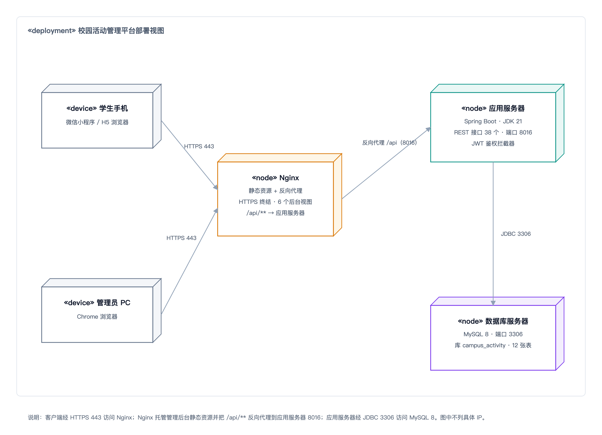
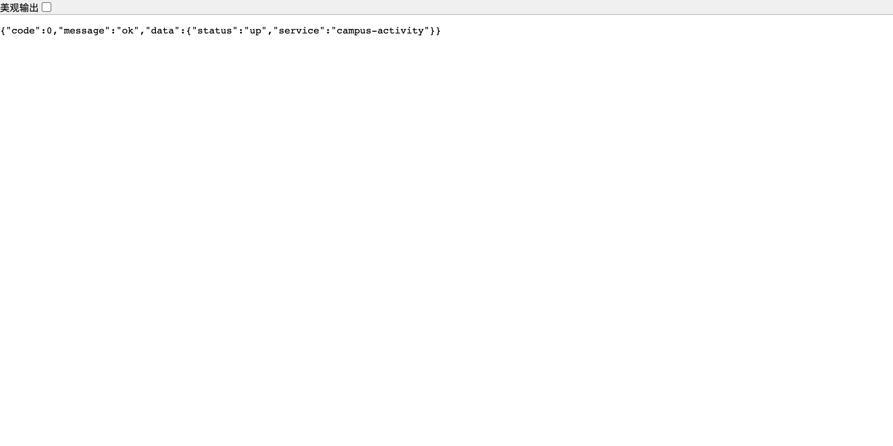

# 校园活动管理平台 部署与运维手册

## 文档信息

| 项 | 内容 |
| --- | --- |
| 文档编号 | CA-DOC-08 |
| 文档名称 | 部署与运维手册 |
| 版本 | v1.1 |
| 日期 | 2026-11-20 |
| 对应阶段 | 部署与运维 |
| 编写 | 项目组 |
| 审核 | 指导教师 |
| 状态 | 定稿 |

## 版本记录

| 版本 | 日期 | 修订人 | 修订说明 |
| --- | --- | --- | --- |
| v1.0 | 2026-11-20 | 项目组 | 首次编写，覆盖开发/演示环境部署、配置项、备份恢复、故障排查与回滚 |
| v1.1 | 2026-11-20 | 项目组 | 增补 Redis 部署与配置、本地上传目录、短信/OSS 环境变量与扩展能力排错，验收口径更新为 33 项断言 |

---

## 1 部署概述与拓扑

本章回答「系统由哪些部署单元组成、它们如何通信、开发环境与生产环境差在哪里」。

### 1.1 部署单元

平台由五个运行单元组成：后端 Spring Boot 应用、小程序（H5 产物或微信小程序包）、管理后台静态站点、MySQL 数据库、Redis。开发阶段三端可分别占用独立端口直接访问；生产阶段由 Nginx 统一提供静态页面并反向代理 `/api`，浏览器与微信客户端只访问 Nginx，不直接暴露 8016、3306 与 6379。短信真实通道与阿里云 OSS 为可选外部服务，默认不启用。

表 8-1 部署单元与端口

| 部署单元 | 技术栈 | 开发端口 | 生产入口 | 说明 |
| --- | --- | --- | --- | --- |
| 后端应用 | Spring Boot 4.1.1 + MyBatis-Plus 3.5.18.1 + Spring Security 7 + Spring Data Redis，JDK 21 | 8016 | 由 Nginx 反代 `/api` | 44 个 REST 接口、Swagger、定时任务 |
| 小程序 H5 | uni-app 3.0（Vue3）+ Vite | 5174 | Nginx 静态站点 | `pnpm run build:h5` 产物 |
| 微信小程序 | uni-app 编译为 mp-weixin | — | 微信客户端 | 由微信开发者工具上传，不占服务器端口 |
| 管理后台 | Vue3 + Vite + Element Plus | 5173 | Nginx 静态站点 | `pnpm run build` 产物 |
| 数据库 | MySQL 8 | 3306 | 仅本机/内网 | 库名 `campus_activity`，12 张表 |
| Redis | Redis 6.2+/7.x | 6379 | 仅本机/内网 | database 11，密码默认 `abc123`；缓存、短信、黑名单、任务锁 |
| 本地文件 | 后端 `./uploads` | — | 由后端 `/uploads/**` 直出 | 已 gitignore；可切阿里云 OSS |

### 1.2 部署拓扑

平台采用「客户端 → Nginx → 应用服务器 → 数据库」的四层结构，客户端不直接连接后端端口与数据库端口。部署拓扑如图 8-1 所示。



如图 8-1 所示，浏览器通过 HTTP/HTTPS 访问 Nginx 上的 H5 站点与管理后台，微信客户端运行小程序包并请求同一套 `/api` 地址；Nginx 将 `/api/**` 反向代理到 `127.0.0.1:8016`，后端通过 JDBC 读写 `127.0.0.1:3306` 的 `campus_activity` 库，并通过 Redis 客户端访问 `127.0.0.1:6379` 的 database 11。开发环境可以省略 Nginx：H5 由 5174 的 Vite 开发服务器提供、后台由 5173 提供，两者通过 Vite 代理把 `/api` 与 `/uploads` 转发到后端；本仓库两处 Vite 代理目标与小程序非 H5 的 `BASE_URL` 均已统一为 8016，无需再改（DEF-02 已修复）。图中端口只用于说明通信关系，生产环境应将 8016、3306、6379 限制在本机或内网，不对外开放。部署图绘制于扩展能力接入前，未单独画出 Redis 与本地文件目录，通信关系以本节文字与表 8-1 为准。

### 1.3 开发环境与生产环境差异

表 8-2 开发/演示环境与生产环境对照

| 项目 | 开发/演示环境 | 生产环境 |
| --- | --- | --- |
| 页面提供方式 | Vite 开发服务器（5174/5173），支持热更新 | Nginx 托管构建产物，无热更新 |
| 接口地址 | Vite 代理 `/api` 到后端；小程序非 H5 分支直连 | Nginx 同域反代 `/api`，避免跨域 |
| 登录方式 | `campus.dev-mode=true`，用 `devOpenId` mock 登录；短信 Mock 通道 | `campus.dev-mode=false`，走微信 `jscode2session`；短信切 `cloopen` 并关闭 `expose-code` |
| 数据库 | 本机 MySQL，`root` 演示密码，允许重导 `data.sql` | 独立账号与强密码，禁止执行 `schema.sql` 的 DROP 段 |
| Redis | 本机 6379，密码 `abc123`，database 11 | 独立实例与强密码，建议开启持久化并纳入备份与监控 |
| 文件存储 | 本地 `./uploads`，`/uploads/**` 直出 | 建议切阿里云 OSS；若保留本地目录需单独备份 |
| 跨域 | 后端 CORS 放开任意来源 | 同域代理，不依赖 CORS |
| 日志级别 | `com.campus.activity: debug`，控制台输出 | 建议 `info`，日志落盘并轮转 |
| 密钥 | 仓库内置演示密钥 | 必须替换 JWT、签到、数据库、Redis、微信密钥 |
| 演示数据 | `data.sql` 以导入日为基准，开发模式自动平移过期活动 | 不导入演示数据，正式数据由业务产生 |

---

## 2 环境要求

本章回答「跑起这套系统至少需要什么硬件与软件版本」。

### 2.1 硬件要求

课程设计与单机演示场景下，前后端与数据库可以部署在同一台机器。以下为可运行的最低配置（设计目标，不是压测结论）：

表 8-3 硬件配置建议

| 部署方式 | CPU | 内存 | 磁盘 | 说明 |
| --- | --- | --- | --- | --- |
| 单机（后端 + MySQL + Nginx） | 2 核 | 4 GB | 50 GB 可用 | 课程演示与少量并发的最低配置 |
| 单机（含前端构建） | 2 核 | 8 GB 建议 | 50 GB 可用 | Node 构建与 MySQL 同时运行，4 GB 容易吃紧 |
| 分离部署 | 应用 2 核 4 GB；数据库 2 核 4 GB | — | 数据库 100 GB 建议 | 数据库与应用分开时的建议值 |

后端进程（JVM）、MySQL、Nginx 与 Node 构建工具不要在同一时刻争抢内存：前端构建建议在发布窗口单独执行，构建完成后再由 Nginx 提供静态文件。磁盘空间主要留给数据库数据、binlog 与日志，备份目录另计。

### 2.2 软件版本

表 8-4 软件版本要求

| 软件 | 版本要求 | 用途 | 备注 |
| --- | --- | --- | --- |
| JDK | 21 | 编译与运行后端 | `pom.xml` 中 `java.version=21` |
| Spring Boot | 4.1.1 | 后端框架 | 父工程版本，需使用 Boot 4 专用 MyBatis-Plus starter |
| Maven | 3.9 及以上（建议） | 后端依赖与打包 | 未在仓库锁定版本 |
| MySQL | 8.0 及以上 | 数据库 | utf8mb4；本机 3306 |
| Redis | 6.2 及以上（建议 7.x） | 缓存、短信验证码、JWT 黑名单、任务锁 | 本机 6379，database 11，密码 `abc123` |
| redis-cli | 随 Redis 安装 | 冒烟脚本清理短信限流 key、排障 | `smoke.sh` 第 7 节依赖 |
| 容联云账号 | 可选 | 真实短信通道 | 需 `CLOOPEN_ACCOUNT_SID` / `CLOOPEN_ACCOUNT_TOKEN` / `CLOOPEN_APP_ID` |
| 阿里云 OSS | 可选 | 文件对象存储 | 需 `OSS_ENDPOINT` / `OSS_ACCESS_KEY_ID` / `OSS_ACCESS_KEY_SECRET` / `OSS_BUCKET` |
| Node.js | 18+（实测 v24.20.0） | 前端构建 | 建议 20/22 LTS，项目要求 18+ |
| pnpm | 未锁定版本 | 前端依赖安装 | npm 在本机受代理限制会超时，统一用 pnpm |
| Nginx | 稳定版（建议 1.18+） | 静态站点与反向代理 | 生产入口；版本未在仓库锁定 |
| Chrome | 稳定版 | H5 与后台页面核对 | 版本未记录 |
| curl + jq | 任意可用版本 | 执行冒烟脚本 | `smoke.sh` 依赖两者 |
| Git | 任意可用版本 | 拉取代码与版本回滚 | 建议保留 tag 或 commit 号 |

### 2.3 网络与端口

表 8-5 端口开放建议

| 端口 | 用途 | 开发环境 | 生产环境 |
| --- | --- | --- | --- |
| 80 / 443 | Nginx HTTP/HTTPS | 可不使用 | 对外开放，HTTPS 建议强制 |
| 8016 | 后端接口 | 本机访问 | 仅监听本机/内网，由 Nginx 反代 |
| 3306 | MySQL | 本机访问 | 仅本机/内网，禁止公网 |
| 6379 | Redis | 本机访问 | 仅本机/内网，禁止公网；建议启用密码 |
| 5174 | 小程序 H5 开发服务器 | 本机访问 | 不启动 |
| 5173 | 管理后台开发服务器 | 本机访问 | 不启动 |

时区统一为 `Asia/Shanghai`：数据库连接串带 `serverTimezone=Asia/Shanghai`，Jackson 也配置了同一时区，操作系统与 MySQL 服务器时区应保持一致，否则活动时间、签到窗口与统计会出现偏移。

---

## 3 部署步骤

本章给出从空库到三端可用的完整命令，按顺序执行；每条命令都在项目根目录或明确标注的子目录下执行。

### 3.1 步骤总览

表 8-6 部署步骤与验证方式

| 步骤 | 操作 | 验证方式 |
| --- | --- | --- |
| 1 | 检查 JDK、Maven、MySQL、Redis、Node、pnpm | `java -version`、`mvn -v`、`mysql --version`、`redis-cli --version`、`node -v`、`pnpm -v` |
| 2 | 创建数据库 `campus_activity` | `SHOW DATABASES` 能看到该库 |
| 3 | 启动 Redis 并确认 database 11 可用 | `redis-cli -a abc123 --no-auth-warning -n 11 ping` 返回 `PONG` |
| 4 | 导入 `schema.sql` 与 `data.sql` | `information_schema.tables` 统计为 12 |
| 5 | 启动后端 | `GET /api/ping` 返回 `code=0`，Swagger 可打开 |
| 6 | 启动小程序（H5 或微信编译） | 5174 首页可访问，或微信开发者工具能预览 |
| 7 | 构建管理后台 | `pnpm run build` 生成 `dist` |
| 8 | 配置 Nginx（生产） | 域名访问静态页，`/api/ping` 经代理返回 0 |
| 9 | 执行冒烟验收 | 33 项断言全部通过 |

### 3.2 创建数据库

```bash
mysql -h127.0.0.1 -P3306 -uroot -p123456 \
  -e "CREATE DATABASE IF NOT EXISTS campus_activity DEFAULT CHARACTER SET utf8mb4 COLLATE utf8mb4_general_ci"
```

库名固定为 `campus_activity`，与 01–14 其他案例的库分开，避免表名冲突。生产环境不要使用 `root`：应新建专用账号并只授予该库的 `SELECT/INSERT/UPDATE/DELETE` 权限，密码通过 `MYSQL_USERNAME`、`MYSQL_PASSWORD` 环境变量注入。

**启动 Redis：**

```bash
# 开发机：带密码启动（已存在的实例可跳过）
redis-server --port 6379 --requirepass abc123 --daemonize yes

# 确认连接与 database 11
redis-cli -a abc123 --no-auth-warning -n 11 ping
# PONG
```

Redis 与 01–14 其他案例共用实例时通过 database 11 隔离；连接参数在 `application.yml` 的 `spring.data.redis`，可用 `REDIS_HOST`、`REDIS_PORT`、`REDIS_PASSWORD`、`REDIS_DATABASE` 覆盖。Redis 是强依赖：缓存、短信验证码、JWT 黑名单、定时任务分布式锁共用同一实例，Redis 不可用时分类/热门活动、短信登录、登出会失败，任务也不会推进。

### 3.3 导入表结构与演示数据

```bash
cd server/src/main/resources/db
mysql -h127.0.0.1 -P3306 -uroot -p123456 campus_activity < schema.sql
mysql -h127.0.0.1 -P3306 -uroot -p123456 campus_activity < data.sql
```

导入后用以下命令确认 12 张表与种子数据：

```bash
mysql -h127.0.0.1 -P3306 -uroot -p123456 campus_activity \
  -e "SELECT COUNT(*) AS table_count FROM information_schema.tables WHERE table_schema='campus_activity'; SELECT COUNT(*) AS activity_count FROM activity;"
```

预期 `table_count=12`，`activity_count=4`。`schema.sql` 开头包含 `DROP TABLE IF EXISTS`，它只适用于开发/演示环境的初始化；生产环境禁止直接重跑该脚本，否则会清空业务数据（回滚见第 10 章）。`data.sql` 中的活动时间以 `CURDATE()` 为基准，导入当天有效；如果演示日期与导入日期不同，开发模式下 `DevDataInitializer` 会把全部过期的示例活动平移到未来，或重新导入 `data.sql`。

### 3.4 启动后端

开发与演示环境直接运行：

```bash
cd server
MYSQL_USERNAME=root MYSQL_PASSWORD=123456 mvn spring-boot:run
```

启动前确认 Redis 已就绪（默认 `127.0.0.1:6379`、密码 `abc123`、database 11）；如需覆盖：

```bash
cd server
REDIS_HOST=127.0.0.1 REDIS_PORT=6379 REDIS_PASSWORD=abc123 REDIS_DATABASE=11 \
  MYSQL_USERNAME=root MYSQL_PASSWORD=123456 mvn spring-boot:run
```

首次启动会自动创建本地上传目录 `server/uploads`（相对启动目录 `./uploads`，`LocalResourceConfig` 中 `mkdirs`），上传后的文件通过 `http://127.0.0.1:8016/uploads/<objectKey>` 访问；该目录已在 `.gitignore` 中排除，备份与清理见第 6 章。短信默认 Mock 通道，验证码打日志并可通过响应 `mockCode` 获取。

看到 Spring Boot 启动日志后，在另一个终端确认：

```bash
curl -s http://127.0.0.1:8016/api/ping
# 期望：{"code":0,"message":"ok","data":{"status":"up"}}
redis-cli -a abc123 --no-auth-warning -n 11 ping
# 期望：PONG
```

生产环境建议先打包，再用外部参数覆盖敏感配置并以守护方式运行：

```bash
cd server
mvn -DskipTests package

mkdir -p logs

# 先导出变量，再启动；不可写成 VAR=值 命令 "$VAR"，否则 $VAR 会在赋值前展开为空
export JWT_SECRET='替换为不少于 32 个字符的随机串'
export CHECKIN_SECRET='替换为独立的随机串'
export MYSQL_USERNAME='campus'
export MYSQL_PASSWORD='替换为强密码'
export WX_APPID='替换为小程序 AppID'
export WX_SECRET='替换为小程序密钥'
export REDIS_HOST='127.0.0.1'
export REDIS_PORT='6379'
export REDIS_PASSWORD='替换为 Redis 强密码'
export REDIS_DATABASE='11'

nohup java -jar target/campus-activity-server-1.0.0.jar \
  --server.port=8016 \
  --campus.dev-mode=false \
  --campus.jwt.secret="$JWT_SECRET" \
  --campus.checkin.secret="$CHECKIN_SECRET" \
  --campus.sms.provider=cloopen \
  --campus.sms.expose-code=false \
  > logs/campus-activity.log 2>&1 &

echo $! > logs/campus-activity.pid
```

说明：`MYSQL_USERNAME`、`MYSQL_PASSWORD`、`WX_APPID`、`WX_SECRET`、`REDIS_*` 会被 `application.yml` 中的 `${...}` 占位符读取；`jwt.secret` 与 `checkin.secret` 在配置文件中是演示明文，生产用命令行参数覆盖更安全，避免把真实密钥写进代码仓库。短信切真实通道时还需导出 `CLOOPEN_ACCOUNT_SID`、`CLOOPEN_ACCOUNT_TOKEN`、`CLOOPEN_APP_ID`、`CLOOPEN_TEMPLATE_ID`；切 OSS 时把 `--campus.file.storage-type=oss` 并导出 `OSS_*`，详见 [12-功能扩展说明](12-功能扩展说明.md)。JWT 密钥少于 32 个字符会导致应用启动失败，这是有意的保护。若不用 `nohup`，可交给 systemd 或容器编排管理（是否采用 systemd 待确认）。

### 3.5 启动小程序

**H5 预览（开发/演示）：**

```bash
cd app
pnpm install
pnpm run dev:h5
```

访问 `http://127.0.0.1:5174`。`app/vite.config.ts` 的 `/api` 与 `/uploads` 代理目标均为 `http://127.0.0.1:8016`，与后端端口一致（DEF-02 已修复），默认配置即可联调。

**微信小程序编译：**

```bash
cd app
pnpm run dev:mp-weixin      # 开发产物：app/dist/dev/mp-weixin
# 或
pnpm run build:mp-weixin    # 生产产物：app/dist/build/mp-weixin
```

在微信开发者工具中导入对应产物目录，首次导入需填写自己的小程序 AppID（当前 `manifest.json` 未配置）。本地调试在「详情 → 本地设置」勾选「不校验合法域名」；`app/src/utils/request.ts` 的非 H5 分支默认为 `http://127.0.0.1:8016/api`，真机调试需改为后端所在机器的局域网 IP 或正式 HTTPS 域名。真机、正式 AppID 与 request 合法域名不在本轮验证范围，接入前需补齐（见「待确认事项」）。

**H5 生产构建：**

```bash
cd app
pnpm run build:h5
# 产物：app/dist/build/h5，部署到 Nginx 静态目录
```

### 3.6 构建管理后台

```bash
cd admin
pnpm install
pnpm run type-check
pnpm run build
# 产物：admin/dist
```

开发预览使用 `pnpm run dev`，访问 `http://127.0.0.1:5173`，账号 `admin / Admin@123`。后台同样依赖 Vite 代理，`admin/vite.config.ts` 的 `/api` 与 `/uploads` 代理目标均为 8016，默认配置即可联调；`admin/README.md` 的说明文字已同步。后台使用 hash 路由，Nginx 只需托管静态文件，无需额外 rewrite 规则。

### 3.7 Nginx 配置示例

生产环境建议为管理后台与 H5 各用一个域名（或子域名），两者都把 `/api/` 反向代理到 8016。以下为 HTTP 配置示例，域名、证书路径与静态目录需按实际替换；生产应补充 HTTPS 与证书。

```nginx
# 管理后台
server {
    listen 80;
    server_name admin.example.com;
    root /var/www/campus-admin;
    index index.html;

    location / {
        try_files $uri $uri/ /index.html;
    }

    location /api/ {
        proxy_pass http://127.0.0.1:8016/api/;
        proxy_set_header Host $host;
        proxy_set_header X-Real-IP $remote_addr;
        proxy_set_header X-Forwarded-For $proxy_add_x_forwarded_for;
        proxy_set_header X-Forwarded-Proto $scheme;
        proxy_connect_timeout 5s;
        proxy_read_timeout 30s;
    }
}

# 小程序 H5
server {
    listen 80;
    server_name h5.example.com;
    root /var/www/campus-h5;
    index index.html;

    location / {
        try_files $uri $uri/ /index.html;
    }

    location /api/ {
        proxy_pass http://127.0.0.1:8016/api/;
        proxy_set_header Host $host;
        proxy_set_header X-Real-IP $remote_addr;
        proxy_set_header X-Forwarded-For $proxy_add_x_forwarded_for;
    }
}
```

部署静态文件时，可将构建产物复制到对应目录：

```bash
sudo mkdir -p /var/www/campus-admin /var/www/campus-h5
sudo cp -r admin/dist/* /var/www/campus-admin/
sudo cp -r app/dist/build/h5/* /var/www/campus-h5/
sudo nginx -t && sudo nginx -s reload
```

`proxy_pass` 末尾保留 `/api/`，与 `location /api/` 配合可去掉重复前缀；若改为只写 `http://127.0.0.1:8016`，转发路径会缺少 `/api`，导致 404。HTTPS 需在 `server` 块中增加 `listen 443 ssl;` 与证书配置，并把 80 端口重定向到 443；微信小程序要求请求域名为 HTTPS 合法域名，具体域名与证书待确认。

### 3.8 部署后验收

在项目根目录执行（脚本默认 `BASE=http://127.0.0.1:8016/api`，无需再覆盖端口）：

```bash
./scripts/smoke.sh
```

输出「全部通过：33 项」且退出码为 0，表示主链路与扩展能力部署成功。脚本第 7 节依赖本机 `curl`、`jq` 与 `redis-cli`，会在运行前用 `redis-cli -a abc123 --no-auth-warning -n 11` 清理演示手机号 `13800000003` 的短信限流 key；Redis 密码或 database 不同时用 `REDIS_PASSWORD` / `REDIS_DATABASE` 覆盖：

```bash
REDIS_PASSWORD=abc123 REDIS_DATABASE=11 ./scripts/smoke.sh
```

随后用浏览器分别打开后台登录页与 H5 首页，确认登录、列表与详情能取到真实数据；再访问 `http://127.0.0.1:8016/swagger-ui.html` 确认接口文档可用。部署验收的完整用例见《测试报告》（[07-测试报告](07-测试报告.md)）。

---

## 4 配置项说明

本章回答「`application.yml` 里每个配置项是什么、能改什么、生产必须改什么」。

### 4.1 application.yml 全量配置

表 8-7 application.yml 配置项说明

| 配置键 | 当前值 | 含义 | 生产建议 |
| --- | --- | --- | --- |
| `server.port` | `8016` | 后端 HTTP 端口 | 保持 8016，由 Nginx 反代 |
| `spring.application.name` | `campus-activity` | 应用名 | 不变 |
| `spring.datasource.url` | `jdbc:mysql://127.0.0.1:3306/campus_activity?...serverTimezone=Asia/Shanghai&useSSL=false&allowPublicKeyRetrieval=true` | JDBC 连接串，库名固定 | 生产按实际内网地址修改；建议开启 SSL |
| `spring.datasource.username` | `${MYSQL_USERNAME:root}` | 数据库账号，优先读环境变量 | 使用专用最小权限账号 |
| `spring.datasource.password` | `${MYSQL_PASSWORD:123456}` | 数据库密码，优先读环境变量 | 必须替换为强密码，不写入仓库 |
| `spring.data.redis.host` | `${REDIS_HOST:127.0.0.1}` | Redis 地址 | 按实际内网地址修改 |
| `spring.data.redis.port` | `${REDIS_PORT:6379}` | Redis 端口 | 默认 6379 |
| `spring.data.redis.password` | `${REDIS_PASSWORD:abc123}` | Redis 密码 | **必须替换为强密码，不写入仓库** |
| `spring.data.redis.database` | `${REDIS_DATABASE:11}` | 与 01–14 其他案例隔离的 database | 保持 11，避免缓存/黑名单串用 |
| `spring.data.redis.timeout` | `3s` | Redis 命令超时 | 保持默认 |
| `spring.data.redis.lettuce.pool.*` | `max-active=8`、`max-idle=8`、`min-idle=2`、`max-wait=1s` | Lettuce 连接池 | 按并发量调整 |
| 缓存 TTL / key 前缀 / null 缓存 | 10 分钟 / `campus:cache:` / 开启 | 在 `RedisConfig` 中定义 | `application.yml` 不写 `spring.cache.*`，修改只改 `RedisConfig` |
| `spring.servlet.multipart.max-file-size` | `10MB` | multipart 单文件上限 | 与 `campus.file.max-file-size` 同步调整 |
| `spring.servlet.multipart.max-request-size` | `10MB` | multipart 整包上限 | 同上 |
| `spring.jackson.date-format` | `yyyy-MM-dd HH:mm:ss` | JSON 日期格式 | 不变 |
| `spring.jackson.time-zone` | `Asia/Shanghai` | JSON 时区 | 与服务器、MySQL 时区一致 |
| `spring.jackson.default-property-inclusion` | `non_null` | 空字段不输出 | 不变 |
| `mybatis-plus.configuration.map-underscore-to-camel-case` | `true` | 下划线转驼峰 | 不变 |
| `mybatis-plus.configuration.log-impl` | `org.apache.ibatis.logging.stdout.StdOutImpl` | SQL 打印到控制台 | 生产建议关闭或改日志实现，避免刷屏与泄露参数 |
| `mybatis-plus.global-config.banner` | `false` | 关闭 MyBatis-Plus banner | 不变 |
| `mybatis-plus.global-config.db-config.id-type` | `assign_id` | 雪花 ID 主键 | 不变 |
| `mybatis-plus.global-config.db-config.logic-delete-field` | `deleted` | 逻辑删除字段 | 不变 |
| `mybatis-plus.global-config.db-config.logic-delete-value` | `1` | 删除值 | 不变 |
| `mybatis-plus.global-config.db-config.logic-not-delete-value` | `0` | 未删除值 | 不变 |
| `mybatis-plus.mapper-locations` | `classpath*:/mapper/**/*.xml` | XML 映射文件位置 | 不变 |
| `springdoc.swagger-ui.path` | `/swagger-ui.html` | Swagger UI 路径 | 生产建议限制访问来源或关闭 |
| `springdoc.swagger-ui.tags-sorter` | `alpha` | 接口分组按字母排序 | 不变 |
| `campus.dev-mode` | `true` | 开发模式，允许 mock openid 登录 | **生产必须改为 false** |
| `campus.jwt.secret` | `campus-activity-demo-secret-key-change-in-production-2026` | JWT HS256 密钥，至少 32 字符 | **必须替换为随机密钥** |
| `campus.jwt.access-token-hours` | `2` | token 有效期（小时） | 按安全要求评估，默认 2 小时可用 |
| `campus.wechat.app-id` | `${WX_APPID:}` | 小程序 AppID | 生产必须配置 |
| `campus.wechat.app-secret` | `${WX_SECRET:}` | 小程序密钥 | 生产必须配置，仅用环境变量注入 |
| `campus.checkin.secret` | `campus-checkin-demo-secret-2026` | 签到码 HMAC 密钥 | **必须替换；多实例必须一致** |
| `campus.checkin.slice-seconds` | `30` | 签到码时间片长度（秒），即二维码轮换周期 | 保持 30，过短影响可用性 |
| `campus.checkin.tolerance-slices` | `2` | 容忍的过期时间片数量 | 保持默认；调大会放宽转发有效期 |
| `campus.checkin.open-before-minutes` | `30` | 签到窗口：活动开始前多少分钟开放 | 按活动类型调整 |
| `campus.checkin.close-after-minutes` | `30` | 签到窗口：活动结束后多少分钟关闭 | 按活动类型调整 |
| `campus.sms.provider` | `mock` | 短信通道：`mock` / `cloopen` | 生产改 `cloopen` |
| `campus.sms.expose-code` | `true` | 是否在响应里回传 `mockCode` | **生产必须改 `false`** |
| `campus.sms.code-expire-seconds` | `300` | 验证码有效期（秒） | 按安全要求调整 |
| `campus.sms.send-interval-seconds` | `60` | 同一手机号发送间隔（秒） | 保持默认 |
| `campus.sms.send-daily-limit` | `10` | 同一手机号 24 小时发送上限 | 按短信预算调整 |
| `campus.sms.max-fail-count` | `5` | 验证码最大输错次数 | 保持默认 |
| `campus.sms.cloopen.server-ip` | `app.cloopen.com` | 容联云接口地址 | 一般不变 |
| `campus.sms.cloopen.port` | `8883` | 容联云接口端口 | 一般不变 |
| `campus.sms.cloopen.account-sid` | `${CLOOPEN_ACCOUNT_SID:}` | 容联云账号 SID | `cloopen` 通道必填 |
| `campus.sms.cloopen.account-token` | `${CLOOPEN_ACCOUNT_TOKEN:}` | 容联云账号 Token | `cloopen` 通道必填 |
| `campus.sms.cloopen.app-id` | `${CLOOPEN_APP_ID:}` | 容联云应用 AppID | `cloopen` 通道必填 |
| `campus.sms.cloopen.template-id` | `${CLOOPEN_TEMPLATE_ID:1}` | 短信模板 ID | 替换为已审核通过的模板 |
| `campus.file.storage-type` | `local` | 文件存储：`local` / `oss` | 生产建议 `oss` |
| `campus.file.max-file-size` | `10MB` | Service 层文件大小上限 | 与 multipart 配置同步 |
| `campus.file.date-pattern` | `yyyy/MM/dd` | objectKey 日期目录 | 不变 |
| `campus.file.allowed-extensions` | 17 种扩展名 | 上传白名单 | 按业务收紧 |
| `campus.file.local.base-dir` | `./uploads` | 本地落盘目录 | 生产需备份该目录或切 OSS |
| `campus.file.local.url-prefix` | `/uploads` | 本地访问前缀 | 挂 Nginx 时可改为完整域名 |
| `campus.file.oss.endpoint` | `${OSS_ENDPOINT:}` | OSS 地域节点 | `oss` 模式必填 |
| `campus.file.oss.access-key-id` | `${OSS_ACCESS_KEY_ID:}` | OSS AccessKeyId | `oss` 模式必填 |
| `campus.file.oss.access-key-secret` | `${OSS_ACCESS_KEY_SECRET:}` | OSS AccessKeySecret | `oss` 模式必填 |
| `campus.file.oss.bucket-name` | `${OSS_BUCKET:}` | OSS Bucket | `oss` 模式必填 |
| `campus.file.oss.dir` | `files` | OSS 统一对象前缀 | 不变 |
| `campus.file.oss.domain` | `${OSS_DOMAIN:}` | 自定义域名/CDN | 可选 |
| `logging.level.com.campus.activity` | `debug` | 业务包日志级别 | 生产建议 `info`，排障时临时调 `debug` |

### 4.2 环境变量

表 8-8 环境变量说明

| 变量 | 作用 | 示例 | 未设置时 |
| --- | --- | --- | --- |
| `MYSQL_USERNAME` | 覆盖 `spring.datasource.username` | `campus` | 使用配置默认 `root` |
| `MYSQL_PASSWORD` | 覆盖 `spring.datasource.password` | 强密码 | 使用配置默认 `123456` |
| `WX_APPID` | 覆盖 `campus.wechat.app-id` | `wx1234567890abcdef` | 空字符串，非 dev 模式下登录报「未配置小程序 AppID」 |
| `WX_SECRET` | 覆盖 `campus.wechat.app-secret` | 密钥串 | 空字符串，微信登录失败 |
| `REDIS_HOST` | 覆盖 `spring.data.redis.host` | `127.0.0.1` | 使用配置默认 `127.0.0.1` |
| `REDIS_PORT` | 覆盖 `spring.data.redis.port` | `6379` | 使用配置默认 `6379` |
| `REDIS_PASSWORD` | 覆盖 `spring.data.redis.password` | 强密码 | 使用配置默认 `abc123` |
| `REDIS_DATABASE` | 覆盖 `spring.data.redis.database` | `11` | 使用配置默认 `11` |
| `CLOOPEN_ACCOUNT_SID` | 覆盖 `campus.sms.cloopen.account-sid` | 账号 SID | 空字符串，`cloopen` 通道发送时报 60008 |
| `CLOOPEN_ACCOUNT_TOKEN` | 覆盖 `campus.sms.cloopen.account-token` | 账号 Token | 同上 |
| `CLOOPEN_APP_ID` | 覆盖 `campus.sms.cloopen.app-id` | 应用 AppID | 同上 |
| `CLOOPEN_TEMPLATE_ID` | 覆盖 `campus.sms.cloopen.template-id` | 已审核模板 ID | 默认 `1`，通常需要替换 |
| `OSS_ENDPOINT` | 覆盖 `campus.file.oss.endpoint` | `https://oss-cn-hangzhou.aliyuncs.com` | 空字符串，`oss` 模式启动失败 |
| `OSS_ACCESS_KEY_ID` | 覆盖 `campus.file.oss.access-key-id` | AccessKeyId | 同上 |
| `OSS_ACCESS_KEY_SECRET` | 覆盖 `campus.file.oss.access-key-secret` | AccessKeySecret | 同上 |
| `OSS_BUCKET` | 覆盖 `campus.file.oss.bucket-name` | Bucket 名称 | 同上 |
| `OSS_DOMAIN` | 覆盖 `campus.file.oss.domain` | 自定义域名/CDN | 空字符串，用 bucket 默认域名 |

开发环境导出示例：

```bash
export MYSQL_USERNAME=root
export MYSQL_PASSWORD=123456
export WX_APPID=''
export WX_SECRET=''
export REDIS_HOST=127.0.0.1
export REDIS_PORT=6379
export REDIS_PASSWORD=abc123
export REDIS_DATABASE=11
```

注意 `WX_SECRET`、`REDIS_PASSWORD`、`CLOOPEN_ACCOUNT_TOKEN`、`OSS_ACCESS_KEY_SECRET` 只应存在于部署环境变量或密钥管理中，不要写入 `application.yml`、脚本或 Git 仓库。JWT 与签到密钥当前没有环境变量占位，生产通过启动参数 `--campus.jwt.secret`、`--campus.checkin.secret` 传入；`campus.sms.provider`、`campus.file.storage-type`、`campus.sms.expose-code` 也没有 `${...}` 占位，切换时用启动参数或改配置。

### 4.3 生产必改项

表 8-9 生产必改配置

| 配置项 | 演示值 | 生产要求 | 不改的后果 |
| --- | --- | --- | --- |
| `campus.dev-mode` | `true` | `false` | 任意人可用 `devOpenId` 冒充用户登录 |
| `campus.jwt.secret` | 仓库内置演示串 | 随机、长度 ≥32、定期更换 | token 可被伪造，全部账号失守 |
| `campus.checkin.secret` | 仓库内置演示串 | 随机且与其他环境隔离；多实例一致 | 可离线计算任意活动签到码，签到形同虚设 |
| `spring.datasource.password` | `123456` | 强密码，仅部署环境可见 | 数据库被直连读写 |
| `campus.wechat.app-id` / `app-secret` | 空 | 配置正式小程序凭据 | 非 dev 模式无法登录 |
| `spring.datasource.username` | `root` | 最小权限专用账号 | 误操作或注入可破坏整库 |
| `spring.data.redis.password` | `abc123` | 强密码，仅内网访问 | Redis 被直连，缓存/黑名单/短信状态被篡改 |
| `campus.sms.provider` | `mock` | `cloopen`（真实通道） | 验证码只打日志，用户收不到短信 |
| `campus.sms.expose-code` | `true` | `false` | 验证码随接口响应泄露，等于任意手机号可登录 |
| `campus.sms.cloopen.*` | 空 | 配置正式账号与已审核模板 | 短信发送失败（60008），验证码登录不可用 |
| `campus.file.storage-type` | `local` | 建议 `oss`；保留 local 时必须备份 `./uploads` | 单机磁盘写满或实例间文件不共享 |
| `campus.file.oss.*` | 空 | 配置 OSS 节点、AccessKey、Bucket | `oss` 模式启动失败，上传不可用 |
| `mybatis-plus.configuration.log-impl` | `StdOutImpl` | 关闭或改用文件日志 | SQL 与参数打印到标准输出，泄露数据 |
| `logging.level.com.campus.activity` | `debug` | `info` | 日志量过大，磁盘被占满 |

修改方式优先级为「命令行参数 > 环境变量 > `application.yml`」。涉及密钥的改动必须重启后端；只改日志级别也应重启（当前未接入配置热更新）。修改完成后按第 5 章健康检查与第 3.8 节冒烟脚本验证，并确认 dev 登录已不可用、真实微信登录可用。

---

## 5 启动、停止与健康检查

本章回答「日常如何启动、如何安全停止、用什么命令判断服务健康」。

### 5.1 启动

开发环境四个进程分别启动（建议各开一个终端；Redis 也可用系统服务）：

```bash
# 终端 1：Redis（若未作为服务运行）
redis-server --port 6379 --requirepass abc123

# 终端 2：后端
cd server && mvn spring-boot:run

# 终端 3：小程序 H5（如需）
cd app && pnpm run dev:h5

# 终端 4：管理后台（如需）
cd admin && pnpm run dev
```

生产环境后端按 3.4 节以 `java -jar` 方式启动；Nginx 由系统服务或 `nginx` 命令启动：

```bash
sudo nginx -t          # 校验配置
sudo nginx             # 启动；若已作为服务安装则用 sudo systemctl start nginx
```

启动顺序建议：MySQL → Redis → 后端 → Nginx。后端启动时会连接数据库与 Redis，并启动每 5 分钟一次的状态推进定时任务；任一依赖未就绪时后端起不来或任务无法抢锁。

### 5.2 停止

开发环境在前端/后端终端按 `Ctrl+C` 即可。生产环境应优雅停止，让正在处理的请求与事务完成：

```bash
# 后端：先发 TERM 信号，等待进程退出
kill -15 $(cat logs/campus-activity.pid)

# 确认端口已释放
lsof -i :8016
```

若进程未退出，再确认是否卡在数据库操作，必要时才使用 `kill -9`；强杀可能导致未提交事务回滚。Nginx 停止或重载：

```bash
sudo nginx -s reload     # 只改配置、不中断连接
sudo nginx -s quit       # 优雅停止
# 若以系统服务安装：sudo systemctl stop nginx
```

前端静态文件更新不需要停 Nginx，替换目录后 `nginx -s reload` 即可。停止顺序与启动相反：Nginx → 后端 → MySQL。

### 5.3 健康检查

表 8-10 健康检查清单

| 检查项 | 命令 | 期望结果 |
| --- | --- | --- |
| 后端探活 | `curl -s http://127.0.0.1:8016/api/ping` | `{"code":0,"message":"ok","data":{"status":"up"}}` |
| Swagger | `curl -s -o /dev/null -w '%{http_code}' -L http://127.0.0.1:8016/swagger-ui.html` | `200` |
| 数据库连通 | `mysql -h127.0.0.1 -P3306 -ucampus -p -e "SELECT 1"` | 返回 `1` |
| Redis 连通 | `redis-cli -a "$REDIS_PASSWORD" --no-auth-warning -n 11 ping` | `PONG` |
| 表数量 | `mysql -h127.0.0.1 -P3306 -ucampus -p campus_activity -e "SELECT COUNT(*) FROM information_schema.tables WHERE table_schema='campus_activity'"` | `12` |
| 缓存写入 | `redis-cli -a "$REDIS_PASSWORD" --no-auth-warning -n 11 exists campus:cache:categories::all` | 请求分类接口后返回 `1` |
| 端到端链路 | `./scripts/smoke.sh` | `全部通过：33 项`，退出码 0 |
| 上传目录 | `ls -ld server/uploads` | 目录存在且可写 |
| 启动日志 | `grep -n "Started CampusActivityApplication" logs/campus-activity.log` | 有启动成功记录，无 `ERROR` |
| 定时任务 | `grep -n "状态推进完成" logs/campus-activity.log` | 每 5 分钟出现一次（有状态变化时） |
| 日志异常 | `grep -nE "ERROR" logs/campus-activity.log` | 无 ERROR 记录与未处理异常堆栈 |
| 磁盘 | `df -h` | 数据盘、日志盘、上传目录剩余空间充足 |
| 进程存活 | `pgrep -fl campus-activity-server` | 只有预期的 Java 进程 |
| Nginx 代理 | `curl -s https://admin.example.com/api/ping` | 经代理返回 `code=0` |

健康检查分三层：进程与端口、接口与数据库/Redis、端到端业务链路。端口通不代表业务正常（例如数据库连接池耗尽时 ping 仍可能返回，Redis 故障时缓存接口会报错），因此上线、发布后与每日巡检都应执行冒烟脚本。`/api/ping` 不查库也不校验身份，只用于探活；真正的业务健康度以 33 项断言与日志为准。

---

健康检查接口的实际返回如图 8-2 所示：`/api/ping` 返回 `code=0` 与 `data.status=up`，可据此判断应用是否完成启动。



图 8-2 健康检查接口返回

## 6 数据备份与恢复

本章回答「数据如何备份、如何恢复、备份策略怎么定」。

### 6.1 全量备份

使用 `mysqldump` 对 `campus_activity` 做逻辑备份。`--single-transaction` 让 InnoDB 表在一致性快照下导出，不锁表：

```bash
mkdir -p ~/campus-backup

mysqldump -h127.0.0.1 -P3306 -ucampus -p \
  --single-transaction \
  --default-character-set=utf8mb4 \
  --routines --triggers \
  campus_activity > ~/campus-backup/campus_activity_$(date +%Y%m%d_%H%M%S).sql
```

命令会提示输入密码；生产不建议把密码写在命令行（会进入 shell 历史与进程列表），可临时使用 `~/.my.cnf` 的 `[client]` 段或 `MYSQL_PWD` 环境变量，并在用完后清理。备份完成后校验文件非空且包含建表语句：

```bash
ls -lh ~/campus-backup/
head -n 20 ~/campus-backup/campus_activity_*.sql
grep -c "CREATE TABLE" ~/campus-backup/campus_activity_*.sql
```

预期能看到 12 段 `CREATE TABLE`。若备份文件极小或没有建表语句，说明连接、库名或权限有问题，需要重新执行。

Redis 中保存的是缓存、短信验证码、JWT 黑名单与分布式锁，均为可重建或短生命周期数据，通常不需要和业务库同等备份；若需要保留登出状态，可在低峰执行 `BGSAVE` 后备份 RDB 文件：

```bash
redis-cli -a "$REDIS_PASSWORD" --no-auth-warning -n 11 bgsave
redis-cli -a "$REDIS_PASSWORD" --no-auth-warning config get dir     # RDB 目录
redis-cli -a "$REDIS_PASSWORD" --no-auth-warning config get dbfilename
# 将 <dir>/<dbfilename> 复制到备份目录
```

本地上传目录需要单独备份（`server/uploads` 已被 gitignore，不在代码仓库与数据库备份中）：

```bash
tar czf ~/campus-backup/uploads_$(date +%Y%m%d_%H%M%S).tgz -C server uploads
```

切阿里云 OSS 后，文件在 OSS 侧，按 OSS 的版本与备份策略管理，不再备份本地目录。

### 6.2 恢复

恢复前先停止后端，避免恢复过程中仍有写入；恢复会覆盖当前库数据，因此先对当前库再做一次备份：

```bash
# 1. 停止后端（见 5.2）
# 2. 对当前库做保护性备份
mysqldump -h127.0.0.1 -P3306 -ucampus -p --single-transaction \
  campus_activity > ~/campus-backup/before_restore_$(date +%Y%m%d_%H%M%S).sql

# 3. 恢复指定备份
mysql -h127.0.0.1 -P3306 -ucampus -p campus_activity < ~/campus-backup/campus_activity_20261109_020000.sql

# 4. 启动后端并验证
```

如果库已被删除，先建库再恢复：

```bash
mysql -h127.0.0.1 -P3306 -ucampus -p \
  -e "CREATE DATABASE IF NOT EXISTS campus_activity DEFAULT CHARACTER SET utf8mb4"
mysql -h127.0.0.1 -P3306 -ucampus -p campus_activity < ~/campus-backup/campus_activity_20261109_020000.sql
```

恢复后核对 12 张表、账号、活动与报名数量，并执行冒烟脚本。注意备份文件中的 `data.sql` 演示数据时间是旧的，开发演示环境可重新导入 `data.sql`，生产数据以备份为准。

### 6.3 备份策略建议

表 8-11 备份策略

| 项目 | 建议 |
| --- | --- |
| 备份频次 | 每日 1 次全量（建议业务低峰，如 02:00）；重要发布前手动加备一次 |
| 保留周期 | 日备保留 7 天，周备保留 4 周；至少保留一份上月备份 |
| 存储位置 | 本机备份目录之外，另存一份到另一台机器或对象存储（课程设计可用 U 盘/另一目录模拟） |
| 校验 | 每次备份后检查文件大小与 `CREATE TABLE` 数量；每月至少做一次恢复演练 |
| 加密与权限 | 备份含用户与学籍信息，目录权限设为仅运维账号可读，传输使用加密通道 |
| 与代码分离 | 备份文件不提交 Git，不放入静态站点目录 |
| 恢复演练 | 在测试库执行「备份 → 恢复 → 冒烟」，确认备份可用后再视为有效备份 |

---

## 7 日志与监控

本章回答「日志在哪里、看什么、慢查询怎么开，以及当前监控到什么程度」。

### 7.1 应用日志

后端默认把日志输出到标准输出；开发时直接看终端，生产通过 `nohup` 重定向到 `logs/campus-activity.log`。日志级别由 `logging.level.com.campus.activity` 控制：开发为 `debug`，可以看到业务异常、状态推进、补签等明细；生产建议 `info`，排障时临时改为 `debug` 并尽快恢复。MyBatis-Plus 当前配置了 `StdOutImpl`，会在控制台打印 SQL 与参数，生产应关闭或改为文件日志实现，避免日志膨胀与敏感参数泄露。

扩展能力相关的关键日志：

| 日志关键字 | 级别 | 含义 |
| --- | --- | --- |
| `[短信模拟] 向 138****0003 发送验证码` | info | Mock 通道发了验证码，可从日志取码 |
| `JWT 黑名单查询失败，按未拉黑处理` | warn | Redis 异常，登出后的 token 暂时仍可用 |
| `活动状态推进任务未抢到分布式锁，跳过本次执行` | info | 其他实例正在执行，属正常多实例行为 |
| `本地文件访问映射：/uploads/** -> ...` | info | 启动时本地存储映射成功 |
| `文件写入本地：...` | info | 本地文件落盘成功 |
| `容联云短信发送成功/失败` | info/warn | 真实短信通道结果，失败时带状态码 |

日志文件需要轮转，否则长期运行会占满磁盘。Linux 下可用 `logrotate` 按天切分并保留 14 天（示例配置需按实际路径调整）：

```bash
# /etc/logrotate.d/campus-activity
/opt/campus-activity/logs/campus-activity.log {
    daily
    rotate 14
    missingok
    notifempty
    compress
    copytruncate
}
```

`copytruncate` 适用于进程仍持有文件句柄的 `nohup` 场景；若改用 systemd/journald，则无需该配置。当前仓库没有内置日志框架配置文件，轮转方案属于部署侧补充，具体保留期待确认。

### 7.2 审计日志

`audit_record` 表记录活动审核、下架、手动补签、角色变更等操作，是业务层面的审计来源。常用查询：

```sql
-- 最近 20 条审计记录
SELECT id, biz_type, biz_id, action, operator_name,
       before_status, after_status, remark, create_time
FROM audit_record
ORDER BY create_time DESC
LIMIT 20;

-- 按业务类型过滤（ACTIVITY / SIGNUP / CHECKIN / USER）
SELECT * FROM audit_record WHERE biz_type = 'CHECKIN' ORDER BY create_time DESC LIMIT 20;
```

后台「操作日志」页面（`GET /api/admin/logs`）直接读取该表。审计记录与业务表在同一库，随全量备份一起保护；不要为「清理数据」而删除审计记录。若发现补签、角色变更记录缺失，应检查对应服务是否在同一事务内写入。

### 7.3 MySQL 慢查询

MySQL 默认未开启慢查询日志，可在数据库侧开启并设置阈值：

```sql
SET GLOBAL slow_query_log = ON;
SET GLOBAL long_query_time = 2;
SHOW VARIABLES LIKE 'slow_query_log_file';
```

`SET GLOBAL` 在 MySQL 重启后失效；需要持久化时应写入 `my.cnf` 的 `[mysqld]` 段（`slow_query_log=1`、`long_query_time=2`、`slow_query_log_file=/var/log/mysql/slow.log`），然后重启 MySQL。慢查询重点观察报名占位、报名分页、后台日志分页等语句；确认执行计划后可补充索引，但 `schema.sql` 中的索引属于设计基线，调整需同步文档。

### 7.4 监控现状与人工巡检

当前未接入 Prometheus、Grafana 或其他监控平台，也未引入 Spring Boot Actuator；没有自动告警，没有可视化看板。可用的是 `/api/ping`、Swagger、应用日志、审计记录、MySQL 慢查询与系统命令。这是课程设计阶段的取舍，不是已完成的监控能力。

表 8-12 人工巡检项

| 巡检项 | 建议频次 | 方法 |
| --- | --- | --- |
| 后端进程与端口 | 每日 | `pgrep -fl campus-activity-server`、`lsof -i :8016` |
| 探活与冒烟 | 发布后、每日 | `/api/ping`、`BASE=http://127.0.0.1:8016/api ./scripts/smoke.sh` |
| 日志错误 | 每日 | `grep -nE "ERROR" logs/campus-activity.log` |
| 审计记录 | 每周 | 抽查 `audit_record` 是否有异常审核、补签、角色变更 |
| 数据库空间与连接 | 每日 | `df -h`、`SHOW STATUS LIKE 'Threads_connected'` |
| 慢查询 | 每周 | 查看慢查询日志并按执行计划分析 |
| 备份有效性 | 每月 | 随机抽取备份在测试库恢复并跑冒烟 |

若后续需要接入监控平台与告警，建议优先补齐指标采集（进程存活、接口错误率、数据库连接数、磁盘）并配置阈值告警；具体平台选型待确认。

---

## 8 常见故障排查

本章按「现象 → 可能原因 → 排查命令 → 处理」列出部署与运行中最常见的问题。

表 8-13 常见故障排查

| 现象 | 可能原因 | 排查与处理 |
| --- | --- | --- |
| 后端启动报 `Port 8016 was already in use` | 已有后端进程占端口，或另一个程序占用 8016 | `lsof -i :8016` 找到 PID；确认是旧进程后 `kill -15`，再重启。不要盲目杀未知进程 |
| 活动时间、签到窗口整体偏移 8 小时 | 操作系统、MySQL、JDBC 时区不一致；服务器时间未同步 | `date`；`mysql -e "SELECT @@global.time_zone, @@session.time_zone, NOW();"`；统一为 `Asia/Shanghai`，JDBC 已带 `serverTimezone=Asia/Shanghai`，改完重启后端 |
| H5 请求 404 或连接失败，Network 显示非 8016 端口 | 本地仍在使用旧的代理配置（仓库默认已统一为 8016） | 查 `app/vite.config.ts`、`admin/vite.config.ts`、`app/src/utils/request.ts`，确认 `/api` 与 `/uploads` 目标为 `http://127.0.0.1:8016`，改后重启 Vite |
| 跨域报错或预检失败 | 前后端不同源且未走代理；生产未配 Nginx | 开发用 Vite 代理或后端 CORS（当前放开任意来源）；生产用同域 Nginx 反代 `/api`，不要依赖 CORS |
| 接口返回 HTTP 401 / `code=10001` | 未带 token、token 过期（默认 2 小时）、签名不匹配（换了 JWT 密钥） | 检查请求头 `Authorization: Bearer <token>`；重新登录获取新 token；确认改了 `jwt.secret` 后旧 token 全部失效属正常现象 |
| 接口返回 HTTP 403 / `code=10002` | 角色不匹配，例如学生访问后台、组织者访问管理员接口 | 用对应角色账号登录；后台仅 ADMIN/REVIEWER，组织者接口仅 ORGANIZER/ADMIN |
| 签到提示「签到码无效或已过期」（40001） | 二维码超过容忍窗口（30 秒一片，容忍 2 片）；手机/服务端时间偏差；多实例签到密钥不一致；扫到了其他活动的码 | 刷新组织者核销页重新扫码；校准时间；确认所有后端实例 `campus.checkin.secret` 相同；确认活动 ID 与当前活动一致 |
| 报名提示「名额已满」（30001） | 名额确实已满；或组织者审核批量通过时名额不足；或 `signed_count` 与报名记录不一致 | 先看活动详情名额进度；核对 `signed_count` 与 SUCCESS/CHECKED_IN/NO_SHOW 记录数；必要时按第 6.5 节 SQL 核查并修正数据 |
| 启动或请求提示 MySQL 连接失败 | MySQL 未启动、库未建、账号密码错、`MYSQL_USERNAME/MYSQL_PASSWORD` 未生效、`allowPublicKeyRetrieval` 未开 | `mysqladmin -h127.0.0.1 -P3306 -uroot -p ping`；确认库名与账号；检查环境变量与 `application.yml`；连接串已含 `allowPublicKeyRetrieval=true` |
| 演示数据全部显示「已结束」 | `data.sql` 以导入日为基准，跨天后过期；非 dev 模式不会自动平移 | dev 模式重启后端触发 `DevDataInitializer` 平移；或重新导入 `data.sql`；确认系统日期正确 |
| 启动失败提示 `campus.jwt.secret 长度至少 32 个字符` | 覆盖的 JWT 密钥过短 | 换用不少于 32 个字符的随机串后重启；这是启动保护，不要改校验逻辑绕过 |
| 非 dev 模式登录报「未配置小程序 AppID」或微信登录失败 | `WX_APPID`、`WX_SECRET` 未配置或错误；服务器无法访问微信接口 | 检查环境变量与小程序后台凭据；确认服务器出网与微信接口连通；先用测试号验证 |
| 启动或请求报 Redis 连接失败 | Redis 未启动、密码/database 错、端口不通 | `redis-cli -a "$REDIS_PASSWORD" --no-auth-warning -n 11 ping`；检查 `REDIS_*` 环境变量与 `spring.data.redis`；确认 6379 未被防火墙拦截 |
| 分类/热门活动接口 500，日志有 `RedisConnectionFailureException` | Redis 故障或缓存序列化异常 | 恢复 Redis；确认 `RedisConfig` 未被改动；缓存可先 `redis-cli -n 11 flushdb` 重建（会清空短信与黑名单，谨慎） |
| 登出后旧 token 仍能访问 | Redis 查询异常导致黑名单降级，日志有 `JWT 黑名单查询失败，按未拉黑处理` | 恢复 Redis 后重新登出；这是可用性优先的降级设计 |
| 发送验证码返回 60002 | 同一手机号 60 秒内已发送 | 等待冷却，或清理 `campus:sms:interval:<phone>`；脚本会自动清理 |
| 发送验证码返回 60003 | 该手机号 24 小时内发送超过 10 条 | 等待计数过期或清理 `campus:sms:daily:<phone>` |
| 验证码登录返回 60004/60007 | 验证码过期（300 秒）或已被使用 | 重新发送；确认 Redis database 11 未被清空 |
| 发送验证码返回 60008 | `provider=cloopen` 但 `CLOOPEN_*` 未配置、模板 ID 错误或网络不通 | 查日志「容联云短信发送失败」与状态码；补齐环境变量或临时切回 Mock |
| Mock 环境下响应里没有 `mockCode` | `campus.sms.expose-code=false`，或 `provider` 不是 mock | 演示环境改为 `provider=mock` + `expose-code=true`；也可从日志 `[短信模拟]` 取码 |
| 上传返回 70003 | 扩展名不在白名单，或图片内容与扩展名不符，或伪装成图片的可执行文件 | 检查文件真实类型与 `campus.file.allowed-extensions`；用真实 PNG/JPG 重试 |
| 上传后访问 `/uploads/...` 返回 404 | 文件未落盘、`base-dir` 被改、访问端口/前缀不对，或 `storage-type=oss` 时仍访问 `/uploads` | 检查 `server/uploads` 下是否有文件；确认 `campus.file.local.base-dir` 与 `url-prefix`；OSS 模式应访问返回的 OSS 地址 |
| 启动报「storage-type 设为 oss，但 ... 没有配置」 | 切了 OSS 但 `OSS_*` 未配齐 | 补齐 `OSS_ENDPOINT` / `OSS_ACCESS_KEY_ID` / `OSS_ACCESS_KEY_SECRET` / `OSS_BUCKET`，或改回 `local` |

排查顺序建议自下而上：先确认 MySQL、Redis 与端口，再确认 `/api/ping`，然后带 token 调具体接口，最后看应用日志中的异常堆栈与 `code`。业务异常按设计返回 HTTP 200 与 40xxx/30xxx/60xxx/70xxx 业务码，不要只看 HTTP 状态；认证/授权问题才是 401/403。任何数据修复前先备份，避免二次损坏。

---

## 9 上线检查清单

本章给出上线前逐项勾选的检查表，全部勾选后才可对外提供服务。

表 8-14 上线检查清单

| 序号 | 类别 | 检查项 | 依据/命令 | 结果 |
| --- | --- | --- | --- | --- |
| 1 | 环境 | JDK 21、Maven、MySQL 8、Node 18+（实测 v24.20.0）、pnpm 已安装且版本正确 | `java -version`、`mvn -v`、`mysql --version`、`node -v`、`pnpm -v` | ☐ |
| 2 | 环境 | 服务器时间与 `Asia/Shanghai` 时区正确 | `date`、`mysql -e "SELECT NOW()"` | ☐ |
| 3 | 数据库 | `campus_activity` 库已创建，字符集 utf8mb4 | `SHOW CREATE DATABASE campus_activity` | ☐ |
| 4 | 数据库 | 12 张表齐全，索引与 `schema.sql` 一致 | `information_schema.tables` 统计为 12 | ☐ |
| 5 | 数据库 | 生产库未导入演示数据，或演示数据已按需清理 | `SELECT COUNT(*) FROM activity` 人工确认 | ☐ |
| 6 | 数据库 | 专用账号最小权限，密码强度达标 | `SHOW GRANTS FOR 'campus'@'localhost'` | ☐ |
| 7 | 后端 | 后端可打包并启动，日志无 `ERROR` | `mvn -DskipTests package`、`grep ERROR logs/...` | ☐ |
| 8 | 后端 | `campus.dev-mode=false` 已生效，dev 登录不可用 | 用 `devOpenId` 登录应失败 | ☐ |
| 9 | 后端 | JWT 密钥、签到密钥、数据库密码、Redis 密码、微信密钥已替换 | 对照表 8-9 逐项核对 | ☐ |
| 10 | 后端 | Redis 已启动，database 11 可读写，缓存参数只在 `RedisConfig` | `redis-cli -a "$REDIS_PASSWORD" --no-auth-warning -n 11 ping` | ☐ |
| 11 | 后端 | 短信通道与回传开关符合环境（生产 `provider=cloopen`、`expose-code=false`） | `grep "campus.sms" application.yml`；真实手机号收码验证 | ☐ |
| 12 | 后端 | 文件存储方式符合环境；本地模式 `server/uploads` 已备份或切 OSS | `curl /api/files/storage`；`ls -ld server/uploads` | ☐ |
| 13 | 后端 | `/api/ping`、Swagger 正常 | `curl` 探活；Swagger 返回 200 | ☐ |
| 14 | 后端 | 定时任务运行，状态推进日志正常 | `grep "状态推进完成" logs/...` | ☐ |
| 15 | 前端 | 小程序 H5/微信产物已构建，接口地址指向正式域名 | `pnpm run build:h5`、`pnpm run build:mp-weixin` | ☐ |
| 16 | 前端 | 管理后台构建成功，登录后能取到真实指标 | `pnpm run build`，浏览器登录核对 | ☐ |
| 17 | 网关 | Nginx 配置校验通过，静态页与 `/api` 反代可用 | `sudo nginx -t`、`curl https://域名/api/ping` | ☐ |
| 18 | 网关 | HTTPS 证书有效，HTTP 跳转 HTTPS | 浏览器访问、证书到期时间检查 | ☐ |
| 19 | 安全 | 8016、3306、6379 未对公网开放，Swagger 访问受控 | 外网端口扫描/云安全组检查 | ☐ |
| 20 | 验收 | 冒烟脚本 33 项断言全部通过（含短信、登出、文件上传） | `./scripts/smoke.sh` | ☐ |
| 21 | 验收 | 关键页面（首页、详情、报名、签到、后台 7 视图）人工核对通过 | 浏览器逐页检查 | ☐ |
| 22 | 运维 | 备份任务已配置并成功执行一次（含 MySQL、上传目录；Redis 按需） | 查看备份文件与 `CREATE TABLE` 数量 | ☐ |
| 23 | 运维 | 回滚包与回滚步骤已准备 | 上一版本 jar、上一版 `dist`、最近备份就位 | ☐ |
| 24 | 运维 | 日志轮转、磁盘空间与巡检安排已落实 | `df -h`、logrotate 配置、巡检表 | ☐ |
| 25 | 运维 | 故障联系人、发布窗口与回滚决策人已明确 | 发布单/值班表 | ☐ |

清单中的勾选项应由执行人逐条确认，不能用「应该没问题」代替。第 20、21 项是功能验收硬门槛，任一项不通过则推迟上线；第 19、22、23 项是安全与可恢复性门槛，不允许跳过。

---

## 10 回滚方案

本章回答「上线后发现问题如何快速退回上一个可用版本，以及数据如何保护」。

### 10.1 回滚触发条件

出现以下任一情况应启动回滚，而不是在线硬修：

1. 冒烟脚本 33 项断言出现失败，且 30 分钟内无法定位修复。
2. 核心链路不可用：登录、报名、签到、审核任一主流程阻断。
3. 数据错误：名额超卖、重复报名/签到、审核记录错乱，且影响面在扩大。
4. 安全事件：`dev-mode` 误开、密钥泄露、未授权访问。
5. 发布后错误率或响应时间明显劣化，超出可接受范围（具体阈值待确认）。

回滚决策由发布负责人确认；数据库恢复属于高风险操作，必须先完成保护性备份并确认影响范围。

### 10.2 应用回滚

后端保留上一版本 jar，不在原文件上覆盖。发布时把新 jar 命名为带版本号的文件，回滚即切换文件名：

```bash
# 发布：保留旧包
cp target/campus-activity-server-1.0.0.jar /opt/campus-activity/releases/campus-activity-server-1.0.0-20261109.jar

# 回滚：停新版本，启动上一版本
kill -15 $(cat logs/campus-activity.pid)
nohup java -jar /opt/campus-activity/releases/campus-activity-server-1.0.0-20261101.jar \
  --server.port=8016 --campus.dev-mode=false \
  --campus.jwt.secret="$JWT_SECRET" --campus.checkin.secret="$CHECKIN_SECRET" \
  > logs/campus-activity.log 2>&1 &
echo $! > logs/campus-activity.pid
```

前端回滚采用目录备份：发布前把当前 `dist` 复制为带日期的备份目录，回滚时把 Nginx `root` 指回旧目录（或把旧目录内容复制回原路径），`nginx -s reload` 生效。静态文件回滚不影响后端与数据库，应优先用于「仅前端改坏」的场景。

### 10.3 数据库回滚

数据库回滚只在数据被写坏、错误脚本执行或发布包含不可逆数据变更时使用。`schema.sql` 是开发初始化脚本（含 `DROP TABLE IF EXISTS`），**生产环境禁止直接重跑**；生产回滚依赖备份恢复：

```bash
# 1. 停后端，阻止继续写入
kill -15 $(cat logs/campus-activity.pid)

# 2. 先备份当前库，保留现场
mysqldump -h127.0.0.1 -P3306 -ucampus -p --single-transaction \
  campus_activity > ~/campus-backup/rollback_safety_$(date +%Y%m%d_%H%M%S).sql

# 3. 用发布前备份恢复
mysql -h127.0.0.1 -P3306 -ucampus -p campus_activity < ~/campus-backup/before_release_20261109.sql

# 4. 启动旧版本后端并验证
```

如果只是少量记录状态错误（例如某条报名状态不对），优先用带条件的 SQL 定点修复并写审计记录，而不是整库恢复；整库恢复会丢失备份点之后的所有正常业务数据。当前仓库没有数据库迁移工具与版本化变更脚本，正式环境的增量变更与回滚方式待确认。

### 10.4 回滚验证

回滚完成后按以下顺序验证，全部通过才算回滚完成：

1. `curl -s http://127.0.0.1:8016/api/ping` 返回 `code=0`。
2. 应用日志无启动异常与持续报错。
3. `./scripts/smoke.sh` 33 项全部通过。
4. 后台登录、工作台、待审核列表可打开；H5 首页、详情、我的报名可打开。
5. 抽查关键数据：活动数量、报名数量、签到数量与回滚前备份一致；12 张表存在。
6. 通知相关方回滚结果与影响时间窗。

### 10.5 回滚记录

每次回滚都应留档，便于复盘与改进发布流程。

表 8-15 回滚记录模板

| 字段 | 填写内容 |
| --- | --- |
| 回滚时间 | 年-月-日 时:分 |
| 触发原因 | 冒烟失败/主链路阻断/数据错误/安全事件/性能劣化 |
| 回滚范围 | 后端 / 前端 / 数据库 / 全部 |
| 回滚版本 | 从哪个版本回到哪个版本（jar 或目录名） |
| 数据影响 | 是否恢复数据库、丢失哪个时间窗的数据 |
| 执行人 / 确认人 | 操作人与发布负责人 |
| 验证结果 | 探活、冒烟、页面、数据核对结果 |
| 后续动作 | 缺陷编号、修复计划、复盘时间 |

---

## 待确认事项

1. 生产域名、HTTPS 证书与备案信息未确定；Nginx 示例中的 `admin.example.com`、`h5.example.com` 与实际证书路径需替换。
2. 后端进程是否采用 systemd、容器或 `nohup` 守护未定；当前文档给出 `nohup` 示例，systemd 单元文件与开机自启方案未落地。
3. 日志落盘目录、轮转周期与保留天数未定；`logrotate` 示例路径需按实际部署目录调整，当前仓库未内置日志配置。
4. 监控平台选型与接入时间未定；当前未接入 Prometheus、Actuator 或告警系统，只有人工巡检与冒烟脚本。
5. 数据库迁移与版本化变更工具未建立；`schema.sql` 为初始化脚本，生产增量变更与回滚方式待补充。
6. 备份的异地存储位置与保留策略未最终确定；文档给出「本机 + 另一位置」的建议方案。
7. 微信小程序 AppID、订阅消息模板 ID 与 request 合法域名未配置；真机联调与正式登录需补齐。
8. `pnpm`、Maven、Nginx 的具体版本未在仓库锁定；文档中的版本要求为建议值，不是已锁定依赖。
9. `admin/README.md` 与两处 `vite.config.ts` 的代理说明已统一到 8016；后续若调整后端端口，需同步维护这三处以及小程序 `request.ts` 的 `BASE_URL`。
10. 生产 Redis 是否启用密码/TLS、是否部署哨兵或集群、持久化策略（RDB/AOF）与备份频率未确定；当前按单实例 `database 11` 编写。
11. 容联云短信的模板 ID、签名与账号归属未最终确定；`CLOOPEN_TEMPLATE_ID` 默认值 1 仅为占位。
12. 阿里云 OSS 的 Bucket 读写策略、自定义域名/CDN 与跨域配置未确定；若采用私有读，需要补充预签名接口。
13. 本地上传目录的保留期限、清理策略与备份频率未确定；当前只纳入备份建议，未做自动清理。
14. 备份策略目前只覆盖 MySQL 与本地上传目录；Redis 仅在必要时备份 RDB，是否需要纳入例行备份待确认。
