# 校园活动管理平台 · 用户操作手册

| 项 | 内容 |
| --- | --- |
| 文档编号 | CA-DOC-09 |
| 文档名称 | 用户操作手册 |
| 版本 | v1.0 |
| 日期 | 2026-11-20 |
| 对应阶段 | 交付与试运行 |
| 编写 | 项目组 |
| 审核 | 指导教师 |
| 状态 | 定稿 |

## 版本记录

| 版本 | 日期 | 修订人 | 修订说明 |
| --- | --- | --- | --- |
| v1.0 | 2026-11-20 | 项目组 | 首次编写，覆盖学生端 10 个操作场景、组织者端 6 个场景、管理后台 6 个视图，附 12 条 FAQ、19 张界面截图与 4 张联调记录截图 |

---

## 1 手册说明

本章回答：这本手册给谁看、三端从哪里进入、用什么账号登录、在什么数据和环境前提下操作。读者按第 2～4 章对应自己的角色即可，遇到报错先查第 5 章。

### 1.1 读者与用途

本手册面向三类使用者与一类支持人员，目的是让使用者在没有开发人员陪同的情况下完成一次完整业务闭环：学生发现活动并报名签到，组织者发布活动并核销，团委审核活动并查看留痕。

| 读者 | 主要阅读章节 | 读完能完成的操作 |
| --- | --- | --- |
| 学生 | 1、2、5 | 登录绑定、浏览筛选、报名、取消、扫码签到、查看消息 |
| 活动组织者（社团、院系学生会） | 1、3、5 | 发布活动、提交审核、审核报名、展示签到码、补签、看统计 |
| 团委审核员与管理员 | 1、4、5 | 审核活动、管理活动与用户、查看操作日志 |
| 部署与支持人员 | 1.2、1.4、5、08 部署手册 | 判断问题出在数据、权限还是环境 |

> 术语约定：本手册中的「报名记录」指 `activity_signup` 中的一条记录，「核销」指组织者展示签到码、学生扫码或组织者手动补签的过程，「未到场」指活动结束后报名成功但未签到的状态。

### 1.2 三端入口与启动前提

平台由一个后端、两个前端入口组成，另有一个接口文档页作为联调工具。三端都必须先启动后端，否则页面只能渲染骨架、无法取数。

表 9-1 三端入口与启动前提

| 端 | 访问方式 | 地址 | 启动前置 |
| --- | --- | --- | --- |
| 小程序（H5 预览） | 浏览器 | `http://127.0.0.1:5174` | 后端已启动；在 `app/` 下执行 `pnpm run dev:h5`；Vite 代理目标需与后端端口一致（见下文说明） |
| 小程序（微信开发者工具） | 导入 `app/` 目录 | 由开发者工具分配 | 后端已启动；勾选「不校验合法域名、web-view（业务域名）、TLS 版本以及 HTTPS 证书」；请求常量需指向后端端口 |
| 管理后台 | 浏览器 | `http://127.0.0.1:5173`（路由为 hash 模式，登录页 `#/login`） | 后端已启动；在 `admin/` 下执行 `pnpm run dev`；Vite 代理目标需与后端端口一致 |
| 后端接口文档 | 浏览器 | `http://127.0.0.1:8016/swagger-ui.html` | 后端已启动 |
| 数据库 | MySQL 客户端 | `127.0.0.1:3306`，库 `campus_activity` | 已执行 `schema.sql` 与 `data.sql` |

需要特别说明代理与端口：后端默认端口为 8016，`app/vite.config.ts` 与 `admin/vite.config.ts` 的 `/api`、`/uploads` 代理目标均已配置为 `http://127.0.0.1:8016`，小程序非 H5 的 `BASE_URL` 也已统一为 `http://127.0.0.1:8016/api`，按默认配置启动即可联调，无需再改端口。若页面仍提示「网络异常，请检查后端是否启动」，先确认后端已启动、端口未被占用，并检查本地是否残留旧的 8080 配置。自检后端是否存活的方法：浏览器打开 `http://127.0.0.1:8016/api/ping`，应返回 `{"code":0,"message":"ok","data":{"status":"up","service":"campus-activity"}}`。

### 1.3 演示账号

演示数据与演示账号固定写在 `server/src/main/resources/db/data.sql` 中，不需要注册。小程序侧不使用账号密码，登录身份由本地存储的 `devOpenId` 决定，因此可以在「我的」页随时切换。

表 9-2 演示账号

| 身份 | 登录方式 | 账号/标识 | 说明 |
| --- | --- | --- | --- |
| 学生（默认） | 小程序自动登录 | `mock-student-1`（张小明） | H5 首次进入自动以此身份登录，无需输入 |
| 学生（切换） | 「我的 → 切换测试身份」 | `mock-student-2`（李小红） | 用于演示「第二个人报名、名额满后候补」 |
| 组织者 | 「我的 → 切换测试身份」 | `mock-organizer-1`（计院学生会） | 所属组织为「计算机学院学生会」，登录后「我的」出现「组织者工作台」入口 |
| 管理员 | 后台账号密码 | `admin` / `Admin@123` | 角色 ADMIN，可审核活动、管理活动、改角色、看日志 |
| 组织者（数据预留） | 后台账号密码 | `org2001` / `Org@123` | 种子数据中的示例账号，角色为 ORGANIZER；后台登录接口只放行 ADMIN/REVIEWER，因此当前版本无有效登录入口（见待确认事项） |

学号绑定依赖管理员预置的学籍白名单，不在白名单内的学号无法绑定。演示环境已导入 5 条白名单，学院、年级、专业可在绑定页留空，由白名单回填。

表 9-3 学籍白名单

| 学号 | 姓名 | 学院 | 年级 | 专业 |
| --- | --- | --- | --- | --- |
| 2023001 | 张小明 | 计算机学院 | 2023 | 软件工程 |
| 2023002 | 李小红 | 计算机学院 | 2023 | 计算机科学与技术 |
| 2023003 | 王大力 | 软件工程学院 | 2024 | 软件工程 |
| 2024001 | 赵静 | 软件工程学院 | 2024 | 人工智能 |
| 2024002 | 陈晨 | 计算机学院 | 2024 | 网络工程 |

### 1.4 运行环境与演示数据时间基准

本版本面向课程设计演示，后端 `application.yml` 中 `campus.dev-mode: true`。该开关打开时，小程序登录直接使用前端传来的 `devOpenId` 建号或取号，不请求微信服务器，本地与课堂环境都能跑通；关闭后才走 `jscode2session` 换取 openid。

演示数据的时间不是固定日期，而是以**执行 `data.sql` 的当天**为基准用 `CURDATE()`、`NOW()` 推算出来的，因此任何一天导入都能得到「有活动可报名」的状态。种子数据包含 4 场活动：

- 3001「春季校园歌手大赛初赛」：3 天后 14:00–17:00，名额 50，报名截止为 2 天后 21:00，报名表单含一个必填文本字段「演唱曲目」，签到方式为扫码；
- 3002「周末栖霞山环保志愿行」：6 天后 09:00–14:00，名额 30，报名开启组织者审核，签到方式为扫码 + 定位（200 米范围）；
- 3003「人工智能前沿讲座：大模型与教育」：8 天后 15:00–17:00，名额 120，签到方式为扫码；
- 3004「迎新晚会节目征集（待审核示例）」：15 天后举行，状态为待审核，用于演示团委审核。

时间基准带来的两个注意点：

1. **数据会过期**。若导入后隔了多天再演示，可能出现「活动都结束了」。此时先看活动状态：`dev-mode` 打开时，后端启动会执行 `DevDataInitializer`，若已发布/进行中/已结束的活动全部过期，会把这些活动整体向后平移并重置为已发布；若仍有未过期活动则不处理。需要彻底重置时，重新导入 `schema.sql` 与 `data.sql` 即可（会清空库表）。
2. **签到窗口与取消截止是相对活动时间的**。签到开放窗口为活动开始前 30 分钟至结束后 30 分钟；取消报名截止默认是活动开始前 2 小时；签到码每 30 秒一个时间片，服务端接受最近 2 个时间片（含当前片共 3 片，约 90 秒容错）。演示扫码签到时，需把活动时间安排在窗口内，否则会提示「当前不在签到时间内」。

表 9-4 关键时间与鉴权参数

| 参数 | 取值 | 配置位置 | 用户可见影响 |
| --- | --- | --- | --- |
| 登录凭证有效期 | 2 小时 | `campus.jwt.access-token-hours` | 超时后操作提示「登录已过期，请重新登录」 |
| 签到码轮换周期 | 30 秒 | `campus.checkin.slice-seconds` | 组织者页面倒计时，过期码提示「签到码无效或已过期」 |
| 签到码时钟容错 | 2 个时间片 | `campus.checkin.tolerance-slices` | 截图转发最多约 90 秒内仍可提交 |
| 签到开放窗口 | 开始前 30 分钟至结束后 30 分钟 | `campus.checkin.open-before-minutes` / `close-after-minutes` | 窗口外提示「当前不在签到时间内」 |
| 定位签到范围 | 200 米 | `CheckinService.MAX_DISTANCE_METERS` | 超出提示「不在签到范围内，请到活动现场签到」 |
| 取消报名截止 | 活动开始前 2 小时（缺省） | 后端 `applyRequest` 缺省值 | 超时提示「已超过取消报名截止时间」 |

本文截图取自演示环境：活动、报名时间与名额以截图当时数据为准；重新导入 `data.sql` 后日期会随执行当天变化。

### 1.5 三端页面导航

小程序共 13 个页面，其中 4 个是底部 tabBar（首页、活动、消息、我的），其余页面通过跳转进入；组织者工作台从「我的」页进入，教师演示时最容易找不到的就是这个入口。管理后台共 6 个视图：登录页 + 左侧菜单 5 项（工作台、活动审核、活动管理、用户管理、操作日志）。图 9-1 给出三端页面与跳转关系的全貌。

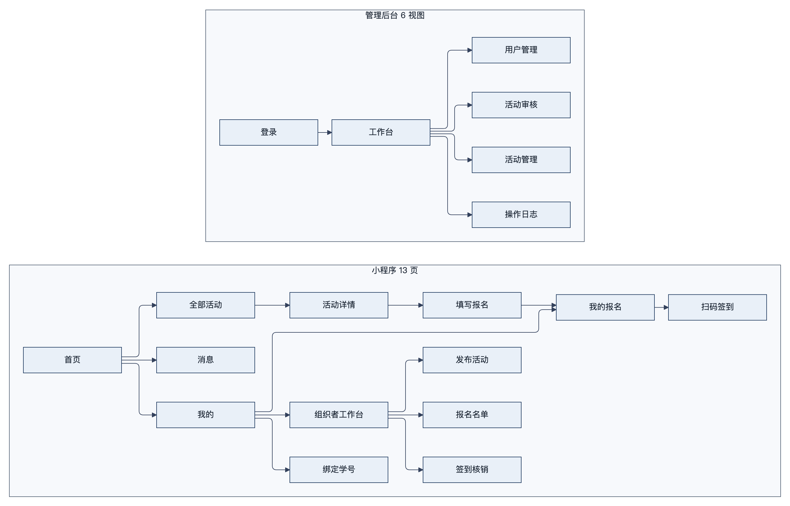

图 9-1 页面导航流程图

图 9-1 上半部分为管理后台：登录后进入工作台，工作台再分出用户管理、活动审核、活动管理、操作日志四个视图；下半部分为小程序 14 页：首页、全部活动、消息、我的为常用入口，首页与全部活动均可进入活动详情，活动详情在需要填表时进入填写报名，报名后到我的报名，再到扫码签到；「我的」可进入绑定学号与组织者工作台，工作台再分出发布活动、报名名单、签到核销。图中页面名称与 `app/src/pages.json`、`admin/src/router/index.ts` 的注册一致，页面路径以这两个文件为准。

### 1.6 提示与状态约定

三端的提示分三类，看到提示时可据此判断问题性质：

1. **业务提示**：后端业务异常统一返回 HTTP 200，响应体 `code` 非 0，前端把 `message` 以轻提示（toast）展示。这类提示文案就是本手册「常见失败提示」列出的内容，例如「名额已满」「你已报名该活动」。
2. **认证提示**：HTTP 401 表示未登录或登录过期，小程序会清空本地登录态并提示「登录已过期，请重新登录」；HTTP 403 表示角色不足，提示「没有操作权限」。
3. **环境提示**：请求未到达后端时提示「网络异常，请检查后端是否启动」，属于环境问题，不是业务错误。

活动详情页底部按钮不是固定文案，而是由后端根据活动状态、报名窗口、名额与当前用户的报名状态计算出的 `actionText`。同一场活动对不同用户、不同时间可能显示不同文案，操作前先看按钮文案即可知道当前能否报名。

表 9-5 活动详情页按钮文案

| 按钮文案 | 出现条件 | 点击后的行为 |
| --- | --- | --- |
| 立即报名 | 活动已发布、在报名窗口内且有剩余名额 | 有报名表单则进入填写报名页；无表单则弹「确认报名」对话框 |
| 已报名 | 当前用户报名状态为「报名成功」 | 跳转「我的报名」 |
| 报名待审核 | 当前用户报名状态为「待审核」 | 跳转「我的报名」 |
| 候补中 | 当前用户报名状态为「候补中」 | 跳转「我的报名」 |
| 已签到 | 当前用户报名状态为「已签到」 | 跳转「我的报名」 |
| 名额已满 | 名额已满且未开启候补 | 提示「名额已满」，不进入报名 |
| 名额已满，可候补 | 名额已满但活动开启候补 | 提示后可提交，进入候补队列 |
| 报名未开始 | 当前时间早于报名开始时间 | 提示「报名未开始」 |
| 报名已结束 | 当前时间晚于报名截止时间 | 提示「报名已结束」 |
| 活动已结束 / 活动已取消 / 不可报名 | 活动状态为已结束、已取消或非可报名状态 | 提示对应文案，不可提交 |

---

## 2 学生端操作

本章回答：学生从进入小程序到完成签到，每一步点什么、看到什么提示、失败时怎么处理。第 2.5、2.7、2.8 节是演示中最容易出问题的三处，建议重点看。

### 2.1 登录与绑定学号

小程序不提供账号密码登录，进入即登录。H5 首次打开时以 `mock-student-1` 调用登录接口，后端不存在该 openid 时自动建号，返回 JWT 与「是否需要绑定」标记；因此学生第一次进来能看到首页，但报名前必须绑定学号。

操作步骤：

1. 浏览器访问 `http://127.0.0.1:5174`，等待首页渲染，右上角显示头像首字与「你好，张小明」。
2. 点击底部 tabBar「我的」，若尚未绑定，资料卡下方显示「尚未绑定学号」，并出现「绑定学号后才能报名」卡片。
3. 点击卡片右侧「去绑定」，进入「绑定学号」页。
4. 填写「学号」「姓名」（两者必填），学院、年级、专业可留空；页面下方提示可用的演示学号清单。
5. 点击「完成绑定」。

成功提示：页面出现绿色 toast「绑定成功」，约 0.8 秒后自动返回首页；再次进入「我的」时，资料卡显示「计算机学院 · 2023 级 · 2023001」，角色标签显示「学生」。

常见失败提示：

表 9-6 绑定学号常见失败提示

| 提示 | 触发原因 | 处理办法 |
| --- | --- | --- |
| 学号与姓名必填 | 提交时学号或姓名为空（前端校验） | 补齐两项再提交 |
| 学号不在名单内，请联系管理员 | 学号不在 `student_whitelist`（错误码 10004） | 核对 1.3 节白名单，或由管理员补录白名单 |
| 该学号已被其他微信绑定 | 同一学号已被另一个用户绑定（10005） | 换用未绑定的学号；确认是否切换过测试身份 |
| 请先绑定学号信息 | 未绑定就报名/签到（10003） | 先完成本节绑定流程 |
| 登录已过期，请重新登录 | JWT 超过 2 小时（HTTP 401） | 退出后重新进入，或「切换测试身份」重新登录 |

首次进入未绑定学籍时，页面先引导完成学号绑定，如图 9-2 所示。

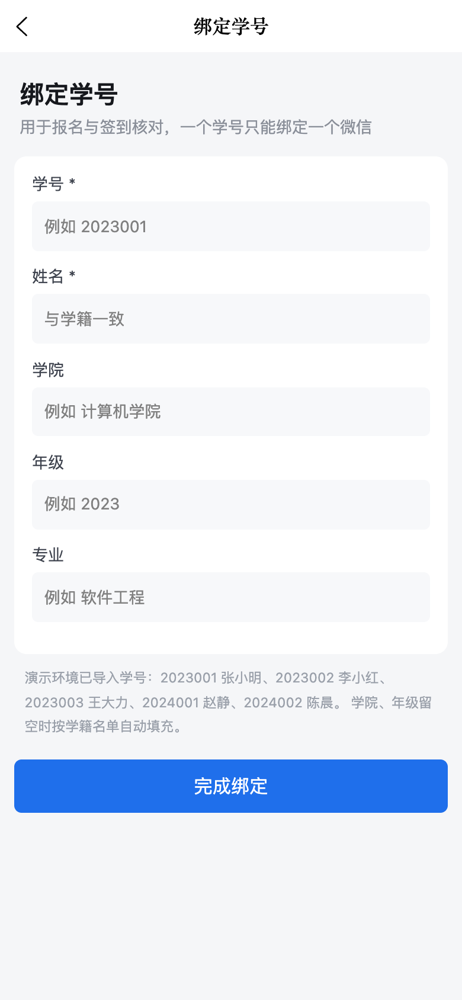

图 9-2 绑定学号页面

### 2.2 首页

首页是发现活动的入口，展示问候语、搜索入口、六个分类、热门活动横滑卡片与「即将开始」列表。数据来自分类接口、热门活动接口与活动列表接口（第一页 10 条），三个请求并发加载。

操作步骤：

1. 点击底部 tabBar「首页」，页面显示「你好，<姓名>」、搜索框、分类横滑条。
2. 下拉页面可刷新数据（页面已启用下拉刷新）。
3. 点击搜索框，跳转「全部活动」页，可输入关键字搜索。
4. 点击某个分类（文体活动、学术讲座、志愿服务、社团招新、创新创业、社会实践），跳转「全部活动」页并自动带上该分类筛选。
5. 点击热门活动卡片或「即将开始」中的任一条，进入活动详情；点击「全部 / 更多」进入全部活动列表。

成功提示：首页没有操作型成功提示，数据加载完成即展示内容；「即将开始」为空时显示「暂时没有可报名的活动」。

常见失败提示：后端未启动时页面只剩骨架，并提示「网络异常，请检查后端是否启动」；分类或热门接口异常时该区块为空，不影响其他区块浏览。

绑定后进入首页，可看到问候语、分类入口、热门活动与即将开始，如图 9-3 所示。

图 9-3 小程序首页

### 2.3 活动列表

活动列表用于按关键字、分类、时间范围筛选活动，支持分页与下拉刷新，是学生找活动的主动入口。

操作步骤：

1. 点击底部 tabBar「活动」，进入「全部活动」。
2. 在搜索框输入活动名称关键字，按键盘「搜索」或点右侧「搜索」，列表回到第一页重新查询。
3. 点分类胶囊（全部 + 六个分类）切换分类筛选。
4. 点时间范围（全部时间 / 今天 / 本周 / 已结束）切换时间筛选；选「已结束」时只显示已结束活动并按开始时间倒序。
5. 向下滚动到底部自动加载下一页，底部提示由「上拉加载更多」变为「没有更多了」。
6. 点击任一卡片进入活动详情。

成功提示：无独立提示，列表顶部状态标签会显示「报名中」或活动状态（如「已发布」「已结束」），卡片右下角显示「已报名数 / 名额」。

常见失败提示：无匹配结果时显示空态「没有找到活动」；后端异常时提示网络错误。注意「已结束」与其他时间范围互斥，切到「已结束」后再点「今天」即可恢复。

活动列表页支持关键字搜索、分类筛选与时间筛选，如图 9-4 所示。

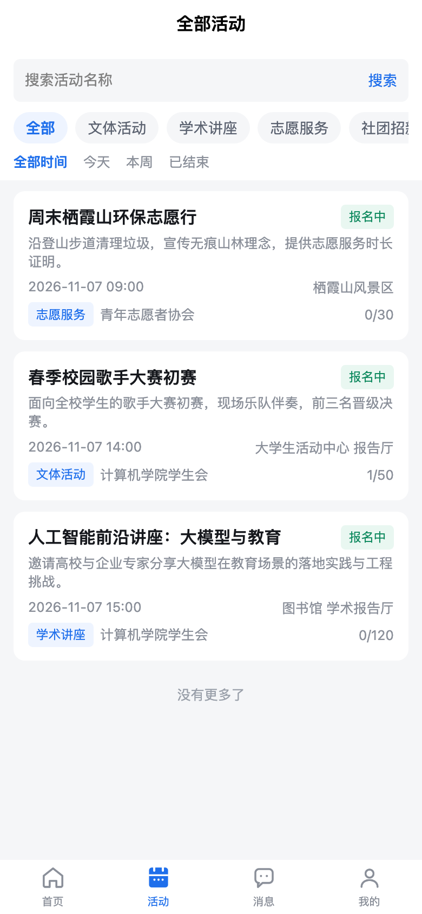

图 9-4 活动列表与筛选

### 2.4 活动详情

详情页是报名决策页，信息分四块：封面与标题、时间/地点/主办/报名人数/报名截止、名额进度条、活动介绍与「报名需要填写」字段清单。底部固定栏为收藏按钮与主操作按钮。

操作步骤：

1. 从首页或列表点击活动卡片进入详情，页面依次展示活动信息。
2. 查看「报名」行：显示「N 人已报名 / 限 M 人」或「（不限人数）」；进度条下方显示「还剩 N 个名额」或「名额已满」。
3. 查看「报名需要填写」区块：列出组织者配置的表单字段，必填项带「（必填）」。
4. 点击左下角「收藏 / 已收藏」切换收藏状态；未登录时会自动触发登录。
5. 点击右下角主按钮，按 1.6 节表 9-5 的文案执行对应行为。

成功提示：收藏切换后按钮文案在「收藏」「已收藏」之间变化；若活动无表单，点「立即报名」会弹出确认框「确认报名「活动名」？」，确认后提示「报名成功」。

常见失败提示：活动不存在或已被取消时提示「活动不存在」；未登录时先自动登录，仍失败则提示登录相关错误；收藏在未绑定时也可完成（收藏只要求登录，不要求绑定）。

活动详情页集中展示时间地点、名额进度与报名按钮，如图 9-5 所示。

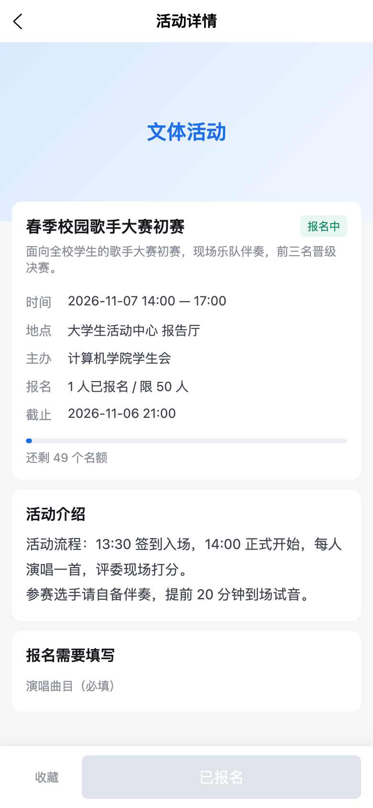

图 9-5 活动详情与报名入口

### 2.5 填写报名

当活动配置了报名表单字段时，点「立即报名」不会直接报名，而是进入「填写报名信息」页。演示数据中 3001「春季校园歌手大赛初赛」配置了必填字段「演唱曲目」，适合用来演示本节。

操作步骤：

1. 在活动详情页点「立即报名」，进入「填写报名信息」。
2. 页面上方显示活动标题、开始时间与地点，下方按组织者配置的字段逐项填写：文本字段直接输入，单选字段点选一项，多选字段可勾选多项。
3. 带红色星号的字段必须填写；未填时点「确认报名」会被前端拦下。
4. 点击底部「确认报名」，按钮变为「提交中…」，避免重复提交。
5. 提交成功后自动跳转到「我的报名」页。

成功提示：toast「报名成功」，约 0.8 秒后跳转「我的报名」。若活动开启了报名审核（如 3002），提交后记录状态为「待审核」，并收到一条「报名已提交」站内消息；若名额已满且开启候补，状态为「候补中」并收到「已加入候补」消息。

常见失败提示：

表 9-7 填写报名常见失败提示

| 提示 | 触发原因 | 处理办法 |
| --- | --- | --- |
| 请填写<字段名> | 必填字段为空（前端校验） | 补齐该字段后重新提交 |
| 请先绑定学号信息 | 未绑定学籍（10003） | 先完成 2.1 节绑定 |
| 名额已满 | 名额占满且未开启候补（30001） | 等他人取消，或联系组织者确认是否开启候补 |
| 你已报名该活动 | 同一活动重复提交（30002） | 到「我的报名」查看已有记录，不要重复提交 |
| 报名已结束 | 超过报名截止时间（20005） | 报名窗口已关闭，无法补报 |
| 报名尚未开始 | 早于报名开始时间（20005） | 到报名开始时间后再试 |
| 活动暂未开放报名 | 活动不在已发布状态（20005） | 等待审核通过或确认活动状态 |

填写报名页按活动配置展示表单；本活动未配置自定义字段，如图 9-6 所示。

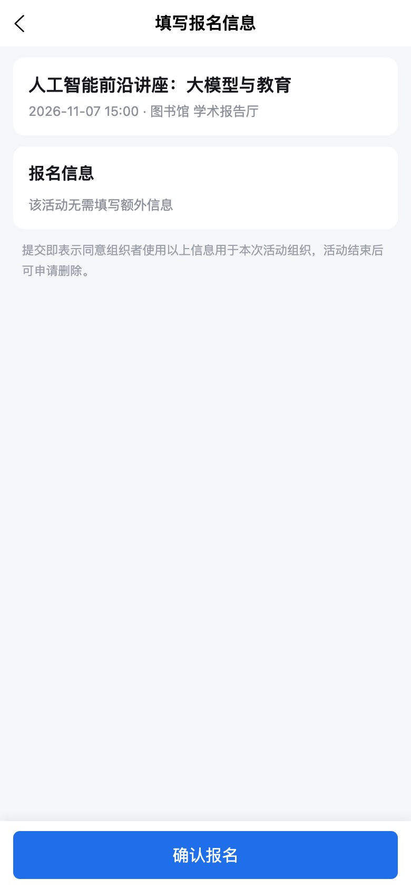

图 9-6 填写报名信息

### 2.6 我的报名

「我的报名」集中展示当前用户的全部报名记录，支持按状态筛选与分页，是查看报名结果、签到凭证与候补序号的唯一页面。

操作步骤：

1. 从「我的」页点「我的报名」，或在活动详情页点「已报名 / 待审核 / 候补中 / 已签到」按钮进入。
2. 顶部按状态筛选：全部、报名成功、待审核、候补中、已签到。
3. 每条记录显示活动标题、状态标签、活动时间与地点；点标题可回到活动详情。
4. 「报名成功」记录下方出现「签到凭证」区块，展示报名编号（`signupNo`），现场核验时可出示。
5. 「候补中」记录显示「候补序号 N，有人取消时按顺序转正」。
6. 向上滑动到底部加载更多，底部提示「上拉加载更多」或「没有更多了」。

成功提示：无操作提示；筛选与分页即时生效。

常见失败提示：无记录时显示空态「暂无报名记录」；网络异常时提示网络错误。若刚报名成功但列表里看不到，先下拉刷新，再确认筛选是否停留在其他状态。

我的报名按状态分组展示报名记录与签到凭证，如图 9-7 所示。

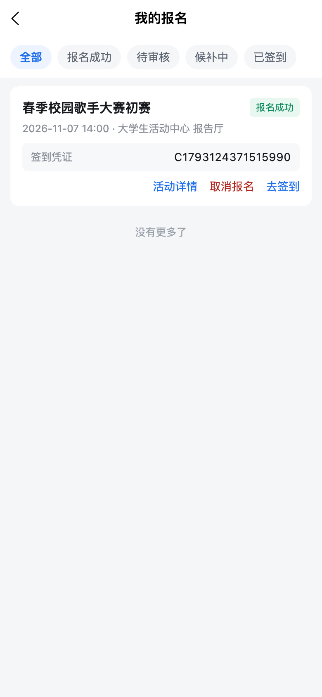

图 9-7 我的报名列表

### 2.7 取消报名

取消报名会释放名额并触发候补转正，因此只在截止时间前允许操作。可取消的状态为待审核、报名成功、候补中；已签到、未到场、已取消、审核未通过不可取消。

操作步骤：

1. 进入「我的报名」，找到需要取消且带「取消报名」链接的记录。
2. 点击「取消报名」，弹出确认框「确认取消「活动名」的报名？名额将释放给候补同学。」
3. 点击确定，等待接口返回，列表自动刷新。

成功提示：toast「已取消」，该条记录状态变为「已取消」，「取消报名」链接消失。若取消的是「报名成功」记录，名额释放后系统按候补序号取队首尝试转正，转正成功会给候补学生发送「候补转正」消息。

常见失败提示：

表 9-8 取消报名常见失败提示

| 提示 | 触发原因 | 处理办法 |
| --- | --- | --- |
| 已超过取消报名截止时间 | 超过 `cancel_deadline`（30004） | 截止后无法自行取消，联系组织者处理 |
| 当前报名状态不支持取消报名 | 状态为已签到/未到场/已取消/审核未通过（30006） | 不可取消；如需处理请联系组织者 |
| 报名记录不存在 | 记录被删除或不属于当前用户（30003） | 刷新列表确认记录是否仍存在 |
| 登录已过期，请重新登录 | JWT 过期（HTTP 401） | 重新登录后再操作 |

### 2.8 扫码签到

签到是活动当天的主要操作。组织者在「签到核销」页展示动态签到码，学生扫码或粘贴签到码提交。H5 预览环境不支持调用微信扫码接口，页面会提示改用粘贴方式；微信开发者工具/真机可使用「扫描签到码」。

操作步骤：

1. 从「我的」页点「扫码签到」，或在「我的报名」中「报名成功」记录上点「去签到」。
2. 若有微信扫码能力，点击虚线框「扫描签到码」调用摄像头；H5 下该操作提示「H5 不支持扫码，请粘贴签到码」。
3. 在「粘贴签到码」输入框粘贴组织者提供的签到码内容，点击「提交签到」。
4. 浏览器询问定位权限时选择允许（签到方式为「扫码 + 定位」的活动必须允许，否则无法通过 200 米校验）。
5. 等待结果页展示。

成功提示：页面切换为签到成功页，显示绿色对勾、「签到成功」、活动名称、签到时间与签到人姓名；点「返回」回到首页。同时活动详情页按钮变为「已签到」，「我的报名」记录状态变为「已签到」。

常见失败提示：

表 9-9 扫码签到常见失败提示

| 提示 | 触发原因 | 处理办法 |
| --- | --- | --- |
| 请先获取签到码 | 未填写签到码就提交（前端校验） | 粘贴或扫描有效签到码 |
| 签到码无效或已过期，请刷新后重试 | 签到码被改、时间片过期（40001） | 让组织者点「立即刷新」重新出码后再扫 |
| 当前不在签到时间内 | 不在开始前 30 分钟至结束后 30 分钟窗口（40004） | 在窗口内签到，或由组织者手动补签 |
| 该活动由组织者统一签到，无需扫码 | 活动签到方式为「仅组织者手动」（40004） | 找组织者在报名名单中补签 |
| 你未报名该活动，无法签到 | 无报名记录（40002） | 先报名；若报名待审核/候补，需状态变为报名成功 |
| 报名未成功，无法签到 | 报名状态非「报名成功」（40002） | 等审核通过或候补转正 |
| 你已签到，无需重复操作 | 已是已签到状态（40003） | 无需再次操作 |
| 不在签到范围内，请到活动现场签到 | 距活动坐标超过 200 米（40005） | 到活动现场签到，或确认浏览器定位是否准确 |

扫码签到页提供摄像头扫码与粘贴签到码两种方式，如图 9-8 所示。

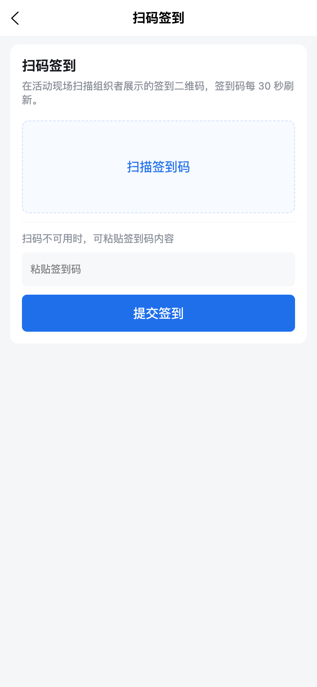

图 9-8 扫码签到页

### 2.9 消息

消息页展示系统自动写入的站内通知，包括报名成功、报名待审核、候补、审核结果、取消等类型。未读消息标题前有红点，列表顶部显示总条数并提供「全部已读」。

操作步骤：

1. 点击底部 tabBar「消息」，进入消息列表。
2. 查看每条消息的类型标签（报名、审核、候补、提醒、取消）、标题、正文与时间；未读消息带红点。
3. 点击右上角「全部已读」，把当前所有消息标记为已读。
4. 下拉页面刷新消息列表。

成功提示：点「全部已读」后提示「已全部标记为已读」，红点全部消失。

常见失败提示：无消息时显示「暂无消息」；网络异常时提示错误。当前版本只发送站内消息，微信订阅消息尚未接入，因此不会在微信服务通知中出现。

消息页按时间展示报名、审核与候补等站内通知，如图 9-9 所示。

图 9-9 消息列表

### 2.10 我的与切换身份

「我的」页承担个人资料展示、功能入口与演示身份切换三件事。角色不同，页面内容不同：学生显示绑定提示与报名入口；组织者额外显示「组织者工作台」入口。

操作步骤：

1. 点击底部 tabBar「我的」，查看头像、姓名、绑定信息或「尚未绑定学号」、角色标签。
2. 点击菜单项进入对应页面：我的报名、扫码签到、消息通知；组织者/管理员还会看到「组织者工作台」。
3. 点击「切换测试身份」，底部弹出选择框：张小明（mock-student-1）、李小红（mock-student-2）、组织者（mock-organizer-1）；选择后清空本地 token 与用户缓存并重启到首页，以新身份重新登录。
4. 点击「退出登录」，清空本地登录态并回到首页。注意：`dev-mode` 打开时首页会立即用当前 `devOpenId` 重新静默登录，因此点击退出后看起来仍是已登录状态；需要真正换身份请用「切换测试身份」。

成功提示：切换身份后首页问候语与「我的」资料随之变化；退出登录回到首页后，dev 模式会静默重登同一身份，资料恢复显示。

常见失败提示：无（本地操作）。若切换后仍显示旧身份，下拉刷新或重新进入「我的」页触发资料查询。

---

我的页面展示学籍信息、我的报名、扫码签到与测试身份切换入口，如图 9-10 所示。

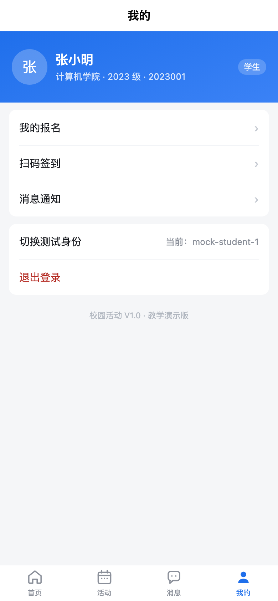

图 9-10 我的页面与身份切换

## 3 组织者端操作

本章回答：组织者如何发布一场活动、让它通过审核、管理报名并完成现场核销。组织者入口与学生在同一个小程序内，先把身份切到 `mock-organizer-1` 再进入「组织者工作台」。

### 3.1 工作台

工作台是组织者的首页，上方四个指标卡展示当前账号创建的活动数据，中间按状态筛选活动，右下角悬浮按钮用于发布新活动。

操作步骤：

1. 在「我的」页点「组织者工作台」（仅 ORGANIZER/ADMIN 显示该入口）。
2. 查看顶部四项概览：活动总数、已发布、待审核、累计报名。
3. 点状态胶囊筛选：全部、草稿、待审核、已发布、已结束。
4. 在活动卡片上执行操作：草稿/已驳回可点「提交审核」；所有状态可点「报名名单」；已发布/进行中/已结束可点「签到核销」。
5. 点右下角「+ 发布活动」进入发布页。

成功提示：无操作型提示；数据来自组织者工作台接口，切换筛选后立即重查。无活动时显示「还没有活动，点击右下角发布」。

常见失败提示：以学生身份进入会提示「没有操作权限」（错误码 10002），需先切换为组织者；未登录提示「未登录或登录已过期」。

组织者工作台汇总活动总数、已发布、待审核与累计报名，如图 9-11 所示。

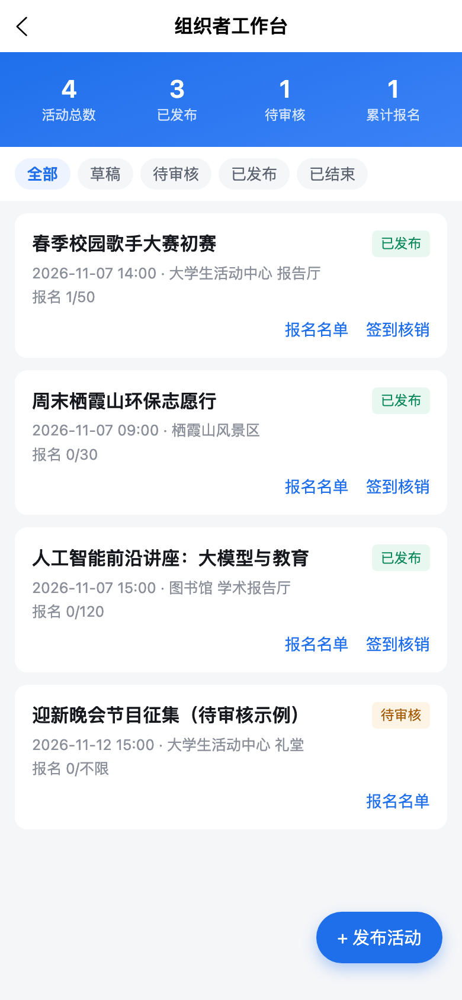

图 9-11 组织者工作台

### 3.2 发布活动

发布页为长表单，分三组：基本信息、时间安排、地点与名额。保存后有「草稿」和「提交审核」两种去向。

操作步骤：

1. 点「+ 发布活动」，进入「发布活动」页。
2. 填写基本信息：活动标题（必填）、活动分类（下拉选择六个分类之一）、一句话简介、活动详情（最多 5000 字）。
3. 填写时间安排：活动开始（日期 + 时间，默认明天 14:00）、活动结束（默认明天 17:00）、报名截止（默认明天 13:00）。报名开始时间固定取当前时间，页面不提供修改；取消报名截止未在页面暴露，由后端缺省为活动开始前 2 小时。
4. 填写地点与名额：活动地点（必填）、人数上限（0 表示不限）、名额满后开启候补（默认开启）、报名需要组织者审核（默认关闭）、签到方式（扫码签到 / 扫码 + 定位签到 / 仅组织者手动签到）。
5. 点「保存草稿」仅保存不提交；点「保存并提交审核」保存后立即提交审核。

表 9-10 发布活动字段说明

| 字段 | 是否必填 | 默认值 | 说明 |
| --- | --- | --- | --- |
| 活动标题 | 是 | 空 | 输入上限 60 字符，占位提示「不超过 30 字」 |
| 活动分类 | 否 | 第一个分类 | 取自分类接口，共 6 个 |
| 一句话简介 | 否 | 空 | 展示在列表卡片中 |
| 活动详情 | 否 | 空 | 多行文本，最多 5000 字 |
| 活动开始 / 结束 | 是 | 明天 14:00 / 17:00 | 必须开始早于结束 |
| 报名截止 | 是 | 明天 13:00 | 不得晚于活动开始 |
| 活动地点 | 是 | 空 | 建议写「楼栋 + 房间」，如「大学生活动中心 报告厅」 |
| 人数上限 | 否 | 0 | 0 表示不限人数 |
| 名额满后开启候补 | 否 | 开启 | 关闭后满员直接返回「名额已满」 |
| 报名需要组织者审核 | 否 | 关闭 | 开启后报名先进入待审核 |
| 签到方式 | 否 | 扫码签到 | 选「仅组织者手动」时学生扫码会被拒绝 |

成功提示：保存草稿提示「已保存草稿」，提交审核提示「已提交审核」，约 0.8 秒后返回工作台，新活动出现在对应状态列表中。

常见失败提示：

表 9-11 发布活动常见失败提示

| 提示 | 触发原因 | 处理办法 |
| --- | --- | --- |
| 请填写活动标题 / 请填写活动地点 | 必填项为空（前端校验） | 补齐后重新保存 |
| 时间设置不合理，请检查报名与活动时间 | 开始不早于结束、报名开始晚于报名截止（20004） | 按「报名开始 ≤ 报名截止 ≤ 活动开始 < 活动结束」调整 |
| 报名截止时间不能晚于活动开始时间 | 报名截止晚于开始（20004） | 把报名截止提前到活动开始之前 |
| 当前账号未绑定组织，无法发布活动 | 组织者未绑定组织（10002） | 由管理员在后台为其设置所属组织 |
| 活动与报名时间不能为空 | 时间字段缺失（50001） | 补齐三个时间字段 |

关于编辑活动：当前小程序只提供新建入口，没有「编辑」按钮；编辑接口（`PUT /api/org/activities/{id}`）已实现，草稿与已驳回可改，已发布/进行中的活动编辑后会回到「待审核」，以防止绕过审核修改时间地点。界面入口待后续版本接入，见文末待确认事项。

发布活动页填写标题、分类、简介、时间地点、名额与签到规则，如图 9-12 所示。

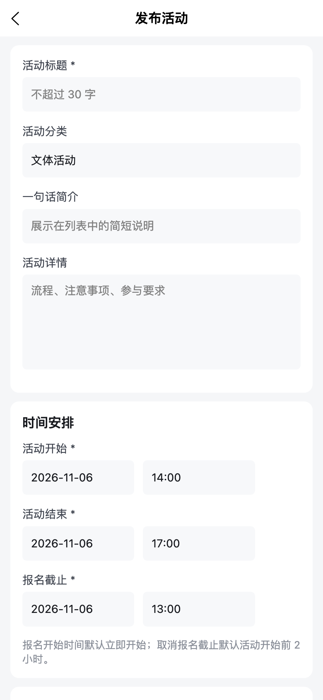

图 9-12 发布活动表单

### 3.3 提交审核

活动必须经过团委审核才能对学生可见。提交动作把草稿或已驳回的活动置为待审核，并清空上一次驳回理由。

操作步骤：

1. 在组织者工作台筛选「草稿」或「已驳回」，找到目标活动。
2. 点击卡片上的「提交审核」。
3. 在确认框「确认提交「活动名」给管理员审核？」中点确定。

成功提示：toast「已提交」，活动状态变为「待审核」，从草稿/已驳回列表移入待审核列表。

常见失败提示：提示「活动当前状态不支持该操作」（20002）表示当前不是草稿或已驳回，不能重复提交；提示「只能操作本组织的活动」（20003）表示该活动创建人不是当前账号且当前账号非管理员。

### 3.4 报名名单与审核

报名名单页用于查看报名者学籍信息、表单答案，并对「待审核」记录批量处理。默认每页 20 条，支持按状态筛选与上拉加载。

操作步骤：

1. 在组织者工作台点活动卡片的「报名名单」，进入名单页。
2. 按状态筛选：全部、待审核、报名成功、已签到、候补中。
3. 查看每条记录：姓名、学号、学院、报名时间；若报名时填写了表单，会以「字段中文名：值」逐行展开（字段名取自活动配置，多选值用顿号连接）。
4. 对「待审核」记录点「通过」或「驳回」；驳回会先弹确认框，确认后以默认理由「信息不完整」提交。
5. 对「报名成功」或「未到场」记录可点「补签」，确认后写入签到记录与审计日志。
6. 上拉加载更多，底部显示「共 N 条」。

成功提示：通过后提示「已通过」，驳回后提示「已驳回」，补签后提示「补签成功」，列表自动刷新。

常见失败提示：

表 9-12 报名审核常见失败提示

| 提示 | 触发原因 | 处理办法 |
| --- | --- | --- |
| 名额已满 | 批量通过时名额不足（30001），整批失败 | 提高人数上限或驳回部分报名后重试 |
| 只能操作本组织的活动 | 非创建人且非管理员（20003） | 用活动创建人账号操作 |
| 你已签到，无需重复操作 | 对已签到记录补签（40003） | 无需补签 |
| 报名记录不存在 | 记录不属于该活动（30003） | 刷新名单确认 |
| 活动当前状态不支持该操作 | 活动已取消等状态（20002） | 确认活动状态 |

报名名单展示学籍信息、报名状态与补签入口，如图 9-13 所示。

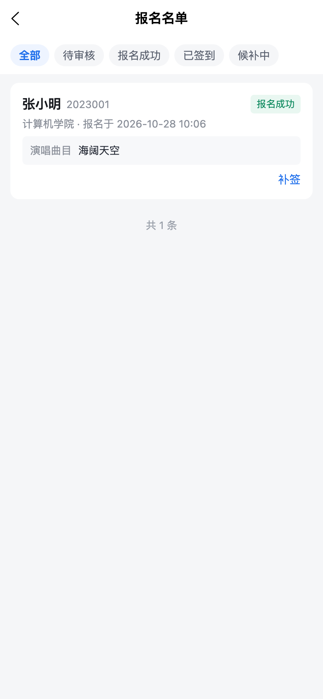

图 9-13 报名名单与审核

### 3.5 签到核销与补签

核销页是活动现场的主界面：展示动态签到码、轮换倒计时、待签到与已签到人数、最近 5 条到场记录。签到码不落库，每 30 秒随服务端时间片变化。

操作步骤：

1. 在工作台对「已发布 / 进行中 / 已结束」的活动点「签到核销」。
2. 页面顶部展示活动名与签到码文本，下方显示「N 秒后自动刷新」，可点「立即刷新」手动刷新，点「复制签到码」复制到剪贴板。
3. 把签到码投屏或发给学生，学生用小程序粘贴/扫码提交。
4. 页面下方查看「待签到」「已签到」人数与「最近签到」姓名列表，用于现场核对。
5. 无法扫码的学生，由组织者回到「报名名单」，对「报名成功/未到场」记录点「补签」，确认后完成核销。

成功提示：复制成功提示「已复制」；倒计时归零自动刷新签到码；补签成功提示「补签成功」，学生端状态变为「已签到」。

常见失败提示：非本组织活动提示「只能操作本组织的活动」；活动不存在提示「活动不存在」；签到码过期时学生端提示「签到码无效或已过期，请刷新后重试」，组织者点「立即刷新」即可；网络不稳定时可直接手动刷新本页重新取码。

签到核销页展示动态签到码、刷新倒计时、待签到与已签到人数，如图 9-14 所示。

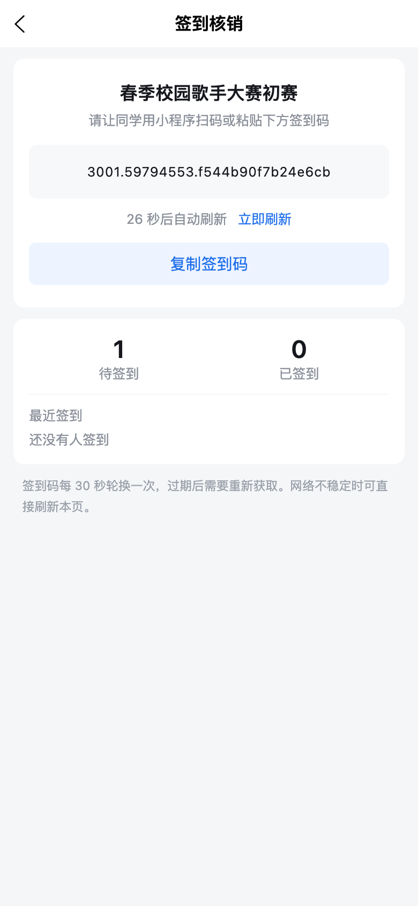

图 9-14 签到核销与到场统计

### 3.6 统计

当前版本的统计信息分三处呈现：工作台四指标（活动总数、已发布、待审核、累计报名）、核销页的待签到/已签到人数、名单页的「共 N 条」。后端另提供活动统计接口（`GET /api/org/activities/{id}/stat`），一次返回六类报名计数与到场率，小程序暂未提供独立统计页面，需要时可通过接口文档页直接调用查看。

表 9-13 活动统计口径

| 字段 | 含义 | 计算口径 |
| --- | --- | --- |
| `capacity` | 人数上限 | 活动表的 `capacity`，0 表示不限 |
| `signedCount` | 已占名额 | 报名成功 + 已签到 + 未到场 |
| `pendingCount` | 待审核 | 报名状态为待审核的数量 |
| `successCount` | 报名成功 | 尚未签到的成功报名 |
| `checkedInCount` | 已签到 | 已签到数量 |
| `noShowCount` | 未到场 | 活动结束后仍未签到的数量 |
| `cancelledCount` | 已取消 | 用户主动取消的数量 |
| `waitlistCount` | 候补中 | 候补队列人数 |
| `totalSignup` | 报名合计 | 上述六类计数之和 |
| `attendanceRate` | 到场率 | 已签到 ÷（已签到 + 未到场 + 报名成功），保留一位小数 |

操作步骤（通过接口查看统计）：打开 `http://127.0.0.1:8016/swagger-ui.html`，在组织者控制器下找到统计接口，填入活动 ID 与组织者 token 执行即可。成功返回 `code` 为 0 与上述字段；失败时返回对应错误码（未登录 10001、无权限 10002、非本组织 20003、活动不存在 20001）。

---

## 4 管理后台操作

本章回答：团委审核员与管理员如何登录后台、审核活动、管理活动与用户、查看操作留痕。管理后台只允许 ADMIN 与 REVIEWER 登录；用户管理与角色变更仅 ADMIN 可调用。

### 4.1 登录与退出

后台使用账号密码登录，登录表单已预填演示账号，课堂演示可直接点登录。登录成功后 token 存于 localStorage，路由守卫会拦截未登录访问。

操作步骤：

1. 浏览器访问 `http://127.0.0.1:5173`，自动跳转登录页（hash 路由 `#/login`）。
2. 账号、密码已预填 `admin` / `Admin@123`，也可手动修改；按回车或点「登录」提交。
3. 登录成功后进入工作台；若之前访问过其他页面，会跳回原页面（`redirect` 参数）。
4. 退出时点右上角头像下拉「退出登录」，在确认框中点「退出」。

成功提示：登录成功提示「登录成功」；退出成功提示「已退出登录」并回到登录页。已登录状态再访问登录页会自动跳转工作台。

常见失败提示：账号或密码错误提示「账号或密码错误」（10007）；账号被禁用提示「账号已被禁用」（10006）；组织者账号登录提示「该账号没有后台登录权限」（10002）；token 过期后任意请求返回 401，提示「登录状态已失效，请重新登录」并跳回登录页。

登录成功后进入管理后台，登录页与账号提示如图 9-15 所示。

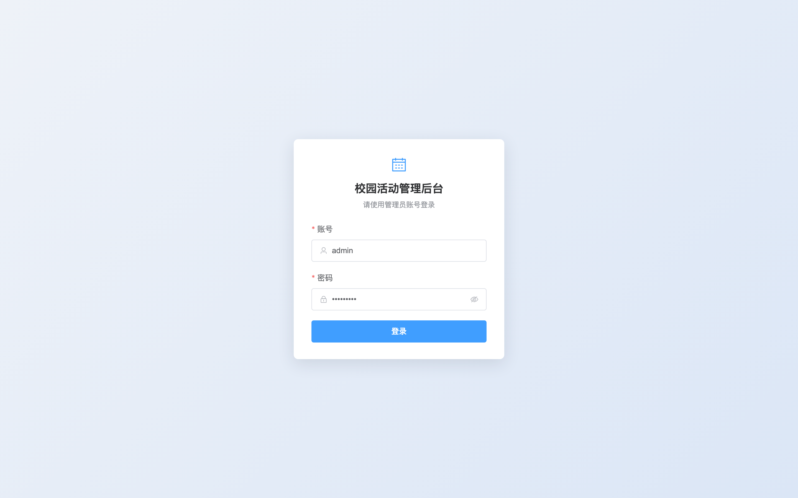

图 9-15 管理后台登录页

### 4.2 工作台

工作台用六张指标卡与一张热门活动表概括全平台运行情况，数据由后台工作台接口一次返回，避免首页发多个请求。

操作步骤：

1. 左侧菜单点「工作台」（登录后默认进入）。
2. 查看六张指标卡：用户数、活动总数、已发布、待审核、报名总数、签到总数；「待审核」大于 0 时右上角出现红点。
3. 查看下方「热门活动」表格：序号、活动名称、报名人数、容量、报名进度条；进度达到 100% 时进度条变为红色。
4. 需要刷新时重新进入菜单或刷新浏览器。

成功提示：无操作型提示；数据加载失败时提示「工作台数据加载失败」。

管理后台工作台展示用户、活动、报名与签到指标，如图 9-16 所示。

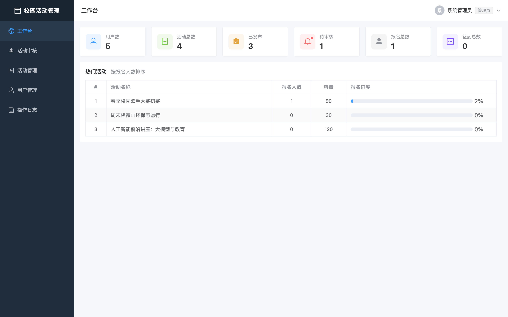

图 9-16 管理后台工作台

### 4.3 活动审核

活动审核是团委的核心工作，只展示待审核活动，按提交时间升序排列，先提交先审核。

操作步骤：

1. 左侧菜单点「活动审核」，查看待审核活动列表（活动标题、所属组织、活动时间段、活动地点、容量、操作）。
2. 点「查看」打开右侧活动详情抽屉，核对活动时间、报名窗口、容量、签到方式、是否需要审核、是否开启候补、活动简介与内容、报名表单字段。
3. 点「通过」，在确认框「确认通过「活动名」的审核吗？通过后活动将对外发布。」中点「通过」，活动状态变为已发布，学生端可见。
4. 点「驳回」，在弹窗中填写驳回理由（必填，最多 200 字），点「确认驳回」，活动状态变为已驳回，理由展示给组织者。
5. 审核完一条后列表自动刷新；点右上角「刷新」可手动重查；底部分页支持 10/20/50 条。

成功提示：通过提示「审核已通过」，驳回提示「已驳回该活动」，该行从待审核列表消失。

常见失败提示：提示「该活动不在待审核状态」表示活动已被其他审核员处理或状态已变更；「活动不存在」表示活动被删除；以无权限账号操作提示「没有操作权限」。

活动审核页列出待审核活动，审核抽屉用于填写通过或驳回意见，如图 9-17 所示。

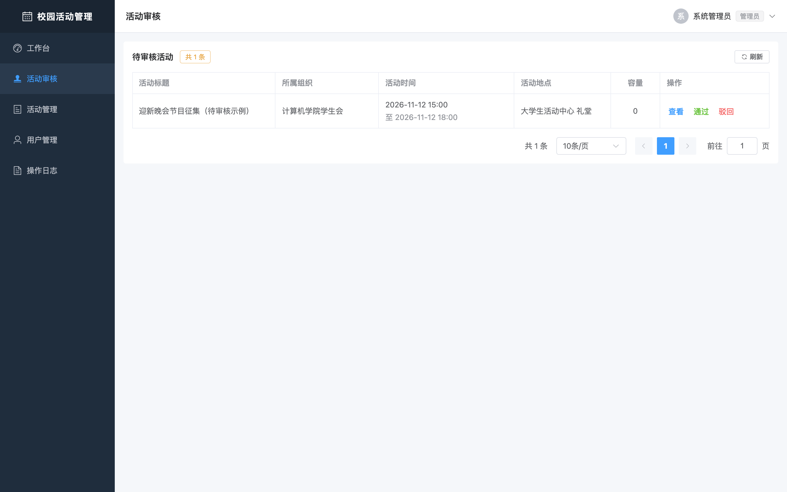

图 9-17 活动审核

### 4.4 活动管理与下架

活动管理展示全量活动，用于按标题、状态检索与违规下架。下架等价于把活动置为已取消，并写入审计记录。

操作步骤：

1. 左侧菜单点「活动管理」。
2. 在筛选栏输入活动标题关键字，或选择状态（草稿、待审核、已驳回、已发布、进行中、已结束、已取消），点「查询」；点「重置」清空条件。
3. 查看表格：活动标题、所属组织、分类、状态标签、活动时间、地点、报名/容量。
4. 点「查看」打开详情抽屉核对信息。
5. 点「下架」，在弹窗中填写下架理由（必填，最多 200 字），点「确认下架」；已取消的活动行「下架」按钮为禁用状态。

成功提示：提示「活动已下架」，活动状态变为已取消，学生端不再可见。

常见失败提示：「活动已取消」表示重复下架；「活动不存在」表示记录已删除；无权限账号操作提示「没有权限执行该操作」。

活动管理页支持按状态筛选与关键字查询，并可在操作列下架活动，如图 9-18 所示。

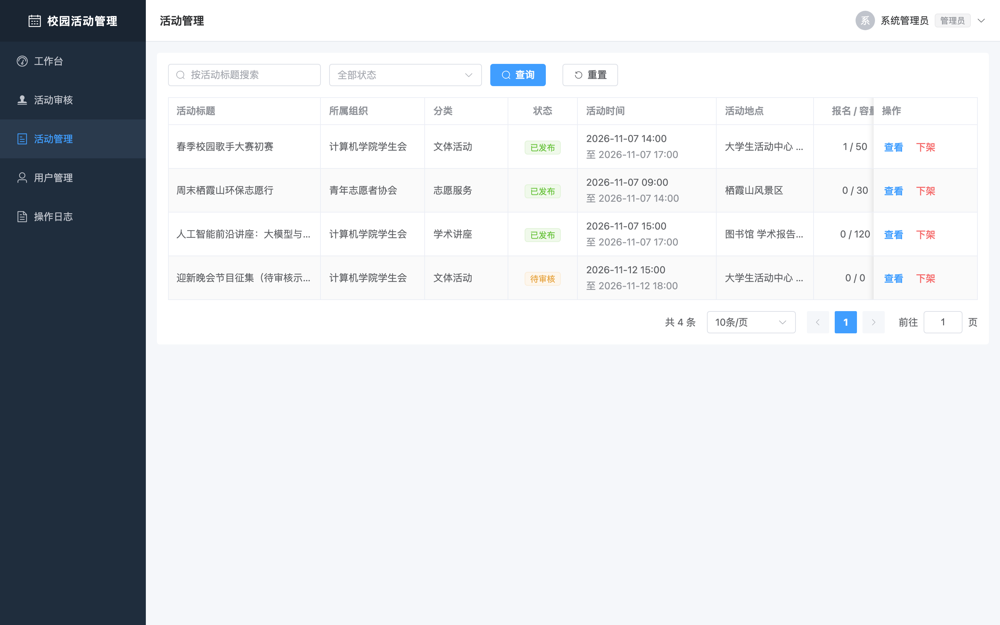

图 9-18 活动管理

### 4.5 用户管理与角色变更

用户管理用于检索用户、查看绑定情况并调整角色。该页接口仅 ADMIN 可调用，REVIEWER 登录后能看到菜单，但请求会返回 403。

操作步骤：

1. 左侧菜单点「用户管理」。
2. 在搜索框输入昵称/姓名/手机号关键字，或按角色（学生、活动组织者、审核员、管理员）筛选，点「查询」。
3. 查看表格：用户（头像 + 昵称）、角色、所属组织、真实姓名、手机号、学号、学院、年级、专业、绑定状态。
4. 点「设置角色」，弹窗显示用户、当前角色，选择新角色；若新角色为「活动组织者」，必须选择「所属组织」（下拉支持搜索）。
5. 点「保存」。

成功提示：提示「角色已更新」，列表刷新；该用户下次登录后按新角色获得权限。

常见失败提示：提示「没有权限执行该操作」表示当前账号不是 ADMIN；「请选择所属组织」表示把用户设为组织者但未选组织；「用户不存在」表示用户已被删除。

用户管理页按角色筛选用户，角色变更对话框用于调整角色与所属组织，如图 9-19 所示。

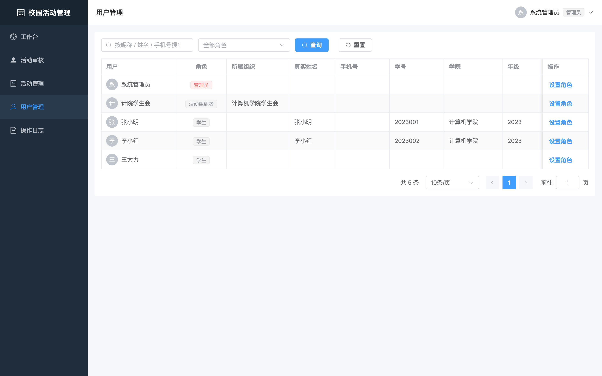

图 9-19 用户管理

### 4.6 操作日志

操作日志是审计留痕的查询入口，记录活动审核、活动下架/取消、手动补签、角色变更等关键动作，包含操作前后状态。

操作步骤：

1. 左侧菜单点「操作日志」。
2. 查看表格：操作时间、业务类型（活动/报名/签到/用户）、业务 ID、操作（通过、驳回、取消、补签、角色变更）、操作人、状态变更（变更前 → 变更后）、备注。
3. 点右上角「刷新」重新查询；底部分页支持 20/50/100 条。

成功提示：无操作提示。若列表为空，说明当前库还没有审核、下架、补签或角色变更动作，先按 4.3～4.5 节操作一次即可产生记录。

表 9-14 操作日志中的动作含义

| 动作标签 | 值 | 产生场景 | 前后状态含义 |
| --- | --- | --- | --- |
| 通过 | APPROVE | 后台审核通过活动 | 1 → 3（待审核 → 已发布） |
| 驳回 | REJECT | 后台驳回活动 | 1 → 2（待审核 → 已驳回） |
| 取消 | CANCEL | 组织者取消或后台下架活动 | 原状态 → 6 |
| 补签 | MANUAL_CHECKIN | 组织者为报名者手动签到 | 备注记录补签说明 |
| 角色变更 | ROLE_CHANGE | 后台修改用户角色 | 原角色 → 新角色 |

---

操作日志页按时间倒序展示审核、取消、补签与角色变更记录，如图 9-20 所示。

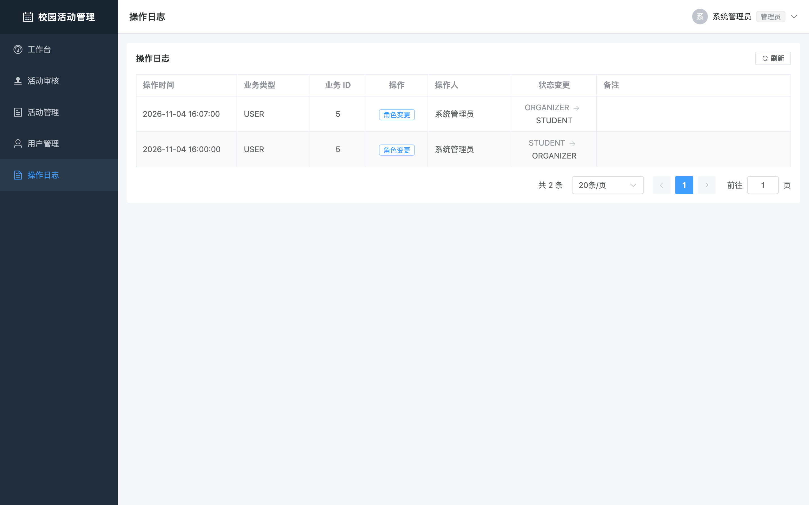

图 9-20 操作日志

## 5 常见问题（FAQ）

本章回答：遇到提示时先判断原因，再按处理办法操作。以下 12 条覆盖演示中最常见的问题，按「现象 → 原因 → 处理」给出。

表 9-15 常见问题与处理

| 序号 | 问题 | 现象/提示 | 原因 | 处理办法 |
| --- | --- | --- | --- | --- |
| 1 | 绑定学号失败 | 提示「学号不在名单内，请联系管理员」 | 学号不在 `student_whitelist`，或白名单被重新导入后 `used_flag` 状态不符 | 核对 1.3 节白名单；管理员补录白名单后重试；重新导入 `data.sql` 会清空已绑定档案 |
| 2 | 报名提示名额已满 | 详情页按钮「名额已满」，点击提示「名额已满」 | 名额占满且活动未开启候补（30001） | 等他人取消；请组织者提高人数上限或开启候补；候补中的用户在有人取消后自动转正 |
| 3 | 候补什么时候能转正 | 「我的报名」显示「候补序号 N」 | 满员后按 `waitlist_seq` 排队，取消释放名额时取队首 | 保持报名状态，转正后收到「候补转正」站内消息；序号越小越靠前 |
| 4 | 报名被驳回怎么办 | 状态「审核未通过」，收到审核结果消息 | 组织者审核驳回（30005），如信息不完整 | 查看驳回消息内容，补齐信息后重新报名（审核未通过可再次提交） |
| 5 | 签到码无效 | 提示「签到码无效或已过期，请刷新后重试」 | 签到码每 30 秒轮换，粘贴了过期码或内容被改动（40001） | 让组织者在核销页点「立即刷新」重新出码；核对是否复制完整三段式签到码 |
| 6 | 重复签到 | 提示「你已签到，无需重复操作」 | 报名记录已是已签到状态（40003） | 无需处理；签到记录与报名记录一对一，重复提交会被拦截 |
| 7 | 提示不在签到范围内 | 「不在签到范围内，请到活动现场签到」 | 活动签到方式为「扫码 + 定位」，当前位置距活动坐标超过 200 米（40005） | 到活动现场再签；检查浏览器/系统定位权限与模拟定位设置 |
| 8 | 登录过期 | 提示「登录已过期，请重新登录」 | JWT 有效期为 2 小时（HTTP 401） | 退出后重新进入，或在「我的」页切换测试身份重新登录；后台刷新页面会跳回登录页 |
| 9 | 演示数据都过期了 | 活动列表全是「已结束」，无法报名 | `data.sql` 以导入当天为基准；隔多天演示会过期 | 重新导入 `data.sql`；`dev-mode` 下后端启动时会把全部过期的活动整体平移并重置为已发布 |
| 10 | 后台提示无权限 | 提示「没有权限执行该操作」或「该账号没有后台登录权限」 | 后台仅 ADMIN/REVIEWER 可登录；用户管理与角色变更仅 ADMIN（403/10002） | 用 `admin` 账号登录；REVIEWER 只做审核与查询，不做角色变更 |
| 11 | H5 无法扫码签到 | 提示「H5 不支持扫码，请粘贴签到码」 | H5 预览没有微信扫码能力 | 在核销页复制签到码后粘贴提交；或用微信开发者工具/真机运行 |
| 12 | 报名成功但列表没有 | 「我的报名」看不到刚报的活动 | 筛选停留在其他状态、页面未刷新，或报名进入的是待审核/候补 | 下拉刷新；切到「全部」；到「消息」页确认是否有待审核或候补通知 |

---

## 6 接口联调记录

本章回答：如何在不启动前端的情况下确认后端行为与提示文案。第 2～4 章的界面截图是实际运行画面，本章 4 张截图是接口级证据。下面 4 张截图来自教程第 15 章的接口联调实录，均标注「下列请求与响应均由脚本实际发起（`java -jar` 真实进程 + 真实 HTTP 调用），非示意数据」，可作为本手册各节提示文案的运行时证据。四张图分别覆盖公开接口、登录绑定、学生端、管理端四个部分，顺序与本文第 2～4 章一致。

### 6.1 公开接口

公开接口部分不需要 token，用于验证后端存活、分类、活动列表与活动详情。如图 9-21 所示。

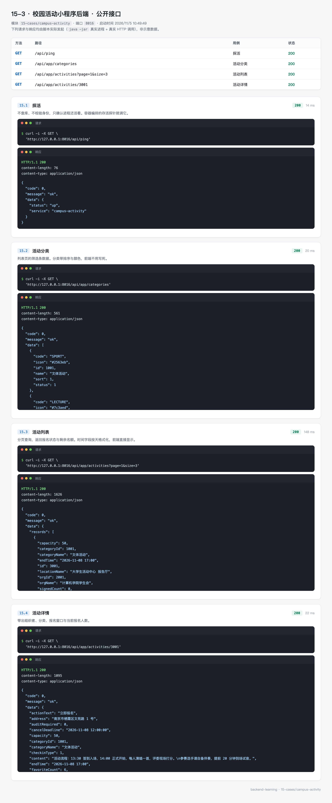

图 9-21 公开接口联调截图

图 9-21 中 `GET /api/ping` 返回 `status: up`、`service: campus-activity`；`GET /api/app/categories` 返回六个分类（含 1001 文体活动、1002 学术讲座等）；`GET /api/app/activities?page=1&size=3` 返回分页活动；`GET /api/app/activities/3001` 返回 3001 的详情（`actionText` 为「立即报名」，并带取消截止时间、签到方式、报名表单等字段）。这四个用例对应 1.2 节的环境自检与 2.3、2.4 节的数据来源。

### 6.2 小程序登录与绑定学籍

登录与绑定部分对应 2.1 节。如图 9-22 所示。

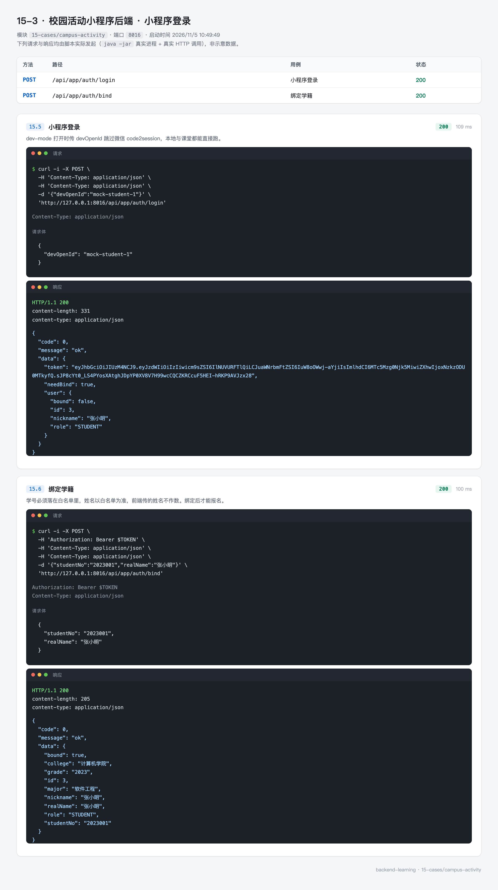

图 9-22 小程序登录与绑定学籍联调截图

图 9-22 中 `POST /api/app/auth/login` 以 `devOpenId` 为 `mock-student-1` 登录，返回 token、`needBind: true` 与用户信息（昵称张小明、角色 STUDENT、`bound: false`），说明首次进入时可浏览但未绑定；`POST /api/app/auth/bind` 以学号 2023001、姓名张小明提交，返回 `bound: true`、学院「计算机学院」、年级 2023、专业「软件工程」，说明白名单回填了留空字段。两个用例均返回 HTTP 200、`code: 0`。

### 6.3 学生端接口

学生端部分对应 2.5～2.9 节。如图 9-23 所示。

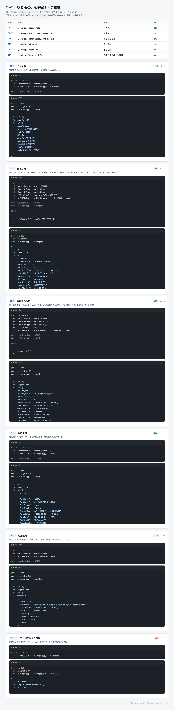

图 9-23 学生端接口联调截图

图 9-23 依次展示：个人资料接口返回已绑定信息；对 3002 提交报名后返回报名记录（含签到凭证号、是否可取消、是否可签到）；同一用户重复提交时被拦截；「我的报名」返回当前用户的报名分页；消息列表返回带类型与未读标记的通知；最后一条故意不带 token 访问个人资料，返回 HTTP 401 与 `code: 10001`「未登录或登录已过期」，对应本手册 1.6 节的认证提示口径。

### 6.4 管理端接口

管理端部分对应第 4 章。如图 9-24 所示。

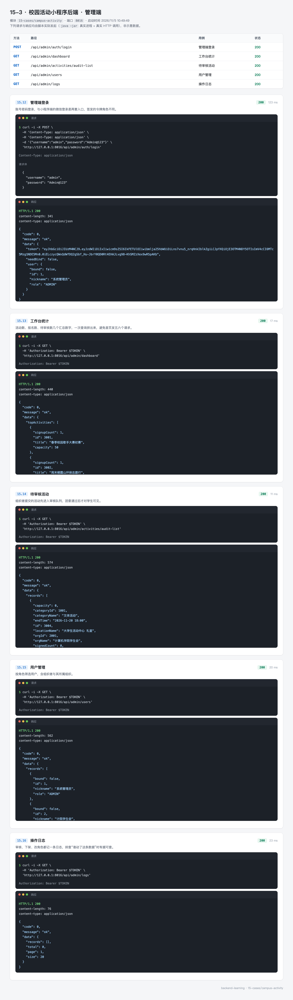

图 9-24 管理端接口联调截图

图 9-24 依次展示：管理员以 `admin` / `Admin@123` 调用登录接口，返回角色 ADMIN 的 token；工作台接口返回指标与热门活动；待审核活动列表返回待审核记录；用户管理返回账号列表；操作日志返回分页结构（截图中因尚未产生审核动作，记录为空）。这些响应结构就是 4.2～4.6 节各表格的字段来源。

---

## 待确认事项

1. 小程序端「编辑活动」入口尚未接入，发布页只支持新建；编辑接口 `API-30` 已实现（已发布/进行中活动编辑后回到待审核），界面入口需后续版本补充。
2. 组织者「活动统计」独立页面尚未接入，统计接口 `API-37` 已实现并可按 3.6 节口径调用；当前界面以工作台指标与核销页人数为准。
3. 消息未读数接口 `API-21` 已实现，但小程序界面未展示未读角标（仅逐条红点与「全部已读」）。
4. 界面截图已归档到 `docs/screenshots/`（18 张页面 PNG + 1 张绑定页截图），另有 4 张接口联调 webp；截图取自演示环境，活动日期与名额以截图当时数据为准，重新导入 `data.sql` 后可能变化。
5. 前端请求地址已统一：`app/src/utils/request.ts`（非 H5 构建的 `BASE_URL`）、`app/vite.config.ts` 与 `admin/vite.config.ts`（H5 与管理后台的 `/api`、`/uploads` 代理）均为 8016，与后端监听端口一致；微信真机调试需把非 H5 的 `BASE_URL` 改为后端所在机器的局域网 IP 或正式域名。
6. 种子数据中的组织者账号 `org2001 / Org@123` 没有对应登录入口：小程序用 openid 登录，后台登录接口只放行 ADMIN/REVIEWER；该账号当前仅作为数据示例保留。
7. `data.sql` 的活动时间以导入当天为基准，跨天演示需依赖 `DevDataInitializer` 平移或重新导入；生产环境应改为运营配置的绝对时间。
8. 种子数据只有 1 个后台账号（ADMIN），没有 REVIEWER 账号；后台登录要求 `sys_user.username` 与 `password_hash`，而「角色变更」只改角色不补口令，因此演示审核员权限需直接更新数据库为某个用户补用户名与 BCrypt 口令，或在种子里新增一条 REVIEWER 账号。
9. 「用户管理」搜索框占位符写的是「昵称 / 姓名 / 手机号」，但后端实际按昵称与账号（`username`）模糊匹配，按姓名或手机号搜索可能无结果；需后端补充关联学籍档案的查询条件后，界面文案与行为才完全一致。
