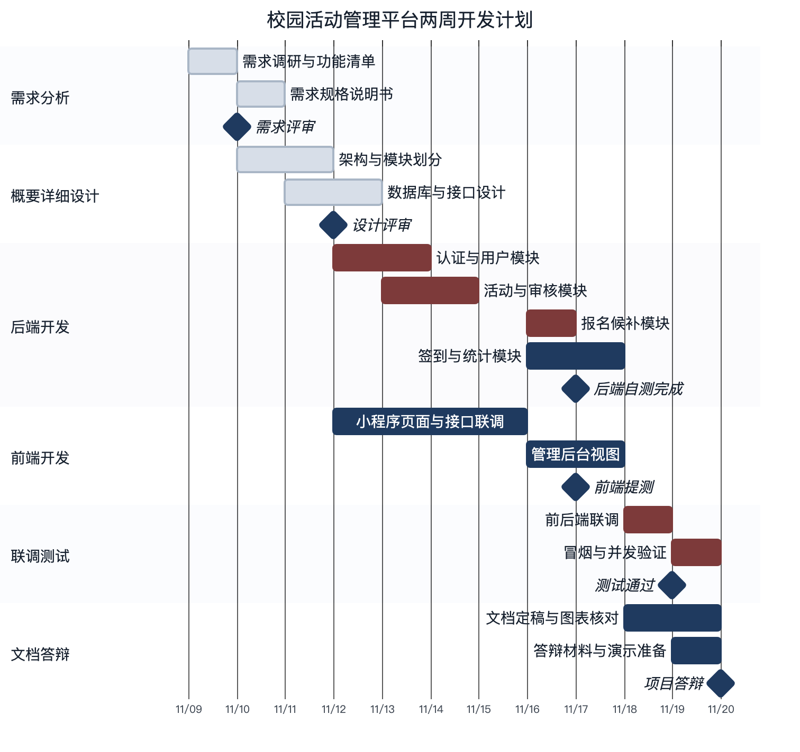

# 校园活动管理平台 · 项目管理与进度计划

| 项 | 内容 |
| --- | --- |
| 文档编号 | CA-DOC-10 |
| 文档名称 | 项目管理与进度计划 |
| 版本 | v1.0 |
| 日期 | 2026-11-20 |
| 对应阶段 | 全过程管理 |
| 编写 | 项目组 |
| 审核 | 指导教师 |
| 状态 | 定稿 |

## 版本记录

| 版本 | 日期 | 修订人 | 修订说明 |
| --- | --- | --- | --- |
| v1.0 | 2026-11-20 | 项目组 | 首次编写，含角色分工、进度、WBS、质量保证、风险登记册与交付物清单 |

---

## 1 项目组织与分工

本章回答：项目由谁组成、每个人负责哪一块、写代码的边界在哪里、平时怎么沟通。分工按「一个人负责一个可独立验收的目录或端」划分，避免多人同时改同一个文件。

### 1.1 小组构成

按课程设计 4 人小组组织，另设指导教师负责需求确认与阶段评审。4 人小组中「测试」与「文档」两个职能由同一名成员兼任；若小组只有 3 人，则由负责人兼任后端、由测试文档成员兼做部分联调，角色职责不变。

表 10-1 角色与职责

| 角色 | 人数 | 主要职责 | 关键产出 | 工时占比 |
| --- | --- | --- | --- | --- |
| 项目负责人 | 1 | 计划与跟踪、需求基线、评审组织、风险与变更、最终集成 | 需求基线、计划与里程碑、评审记录、集成版本 | 20% |
| 后端开发 | 1 | 数据库脚本、接口实现、业务规则、鉴权、定时任务、冒烟脚本 | `server/` 源码、`schema.sql`/`data.sql`、`scripts/smoke.sh` | 30% |
| 前端开发 | 1 | 小程序 14 页、管理后台 7 视图、请求层与类型定义、联调 | `app/`、`admin/` 源码与构建产物 | 30% |
| 测试 | 1（4 人组由文档成员兼任） | 测试用例、冒烟执行、缺陷跟踪、并发与安全专项 | 测试报告、缺陷记录、冒烟执行记录 | 10% |
| 文档 | 1（4 人组由测试成员兼任） | 12 份文档、20 张设计图与 27 张运行截图、答辩材料、交叉检查 | 文档与图表成品 | 10% |

角色之外还有两类干系人：指导教师负责阶段评审与验收签字；团委/学生会代表作为业务方，确认活动审核流程与签到规则是否符合真实场景。课程设计阶段由组内成员模拟业务方，但需求确认结论需记录在需求文档中。

### 1.2 责任边界

为避免并行修改冲突，源码与文档按目录划分写权限，跨目录修改必须先沟通再合并。

表 10-2 目录级责任边界

| 范围 | 主要责任人 | 允许他人修改的方式 |
| --- | --- | --- |
| `server/src/main/java`、`server/src/main/resources` | 后端开发 | 提交 MR 由后端评审后合并 |
| `app/src`（页面、utils、types） | 前端开发 | 提交 MR 由前端评审后合并 |
| `admin/src`（views、api、router） | 前端开发 | 同上 |
| `scripts/smoke.sh` | 后端开发编写，测试执行 | 断言变更需测试确认 |
| `docs/项目文档`、`docs/diagrams`、`docs/screenshots` | 测试与文档，按文档编号再细分 | 文档交叉引用改动需通知文档负责人 |
| `README.md`、`.gitignore` | 项目负责人 | 合并前检查命令与端口是否仍准确 |

### 1.3 沟通与协作机制

- **每日站会（10 分钟）**：昨天完成什么、今天做什么、有没有阻塞。阻塞项当场指派负责人，超过一天未解决的升级到负责人。
- **每日站会（15 分钟）+ 每周评审（60 分钟）**：站会同步当天任务与阻塞，周五评审对齐里程碑，检查本周产出是否可演示，更新风险登记册。
- **任务板**：每个任务写清「产出物 + 验收标准 + 写权限范围」，完成后由负责人验收再关闭。
- **文档同步**：技术口径（接口路径、表名、状态码、数字指标）统一以写作基线为准，任何人发现不一致先在群里确认，再统一修改，避免各文档口径分叉。

---

## 2 阶段划分与里程碑

本章回答：项目分成几个阶段、每个阶段什么时候结束、以什么标志判断结束。两周（10 个工作日）对应五个阶段，最后阶段留给文档与答辩。

表 10-3 阶段划分与里程碑

| 阶段 | 时间 | 主要工作 | 里程碑 | 交付物 |
| --- | --- | --- | --- | --- |
| 需求分析 | 2026-11-09 ~ 11-10 | 调研校园活动流程、确定角色与范围、梳理功能清单与业务规则 | M1 需求基线冻结（11-10） | 01 项目概述、02 需求规格说明书 |
| 概要/详细设计 | 2026-11-10 ~ 11-12 | 架构分层、模块划分、数据库设计、接口定义、关键流程设计 | M2 设计评审通过（11-12） | 03 概要设计、04 数据库设计、05 接口设计、06 详细设计 |
| 编码实现 | 2026-11-12 ~ 11-17 | 后端接口与业务规则、小程序 14 页、后台 7 视图、自测 | M3 主链路联调通过（11-17） | 三端可运行版本、`schema.sql`/`data.sql` |
| 联调测试 | 2026-11-18 ~ 11-19 | 端到端联调、33 项冒烟断言、并发与安全专项、缺陷修复 | M4 冒烟 20 项全部通过（11-19） | 07 测试报告、08 部署手册、09 用户手册 |
| 文档与答辩 | 2026-11-18 ~ 11-20 | 文档定稿、图表终检、演示脚本、答辩演练 | M5 文档定稿与答辩（11-20） | 10 项目管理、11 项目总结、20 张设计图与 27 张运行截图、答辩材料 |

里程碑的验收标准不是「做完了」，而是「可演示」：M1 要求每条功能有编号且能对应到角色；M2 要求 12 张表、44 个接口路径与状态字典全部确定；M3 要求从建活动到签到统计的链路在本地跑通；M4 要求冒烟脚本 33 项断言全绿并留输出记录；M5 要求 12 份文档齐全、20 张设计图与 27 张运行截图可打开。

---

## 3 WBS 工作分解

本章回答：每个阶段具体拆成哪些任务、产出什么、大约需要多少工时。工时按「人时」估算，不含等待与会议之外的碎片时间；4 人小组两周（10 个工作日）总投入约 330 人时，相当于每人每天约 8 小时，与课程设计的集中投入强度匹配。

表 10-4 WBS 工作分解

| 编号 | 阶段 | 任务 | 产出 | 工时（人时） | 责任角色 |
| --- | --- | --- | --- | --- | --- |
| 1.1 | 需求 | 业务流程调研与角色梳理 | 角色清单、主流程说明 | 10 | 负责人 |
| 1.2 | 需求 | 功能清单与用例 | 4 组用例、40 项功能（FR-S/O/A/SYS） | 12 | 负责人、测试 |
| 1.3 | 需求 | 业务规则与状态字典 | 18 条 BR、7+7 状态、错误码分段 | 8 | 后端 |
| 1.4 | 需求 | 需求评审与基线冻结 | 评审记录、需求基线 | 6 | 全员 |
| 2.1 | 设计 | 架构与模块划分 | 分层架构、模块图 | 10 | 后端、负责人 |
| 2.2 | 设计 | 数据库设计 | 12 张表、索引、种子数据 | 14 | 后端 |
| 2.3 | 设计 | 接口设计 | 44 个接口的路径、入参、出参、权限 | 12 | 后端、前端 |
| 2.4 | 设计 | 关键流程与前端页面设计 | 5 张时序/流程/状态图、14 页原型 | 12 | 全员 |
| 3.1 | 开发 | 后端工程与公共层 | 统一返回、异常、鉴权、分页 | 12 | 后端 |
| 3.2 | 开发 | 认证与绑定 | 登录、绑定、JWT、拦截器 | 8 | 后端 |
| 3.3 | 开发 | 活动模块 | 查询、发布、编辑、提审、审核、收藏 | 14 | 后端 |
| 3.4 | 开发 | 报名与候补模块 | 条件占位、候补队列、取消转正、报名审核 | 16 | 后端 |
| 3.5 | 开发 | 签到与统计模块 | 动态签到码、扫码校验、补签、统计 | 12 | 后端 |
| 3.6 | 开发 | 消息与定时任务 | 站内消息、状态推进、未到场标记 | 6 | 后端 |
| 3.7 | 开发 | 管理后台接口 | 工作台、审核、活动、用户、日志 | 8 | 后端 |
| 3.8 | 开发 | 小程序骨架与请求层 | 路由、tabBar、请求封装、类型定义 | 8 | 前端 |
| 3.9 | 开发 | 小程序学生端 10 页 | 首页、列表、详情、报名、我的、消息、签到、绑定 | 22 | 前端 |
| 3.10 | 开发 | 小程序组织者端 4 页 | 工作台、发布、名单、核销 | 14 | 前端 |
| 3.11 | 开发 | 管理后台 7 视图 | 登录、工作台、审核、活动、用户、日志 | 18 | 前端 |
| 3.12 | 开发 | 三端类型对齐与自测 | 类型检查零错误、页面可渲染 | 8 | 前端、测试 |
| 4.1 | 测试 | 环境与演示数据准备 | 可重复初始化的库、演示账号 | 6 | 后端 |
| 4.2 | 测试 | 主链路端到端联调 | 登录→建活动→审核→报名→签到→统计 | 12 | 全员 |
| 4.3 | 测试 | 冒烟脚本 33 项断言 | `scripts/smoke.sh` 及执行记录 | 10 | 后端、测试 |
| 4.4 | 测试 | 并发与安全专项 | 超卖、重复报名、伪造签到码、越权 | 8 | 测试、后端 |
| 4.5 | 测试 | 缺陷修复与回归 | 缺陷记录、回归结果 | 8 | 相关角色 |
| 5.1 | 文档 | 12 份文档编写与交叉检查 | `docs/项目文档/00-11` | 26 | 测试与文档 |
| 5.2 | 文档 | 20 张设计图绘制与 27 张运行截图采集 | `docs/diagrams/out` | 8 | 测试与文档 |
| 5.3 | 文档 | 演示脚本与答辩材料 | 演示步骤、PPT 提纲 | 4 | 负责人 |
| 6.1 | 管理 | 计划跟踪与周评审 | 周报、评审记录 | 10 | 负责人 |
| 6.2 | 管理 | 风险与变更管理 | 风险登记册、变更记录 | 6 | 负责人 |

合计约 328 人时，其中开发类任务约 146 人时、测试 44 人时、文档 38 人时、需求与设计 84 人时、管理 16 人时。工时估算的用途是排期与发现瓶颈，不作为绩效考核依据；实际执行时允许 ±20% 偏差。

---

## 4 进度计划

本章回答：两周里每天做什么、关键路径是哪几条、卡住时先保什么。整体计划从 2026-11-09 开始，到 2026-11-20 答辩结束，共 12 个自然日、10 个工作日（11-14、11-15 为周末）；11-21、11-22 另作机动缓冲。

### 4.1 两周总体安排

图 10-1 用甘特图给出各阶段的起止与重叠关系：需求与设计严格串行，开发阶段前后端两组任务并行，联调测试在开发收尾时开始，文档阶段与测试后期重叠，最后阶段集中定稿与答辩。

图 10-1 项目甘特图

图 10-1 中横轴为日期（11-09 至 11-20），按需求分析、概要详细设计、后端开发、前端开发、联调测试、文档答辩六行展开。两周口径为：需求 11-09～11-10、设计 11-10～11-12、开发 11-12～11-17、联调测试 11-18～11-19、文档答辩 11-18～11-20。需求分析以需求评审（M1）收口；概要详细设计以设计评审（M2）收口；后端开发 11-12～11-17 依次完成认证与用户、活动与审核、报名候补、签到与统计四个模块，以后端自测完成收口；前端开发与后端并行，小程序页面联调、管理后台视图随后端接口推进，以前端提测收口；联调测试 11-18～11-19 集中冒烟与并发验证，以测试通过（M4）收口；文档答辩 11-18～11-20 完成文档定稿、图表核对与答辩准备，以项目答辩（M5）收口。图中菱形为检查点，「需求评审、设计评审、后端自测完成、前端提测、测试通过、项目答辩」六个检查点与表 10-3 的 M1～M5 对应，其中后端自测完成与前端提测共同构成 M3「主链路联调通过」。

### 4.2 逐周计划

表 10-5 逐周任务与产出

| 周次 | 日期 | 本周任务 | 周产出 | 参与角色 |
| --- | --- | --- | --- | --- |
| 第 1 周 | 11-09 ~ 11-15 | 流程调研、角色与范围、功能清单、业务规则、需求评审；架构与模块、12 表设计、38 接口定义；后端公共层与认证、活动模块；小程序骨架与学生端页面 | 01～06 文档初稿；数据库脚本；后端接口可调通；小程序可浏览 | 全员 |
| 第 2 周 | 11-16 ~ 11-20 | 报名候补、签到统计、消息任务、后台接口；组织者端与后台视图；前后端联调、33 项冒烟、并发与安全专项；文档定稿与答辩准备 | 三端主链路跑通（M3）；冒烟全绿（M4）；12 份文档与答辩材料（M5） | 全员 |
| 机动 | 11-21 ~ 11-22 | 提交缓冲、补拍截图、答辩材料兜底 | 最终提交包 | 全员 |

### 4.3 关键路径与缓冲

关键路径为：需求基线 → 数据库设计与接口定义 → 后端报名/签到模块 → 三端联调 → 冒烟测试 → 文档定稿。这条路径上任一环节延期都会直接推迟答辩，因此安排两条保护措施：

1. **前后端分离排期**：第 1 周后段后端先给出接口契约（路径、入参、出参），前端用假数据并行开发，减少互相等待。
2. **利用周末与机动日缓冲**：11-14～11-15 与 11-21～11-22 作为补齐、回归与文档缓冲，不提前占用，只在出现延期时使用。两周计划没有整周余量，任一里程碑延期都要启动裁剪。

若进度仍然吃紧，按以下优先级裁剪：先保「登录绑定 → 发布审核 → 报名 → 签到」主链路与 33 项冒烟，再保管理后台的审核与日志；统计页面、编辑入口等非主链路功能可延后到下一版本，但必须在总结报告中如实记录。

## 5 协作与版本管理

本章回答：代码怎么提交、分支怎么管、改动如何被评审、文档如何协同。目标是任何一次改动都能追溯到人、追溯到任务，并且主分支始终可运行。

### 5.1 Git 分支模型

表 10-6 分支与合并规则

| 分支 | 命名 | 用途 | 合并去向 | 保护规则 |
| --- | --- | --- | --- | --- |
| `main` | 固定 | 可演示、可交付的稳定版本 | — | 禁止直接提交，只接受评审通过的合并 |
| `develop` | 固定 | 集成分支，每日构建基线 | `main`（里程碑时） | 需通过类型检查与冒烟 |
| 功能分支 | `feat/<任务号>-<简述>` | 单个功能开发，如 `feat/CA-12-activity-list` | `develop` | 至少 1 人评审 |
| 修复分支 | `fix/<问题简述>` | 缺陷修复，如 `fix/checkin-token-slice` | `develop` | 至少 1 人评审 |
| 文档分支 | `docs/<文档号>-<简述>` | 单份文档或图表 | `develop` | 文档负责人评审 |
| 发布分支 | `release/<版本>` | 答辩/交付前冻结，只修致命缺陷 | `main` | 负责人批准 |

分支生命周期尽量短，功能分支不超过 3 天；合并前先同步 `develop`，冲突在自己分支解决，不允许把冲突带到集成分支。

### 5.2 提交规范

提交信息采用「类型(范围): 描述」格式，一行说清改了什么，正文补充原因与影响面。类型与范围的取值固定，便于按类型生成变更记录。

表 10-7 提交类型与范围

| 类型 | 含义 | 示例 |
| --- | --- | --- |
| `feat` | 新功能 | `feat(server): 报名满员后进入候补队列` |
| `fix` | 缺陷修复 | `fix(app): 修复我的报名状态筛选不刷新` |
| `docs` | 文档与图 | `docs: 补充 09 用户操作手册与截图引用` |
| `refactor` | 不改变行为的重构 | `refactor(admin): 抽取活动状态字典` |
| `test` | 测试与断言 | `test(scripts): 冒烟新增伪造签到码断言` |
| `chore` | 构建、依赖、配置 | `chore: 升级 uni-app 依赖版本` |

范围取值：`server`、`app`、`admin`、`scripts`、`docs`、`db`。禁止一次提交混合多个不相关改动；禁止提交本地数据库密码、构建产物与个人配置。

### 5.3 代码评审与合并

1. 作者提交 MR，填写「改了什么、为什么、怎么验证」三项，附验证命令或截图。
2. 评审人按清单检查：接口路径与文档一致、状态码未新增未记录值、无调试代码、前端类型无 `any` 泛滥、异常分支有提示。
3. 评审通过后由作者合并到 `develop`；里程碑合入 `main` 前由负责人跑一遍冒烟脚本。
4. 文档类 MR 由文档负责人检查：信息表与版本记录齐全、编号连续、图引用路径存在、与基线数字一致。

### 5.4 文档协作

12 份文档按编号分给不同成员并行编写，写作前统一阅读写作基线，技术口径以基线为准。图表由文档成员按图号分工，源文件放 `docs/diagrams/src/`，成品放 `docs/diagrams/out/`，同一图号只允许一个负责人修改。交叉引用统一用相对路径，文档定稿前做一次全量链接检查。

---

## 6 质量保证

本章回答：怎样证明系统「确实能用」，而不是「看起来能用」。质量保证分三层：静态检查保证代码自洽，构建保证产物可交付，端到端冒烟保证业务链路正确。

### 6.1 质量目标

表 10-8 质量目标与验证方式

| 目标 | 验证方式 | 通过标准 |
| --- | --- | --- |
| 前端类型自洽 | `pnpm type-check`（app、admin） | 零错误 |
| 前端可构建 | `pnpm build:h5`、`pnpm build` | 构建成功，产物可预览 |
| 主链路业务正确 | `scripts/smoke.sh` | 33 项断言全部通过 |
| 关键并发安全 | 冒烟中的重复报名、满员候补断言 | 重复提交被拒、候补序号正确 |
| 签到安全 | 冒烟中的伪造签到码断言 | 错误码 40001，无法签到 |
| 权限隔离 | 无 token 访问受保护接口、越权操作 | 返回 401/403，不能越组织操作 |
| 文档一致 | 文档交叉检查 | 编号连续、路径存在、数字与基线一致 |

### 6.2 检查手段

1. **类型检查**：小程序与管理后台分别执行 `vue-tsc --noEmit`，在提交 MR 前本地跑一遍，CI 未接入阶段由评审人复核结果。
2. **构建验证**：小程序执行 `pnpm build:h5` 验证 uni-app 构建链路，后台执行 `pnpm build` 验证 Vite 产物，构建失败直接阻塞合并。
3. **接口自测**：后端启动后用 `swagger-ui.html` 逐个接口验证入参与返回，重点看错误码分支。
4. **端到端冒烟**：`BASE=http://127.0.0.1:8016/api ./scripts/smoke.sh` 从登录一路跑到统计，覆盖 6 组断言。

表 10-9 冒烟断言分组

| 分组 | 断言数 | 覆盖内容 |
| --- | --- | --- |
| 登录与绑定 | 4 | 两个学生各登录一次、各绑定一个学号 |
| 活动与审核 | 5 | 组织者建活动、提交审核、管理员登录、待审核列表可见、审核通过 |
| 报名与名额 | 3 | 首个报名成功、重复报名被拒（30002）、满员后进入候补 |
| 签到 | 5 | 取签到码、轮换周期 30 秒、签到成功、重复签到被拒（40003）、伪造签到码被拒（40001） |
| 统计 | 3 | 已签到 1 人、候补 1 人、到场率 100 |
| 合计 | 20 | 端到端主链路 + 关键异常分支 |

### 6.3 缺陷管理

缺陷按影响分级：致命（无法启动、主链路中断）、严重（业务结果错误、越权）、一般（提示错误、样式错位）、轻微（文案、日志）。致命与严重缺陷当天修复并回归，一般缺陷在里程碑前清理，轻微缺陷进入下一版本。每个缺陷记录「复现步骤、期望结果、实际结果、修复提交」，回归时先跑冒烟再验证缺陷点。

---

## 7 风险登记册

本章回答：项目最可能出问题的地方在哪、概率与影响多大、提前做什么准备。风险在每周评审时更新状态，触发信号出现即启动应对，不等到问题发生。

表 10-10 风险登记册

| 编号 | 风险描述 | 概率 | 影响 | 等级 | 应对措施 | 触发信号 |
| --- | --- | --- | --- | --- | --- | --- |
| R-01 | 报名并发导致名额超卖 | 高 | 高 | 高 | 用单条条件 UPDATE 占名额，不做「先查后写」；`uk_activity_user` 唯一索引兜底；冒烟中验证满员与重复提交 | 并发测试出现 `signed_count > capacity` |
| R-02 | 签到码被截图转发、远程代签 | 中 | 中 | 中 | HMAC 动态码 30 秒轮换、只接受最近 2 个时间片；「扫码 + 定位」活动校验 200 米范围 | 出现同一码短时间多地签到 |
| R-03 | 演示数据过期，答辩时活动全是已结束 | 高 | 中 | 高 | `data.sql` 用相对时间；`dev-mode` 下启动自动平移过期活动；文档写明重新导入步骤 | 打开首页无「报名中」活动 |
| R-04 | 前端依赖安装失败或版本漂移 | 中 | 中 | 中 | 统一用 pnpm 与锁文件；不随意升级 uni-app 与 Element Plus 大版本；记录 Node 版本要求 | `pnpm install` 超时或类型包不一致 |
| R-05 | 端口/地址不一致导致联调失败 | 高 | 低 | 中 | 后端统一 8016；冒烟脚本显式 `BASE`；前端 Vite 代理与请求常量也对齐 8016；README 与手册写明三端地址；真机前核对请求常量 | 页面提示「网络异常，请检查后端是否启动」 |
| R-06 | 微信订阅消息资质未获批 | 高 | 中 | 中 | V1 明确只发站内消息，订阅消息仅预留 `NoticeSender` 接口；文档不承诺微信通知 | 需要模板 ID 但拿不到 |
| R-07 | 进度延期挤压测试与文档 | 中 | 高 | 高 | 文档与开发并行；预留 2 天缓冲；按主链路优先裁剪非核心功能 | 周评审任务完成率低于 70% |
| R-08 | 图表渲染环境不可用 | 低 | 中 | 低 | 图表工具离线可运行，源文件与成品都入库；必要时手工 SVG 兜底 | Chrome 无头渲染报错、图缺字 |

风险等级按「概率 × 影响」粗略分档，高等级风险每周跟踪一次。R-01 与 R-07 是本项目最需要盯的两条：前者决定业务是否正确，后者决定能否按时交付完整文档。

---

## 8 变更管理

本章回答：需求或实现发生变化时怎么控制，避免「悄悄改」。变更分三类：范围变更（增删功能）、技术变更（改接口/表结构/算法）、文档口径变更（统一说法或修正错误）。范围变更需指导教师确认，技术变更需设计与测试同步，文档口径变更由负责人统一发布。

表 10-11 变更处理流程

| 步骤 | 动作 | 责任人 | 产出 |
| --- | --- | --- | --- |
| 1 提出 | 记录变更内容、原因、期望时间 | 提出人 | 变更申请 |
| 2 影响分析 | 评估对接口、表、页面、测试、文档、进度的影响 | 负责人 + 相关角色 | 影响清单 |
| 3 审批 | 范围变更报指导教师；技术变更由负责人批准 | 负责人 | 审批结论 |
| 4 实施 | 建 `feat/` 或 `fix/` 分支实现，同步更新文档 | 开发 | 代码与文档改动 |
| 5 回归 | 跑类型检查、构建与冒烟，验证受影响功能 | 测试 | 回归记录 |
| 6 记录 | 在变更登记表登记并更新基线 | 负责人 | 变更记录 |

表 10-12 已发生的口径调整记录

| 编号 | 变更内容 | 类别 | 原因 | 处理结果 |
| --- | --- | --- | --- | --- |
| CHG-01 | 截图目录缺失，改为复制 4 张真实截图到 `docs/screenshots/` | 文档 | 根 README 引用的原截图目录不存在 | 文档集统一引用 4 张 `15-cases-campus-activity-*.webp` |
| CHG-02 | 冒烟脚本默认端口 8080 与后端 8016 不一致 | 技术/文档 | 脚本默认值沿用早期端口 | 已修复：`smoke.sh` 默认 `BASE` 改为 8016，前端 Vite 代理与非 H5 `BASE_URL` 同步改为 8016 |
| CHG-03 | 微信订阅消息不接入 | 范围 | 无模板 ID 与资质 | V1 只发站内消息，`NoticeSender` 预留接口，文档如实说明 |
| CHG-04 | 小程序暂不提供活动编辑、独立统计页入口 | 范围/进度 | 优先保主链路与交付时间 | 接口已实现，界面入口列入后续版本与总结报告 |

变更登记同时是项目总结报告「不足与改进」的输入：凡是被裁剪或被替换的内容，都要在 11 文档中有对应条目，避免文档承诺与实际交付脱节。

---

## 9 交付物清单

本章回答：项目最终交出什么、放在哪里、按什么标准验收。交付物分源码、数据、测试、文档、图表、工具六类。

表 10-13 交付物清单

| 类别 | 交付物 | 形式 | 存放位置 | 验收标准 |
| --- | --- | --- | --- | --- |
| 源码 | 后端服务 | Java 源码（83 个主代码文件、44 个接口） | `server/` | 可启动，接口文档可访问 |
| 源码 | 小程序 | uni-app + Vue3 + TS（14 页） | `app/` | 类型检查零错误、H5 可构建可运行 |
| 源码 | 管理后台 | Vue3 + Element Plus（7 视图） | `admin/` | 类型检查零错误、可构建可登录 |
| 数据 | 建表与种子数据 | SQL 脚本（12 表、4 场演示活动） | `server/src/main/resources/db/` | 可重复导入，导入后活动可报名 |
| 测试 | 冒烟脚本 | Shell（33 项断言） | `scripts/smoke.sh` | 20 项全部通过 |
| 文档 | 项目文档 12 份 | Markdown | `docs/项目文档/` | 信息表、版本记录、待确认事项齐全 |
| 图表 | 20 张设计图 + 27 张运行截图 | SVG/PNG 与 PNG 截图 | `docs/diagrams/out/`（源 `src/`）、`docs/screenshots/` | 可打开、文字不溢出、灰度可分辨 |
| 截图 | 运行时截图 4 张 | WebP | `docs/screenshots/` | 路径被文档引用且可打开 |
| 工具 | 图表渲染工具 | 离线工具链 | `tools/software-eng-diagrams/` | 可按预设重新渲染 |
| 说明 | README 与部署手册 | Markdown | 根目录、08 文档 | 命令、端口、账号与实现一致 |

验收顺序建议按「数据 → 后端 → 冒烟 → 前端 → 文档」：先保证库能初始化，再保证后端接口可用，跑通冒烟后再看前端页面，最后核对文档与图。这样任何一步失败都能定位到最小范围。

---

## 待确认事项

1. 小组实际人数与姓名未定稿：本文按 4 人小组编写，测试与文档由同一名成员兼任；若为 3 人小组，则由负责人兼任后端、前端兼部分测试与联调，工时占比需相应调整。
2. 两周计划的起止日期按 2026-11-09 至 2026-11-20 编排（10 个工作日，11-21/22 为机动缓冲），实际教学日历若调整，里程碑日期需同步平移。
3. 表 10-4 的工时估算为计划值，非实际工时统计，不用于考核；如需精确数据需补充工时记录。
4. 变更登记表仅记录本版本已发生的 4 项口径调整，后续变更需按流程继续登记。
5. CI（持续集成）尚未接入，质量检查目前依赖本地命令与人工复核，接入方案见 11 文档改进方向。
