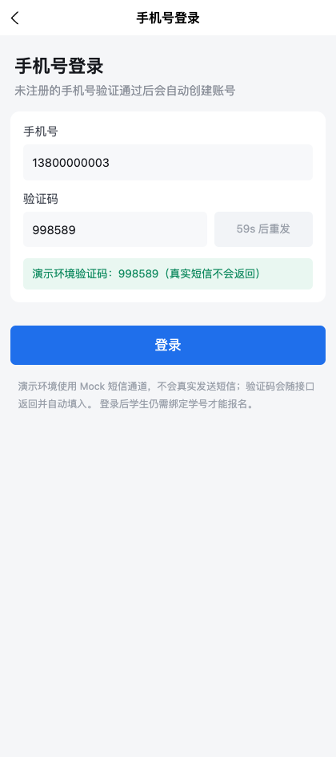
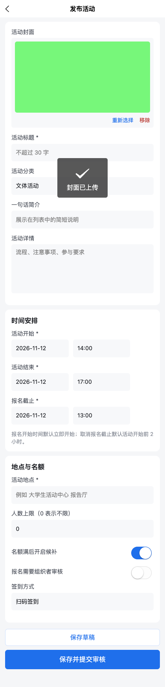
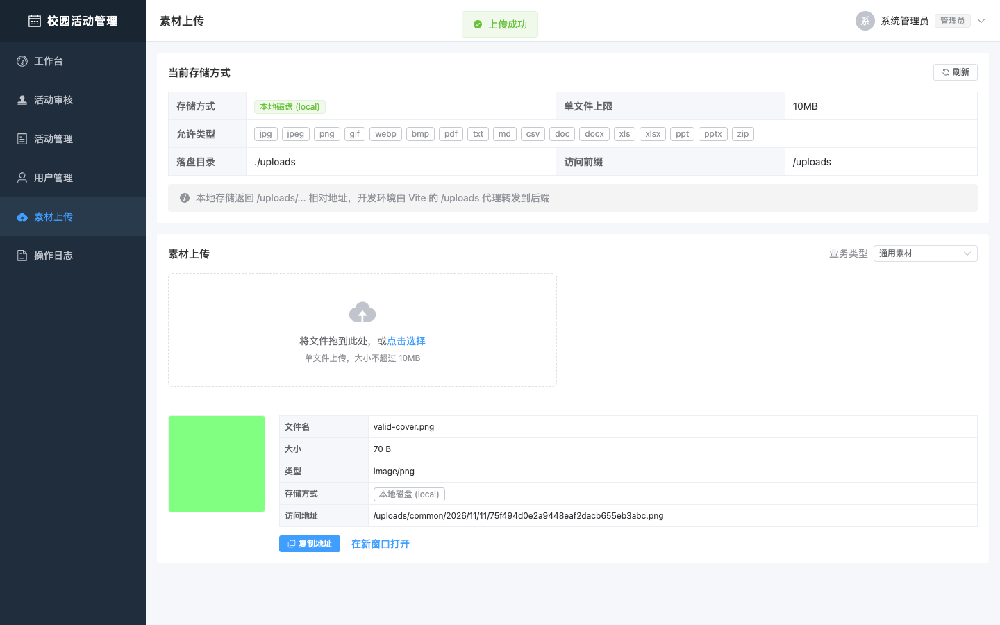

# 校园活动管理平台 · 功能扩展说明

| 项 | 内容 |
| --- | --- |
| 文档编号 | CA-DOC-12 |
| 文档名称 | 功能扩展说明 |
| 版本 | v1.1 |
| 日期 | 2026-11-11 |
| 对应阶段 | 详细设计与实现 |
| 编写 | 项目组 |
| 审核 | 指导教师 |
| 状态 | 定稿 |

## 版本记录

| 版本 | 日期 | 修订人 | 修订说明 |
| --- | --- | --- | --- |
| v1.0 | 2026-11-10 | 项目组 | 首次编写，覆盖 Spring Security、Redis、短信验证码、文件上传四项扩展能力 |
| v1.1 | 2026-11-11 | 项目组 | 小程序与管理后台接入四项扩展能力，补充前端接入点表与浏览器端到端验证结果 |

> 本文档回答“四项扩展能力分别落在哪、怎么配置、怎么验证”。所有类名、配置键、接口路径、错误码与响应字段均取自 `server/` 当前源码与 `application.yml`，前端页面路径、函数名与接口调用取自 `app/`、`admin/` 当前源码，不描述未实现的接口或配置。四项能力在架构中的位置分别见 [03 概要设计说明书](03-概要设计说明书.md) 第 4、7、9、10 章，接口字段见 [05 接口设计说明书](05-接口设计说明书.md)，类与算法见 [06 详细设计说明书](06-详细设计说明书.md)，部署配置见 [08 部署与运维手册](08-部署与运维手册.md)。

---

## 1 概述

### 1.1 扩展范围与代码落点

表 12-1 四项扩展能力与代码落点

| 能力 | 主要代码位置 | 关键类 | 详细说明 |
| --- | --- | --- | --- |
| Spring Security 鉴权 | `server/src/main/java/com/campus/activity/config/SecurityConfig.java`、`security/` | `SecurityConfig`、`JwtAuthenticationFilter`、`SysUserDetailsService`、`SysUserDetails`、`TokenBlacklistService`、`JsonAuthenticationEntryPoint`、`JsonAccessDeniedHandler`、`SecurityExceptionAdvice` | 本文第 3 章、06 第 2.6 节 |
| Redis 缓存与分布式锁 | `config/RedisConfig.java`、`support/`、`job/` | `RedisConfig`、`RedisCache`、`RedisKeys`、`RedisLock`、`ActivityStatusJob` | 本文第 4 章、06 第 13.1 节 |
| 短信验证码登录 | `config/SmsProperties.java`、`sms/`、`controller/app/SmsAuthController.java` | `SmsCodeService`、`SmsAuthService`、`MockSmsSender`、`CloopenSmsSender`、`SmsSendVO` | 本文第 5 章、06 第 13.2 节 |
| 文件上传与存储 | `file/` | `FileController`、`FileService`、`FileTypeDetector`、`LocalStorageService`、`AliyunOssStorageService` | 本文第 6 章、06 第 13.3 节 |

四项能力的连接配置与开关集中在 `application.yml`（缓存 TTL、key 前缀等参数例外，只在 `config/RedisConfig.java` 中定义），短信与文件模块通过 `campus.sms.provider`、`campus.file.storage-type` 两个开关在 Mock/真实通道、本地/OSS 之间切换，具体实现由 `@ConditionalOnProperty` 条件装配，业务代码不感知具体通道。

### 1.2 扩展前后的规模变化

表 12-2 扩展前后对比

| 指标 | 扩展前 | 当前 | 说明 |
| --- | --- | --- | --- |
| REST 接口 | 38 | 44 | 新增登出 2 个、短信 2 个、文件 2 个 |
| 后端 Java 主代码文件 | 83 | 113 | 新增 `security/` 8、`file/` 12、`sms/` 8、`support/` 3 等 |
| 控制器 | 12 | 14 | 新增 `SmsAuthController`、`FileController` |
| 配置类 | 4 | 6 | 删除 `WebMvcConfig`，新增 `SecurityConfig`、`RedisConfig`、`SmsProperties` |
| 安全类 | 4 | 8 | 删除 `AuthInterceptor`、`RequireLogin`、`RequireRole`，新增 7 个过滤器/处理器/服务类 |
| 自动化测试 | 1 个类 5 个用例 | 5 个类 20 个用例 | 见本文 9.1 节 |
| 冒烟断言 | 20 | 33 | 见本文 9.2 节 |
| 运行时中间件 | MySQL | MySQL + Redis | 短信真实通道、OSS 为可选外部服务 |

### 1.3 阅读约定

- 接口前缀统一为 `http://127.0.0.1:8016/api`，文中 `$BASE` 均指该值。
- 所有命令在项目根目录执行；涉及 `server` 子目录的命令会显式注明。
- Redis 默认连接 `127.0.0.1:6379`、密码 `abc123`、`database 11`；短信与文件相关命令默认使用 Mock 通道与本地存储。
- 错误码分段新增 `60xxx`（短信）与 `70xxx`（文件），完整明细见 [05 接口设计说明书](05-接口设计说明书.md) 第 2.4 节。

---

## 2 技术栈变化

### 2.1 新增后端依赖

表 12-3 新增依赖

| 依赖 | 版本 | 用途 | 是否必需 |
| --- | --- | --- | --- |
| `spring-boot-starter-security` | 由 Spring Boot 4.1.1 统一管理（Spring Security 7.x） | 过滤器链、方法级鉴权、`AuthenticationManager`、BCrypt | 必需 |
| `spring-boot-starter-data-redis` | 由 Spring Boot 4.1.1 统一管理（Spring Data Redis 4.x） | 注解缓存、验证码、JWT 黑名单、分布式锁 | 必需 |
| `commons-pool2` | 由 Spring Boot 管理 | Lettuce 连接池；缺省时池参数静默失效 | 必需 |
| `spring-boot-starter-cache` | 由 Spring Boot 管理 | Boot 4 把缓存自动配置拆成独立模块，`@Cacheable` 必须显式引入 | 必需 |
| `com.cloopen:java-sms-sdk` | 1.0.4 | 容联云短信真实通道 | 可选 |
| `com.aliyun.oss:aliyun-sdk-oss` | 3.18.5 | 阿里云 OSS 存储 | 可选 |
| Redis 服务端 | 6.2 及以上（建议 7.x） | 缓存、验证码、黑名单、锁 | 必需 |

说明：后台密码校验从原来单独引入的 `spring-security-crypto` 改为 `spring-boot-starter-security` 自带的 `PasswordEncoder`（`BCryptPasswordEncoder`），不再单独声明 crypto 依赖。短信 SDK 与 OSS SDK 虽然打进构建产物，但只要不打开对应开关就不会创建客户端，也不会有外部网络调用。

### 2.2 运行时依赖与端口

表 12-4 扩展后的运行时依赖

| 组件 | 默认地址 | 说明 |
| --- | --- | --- |
| MySQL | `127.0.0.1:3306/campus_activity` | 12 张表，不变 |
| Redis | `127.0.0.1:6379`，`database 11` | 与 01–14 其他案例用不同 database 隔离；密码默认 `abc123` |
| 本地文件目录 | `server/uploads`（相对启动目录 `./uploads`） | 应用启动时自动创建，已在 `.gitignore` 中排除 |
| 容联云短信 | `app.cloopen.com:8883` | 仅 `campus.sms.provider=cloopen` 时访问 |
| 阿里云 OSS | `${OSS_ENDPOINT}` | 仅 `campus.file.storage-type=oss` 时创建客户端 |

### 2.3 兼容性说明

- Spring Boot 4.1.1 默认使用 Jackson 3（包名 `tools.jackson`），Redis 值的序列化统一使用 `GenericJacksonJsonRedisSerializer`，没有沿用 Boot 3 的 Jackson 2 序列化器。
- Spring Security 7 的配置按 `SecurityFilterChain` + lambda DSL 编写，登录页、HTTP Basic、默认 logout、Session 全部关闭，走无状态 JWT。
- 测试侧继续使用 `MockMvc`；Boot 4 的 `@AutoConfigureMockMvc` 来自 `spring-boot-starter-webmvc-test`，测试会真实连接 MySQL 与 Redis（database 11），不依赖外部短信与 OSS。

---

## 3 Spring Security 鉴权链路与规则

### 3.1 请求处理链路

一次请求进入后端后按以下顺序处理：

1. `JwtAuthenticationFilter`（注册在 `UsernamePasswordAuthenticationFilter` 之前）读取 `Authorization: Bearer <token>`，调用 `JwtUtil.parse` 验签。
2. 验签通过且 `jti` 不在 Redis 黑名单中时，把身份同时写入 `SecurityContext`（`UsernamePasswordAuthenticationToken`，权限为 `ROLE_<role>`）与业务代码沿用的 `UserContext`。
3. 令牌缺失、无效或已拉黑时不直接返回 401，只清空上下文，以匿名身份继续，交给后续授权层统一拒绝。
4. 路径级规则由 `SecurityFilterChain` 的 `authorizeHttpRequests` 判断；拒绝时走 `ExceptionTranslationFilter` → `JsonAuthenticationEntryPoint`（401）或 `JsonAccessDeniedHandler`（403）。
5. 方法级规则由 Controller 上的 `@PreAuthorize` 判断；拒绝时抛出的 `AccessDeniedException` 由 `SecurityExceptionAdvice` 兜底，按匿名/已登录分别复用上面两个处理器输出同样的 JSON。
6. 请求结束在 `JwtAuthenticationFilter` 的 `finally` 中清理 `UserContext`，避免线程池复用造成身份串号。

### 3.2 三种登录方式

表 12-5 登录入口与校验方式

| 入口 | 接口 | 身份校验 | 签发结果 |
| --- | --- | --- | --- |
| 微信登录（开发模式 mock openid） | `POST /api/app/auth/login` | `AuthService.resolveOpenId`，dev 模式直接用 `devOpenId` | `LoginVO`：`token`、`needBind`、`user` |
| 手机号验证码登录 | `POST /api/app/auth/sms/login` | `SmsCodeService.verify` 校验 Redis 中的验证码 | 同上；手机号首次登录自动建号 |
| 后台账号密码登录 | `POST /api/admin/auth/login` | `AuthenticationManager` → `DaoAuthenticationProvider` → `SysUserDetailsService` 查库 → `BCryptPasswordEncoder` 校验 | 同上；仅 `ADMIN`、`REVIEWER` 可登录 |

JWT 由 `JwtUtil` 用 HS256 签发，载荷见表 12-6。与扩展前相比新增了 `jti`，用于登出拉黑；密钥长度不足 32 字符时应用启动即失败。

表 12-6 JWT 载荷

| 声明 | 含义 |
| --- | --- |
| `sub` | 用户 ID（字符串） |
| `role` | `STUDENT` / `ORGANIZER` / `REVIEWER` / `ADMIN` |
| `orgId` | 组织 ID，可为空 |
| `nickname` | 昵称 |
| `jti` | 令牌唯一 ID，登出时写入黑名单 |
| `iat` / `exp` | 签发时间、过期时间，有效期取 `campus.jwt.access-token-hours`（默认 2 小时） |

### 3.3 路径级规则

表 12-7 `SecurityFilterChain` 路径规则

| 路径/方法 | 规则 | 说明 |
| --- | --- | --- |
| `OPTIONS /**` | `permitAll` | 跨域预检不带 token，不放行会永远 401 |
| `/api/ping` | `permitAll` | 健康检查 |
| `/api/app/auth/login` | `permitAll` | 微信登录 |
| `/api/app/auth/sms/**` | `permitAll` | 发送验证码、短信登录 |
| `/api/admin/auth/login` | `permitAll` | 后台账号登录 |
| `/error` | `permitAll` | 参数校验失败会 forward 到这里，拦下来会把 400 覆盖成 401 |
| `/uploads/**` | `permitAll` | 本地文件静态直出 |
| `/swagger-ui/**`、`/swagger-ui.html`、`/v3/api-docs/**` | `permitAll` | OpenAPI 文档 |
| `/api/admin/**` | `hasAnyRole("REVIEWER","ADMIN")` | 后台管理粗粒度守门 |
| `/api/org/**` | `hasAnyRole("ORGANIZER","ADMIN")` | 组织者中心粗粒度守门 |
| `/api/files/**` | `authenticated` | 文件接口必须登录 |
| 其余路径 | `permitAll` | 公开查询放行，登录校验交给方法级 `@PreAuthorize` |

CSRF、`formLogin`、`httpBasic`、默认 `logout` 全部关闭，Session 策略为 `STATELESS`；跨域配置统一放在 `SecurityConfig.corsConfigurationSource()`，原 `WebMvcConfig` 中对拦截器与跨域的注册已删除。

### 3.4 方法级规则

表 12-8 `@PreAuthorize` 规则

| 控制器 | 注解位置与表达式 | 覆盖接口 |
| --- | --- | --- |
| `AppAuthController` | 方法级 `isAuthenticated()` | 学号绑定、登出 |
| `AppActivityController` | 方法级 `isAuthenticated()` | 收藏切换 |
| `AppSignupController` | 方法级 `isAuthenticated()` | 报名、我的报名、报名详情、取消报名 |
| `AppCheckinController` | 方法级 `isAuthenticated()` | 扫码签到 |
| `AppUserController` | 方法级 `isAuthenticated()` | 当前用户资料 |
| `AppNoticeController` | 类级 `isAuthenticated()` | 消息列表、未读数、标记已读 |
| `FileController` | 方法级 `isAuthenticated()` | 文件上传、存储信息 |
| `OrgController` | 类级 `hasAnyRole('ORGANIZER','ADMIN')` | 组织者 11 个接口 |
| `AdminActivityController` | 类级 `hasAnyRole('REVIEWER','ADMIN')` | 审核、活动管理、下架 |
| `AdminDashboardController` | 类级 `hasAnyRole('REVIEWER','ADMIN')` | 后台工作台、操作日志 |
| `AdminUserController` | 类级 `hasAnyRole('ADMIN')` | 用户分页、角色变更、组织列表 |
| `AdminAuthController` | 方法级 `isAuthenticated()` | 后台登出 |
| `SmsAuthController` | 无 | 发送验证码、短信登录（公开） |

方法级规则只做“登录/角色”判断，具体归属校验（活动创建人、报名记录归属）仍在 Service 层完成。

### 3.5 401/403 统一 JSON

鉴权失败不返回 302 跳登录页，也不返回 HTML 错误页。路径级失败由 `JsonAuthenticationEntryPoint` / `JsonAccessDeniedHandler` 写出，方法级失败由 `SecurityExceptionAdvice` 复用同一套写法：

```http
HTTP/1.1 401 Unauthorized
Content-Type: application/json

{"code":10001,"message":"未登录或登录已过期","data":null}
```

```http
HTTP/1.1 403 Forbidden
Content-Type: application/json

{"code":10002,"message":"没有操作权限","data":null}
```

表 12-9 鉴权失败的来源

| 场景 | HTTP | code | 写出位置 |
| --- | --- | --- | --- |
| 匿名访问 `/api/admin/**`、`/api/org/**`、`/api/files/**` | 401 | 10001 | `ExceptionTranslationFilter` → `JsonAuthenticationEntryPoint` |
| 匿名访问方法级 `isAuthenticated()` 接口 | 401 | 10001 | `SecurityExceptionAdvice` → `JsonAuthenticationEntryPoint` |
| 已登录但角色不足 | 403 | 10002 | `JsonAccessDeniedHandler` 或 `SecurityExceptionAdvice` |
| 令牌过期、签名错误、已拉黑 | 401 | 10001 | 过滤器按匿名继续，最终由上述授权层拒绝 |

`SecurityExceptionAdvice` 使用 `@Order(Ordered.HIGHEST_PRECEDENCE)`，先于 `GlobalExceptionHandler` 的 `Exception` 兜底执行，否则 `@PreAuthorize` 抛出的 `AccessDeniedException` 会被统一异常处理器转成 500。

### 3.6 JWT 黑名单与登出

表 12-10 登出接口

| 接口 | 权限 | 行为 |
| --- | --- | --- |
| `POST /api/app/auth/logout` | 登录 | 解析当前 `Authorization`，把 `jti` 写入 Redis 黑名单 |
| `POST /api/admin/auth/logout` | 登录 | 同上 |

登出流程：

1. `AuthService.logout` 从请求头取出 `Bearer <token>`，用 `JwtUtil.parse` 解析出 `jti` 与 `exp`。
2. 计算剩余有效期 `Duration.between(now, exp)`，调用 `TokenBlacklistService.block(jti, ttl)` 写入 `campus:auth:blacklist:<jti>`，值为 `1`。
3. 之后携带同一 token 的请求在 `JwtAuthenticationFilter` 中被识别为已拉黑，按匿名处理并返回 401 + 10001。
4. token 已过期或格式非法时，`logout` 直接返回成功，不写黑名单。

黑名单 key 的 TTL 等于 token 剩余有效期，到期自动删除，不需要清理任务。Redis 查询异常时 `TokenBlacklistService.isBlocked` 捕获异常并记录 `warn`，按“未拉黑”处理，属于可用性优先的降级：Redis 故障时令牌仍能凭签名与有效期通过，登出能力暂时失效。

### 3.7 从拦截器迁移到 SecurityFilterChain

表 12-11 原实现与当前实现对照

| 原实现 | 当前实现 | 说明 |
| --- | --- | --- |
| `security/AuthInterceptor` + `config/WebMvcConfig` | `config/SecurityConfig` + `security/JwtAuthenticationFilter` | 解析 JWT、写 `UserContext` 的职责迁移到过滤器 |
| `@RequireLogin` | `@PreAuthorize("isAuthenticated()")` | 注解已删除 |
| `@RequireRole({"ORGANIZER","ADMIN"})` | `@PreAuthorize("hasAnyRole('ORGANIZER','ADMIN')")` | 注解已删除，角色统一加 `ROLE_` 前缀 |
| 拦截器内手写 401/403 JSON | `JsonAuthenticationEntryPoint`、`JsonAccessDeniedHandler`、`SecurityExceptionAdvice` | 方法级与路径级响应体完全一致 |
| `spring-security-crypto` 手工 BCrypt | `spring-boot-starter-security` + `PasswordEncoder` Bean + `AuthenticationManager` | 后台登录统一走 `DaoAuthenticationProvider` |
| `UserContext`（ThreadLocal） | 保留 | 过滤器与 `SecurityContext` 同步写入，业务代码无需改动 |

`WebMvcConfig` 删除后，它原来的两项职责分别由 `SecurityConfig.corsConfigurationSource()`（跨域）和 `file/config/LocalResourceConfig`（`/uploads/**` 静态映射）承担。`@EnableMethodSecurity` 打开方法级鉴权，`SysUserDetailsService` 负责后台账号查库，`SysUserDetails.isEnabled()` 由 `sys_user.status` 映射，禁用账号登录时抛 `DisabledException`。

---

## 4 Redis 使用场景与 key 设计

### 4.1 场景总览

表 12-12 Redis 使用场景

| 场景 | 使用位置 | 实现方式 | 失效策略 |
| --- | --- | --- | --- |
| 分类缓存 | `ActivityService.categories()` | `@Cacheable(cacheNames="categories", key="'all'")` | TTL 10 分钟 |
| 热门活动缓存 | `ActivityService.hot(limit)` | `@Cacheable(cacheNames="activity-hot", key="#limit")` | TTL 10 分钟 |
| 活动写操作失效 | 创建、编辑、取消、下架、审核 | `@CacheEvict(cacheNames="activity-hot", allEntries=true)` | 写操作后清空热门榜 |
| 短信验证码 | `SmsCodeService` | `StringRedisTemplate` 读写 Hash | 300 秒 |
| 发送间隔/日限/错误次数 | `SmsCodeService` | `SET NX EX`、自增计数 | 60 秒 / 24 小时 / 300 秒 |
| JWT 黑名单 | `TokenBlacklistService` | `SET` 带剩余 TTL | 等于 token 剩余有效期 |
| 定时任务分布式锁 | `ActivityStatusJob` + `RedisLock` | `SET NX EX` + Lua 比对释放 | 租期 120 秒 |

### 4.2 key 设计

表 12-13 Redis key 设计

| key 模式 | 类型 | 内容 | TTL | 写入/读取位置 |
| --- | --- | --- | --- | --- |
| `campus:cache:categories::all` | String（JSON） | 活动分类列表 | 10 分钟 | `ActivityService.categories()` |
| `campus:cache:activity-hot::<limit>` | String（JSON） | 热门活动列表，`limit` 为方法参数 | 10 分钟 | `ActivityService.hot(limit)` |
| `campus:auth:blacklist:<jti>` | String | 固定值 `1`，表示该 `jti` 已失效 | token 剩余有效期 | `TokenBlacklistService` |
| `campus:sms:code:<phone>` | Hash | `code`=验证码，`status`=`0` 未使用 / `1` 已使用 | 300 秒 | `SmsCodeService` |
| `campus:sms:interval:<phone>` | String | 固定值 `1`，存在即表示仍在发送冷却期 | 60 秒 | `SmsCodeService.sendCode` |
| `campus:sms:daily:<phone>` | String（计数） | 当日已发送条数 | 首次自增时设 24 小时 | `SmsCodeService.sendCode` |
| `campus:sms:fail:<phone>` | String（计数） | 验证码连续输错次数 | 300 秒 | `SmsCodeService.verify` |
| `campus:lock:activity-status-job` | String | 锁持有者 UUID | 120 秒租期 | `ActivityStatusJob` |

key 常量集中在 `support/RedisKeys`，缓存 key 由 `RedisConfig` 的 `computePrefixWith(name -> "campus:cache:" + name + "::")` 生成，避免各处手写字符串。

### 4.3 注解缓存实现

`config/RedisConfig` 标注 `@EnableCaching`，并显式定义 `RedisCacheManager`：

| 项 | 值 | 说明 |
| --- | --- | --- |
| 默认 TTL | 10 分钟 | 读多写少的分类与热门榜足够，只在 `RedisConfig` 中定义 |
| key 前缀 | `campus:cache:` | 只在 `RedisConfig` 的 `computePrefixWith` 中定义 |
| key 形态 | `<前缀><cacheName>::<key>` | 如 `campus:cache:categories::all` |
| 值序列化 | `GenericJacksonJsonRedisSerializer` | 以 JSON 存值并带类型信息，`redis-cli` 可直接查看 |
| 类型白名单 | `com.campus.`、`java.lang.`、`java.util.`、`java.math.` | 开启默认类型信息时限制可反序列化类型，降低反序列化漏洞风险 |
| null 缓存 | 开启 | `enableSpringCacheNullValueSupport()` |
| 写入策略 | `immediateWrites().collectStatistics()` | Spring Data Redis 4 默认延迟写，演示时写完立刻读可能读不到 |
| 时间格式 | 关闭 `WRITE_DATES_AS_TIMESTAMPS` | 缓存中的时间以可读字符串保存 |

自定义 `RedisCacheManager` 会覆盖 Boot 的缓存自动配置，因此 `application.yml` 中没有 `spring.cache.*` 配置；缓存 TTL、key 前缀、null 缓存与写入策略全部只在 `config/RedisConfig.java` 中定义，修改时只改这一处。

### 4.4 手动读写工具

| 组件 | 作用 |
| --- | --- |
| `RedisCache` | 对 `StringRedisTemplate` 的薄封装：`set`、`get`、`setIfAbsent`、`increment`、`hasKey`、`delete`、`expire`、`hSet`、`hMSet`、`hGet`、`hGetAll`、`hDel` |
| `RedisKeys` | 短信四类 key 与定时任务锁 key 的唯一来源 |
| `RedisLock` | 分布式锁：`tryLock` 抢锁、`unlock` 用 Lua 比对持有者后删除 |
| `RedisTemplate<String,Object>` | 通用 JSON 读写，当前项目未直接使用，留给需要存 POJO 的场景 |

短信验证码全程以字符串/Hash 保存，前导 0 不会被数字类型吃掉；`RedisCache.increment` 在第一次自增时设置过期时间，用固定窗口实现“当日发送条数”。

### 4.5 定时任务分布式锁

`ActivityStatusJob.advanceStatus()` 每 5 分钟触发一次（`cron = "0 */5 * * * ?"`），执行前先 `redisLock.tryLock("campus:lock:activity-status-job", 120)`：

1. 抢锁成功：执行状态推进，结束后在 `finally` 中调用 `unlock`。
2. 抢锁失败：说明其他实例正在执行，直接跳过本次并记录 info 日志，不等待、不堆积。
3. 释放锁使用 Lua 脚本先比较 value 再删除，避免锁租期到期后误删其他实例的锁；进程崩溃时锁在 120 秒后自动过期。

名额占用不使用 Redis 锁，仍由 MySQL 单条条件 UPDATE 保证原子性；Redis 锁只解决“同一时刻只有一个实例执行定时任务”。

### 4.6 Redis 不可用时的行为

表 12-14 Redis 故障影响

| 功能 | 行为 | 影响 |
| --- | --- | --- |
| 注解缓存 | `RedisCacheManager` 抛连接异常，请求返回 500 + 50000 | 分类、热门活动接口不可用 |
| JWT 黑名单查询 | 捕获异常并 `warn`，按未拉黑处理 | 已登出的 token 在剩余有效期内仍可使用 |
| 登出写黑名单 | 异常向上抛出，登出返回 500 + 50000 | 只能等 token 自然过期 |
| 短信验证码 | 读写异常向上抛出，接口返回 500 + 50000 | 短信登录不可用 |
| 定时任务锁 | 抢锁异常向上抛出，任务本轮失败 | 活动状态暂不推进，下一轮重试 |

Redis 在本项目中是强依赖（缓存、短信、登出、定时任务锁共用同一实例），部署时必须保证其可用性；当前没有哨兵或集群方案，见第 10 章已知限制。

---

## 5 短信验证码

### 5.1 链路

1. 小程序调用 `POST /api/app/auth/sms/send-code`，请求体 `{"phone":"13800000003"}`。
2. `SmsCodeService.sendCode` 依次校验手机号格式、发送间隔、当日发送上限，生成 6 位数字验证码。
3. `SmsSender.send` 由当前通道实现：`MockSmsSender` 只打日志，`CloopenSmsSender` 调容联云模板短信接口。
4. 发送成功后把验证码与状态写入 `campus:sms:code:<phone>` Hash，TTL 300 秒；发送失败会撤掉冷却 key，允许立即重试。
5. 调用 `POST /api/app/auth/sms/login`，`SmsCodeService.verify` 校验验证码，通过后立即把状态改为已使用。
6. `SmsAuthService.login` 按手机号查 `sys_user`：存在则校验禁用状态并更新登录时间，不存在则自动建号（`open_id=phone:<手机号>`、昵称“手机用户+后 4 位”、角色 `STUDENT`）。
7. 最后复用 `JwtUtil` 签发 JWT，返回与微信登录一致的 `LoginVO`。

### 5.2 校验与限制

表 12-15 短信策略参数（`campus.sms.*`）

| 参数 | 默认值 | 作用 | 超过后的错误码 |
| --- | --- | --- | --- |
| `code-expire-seconds` | 300 | 验证码有效期 | 60004 已失效 |
| `send-interval-seconds` | 60 | 同一手机号两次发送的最小间隔 | 60002 发送太频繁 |
| `send-daily-limit` | 10 | 同一手机号 24 小时内最多发送条数 | 60003 今日次数已达上限 |
| `max-fail-count` | 5 | 同一验证码连续输错次数，达到即作废 | 60006 错误次数过多 |

手机号格式为 `^1[3-9]\d{9}$`，格式不符返回 60001；验证码为 6 位数字，登录参数校验不通过返回 50001。验证码使用一次后状态置为已使用并保留到过期，重复提交返回 60007。

表 12-16 短信相关错误码

| code | 枚举 | 提示 |
| --- | --- | --- |
| 60001 | `PHONE_FORMAT_INVALID` | 手机号格式不正确 |
| 60002 | `SMS_CODE_SEND_TOO_MANY` | 验证码发送太频繁，请稍后再试 |
| 60003 | `SMS_CODE_DAILY_LIMIT` | 今日验证码发送次数已达上限 |
| 60004 | `SMS_CODE_EXPIRED` | 验证码已失效，请重新获取 |
| 60005 | `SMS_CODE_ERROR` | 验证码错误 |
| 60006 | `SMS_CODE_ERROR_TOO_MANY` | 验证码错误次数过多，请重新获取 |
| 60007 | `SMS_CODE_USED` | 验证码已使用，请重新获取 |
| 60008 | `SMS_SEND_FAILED` | 短信发送失败，请稍后再试 |

### 5.3 Mock 通道

`campus.sms.provider=mock`（默认，`MockSmsSender` 的 `@ConditionalOnProperty` 在缺省时也生效）时不调用任何第三方接口，只打印日志：

```text
[短信模拟] 向 138****0003 发送验证码：123456
```

应用默认 `campus.sms.expose-code=true`，此时 `SmsSendVO.mockCode` 会带上验证码，方便 curl / Swagger 直接联调；两条件必须同时满足（Mock 通道 + 回传开关打开）才返回 `mockCode`，真实通道下该字段为 `null`（因 `non_null` 序列化策略会在响应中省略）。

```bash
curl -s -X POST http://127.0.0.1:8016/api/app/auth/sms/send-code \
  -H 'Content-Type: application/json' \
  -d '{"phone":"13800000003"}'
# {"code":0,"message":"ok","data":{"phone":"13800000003","expireSeconds":300,"intervalSeconds":60,"mockCode":"123456"}}
```

生产必须把 `campus.sms.expose-code` 改为 `false`，否则任何调用者都能从响应里拿到验证码。

### 5.4 容联云真实通道

切换步骤：

1. 在 `application.yml` 把 `campus.sms.provider` 改为 `cloopen`（或用启动参数 `--campus.sms.provider=cloopen` 覆盖）。
2. 配置账号相关环境变量：

```bash
export CLOOPEN_ACCOUNT_SID='替换为容联云 Account SID'
export CLOOPEN_ACCOUNT_TOKEN='替换为容联云 Account Token'
export CLOOPEN_APP_ID='替换为容联云 AppID'
export CLOOPEN_TEMPLATE_ID='1'   # 短信模板 ID，默认 1
```

3. 重启后端，启动日志中短信通道变为 `cloopen`；`MockSmsSender` 因条件不满足不会装配。

容联云相关配置项见表 12-17。`CloopenSmsSender` 在真正发短信时才校验账号三项是否齐全，缺失时抛 60008 并提示“请设置环境变量 CLOOPEN_ACCOUNT_SID / CLOOPEN_ACCOUNT_TOKEN / CLOOPEN_APP_ID”；应用本身仍可正常启动。发送成功状态码为 `000000`，其他状态码与非网络异常统一转 60008。

表 12-17 容联云配置项（`campus.sms.cloopen.*`）

| 配置键 | 默认值 | 说明 |
| --- | --- | --- |
| `server-ip` | `app.cloopen.com` | 容联云接口地址 |
| `port` | `8883` | 接口端口 |
| `account-sid` | `${CLOOPEN_ACCOUNT_SID:}` | 账号 SID |
| `account-token` | `${CLOOPEN_ACCOUNT_TOKEN:}` | 账号 Token |
| `app-id` | `${CLOOPEN_APP_ID:}` | 应用 AppID |
| `template-id` | `${CLOOPEN_TEMPLATE_ID:1}` | 短信模板 ID |

### 5.5 与账号体系的关系

- 手机号首次登录会自动建号，不要求先在学籍白名单中；`needBind=true` 时仍走原有 `POST /api/app/auth/bind` 绑定学号。
- `data.sql` 为 3 个学生补了手机号，可直接用于验证码登录演示，见表 12-18。

表 12-18 演示手机号

| 手机号 | 用户 | 角色 |
| --- | --- | --- |
| 13800000003 | 张小明（`mock-student-1`） | STUDENT |
| 13800000004 | 李小红（`mock-student-2`） | STUDENT |
| 13800000005 | 王大力（`mock-student-3`） | STUDENT |

### 5.6 登录示例

```bash
BASE=http://127.0.0.1:8016/api

SMS=$(curl -s -X POST "$BASE/app/auth/sms/send-code" \
  -H 'Content-Type: application/json' -d '{"phone":"13800000003"}')
CODE=$(echo "$SMS" | jq -r '.data.mockCode')

curl -s -X POST "$BASE/app/auth/sms/login" \
  -H 'Content-Type: application/json' \
  -d "{\"phone\":\"13800000003\",\"code\":\"$CODE\"}"
# {"code":0,"message":"ok","data":{"token":"eyJ...","needBind":true,"user":{...}}}
```

`needBind` 取决于该用户是否已有 `student_profile`。`data.sql` 没有预置学籍档案，因此 13800000003 用验证码首次登录时返回 `needBind=true`，需要先调用绑定接口或改用微信登录绑定；绑定后再次登录返回 `false`，具体以数据库当前状态为准。登录成功后 token 与微信登录完全等价，后续请求带 `Authorization: Bearer <token>` 即可。

---

## 6 文件上传

### 6.1 链路

1. 调用 `POST /api/files/upload`，multipart 字段名固定为 `file`，可选 `bizType`。
2. `FileService.upload` 先按“空文件 → 大小 → 扩展名 → 文件头”顺序校验，再生成 `objectKey`。
3. `StorageService.write` 按当前存储方式写入本地磁盘或阿里云 OSS。
4. 返回 `FileUploadResult`：`objectKey`、`originalName`、`url`、`size`、`contentType`、`storage`。

`StorageService` 是存储抽象，`LocalStorageService` 与 `AliyunOssStorageService` 通过 `campus.file.storage-type` 条件装配，业务代码只依赖接口。

### 6.2 校验规则

表 12-19 上传校验顺序

| 顺序 | 校验 | 失败错误码 |
| --- | --- | --- |
| 1 | 文件为空或 `MultipartFile` 缺失 | 70001 |
| 2 | 文件大小超过 `campus.file.max-file-size`（默认 10MB） | 70002 |
| 3 | 扩展名不在 `campus.file.allowed-extensions` 白名单 | 70003 |
| 4 | 文件头识别为可执行文件（`exe` / `elf`） | 70003 |
| 5 | 图片扩展名与文件头不一致（防伪装图片） | 70003 |

`spring.servlet.multipart.max-file-size` 与 `campus.file.max-file-size` 都设为 10MB：超过 multipart 上限时请求在进入 Controller 前就抛 `MaxUploadSizeExceededException`，由 `GlobalExceptionHandler` 转为 HTTP 413 + 70002；Service 内的大小检查是第二道防线。

扩展名白名单：`jpg`、`jpeg`、`png`、`gif`、`webp`、`bmp`、`pdf`、`txt`、`md`、`csv`、`doc`、`docx`、`xls`、`xlsx`、`ppt`、`pptx`、`zip`。`FileTypeDetector` 只读前 12 个字节的魔数，可识别 jpeg/png/gif/bmp/webp/pdf/zip（docx、xlsx、pptx 本质是 zip 容器）、rar/7z/gzip/exe/elf；识别不出的类型记为 `unknown`，文本类文件因此可以正常上传。

### 6.3 本地存储（默认）

| 项 | 值 |
| --- | --- |
| 开关 | `campus.file.storage-type=local`（默认，缺省也生效） |
| 落盘目录 | `campus.file.local.base-dir`，默认 `./uploads`，相对后端启动目录 |
| 访问前缀 | `campus.file.local.url-prefix`，默认 `/uploads` |
| 静态映射 | `LocalResourceConfig` 把 `base-dir` 绝对路径映射到 `/uploads/**`，启动时自动 `mkdirs` |
| 上传安全 | `/uploads/**` 在 `SecurityFilterChain` 中 `permitAll`，上传接口本身必须登录 |
| objectKey | `<bizType>/<yyyy/MM/dd>/<32 位十六进制 UUID>.<ext>` |
| 访问地址 | `/uploads/<objectKey>`，如 `/uploads/avatar/2026/11/10/5f2c...png` |

本地路径在读写前会 `normalize` 并确认仍落在根目录内，防止 `../` 目录穿越；删除文件后向上清理空目录。`server/uploads/` 已在仓库 `.gitignore` 中排除，不会误提交演示文件。

### 6.4 阿里云 OSS

切换步骤：

1. 把 `campus.file.storage-type` 改为 `oss`（或用启动参数 `--campus.file.storage-type=oss` 覆盖）。
2. 配置环境变量：

```bash
export OSS_ENDPOINT='https://oss-cn-hangzhou.aliyuncs.com'
export OSS_ACCESS_KEY_ID='替换为 AccessKeyId'
export OSS_ACCESS_KEY_SECRET='替换为 AccessKeySecret'
export OSS_BUCKET='替换为 Bucket 名称'
export OSS_DOMAIN=''   # 可选：自定义域名或 CDN 域名
```

3. 重启后端，`AliyunOssConfig` 在启动时校验 `endpoint`、`access-key-id`、`access-key-secret`、`bucket-name`，缺失直接抛 `IllegalStateException`，避免上线后才发现传不上去。

表 12-20 OSS 配置项（`campus.file.oss.*`）

| 配置键 | 默认值 | 说明 |
| --- | --- | --- |
| `endpoint` | `${OSS_ENDPOINT:}` | 地域节点 |
| `access-key-id` | `${OSS_ACCESS_KEY_ID:}` | AccessKeyId |
| `access-key-secret` | `${OSS_ACCESS_KEY_SECRET:}` | AccessKeySecret |
| `bucket-name` | `${OSS_BUCKET:}` | Bucket 名称 |
| `dir` | `files` | 统一对象前缀，最终 key 为 `files/<objectKey>` |
| `domain` | `${OSS_DOMAIN:}` | 自定义域名或 CDN；为空时用 `https://<bucket>.<endpoint>` 拼地址 |

OSS 模式下上传对象的 `Content-Disposition` 固定为 `attachment`，避免上传的 HTML 被浏览器渲染；建议 Bucket 设为私有读，通过 `StorageService.presignedUrl` 生成临时地址。当前 `FileController` 只返回 `url()` 拼出的固定地址，没有对外暴露预签名接口，见第 10 章已知限制。

### 6.5 bizType 与 objectKey

表 12-21 bizType 取值

| bizType | 用途 | objectKey 示例 |
| --- | --- | --- |
| `activity-cover` | 管理后台活动封面 | `activity-cover/2026/11/10/<uuid>.png` |
| `org-logo` | 组织者 logo | `org-logo/2026/11/10/<uuid>.jpg` |
| `avatar` | 小程序头像 | `avatar/2026/11/10/<uuid>.png` |
| `common` | 通用文件，缺省值 | `common/2026/11/10/<uuid>.pdf` |

`bizType` 只允许上述四类，其他值（包括 `../evil` 这类路径参数）返回 50001，避免目录穿越。

### 6.6 接口示例

```bash
BASE=http://127.0.0.1:8016/api

# 登录取 token（dev 模式）
TOKEN=$(curl -s -X POST "$BASE/app/auth/login" \
  -H 'Content-Type: application/json' \
  -d '{"devOpenId":"mock-student-1"}' | jq -r '.data.token')

# 上传头像
curl -s -X POST "$BASE/files/upload?bizType=avatar" \
  -H "Authorization: Bearer $TOKEN" \
  -F "file=@avatar.png;type=image/png"
# {"code":0,"message":"ok","data":{"objectKey":"avatar/2026/11/10/<uuid>.png","originalName":"avatar.png","url":"/uploads/avatar/2026/11/10/<uuid>.png","size":1234,"contentType":"image/png","storage":"local"}}

# 查看当前存储配置
curl -s "$BASE/files/storage" -H "Authorization: Bearer $TOKEN"
# {"code":0,"message":"ok","data":{"storage":"local","maxFileSize":"10MB","allowedExtensions":["jpg",...,"zip"],"baseDir":"./uploads","urlPrefix":"/uploads"}}
```

本地存储返回的 `url` 是相对路径，浏览器访问时拼接后端地址：`http://127.0.0.1:8016/uploads/avatar/2026/11/10/<uuid>.png`。`GET /api/files/storage` 返回的 `storage` 字段为 `local` 或 `oss`；OSS 模式返回 `bucket` 与 `dir`，不返回 AccessKey 等敏感信息。

---

## 7 配置项汇总

表 12-22 四项扩展新增配置

| 配置键 | 默认值 | 覆盖方式 | 说明 |
| --- | --- | --- | --- |
| `spring.data.redis.host` | `${REDIS_HOST:127.0.0.1}` | `REDIS_HOST` | Redis 地址 |
| `spring.data.redis.port` | `${REDIS_PORT:6379}` | `REDIS_PORT` | Redis 端口 |
| `spring.data.redis.password` | `${REDIS_PASSWORD:abc123}` | `REDIS_PASSWORD` | Redis 密码 |
| `spring.data.redis.database` | `${REDIS_DATABASE:11}` | `REDIS_DATABASE` | 与其他案例隔离 |
| `spring.data.redis.timeout` | `3s` | — | 命令超时 |
| `spring.data.redis.lettuce.pool.*` | `max-active=8`、`max-idle=8`、`min-idle=2`、`max-wait=1s` | — | Lettuce 连接池 |
| `spring.servlet.multipart.max-file-size` | `10MB` | — | multipart 单文件上限 |
| `spring.servlet.multipart.max-request-size` | `10MB` | — | multipart 整包上限 |
| `campus.sms.provider` | `mock` | 启动参数 `--campus.sms.provider=cloopen` 或改 yml | 短信通道 |
| `campus.sms.expose-code` | `true` | 启动参数或改 yml | 演示开关；生产必须 `false` |
| `campus.sms.code-expire-seconds` | `300` | 改 yml | 验证码有效期 |
| `campus.sms.send-interval-seconds` | `60` | 改 yml | 发送间隔 |
| `campus.sms.send-daily-limit` | `10` | 改 yml | 当日发送上限 |
| `campus.sms.max-fail-count` | `5` | 改 yml | 最大输错次数 |
| `campus.sms.cloopen.server-ip` | `app.cloopen.com` | 改 yml | 容联云地址 |
| `campus.sms.cloopen.port` | `8883` | 改 yml | 容联云端口 |
| `campus.sms.cloopen.account-sid` | `${CLOOPEN_ACCOUNT_SID:}` | `CLOOPEN_ACCOUNT_SID` | 账号 SID |
| `campus.sms.cloopen.account-token` | `${CLOOPEN_ACCOUNT_TOKEN:}` | `CLOOPEN_ACCOUNT_TOKEN` | 账号 Token |
| `campus.sms.cloopen.app-id` | `${CLOOPEN_APP_ID:}` | `CLOOPEN_APP_ID` | 应用 AppID |
| `campus.sms.cloopen.template-id` | `${CLOOPEN_TEMPLATE_ID:1}` | `CLOOPEN_TEMPLATE_ID` | 模板 ID |
| `campus.file.storage-type` | `local` | 启动参数 `--campus.file.storage-type=oss` 或改 yml | 存储方式 |
| `campus.file.max-file-size` | `10MB` | 改 yml | Service 层大小上限 |
| `campus.file.date-pattern` | `yyyy/MM/dd` | 改 yml | objectKey 日期目录 |
| `campus.file.allowed-extensions` | 17 种扩展名 | 改 yml | 上传白名单 |
| `campus.file.local.base-dir` | `./uploads` | 改 yml | 本地落盘目录 |
| `campus.file.local.url-prefix` | `/uploads` | 改 yml | 本地访问前缀 |
| `campus.file.oss.endpoint` | `${OSS_ENDPOINT:}` | `OSS_ENDPOINT` | OSS 节点 |
| `campus.file.oss.access-key-id` | `${OSS_ACCESS_KEY_ID:}` | `OSS_ACCESS_KEY_ID` | OSS AccessKeyId |
| `campus.file.oss.access-key-secret` | `${OSS_ACCESS_KEY_SECRET:}` | `OSS_ACCESS_KEY_SECRET` | OSS AccessKeySecret |
| `campus.file.oss.bucket-name` | `${OSS_BUCKET:}` | `OSS_BUCKET` | Bucket |
| `campus.file.oss.dir` | `files` | 改 yml | OSS 统一前缀 |
| `campus.file.oss.domain` | `${OSS_DOMAIN:}` | `OSS_DOMAIN` | 自定义域名/CDN |

`campus.sms.provider`、`campus.file.storage-type`、`campus.sms.expose-code` 在 `application.yml` 中没有 `${...}` 占位符，不能通过同名的 `CAMPUS_*` 环境变量可靠覆盖；切换时改 `application.yml` 或使用 Spring Boot 启动参数（如 `--campus.file.storage-type=oss`）最稳妥。Redis、容联云、OSS 的敏感项已用 `${ENV:default}` 占位，可直接用环境变量注入。

缓存相关参数（TTL 10 分钟、key 前缀 `campus:cache:`、null 缓存、写入策略）不在 `application.yml` 中，统一由 `server/src/main/java/com/campus/activity/config/RedisConfig.java` 定义；`application.yml` 的 `spring.data.redis.*` 只负责连接信息。

---

## 8 接口清单与示例

### 8.1 新增接口

表 12-23 四项能力新增接口（完整编号见 05 附录 A）

| 编号 | 方法 | 路径 | 权限 | 说明 |
| --- | --- | --- | --- | --- |
| API-39 | POST | `/api/app/auth/logout` | 登录 | 小程序登出，token 的 `jti` 入黑名单 |
| API-40 | POST | `/api/admin/auth/logout` | 登录 | 后台登出，逻辑同 API-39 |
| API-41 | POST | `/api/app/auth/sms/send-code` | 公开 | 发送短信验证码，Mock 通道可回传 `mockCode` |
| API-42 | POST | `/api/app/auth/sms/login` | 公开 | 手机号 + 验证码登录 |
| API-43 | POST | `/api/files/upload` | 登录 | multipart 上传单文件 |
| API-44 | GET | `/api/files/storage` | 登录 | 当前存储方式与约束 |

扩展后接口总数为 44 个：`/api/app` 19 个、`/api/org` 11 个、`/api/admin` 11 个、`/api/files` 2 个、`/api/ping` 1 个。

### 8.2 可复现命令

前置条件：后端已在 8016 启动，MySQL 与 Redis（database 11）可用，本机有 `curl`、`jq` 与 `redis-cli`；`data.sql` 已导入。

```bash
BASE=http://127.0.0.1:8016/api

# 1. 发送验证码（Mock 通道 + expose-code=true，响应直接给 mockCode）
SMS=$(curl -s -X POST "$BASE/app/auth/sms/send-code" \
  -H 'Content-Type: application/json' -d '{"phone":"13800000003"}')
CODE=$(echo "$SMS" | jq -r '.data.mockCode')
echo "$SMS"

# 2. 手机号验证码登录
LOGIN=$(curl -s -X POST "$BASE/app/auth/sms/login" \
  -H 'Content-Type: application/json' \
  -d "{\"phone\":\"13800000003\",\"code\":\"$CODE\"}")
TOKEN=$(echo "$LOGIN" | jq -r '.data.token')
echo "$LOGIN"

# 3. 带 token 访问个人资料
curl -s "$BASE/app/user/profile" -H "Authorization: Bearer $TOKEN"

# 4. 上传文件（先准备一张真实 PNG）
curl -s -X POST "$BASE/files/upload?bizType=avatar" \
  -H "Authorization: Bearer $TOKEN" -F "file=@avatar.png;type=image/png"

# 5. 查看存储配置
curl -s "$BASE/files/storage" -H "Authorization: Bearer $TOKEN"

# 6. 最后登出：同一 token 再用应返回 401 + 10001
curl -s -X POST "$BASE/app/auth/logout" -H "Authorization: Bearer $TOKEN"
# {"code":0,"message":"ok"}
curl -s "$BASE/app/user/profile" -H "Authorization: Bearer $TOKEN"
# {"code":10001,"message":"未登录或登录已过期","data":null}
```

第 2 步若返回 60002，说明同一手机号 60 秒内已发过验证码；测试脚本会先删除该手机号的限流 key，手工重复执行时可执行：

```bash
redis-cli -a abc123 --no-auth-warning -n 11 \
  del "campus:sms:interval:13800000003" "campus:sms:code:13800000003" \
      "campus:sms:daily:13800000003" "campus:sms:fail:13800000003"
```

---

## 9 测试与冒烟验证

### 9.1 自动化测试

表 12-24 测试类与用例数

| 测试类 | 用例数 | 覆盖内容 | 依赖 |
| --- | --- | --- | --- |
| `ApiSmokeTest` | 5 | 探活、分类、活动列表、未登录 401、dev 登录 | MySQL、Redis |
| `SecurityAccessTest` | 5 | 路径级 401/403、后台登录、登出后 token 失效 | MySQL、Redis |
| `FileUploadTest` | 5 | 真实 PNG 上传与静态访问、伪装图片、空文件、非法 bizType、存储信息 | MySQL、Redis、本地 `target/test-uploads` |
| `SmsAuthTest` | 3 | 发码 → 登录 → 资料、错误验证码 60005、60 秒内重复发送 60002 | MySQL、Redis |
| `RedisCacheTest` | 2 | 分类缓存 key 与 TTL、热门活动缓存命中 | MySQL、Redis |

合计 5 个测试类、20 个用例。执行命令：

```bash
cd server
mvn test
```

测试会真实连接本地 MySQL 与 Redis（database 11），执行前需保证两者可用；用例结束后会清理新建用户、短信 key、JWT 黑名单 key 与测试上传目录，不污染种子数据。当前执行结果为 20 个用例全部通过。

### 9.2 冒烟脚本

`scripts/smoke.sh` 已扩展为 7 个章节、33 项断言，默认 `BASE=http://127.0.0.1:8016/api`，无需再显式覆盖端口：

```bash
./scripts/smoke.sh
```

表 12-25 冒烟脚本断言分布

| 章节 | 断言数 | 内容 |
| --- | --- | --- |
| 0 健康检查 | 0 | 仅前置检查，不计入断言 |
| 1 学生登录与绑定 | 4 | 两名学生登录与绑定 |
| 2 组织者创建活动 | 1 | 创建活动返回 id |
| 3 提交审核与管理员审核 | 4 | 提审、管理员登录、待审核列表、审核通过 |
| 4 报名与名额控制 | 3 | 报名成功、重复报名 30002、满员候补 |
| 5 签到 | 5 | 取签到码、轮换周期、签到成功、重复签到 40003、伪造签到码 40001 |
| 6 统计 | 3 | 已签到、候补人数、到场率 |
| 7 扩展能力 | 13 | 短信发码/验证码登录/限流、登出与黑名单、文件上传与静态访问、未登录上传拦截 |
| 合计 | 33 | 全部通过输出「全部通过：33 项」 |

第 7 节默认使用手机号 `13800000003`，并通过 `redis-cli -a abc123 --no-auth-warning -n 11` 在运行前清理该手机号的 `interval`、`code`、`daily`、`fail` 四个 key，保证脚本可重复执行。Redis 密码与 database 可用环境变量覆盖：

```bash
REDIS_PASSWORD=abc123 REDIS_DATABASE=11 ./scripts/smoke.sh
```

脚本依赖后端已启动、MySQL/Redis 可用、本机有 `curl` 与 `jq`；文件上传断言使用临时生成的 PNG，上传后通过 `http://127.0.0.1:8016/uploads/...` 匿名访问并校验 HTTP 200。

### 9.3 手工验证清单

表 12-26 手工验证清单

| 验证项 | 操作 | 预期 |
| --- | --- | --- |
| Redis 连接 | `redis-cli -a abc123 --no-auth-warning -n 11 ping` | `PONG` |
| 缓存写入 | 请求 `/api/app/categories` 后查 key | 存在 `campus:cache:categories::all`，TTL ≤ 600 秒 |
| 黑名单 | 登出后查 key | 存在 `campus:auth:blacklist:<jti>` |
| 短信限流 | 60 秒内连续两次 `send-code` | 第二次返回 60002 |
| 本地文件 | 上传图片后访问返回的 `url` | HTTP 200 且内容与原文件一致 |
| 权限 | 学生 token 访问 `/api/admin/activities` | 403 + 10002 |
| 未登录文件 | 不带 token 调 `/api/files/upload` | 401 + 10001 |

### 9.4 前端接入点

四项扩展能力已在小程序与管理后台完成接线，页面路径、函数名与接口调用见表 12-27。

表 12-27 前端接入点

| 端 | 页面或文件 | 调用的接口 | 说明 |
| --- | --- | --- | --- |
| 小程序 | `app/src/pages/auth/login.vue`（已在 `pages.json` 注册，标题“手机号登录”） | `POST /api/app/auth/sms/send-code`、`POST /api/app/auth/sms/login` | 手机号 + 验证码登录；发码后 60 秒倒计时；Mock 通道下 `mockCode` 自动填入并显示“演示环境验证码”；登录成功 `needBind=true` 跳绑定页，否则回首页 |
| 小程序 | `app/src/pages/mine/index.vue` | `POST /api/app/auth/logout` | 新增“手机号验证码登录”入口；退出登录调用 `utils/auth.ts` 的 `logout()` |
| 小程序 | `app/src/utils/auth.ts` | `POST /api/app/auth/logout` | `logout()` 改为 async：先 best-effort 调后端登出（失败忽略），再清本地并 `reLaunch` 首页 |
| 小程序 | `app/src/pages/org/edit.vue` | `POST /api/files/upload?bizType=activity-cover` | 新增“活动封面”：`uni.chooseImage` 选单张 → 上传 → 预览/重新选择/移除；保存 payload 带 `coverUrl` |
| 小程序 | `app/src/utils/request.ts` | — | 新增 `uploadFile(filePath, bizType)` 与 `resolveFileUrl(url)`；非 H5 的 `BASE_URL` 为 `http://127.0.0.1:8016/api` |
| 小程序 | `app/vite.config.ts` | — | `/api` 与 `/uploads` 代理均指向 `http://127.0.0.1:8016` |
| 管理后台 | `admin/src/layout/index.vue` | `POST /api/admin/auth/logout` | 退出登录先 best-effort 调后端登出，再清本地并跳登录页 |
| 管理后台 | `admin/src/views/file/index.vue`（`/file` 路由，菜单在“操作日志”前） | `GET /api/files/storage`、`POST /api/files/upload` | “素材上传”页：展示存储方式与上传约束；bizType 可选 `common` / `activity-cover` / `org-logo` / `avatar`；上传后预览图片、复制访问地址 |
| 管理后台 | `admin/src/components/ActivityDetailDrawer.vue` | `GET /api/app/activities/{id}` | 活动详情抽屉封面使用相对 `/uploads/...`，由 Vite 的 `/uploads` 代理显示 |
| 管理后台 | `admin/vite.config.ts` | — | `/api` 与 `/uploads` 代理均指向 `http://127.0.0.1:8016` |

封面与头像地址统一经 `resolveFileUrl` 处理：绝对地址原样返回；H5 返回相对路径（交给 Vite 代理）；非 H5 拼上 `http://127.0.0.1:8016`。首页热门、全部活动、活动详情、我的、我的报名、组织者工作台等页面的封面/头像均已替换为该函数。

### 9.5 前端联调验证结果

2026-11-11 用真实 Chrome 浏览器对 H5 5174 与管理后台 5173 做端到端验证，后端使用 Mock 短信通道 + 本地存储，MySQL 与 Redis 正常：小程序 8 项检查全部通过，管理后台 4 项检查全部通过，关键项见表 12-28。

表 12-28 前端联调验证（关键项）

| 端 | 验证项 | 结果 |
| --- | --- | --- |
| 小程序 | 首页自动登录（dev 模式 mock openid） | 通过 |
| 小程序 | 组织者发布活动上传封面并预览 | 通过；保存后列表与详情显示封面 |
| 小程序 | Mock 通道验证码提示与自动填入 | 通过；页面显示“演示环境验证码”，输入框自动填入 |
| 小程序 | 手机号登录后回首页 | 通过；`needBind=false` 时 `switchTab` 回首页 |
| 小程序 | 退出登录调用后端登出接口 | 通过；Network 可见 `POST /api/app/auth/logout` |
| 管理后台 | admin 登录 | 通过 |
| 管理后台 | 素材上传页展示存储配置 | 通过；local 模式显示落盘目录与访问前缀 |
| 管理后台 | 上传返回 code 0 | 通过；图片可预览、访问地址可复制 |
| 管理后台 | 退出登录调用后端并跳登录页 | 通过；Network 可见 `POST /api/admin/auth/logout` |







浏览器验证覆盖 H5 预览与本地存储；微信小程序真机（AppID、合法域名）与 OSS 存储模式下的图片展示不在本轮验证范围，见第 10 章已知限制。

---

## 10 已知限制

1. **短信默认是 Mock 通道**：`campus.sms.provider=mock` 且 `campus.sms.expose-code=true` 只适合本地与课堂演示；生产必须切换 `cloopen`、关闭 `expose-code`，否则验证码会泄露给调用方。
2. **手机号登录会自动建号**：首次用手机号登录会创建 `STUDENT` 账号（`open_id=phone:<手机号>`），不校验学籍白名单；需绑定学号后才能报名，业务上依赖 `needBind` 引导。
3. **前端已完成接入，真机与 OSS 模式尚未端到端验证**：小程序已接入手机号验证码登录（`pages/auth/login.vue`）、“我的”页登出入口、组织者发布活动封面上传（`bizType=activity-cover`）与封面地址解析；管理后台已接入真实登出（`POST /api/admin/auth/logout`）、素材上传页（`/file` 路由，bizType 可选）与 `/uploads` 静态代理，接入点见表 12-27。当前验证基于 H5 预览与本地存储（见 9.5 节），微信小程序真机（AppID、合法域名）与 OSS 存储模式下的上传与图片展示尚未单独跑通，演示仍以 H5 + 本地存储为准。
4. **Redis 是单点强依赖**：缓存、短信、登出、定时任务锁共用一个 Redis 实例，没有哨兵/集群；Redis 故障时缓存与短信接口不可用，黑名单查询降级为放行。Redis 故障影响见表 12-14。
5. **本地文件存储只适合单机**：`./uploads` 不共享、无配额与定期清理，多实例部署会各存各的；生产建议切 OSS，并单独备份上传目录。
6. **OSS 预签名能力未对外暴露**：`StorageService` 已提供 `presignedUrl`，但 `FileController` 只返回固定 `url`；若 Bucket 设为私有读，前端无法直接访问，需要后续补预签名接口。
7. **文件类型校验只基于扩展名与文件头**：可以拦截伪装图片和可执行文件，但不做病毒扫描、不做文本内容审查；压缩包内部文件不检查。
8. **未做登录失败锁定与图形验证码**：短信侧有发送间隔、日限与错误次数三条防线，后台账号登录没有失败次数锁定，也没有验证码。
9. **分布式锁只覆盖定时任务**：名额占用仍依赖 MySQL 条件更新；候补转正、批量审核等并发场景没有额外 Redis 锁。
10. **黑名单粒度为 token**：登出只拉黑当前 token 的 `jti`，同一账号在其他设备/终端上的 token 不受影响；如需“全端下线”，需要按用户维度维护令牌版本。

---

## 11 待确认事项

1. 生产环境 Redis 是否启用密码/TLS、是否独立部署，以及是否引入哨兵或集群，尚未确定；当前文档按单实例 `database 11` 编写。
2. 容联云短信模板 ID、签名与审核状态未最终确定；`CLOOPEN_TEMPLATE_ID` 默认值 `1` 仅为占位，正式使用前需替换为已审核通过的模板。
3. 阿里云 OSS 的 Bucket 读写策略、自定义域名/CDN 与跨域配置未确定；若采用私有读，需要补充预签名接口。
4. 本地上传目录的保留期限、清理策略与备份方式未确定；当前只保证演示可用。
5. 小程序与管理后台的四项扩展能力接入已完成，并做过 H5 与管理后台浏览器的端到端验证（接入点见表 12-27、验证结果见 9.5 节）；微信小程序真机（AppID、request 合法域名）与 OSS 存储模式的前端联调排期尚未确定。
