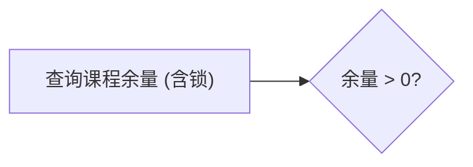
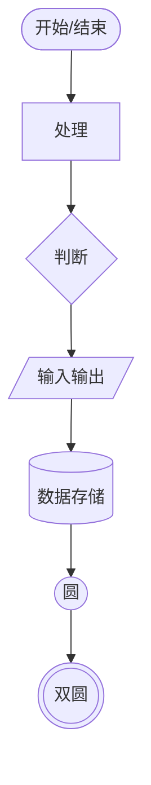
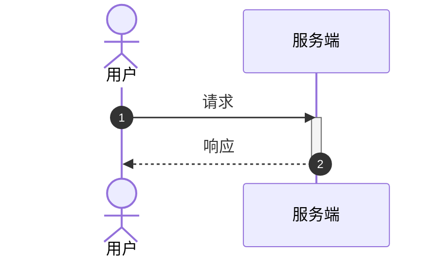
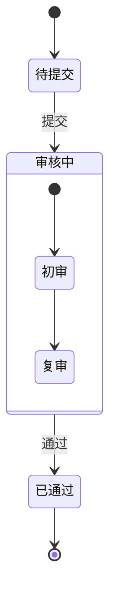
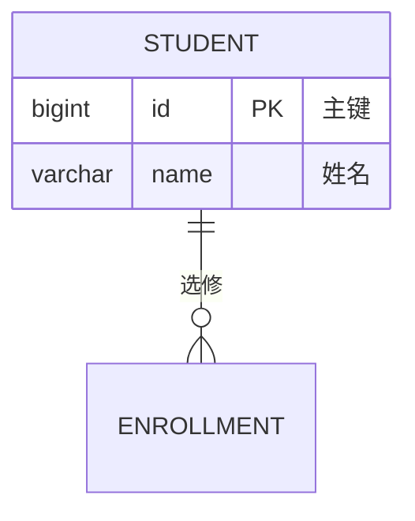
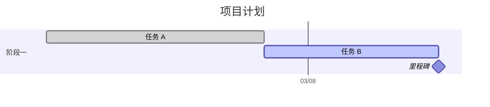
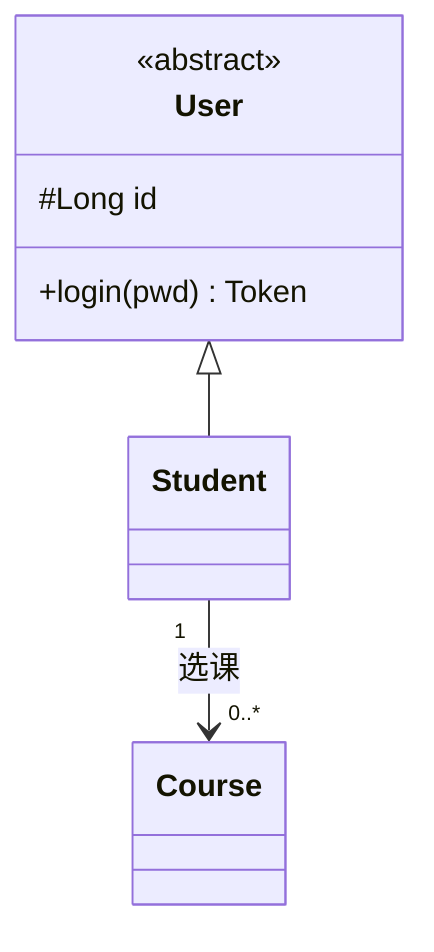

# Mermaid 写法规范与常见坑

同一份 Mermaid 源码要能贴进 Typora、语雀、飞书、CSDN、GitHub 都能渲染。
下面这些写法在这些平台上是通的，也经过本 skill 的本地渲染器验证。

## 一、通用约定

### 节点文字要短

节点里的字超过 12 个字就换行（` `），否则节点会撑得很宽，整张图失去比例。
方框内尽量写名词短语，句子放到图下面的正文里。

### 不用 Markdown 语法

节点文字里不要写 `**加粗**`、`[链接](url)`。Mermaid 默认按 Markdown 解析，
不同平台的开启状态不一致，同一个文件在 A 平台正常、B 平台出错。
需要强调就换一种表达。

### 括号和冒号要转义

中文括号没问题，但节点文字里出现 `(`、`)`、`{`、`}`、`:`、`[`、`]` 时，
不同版本解析结果不一样。稳妥做法是整段文字加引号：

同理，`end` 这个名字不能当节点 id，会和 `subgraph ... end` 冲突。

### 一套图统一方向

流程图 `TD`（上到下）或 `LR`（左到右）。纵向适合步骤多的流程，
横向适合「输入 → 处理 → 输出」这类短链。同一份文档里保持一致。

### 控制图的高度

Mermaid 按最长链路自动排布。链路超过 12 层，图会变成细长条，
插进 A4 文档后按页宽缩放，字会小到看不清。两个对策：

- 拆成「主流程 + 子流程」两张图
- 把 `direction LR` 和 `TD` 组合使用：主图 `LR`，子图 `TD`

判断标准：**渲染出来的宽度小于 700px、高度超过 1400px，就该拆了。**

## 二、各图型要点

### flowchart

节点形状按语义选，不要全用矩形：

连线标签写成 `A -- 条件 --> B`，不要写成 `A -->|条件| B`（后者部分平台不支持）。

判断框的出边都要有标签。两条出边都不标，读者只能靠猜。

### sequenceDiagram

箭头记法：`->>` 实线实心箭头（同步调用）、`-->>` 虚线空心箭头（返回）、
`->` 实线无箭头、`--)` 异步消息。

`autonumber` 会给消息编号，超过 12 条消息时建议关掉，编号圆圈会挤压箭头。

参与者超过 7 个时，把不重要的合并成「其他服务」，或者拆图。

`Note over A,B: 说明` 放在两个参与者上方，`Note right of A` 放在右侧。
注释不要写成长句，两行以内。

### stateDiagram-v2

状态名用中文可以直接写，不必加引号，但不能有空格和标点。
复合状态用 `state 名称 { ... }`，嵌套层数不要超过两层。

`direction LR` 放在第一行之后，能让横向排列的状态更紧凑。

### erDiagram

基数符号对照：

| 写法 | 含义 |
| --- | --- |
| `||--||` | 一对一，两边都必然存在 |
| `||--o{` | 一对多，右边零到多 |
| `||--|{` | 一对多，右边至少一条 |
| `}o--o{` | 多对多 |
| `|o--o|` | 零或一对一 |

表名习惯写大写。字段顺序：类型 → 字段名 → 键标记 → 注释。
注释用引号包起来，不写注释列会更紧凑。

实体超过 7 个时，Mermaid 的布局会开始绕远，建议按业务域拆成多张图。

### gantt

任务定义格式：`名称 :状态标签, id, 开始, 持续`。
`after a1` 表示接在 a1 之后，比手写日期可靠——改一处的工期，后续自动顺延。

状态标签：`done`（已完成）、`active`（进行中）、`crit`（关键路径）、
`milestone`（里程碑，持续写 `0d`）。

`tickInterval` 可选 `1day` / `1week` / `1month`。工期超过一个月用 `1week`，
否则竖线密到看不清日期。

### classDiagram

关系符号：

| 写法 | 含义 |
| --- | --- |
| `A <|-- B` | B 继承 A（实线空心三角） |
| `A <|.. B` | B 实现 A（虚线空心三角） |
| `A *-- B` | 组合（实线实心菱形） |
| `A o-- B` | 聚合（实线空心菱形） |
| `A --> B` | 关联 |
| `A ..> B` | 依赖（虚线箭头） |

## 三、渲染失败的排查

本 skill 的渲染器会把 Mermaid 的报错原文带出来。按报错对照处理：

| 报错关键字 | 原因 | 处理 |
| --- | --- | --- |
| `Parse error` + 行号 | 该行有未加引号的特殊符号 | 给节点文字加双引号 |
| `Expecting ... got ...` | 关键字拼错，如 `participant` 写成 `participants` | 对照语法检查 |
| `Maximum call stack` | 节点 id 冲突或循环引用 | 检查 id 是否重复 |
| `No diagram type detected` | 第一行不是图形关键字 | 第一行必须是 `flowchart` / `sequenceDiagram` 等 |
| 空白图，无报错 | 只有注释没有内容，或全部节点被注释掉 | 检查 `%%` 注释范围 |

节点 id 用英文短标识（`A`、`A1`、`S1`），显示文字放在 `[...]` 或 `{...}` 里。
id 用中文也能跑，但一旦出现重复或特殊字符，报错信息很难定位。

## 四、写完之后的中文排版检查

- 中英文之间留空格：`Spring Boot 3.3` 而不是 `SpringBoot3.3`
- 括号统一用中文全角，除非括号里全是英文
- 数字和单位之间不留空格（`200MB`、`5d`）
- 接口路径、类名、表名保持原文大小写，不要翻译

这几条看起来琐碎，但是同一份文档里图上的写法和正文写法不一致时，读者会以为说的是两个东西。
