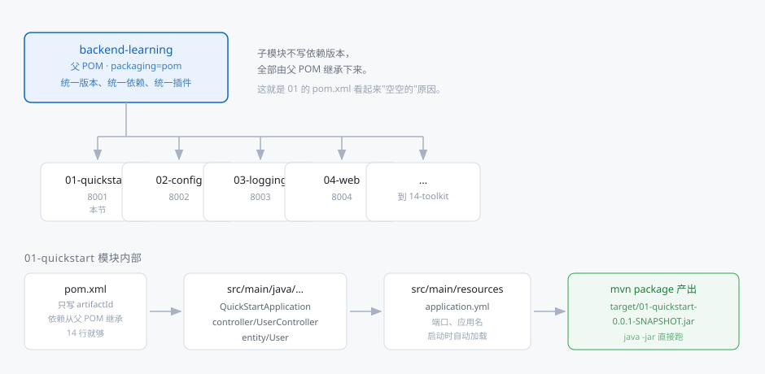
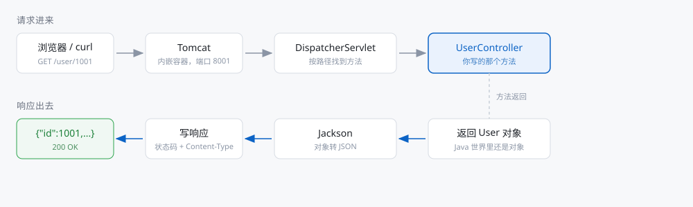
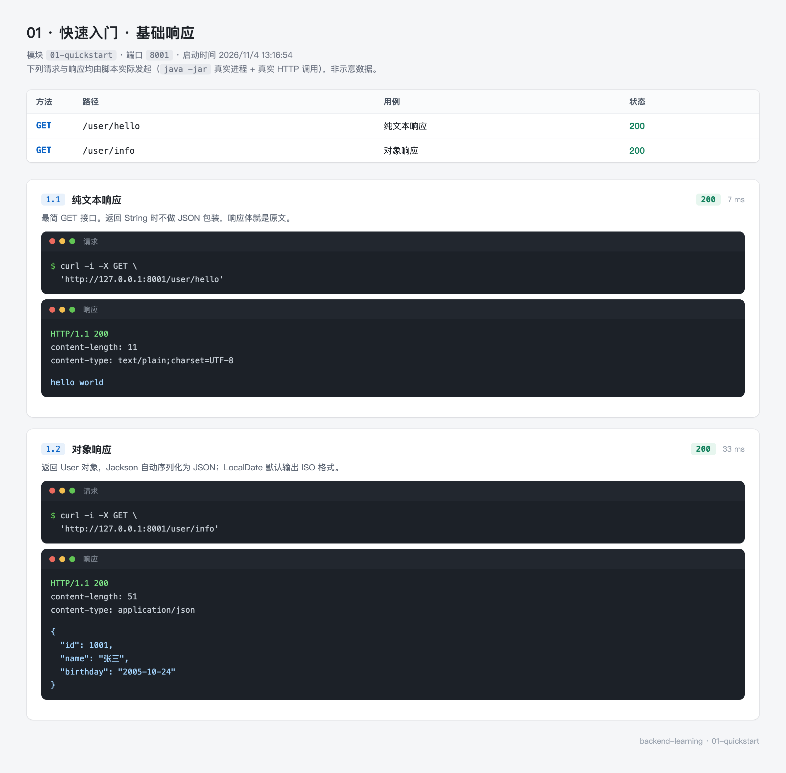
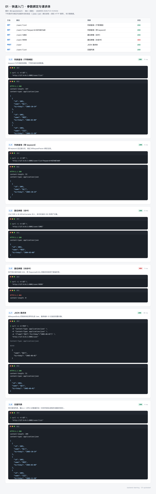

# 01 · 快速入门：从空文件夹到第一个能访问的接口

> - 难度：入门（不需要任何 Spring 基础）
> - 前置条件：会写 Java 的类和方法，知道 `public static void main` 是入口
> - 预计时长：60~80 分钟，跟着敲一遍
> - 对应代码：[01-quickstart](https://github.com/mqxu/backend-learning/tree/main/01-quickstart)

这一节从零开始：建目录、写 POM、写启动类、写实体、写接口、发请求、看结果。每段代码都给全文，不用去猜省略号里是什么。

---

## 0. 先看结果

做完这一节，你会在浏览器里看到这样的东西：

```json
{
  "id": 1002,
  "name": "李四",
  "birthday": "2004-03-08"
}
```

它不是静态文件，是 Java 代码把一个对象序列化成 JSON 后返回的。

整个过程只有三条命令：

```bash
mvn -pl 01-quickstart package -DskipTests   # 打包
java -jar 01-quickstart/target/01-quickstart-0.0.1-SNAPSHOT.jar   # 启动
curl http://127.0.0.1:8001/user/1002        # 访问
```

第一次做会花一小时，因为要理解每个文件在干什么。做完之后再建一个模块，十分钟。

### 这一节的路线

| 步骤 | 你会做出什么 | 做完能验证什么 |
| --- | --- | --- |
| 1 | 检查环境 | `java -version` 有输出，版本是 21 |
| 2 | 建模块与 POM | `mvn compile` 通过 |
| 3 | 启动类 | 控制台出现 `Tomcat started on port 8001` |
| 4 | 实体类 | 编译通过 |
| 5 | 第一个接口 | 浏览器能看到 `hello world` |
| 6 | 三种参数 | 分别用路径、查询串、JSON 请求体拿到数据 |
| 7 | 状态码 | 查一个不存在的 ID 返回 404 |
| 8 | 测试 | `mvn test` 通过 |

---

## 1. 准备环境

### 1.1 检查 JDK

这个仓库用 Java 21。打开终端：

```bash
java -version
```

正常输出类似：

```
openjdk version "21.0.5" 2024-10-15 LTS
OpenJDK Runtime Environment Temurin-21.0.5+11 (build 21.0.5+11-LTS)
OpenJDK 64-Bit Server VM Temurin-21.0.5+11 (build 21.0.5+11-LTS, mixed mode, sharing)
```

只要第一行的版本号是 21 就行。低于 21 会在后面的 `mvn compile` 阶段报 `invalid target release: 21`。

没有 JDK 的话，装 Temurin 21 或 Oracle JDK 21 都可以，Spring Boot 不挑发行版。

顺带确认 `JAVA_HOME`：

```bash
echo $JAVA_HOME
```

输出为空不一定有问题（Maven 会自己找 `java`），但如果后面编译报找不到 JDK，多半是这个变量没设。

### 1.2 检查 Maven

```bash
mvn -v
```

输出里要能看到 Java 版本是 21：

```
Apache Maven 3.9.9 (8e8579a9e76f7d015ee5ec7bfcdc97d260186937)
Maven home: /opt/homebrew/Cellar/maven/3.9.9/libexec
Java version: 21.0.5, vendor: Eclipse Adoptium
```

如果 Maven 用的是 Java 17 或 8，编译会失败。这时需要设置 `JAVA_HOME` 指向 JDK 21 的目录。

### 1.3 IDE 与插件

IntelliJ IDEA 社区版就够。三个建议：

- 装 Lombok 插件（新版 IDEA 已内置，检查 Settings → Plugins 里 Lombok 是否启用）
- 打开 Settings → Build → Compiler → Annotation Processors，勾上 Enable annotation processing
- 把项目按 Maven 项目导入（右键 `pom.xml` → Add as Maven Project），否则依赖不会下载

用 VS Code 也可以，装 Extension Pack for Java。但 Lombok 在 VS Code 里偶尔会报"找不到 getter"，需要重启语言服务。

### 1.4 两个新手最常撞的环境问题

**端口被占用**

启动时报：

```
Web server failed to start. Port 8001 was already in use.
```

说明 8001 已经被别的进程占了。查出来杀掉：

```bash
lsof -i:8001                    # macOS / Linux
netstat -ano | findstr 8001     # Windows
```

或者换端口启动（临时验证用）：

```bash
java -jar target/01-quickstart-0.0.1-SNAPSHOT.jar --server.port=8011
```

**依赖下载慢**

第一次 `mvn` 要下载几百 MB 依赖。国内建议在 `~/.m2/settings.xml` 里配阿里云镜像：

```xml
<mirrors>
  <mirror>
    <id>aliyun</id>
    <mirrorOf>central</mirrorOf>
    <url>https://maven.aliyun.com/repository/public</url>
  </mirror>
</mirrors>
```

配完第一次构建能快好几倍。

---

## 2. 创建模块

### 2.1 先搞清仓库的结构

这个仓库不是"一个工程一个 pom"，而是"一个父 POM 下挂多个子模块"：



图里最重要的一句话：**子模块的 pom.xml 几乎是空的，依赖是从父 POM 继承下来的。**

这是新手最容易困惑的地方——照着网上教程新建 Spring Boot 项目，pom.xml 里会有一大段 `<dependencies>`；而这个仓库的子模块只有十四行。原因是依赖已经统一写在根 `pom.xml` 里了。

### 2.2 父 POM 做了什么

根目录的 `pom.xml` 里有两段关键配置。

第一段，指定 Spring Boot 的版本：

```xml
<parent>
    <groupId>org.springframework.boot</groupId>
    <artifactId>spring-boot-starter-parent</artifactId>
    <version>4.1.1</version>
    <relativePath/>
</parent>
```

继承这个 parent 之后，所有 Spring 相关依赖都不用写版本号。写 `spring-boot-starter-webmvc` 就够，Maven 会自动用 4.1.1 对应的版本。这也是为什么升级 Spring Boot 只需要改这一行。

第二段，把公共依赖放在 `<dependencies>` 里：

```xml
<dependencies>
    <!-- Web 开发所需的一切：内嵌 Tomcat、Spring MVC、Jackson -->
    <dependency>
        <groupId>org.springframework.boot</groupId>
        <artifactId>spring-boot-starter-webmvc</artifactId>
    </dependency>

    <!-- 改代码后自动重启，仅开发期用 -->
    <dependency>
        <groupId>org.springframework.boot</groupId>
        <artifactId>spring-boot-devtools</artifactId>
        <scope>runtime</scope>
        <optional>true</optional>
    </dependency>

    <!-- 用注解生成 getter/setter，编译期生效 -->
    <dependency>
        <groupId>org.projectlombok</groupId>
        <artifactId>lombok</artifactId>
        <optional>true</optional>
    </dependency>

    <!-- 测试：JUnit 5 + MockMvc -->
    <dependency>
        <groupId>org.springframework.boot</groupId>
        <artifactId>spring-boot-starter-webmvc-test</artifactId>
        <scope>test</scope>
    </dependency>
</dependencies>
```

父 POM 的 `<dependencies>` 会被所有子模块**无条件继承**，而 `<dependencyManagement>` 只继承版本声明、不引入依赖。这里用的是前者，因为每个模块都要写 Web 接口。

### 2.3 建目录

在仓库根目录下建出这样的结构：

```
01-quickstart
├── pom.xml
└── src
    └── main
        ├── java
        │   └── top
        │       └── mqxu
        │           └── quickstart
        │               ├── QuickStartApplication.java
        │               ├── controller
        │               │   └── UserController.java
        │               └── entity
        │                   └── User.java
        └── resources
            └── application.yml
```

三个目录的作用：

| 路径 | 放什么 | 会不会打进 jar |
| --- | --- | --- |
| `src/main/java` | Java 源码 | 编译成 class 后打进去 |
| `src/main/resources` | 配置文件、静态资源 | 原样打进去 |
| `src/test/java` | 测试代码 | 不打包（本节最后会用到） |

包名 `top.mqxu.quickstart` 是仓库约定：`top.mqxu` 是域名倒写，`quickstart` 是模块名。你换成自己的域名也行，但要保证启动类和控制器在同一个包或子包里（原因见 3.3）。

### 2.4 写模块 POM

`01-quickstart/pom.xml` 全文只有这些：

```xml
<?xml version="1.0" encoding="UTF-8"?>
<project xmlns="http://maven.apache.org/POM/4.0.0"
         xmlns:xsi="http://www.w3.org/2001/XMLSchema-instance"
         xsi:schemaLocation="http://maven.apache.org/POM/4.0.0 http://maven.apache.org/xsd/maven-4.0.0.xsd">
    <modelVersion>4.0.0</modelVersion>

    <parent>
        <groupId>top.mqxu</groupId>
        <artifactId>backend-learning</artifactId>
        <version>0.0.1-SNAPSHOT</version>
    </parent>

    <artifactId>01-quickstart</artifactId>

</project>
```

逐段解释：

| 元素 | 含义 | 能不能省 |
| --- | --- | --- |
| `modelVersion` | POM 模型版本，固定 4.0.0 | 不能 |
| `parent` | 指向根 POM | 不能，省了就没有依赖和插件 |
| `artifactId` | 模块名，也是 jar 包名前缀 | 不能 |
| `groupId` / `version` | 从 parent 继承 | 可以省，省了就用父的 |

Maven 的坐标有三要素 `groupId:artifactId:version`。这里只写了 `artifactId`，另外两个从父 POM 继承，所以最终坐标是 `top.mqxu:01-quickstart:0.0.1-SNAPSHOT`。

### 2.5 第一次编译

先别写代码，确认构建能过：

```bash
mvn -pl 01-quickstart compile
```

`-pl` 是 `--projects` 的缩写，表示只构建指定模块。不加的话会把 14 个模块全编译一遍，第一次要等很久。

成功输出结尾是：

```
[INFO] BUILD SUCCESS
```

如果报 `Could not find artifact top.mqxu:backend-learning:pom:0.0.1-SNAPSHOT`，说明根 POM 没装到本地仓库。在根目录执行一次：

```bash
mvn -N install
```

`-N` 表示 non-recursive，只安装根 POM 本身，不构建子模块。

---

## 3. 写启动类

### 3.1 目标

一个能启动、但还不能响应请求的 Spring Boot 应用。启动后控制台会打印 Tomcat 的端口，然后进程一直挂着——这就是"服务在运行"。

### 3.2 完整代码

`src/main/java/top/mqxu/quickstart/QuickStartApplication.java`：

```java
package top.mqxu.quickstart;

import org.springframework.boot.SpringApplication;
import org.springframework.boot.autoconfigure.SpringBootApplication;

/**
 * 启动类。整个应用的入口。
 *
 * @author mqxu
 */
@SpringBootApplication
public class QuickStartApplication {

    public static void main(String[] args) {
        SpringApplication.run(QuickStartApplication.class, args);
    }
}
```

### 3.3 逐行看

**`@SpringBootApplication`**

这一个注解等于三个注解的组合：

| 组合里的注解 | 作用 | 少了会怎样 |
| --- | --- | --- |
| `@SpringBootConfiguration` | 标记这是个配置类 | 容器起不来 |
| `@EnableAutoConfiguration` | 根据 classpath 上的 jar 自动装配 | 有 Tomcat 也不启动，接口全 404 |
| `@ComponentScan` | 扫描当前包及子包下的组件 | 写了 `@RestController` 也不生效 |

第三条最容易被忽略。`@ComponentScan` 的默认范围是"启动类所在的包及其子包"。所以：

```
top.mqxu.quickstart          ← 启动类在这
├── controller               ← 子包，能扫到 ✅
└── entity                   ← 子包，能扫到 ✅

top.mqxu.other               ← 兄弟包，扫不到 ❌
```

如果把控制器放到 `top.mqxu.controller`（少了 `quickstart` 这一层），启动不报错，但所有接口都 404。这个坑很难自己看出来，因为日志里一切正常。

**`SpringApplication.run(...)`**

干三件事：创建 Spring 容器、扫描并实例化所有组件、启动内嵌 Tomcat。第一个参数是配置类的 class，第二个是命令行参数（后面用 `--server.port=8011` 就是从这里传进去的）。

方法返回值是 `ConfigurableApplicationContext`，本节用不到，所以没接。

**为什么 `main` 里没有 `new`**

Spring 的核心理念是控制反转：对象不是你 `new` 出来的，是容器扫描到注解后自己创建并管理的。`main` 只负责把容器点起来。

### 3.4 加配置文件

`src/main/resources/application.yml`：

```yaml
server:
  port: 8001

spring:
  application:
    name: 01-快速起步
```

两行配置，两个作用：

- `server.port`：不改的话默认 8080，会和其他项目撞端口
- `spring.application.name`：应用名，日志里会显示，后面接监控、注册中心也要用

文件名必须是 `application.yml`（或 `application.properties`），放在 `src/main/resources` 根目录。Spring Boot 启动时会自动找这个名字，找不到就用默认值。

### 3.5 验证：能启动

```bash
mvn -pl 01-quickstart spring-boot:run
```

控制台会滚出一大段日志，盯这三行：

```
  .   ____          _            __ _ _
 /\\ / ___'_ __ _ _(_)_ __  __ _ \ \ \ \
( ( )\___ | '_ | '_| | '_ \/ _` | \ \ \ \
...
Tomcat started on port 8001 (http) with context path '/'
Started QuickStartApplication in 1.284 seconds (process running for 1.691)
```

| 日志 | 说明 |
| --- | --- |
| `Tomcat initialized with port 8001` | 内嵌容器开始初始化 |
| `Tomcat started on port 8001 (http)` | 端口绑定成功，可以访问了 |
| `Started QuickStartApplication in 1.284 seconds` | 应用启动完成 |

看到第二行就可以访问了，第三行只是告诉你花了多久。

现在访问 `http://127.0.0.1:8001` 会返回一个 404 的 JSON：

```json
{
  "timestamp": "2026-11-04T05:40:12.331+00:00",
  "status": 404,
  "error": "Not Found",
  "path": "/"
}
```

这是正常的——我们还没写任何接口。这个 404 来自 Spring Boot 的默认错误处理，说明 Tomcat 和 Spring MVC 都已经在工作，只是没有匹配的路径。

按 `Ctrl + C` 停止。

---

## 4. 写实体类

### 4.1 为什么先写实体

接口返回的是"数据"，先把数据的形状定下来，接口才好写。这一节要返回的用户有编号、姓名、生日三个字段。

### 4.2 完整代码

`src/main/java/top/mqxu/quickstart/entity/User.java`：

```java
package top.mqxu.quickstart.entity;

import lombok.AllArgsConstructor;
import lombok.Data;
import lombok.NoArgsConstructor;

import java.time.LocalDate;

/**
 * 用户。
 *
 * @author mqxu
 */
@Data
@NoArgsConstructor
@AllArgsConstructor
public class User {

    private Long id;

    private String name;

    private LocalDate birthday;
}
```

### 4.3 Lombok 到底生成了什么

新手最容易在这里懵：类里明明只有三个字段，为什么能 `user.getName()`？

`@Data` 在**编译期**生成方法，源码里看不到，但编译出来的 class 文件里有。等价于手写：

```java
public class User {

    private Long id;
    private String name;
    private LocalDate birthday;

    public Long getId() { return id; }
    public void setId(Long id) { this.id = id; }

    public String getName() { return name; }
    public void setName(String name) { this.name = name; }

    public LocalDate getBirthday() { return birthday; }
    public void setBirthday(LocalDate birthday) { this.birthday = birthday; }

    @Override
    public String toString() { /* ... */ }

    @Override
    public boolean equals(Object o) { /* ... */ }

    @Override
    public int hashCode() { /* ... */ }
}
```

三个注解的分工：

| 注解 | 生成什么 | 本节为什么需要 |
| --- | --- | --- |
| `@Data` | getter / setter / toString / equals / hashCode | Jackson 靠 getter 取值转 JSON，没有它 JSON 会是 `{}` |
| `@NoArgsConstructor` | 无参构造器 | Jackson 反序列化时先调无参构造再 set 字段 |
| `@AllArgsConstructor` | 全参构造器 | 代码里 `new User(1001L, "张三", date)` 用得上 |

只有字段没有 getter 时，接口返回的会是 `{}` 而不是报错——这是"数据丢了"最常见的原因。

### 4.4 验证

```bash
mvn -pl 01-quickstart compile
```

能过就说明 Lombok 的注解处理器配置生效了。如果报 `cannot find symbol: method getName()`，检查 IDEA 的 Annotation Processors 有没有开。

---

## 5. 写第一个接口

### 5.1 先理解请求怎么走到你的方法



图里有两行，正好是"请求进来"和"响应出去"两条路。你现在要写的只有中间那个蓝框。

其余每一步都是框架做的：

- Tomcat 负责监听端口、解析 HTTP 报文
- DispatcherServlet 按 URL 找到对应的方法
- Jackson 把返回的 Java 对象转成 JSON 字符串

### 5.2 完整代码

新建 `src/main/java/top/mqxu/quickstart/controller/UserController.java`：

```java
package top.mqxu.quickstart.controller;

import org.springframework.web.bind.annotation.GetMapping;
import org.springframework.web.bind.annotation.RequestMapping;
import org.springframework.web.bind.annotation.RestController;

/**
 * 用户接口。
 *
 * @author mqxu
 */
@RestController
@RequestMapping("/user")
public class UserController {

    @GetMapping("/hello")
    public String getHello() {
        return "hello world";
    }
}
```

### 5.3 三个注解

| 注解 | 位置 | 作用 |
| --- | --- | --- |
| `@RestController` | 类 | 这个类处理 HTTP 请求，返回值直接写进响应体 |
| `@RequestMapping("/user")` | 类 | 类里所有接口的路径前缀 |
| `@GetMapping("/hello")` | 方法 | 这个方法处理 `GET /user/hello` |

`@RestController` 是 `@Controller` + `@ResponseBody` 的组合。`@Controller` 原本用于返回页面（视图名），加上 `@ResponseBody` 才表示"返回值当响应体"。前后端分离的项目一律用 `@RestController`。

路径的拼法：类的 `/user` + 方法的 `/hello` = `/user/hello`。

### 5.4 验证

启动：

```bash
mvn -pl 01-quickstart spring-boot:run
```

浏览器打开 `http://127.0.0.1:8001/user/hello`，页面显示：

```
hello world
```

或者用 curl 看响应头：

```bash
curl -i http://127.0.0.1:8001/user/hello
```

```
HTTP/1.1 200
Content-Type: text/plain;charset=UTF-8
Content-Length: 11

hello world
```

注意 `Content-Type` 是 `text/plain`——因为返回的是 `String`。

### 5.5 返回对象的区别

再加一个方法，返回 `User` 对象：

```java
@GetMapping("/info")
public User getUserInfo() {
    return new User(1001L, "张三", LocalDate.of(2005, 10, 24));
}
```

重新启动，访问 `http://127.0.0.1:8001/user/info`：

```json
{
  "id": 1001,
  "name": "张三",
  "birthday": "2005-10-24"
}
```

同样是方法返回，为什么这次是 JSON？

| 返回类型 | 响应体 | Content-Type |
| --- | --- | --- |
| `String` | 原样字符串 | `text/plain` |
| 对象 / 集合 | Jackson 序列化后的 JSON | `application/json` |
| `ResponseEntity<T>` | 同对象，但状态码和响应头由你定 | 同对象 |

Spring MVC 看了一眼返回类型，发现是对象，就交给 Jackson 处理。日期变成 `"2005-10-24"` 也是 Jackson 的默认行为（ISO 格式）。

---

## 6. 接收参数

真实接口都要接参数。三种最常见的传参方式，一次讲完。

### 6.1 路径参数：数据在 URL 里

用于"定位某个资源"，比如查某个用户、某篇文章。

```java
@GetMapping("/{id}")
public User getById(@PathVariable Long id) {
    return new User(id, "按 ID 查到的用户", LocalDate.of(2000, 1, 1));
}
```

访问 `http://127.0.0.1:8001/user/1002`，返回：

```json
{
  "id": 1002,
  "name": "按 ID 查到的用户",
  "birthday": "2000-01-01"
}
```

要点：

- `{id}` 是占位符，花括号里的名字要和 `@PathVariable Long id` 的参数名一致
- 名字一致时可以省略注解的值：`@PathVariable Long id` 等价于 `@PathVariable("id") Long id`
- 类型不匹配会返回 400。比如访问 `/user/abc`，Spring 无法把 `abc` 转成 `Long`，直接报错

### 6.2 查询参数：数据在问号后面

用于"筛选"，比如搜索、分页。

```java
@GetMapping("/list")
public List<User> list(@RequestParam(required = false) String keyword) {
    if (keyword == null || keyword.isBlank()) {
        return users;
    }
    return users.stream().filter(u -> u.getName().contains(keyword)).toList();
}
```

访问 `http://127.0.0.1:8001/user/list?keyword=张`，只返回名字里带"张"的用户。

`required = false` 的作用：

| 写法 | 不传参数时 |
| --- | --- |
| `@RequestParam String keyword` | 返回 400，提示缺少参数 |
| `@RequestParam(required = false) String keyword` | 参数为 `null`，方法正常执行 |
| `@RequestParam(defaultValue = "all") String keyword` | 参数为 `"all"` |

### 6.3 请求体：数据在 body 里

用于"提交数据"，比如新增、修改。数据格式通常是 JSON。

```java
@PostMapping
public User create(@RequestBody User user) {
    user.setId(idGenerator.incrementAndGet());
    users.add(user);
    return user;
}
```

用 curl 提交（`Content-Type` 必须写对，否则返回 415）：

```bash
curl -X POST http://127.0.0.1:8001/user \
  -H "Content-Type: application/json" \
  -d '{"name":"赵六","birthday":"2005-06-01"}'
```

返回：

```json
{
  "id": 1004,
  "name": "赵六",
  "birthday": "2005-06-01"
}
```

请求体里没传 `id`，响应里却有——因为方法里 `setId` 补了一个自增 ID。这就是"服务端生成主键"的常见做法。

三种参数的区别：

| 方式 | 长什么样 | 典型用途 | 注解 |
| --- | --- | --- | --- |
| 路径参数 | `/user/1002` | 定位单个资源 | `@PathVariable` |
| 查询参数 | `/user/list?keyword=张` | 筛选、分页 | `@RequestParam` |
| 请求体 | POST 的 body | 提交复杂数据 | `@RequestBody` |

---

## 7. 让"查不到"返回 404

### 7.1 原来的写法有问题

如果按前面的写法，查一个不存在的 ID：

```java
@GetMapping("/{id}")
public User getById(@PathVariable Long id) {
    return users.stream().filter(u -> u.getId().equals(id)).findFirst().orElse(null);
}
```

不存在的 ID 会返回：

```
HTTP/1.1 200
Content-Length: 0
```

状态码 200 但没有内容。调用方分不清"这个用户不存在"和"接口坏了"，只能靠判断响应体是不是空。

### 7.2 用 ResponseEntity 控制状态码

```java
@GetMapping("/{id}")
public ResponseEntity<User> getById(@PathVariable Long id) {
    return users.stream()
            .filter(u -> u.getId().equals(id))
            .findFirst()
            .map(ResponseEntity::ok)
            .orElseGet(() -> ResponseEntity.notFound().build());
}
```

`ResponseEntity` 让你自己决定状态码、响应头、响应体三件事：

| 场景 | 状态码 | 写法 |
| --- | --- | --- |
| 查到 | 200 | `ResponseEntity.ok(user)` |
| 查不到 | 404 | `ResponseEntity.notFound().build()` |
| 创建成功 | 201 | `ResponseEntity.status(201).body(user)` |
| 无内容 | 204 | `ResponseEntity.noContent().build()` |

访问一个不存在的 ID：

```bash
curl -i http://127.0.0.1:8001/user/9999
```

```
HTTP/1.1 404
Content-Length: 0
```

状态码变成 404，调用方一看就知道是"资源不存在"。

---

## 8. 完整代码

到这里所有代码都写完了。下面按文件列一遍，方便对照检查。

`src/main/java/top/mqxu/quickstart/QuickStartApplication.java`

```java
package top.mqxu.quickstart;

import org.springframework.boot.SpringApplication;
import org.springframework.boot.autoconfigure.SpringBootApplication;

@SpringBootApplication
public class QuickStartApplication {

    public static void main(String[] args) {
        SpringApplication.run(QuickStartApplication.class, args);
    }
}
```

`src/main/java/top/mqxu/quickstart/entity/User.java`

```java
package top.mqxu.quickstart.entity;

import lombok.AllArgsConstructor;
import lombok.Data;
import lombok.NoArgsConstructor;

import java.time.LocalDate;

@Data
@NoArgsConstructor
@AllArgsConstructor
public class User {

    private Long id;
    private String name;
    private LocalDate birthday;
}
```

`src/main/java/top/mqxu/quickstart/controller/UserController.java`

```java
package top.mqxu.quickstart.controller;

import org.springframework.http.ResponseEntity;
import org.springframework.web.bind.annotation.GetMapping;
import org.springframework.web.bind.annotation.PathVariable;
import org.springframework.web.bind.annotation.PostMapping;
import org.springframework.web.bind.annotation.RequestBody;
import org.springframework.web.bind.annotation.RequestMapping;
import org.springframework.web.bind.annotation.RequestParam;
import org.springframework.web.bind.annotation.RestController;
import top.mqxu.quickstart.entity.User;

import java.time.LocalDate;
import java.util.List;
import java.util.concurrent.CopyOnWriteArrayList;
import java.util.concurrent.atomic.AtomicLong;

@RestController
@RequestMapping("/user")
public class UserController {

    /**
     * 用内存列表充当数据源。入门阶段先不引入数据库，
     * 把注意力放在"请求怎么进来、对象怎么出去"这两件事上。
     */
    private final List<User> users = new CopyOnWriteArrayList<>(List.of(
            new User(1001L, "张三", LocalDate.of(2005, 10, 24)),
            new User(1002L, "李四", LocalDate.of(2004, 3, 8)),
            new User(1003L, "王五", LocalDate.of(2006, 11, 30))
    ));

    private final AtomicLong idGenerator = new AtomicLong(1003L);

    @GetMapping("/hello")
    public String getHello() {
        return "hello world";
    }

    @GetMapping("/info")
    public User getUserInfo() {
        return new User(1001L, "张三", LocalDate.of(2005, 10, 24));
    }

    @GetMapping("/list")
    public List<User> list(@RequestParam(required = false) String keyword) {
        if (keyword == null || keyword.isBlank()) {
            return users;
        }
        return users.stream().filter(u -> u.getName().contains(keyword)).toList();
    }

    @GetMapping("/{id}")
    public ResponseEntity<User> getById(@PathVariable Long id) {
        return users.stream()
                .filter(u -> u.getId().equals(id))
                .findFirst()
                .map(ResponseEntity::ok)
                .orElseGet(() -> ResponseEntity.notFound().build());
    }

    @PostMapping
    public User create(@RequestBody User user) {
        user.setId(idGenerator.incrementAndGet());
        users.add(user);
        return user;
    }
}
```

`src/main/resources/application.yml`

```yaml
server:
  port: 8001

spring:
  application:
    name: 01-快速起步
```

为什么用 `CopyOnWriteArrayList` 和 `AtomicLong`：Tomcat 用线程池处理并发请求，多个请求可能同时读写这个列表。普通的 `ArrayList` 在并发扩容时会抛 `ConcurrentModificationException`。这两个类都是线程安全的，代价低，适合课堂演示。

---

## 9. 运行与实测

### 9.1 打包成可执行 jar

```bash
mvn -pl 01-quickstart package -DskipTests
```

产物在 `01-quickstart/target/`：

```
01-quickstart-0.0.1-SNAPSHOT.jar            可直接 java -jar 运行
01-quickstart-0.0.1-SNAPSHOT.jar.original   原始 jar（不含依赖）
```

打出来的 jar 有二十多 MB，因为里面塞进了 Tomcat 和所有依赖。这就是 Spring Boot 的"胖 jar"，`java -jar` 就能独立运行，不需要装 Tomcat。

### 9.2 启动与访问

```bash
java -jar 01-quickstart/target/01-quickstart-0.0.1-SNAPSHOT.jar
```

然后逐个验证五个接口。

### 9.3 基础响应



这张图是脚本真实跑出来的：启动服务、发请求、把请求命令和响应原样记录下来。

对照着看两处：

- `/user/hello` 的 `content-type` 是 `text/plain`，响应体是裸字符串
- `/user/info` 的 `content-type` 是 `application/json`，响应体是 JSON

### 9.4 参数与状态码



六个请求连起来看：

| 请求 | 结果 | 说明 |
| --- | --- | --- |
| `/user/list` | 3 个用户 | 不传 keyword 返回全部 |
| `/user/list?keyword=张` | 1 个用户 | 查询参数生效 |
| `/user/1002` | 李四 | 路径参数命中 |
| `/user/9999` | 404 空响应 | 未命中返回 404 |
| `POST /user` | id 为 1004 | 服务端补 ID |
| 再查列表 | 4 个用户 | 新增的数据保留了 |

最后一行值得注意：内存里的数据在进程存活期间一直在。重启应用后回到 3 个用户——因为数据本来就在内存里，没有落库。这正是下一节之后要解决的问题。

---

## 10. 写第一个测试

手工 curl 能验证，但每次改代码都要重来。写个测试让机器替你验证。

新建 `src/test/java/top/mqxu/quickstart/UserControllerTest.java`：

```java
package top.mqxu.quickstart;

import org.junit.jupiter.api.Test;
import org.springframework.beans.factory.annotation.Autowired;
import org.springframework.boot.test.context.SpringBootTest;
import org.springframework.boot.webmvc.test.autoconfigure.AutoConfigureMockMvc;
import org.springframework.test.web.servlet.MockMvc;

import static org.springframework.test.web.servlet.request.MockMvcRequestBuilders.get;
import static org.springframework.test.web.servlet.result.MockMvcResultMatchers.jsonPath;
import static org.springframework.test.web.servlet.result.MockMvcResultMatchers.status;

@SpringBootTest
@AutoConfigureMockMvc
class UserControllerTest {

    @Autowired
    private MockMvc mockMvc;

    @Test
    void 查询存在的用户返回 200() throws Exception {
        mockMvc.perform(get("/user/1002"))
                .andExpect(status().isOk())
                .andExpect(jsonPath("$.name").value("李四"));
    }

    @Test
    void 查询不存在的用户返回 404() throws Exception {
        mockMvc.perform(get("/user/9999"))
                .andExpect(status().isNotFound());
    }

    @Test
    void 按关键词过滤只返回匹配项() throws Exception {
        mockMvc.perform(get("/user/list").param("keyword", "张"))
                .andExpect(status().isOk())
                .andExpect(jsonPath("$.length()").value(1))
                .andExpect(jsonPath("$[0].name").value("张三"));
    }
}
```

跑：

```bash
mvn -pl 01-quickstart test
```

输出：

```
[INFO] Tests run: 3, Failures: 0, Errors: 0, Skipped: 0
[INFO] BUILD SUCCESS
```

三个注解的作用：

| 注解 | 作用 |
| --- | --- |
| `@SpringBootTest` | 启动完整的 Spring 容器 |
| `@AutoConfigureMockMvc` | 装一个 MockMvc，用于发"假请求" |
| `@Autowired MockMvc` | 注入它，不用真的开端口 |

`MockMvc` 不走网络，直接在内存里调用 DispatcherServlet，所以很快。`jsonPath("$.name")` 是按 JSON 路径断言，`$` 表示根节点，`$.name` 表示取 `name` 字段。

一个细节：测试启动时会占用 8001 端口吗？不会。`MockMvc` 不启动真实的 Tomcat，`server.port` 在测试里不起作用。

---

## 11. 常见问题

| 现象 | 原因 | 解决 |
| --- | --- | --- |
| 启动报 `Port 8001 was already in use` | 端口被占 | `lsof -i:8001` 杀掉，或换端口启动 |
| 接口全 404，日志正常 | 控制器不在启动类的包或子包下 | 把 controller 包挪到启动类同级以下 |
| 返回的 JSON 是 `{}` | 实体没有 getter | 加 `@Data`，或检查 Lombok 是否生效 |
| 编译报找不到 getter | 注解处理器没开 | IDEA：Settings → Annotation Processors → 勾选 |
| POST 报 415 | 没带 `Content-Type: application/json` | 请求头补上 |
| 路径传字母报 400 | 类型不匹配（`abc` 转不成 `Long`） | 前端校验，或参数改用 `String` 接收 |
| 端口不是 8001 | 环境变量 `SERVER__PORT` 覆盖了配置 | 显式加 `--server.port=8001` |
| 改了 yml 没生效 | 用的是 `java -jar`，没有热加载 | 重启；或开发期用 `spring-boot:run` |
| `mvn package` 很慢 | 第一次要下依赖 | 配阿里云镜像，之后走本地缓存 |
| jar 有二十多 MB | 把依赖都打进去了 | 正常，Spring Boot 胖 jar 就这样 |

---

## 12. 练习

### 12.1 随堂练习（20 分钟内能做完）

| # | 练习 | 检查点 |
| --- | --- | --- |
| 1 | 加 `GET /user/count` 返回用户总数 | 返回类型为 `Integer`，响应体是裸数字，不是 JSON 对象 |
| 2 | 给 `/user/list` 加 `minId` 参数，只返回 ID 大于它的用户 | 两个查询参数同时生效 |
| 3 | 把 `create` 的返回状态码改成 201 | `curl -i` 看到 `HTTP/1.1 201` |

### 12.2 课后练习

**基础**：给 `User` 加一个 `email` 字段，新增用户时校验不能为空，为空返回 400 并给出提示。

提示：先用 `@RequestBody` 收到对象，手动判断 `getEmail() == null`，然后 `return ResponseEntity.badRequest().build()`。下一节会讲用注解自动校验。

**进阶**：加 `DELETE /user/{id}`，删除不存在的记录返回 404，删除成功返回 204。

提示：`users.removeIf(u -> u.getId().equals(id))` 会返回布尔值，用它判断有没有删到。

**挑战**：让 `birthday` 输出成 `2005/10/24` 而不是 `2005-10-24`。

提示：在字段上加 `@JsonFormat(pattern = "yyyy/MM/dd")`（来自 `com.fasterxml.jackson.annotation`）。做完再想想：如果有一百个类都要改格式，一个个加注解合适吗？

---

## 13. 小结

### 13.1 你写下的东西

| 文件 | 职责 | 关键点 |
| --- | --- | --- |
| `pom.xml` | 声明模块 | 依赖从父 POM 继承，所以只有十几行 |
| `QuickStartApplication` | 启动入口 | `@SpringBootApplication` 管三件事：配置、自动装配、组件扫描 |
| `User` | 数据形状 | `@Data` 生成 getter，Jackson 靠它转 JSON |
| `UserController` | 暴露接口 | `@RestController` + `@GetMapping` |
| `application.yml` | 运行时配置 | 端口与应用名 |

### 13.2 记住这几条

- 控制器必须放在启动类的包或子包下，否则接口 404
- 返回 `String` 是纯文本，返回对象是 JSON，这个转换是自动的
- 三种参数对应三种注解：路径 `@PathVariable`、查询 `@RequestParam`、请求体 `@RequestBody`
- "查不到"用 404 表达，不要用 200 加空响应体
- `@Data` 少了，JSON 就是 `{}`，这类问题不会报错，只能靠测试发现

### 13.3 现在这个模块的问题

数据存在内存里，重启就没了；多台机器部署时各存各的；查询只能全量遍历。这些问题在 `05-mybatis` 会解决。

不过在此之前，先解决另一件事：配置写死在代码里，改个端口要重新打包。下一节 [02-config](02-config.md) 把配置从代码里抽出来。

> 本节遵循的规范：控制器方法一律 `public`；资源定位用路径参数，筛选用查询参数，提交用请求体；查不到返回 404；数据源用线程安全的集合。
