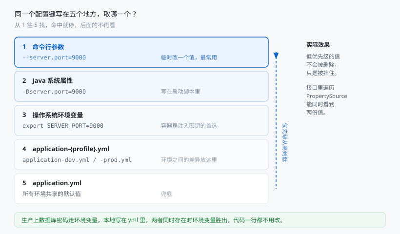
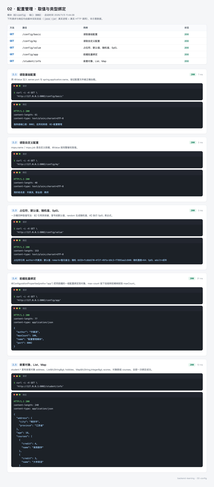
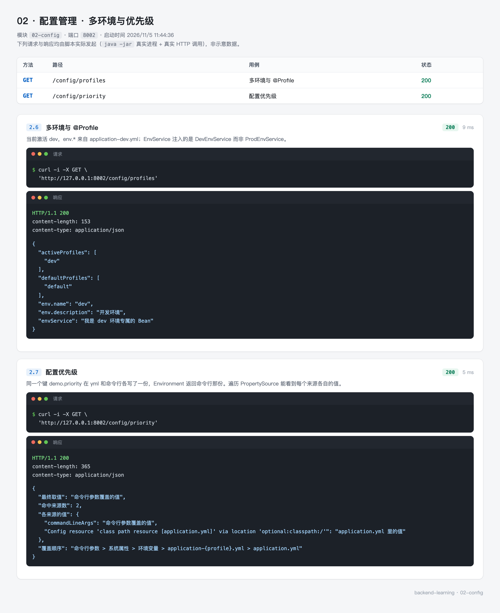

# 02 · 配置管理：让同一份代码在不同环境跑出不同行为

> - 难度：入门
> - 前置条件：完成 [01-quickstart](01-quickstart.md)，知道怎么写控制器
> - 预计时长：60~80 分钟
> - 对应代码：[02-config](https://github.com/mqxu/backend-learning/tree/main/02-config)

上一节的端口写在 `application.yml` 里，这已经算"配置"了。但真实项目里的配置远不止端口：数据库地址、第三方密钥、业务开关、限流阈值……这一节把这些东西系统地讲一遍。

---

## 0. 先看结果

这一节做完，你能做到这些事：

| 想改的东西 | 改哪里 | 要重新打包吗 |
| --- | --- | --- |
| 端口 | 启动参数 `--server.port=9000` | 不用 |
| 开发/生产切换 | `--spring.profiles.active=prod` | 不用 |
| 数据库密码 | 环境变量 | 不用 |
| 限流阈值 | yml 里一个数字 | 不用 |

而且当同一个键写在多个地方时，你能说清到底哪一份生效。

### 这一节的路线

| 步骤 | 你会做出什么 | 验证方式 |
| --- | --- | --- |
| 1 | 建模块，只多一个校验依赖 | `mvn compile` 通过 |
| 2 | 写基础配置并用 `@Value` 读出 | 访问接口看到值 |
| 3 | 用占位符、默认值、随机值、SpEL | 一次看到四种写法的效果 |
| 4 | 用 `@ConfigurationProperties` 绑定一组配置 | 返回一个完整对象 |
| 5 | 加校验，让非法配置起不来 | 改错一个值，启动失败 |
| 6 | 配 dev/prod 两套环境 | 换启动参数，行为跟着变 |
| 7 | 看清配置优先级 | 同一个键看到两个来源 |

---

## 1. 为什么需要配置管理

先想一个问题：数据库密码应该写在哪？

**写死在 Java 代码里**

```java
private static final String DB_PASSWORD = "123456";
```

改密码要改代码、重新编译、重新发版。而且这个密码会进 Git，所有能看仓库的人都能看到。

**写在配置文件里**

```yaml
spring:
  datasource:
    password: 123456
```

不用改代码了，但密码还是进了 Git。

**从环境变量读**

```yaml
spring:
  datasource:
    password: ${DB_PASSWORD:}
```

配置文件里只有占位符，真实值由运行环境注入。仓库里干干净净，开发用开发库的密码，生产用生产的，代码完全一样。

配置管理要解决的就是这类问题：**让同一份代码在不同环境下表现不同，同时把敏感信息从代码里拿出去。**

---

## 2. 创建模块

### 2.1 与 01 的差别

模块 POM 与 01 几乎一样，只多了一个校验依赖：

```xml
<?xml version="1.0" encoding="UTF-8"?>
<project xmlns="http://maven.apache.org/POM/4.0.0"
         xmlns:xsi="http://www.w3.org/2001/XMLSchema-instance"
         xsi:schemaLocation="http://maven.apache.org/POM/4.0.0 http://maven.apache.org/xsd/maven-4.0.0.xsd">
    <modelVersion>4.0.0</modelVersion>

    <parent>
        <groupId>top.mqxu</groupId>
        <artifactId>backend-learning</artifactId>
        <version>0.0.1-SNAPSHOT</version>
    </parent>

    <artifactId>02-config</artifactId>

    <dependencies>
        <!-- 配置校验：@Validated 与 @Min / @Max 等约束注解 -->
        <dependency>
            <groupId>org.springframework.boot</groupId>
            <artifactId>spring-boot-starter-validation</artifactId>
        </dependency>
    </dependencies>

</project>
```

`spring-boot-starter-validation` 提供 Jakarta Validation（JSR-380）的实现，`@NotBlank`、`@Min`、`@Max` 都来自它。Web 依赖那部分从父 POM 继承，这里不用重复写。

### 2.2 目录结构

```
02-config
├── pom.xml
└── src/main
    ├── java/top/mqxu/config
    │   ├── ConfigApplication.java
    │   ├── controller
    │   │   ├── ConfigController.java      # @Value 的各种写法
    │   │   └── StudentController.java     # 复杂结构绑定
    │   ├── properties
    │   │   ├── AppProperties.java         # app.* 前缀 + 校验
    │   │   └── StudentProperties.java     # student.* 前缀，嵌套结构
    │   └── service
    │       ├── EnvService.java            # 接口
    │       ├── DevEnvService.java         # @Profile("dev")
    │       └── ProdEnvService.java        # @Profile("prod")
    └── resources
        ├── application.yml                # 主配置
        ├── application-dev.yml            # 开发环境
        └── application-prod.yml           # 生产环境
```

比 01 多了 `properties` 和 `service` 两个包，配置文件从一个变成三个。后面按顺序创建。

---

## 3. 写基础配置

### 3.1 主配置文件

`src/main/resources/application.yml`：

```yaml
# 所有环境共享的通用配置
server:
  port: 8002

spring:
  application:
    name: 02-配置管理
  # 默认激活开发环境，可以被命令行参数覆盖
  profiles:
    active: dev

# 自定义配置：@Value 直接注入
mqxu:
  name: 许莫淇
  job: 教师
```

三段说明：

- `server.port` 换成了 8002，避免和 01 的 8001 冲突（两个模块可能同时跑）
- `spring.profiles.active: dev` 指定默认用开发环境，后面会用到
- `mqxu` 是自定义前缀，随便叫什么，用自己域名或项目名比较规范

自定义配置不需要任何声明，写到 yml 里就能被读到。Spring Boot 会把整个 yml 解析成一个键值对集合，你写 `mqxu.name` 就是一个键。

### 3.2 用 @Value 读出来

新建 `src/main/java/top/mqxu/config/controller/ConfigController.java`：

```java
package top.mqxu.config.controller;

import org.springframework.beans.factory.annotation.Value;
import org.springframework.web.bind.annotation.GetMapping;
import org.springframework.web.bind.annotation.RequestMapping;
import org.springframework.web.bind.annotation.RestController;

@RestController
@RequestMapping("/config")
public class ConfigController {

    @Value("${server.port}")
    private Integer serverPort;

    @Value("${spring.application.name}")
    private String appName;

    @Value("${mqxu.name}")
    private String myName;

    @Value("${mqxu.job}")
    private String myJob;

    @GetMapping("/basic")
    public String getBasicInfo() {
        return "服务器端口是：" + serverPort + "，应用名称是：" + appName;
    }

    @GetMapping("/my")
    public String getMyInfo() {
        return "我的姓名是：" + myName + "，职业是：" + myJob;
    }
}
```

`@Value("${键名}")` 的规则：

- `${}` 是占位符语法，中间是完整的键路径
- 键路径用点分隔，和 yml 的层级对应
- 类型可以是 `String`、`Integer`、`Boolean`，Spring 会做转换
- 键不存在时启动直接失败，报 `Could not resolve placeholder`

最后一条是好事——配置写错了立刻知道，而不是运行到一半抛空指针。

### 3.3 验证

```bash
mvn -pl 02-config spring-boot:run
```

访问 `http://127.0.0.1:8002/config/basic`：

```
服务器端口是：8002，应用名称是：02-配置管理
```

访问 `/config/my`：

```
我的姓名是：许莫淇，职业是：教师
```

两个接口都通了，说明 yml 里的值确实被注入到了字段上。

---

## 4. 四种进阶写法

`@Value` 不只能取键值，还有几个实用写法。先往 yml 里补两段：

```yaml
# 占位符引用：author 的值来自 mqxu.name
app:
  name: 配置管理模块
  author: ${mqxu.name}
  port: 8002
  max-count: 100

# 给 SpEL 用的数值
student:
  name: 张三
  age: 18
```

然后在 `ConfigController` 里加四个字段：

```java
// 占位符嵌套：app.author 的值是 ${mqxu.name}，会被继续解析
@Value("${app.author}")
private String author;

// 默认值：键不存在时用冒号后面的内容
@Value("${app.remark:暂无备注}")
private String remark;

// 随机值：每次启动重新生成
@Value("${random.uuid}")
private String randomUuid;

@Value("${random.int(1,100)}")
private Integer randomInt;

// SpEL：先解析 ${student.age}，再用 #{ } 里的表达式计算
@Value("#{${student.age} >= 18 ? '成年' : '未成年'}")
private String adult;
```

对应的接口：

```java
@GetMapping("/value")
public String getValueCases() {
    return "占位符引用 author=" + author
            + "；默认值 remark=" + remark
            + "；随机 UUID=" + randomUuid
            + "；随机整数=" + randomInt
            + "；SpEL adult=" + adult;
}
```

逐个说清楚：

**占位符嵌套**

yml 里写 `author: ${mqxu.name}`，Spring 读出来时会再解析一次，最终得到 `许莫淇`。适合表达"这个值和那个值一样"，改一处两处都变。

**默认值**

`${app.remark:暂无备注}` 里的冒号后面是默认值。`app.remark` 在 yml 里根本不存在，所以取到 `暂无备注`。没有默认值时，键不存在会直接启动失败。

**随机值**

`${random.uuid}` 每次启动生成一个新的 UUID，`${random.int(1,100)}` 生成 1 到 99 的随机整数。常用于实例标识、临时密钥、测试数据。注意：同一次启动内多次读取是同一个值，因为字段初始化时只解析一次。

**SpEL**

`#{}` 是 Spring 表达式，可以做运算、调用方法、写三元表达式。`#{${student.age} >= 18 ? '成年' : '未成年'}` 的执行顺序是：先解析内层 `${student.age}` 得到 `18`，再计算 `18 >= 18` 为真，返回 `成年`。

四种写法汇总：

| 写法 | 含义 | 不存在的键 |
| --- | --- | --- |
| `${key}` | 取配置值 | 启动失败 |
| `${key:默认}` | 取配置值，缺失时用默认 | 用默认值 |
| `${random.uuid}` | 随机 UUID | 自动生成 |
| `#{表达式}` | Spring 表达式 | 按表达式逻辑 |
| `#{${key} > 0}` | 先取值再运算 | 内层先失败 |

---

## 5. 一组配置绑到对象上

### 5.1 为什么不用一堆 @Value

如果 `app` 前缀下有十个配置项，写十个 `@Value` 字段很啰嗦，而且 IDE 不会提示、写错了要到运行时才发现。

`@ConfigurationProperties` 的做法是：定义一个类，字段名对应配置键，一次性绑完。

### 5.2 写属性类

`src/main/java/top/mqxu/config/properties/AppProperties.java`：

```java
package top.mqxu.config.properties;

import jakarta.validation.constraints.Max;
import jakarta.validation.constraints.Min;
import jakarta.validation.constraints.NotBlank;
import lombok.Data;
import org.springframework.boot.context.properties.ConfigurationProperties;
import org.springframework.stereotype.Component;

@Data
@Component
@ConfigurationProperties(prefix = "app")
public class AppProperties {

    private String name;

    /** 占位符引用，绑定 app.author = ${mqxu.name} */
    private String author;

    private Integer port;

    /** 宽松绑定：yml 里写 max-count，绑定到 maxCount */
    private Integer maxCount;
}
```

三个注解：

| 注解 | 作用 |
| --- | --- |
| `@Component` | 注册成 Bean，才能被注入 |
| `@ConfigurationProperties(prefix = "app")` | 把 `app.*` 下的配置绑到字段 |
| `@Data` | 生成 getter/setter，绑定和序列化都要用 |

绑定规则：

- `prefix` 只写前缀，不带点
- `app.max-count` 会自动映射到 `maxCount`，这叫宽松绑定（relaxed binding）
- 字段名大小写不敏感，`app.maxCount`、`app.max-count`、`app.max_count` 都能绑上

### 5.3 复杂结构也能绑

`StudentProperties` 演示嵌套对象、List、Map、对象数组：

```java
package top.mqxu.config.properties;

import lombok.Data;
import org.springframework.boot.context.properties.ConfigurationProperties;
import org.springframework.stereotype.Component;

import java.util.List;
import java.util.Map;

@Data
@Component
@ConfigurationProperties(prefix = "student")
public class StudentProperties {

    private String name;

    private Integer age;

    /** 简单 List：student.hobbies */
    private List<String> hobbies;

    /** Map：student.scores */
    private Map<String, Integer> scores;

    /** 嵌套对象：student.address */
    private Address address;

    /** List 嵌套对象：student.courses */
    private List<Course> courses;

    @Data
    public static class Address {
        private String province;
        private String city;
    }

    @Data
    public static class Course {
        private String name;
        private Integer credit;
    }
}
```

对应的 yml：

```yaml
student:
  name: 张三
  age: 18
  hobbies:
    - 篮球
    - 编程
    - 阅读
  scores:
    chinese: 90
    math: 95
    english: 88
  address:
    province: 江苏省
    city: 南京市
  courses:
    - name: 高等数学
      credit: 4
    - name: 大学英语
      credit: 3
```

这五种结构一次全绑好了，`@Value` 做不到。嵌套类用 `static` 内部类，字段名要和 yml 的键对齐。

### 5.4 两个控制器

`ConfigController` 里注入 `AppProperties`：

```java
private final AppProperties appProperties;

@GetMapping("/app")
public AppProperties getApp() {
    return appProperties;
}
```

`StudentController` 单独暴露复杂结构：

```java
package top.mqxu.config.controller;

import lombok.AllArgsConstructor;
import org.springframework.web.bind.annotation.GetMapping;
import org.springframework.web.bind.annotation.RequestMapping;
import org.springframework.web.bind.annotation.RestController;
import top.mqxu.config.properties.StudentProperties;

@RestController
@RequestMapping("/student")
@AllArgsConstructor
public class StudentController {

    private final StudentProperties studentProperties;

    @GetMapping("/info")
    public StudentProperties getStudent() {
        return studentProperties;
    }
}
```

构造函数注入用 `@RequiredArgsConstructor` 或 `@AllArgsConstructor` 都可以，Spring 4.3 之后单构造器不需要写 `@Autowired`。

### 5.5 @Value 与 @ConfigurationProperties 怎么选

| 维度 | `@Value` | `@ConfigurationProperties` |
| --- | --- | --- |
| 适合 | 零散的一两个值 | 一组有共同前缀的配置 |
| 复杂结构 | 不支持，只能拿字符串 | 嵌套对象、List、Map、对象数组都行 |
| 类型安全 | 弱，类型写错运行时才发现 | 强，按字段类型绑定 |
| 校验 | 能加，但麻烦 | 直接在字段上加注解 |
| 宽松绑定 | 不支持 | 支持 |
| IDE 提示 | 无 | 装 `spring-boot-configuration-processor` 后有补全 |

一句话：单个值用 `@Value`，成组配置用 `@ConfigurationProperties`。生产代码里后者更常见。

---

## 6. 让非法配置起不来

### 6.1 为什么要在启动时校验

假设 `app.max-count` 配成了 `-5`，代码里用它做循环上限。不校验的话，应用能启动，功能跑起来才报错，排查时还得先想到是配置问题。

启动时校验就简单了：配置错了直接不启动，控制台告诉你哪个值不合法。

### 6.2 加校验注解

给 `AppProperties` 补上：

```java
@Data
@Validated
@Component
@ConfigurationProperties(prefix = "app")
public class AppProperties {

    @NotBlank(message = "应用名称 app.name 不能为空")
    private String name;

    private String author;

    @Min(value = 1, message = "app.port 必须大于等于 1")
    @Max(value = 65535, message = "app.port 必须小于等于 65535")
    private Integer port;

    @Min(value = 1, message = "app.max-count 必须大于等于 1")
    @Max(value = 1000, message = "app.max-count 不能超过 1000")
    private Integer maxCount;
}
```

类上的 `@Validated` 是关键，漏了它字段上的约束不会生效。

### 6.3 验证一下

把 yml 里的 `app.max-count` 改成 `0`，重新启动：

```
Binding to target top.mqxu.config.properties.AppProperties failed:

    Property: app.maxCount
    Value: "0"
    Origin: class path resource [application.yml] - 47:14
    Reason: app.max-count 必须大于等于 1
```

应用不会启动，错误信息里带上了键名、值、出错位置、失败原因。改回 `100` 就正常了。

这个行为在 CI 里特别有用：配置写错的构建直接失败，不会部署上去。

---

## 7. 多环境

### 7.1 三个文件的分工

```
application.yml            所有环境共享
application-dev.yml        只有 dev 环境加载
application-prod.yml       只有 prod 环境加载
```

`application-dev.yml`：

```yaml
# 开发环境
env:
  name: dev
  description: 开发环境
```

`application-prod.yml`：

```yaml
# 生产环境
env:
  name: prod
  description: 生产环境
```

文件名格式是固定的：`application-{profile}.yml`。profile 名和文件名后缀必须完全一致（大小写敏感）。

### 7.2 激活哪个由谁决定

三种方式，优先级从低到高：

```yaml
# 1. 写死在主配置里，适合本地开发
spring:
  profiles:
    active: dev
```

```bash
# 2. 命令行参数，部署时最常用
java -jar app.jar --spring.profiles.active=prod
```

```bash
# 3. 环境变量，容器里最常用
export SPRING_PROFILES_ACTIVE=prod
```

后两种会覆盖配置文件里的值，所以本地能安安稳稳用 dev，上线时一条命令切成 prod。

### 7.3 用 @Profile 切换 Bean

配置文件切了，Bean 也可以跟着切。先定义一个接口：

```java
package top.mqxu.config.service;

public interface EnvService {
    String envInfo();
}
```

两个实现：

```java
package top.mqxu.config.service;

import org.springframework.context.annotation.Profile;
import org.springframework.stereotype.Service;

@Service
@Profile("dev")
public class DevEnvService implements EnvService {

    @Override
    public String envInfo() {
        return "我是 dev 环境专属的 Bean";
    }
}
```

```java
package top.mqxu.config.service;

import org.springframework.context.annotation.Profile;
import org.springframework.stereotype.Service;

@Service
@Profile("prod")
public class ProdEnvService implements EnvService {

    @Override
    public String envInfo() {
        return "我是 prod 环境专属的 Bean";
    }
}
```

两个类都标了 `@Service`，但同时只会有一个注册进容器——因为 `@Profile` 限制了生效条件。

控制器注入的是接口：

```java
private final EnvService envService;

@GetMapping("/env")
public String getEnv() {
    return "当前环境：" + envName + "，" + envDescription + "；Profile Bean：" + envService.envInfo();
}
```

调用方完全不知道具体是哪个实现，切环境只改一个启动参数。

### 7.4 查看当前环境

```java
private final ConfigurableEnvironment environment;

@GetMapping("/profiles")
public Map<String, Object> getProfiles() {
    Map<String, Object> info = new LinkedHashMap<>();
    info.put("activeProfiles", List.of(environment.getActiveProfiles()));
    info.put("defaultProfiles", List.of(environment.getDefaultProfiles()));
    info.put("env.name", environment.getProperty("env.name"));
    info.put("env.description", environment.getProperty("env.description"));
    info.put("envService", envService.envInfo());
    return info;
}
```

`Environment` 是 Spring 的配置总入口，`getActiveProfiles()` 返回当前激活的 profile 数组。排查"为什么配置没生效"时，先看这个接口返回的 profile 对不对。

---

## 8. 配置优先级

### 8.1 同一个键写在多处会怎样



图中从 1 到 5 依次查找，命中即停。低优先级的值没有被删除，只是被挡住了。

### 8.2 亲眼看到两个来源

`ConfigController` 里加一个接口，遍历所有 `PropertySource`：

```java
@GetMapping("/priority")
public Map<String, Object> getPriority() {
    Map<String, Object> sources = new LinkedHashMap<>();
    for (PropertySource<?> source : environment.getPropertySources()) {
        if (source instanceof EnumerablePropertySource<?> enumerable
                && enumerable.containsProperty("demo.priority")) {
            sources.put(source.getName(), enumerable.getProperty("demo.priority"));
        }
    }

    Map<String, Object> info = new LinkedHashMap<>();
    info.put("最终取值", environment.getProperty("demo.priority"));
    info.put("命中来源数", sources.size());
    info.put("各来源的值", sources);
    info.put("覆盖顺序", "命令行参数 > 系统属性 > 环境变量 > application-{profile}.yml > application.yml");
    return info;
}
```

yml 里给个默认值：

```yaml
demo:
  priority: application.yml 里的值
```

启动时额外传一个命令行参数：

```bash
java -jar 02-config/target/02-config-0.0.1-SNAPSHOT.jar \
  --demo.priority=命令行参数覆盖的值
```

访问 `/config/priority` 会看到：

```json
{
  "最终取值": "命令行参数覆盖的值",
  "命中来源数": 2,
  "各来源的值": {
    "commandLineArgs": "命令行参数覆盖的值",
    "Config resource 'class path resource [application.yml]'": "application.yml 里的值"
  }
}
```

`命中来源数` 是 2——两份值都在，只是取值时用了优先级高的那份。

### 8.3 这套机制在解决什么问题

生产环境的数据库密码有三个诉求：不能进 Git、不同环境不同、改密码不用改代码。

于是：

```yaml
spring:
  datasource:
    password: ${DB_PASSWORD:}
```

本地开发在 IDE 里配环境变量，容器里用 `-e DB_PASSWORD=xxx`，K8s 里用 Secret 注入。代码和 yml 完全一样。

---

## 9. 完整代码

`src/main/java/top/mqxu/config/ConfigApplication.java`

```java
package top.mqxu.config;

import org.springframework.boot.SpringApplication;
import org.springframework.boot.autoconfigure.SpringBootApplication;

@SpringBootApplication
public class ConfigApplication {

    public static void main(String[] args) {
        SpringApplication.run(ConfigApplication.class, args);
    }
}
```

`src/main/java/top/mqxu/config/controller/ConfigController.java`

```java
package top.mqxu.config.controller;

import lombok.RequiredArgsConstructor;
import org.springframework.beans.factory.annotation.Value;
import org.springframework.core.env.ConfigurableEnvironment;
import org.springframework.core.env.EnumerablePropertySource;
import org.springframework.core.env.PropertySource;
import org.springframework.web.bind.annotation.GetMapping;
import org.springframework.web.bind.annotation.RequestMapping;
import org.springframework.web.bind.annotation.RestController;
import top.mqxu.config.properties.AppProperties;
import top.mqxu.config.service.EnvService;

import java.util.LinkedHashMap;
import java.util.List;
import java.util.Map;

@RestController
@RequestMapping("/config")
@RequiredArgsConstructor
public class ConfigController {

    private final AppProperties appProperties;
    private final EnvService envService;
    private final ConfigurableEnvironment environment;

    @Value("${server.port}")
    private Integer serverPort;

    @Value("${spring.application.name}")
    private String appName;

    @Value("${mqxu.name}")
    private String myName;

    @Value("${mqxu.job}")
    private String myJob;

    @Value("${app.author}")
    private String author;

    @Value("${app.remark:暂无备注}")
    private String remark;

    @Value("${random.uuid}")
    private String randomUuid;

    @Value("${random.int(1,100)}")
    private Integer randomInt;

    @Value("#{${student.age} >= 18 ? '成年' : '未成年'}")
    private String adult;

    @Value("${env.name}")
    private String envName;

    @Value("${env.description}")
    private String envDescription;

    @GetMapping("/basic")
    public String getBasicInfo() {
        return "服务器端口是：" + this.serverPort + "，应用名称是：" + appName;
    }

    @GetMapping("/my")
    public String getMyInfo() {
        return "我的姓名是：" + this.myName + "，职业是：" + this.myJob;
    }

    @GetMapping("/value")
    public String getValueCases() {
        return "占位符引用 author=" + author
                + "；默认值 remark=" + remark
                + "；随机 UUID=" + randomUuid
                + "；随机整数=" + randomInt
                + "；SpEL adult=" + adult;
    }

    @GetMapping("/env")
    public String getEnv() {
        return "当前环境：" + envName + "，" + envDescription + "；Profile Bean：" + envService.envInfo();
    }

    @GetMapping("/app")
    public AppProperties getApp() {
        return appProperties;
    }

    @GetMapping("/profiles")
    public Map<String, Object> getProfiles() {
        Map<String, Object> info = new LinkedHashMap<>();
        info.put("activeProfiles", List.of(environment.getActiveProfiles()));
        info.put("defaultProfiles", List.of(environment.getDefaultProfiles()));
        info.put("env.name", environment.getProperty("env.name"));
        info.put("env.description", environment.getProperty("env.description"));
        info.put("envService", envService.envInfo());
        return info;
    }

    @GetMapping("/priority")
    public Map<String, Object> getPriority() {
        Map<String, Object> sources = new LinkedHashMap<>();
        for (PropertySource<?> source : environment.getPropertySources()) {
            if (source instanceof EnumerablePropertySource<?> enumerable
                    && enumerable.containsProperty("demo.priority")) {
                sources.put(source.getName(), enumerable.getProperty("demo.priority"));
            }
        }
        Map<String, Object> info = new LinkedHashMap<>();
        info.put("最终取值", environment.getProperty("demo.priority"));
        info.put("命中来源数", sources.size());
        info.put("各来源的值", sources);
        info.put("覆盖顺序", "命令行参数 > 系统属性 > 环境变量 > application-{profile}.yml > application.yml");
        return info;
    }
}
```

`src/main/resources/application.yml`

```yaml
server:
  port: 8002

spring:
  application:
    name: 02-配置管理
  profiles:
    active: dev

mqxu:
  name: 许莫淇
  job: 教师

student:
  name: 张三
  age: 18
  hobbies:
    - 篮球
    - 编程
    - 阅读
  scores:
    chinese: 90
    math: 95
    english: 88
  address:
    province: 江苏省
    city: 南京市
  courses:
    - name: 高等数学
      credit: 4
    - name: 大学英语
      credit: 3

app:
  name: 配置管理模块
  author: ${mqxu.name}
  port: 8002
  max-count: 100

demo:
  priority: application.yml 里的值
```

`src/main/resources/application-dev.yml`

```yaml
env:
  name: dev
  description: 开发环境
```

`src/main/resources/application-prod.yml`

```yaml
env:
  name: prod
  description: 生产环境
```

其余三个 Java 文件（`AppProperties`、`StudentProperties`、`StudentController`）在前面的步骤里已经给过全文，`EnvService` 及两个实现也一样。

---

## 10. 运行与实测

### 10.1 两种启动方式

```bash
# 开发环境
mvn -pl 02-config spring-boot:run

# 生产环境（会加载 application-prod.yml）
java -jar 02-config/target/02-config-0.0.1-SNAPSHOT.jar --spring.profiles.active=prod
```

### 10.2 取值与绑定



五个接口连着看：

| 接口 | 看点 |
| --- | --- |
| `/config/basic` | `@Value` 取到了 `server.port` 和 `application.name` |
| `/config/value` | 占位符解析成"许莫淇"，默认值生效，随机值每次启动不同 |
| `/config/app` | 返回对象的字段是 `maxCount`，yml 里写的是 `max-count`，宽松绑定生效 |
| `/student/info` | List、Map、嵌套对象、对象数组一次全绑好 |
| `/config/env` | 显示 dev 环境的信息与 dev 专属 Bean |

`/config/value` 里的 `randomUuid` 每次启动都会变，但同一次启动内多次调用返回同一个值——`@Value` 只在字段初始化时解析一次。

### 10.3 多环境与优先级



`/config/profiles` 返回 `activeProfiles` 是 `["dev"]`，`envService` 是 dev 的实现。

`/config/priority` 的 `命中来源数` 是 2，`各来源的值` 里同时有 `commandLineArgs` 和配置文件两份——最终取值用的是命令行那份。这就是优先级的具体形态。

### 10.4 验证校验不通过

把 `app.max-count` 临时改成 `0` 再启动，控制台会输出绑定失败的详细信息，进程退出。改回来即可。

这一步建议真的做一次，比看十遍文档印象深。

---

## 11. 写个测试

配置绑定最容易出的问题是"字段名写错，绑不上，值是 null"。写个测试盯住它。

`src/test/java/top/mqxu/config/ConfigBindingTest.java`：

```java
package top.mqxu.config;

import org.junit.jupiter.api.Test;
import org.springframework.beans.factory.annotation.Autowired;
import org.springframework.boot.test.context.SpringBootTest;
import org.springframework.core.env.Environment;
import top.mqxu.config.properties.AppProperties;
import top.mqxu.config.properties.StudentProperties;

import static org.assertj.core.api.Assertions.assertThat;

@SpringBootTest
class ConfigBindingTest {

    @Autowired
    private AppProperties appProperties;

    @Autowired
    private StudentProperties studentProperties;

    @Autowired
    private Environment environment;

    @Test
    void 前缀绑定生效且支持宽松绑定() {
        assertThat(appProperties.getName()).isEqualTo("配置管理模块");
        // yml 里写的是 max-count，字段是 maxCount
        assertThat(appProperties.getMaxCount()).isEqualTo(100);
    }

    @Test
    void 占位符引用被解析成实际值() {
        // app.author 在 yml 里写的是 ${mqxu.name}
        assertThat(appProperties.getAuthor()).isEqualTo("许莫淇");
    }

    @Test
    void 复杂结构绑定完整() {
        assertThat(studentProperties.getHobbies()).hasSize(3).contains("编程");
        assertThat(studentProperties.getScores()).containsEntry("math", 95);
        assertThat(studentProperties.getAddress().getCity()).isEqualTo("南京市");
        assertThat(studentProperties.getCourses()).hasSize(2);
        assertThat(studentProperties.getCourses().get(0).getCredit()).isEqualTo(4);
    }

    @Test
    void 默认激活开发环境() {
        assertThat(environment.getActiveProfiles()).contains("dev");
    }
}
```

跑：

```bash
mvn -pl 02-config test
```

四个用例覆盖了：前缀绑定、宽松绑定、占位符解析、嵌套结构、profile 激活。以后改配置结构时，这些测试会第一时间报警。

---

## 12. 常见问题

| 现象 | 原因 | 解决 |
| --- | --- | --- |
| `Could not resolve placeholder 'xxx'` | 键不存在且没给默认值 | 补配置或用 `${xxx:默认}` |
| `@ConfigurationProperties` 字段全是 null | 类没被扫描到 | 补 `@Component`，或用 `@EnableConfigurationProperties` |
| 校验注解不生效 | 类上漏了 `@Validated` | 补上 |
| profile 文件没生效 | 文件名写错 | 必须是 `application-dev.yml` 这种格式 |
| 切了 profile 但值没变 | 主配置里写死了 `spring.profiles.active` | 命令行参数优先级更高，但要注意同时存在时的顺序 |
| `@Profile` 的 Bean 注入不到 | profile 名不匹配 | 打日志看 `getActiveProfiles()` |
| yml 里的中文乱码 | 文件编码不是 UTF-8 | IDE 里统一设为 UTF-8 |
| 改了 yml 没反应 | 用 `java -jar` 启动 | 重启；开发期用 `devtools` 或 `spring-boot:run` |
| 环境变量不生效 | 名字写成了驼峰 | 环境变量用下划线：`SERVER_PORT` 对应 `server.port` |
| `max-count: 100` 绑不上 | 字段名与键名都对不上 | 检查 `prefix` 与字段名，注意宽松绑定也要求字母一致 |

---

## 13. 练习

### 13.1 随堂练习（15 分钟内）

| # | 练习 | 检查点 |
| --- | --- | --- |
| 1 | 新增 `mqxu.school`，用 `@Value` 读出并返回 | 值能正确显示 |
| 2 | 给 `student.courses` 加第三门课 | `/student/info` 返回 3 个元素 |
| 3 | 把 `app.max-count` 改成 0 再启动 | 启动失败，控制台给出具体原因 |

### 13.2 课后练习

**基础**：新建 `application-test.yml`，加一个 `@Profile("test")` 的实现，用 `--spring.profiles.active=test` 启动验证。

**进阶**：把 `StudentProperties` 拆成两个类，用 `@NestedConfigurationProperty` 关联嵌套对象。对比拆分前后绑定结果是否一致，并说明什么时候值得拆。

**挑战**：做一个"配置热更新"的最小方案：用 `@RefreshScope`（需要 Spring Cloud）或监听 `EnvironmentChangeEvent`，让改了配置之后不重启就能生效。写清各自的前提条件与局限。

---

## 14. 小结

### 14.1 核心概念

| 概念 | 一句话 |
| --- | --- |
| `@Value` | 取单个值，`${}` 占位符，冒号给默认值 |
| `@ConfigurationProperties` | 按前缀批量绑定，支持嵌套、List、Map、宽松绑定 |
| `@Validated` | 启动期校验，配置错了直接起不来 |
| profile | 环境开关，作用于配置文件与 Bean |
| 优先级 | 命令行 > 系统属性 > 环境变量 > profile 文件 > 主文件 |
| `Environment` | 配置总入口，排查问题时先看它 |

### 14.2 几条实践建议

- 密钥类配置一律走环境变量，仓库里只留 `${VAR:}` 占位符
- 成组配置用 `@ConfigurationProperties`，别写十个 `@Value`
- 关键配置加校验，宁可启动失败也不带病运行
- 排查"配置没生效"的顺序：先看 profile 对不对，再看键名是否有拼写差异，最后看有没有更高优先级的来源覆盖

### 14.3 下一节

配置解决了"值从哪来"。接下来要解决"运行中发生了什么"——现在程序的输出全靠 `System.out.println`，出问题没法查。

下一节 [03-logging](03-logging.md) 把日志换成规范的分级输出，并给每个请求打上可追踪的编号。

> 本节遵循的规范：密钥不进仓库；成组配置用 `@ConfigurationProperties`；关键配置必须校验；profile 差异放 `application-{profile}.yml`；配置文件统一 UTF-8。
