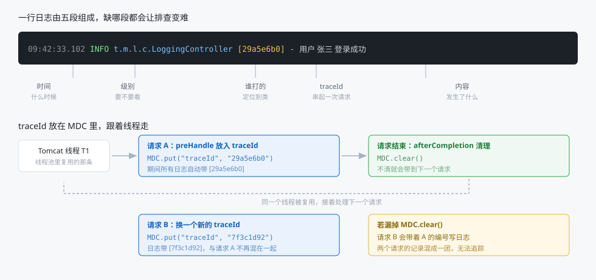
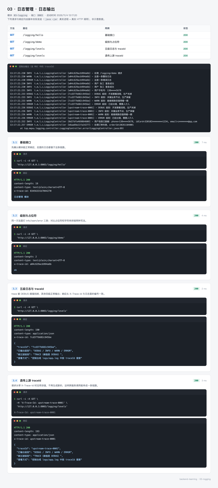
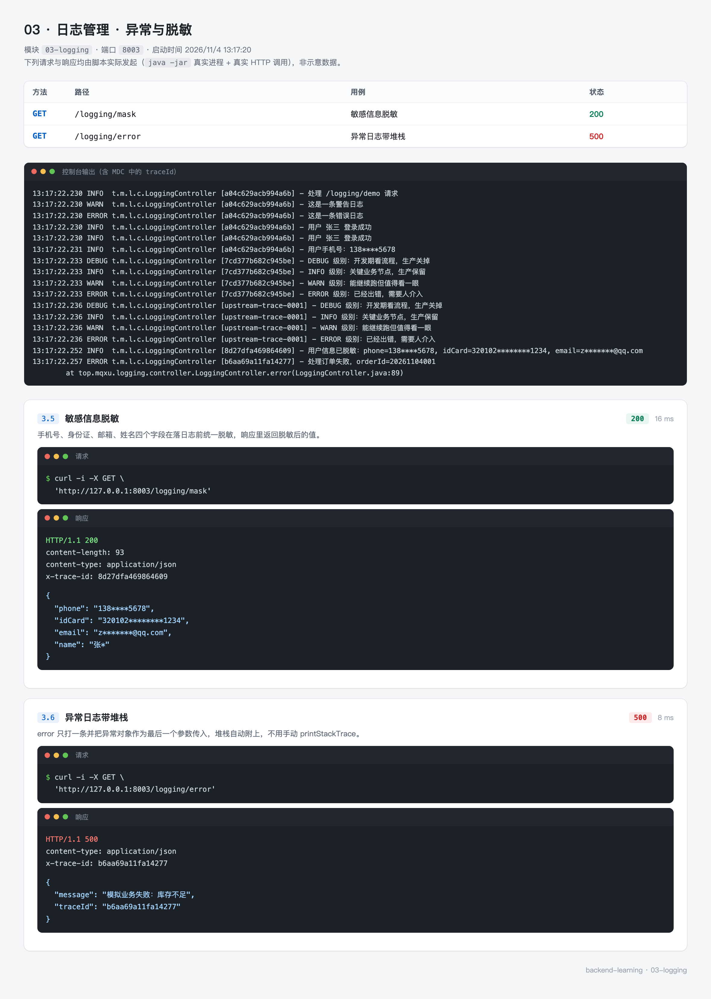

# 03 · 日志管理：出问题之后能查，才叫日志

> - 难度：入门
> - 前置条件：完成 [02-config](02-config.md)，会读 yml 配置
> - 预计时长：60~75 分钟
> - 对应代码：[03-logging](https://github.com/mqxu/backend-learning/tree/main/03-logging)

程序上线之后，你看不到用户的屏幕，也复现不了他的操作。唯一能依靠的就是日志。这一节把"随手 `System.out.println`"换成一套能用于排障的日志方案。

---

## 0. 先看结果

做完这一节，你的控制台输出会变成这样：

```
10:02:31.442 INFO  t.m.l.controller.LoggingController [bf5ad2a5] - 处理 /logging/demo 请求
10:02:31.443 WARN  t.m.l.controller.LoggingController [bf5ad2a5] - 这是一条警告日志
10:02:31.443 ERROR t.m.l.controller.LoggingController [bf5ad2a5] - 这是一条错误日志
10:02:31.444 INFO  t.m.l.controller.LoggingController [bf5ad2a5] - 用户 张三 登录成功
10:02:31.444 INFO  t.m.l.controller.LoggingController [bf5ad2a5] - 用户手机号：138****5678
```

五点变化，每一点都对应一个具体问题：

| 变化 | 解决什么问题 |
| --- | --- |
| 有级别（INFO / WARN / ERROR） | 生产环境只看 WARN 以上，不被噪音淹没 |
| 有类名 | 一眼知道是哪个类打的 |
| 有 `[bf5ad2a5]` | 一次请求产生的所有日志能被串起来 |
| 手机号是 `138****5678` | 日志文件泄露也不会暴露用户隐私 |
| 不叫 `System.out` | 可以按天滚动、可以按环境切输出目标 |

### 这一节的路线

| 步骤 | 做什么 | 验证 |
| --- | --- | --- |
| 1 | 建模块，加第一个 logger | 控制台出现日志 |
| 2 | 搞清五个级别 | 改级别后 DEBUG 消失 |
| 3 | 用 `{}` 占位符 | 对比拼接写法 |
| 4 | 写 logback-spring.xml | 控制台有颜色、文件按天滚动 |
| 5 | 用 MDC 打 traceId | 响应头与日志里编号一致 |
| 6 | 写脱敏工具 | 手机号、身份证被打码 |
| 7 | 记异常 | 堆栈自动带上 |

---

## 1. 为什么不能用 System.out.println

先看看它的问题：

```java
System.out.println("用户登录成功");
```

| 问题 | 后果 |
| --- | --- |
| 没有级别 | 想在生产只输出错误，做不到 |
| 没有时间 | 不知道什么时候发生的 |
| 没有类名 | 日志多了不知道谁打的 |
| 输出到标准输出 | 重定向到文件要靠 shell，滚动、清理都得自己写 |
| 无法关闭 | 每行都打印，性能白扔 |
| 不能按包过滤 | 第三方库的日志和自己的混在一起 |

日志框架解决的就是这些。Java 生态里的标准做法是两层：

| 层 | 是什么 | 类比 |
| --- | --- | --- |
| SLF4J | 日志门面（接口） | 插座标准 |
| Logback | 日志实现 | 插头 |

代码里只依赖 SLF4J 的 `Logger` 接口，运行时由 Logback 干活。以后想换 Log4j2 也不用改业务代码。

---

## 2. 创建模块

### 2.1 POM

```xml
<?xml version="1.0" encoding="UTF-8"?>
<project xmlns="http://maven.apache.org/POM/4.0.0"
         xmlns:xsi="http://www.w3.org/2001/XMLSchema-instance"
         xsi:schemaLocation="http://maven.apache.org/POM/4.0.0 http://maven.apache.org/xsd/maven-4.0.0.xsd">
    <modelVersion>4.0.0</modelVersion>

    <parent>
        <groupId>top.mqxu</groupId>
        <artifactId>backend-learning</artifactId>
        <version>0.0.1-SNAPSHOT</version>
    </parent>

    <artifactId>03-logging</artifactId>

</project>
```

一个依赖都不加。为什么？因为 `spring-boot-starter-webmvc`（父 POM 里已有）间接引入了 `spring-boot-starter-logging`，后者包含 SLF4J + Logback + 各种桥接包。

验证一下：

```bash
mvn -pl 03-logging dependency:tree | grep -E "logback|slf4j"
```

能看到 `logback-classic`、`logback-core`、`slf4j-api` 三个包。

### 2.2 目录结构

```
03-logging
└── src/main
    ├── java/top/mqxu/logging
    │   ├── LoggingApplication.java
    │   ├── common
    │   │   ├── LogMaskUtil.java        # 脱敏工具
    │   │   └── TraceInterceptor.java   # 生成并写入 traceId
    │   ├── config
    │   │   └── WebConfig.java          # 注册拦截器
    │   └── controller
    │       └── LoggingController.java  # 演示接口
    └── resources
        ├── application.yml
        ├── application-prod.yml
        ├── logback-spring.xml          # 日志的完整配置
        └── banner.txt                  # 启动横幅（可选）
```

`logback-spring.xml` 这个名字有讲究：带 `-spring` 后缀才能用 `<springProfile>`、`<springProperty>` 这些扩展标签，也才会被 Spring Boot 特殊处理。叫 `logback.xml` 也能生效，但用不了扩展标签。

---

## 3. 第一个 logger

### 3.1 启动类

`src/main/java/top/mqxu/logging/LoggingApplication.java`：

```java
package top.mqxu.logging;

import org.springframework.boot.SpringApplication;
import org.springframework.boot.autoconfigure.SpringBootApplication;

@SpringBootApplication
public class LoggingApplication {

    public static void main(String[] args) {
        SpringApplication.run(LoggingApplication.class, args);
    }
}
```

### 3.2 控制器

`src/main/java/top/mqxu/logging/controller/LoggingController.java`：

```java
package top.mqxu.logging.controller;

import lombok.extern.slf4j.Slf4j;
import org.springframework.web.bind.annotation.GetMapping;
import org.springframework.web.bind.annotation.RequestMapping;
import org.springframework.web.bind.annotation.RestController;

@Slf4j
@RestController
@RequestMapping("/logging")
public class LoggingController {

    @GetMapping("/hello")
    public String hello() {
        log.info("有人访问了 hello 接口");
        return "日志管理 模块";
    }
}
```

`@Slf4j` 来自 Lombok，编译后等价于：

```java
private static final Logger log = LoggerFactory.getLogger(LoggingController.class);
```

`LoggerFactory` 的全名是 `org.slf4j.LoggerFactory`，`Logger` 是 `org.slf4j.Logger`。

为什么是 `static final`：

- `static`：Logger 与类绑定，不需要每个实例一份
- `final`：初始化一次就够，Logger 本身是线程安全的
- 变量名用 `log`：Lombok 默认就叫这个，用 `logger` 需要自己写

### 3.3 验证

把端口写进 `application.yml`：

```yaml
server:
  port: 8003

spring:
  application:
    name: 03-日志管理
```

启动并访问：

```bash
mvn -pl 03-logging spring-boot:run
curl http://127.0.0.1:8003/logging/hello
```

控制台会出现类似：

```
2026-11-04T10:02:28.115Z  INFO 12345 --- [03-logging] [nio-8003-exec-1] t.m.l.controller.LoggingController : 有人访问了 hello 接口
```

这是 Spring Boot 的默认格式。信息够用，但还缺 traceId 和颜色，后面会换成自定义格式。

---

## 4. 五个级别

### 4.1 级别是阈值，不是标签

```java
log.trace("最细，只在排查具体某行时临时打开");
log.debug("开发期看流程，生产关掉");
log.info("关键业务节点，生产保留");
log.warn("能继续跑但反常");
log.error("已经失败，需要人介入");
```

级别从低到高：`TRACE < DEBUG < INFO < WARN < ERROR < OFF`。

关键理解：**配成 INFO 时，TRACE 和 DEBUG 会被直接丢弃，不是"打了但不显示"。** 判断发生在格式化之前，所以连字符串都不会拼。

这就引出一个性能细节，见 5.1。

### 4.2 什么时候用哪一级

| 级别 | 判断标准 | 例子 |
| --- | --- | --- |
| TRACE | 只在追某个具体 bug 时用 | 循环里每一步的中间值 |
| DEBUG | 开发期想知道流程走向 | 参数值、分支判断结果、SQL |
| INFO | 这条日志对运维有意义 | 应用启动完成、订单创建成功、定时任务开始 |
| WARN | 出了问题但系统自己处理了 | 重试成功、降级返回、参数被修正 |
| ERROR | 需要人来处理 | 数据库连不上、第三方接口持续失败 |

一个常见错误：把所有异常都打成 ERROR。用户输入格式不对导致校验失败，这是预期内的，打 WARN 就够；只有真正需要人介入的才打 ERROR。

---

## 5. 占位符与拼接

### 5.1 两种写法

```java
log.debug("用户 {} 登录成功，耗时 {} ms", name, cost);    // 推荐
log.debug("用户 " + name + " 登录成功，耗时 " + cost + " ms");  // 不推荐
```

输出看起来一样，差别在 DEBUG 关闭时：

| 写法 | DEBUG 关闭时发生了什么 |
| --- | --- |
| `{}` 占位符 | 判断级别后直接返回，字符串拼接根本不会发生 |
| `+` 拼接 | 先把字符串拼好，再判断级别，然后丢弃 |

第二条在高频路径上就是白白浪费 CPU 和内存。一条日志省几微秒，每秒几万次请求就是几百毫秒。

### 5.2 占位符的用法

```java
log.info("用户 {} 登录成功", name);                    // 一个参数
log.info("用户 {} 在 {} 登录", name, city);             // 两个参数
log.info("订单 {} 金额 {} 元", orderNo, amount);         // 类型自动转换
log.info("异常信息：{}", e.getMessage());               // 注意：这只是字符串
```

参数个数可以多于占位符（多余的忽略），少于占位符时缺的位置原样输出 `{}`。

---

## 6. 配置日志级别

### 6.1 全局级别

```yaml
logging:
  level:
    root: info
```

`root` 是根 logger，所有没单独配置的包都继承它。

### 6.2 按包调级别

```yaml
logging:
  level:
    root: info
    top.mqxu.logging: debug
```

这样业务包输出 DEBUG，第三方库还是 INFO。排查问题时最常用的操作就是临时把某个包调到 DEBUG，不用重启——配合 Actuator 的 `/actuator/loggers` 端点可以在运行期改（见 12 节）。

### 6.3 输出到文件

```yaml
logging:
  file:
    name: logs/app.log
```

配置之后，日志同时写控制台和文件。文件名相对于应用的工作目录。

---

## 7. 自定义 logback-spring.xml

### 7.1 为什么要自定义

yml 里的配置能解决大部分问题，但做不到这些：

- 按 profile 切换输出目标（开发看控制台，生产只写文件）
- 文件按天滚动并限制保留天数
- 精确控制日志格式里每一段的宽度和对齐

### 7.2 完整配置

`src/main/resources/logback-spring.xml`：

```xml
<?xml version="1.0" encoding="UTF-8"?>
<configuration>
    <!-- 注册 Spring Boot 的颜色转换器 %clr，自定义配置里不会自动注册 -->
    <conversionRule conversionWord="clr"
                    class="org.springframework.boot.logging.logback.ColorConverter"/>

    <!-- 从 yml 读日志格式，读不到就用后面的默认值 -->
    <springProperty scope="context" name="CONSOLE_LOG_PATTERN"
                    source="logging.pattern.console"
                    defaultValue="%d{HH:mm:ss.SSS} %clr(%-5level) %clr(%logger{24}){cyan} [%X{traceId}] - %msg%n"/>

    <!-- 控制台输出 -->
    <appender name="CONSOLE" class="ch.qos.logback.core.ConsoleAppender">
        <encoder>
            <pattern>${CONSOLE_LOG_PATTERN}</pattern>
        </encoder>
    </appender>

    <!-- 文件输出，按天滚动，保留 30 天 -->
    <appender name="FILE" class="ch.qos.logback.core.rolling.RollingFileAppender">
        <file>logs/app.log</file>
        <rollingPolicy class="ch.qos.logback.core.rolling.TimeBasedRollingPolicy">
            <fileNamePattern>logs/app.%d{yyyy-MM-dd}.log</fileNamePattern>
            <maxHistory>30</maxHistory>
        </rollingPolicy>
        <encoder>
            <pattern>%d{yyyy-MM-dd HH:mm:ss.SSS} [%thread] %-5level %logger{36} [%X{traceId}] - %msg%n</pattern>
        </encoder>
    </appender>

    <!-- 默认：INFO 输出到控制台 -->
    <root level="INFO">
        <appender-ref ref="CONSOLE"/>
    </root>

    <!-- 开发环境：INFO，控制台 -->
    <springProfile name="dev">
        <root level="INFO">
            <appender-ref ref="CONSOLE"/>
        </root>
    </springProfile>

    <!-- 生产环境：WARN，写文件 -->
    <springProfile name="prod">
        <root level="WARN">
            <appender-ref ref="FILE"/>
        </root>
    </springProfile>
</configuration>
```

### 7.3 逐段讲

**`<conversionRule>`**

`%clr(...)` 是 Spring Boot 提供的彩色输出，但它不是 Logback 原生的。用自定义配置文件时不会自动注册，所以手动加这一行，否则 `%clr` 会被当成普通文本输出。

**`<springProperty>`**

把 yml 里的 `logging.pattern.console` 读进来当变量用。这样格式只在 yml 里写一份，改格式不用改 XML。

**`<appender>`**

Appender 是"输出目的地"。这里定义了两个：`CONSOLE` 打控制台，`FILE` 写文件。

`RollingFileAppender` 的滚动策略：

| 元素 | 作用 |
| --- | --- |
| `<file>` | 当前正在写的文件名 |
| `<fileNamePattern>` | 滚动后的文件名格式，`%d{yyyy-MM-dd}` 表示按天 |
| `<maxHistory>` | 保留多少天，超出的自动删除 |

按天滚动是必须的。不滚动的话，一个高流量服务一天能写出几个 G，磁盘满了整台机器都受影响。

**`<springProfile>`**

根据激活的 profile 选不同的配置。开发时盯控制台，生产时只写文件且只记 WARN 以上——生产上 INFO 日志量很大，全写文件既占磁盘又影响 IO。

**`%X{traceId}`**

从 MDC 里取 `traceId` 的值。没有值时输出空，所以日志里会是 `[]`。下一节讲怎么填上。

### 7.4 格式里的占位符

| 写法 | 含义 |
| --- | --- |
| `%d{HH:mm:ss.SSS}` | 时间，精确到毫秒 |
| `%-5level` | 级别，左对齐占 5 字符 |
| `%logger{24}` | 类名，超过 24 字符时缩写（`t.m.l.c.LoggingController`） |
| `%thread` | 线程名 |
| `%X{traceId}` | MDC 里的 traceId |
| `%msg` | 日志内容 |
| `%n` | 换行 |

---

## 8. 用 MDC 串起一次请求

### 8.1 没有 traceId 时有多难受

线上用户报"下单失败"。你打开日志文件，看到：

```
10:02:31 INFO  订单服务 - 开始创建订单
10:02:31 INFO  库存服务 - 扣减库存成功
10:02:31 ERROR 订单服务 - 创建订单失败：超时
10:02:31 INFO  订单服务 - 开始创建订单
```

同一秒有成百上千条日志混在一起，你无法确定哪几行属于同一个用户的那一次请求。

traceId 就是给每次请求发一个唯一编号，所有相关日志都带上它。查问题时按编号过滤，一次请求的完整链路就出来了。



### 8.2 写拦截器

`src/main/java/top/mqxu/logging/common/TraceInterceptor.java`：

```java
package top.mqxu.logging.common;

import jakarta.servlet.http.HttpServletRequest;
import jakarta.servlet.http.HttpServletResponse;
import org.jspecify.annotations.NonNull;
import org.slf4j.MDC;
import org.springframework.stereotype.Component;
import org.springframework.web.servlet.HandlerInterceptor;

import java.util.UUID;

@Component
public class TraceInterceptor implements HandlerInterceptor {

    public static final String TRACE_HEADER = "X-Trace-Id";
    public static final String TRACE_KEY = "traceId";

    @Override
    public boolean preHandle(@NonNull HttpServletRequest request,
                             @NonNull HttpServletResponse response,
                             @NonNull Object handler) {
        // 上游已经带了 traceId 就沿用，保证跨服务调用是同一个号
        String traceId = request.getHeader(TRACE_HEADER);
        if (traceId == null || traceId.isBlank()) {
            traceId = UUID.randomUUID().toString().replace("-", "").substring(0, 16);
        }
        MDC.put(TRACE_KEY, traceId);
        // 回写响应头，调用方拿到号才能去日志里搜
        response.setHeader(TRACE_HEADER, traceId);
        return true;
    }

    @Override
    public void afterCompletion(@NonNull HttpServletRequest request,
                                @NonNull HttpServletResponse response,
                                @NonNull Object handler, Exception ex) {
        // 必须清理：Tomcat 复用线程，不清会把编号带到下一个请求
        MDC.clear();
    }
}
```

四个设计点：

**为什么先看请求头**

一次前端请求可能经过网关、服务 A、服务 B。如果每个服务都生成新编号，链路就断了。约定用 `X-Trace-Id` 传递，谁先生成谁负责往下传。

**为什么截取 16 位**

UUID 完整是 32 位十六进制，太长，日志里占地方。16 位（64 位熵）在单日日志量内碰撞概率极低，够用。

**为什么回写响应头**

用户报障时把响应头里的编号发过来，你直接 `grep` 就能定位，不用问"你大概几点操作的"。

**为什么必须 `MDC.clear()`**

MDC 底层是 ThreadLocal。Tomcat 用线程池，一个线程处理完请求 A 会接着处理请求 B。不清理的话，B 的日志会带着 A 的编号——两条不同请求的记录混在一起，比没有编号更糟。

### 8.3 注册拦截器

`src/main/java/top/mqxu/logging/config/WebConfig.java`：

```java
package top.mqxu.logging.config;

import lombok.RequiredArgsConstructor;
import org.springframework.context.annotation.Configuration;
import org.springframework.web.servlet.config.annotation.InterceptorRegistry;
import org.springframework.web.servlet.config.annotation.WebMvcConfigurer;
import top.mqxu.logging.common.TraceInterceptor;

@Configuration
@RequiredArgsConstructor
public class WebConfig implements WebMvcConfigurer {

    private final TraceInterceptor traceInterceptor;

    @Override
    public void addInterceptors(InterceptorRegistry registry) {
        registry.addInterceptor(traceInterceptor).addPathPatterns("/**");
    }
}
```

`addPathPatterns("/**")` 表示拦截所有路径。拦截器与过滤器的区别、谁先谁后，`04-web` 会专门讲，这里只需要知道"它能在控制器之前执行"。

### 8.4 日志格式里接上

yml 里的格式串：

```yaml
logging:
  pattern:
    console: '%d{HH:mm:ss.SSS} %clr(%-5level) %clr(%logger{24}){cyan} [%X{traceId}] - %msg%n'
```

`[%X{traceId}]` 就是 MDC 里那个键。`logback-spring.xml` 通过 `<springProperty>` 把它读进去。

### 8.5 验证

```bash
curl -i http://127.0.0.1:8003/logging/levels
```

响应头里有：

```
x-trace-id: bf5ad2a5d7464bbe
```

控制台对应的日志行里有 `[bf5ad2a5d7464bbe]`，两个完全一致。

再试一次带自定义编号的请求：

```bash
curl -H "X-Trace-Id: upstream-trace-0001" http://127.0.0.1:8003/logging/levels
```

日志里的编号变成 `[upstream-trace-0001]`——沿用上游而不是重新生成。

---

## 9. 敏感信息脱敏

### 9.1 为什么必须做

日志会进文件、进采集系统、进 ELK，可能被很多人看到。手机号、身份证、银行卡明文写进日志，等于把用户隐私摊开放在那里。

很多合规要求（个人信息保护法、等保）也明确写了这一点。

### 9.2 写工具类

`src/main/java/top/mqxu/logging/common/LogMaskUtil.java`：

```java
package top.mqxu.logging.common;

public final class LogMaskUtil {

    private LogMaskUtil() {
    }

    /** 13812345678 -> 138****5678 */
    public static String maskPhone(String phone) {
        if (phone == null || phone.length() != 11) {
            return phone;
        }
        return phone.substring(0, 3) + "****" + phone.substring(7);
    }

    /** 320102200510241234 -> 320102********1234 */
    public static String maskIdCard(String idCard) {
        if (idCard == null || idCard.length() < 10) {
            return idCard;
        }
        return idCard.substring(0, 6) + "********" + idCard.substring(idCard.length() - 4);
    }

    /** zhangsan@qq.com -> z*******@qq.com */
    public static String maskEmail(String email) {
        if (email == null) {
            return null;
        }
        int at = email.indexOf('@');
        if (at <= 1) {
            return email;
        }
        return email.charAt(0) + "*".repeat(at - 1) + email.substring(at);
    }

    /** 6222020200112345678 -> ************5678 */
    public static String maskBankCard(String card) {
        if (card == null || card.length() < 8) {
            return card;
        }
        return "*".repeat(card.length() - 4) + card.substring(card.length() - 4);
    }

    /** 张三 -> 张* */
    public static String maskName(String name) {
        if (name == null || name.isEmpty()) {
            return name;
        }
        return name.charAt(0) + "*".repeat(Math.max(1, name.length() - 1));
    }
}
```

保留规则：

| 类型 | 保留 | 理由 |
| --- | --- | --- |
| 手机号 | 前 3 后 4 | 能对上是哪个号，但看不出全号 |
| 身份证 | 前 6 后 4 | 前 6 位是地区码，便于核对 |
| 邮箱 | 首字母 + 域名 | 域名有用，用户名遮住 |
| 银行卡 | 后 4 | 与银行账单的展示规则一致 |
| 姓名 | 姓 | 保留称呼，名字遮住 |

工具类用 `final` 类 + 私有构造器，防止被实例化或被继承。

### 9.3 用起来

```java
log.info("用户手机号：{}", LogMaskUtil.maskPhone("13812345678"));
```

原则是：**业务代码里该用明文用明文，只在写日志的那一刻脱敏。** 不要图省事把数据库里的值改成脱敏后的——那样业务就算不出手机号归属地了。

---

## 10. 正确记录异常

### 10.1 三种写法对比

```java
// 推荐：异常对象放最后一个参数，堆栈自动附上
log.error("处理订单失败，orderId=20261104001", e);

// 不推荐：只打 message，堆栈丢了
log.error("处理订单失败：" + e.getMessage());

// 更糟：打两次，一条错误变两条
log.error(e.getMessage());
e.printStackTrace();
```

`printStackTrace` 输出到标准错误流，不受日志配置控制，格式也对不上，生产环境基本等于没打。

### 10.2 一个容易踩的坑

```java
log.error("异常：{}", e);        // 只有 {} 占位符时，e 会被当成普通对象，输出类名
log.error("异常：{}", e.getMessage(), e);  // 这样才带堆栈？不对，看下面
```

SLF4J 的规则：最后一个参数如果是 `Throwable`，就当作异常处理，堆栈自动追加，且不占用 `{}` 的位置。

所以正确写法只有一种：

```java
log.error("处理订单失败，orderId={}", orderId, e);
```

两个参数，一个填 `{}`，一个是异常对象。堆栈自动附在消息后面。

### 10.3 控制器里的完整写法

```java
@GetMapping("/error")
public ResponseEntity<Map<String, Object>> error() {
    try {
        throw new IllegalStateException("模拟业务失败：库存不足");
    } catch (IllegalStateException e) {
        log.error("处理订单失败，orderId=20261104001", e);
        Map<String, Object> body = new LinkedHashMap<>();
        body.put("message", e.getMessage());
        body.put("traceId", MDC.get("traceId"));
        return ResponseEntity.status(HttpStatus.INTERNAL_SERVER_ERROR).body(body);
    }
}
```

响应体里带上 `traceId` 是个实用设计：用户截图报障时，你直接从截图里读到编号，不用额外沟通。

---

## 11. 完整代码

`LoggingController` 全文（五个接口）：

```java
package top.mqxu.logging.controller;

import lombok.extern.slf4j.Slf4j;
import org.slf4j.MDC;
import org.springframework.http.HttpStatus;
import org.springframework.http.ResponseEntity;
import org.springframework.web.bind.annotation.GetMapping;
import org.springframework.web.bind.annotation.RequestMapping;
import org.springframework.web.bind.annotation.RequestParam;
import org.springframework.web.bind.annotation.RestController;
import top.mqxu.logging.common.LogMaskUtil;

import java.util.LinkedHashMap;
import java.util.Map;

@Slf4j
@RestController
@RequestMapping("/logging")
public class LoggingController {

    @GetMapping("/hello")
    public String hello() {
        return "日志管理 模块";
    }

    @GetMapping("/demo")
    public String demo() {
        log.info("处理 /logging/demo 请求");
        log.warn("这是一条警告日志");
        log.error("这是一条错误日志");
        String name = "张三";
        log.info("用户 {} 登录成功", name);          // 推荐：级别关闭时不拼字符串
        log.info("用户 " + name + " 登录成功");       // 禁止：无论级别都拼
        log.info("用户手机号：{}", LogMaskUtil.maskPhone("13812345678"));
        return "ok";
    }

    @GetMapping("/levels")
    public Map<String, Object> levels() {
        log.trace("TRACE 级别：只在排查具体某行逻辑时临时打开");
        log.debug("DEBUG 级别：开发期看流程，生产关掉");
        log.info("INFO 级别：关键业务节点，生产保留");
        log.warn("WARN 级别：能继续跑但值得看一眼");
        log.error("ERROR 级别：已经出错，需要人介入");

        Map<String, Object> result = new LinkedHashMap<>();
        result.put("traceId", MDC.get("traceId"));
        result.put("已输出级别", "DEBUG / INFO / WARN / ERROR");
        result.put("被过滤级别", "TRACE（阈值是 DEBUG）");
        result.put("查看方式", "控制台或 logs/app.log 中按 traceId 搜索");
        return result;
    }

    @GetMapping("/mask")
    public Map<String, Object> mask(@RequestParam(defaultValue = "13812345678") String phone,
                                    @RequestParam(defaultValue = "320102200510241234") String idCard,
                                    @RequestParam(defaultValue = "zhangsan@qq.com") String email,
                                    @RequestParam(defaultValue = "张三") String name) {
        Map<String, Object> result = new LinkedHashMap<>();
        result.put("phone", LogMaskUtil.maskPhone(phone));
        result.put("idCard", LogMaskUtil.maskIdCard(idCard));
        result.put("email", LogMaskUtil.maskEmail(email));
        result.put("name", LogMaskUtil.maskName(name));
        log.info("用户信息已脱敏：phone={}, idCard={}, email={}",
                result.get("phone"), result.get("idCard"), result.get("email"));
        return result;
    }

    @GetMapping("/error")
    public ResponseEntity<Map<String, Object>> error() {
        try {
            throw new IllegalStateException("模拟业务失败：库存不足");
        } catch (IllegalStateException e) {
            log.error("处理订单失败，orderId=20261104001", e);
            Map<String, Object> body = new LinkedHashMap<>();
            body.put("message", e.getMessage());
            body.put("traceId", MDC.get("traceId"));
            return ResponseEntity.status(HttpStatus.INTERNAL_SERVER_ERROR).body(body);
        }
    }
}
```

`application.yml`：

```yaml
server:
  port: 8003

spring:
  application:
    name: 03-日志管理
  profiles:
    active: dev
  output:
    ansi:
      # 关掉颜色后重定向到文件会是干净的纯文本；这里强制开启便于教学演示
      enabled: always

logging:
  # 级别从低到高：TRACE < DEBUG < INFO < WARN < ERROR < OFF
  level:
    root: info
    top.mqxu.logging: debug
  pattern:
    # %d 时间  %-5level 级别  %logger 类名  %X{traceId} 链路号  %msg 内容
    console: '%d{HH:mm:ss.SSS} %clr(%-5level) %clr(%logger{24}){cyan} [%X{traceId}] - %msg%n'
  file:
    name: logs/app.log
```

`application-prod.yml`：

```yaml
# 生产环境由 logback-spring.xml 的 <springProfile name="prod"> 接管：
# 级别 WARN，只写文件，不输出到控制台
```

---

## 12. 运行与实测

### 12.1 启动

```bash
mvn -pl 03-logging spring-boot:run
```

### 12.2 日志输出与 traceId



页面顶部是真实的应用控制台输出，对照着看四件事：

**一、TRACE 一条都没有**

配置里 `top.mqxu.logging` 是 DEBUG，阈值以下的 TRACE 被丢弃。把 yml 改成 `trace` 再跑，就能看到那条日志。

**二、每个请求的日志带同一个编号**

`/logging/levels` 打了四条日志，编号完全相同。这就是 traceId 的作用——同一请求的多条记录能串起来。

**三、上游编号被沿用**

第 3.4 个用例请求头传了 `X-Trace-Id: upstream-trace-0001`，日志与响应头里都是这个值，没有重新生成。

**四、两种写法输出一样**

`用户 {} 登录成功` 和 `用户 张三 登录成功` 打印结果相同，但只有前者在 DEBUG 关闭时不产生拼接开销。

### 12.3 脱敏与异常



`/logging/mask` 返回的是脱敏后的四个值：`138****5678`、`320102********1234`、`z*******@qq.com`、`张*`。日志里写进去的也是这些，原文只存在于请求参数里。

`/logging/error` 返回 500，响应体带 `traceId`。控制台里能看到完整堆栈，因为 `log.error(msg, e)` 的第二个参数是异常对象。

### 12.4 生产环境的差别

用 prod profile 启动：

```bash
java -jar 03-logging/target/03-logging-0.0.1-SNAPSHOT.jar --spring.profiles.active=prod
```

控制台几乎没有输出（只有启动横幅），日志写进了 `logs/app.log`，且只记录 WARN 以上。这就是"生产不刷屏"的实现方式。

---

## 13. 写个测试

日志本身不好断言，但可以断言"MDC 有没有被正确设置和清理"。

`src/test/java/top/mqxu/logging/TraceInterceptorTest.java`：

```java
package top.mqxu.logging;

import org.junit.jupiter.api.AfterEach;
import org.junit.jupiter.api.Test;
import org.slf4j.MDC;
import org.springframework.mock.web.MockHttpServletRequest;
import org.springframework.mock.web.MockHttpServletResponse;
import top.mqxu.logging.common.TraceInterceptor;

import static org.assertj.core.api.Assertions.assertThat;

class TraceInterceptorTest {

    private final TraceInterceptor interceptor = new TraceInterceptor();

    @AfterEach
    void clear() {
        MDC.clear();
    }

    @Test
    void 没有上游编号时自动生成() {
        MockHttpServletRequest request = new MockHttpServletRequest();
        MockHttpServletResponse response = new MockHttpServletResponse();

        interceptor.preHandle(request, response, new Object());

        String traceId = MDC.get("traceId");
        assertThat(traceId).isNotBlank().hasSize(16);
        // 响应头里的编号要与 MDC 里的一致
        assertThat(response.getHeader("X-Trace-Id")).isEqualTo(traceId);
    }

    @Test
    void 上游带了编号就沿用() {
        MockHttpServletRequest request = new MockHttpServletRequest();
        request.addHeader("X-Trace-Id", "upstream-0001");
        MockHttpServletResponse response = new MockHttpServletResponse();

        interceptor.preHandle(request, response, new Object());

        assertThat(MDC.get("traceId")).isEqualTo("upstream-0001");
        assertThat(response.getHeader("X-Trace-Id")).isEqualTo("upstream-0001");
    }

    @Test
    void 请求结束后清理MDC() {
        MockHttpServletRequest request = new MockHttpServletRequest();
        MockHttpServletResponse response = new MockHttpServletResponse();

        interceptor.preHandle(request, response, new Object());
        assertThat(MDC.get("traceId")).isNotNull();

        interceptor.afterCompletion(request, response, new Object(), null);
        assertThat(MDC.get("traceId")).isNull();
    }
}
```

跑：

```bash
mvn -pl 03-logging test
```

三个用例分别盯住"生成"、"沿用"、"清理"三件事。第三条最重要——它是那个最难排查的串号问题的防线。

---

## 14. 常见问题

| 现象 | 原因 | 解决 |
| --- | --- | --- |
| 一条日志都没有 | 类上没加 `@Slf4j` | 补注解，或用 `LoggerFactory` 手动创建 |
| DEBUG 日志看不到 | 阈值是 INFO | `logging.level.你的包=debug` |
| 日志里 `[]` 是空的 | 拦截器没生效或路径没匹配 | 检查 `addPathPatterns` |
| 不同请求的 traceId 相同 | `MDC.clear()` 漏了 | 在 `afterCompletion` 里清理 |
| 中文乱码 | 文件编码不是 UTF-8 | encoder 加 `charset=UTF-8`，或统一 IDE 编码 |
| 日志文件涨到几个 G | 没配滚动策略 | 用 `TimeBasedRollingPolicy` + `maxHistory` |
| 一个异常打出好几条堆栈 | message 和堆栈各打了一次 | 只保留 `log.error(msg, e)` |
| `%clr` 显示成字面量 | 自定义 XML 没注册转换器 | 加 `<conversionRule>` |
| 生产环境日志写不进文件 | 目录没有写权限 | 检查工作目录与文件属主 |
| 改了 logback 配置没反应 | 文件名是 `logback.xml` | 改成 `logback-spring.xml` |

---

## 15. 练习

### 15.1 随堂练习（15 分钟）

| # | 练习 | 检查点 |
| --- | --- | --- |
| 1 | 加 `/logging/slow` 接口，`Thread.sleep(1500)` 并记录耗时 | INFO 日志里出现耗时数字 |
| 2 | 把 `top.mqxu.logging` 的级别改成 `warn`，再访问 `/logging/levels` | INFO 与 DEBUG 都消失，只剩 WARN 与 ERROR |
| 3 | 给 `/logging/mask` 加一个银行卡参数 | 返回只剩后 4 位 |

### 15.2 课后练习

**基础**：写一个 `OncePerRequestFilter` 版本的 traceId 注入，对比拦截器版本。重点看两者在"静态资源请求"上的差异。

**进阶**：把控制台 Appender 换成异步的（`AsyncAppender` + 有界队列），用压测对比吞吐。说明队列满了之后应该丢弃还是阻塞，各自的代价是什么。

**挑战**：写一个 Logback 的 `MessageConverter`，在 `%msg` 输出前自动把符合手机号格式的字符串替换成 `***`。对比它与"业务代码手动脱敏"的优劣：前者不会漏，但可能误伤订单号。

---

## 16. 小结

### 16.1 核心概念

| 概念 | 一句话 |
| --- | --- |
| SLF4J | 门面接口，实现可换 |
| 级别 | 阈值过滤，TRACE < DEBUG < INFO < WARN < ERROR |
| `{}` 占位符 | 延迟拼接，级别关闭时零开销 |
| MDC | 线程绑定的上下文，用 traceId 串一次请求 |
| `log.error(msg, e)` | 异常对象放最后，堆栈自动追加 |
| 脱敏 | 日志里永不出现原文 |
| `<springProfile>` | 按环境切换级别与输出目标 |

### 16.2 几条实践建议

- 禁止 `System.out.println` 和 `printStackTrace`
- 一律用 `{}` 占位符，不要用 `+` 拼
- MDC 用完即清，这是底线
- 个人信息在写日志那一刻脱敏
- 生产日志按天滚动，设置保留天数
- ERROR 留给"需要人处理"的情况，别把校验失败也打成 ERROR

### 16.3 下一节

现在每个模块各自处理异常、各自拼响应体，输出形状不统一。前端要写好几套解析逻辑。

下一节 [04-web](04-web.md) 把这些收进统一响应体、全局异常处理和参数校验，让所有接口长得一样。

> 本节遵循的规范：禁止 `System.out.println`；占位符传参；MDC 用完即清；个人信息脱敏后落盘；生产日志按天滚动并限制保留天数；异常只打一次并带堆栈。
