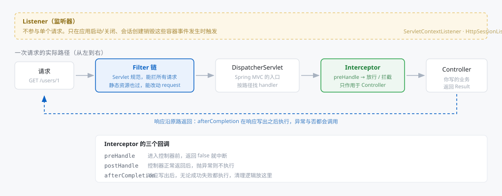
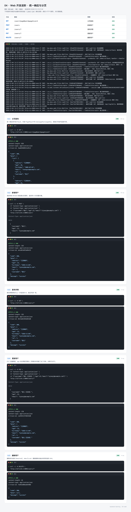
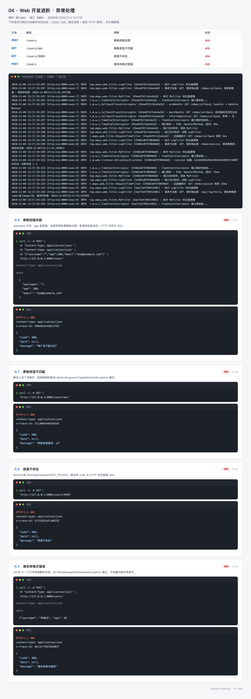
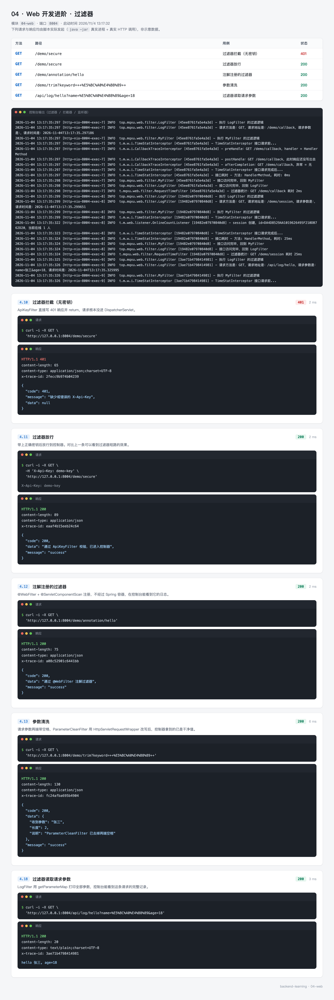
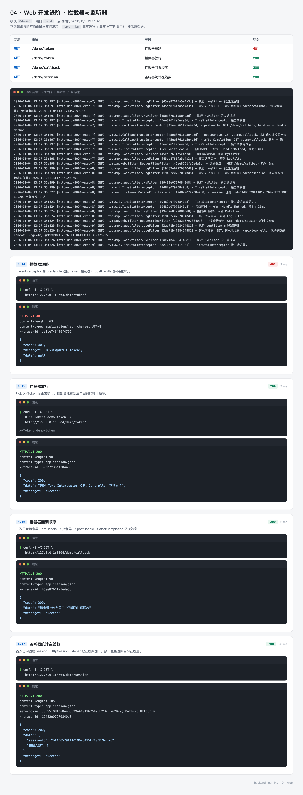

# 04 · Web 开发进阶：让所有接口长得一样

> - 难度：进阶
> - 前置条件：完成 [03-logging](03-logging.md)，会写带参数的接口
> - 预计时长：90~110 分钟
> - 对应代码：[04-web](https://github.com/mqxu/backend-learning/tree/main/04-web)

前三个模块的接口各写各的：成功返回对象，失败返回字符串，查不到返回空。前端要写好几套判断逻辑。这一节把这些收进统一的结构里，并补上参数校验、过滤器、拦截器、监听器。

---

## 0. 先看结果

做完这一节，所有接口都长成这样：

**成功**

```json
{
  "code": 200,
  "message": "success",
  "data": {
    "list": [ ... ],
    "total": 6,
    "pageNum": 1,
    "pageSize": 5
  }
}
```

**失败**

```json
{
  "code": 404,
  "message": "资源不存在",
  "data": null
}
```

前端只需要写一次判断：

```javascript
if (res.data.code === 200) {
  // 用 res.data.data
} else {
  // 展示 res.data.message
}
```

### 这一节的路线

| 步骤 | 做什么 | 验证 |
| --- | --- | --- |
| 1 | 建模块，加校验依赖 | 编译通过 |
| 2 | 写 `Result` / `ErrorCode` / `BusinessException` | 单元测试通过 |
| 3 | 写全局异常处理器 | 四种错误各返回对应状态码 |
| 4 | 给 DTO 加校验注解 | 传空用户名返回 400 |
| 5 | 写分页与 CRUD | 五个接口串起来能跑 |
| 6 | 写过滤器：密钥校验、参数清洗 | 无密钥 401，带空格参数被清理 |
| 7 | 写拦截器：令牌校验、回调追踪 | 观察三个回调的执行顺序 |
| 8 | 写监听器：应用生命周期、在线人数 | 启动日志出现初始化记录 |

---

## 1. 为什么接口必须统一

### 1.1 三个接口三种形状

```java
@GetMapping("/users/{id}")
public User getUser(@PathVariable Long id) { ... }        // 返回对象

@DeleteMapping("/users/{id}")
public String delete(@PathVariable Long id) {
    return "删除成功";                                      // 返回字符串
}

@GetMapping("/users/{id}/detail")
public Map<String, Object> detail(@PathVariable Long id) {
    Map<String, Object> map = new HashMap<>();
    map.put("error", "用户不存在");                          // 返回错误也用 200
    return map;
}
```

前端要处理三种情况：

- 拿到的是对象 → 成功
- 拿到的是字符串 → 也算成功，但内容固定
- 拿到的是带 `error` 字段的对象 → 失败，但 HTTP 状态是 200

第三种最坑：HTTP 200 表示成功，业务上却是失败。监控看不到错误率，日志里也全是正常请求。

### 1.2 统一的三个字段

```json
{"code": 200, "message": "success", "data": { ... }}
```

| 字段 | 作用 |
| --- | --- |
| `code` | 业务码，前端据此判断成败 |
| `message` | 给人看的提示，可以直接弹窗 |
| `data` | 真正的数据，失败时为 `null` |

### 1.3 HTTP 状态码要不要跟着变

两种流派：

| 做法 | 优点 | 缺点 |
| --- | --- | --- |
| 永远返回 200，只看 `code` | 前端只处理一种响应格式 | 监控、APM 看不出错误率 |
| HTTP 状态与业务码一致 | 浏览器 F12 一眼看出哪条挂了，监控能统计 4xx/5xx | 前端要处理 `catch` 分支 |

本节采用第二种。校验失败返回 400，资源不存在返回 404，系统异常返回 500，同时响应体里的 `code` 与 HTTP 状态保持一致。

这不是唯一正确答案，关键是项目内统一。后面 `06-redis` 用的是第一种风格，两种都能工作，混用才是灾难。

---

## 2. 创建模块

### 2.1 POM

```xml
<?xml version="1.0" encoding="UTF-8"?>
<project xmlns="http://maven.apache.org/POM/4.0.0"
         xmlns:xsi="http://www.w3.org/2001/XMLSchema-instance"
         xsi:schemaLocation="http://maven.apache.org/POM/4.0.0 http://maven.apache.org/xsd/maven-4.0.0.xsd">
    <modelVersion>4.0.0</modelVersion>

    <parent>
        <groupId>top.mqxu</groupId>
        <artifactId>backend-learning</artifactId>
        <version>0.0.1-SNAPSHOT</version>
    </parent>

    <artifactId>04-web</artifactId>

    <dependencies>
        <!-- @Valid、@NotBlank、@Min 等校验注解的实现 -->
        <dependency>
            <groupId>org.springframework.boot</groupId>
            <artifactId>spring-boot-starter-validation</artifactId>
        </dependency>
    </dependencies>

</project>
```

### 2.2 目录结构

```
04-web
└── src/main
    ├── java/top/mqxu/web
    │   ├── WebApplication.java
    │   ├── common
    │   │   ├── Result.java                  # 统一响应体
    │   │   ├── PageResult.java              # 分页结果
    │   │   ├── ErrorCode.java               # 错误码枚举
    │   │   ├── BusinessException.java       # 业务异常
    │   │   └── GlobalExceptionHandler.java  # 全局异常处理
    │   ├── dto
    │   │   ├── UserCreateRequest.java
    │   │   └── UserUpdateRequest.java
    │   ├── entity/User.java
    │   ├── service/UserService.java
    │   ├── controller
    │   │   ├── UserController.java          # CRUD
    │   │   ├── DemoController.java          # 过滤器/拦截器演示
    │   │   └── LogController.java
    │   ├── filter
    │   │   ├── LogFilter.java               # 请求日志
    │   │   ├── MyFilter.java                # 观察执行顺序
    │   │   ├── ParameterCleanFilter.java    # 参数去空格
    │   │   ├── ApiKeyFilter.java            # 密钥校验（会短路）
    │   │   ├── TraceIdFilter.java           # traceId
    │   │   ├── RequestTimeFilter.java       # 耗时统计
    │   │   └── AnnotationDemoFilter.java    # @WebFilter 注册
    │   ├── interceptor
    │   │   ├── TimeStatInterceptor.java
    │   │   ├── CallbackTraceInterceptor.java
    │   │   ├── TokenInterceptor.java        # 会短路
    │   │   └── LogInterceptor.java
    │   ├── listener
    │   │   ├── AppLifecycleListener.java    # 应用启动/关闭
    │   │   └── OnlineCountListener.java     # 在线人数
    │   └── config
    │       ├── WebConfig.java               # 拦截器与跨域
    │       └── FilterConfig.java            # 过滤器注册
    └── resources/application.yml
```

文件多，但按 `common / dto / entity / service / controller / filter / interceptor / listener / config` 分类后很清晰。下面按依赖顺序创建。

---

## 3. 统一响应体

### 3.1 错误码枚举

`common/ErrorCode.java`：

```java
package top.mqxu.web.common;

import lombok.Getter;

@Getter
public enum ErrorCode {

    SUCCESS(200, "success"),
    BAD_REQUEST(400, "参数错误"),
    NOT_FOUND(404, "资源不存在"),
    INTERNAL_ERROR(500, "系统繁忙，请稍后再试");

    private final Integer code;
    private final String message;

    ErrorCode(Integer code, String message) {
        this.code = code;
        this.message = message;
    }
}
```

为什么用枚举而不是常量类：

- 码和文案绑在一起，不会出现"改了码忘了改文案"
- 遍历、switch 都方便
- IDE 会自动补全，写错编译不过

### 3.2 响应体

`common/Result.java`：

```java
package top.mqxu.web.common;

import lombok.Data;

@Data
public class Result<T> {

    private Integer code;
    private String message;
    private T data;

    private Result(Integer code, String message, T data) {
        this.code = code;
        this.message = message;
        this.data = data;
    }

    public static <T> Result<T> ok() {
        return ok(null);
    }

    public static <T> Result<T> ok(T data) {
        return new Result<>(ErrorCode.SUCCESS.getCode(), ErrorCode.SUCCESS.getMessage(), data);
    }

    public static <T> Result<T> fail(ErrorCode errorCode) {
        return new Result<>(errorCode.getCode(), errorCode.getMessage(), null);
    }

    public static <T> Result<T> fail(Integer code, String message) {
        return new Result<>(code, message, null);
    }
}
```

三个设计点：

**构造器 `private`**

强制走静态工厂方法。这样以后要给响应加字段（比如 `timestamp`、`traceId`），只改构造器一处，所有调用点不用动。

**泛型 `<T>`**

`Result<User>` 表示 data 是用户对象，`Result<PageResult<User>>` 表示 data 是分页结果。方法签名上一看就知道返回什么。

**`ok()` 和 `ok(T)` 分开**

删除成功这类没有返回数据的场景，调 `Result.ok()` 就够，不用传 `null`。

### 3.3 业务异常

`common/BusinessException.java`：

```java
package top.mqxu.web.common;

import lombok.Getter;

@Getter
public class BusinessException extends RuntimeException {

    private final ErrorCode errorCode;

    public BusinessException(ErrorCode errorCode) {
        super(errorCode.getMessage());
        this.errorCode = errorCode;
    }
}
```

继承 `RuntimeException`（非受检异常），业务代码里可以直接 `throw`，不用每层都写 `throws`。

为什么要把 `ErrorCode` 存进去：全局异常处理器需要知道"该返回哪个码"。只存 message 的话，处理器没法判断。

用起来就一行：

```java
throw new BusinessException(ErrorCode.NOT_FOUND);
```

---

## 4. 全局异常处理

### 4.1 没有它的时候

每个控制器都要写：

```java
@GetMapping("/{id}")
public Result<User> get(@PathVariable Long id) {
    try {
        User user = userService.getById(id);
        return Result.ok(user);
    } catch (Exception e) {
        return Result.fail(500, e.getMessage());
    }
}
```

二十个接口写二十遍，一定会有人漏写，也一定会有人把异常信息直接返回给用户（泄露内部实现）。

### 4.2 集中处理

`common/GlobalExceptionHandler.java`：

```java
package top.mqxu.web.common;

import lombok.extern.slf4j.Slf4j;
import org.springframework.context.support.DefaultMessageSourceResolvable;
import org.springframework.http.HttpStatus;
import org.springframework.http.ResponseEntity;
import org.springframework.http.converter.HttpMessageNotReadableException;
import org.springframework.web.bind.MethodArgumentNotValidException;
import org.springframework.web.bind.annotation.ExceptionHandler;
import org.springframework.web.bind.annotation.RestControllerAdvice;
import org.springframework.web.method.annotation.MethodArgumentTypeMismatchException;
import org.springframework.web.servlet.resource.NoResourceFoundException;

@Slf4j
@RestControllerAdvice
public class GlobalExceptionHandler {

    @ExceptionHandler(BusinessException.class)
    public ResponseEntity<Result<Void>> handleBusiness(BusinessException e) {
        ErrorCode errorCode = e.getErrorCode();
        log.warn("业务异常：code={}, message={}", errorCode.getCode(), e.getMessage());
        return ResponseEntity.status(errorCode.getCode()).body(Result.fail(errorCode));
    }

    @ExceptionHandler(MethodArgumentNotValidException.class)
    public ResponseEntity<Result<Void>> handleValid(MethodArgumentNotValidException e) {
        String msg = e.getBindingResult().getFieldErrors().stream()
                .findFirst()
                .map(DefaultMessageSourceResolvable::getDefaultMessage)
                .orElse("参数校验失败");
        log.warn("参数校验失败：{}", msg);
        return ResponseEntity.badRequest().body(Result.fail(ErrorCode.BAD_REQUEST.getCode(), msg));
    }

    @ExceptionHandler(MethodArgumentTypeMismatchException.class)
    public ResponseEntity<Result<Void>> handleTypeMismatch(MethodArgumentTypeMismatchException e) {
        log.warn("参数类型不匹配：{}", e.getMessage());
        return ResponseEntity.badRequest()
                .body(Result.fail(ErrorCode.BAD_REQUEST.getCode(), "参数类型错误：" + e.getName()));
    }

    @ExceptionHandler(HttpMessageNotReadableException.class)
    public ResponseEntity<Result<Void>> handleNotReadable(HttpMessageNotReadableException e) {
        log.warn("请求体解析失败：{}", e.getMessage());
        return ResponseEntity.badRequest()
                .body(Result.fail(ErrorCode.BAD_REQUEST.getCode(), "请求体格式错误"));
    }

    @ExceptionHandler(NoResourceFoundException.class)
    public ResponseEntity<Result<Void>> handleNotFound(NoResourceFoundException e) {
        return ResponseEntity.status(HttpStatus.NOT_FOUND).body(Result.fail(ErrorCode.NOT_FOUND));
    }

    @ExceptionHandler(Exception.class)
    public ResponseEntity<Result<Void>> handleOther(Exception e) {
        // 兜底异常必须打全堆栈，否则线上无从下手
        log.error("系统异常", e);
        return ResponseEntity.status(HttpStatus.INTERNAL_SERVER_ERROR)
                .body(Result.fail(ErrorCode.INTERNAL_ERROR));
    }
}
```

### 4.3 为什么是这几个异常

| 异常 | 什么时候抛 | 不接的后果 |
| --- | --- | --- |
| `BusinessException` | 自己主动抛的业务错误 | 走进兜底分支，返回 500 |
| `MethodArgumentNotValidException` | `@Valid` 校验失败 | 返回 500，用户看不到具体哪个字段错了 |
| `MethodArgumentTypeMismatchException` | `/users/abc` 转 `Long` 失败 | 返回 500 |
| `HttpMessageNotReadableException` | JSON 少括号、类型不匹配 | 返回 500，实际是请求方的问题 |
| `NoResourceFoundException` | 路径不存在 | 返回 500，应该是 404 |
| `Exception` | 以上都不是 | 不受控，可能把堆栈直接吐给用户 |

只接 `BusinessException` 是不够的——其余几种都会落到兜底分支，把"客户端的问题"报成"服务端的问题"。

### 4.4 `@RestControllerAdvice` 做了什么

它是 `@ControllerAdvice` + `@ResponseBody` 的组合：

- `@ControllerAdvice`：把异常处理逻辑应用到所有控制器
- `@ResponseBody`：返回值序列化成 JSON

类里每个方法用 `@ExceptionHandler(异常类型.class)` 声明"我负责处理哪种异常"。Spring 会挑最具体的那个——`BusinessException` 和 `Exception` 同时存在时，抛业务异常走前者。

### 4.5 为什么返回 `ResponseEntity`

如果返回 `Result<Void>`，Spring 会用 200 作为 HTTP 状态。想让 404 真的是 404，必须包一层 `ResponseEntity`：

```java
ResponseEntity.status(errorCode.getCode()).body(Result.fail(errorCode));
```

`errorCode.getCode()` 对 `NOT_FOUND` 是 404，正好是合法的 HTTP 状态码。这一点在 `09-file` 会遇到边界情况——业务码用 `10404` 这种五位数时不能直接当状态码用，需要额外的映射。

---

## 5. 参数校验

### 5.1 DTO 上加约束

`dto/UserCreateRequest.java`：

```java
package top.mqxu.web.dto;

import jakarta.validation.constraints.Max;
import jakarta.validation.constraints.Min;
import jakarta.validation.constraints.NotBlank;
import lombok.Data;

@Data
public class UserCreateRequest {

    @NotBlank(message = "用户名不能为空")
    private String username;

    @Min(value = 1, message = "年龄不能小于 1")
    @Max(value = 150, message = "年龄不能大于 150")
    private Integer age;

    @NotBlank(message = "邮箱不能为空")
    private String email;
}
```

常用注解：

| 注解 | 作用 | 注意 |
| --- | --- | --- |
| `@NotNull` | 不能为 null | 空字符串能过 |
| `@NotBlank` | 字符串不能为 null、空、纯空格 | 只用于字符串 |
| `@NotEmpty` | 集合/数组不能为空 | 长度为 0 也不行 |
| `@Min` / `@Max` | 数值范围 | |
| `@Size(min, max)` | 长度范围 | 字符串、集合都能用 |
| `@Pattern(regexp)` | 正则 | 手机号、身份证常用 |
| `@Email` | 邮箱格式 | 内置规则较宽松 |

`message` 一定要写。不写的话报错信息是 `must not be blank`，直接弹给用户很奇怪。

### 5.2 控制器上开启校验

```java
@PostMapping
public Result<User> create(@Valid @RequestBody UserCreateRequest request) {
    return Result.ok(userService.create(request));
}
```

`@Valid` 不能漏。漏了注解一条规则都不生效，请求和没写校验时一样。

### 5.3 为什么用 DTO 而不是直接用实体

| | 直接接收实体 | 用 DTO |
| --- | --- | --- |
| 校验规则 | 只能加在实体上，所有场景共用 | 新增和修改可以有不同的规则 |
| 字段范围 | 实体有一百个字段，接口就能传一百个 | 只暴露接口需要的字段 |
| 安全性 | 用户可能传 `id`、`isAdmin` 等不该由他决定的字段 | DTO 里没有这些字段，传了也被忽略 |

第三条是安全问题。用实体接收请求时，用户传 `{"isAdmin": true}` 就能把自己变成管理员——这类漏洞在真实项目里出现过很多次。

### 5.4 校验失败的完整链路

```
请求 {"username":"", "age":200}
  ↓
@Valid 触发校验，发现两个错误
  ↓
抛 MethodArgumentNotValidException
  ↓
GlobalExceptionHandler.handleValid 接住
  ↓
取第一条错误信息"用户名不能为空"
  ↓
返回 400 + {"code":400,"message":"用户名不能为空","data":null}
```

只返回第一条是有意的：一次弹五个错误提示，用户不知道该先改哪个。

---

## 6. 分页

`common/PageResult.java`：

```java
package top.mqxu.web.common;

import lombok.AllArgsConstructor;
import lombok.Data;

import java.util.List;

@Data
@AllArgsConstructor
public class PageResult<T> {

    private List<T> list;
    private long total;
    private int pageNum;
    private int pageSize;

    public static <T> PageResult<T> of(List<T> list, long total, int pageNum, int pageSize) {
        return new PageResult<>(list, total, pageNum, pageSize);
    }
}
```

前端分页组件需要的四样东西：

| 字段 | 用途 |
| --- | --- |
| `list` | 当前页数据 |
| `total` | 总条数，用来算"共 N 页" |
| `pageNum` | 当前第几页，回填页码 |
| `pageSize` | 每页几条，回填下拉框 |

少了 `total` 前端就没法渲染页码，这是最常见的漏字段。

---

## 7. CRUD 与分页接口

### 7.1 Service

`service/UserService.java`（用内存 Map 模拟存储，`05-mybatis` 会换成数据库）：

```java
package top.mqxu.web.service;

import org.springframework.stereotype.Service;
import top.mqxu.web.common.BusinessException;
import top.mqxu.web.common.ErrorCode;
import top.mqxu.web.common.PageResult;
import top.mqxu.web.dto.UserCreateRequest;
import top.mqxu.web.dto.UserUpdateRequest;
import top.mqxu.web.entity.User;

import java.time.LocalDate;
import java.util.ArrayList;
import java.util.Comparator;
import java.util.List;
import java.util.Map;
import java.util.concurrent.ConcurrentHashMap;
import java.util.concurrent.atomic.AtomicLong;

@Service
public class UserService {

    private final Map<Long, User> store = new ConcurrentHashMap<>();
    private final AtomicLong idGenerator = new AtomicLong(0);

    /** 预置几条数据，分页接口一调就有内容 */
    public UserService() {
        seed("张三", 18, "zhangsan@example.com", "江苏南京");
        seed("李四", 19, "lisi@example.com", "江苏苏州");
        seed("王五", 20, "wangwu@example.com", "浙江杭州");
        seed("赵六", 21, "zhaoliu@example.com", "上海");
        seed("孙七", 22, "sunqi@example.com", "安徽合肥");
        seed("周八", 23, "zhouba@example.com", "山东济南");
    }

    private void seed(String username, int age, String email, String address) {
        User user = new User();
        user.setId(idGenerator.incrementAndGet());
        user.setUsername(username);
        user.setAge(age);
        user.setEmail(email);
        user.setAddress(address);
        user.setBirthday(LocalDate.of(2005, (age % 12) + 1, 1));
        store.put(user.getId(), user);
    }

    public PageResult<User> page(int pageNum, int pageSize) {
        List<User> all = new ArrayList<>(store.values());
        all.sort(Comparator.comparing(User::getId));
        int from = (pageNum - 1) * pageSize;
        int to = Math.min(from + pageSize, all.size());
        List<User> list = from >= all.size() ? List.of() : all.subList(from, to);
        return PageResult.of(list, all.size(), pageNum, pageSize);
    }

    public User getById(Long id) {
        User user = store.get(id);
        if (user == null) {
            throw new BusinessException(ErrorCode.NOT_FOUND);
        }
        return user;
    }

    public User create(UserCreateRequest request) {
        User user = new User();
        user.setId(idGenerator.incrementAndGet());
        user.setUsername(request.getUsername());
        user.setAge(request.getAge());
        user.setEmail(request.getEmail());
        user.setAddress("江苏南京");
        user.setBirthday(LocalDate.now());
        store.put(user.getId(), user);
        return user;
    }

    public User update(Long id, UserUpdateRequest request) {
        User user = getById(id);
        user.setUsername(request.getUsername());
        user.setAge(request.getAge());
        user.setEmail(request.getEmail());
        return user;
    }

    public void delete(Long id) {
        if (store.remove(id) == null) {
            throw new BusinessException(ErrorCode.NOT_FOUND);
        }
    }
}
```

两个细节：

- `getById` 查不到直接抛 `BusinessException(NOT_FOUND)`，不返回 null。让异常决定状态码，控制器不用判断
- 分页的 `from >= all.size()` 判断处理了"页码超出范围"的情况，返回空列表而不是抛越界异常

### 7.2 控制器

`controller/UserController.java`：

```java
package top.mqxu.web.controller;

import jakarta.validation.Valid;
import lombok.RequiredArgsConstructor;
import org.springframework.web.bind.annotation.DeleteMapping;
import org.springframework.web.bind.annotation.GetMapping;
import org.springframework.web.bind.annotation.PathVariable;
import org.springframework.web.bind.annotation.PostMapping;
import org.springframework.web.bind.annotation.PutMapping;
import org.springframework.web.bind.annotation.RequestBody;
import org.springframework.web.bind.annotation.RequestMapping;
import org.springframework.web.bind.annotation.RequestParam;
import org.springframework.web.bind.annotation.RestController;
import top.mqxu.web.common.PageResult;
import top.mqxu.web.common.Result;
import top.mqxu.web.dto.UserCreateRequest;
import top.mqxu.web.dto.UserUpdateRequest;
import top.mqxu.web.entity.User;
import top.mqxu.web.service.UserService;

@RestController
@RequestMapping("/users")
@RequiredArgsConstructor
public class UserController {

    private final UserService userService;

    @GetMapping
    public Result<PageResult<User>> page(@RequestParam(defaultValue = "1") int pageNum,
                                         @RequestParam(defaultValue = "10") int pageSize) {
        return Result.ok(userService.page(pageNum, pageSize));
    }

    @GetMapping("/{id}")
    public Result<User> get(@PathVariable Long id) {
        return Result.ok(userService.getById(id));
    }

    @PostMapping
    public Result<User> create(@Valid @RequestBody UserCreateRequest request) {
        return Result.ok(userService.create(request));
    }

    @PutMapping("/{id}")
    public Result<User> update(@PathVariable Long id, @Valid @RequestBody UserUpdateRequest request) {
        return Result.ok(userService.update(id, request));
    }

    @DeleteMapping("/{id}")
    public Result<Void> delete(@PathVariable Long id) {
        userService.delete(id);
        return Result.ok();
    }
}
```

控制器里没有一行 `try-catch`，也没有一行状态码判断——全交给全局处理器。这就是统一响应的价值：业务代码只关心业务。

---

## 8. 过滤器、拦截器、监听器

### 8.1 三者在链路里的位置



看图记住三件事：

- **Filter 在最外层**：Servlet 规范的东西，静态资源也过。能改 `request`、能直接写响应短路
- **Interceptor 在中间**：Spring MVC 的东西，只作用于 Controller。能拿到 handler 信息（方法名、注解）
- **Listener 在边上看**：不参与单个请求，只在容器事件发生时触发

选择标准一句话：**需要在 Servlet 层拦住（比如编码、跨域、密钥）用 Filter，需要业务上下文（登录态、权限、日志）用 Interceptor，与请求无关用 Listener。**

### 8.2 过滤器：密钥校验（会短路）

`filter/ApiKeyFilter.java`：

```java
package top.mqxu.web.filter;

import jakarta.servlet.FilterChain;
import jakarta.servlet.ServletException;
import jakarta.servlet.http.HttpServletRequest;
import jakarta.servlet.http.HttpServletResponse;
import lombok.extern.slf4j.Slf4j;
import org.springframework.web.filter.OncePerRequestFilter;

import java.io.IOException;

@Slf4j
public class ApiKeyFilter extends OncePerRequestFilter {

    private static final String HEADER = "X-Api-Key";
    private static final String EXPECTED = "demo-key";

    @Override
    protected void doFilterInternal(HttpServletRequest request, HttpServletResponse response,
                                    FilterChain chain) throws ServletException, IOException {
        String key = request.getHeader(HEADER);
        if (!EXPECTED.equals(key)) {
            log.warn("ApiKeyFilter 拦住请求：{} {}，{} 不合法",
                    request.getMethod(), request.getRequestURI(), HEADER);
            response.setStatus(HttpServletResponse.SC_UNAUTHORIZED);
            response.setContentType("application/json;charset=UTF-8");
            response.getWriter().write("{\"code\":401,\"message\":\"缺少或错误的 X-Api-Key\",\"data\":null}");
            return;   // 不调用 chain.doFilter，请求到此为止
        }
        chain.doFilter(request, response);
    }
}
```

`return` 那一行是短路的本质。没有它，请求会继续往下走到控制器。

注意这里手写了 JSON 字符串——因为过滤器在 Spring MVC 之前，注入不了 Jackson 的 `ObjectMapper` 也不方便（除非专门处理）。实际项目里可以注入，但要注意过滤器不一定能拿到 Spring 的 Bean（取决于注册方式）。

### 8.3 过滤器：参数清洗（改写请求）

`filter/ParameterCleanFilter.java`：

```java
package top.mqxu.web.filter;

import jakarta.servlet.FilterChain;
import jakarta.servlet.ServletException;
import jakarta.servlet.http.HttpServletRequest;
import jakarta.servlet.http.HttpServletRequestWrapper;
import jakarta.servlet.http.HttpServletResponse;
import org.springframework.web.filter.OncePerRequestFilter;

import java.io.IOException;
import java.util.Arrays;
import java.util.Collections;
import java.util.LinkedHashMap;
import java.util.Map;

public class ParameterCleanFilter extends OncePerRequestFilter {

    @Override
    protected void doFilterInternal(HttpServletRequest request, HttpServletResponse response,
                                    FilterChain chain) throws ServletException, IOException {
        chain.doFilter(new TrimmedRequest(request), response);
    }

    /** 只改读参数的四个方法，其余行为全部委托给原始 request */
    static final class TrimmedRequest extends HttpServletRequestWrapper {

        private final Map<String, String[]> values;

        TrimmedRequest(HttpServletRequest request) {
            super(request);
            Map<String, String[]> copy = new LinkedHashMap<>();
            request.getParameterMap().forEach((name, origin) -> copy.put(name, trimAll(origin)));
            this.values = Collections.unmodifiableMap(copy);
        }

        private static String[] trimAll(String[] origin) {
            return Arrays.stream(origin).map(v -> v == null ? null : v.trim()).toArray(String[]::new);
        }

        @Override
        public String getParameter(String name) {
            String[] value = values.get(name);
            return value == null || value.length == 0 ? null : value[0];
        }

        @Override
        public String[] getParameterValues(String name) {
            return values.get(name);
        }

        @Override
        public Map<String, String[]> getParameterMap() {
            return values;
        }
    }
}
```

`HttpServletRequest` 的参数是只读的，想改只能包一层。`HttpServletRequestWrapper` 把所有方法都委托给原始 request，你只需要覆盖想改的那几个。

这个包装只影响 `getParameter` 系列方法。想改请求体（`getInputStream`）得自己缓存流，成本高得多。

### 8.4 过滤器的三种注册方式

| 方式 | 写法 | 适用 |
| --- | --- | --- |
| `@Component` | 类上加注解 | 简单场景，不需要控制顺序和路径 |
| `FilterRegistrationBean` | `@Bean` 里 `new` 并设置 | 需要控制顺序、路径 |
| `@WebFilter` + `@ServletComponentScan` | Servlet 原生注解 | 想脱离 Spring 容器 |

`config/FilterConfig.java`（节选关键部分）：

```java
@Configuration
public class FilterConfig {

    @Bean
    public FilterRegistrationBean<LogFilter> logFilterFilterRegistrationBean() {
        FilterRegistrationBean<LogFilter> registration = new FilterRegistrationBean<>(new LogFilter());
        List<String> urlPatterns = new ArrayList<>();
        urlPatterns.add("/*");
        registration.setUrlPatterns(urlPatterns);
        registration.setOrder(1);   // 值越小越先执行
        return registration;
    }

    @Bean
    public FilterRegistrationBean<ApiKeyFilter> apiKeyFilter() {
        FilterRegistrationBean<ApiKeyFilter> bean = new FilterRegistrationBean<>(new ApiKeyFilter());
        bean.addUrlPatterns("/demo/secure");
        bean.setOrder(Ordered.HIGHEST_PRECEDENCE + 30);
        return bean;
    }

    @Bean
    public FilterRegistrationBean<ParameterCleanFilter> parameterCleanFilter() {
        FilterRegistrationBean<ParameterCleanFilter> bean =
                new FilterRegistrationBean<>(new ParameterCleanFilter());
        bean.addUrlPatterns("/*");
        bean.setOrder(Ordered.HIGHEST_PRECEDENCE + 20);
        return bean;
    }
}
```

**不要混用前两种。** `@Component` 的 Filter 已经被 Spring Boot 自动注册了一次，再写一个指向同一实例的 `FilterRegistrationBean`，请求就会过两遍——日志里同一行出现两次，很难想到是这个原因。

本模块的 `LogFilter` 和 `MyFilter` 因此刻意不加 `@Component`，统一在 `FilterConfig` 里注册。

### 8.5 拦截器：令牌校验（会短路）

`interceptor/TokenInterceptor.java`：

```java
package top.mqxu.web.interceptor;

import jakarta.servlet.http.HttpServletRequest;
import jakarta.servlet.http.HttpServletResponse;
import lombok.extern.slf4j.Slf4j;
import org.springframework.stereotype.Component;
import org.springframework.web.servlet.HandlerInterceptor;

import java.nio.charset.StandardCharsets;

@Slf4j
@Component
public class TokenInterceptor implements HandlerInterceptor {

    private static final String HEADER = "X-Token";
    private static final String EXPECTED = "demo-token";

    @Override
    public boolean preHandle(HttpServletRequest request, HttpServletResponse response,
                             Object handler) throws Exception {
        String token = request.getHeader(HEADER);
        if (EXPECTED.equals(token)) {
            return true;
        }
        log.warn("TokenInterceptor 拦住请求：{} {}，{} 不合法",
                request.getMethod(), request.getRequestURI(), HEADER);
        response.setStatus(HttpServletResponse.SC_UNAUTHORIZED);
        response.setContentType("application/json;charset=UTF-8");
        response.getOutputStream().write(
                "{\"code\":401,\"message\":\"缺少或错误的 X-Token\",\"data\":null}"
                        .getBytes(StandardCharsets.UTF_8));
        return false;   // 中断：控制器与 postHandle 都不会执行
    }
}
```

`return false` 与过滤器的 `return` 效果相同，区别是拦截器还能拿到 `handler` 参数——`handler` 里包含方法名和注解，后面 `08-security` 会用它做权限判断。

### 8.6 拦截器：观察三个回调

`interceptor/CallbackTraceInterceptor.java`：

```java
@Slf4j
@Component
public class CallbackTraceInterceptor implements HandlerInterceptor {

    @Override
    public boolean preHandle(HttpServletRequest request, HttpServletResponse response, Object handler) {
        log.info("preHandle：{} {}，handler = {}", request.getMethod(), request.getRequestURI(),
                handler.getClass().getSimpleName());
        return true;
    }

    @Override
    public void postHandle(HttpServletRequest request, HttpServletResponse response, Object handler,
                           ModelAndView modelAndView) {
        log.info("postHandle：{} {}，此时响应还没写出去", request.getMethod(), request.getRequestURI());
    }

    @Override
    public void afterCompletion(HttpServletRequest request, HttpServletResponse response, Object handler,
                                Exception ex) {
        log.info("afterCompletion：{} {}，异常 = {}", request.getMethod(), request.getRequestURI(),
                ex == null ? "无" : ex.getClass().getSimpleName());
    }
}
```

三个回调的时机：

| 回调 | 时机 | 控制器抛异常时 |
| --- | --- | --- |
| `preHandle` | 进入控制器前 | 已执行（返回 true 的话） |
| `postHandle` | 控制器正常返回后、响应写出前 | **不执行** |
| `afterCompletion` | 响应写出后 | 执行，`ex` 里带着异常 |

所以清理逻辑（`MDC.clear()`、关闭资源）必须放 `afterCompletion`——它是唯一无论成败都会调用的。

### 8.7 注册拦截器

`config/WebConfig.java`：

```java
@Configuration
@RequiredArgsConstructor
public class WebConfig implements WebMvcConfigurer {

    private final TimeStatInterceptor timeStatInterceptor;
    private final CallbackTraceInterceptor callbackTraceInterceptor;
    private final TokenInterceptor tokenInterceptor;

    @Override
    public void addInterceptors(InterceptorRegistry registry) {
        // 全局耗时统计
        registry.addInterceptor(timeStatInterceptor)
                .addPathPatterns("/**")
                .excludePathPatterns("/static/**", "/error")
                .order(1);

        // 只挂在演示路径上，用来观察回调顺序
        registry.addInterceptor(callbackTraceInterceptor)
                .addPathPatterns("/demo/callback")
                .order(2);

        // 只挂在演示路径上，校验不过直接短路
        registry.addInterceptor(tokenInterceptor)
                .addPathPatterns("/demo/token")
                .order(3);
    }

    @Override
    public void addCorsMappings(CorsRegistry registry) {
        registry.addMapping("/**")
                .allowedOriginPatterns("*")
                .allowedMethods("GET", "POST", "PUT", "DELETE")
                .allowCredentials(true)
                .maxAge(3600);
    }
}
```

拦截器的注册是按路径来的，可以精确控制。`order` 决定同一路径上多个拦截器的执行顺序。

### 8.8 监听器

`listener/AppLifecycleListener.java`：

```java
@Slf4j
@WebListener
public class AppLifecycleListener implements ServletContextListener {

    @Override
    public void contextInitialized(ServletContextEvent event) {
        String contextPath = event.getServletContext().getContextPath();
        log.info("ServletContext 初始化，contextPath=[{}]", contextPath.isEmpty() ? "/" : contextPath);
    }

    @Override
    public void contextDestroyed(ServletContextEvent event) {
        log.info("ServletContext 销毁，应用即将退出");
    }
}
```

`listener/OnlineCountListener.java`：

```java
@Slf4j
@WebListener
public class OnlineCountListener implements HttpSessionListener {

    private static final AtomicInteger ONLINE = new AtomicInteger();

    @Override
    public void sessionCreated(HttpSessionEvent event) {
        int now = ONLINE.incrementAndGet();
        log.info("session 创建，id={}，当前在线 {} 人", event.getSession().getId(), now);
    }

    @Override
    public void sessionDestroyed(HttpSessionEvent event) {
        int now = ONLINE.decrementAndGet();
        log.info("session 销毁，id={}，当前在线 {} 人", event.getSession().getId(), now);
    }

    public static int online() {
        return ONLINE.get();
    }
}
```

`@WebListener` 需要启动类上的 `@ServletComponentScan` 才会被扫描到：

```java
@SpringBootApplication
@ServletComponentScan
public class WebApplication {
    public static void main(String[] args) {
        SpringApplication.run(WebApplication.class, args);
    }
}
```

漏了这个注解，监听器不会生效，也不报错。

用 `AtomicInteger` 而不是 `int`：多个用户同时创建 session 时会并发写，`int++` 不是原子操作。

---

## 9. 演示接口

`controller/DemoController.java` 里的七个接口，每个验证一个扩展点：

```java
@Slf4j
@RestController
@RequestMapping("/demo")
public class DemoController {

    /** 被 ApiKeyFilter 拦截，需要 X-Api-Key: demo-key */
    @GetMapping("/secure")
    public Result<String> secure() {
        return Result.ok("通过 ApiKeyFilter 校验，已进入控制器");
    }

    /** 被 AnnotationDemoFilter 拦截（@WebFilter 方式注册） */
    @GetMapping("/annotation/hello")
    public Result<String> annotation() {
        return Result.ok("通过 @WebFilter 注解过滤器");
    }

    /** 演示参数清洗：请求里带前后空格，到这里已经被去掉 */
    @GetMapping("/trim")
    public Result<Map<String, Object>> trim(@RequestParam(defaultValue = "") String keyword) {
        Map<String, Object> data = new LinkedHashMap<>();
        data.put("收到参数", keyword);
        data.put("长度", keyword.length());
        data.put("说明", "ParameterCleanFilter 已去掉两端空格");
        return Result.ok(data);
    }

    /** 演示耗时统计 */
    @GetMapping("/slow")
    public Result<String> slow(@RequestParam(defaultValue = "200") long ms) throws InterruptedException {
        Thread.sleep(ms);
        return Result.ok("已耗时 " + ms + " ms");
    }

    /** 被 TokenInterceptor 拦截，需要 X-Token: demo-token */
    @GetMapping("/token")
    public Result<String> token() {
        return Result.ok("通过 TokenInterceptor 校验，Controller 正常执行");
    }

    /** 观察三个回调的调用顺序 */
    @GetMapping("/callback")
    public Result<String> callback() {
        log.info("Controller 方法执行中");
        return Result.ok("请查看控制台里三个回调的打印顺序");
    }

    /** 主动创建 session，触发 OnlineCountListener */
    @GetMapping("/session")
    public Result<Map<String, Object>> session(HttpSession session) {
        Map<String, Object> data = new LinkedHashMap<>();
        data.put("sessionId", session.getId());
        data.put("在线人数", OnlineCountListener.online());
        return Result.ok(data);
    }
}
```

---

## 10. 运行与实测

### 10.1 启动

```bash
mvn -pl 04-web spring-boot:run
```

### 10.2 统一响应与分页



五个接口串成一个完整流程：

| 请求 | 结果 | 看点 |
| --- | --- | --- |
| `GET /users?pageNum=1&pageSize=5` | `list` + `total` + `pageNum` + `pageSize` | 预置了 6 条，第一页返回 5 条 |
| `POST /users` | 带 `id` 的完整对象 | 服务端生成主键 |
| `GET /users/7` | 刚建的那个 | 写读一致 |
| `PUT /users/7` | 改后的字段 | `age` 也在更新范围内 |
| `DELETE /users/7` | `data` 为 `null` | 删除没有返回数据 |

### 10.3 异常处理



四条错误各自走到了对应的处理器：

| 用例 | HTTP | `code` | `message` |
| --- | --- | --- | --- |
| username 为空、age 超范围 | 400 | 400 | 用户名不能为空 |
| `/users/abc` 类型不匹配 | 400 | 400 | 参数类型错误：id |
| `/users/9999` 不存在 | 404 | 404 | 资源不存在 |
| JSON 少一个右括号 | 400 | 400 | 请求体格式错误 |

四个都是客户端的问题，所以都是 4xx。如果没有全局处理器，这四个都会变成 500——监控上看起来像服务端崩了。

### 10.4 过滤器



- 4.10 没带密钥，返回 401，响应体是过滤器手写的 JSON（不是 `Result` 对象）
- 4.11 带上 `X-Api-Key: demo-key` 后放行
- 4.13 参数传 `"  张三  "`（前后各两个空格），控制器收到的 `keyword` 长度是 2——`ParameterCleanFilter` 生效了
- 4.18 过滤器打印了完整请求参数

4.10 那条特别值得注意：响应体结构和其他接口一致，但它是过滤器手写的字符串，没有经过 Spring MVC。这说明过滤器的能力边界——它能短路，但拿不到 `Result` 类。

### 10.5 拦截器与监听器



顶部控制台的日志顺序清晰地展示了回调时机：

```
preHandle：GET /demo/callback
Controller 方法执行中
postHandle：GET /demo/callback，此时响应还没写出去
afterCompletion：GET /demo/callback，异常 = 无
```

访问 `/demo/session` 时触发了 `session 创建`，在线人数从 0 变 1。

---

## 11. 写测试

统一响应和异常处理最适合用切片测试固定住。

`src/test/java/top/mqxu/web/UserControllerTest.java`：

```java
package top.mqxu.web;

import org.junit.jupiter.api.Test;
import org.springframework.beans.factory.annotation.Autowired;
import org.springframework.boot.webmvc.test.autoconfigure.WebMvcTest;
import org.springframework.http.MediaType;
import org.springframework.test.context.bean.override.mockito.MockitoBean;
import org.springframework.test.web.servlet.MockMvc;
import top.mqxu.web.common.PageResult;
import top.mqxu.web.controller.UserController;
import top.mqxu.web.entity.User;
import top.mqxu.web.service.UserService;

import java.util.List;

import static org.mockito.ArgumentMatchers.any;
import static org.mockito.ArgumentMatchers.anyInt;
import static org.mockito.BDDMockito.given;
import static org.springframework.test.web.servlet.request.MockMvcRequestBuilders.get;
import static org.springframework.test.web.servlet.request.MockMvcRequestBuilders.post;
import static org.springframework.test.web.servlet.result.MockMvcResultMatchers.jsonPath;
import static org.springframework.test.web.servlet.result.MockMvcResultMatchers.status;

@WebMvcTest(UserController.class)
class UserControllerTest {

    @Autowired
    private MockMvc mockMvc;

    @MockitoBean
    private UserService userService;

    @Test
    void 分页返回统一结构() throws Exception {
        User user = new User();
        user.setId(1L);
        user.setUsername("张三");
        given(userService.page(anyInt(), anyInt()))
                .willReturn(PageResult.of(List.of(user), 1, 1, 10));

        mockMvc.perform(get("/users").param("pageNum", "1").param("pageSize", "10"))
                .andExpect(status().isOk())
                .andExpect(jsonPath("$.code").value(200))
                .andExpect(jsonPath("$.data.total").value(1))
                .andExpect(jsonPath("$.data.list[0].username").value("张三"));
    }

    @Test
    void 用户名为空返回400() throws Exception {
        mockMvc.perform(post("/users")
                        .contentType(MediaType.APPLICATION_JSON)
                        .content("""
                                {"username":"","age":20,"email":"a@b.com"}"""))
                .andExpect(status().isBadRequest())
                .andExpect(jsonPath("$.code").value(400))
                .andExpect(jsonPath("$.message").value("用户名不能为空"));
    }

    @Test
    void 年龄越界返回400() throws Exception {
        mockMvc.perform(post("/users")
                        .contentType(MediaType.APPLICATION_JSON)
                        .content("""
                                {"username":"张三","age":200,"email":"a@b.com"}"""))
                .andExpect(status().isBadRequest())
                .andExpect(jsonPath("$.message").value("年龄不能大于 150"));
    }

    @Test
    void 请求体格式错误返回400而不是500() throws Exception {
        mockMvc.perform(post("/users")
                        .contentType(MediaType.APPLICATION_JSON)
                        .content("{\"username\":\"张三\""))
                .andExpect(status().isBadRequest())
                .andExpect(jsonPath("$.code").value(400));
    }

    @Test
    void 路径参数类型错误返回400() throws Exception {
        mockMvc.perform(get("/users/abc"))
                .andExpect(status().isBadRequest())
                .andExpect(jsonPath("$.message").value("参数类型错误：id"));
    }
}
```

跑：

```bash
mvn -pl 04-web test
```

五个用例分别验证：统一结构、两个校验规则、请求体解析失败、类型不匹配。这些都是"改一行配置就会坏"的地方，用测试盯住最省心。

注意 `@WebMvcTest` 只装配 Web 层，所以 `UserService` 必须用 `@MockitoBean` 补上，否则启动时就报找不到 Bean。

---

## 12. 常见问题

| 现象 | 原因 | 解决 |
| --- | --- | --- |
| 过滤器执行了两次 | `@Component` 与 `FilterRegistrationBean` 重复注册 | 二选一 |
| `@Valid` 不生效 | 漏了注解，或 DTO 上没加约束 | 检查两者 |
| 校验失败返回 500 | 没接 `MethodArgumentNotValidException` | 补处理器 |
| 全局处理器不生效 | 不在启动类的扫描范围内 | 移到同包或子包 |
| 拦截器拦不到静态资源 | 拦截器本就只作用于 Controller | 需要拦资源用 Filter |
| `MDC` 里的值串到下一个请求 | 没在 `afterCompletion` 清理 | 补清理 |
| 过滤器里参数中文乱码 | 字符编码没设置 | 配 `server.servlet.encoding.charset=UTF-8` |
| 改了参数但控制器没变 | 只包了 request 没传下去 | `chain.doFilter(wrapper, response)` |
| 监听器不生效 | 缺 `@ServletComponentScan` | 启动类补注解 |
| `ResponseEntity.status(10404)` 报错 | 非法 HTTP 状态码 | 业务码与 HTTP 状态分开映射 |

---

## 13. 练习

### 13.1 随堂练习（20 分钟）

| # | 练习 | 检查点 |
| --- | --- | --- |
| 1 | 给 `/users` 加 `keyword` 参数，按用户名模糊查询 | 查询参数与分页共存 |
| 2 | 新增 `ErrorCode.ACCOUNT_NOT_FOUND(30001, "账号不存在")` 并触发 | 观察会抛什么异常，想想为什么 |
| 3 | 把 `TimeStatInterceptor` 改成只记录超过 100ms 的请求 | 拦截器里能拿到耗时 |

第 2 题是个陷阱：`ResponseEntity.status(30001)` 会抛 `IllegalArgumentException`，因为 30001 不是合法的 HTTP 状态码。业务码想超出 HTTP 范围，就得放弃"状态码一致"的做法，改成统一返回 200。这正是 `09-file` 要处理的问题。

### 13.2 课后练习

**基础**：给 `Result` 加一个 `timestamp` 字段，说明这样改会影响哪些地方，以及为什么构造器设为 `private` 能减少改动量。

**进阶**：实现 `@RepeatSubmit` 注解 + 拦截器，阻止同一用户 3 秒内重复提交同一接口。提示：用 ConcurrentHashMap 存"用户+路径 → 上次时间"。

**挑战**：写一个过滤器缓存请求体（`ContentCachingRequestWrapper`），在响应后把完整请求体和响应体打进日志。与 `ParameterCleanFilter` 对比，说明两者在内存占用上的差别——前者要缓存整个 body，大文件上传时会非常危险。

---

## 14. 小结

### 14.1 核心概念

| 概念 | 一句话 |
| --- | --- |
| `Result<T>` | 统一响应形状，三个字段：code / message / data |
| `@RestControllerAdvice` | 集中处理异常，控制器不写 `try-catch` |
| `@Valid` | 声明式校验，失败抛 `MethodArgumentNotValidException` |
| Filter | Servlet 层，能拦所有请求，靠不调 `doFilter` 短路 |
| Interceptor | Spring MVC 层，能拿 handler 信息，三个回调 |
| Listener | 容器事件，与单个请求无关 |
| `HttpServletRequestWrapper` | 改写请求参数的标准手法 |

### 14.2 几条实践建议

- 控制器不写 `try-catch`，异常交给全局处理器
- 校验用 DTO，不要用实体接收请求
- 每种"客户端错误"都要有对应的处理器，否则会报成 500
- 过滤器的 `@Component` 与 `FilterRegistrationBean` 不要混用
- 清理逻辑放 `afterCompletion`
- 业务码与 HTTP 状态的关系，项目内必须统一

### 14.3 下一节

数据还在内存里，重启就没了。下一节 [05-mybatis](05-mybatis.md) 把它换成真正的数据库，讲清 MyBatis-Plus 的增删改查、分页、事务与多表关联。

> 本节遵循的规范：控制器不写 `try-catch`；请求参数用 DTO 接收；每种客户端错误有对应处理器；过滤器不与 `@Component` 混用；清理逻辑放 `afterCompletion`；`ResponseEntity` 的状态码必须是合法 HTTP 码。
