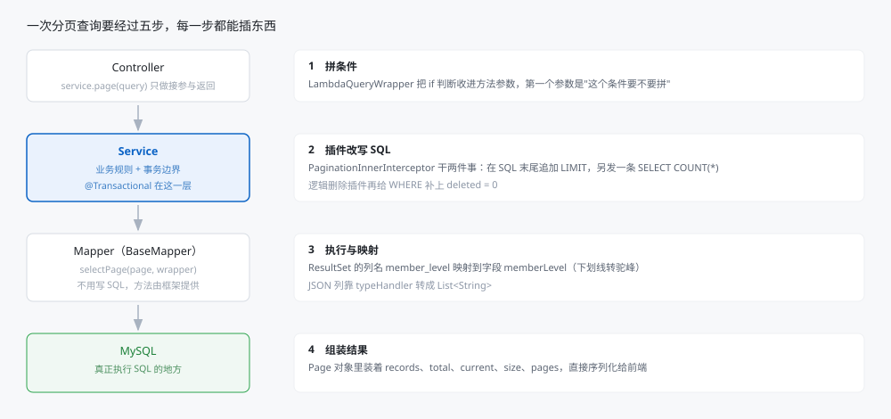
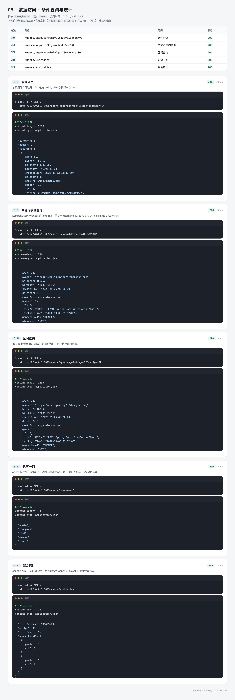
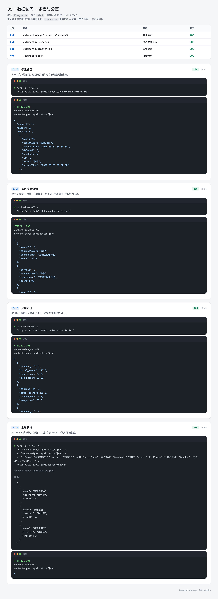
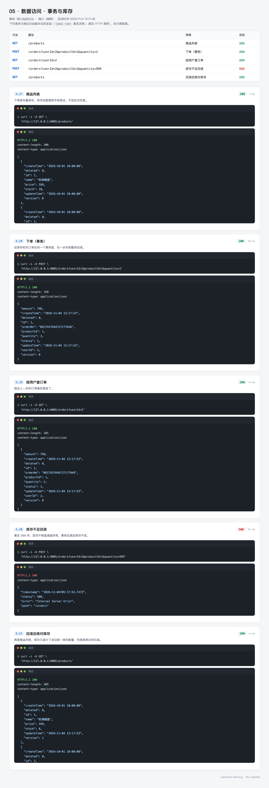

# 05 · 数据访问：把数据真正存下去

> - 难度：进阶
> - 前置条件：完成 [04-web](04-web.md)；会写基本的 SQL（`SELECT`、`INSERT`、`JOIN`）
> - 预计时长：120~150 分钟
> - 对应代码：[05-mybatis](https://github.com/mqxu/backend-learning/tree/main/05-mybatis)

前面几个模块的数据都在内存里，重启就没了。这一节换成 MySQL，并解决随之而来的一堆问题：字段怎么映射、分页怎么写、多个操作怎么保证要么全成要么全败。

---

## 0. 先看结果

做完这一节，你会有一个能真正存数据的模块：

```bash
# 新增一个用户
curl -X POST http://127.0.0.1:8005/users -H "Content-Type: application/json" \
  -d '{"username":"testuser","nickname":"接口测试","age":25}'

# 重启应用后再查，数据还在
curl http://127.0.0.1:8005/users/7
```

同时下面这些都能跑通：

| 能力 | 用哪个接口验证 |
| --- | --- |
| 单表增删改查 | `/users` 系列 |
| 条件查询（模糊、区间、排序） | `/users/keyword`、`/users/age-range`、`/users/top` |
| 分页 | `/users/page?current=1&size=3` |
| 聚合统计 | `/users/statistics` |
| 逻辑删除 | 删除后再查返回 null，库里那行还在 |
| 事务回滚 | 库存不足时下单失败，库存不变 |
| 多表关联 | `/students/1/scores` 返回三张表拼出来的成绩单 |

### 这一节的路线

| 步骤 | 做什么 | 验证 |
| --- | --- | --- |
| 1 | 装 MySQL、建库 | 能连上，库存在 |
| 2 | 建模块，加三个依赖 | `mvn compile` 通过 |
| 3 | 写数据源与初始化脚本 | 启动时自动建表灌数据 |
| 4 | 写实体与 Mapper | 能按 ID 查到一条 |
| 5 | 写 Service 与自动填充 | 新增时 `create_time` 自动有值 |
| 6 | 配分页插件 | 分页返回 total |
| 7 | 逻辑删除与乐观锁 | 删除后查不到，版本号自增 |
| 8 | 条件构造器 | 模糊、区间、排序都生效 |
| 9 | 事务 | 失败时库存回滚 |
| 10 | 多表查询 | 三张表拼成一个对象 |

---

## 1. 为什么不直接写 JDBC

用原生 JDBC 查一个用户：

```java
String sql = "SELECT id, username, nickname, gender, age FROM t_user WHERE id = ?";
try (Connection conn = dataSource.getConnection();
     PreparedStatement ps = conn.prepareStatement(sql)) {
    ps.setLong(1, id);
    try (ResultSet rs = ps.executeQuery()) {
        if (rs.next()) {
            User user = new User();
            user.setId(rs.getLong("id"));
            user.setUsername(rs.getString("username"));
            user.setNickname(rs.getString("nickname"));
            user.setGender(rs.getInt("gender"));
            user.setAge(rs.getInt("age"));
            return user;
        }
    }
}
```

一张五个字段的表就要写十几行。加个字段，SQL 和映射两处都要改，漏一处就是空值。

ORM 把这层映射接过去：

```java
User user = userMapper.selectById(id);
```

一行。字段对应关系由注解声明一次，之后加字段只改实体。

MyBatis 属于"半自动"：SQL 还是你写（或者由 MyBatis-Plus 生成），但参数绑定和结果映射交给框架。

---

## 2. 准备 MySQL

### 2.1 装库与建库

本地已经有 MySQL 8 的话直接跳到建库。没有的话，Docker 最快：

```bash
docker run -d --name mysql8 \
  -p 3306:3306 \
  -e MYSQL_ROOT_PASSWORD=你的密码 \
  mysql:8.4
```

建库：

```sql
CREATE DATABASE IF NOT EXISTS backend_learning DEFAULT CHARSET utf8mb4;
```

字符集必须是 `utf8mb4`，不是 `utf8`。MySQL 的 `utf8` 只支持三个字节，存不了 emoji 和部分生僻字。

### 2.2 确认能连上

```bash
mysql -uroot -p -h127.0.0.1 -P3306 -e "show databases;"
```

看到 `backend_learning` 就行。

### 2.3 三个与新手相关的概念

| 概念 | 一句话 |
| --- | --- |
| 连接池 | 预先建好一批连接反复用，避免每次请求都握手认证 |
| 事务 | 一组操作要么全成功要么全回滚 |
| 字符集 | 库、表、连接三处都要 utf8mb4，不然中文可能变成问号 |

---

## 3. 创建模块

### 3.1 POM

```xml
<?xml version="1.0" encoding="UTF-8"?>
<project xmlns="http://maven.apache.org/POM/4.0.0"
         xmlns:xsi="http://www.w3.org/2001/XMLSchema-instance"
         xsi:schemaLocation="http://maven.apache.org/POM/4.0.0 http://maven.apache.org/xsd/maven-4.0.0.xsd">
    <modelVersion>4.0.0</modelVersion>

    <parent>
        <groupId>top.mqxu</groupId>
        <artifactId>backend-learning</artifactId>
        <version>0.0.1-SNAPSHOT</version>
    </parent>

    <artifactId>05-mybatis</artifactId>

    <properties>
        <mybatis-plus.version>3.5.17</mybatis-plus.version>
    </properties>

    <dependencies>
        <!-- Spring Boot 4 专用 starter，注意 artifactId 里带 4 -->
        <dependency>
            <groupId>com.baomidou</groupId>
            <artifactId>mybatis-plus-spring-boot4-starter</artifactId>
            <version>${mybatis-plus.version}</version>
        </dependency>

        <!-- MySQL 驱动，版本由 Spring Boot 统一管理 -->
        <dependency>
            <groupId>com.mysql</groupId>
            <artifactId>mysql-connector-j</artifactId>
            <scope>runtime</scope>
        </dependency>

        <!-- 分页插件依赖 JSqlParser，3.5.9 起被拆成独立构件，必须显式引入 -->
        <dependency>
            <groupId>com.baomidou</groupId>
            <artifactId>mybatis-plus-jsqlparser</artifactId>
            <version>${mybatis-plus.version}</version>
        </dependency>
    </dependencies>

</project>
```

三个依赖各有讲究：

**为什么 artifactId 里带 `4`**

MyBatis-Plus 针对 Spring Boot 3 和 4 出了不同的 starter。Spring Boot 4 用的是 `mybatis-plus-spring-boot4-starter`。写成 `mybatis-plus-boot-starter`（Boot 2 时代的名字）会启动失败，报自动配置类找不到。

**为什么要 `mybatis-plus-jsqlparser`**

3.5.9 之后，分页插件依赖的 JSqlParser 被拆成了独立构件。只引 starter 的话，配分页插件时会报 `ClassNotFoundException: net.sf.jsqlparser.parser.CCJSqlParserUtil`。这是升级版本时最常见的一个坑。

**为什么 mysql 驱动是 `runtime`**

编译时用不到驱动类（代码里没有 `import com.mysql...`），运行时才需要。用 `runtime` 范围能避免误用。

### 3.2 目录结构

```
05-mybatis
└── src/main
    ├── java/top/mqxu/mybatis
    │   ├── MybatisApplication.java
    │   ├── entity        User / Product / Order / Student / Course / Score
    │   ├── dto           UserQuery
    │   ├── vo            ScoreSheetVO
    │   ├── mapper        六个 Mapper，多数只有一行
    │   ├── service       接口
    │   │   └── impl      实现，业务逻辑都在这
    │   ├── controller    接口层
    │   └── config
    │       ├── MybatisPlusConfig.java      # 分页与乐观锁插件
    │       └── MyMetaObjectHandler.java    # 字段自动填充
    └── resources
        ├── application.yml
        ├── schema.sql    建表
        └── data.sql      初始数据
```

---

## 4. 配置数据源

`src/main/resources/application.yml`：

```yaml
server:
  port: 8005

spring:
  application:
    name: 05-数据访问

  datasource:
    driver-class-name: com.mysql.cj.jdbc.Driver
    url: jdbc:mysql://localhost:3306/backend_learning?useUnicode=true&characterEncoding=utf8&serverTimezone=Asia/Shanghai
    username: root
    password: 你的密码
    hikari:
      pool-name: backend-learning-pool
      maximum-pool-size: 10     # 池上限
      minimum-idle: 5           # 空闲保底连接数
      connection-timeout: 3000  # 取连接超时，毫秒
      max-lifetime: 1800000     # 连接最长存活，毫秒

  # 启动时执行建表与初始化数据
  sql:
    init:
      mode: always
      schema-locations: classpath:schema.sql
      data-locations: classpath:data.sql
      encoding: UTF-8

mybatis-plus:
  configuration:
    map-underscore-to-camel-case: true   # member_level -> memberLevel
    log-impl: org.apache.ibatis.logging.stdout.StdOutImpl  # 打印 SQL，开发期用
  global-config:
    banner: false
    db-config:
      id-type: auto                      # 主键自增
      table-underline: true              # 实体驼峰转表名下划线
      logic-delete-field: deleted        # 逻辑删除字段
      logic-delete-value: 1
      logic-not-delete-value: 0
```

五处值得单独说：

**`serverTimezone=Asia/Shanghai`**

不加这个参数，`LocalDateTime` 存进去和读出来会差 8 小时。原因是驱动默认按 UTC 解释时间。

**`sql.init.mode: always`**

对 MySQL 这种非内嵌数据库，必须显式写 `always`，默认的 `embedded` 不会执行脚本。这个值让每次启动都执行 `schema.sql`（先 DROP 再 CREATE）和 `data.sql`。

对学习仓库来说这很方便：每次启动都是干净数据，改表结构不用手动 `ALTER`。真实项目不能这么干，要用 Flyway 或 Liquibase 做版本化迁移。

**`hikari.maximum-pool-size: 10`**

池子不是越大越好。数据库的连接数有上限，二十个实例各开五十个连接，MySQL 会直接拒绝。经验值是 CPU 核数 × 2 + 磁盘数。

**`map-underscore-to-camel-case`**

数据库列名 `member_level` 自动映射到 Java 字段 `memberLevel`。不开这个，查出来的对象字段全是 null。

**`log-impl: StdOutImpl`**

把执行的 SQL 打到控制台。开发期非常有用，能看到"到底执行了什么 SQL、参数是什么"。生产环境要关掉，否则日志量惊人。

---

## 5. 建表

`schema.sql` 的关键部分（完整文件还有 `t_course`、`t_product`、`t_order`、`t_student`、`t_score`）：

```sql
CREATE DATABASE IF NOT EXISTS backend_learning DEFAULT CHARSET utf8mb4;
USE backend_learning;

-- 先删后建：改字段时不用手工 ALTER，保证表结构与实体一致
DROP TABLE IF EXISTS t_user;

CREATE TABLE t_user
(
    id              BIGINT UNSIGNED AUTO_INCREMENT COMMENT '主键',
    username        VARCHAR(50)                     NOT NULL COMMENT '登录名',
    password        CHAR(64)                        NOT NULL COMMENT '密码摘要',
    nickname        VARCHAR(50) COMMENT '昵称',
    gender          TINYINT                         NOT NULL DEFAULT 0 COMMENT '0 未设置 / 1 男 / 2 女',
    age             TINYINT UNSIGNED COMMENT '年龄',
    member_level    ENUM ('BRONZE','SILVER','GOLD') NOT NULL DEFAULT 'BRONZE' COMMENT '会员等级',
    points          INT                             NOT NULL DEFAULT 0 COMMENT '积分',
    balance         DECIMAL(12, 2)                  NOT NULL DEFAULT 0.00 COMMENT '余额',
    score           FLOAT COMMENT '推荐评分',
    phone           VARCHAR(20) COMMENT '手机号',
    email           VARCHAR(100) COMMENT '邮箱',
    avatar          VARCHAR(255) COMMENT '头像',
    intro           TEXT COMMENT '个人简介',
    tags            JSON COMMENT '标签数组',
    birthday        DATE COMMENT '生日',
    work_time       TIME COMMENT '上班时间',
    vip             TINYINT                         NOT NULL DEFAULT 0 COMMENT '是否会员',
    status          TINYINT                         NOT NULL DEFAULT 1 COMMENT '1 正常 / 0 禁用',
    last_login_time DATETIME COMMENT '最后登录时间',
    create_time     DATETIME                        NOT NULL COMMENT '创建时间',
    update_time     DATETIME                        NOT NULL COMMENT '更新时间',
    deleted         TINYINT                         NOT NULL DEFAULT 0 COMMENT '逻辑删除',
    version         INT                             NOT NULL DEFAULT 0 COMMENT '乐观锁版本号',
    PRIMARY KEY (id),
    UNIQUE KEY uk_username (username),
    KEY idx_status_gender (status, gender)
) ENGINE = InnoDB
  DEFAULT CHARSET = utf8mb4 COMMENT ='用户表';
```

这张表刻意覆盖了常用类型，方便一次讲清映射关系：

| MySQL 类型 | Java 类型 | 注意 |
| --- | --- | --- |
| `BIGINT UNSIGNED` | `Long` | 主键首选，留够增长空间 |
| `DECIMAL(12,2)` | `BigDecimal` | 金额必须用定点数 |
| `FLOAT` | `Float` | 近似值，不要用于金额 |
| `DATE` / `TIME` / `DATETIME` | `LocalDate` / `LocalTime` / `LocalDateTime` | 用 `java.time`，别用 `Date` |
| `JSON` | `List<String>` | 需要 `typeHandler` |
| `TINYINT` | `Integer` / `Boolean` | 表示布尔时用 `Integer` 更直观 |

金额用 `double` 是经典事故：`0.1 + 0.2` 在二进制浮点里等于 `0.30000000000000004`，对账时差一分钱要查一整天。

---

## 6. 实体映射

`entity/User.java`：

```java
package top.mqxu.mybatis.entity;

import com.baomidou.mybatisplus.annotation.FieldFill;
import com.baomidou.mybatisplus.annotation.IdType;
import com.baomidou.mybatisplus.annotation.TableField;
import com.baomidou.mybatisplus.annotation.TableId;
import com.baomidou.mybatisplus.annotation.TableLogic;
import com.baomidou.mybatisplus.annotation.TableName;
import com.baomidou.mybatisplus.annotation.Version;
import com.baomidou.mybatisplus.extension.handlers.Jackson3TypeHandler;
import lombok.Data;

import java.math.BigDecimal;
import java.time.LocalDate;
import java.time.LocalDateTime;
import java.time.LocalTime;
import java.util.List;

@Data
@TableName(value = "t_user", autoResultMap = true)
public class User {

    @TableId(type = IdType.AUTO)
    private Long id;

    private String username;
    private String password;
    private String nickname;
    private Integer gender;
    private Integer age;
    private String memberLevel;
    private Integer points;
    private BigDecimal balance;
    private Float score;
    private String phone;
    private String email;
    private String avatar;
    private String intro;

    /** JSON 列与 List 互转 */
    @TableField(typeHandler = Jackson3TypeHandler.class)
    private List<String> tags;

    private LocalDate birthday;
    private LocalTime workTime;
    private Integer vip;
    private Integer status;
    private LocalDateTime lastLoginTime;

    @TableField(fill = FieldFill.INSERT)
    private LocalDateTime createTime;

    @TableField(fill = FieldFill.INSERT_UPDATE)
    private LocalDateTime updateTime;

    @TableLogic
    private Integer deleted;

    @Version
    private Integer version;
}
```

逐个注解说明：

| 注解 | 作用 | 不写会怎样 |
| --- | --- | --- |
| `@TableName("t_user")` | 指定表名 | 按类名推导成 `user`，与 `t_user` 对不上，报表不存在 |
| `@TableId(type = AUTO)` | 主键用数据库自增 | 默认雪花 ID，插入后拿不到自增值 |
| `@TableField(fill = INSERT)` | 插入时自动填充 | `create_time` 为 null，`NOT NULL` 约束报错 |
| `@TableField(fill = INSERT_UPDATE)` | 插入和更新都填充 | 更新时间永远是创建时间 |
| `@TableField(typeHandler = ...)` | JSON 列转换 | 存进去是乱码或反序列化失败 |
| `@TableLogic` | 逻辑删除 | `delete` 变成真删，数据无法恢复 |
| `@Version` | 乐观锁 | 并发更新互相覆盖 |

`autoResultMap = true` 是 `typeHandler` 生效的前提，漏了之后查询出来的 `tags` 会是 null——这个坑很隐蔽，因为插入看起来是正常的。

字段名与列名的对应靠约定：`memberLevel` → `member_level`，由 `table-underline: true` 和 `map-underscore-to-camel-case: true` 共同保证。

---

## 7. Mapper 与 Service

### 7.1 Mapper 只有一行

```java
package top.mqxu.mybatis.mapper;

import com.baomidou.mybatisplus.core.mapper.BaseMapper;
import top.mqxu.mybatis.entity.User;

public interface UserMapper extends BaseMapper<User> {
}
```

`BaseMapper` 已经带了 17 个方法：

```java
User selectById(Serializable id);
List<User> selectList(Wrapper<User> wrapper);
Long selectCount(Wrapper<User> wrapper);
int insert(User entity);
int updateById(User entity);
int deleteById(Serializable id);
// ...
```

单表 CRUD 一行 SQL 都不用写。

### 7.2 Service 继承 ServiceImpl

```java
package top.mqxu.mybatis.service;

import com.baomidou.mybatisplus.extension.service.IService;
import top.mqxu.mybatis.entity.User;

public interface UserService extends IService<User> {
}
```

```java
package top.mqxu.mybatis.service.impl;

import com.baomidou.mybatisplus.spring.service.impl.ServiceImpl;
import org.springframework.stereotype.Service;
import top.mqxu.mybatis.entity.User;
import top.mqxu.mybatis.mapper.UserMapper;
import top.mqxu.mybatis.service.UserService;

@Service
public class UserServiceImpl extends ServiceImpl<UserMapper, User> implements UserService {
}
```

注意 `ServiceImpl` 的包名：`com.baomidou.mybatisplus.spring.service.impl`。旧版本是 `com.baomidou.mybatisplus.extension.service.impl`，Boot 4 适配版换了包。照旧教程写会编译不过。

`ServiceImpl` 提供了 `baseMapper`、`getById()`、`save()`、`saveBatch()`、`lambdaQuery()` 等便利方法。

### 7.3 第一个查询

在 `UserServiceImpl` 里用 `getById`：

```java
@Override
public User getById(Long id) {
    return getBaseMapper().selectById(id);
}
```

`ServiceImpl` 自己实现了 `IService.getById`，所以大多数时候不用重写，直接调：

```java
User user = userService.getById(2L);
```

---

## 8. 字段自动填充

`create_time` 和 `update_time` 是 `NOT NULL`，但代码里不该每次都手动 set。交给填充器。

`config/MyMetaObjectHandler.java`：

```java
package top.mqxu.mybatis.config;

import com.baomidou.mybatisplus.core.handlers.MetaObjectHandler;
import org.apache.ibatis.reflection.MetaObject;
import org.springframework.stereotype.Component;

import java.time.LocalDateTime;

@Component
public class MyMetaObjectHandler implements MetaObjectHandler {

    @Override
    public void insertFill(MetaObject metaObject) {
        strictInsertFill(metaObject, "createTime", LocalDateTime::now, LocalDateTime.class);
        strictInsertFill(metaObject, "updateTime", LocalDateTime::now, LocalDateTime.class);
        strictInsertFill(metaObject, "deleted", () -> 0, Integer.class);
        strictInsertFill(metaObject, "version", () -> 0, Integer.class);
    }

    @Override
    public void updateFill(MetaObject metaObject) {
        // 不能用 strictUpdateFill：严格填充只在字段为 null 时写，
        // 而从库里查出来的实体 updateTime 已有旧值，会被原样写回，等于没刷新
        if (metaObject.hasSetter("updateTime")) {
            setFieldValByName("updateTime", LocalDateTime.now(), metaObject);
        }
    }
}
```

两个实战细节：

**`strictInsertFill` 只在字段为 null 时填充**

不会覆盖你手动设置的值。比如你想导入历史数据、指定原始创建时间，直接 set 就行。

**`hasSetter` 判断不能省**

同一个填充器服务于所有实体，而 `t_course` 表没有 `updateTime` 字段。不判断的话，插入课程时会抛 `There is no setter for property named 'updateTime'`。

时间字段的填充时机：

| 字段 | 策略 | 效果 |
| --- | --- | --- |
| `createTime` | `INSERT` | 只在插入时写 |
| `updateTime` | `INSERT_UPDATE` | 插入和更新都刷新 |

---

## 9. 分页插件

分页看着只是"多查一个 COUNT"，实际上一共有五步。理解这五步，才知道每个拦截器该插在哪：



### 9.1 注册插件

`config/MybatisPlusConfig.java`：

```java
package top.mqxu.mybatis.config;

import com.baomidou.mybatisplus.annotation.DbType;
import com.baomidou.mybatisplus.extension.plugins.MybatisPlusInterceptor;
import com.baomidou.mybatisplus.extension.plugins.inner.OptimisticLockerInnerInterceptor;
import com.baomidou.mybatisplus.extension.plugins.inner.PaginationInnerInterceptor;
import org.springframework.context.annotation.Bean;
import org.springframework.context.annotation.Configuration;

@Configuration
public class MybatisPlusConfig {

    @Bean
    public MybatisPlusInterceptor mybatisPlusInterceptor() {
        MybatisPlusInterceptor interceptor = new MybatisPlusInterceptor();
        // 顺序有讲究：分页在前，乐观锁在后
        interceptor.addInnerInterceptor(new PaginationInnerInterceptor(DbType.MYSQL));
        interceptor.addInnerInterceptor(new OptimisticLockerInnerInterceptor());
        return interceptor;
    }
}
```

不注册这个插件，`selectPage` 会退化成全表查询——它不会报错，只是把你传的 `size` 忽略掉，把整张表的数据都返回。数据量小时看不出来，上线后才炸。

### 9.2 用起来

```java
public Page<User> page(UserQuery query, long current, long size) {
    LambdaQueryWrapper<User> wrapper = new LambdaQueryWrapper<>();
    wrapper.eq(query.getGender() != null, User::getGender, query.getGender());

    Page<User> page = new Page<>(current, size);
    return page(page, wrapper);
}
```

`Page` 返回后能拿到：

| 方法 | 含义 |
| --- | --- |
| `getRecords()` | 当前页数据 |
| `getTotal()` | 总条数 |
| `getCurrent()` | 当前页码 |
| `getSize()` | 每页条数 |
| `getPages()` | 总页数（自动算好） |

序列化后前端直接能用。

---

## 10. 逻辑删除与乐观锁

### 10.1 逻辑删除

配置里已经声明了：

```yaml
logic-delete-field: deleted
logic-delete-value: 1
logic-not-delete-value: 0
```

实体字段加 `@TableLogic`。之后：

```java
userMapper.deleteById(5L);
// 实际执行：UPDATE t_user SET deleted=1 WHERE id=5 AND deleted=0

userMapper.selectById(5L);
// 实际执行：SELECT ... WHERE id=5 AND deleted=0，查不到
```

好处是数据可追溯，"用户注销"之后还能做数据分析。

两个代价：

- 表会越来越大，需要定期归档
- 所有唯一索引都要把 `deleted` 考虑进去，否则删掉 `zhangsan` 之后再注册同名用户会撞唯一键

还有一条最容易忘：**手写的 SQL 不会自动加 `deleted = 0`**。多表查询的 `@Select` 里必须自己写。

### 10.2 乐观锁

```java
User user = userMapper.selectById(1L);   // version = 0
user.setNickname("新昵称");
userMapper.updateById(user);
// 实际执行：UPDATE t_user SET nickname=?, version=1 WHERE id=1 AND version=0
```

如果这中间有人改了同一条记录，`WHERE version=0` 匹配不到行，更新影响行数为 0。业务上要检查返回值：

```java
if (userMapper.updateById(user) == 0) {
    throw new BusinessException("数据已被他人修改，请刷新后重试");
}
```

乐观锁适合冲突少的场景（读多写少）。冲突频繁时会大量失败重试，那该用悲观锁（`SELECT ... FOR UPDATE`）。

---

## 11. 条件构造器

### 11.1 基本用法

```java
// 等值
wrapper.eq(User::getGender, 1);

// 模糊
wrapper.like(User::getUsername, "张");

// 区间
wrapper.ge(User::getAge, 20).le(User::getAge, 30);

// 排序
wrapper.orderByDesc(User::getPoints);

// 只取一列
wrapper.select(User::getUsername);
```

`User::getGender` 是方法引用，编译期就能检查字段是否存在。写错名字编译不过，这是 Lambda 版相比字符串版（`"gender"`）的最大好处。

### 11.2 条件开关

```java
wrapper.eq(query.getGender() != null, User::getGender, query.getGender())
       .ge(query.getMinAge() != null, User::getAge, query.getMinAge())
       .le(query.getMaxAge() != null, User::getAge, query.getMaxAge());
```

第一个参数为 `false` 时，这个条件不拼进 SQL。省掉一堆 `if` 包裹。

### 11.3 and / or 必须加括号

```java
// 期望：username LIKE '%张%' OR nickname LIKE '%张%'
wrapper.and(w -> w.like(User::getUsername, keyword)
                  .or()
                  .like(User::getNickname, keyword));
```

不加 `and(w -> ...)` 会变成：

```sql
-- 实际：username LIKE '%张%' OR nickname LIKE '%张%' AND deleted = 0
-- 因为 OR 优先级低于 AND，等价于 username LIKE '%张%' OR (nickname LIKE ... AND deleted = 0)
```

结果就是删掉的记录也可能被查出来。这类 bug 在测试数据少时看不出来。

### 11.4 更新用 setSql

```java
// 充值：直接在数据库里加，避免先查后改的并发覆盖
userMapper.update(null, new LambdaUpdateWrapper<User>()
        .setSql("points = points + " + amount)
        .eq(User::getId, id));
```

"先查出余额 100，加 50，再写回 150"，两个并发请求都读到 100，最后都是 150——少加了 50。`setSql` 让数据库自己算，不会丢更新。

### 11.5 聚合统计

```java
QueryWrapper<User> wrapper = new QueryWrapper<>();
wrapper.select("COUNT(*) AS totalCount",
               "SUM(balance) AS totalBalance",
               "MAX(age) AS maxAge");
Map<String, Object> summary = getMap(wrapper);
```

`getMap` 返回的 key 是 SQL 里的别名。注意这里用的是 `QueryWrapper`（字符串列名）而不是 `LambdaQueryWrapper`——聚合表达式没法用方法引用表达。

---

## 12. 事务

### 12.1 一个必须原子化的场景

下单要做两件事：扣库存、写订单。第二件失败时，第一件必须撤销，否则库存凭空少了。

`service/impl/OrderServiceImpl.java`：

```java
package top.mqxu.mybatis.service.impl;

import com.baomidou.mybatisplus.core.conditions.query.LambdaQueryWrapper;
import com.baomidou.mybatisplus.spring.service.impl.ServiceImpl;
import lombok.RequiredArgsConstructor;
import org.springframework.stereotype.Service;
import org.springframework.transaction.annotation.Transactional;
import top.mqxu.mybatis.entity.Order;
import top.mqxu.mybatis.entity.Product;
import top.mqxu.mybatis.mapper.OrderMapper;
import top.mqxu.mybatis.mapper.ProductMapper;
import top.mqxu.mybatis.service.OrderService;

import java.math.BigDecimal;
import java.util.List;
import java.util.concurrent.ThreadLocalRandom;

@Service
@RequiredArgsConstructor
public class OrderServiceImpl extends ServiceImpl<OrderMapper, Order> implements OrderService {

    private final ProductMapper productMapper;

    @Transactional(rollbackFor = Exception.class)
    @Override
    public Order createOrder(Long userId, Long productId, int quantity) {
        if (quantity <= 0) {
            throw new IllegalArgumentException("购买数量必须大于 0");
        }

        Product product = productMapper.selectById(productId);
        if (product == null) {
            throw new IllegalArgumentException("商品不存在：" + productId);
        }

        int stockBefore = product.getStock();

        // 第一步：扣库存，先改库
        product.setStock(stockBefore - quantity);
        productMapper.updateById(product);

        // 第二步：库存成负数就抛异常，让第一步回滚。
        // 故意把校验放在写库之后，是为了让"扣库存已执行"暴露在回滚面前
        if (product.getStock() < 0) {
            throw new IllegalStateException("库存不足：剩余 " + stockBefore + "，需要 " + quantity);
        }

        // 第三步：写订单
        Order order = new Order();
        order.setOrderNo(generateOrderNo());
        order.setUserId(userId);
        order.setProductId(productId);
        order.setQuantity(quantity);
        order.setAmount(product.getPrice().multiply(BigDecimal.valueOf(quantity)));
        order.setStatus(1);
        save(order);
        return order;
    }

    @Override
    public List<Order> listByUser(Long userId) {
        return list(new LambdaQueryWrapper<Order>()
                .eq(Order::getUserId, userId)
                .orderByDesc(Order::getId));
    }

    @Override
    public boolean cancelOrder(Long orderId) {
        Order order = getById(orderId);
        if (order == null) {
            throw new IllegalArgumentException("订单不存在：" + orderId);
        }
        if (Integer.valueOf(0).equals(order.getStatus())) {
            return false;
        }
        order.setStatus(0);
        return updateById(order);
    }

    @Override
    public boolean removeOrder(Long orderId) {
        return removeById(orderId);
    }

    private String generateOrderNo() {
        return "NO" + System.currentTimeMillis() + ThreadLocalRandom.current().nextInt(1000, 10000);
    }
}
```

### 12.2 四个必须知道的点

**`rollbackFor = Exception.class` 不能省**

默认只对 `RuntimeException` 回滚。抛受检异常（比如 `IOException`）时事务照常提交——这是 Spring 事务最经典的坑。

**校验放在写库之后是有意的**

按正常思维应该先判断 `stock >= quantity` 再扣。这里故意反过来，是为了让"扣库存已经执行了"这件事暴露在回滚面前——如果事务不生效，库存就会变成负数，一眼能看出来。教学演示用，生产代码应该先判断。

**`@Transactional` 靠代理生效**

同类内部方法调用（`this.xxx()`）不走代理，事务不生效。要调用带事务的方法，必须从外部通过 Bean 调用。

**方法必须是 `public`**

`private`、`protected` 方法上的 `@Transactional` 不生效，Spring 的代理拦不到。

---

## 13. 多表查询

`BaseMapper` 只管单表。要三张表拼成一张成绩单，得自己写 SQL。

`mapper/ScoreMapper.java`：

```java
package top.mqxu.mybatis.mapper;

import com.baomidou.mybatisplus.core.mapper.BaseMapper;
import org.apache.ibatis.annotations.Param;
import org.apache.ibatis.annotations.Select;
import top.mqxu.mybatis.entity.Score;
import top.mqxu.mybatis.vo.ScoreSheetVO;

import java.util.List;

public interface ScoreMapper extends BaseMapper<Score> {

    @Select("""
            SELECT s.id        AS scoreId,
                   st.name     AS studentName,
                   c.name      AS courseName,
                   s.score     AS score
            FROM t_score s
                     JOIN t_student st ON st.id = s.student_id AND st.deleted = 0
                     JOIN t_course c ON c.id = s.course_id
            WHERE s.deleted = 0
              AND s.student_id = #{studentId}
            ORDER BY s.id
            """)
    List<ScoreSheetVO> selectScoreSheet(@Param("studentId") Long studentId);
}
```

三个要点：

**别名要和 VO 的属性名一致**

数据库返回的列叫 `studentName`，VO 里也叫 `studentName`，MyBatis 才能自动填进去。写成 `student_name` 就对不上——除非开了下划线转驼峰（本项目开了，但显式别名更稳）。

**`deleted = 0` 要自己写**

逻辑删除只对 MyBatis-Plus 生成的那几条 SQL 生效，手写的 SQL 它不管。两个表的条件都要写。

**`#{studentId}` 是预编译参数**

用 `#{}` 不是 `${}`。后者是字符串拼接，有 SQL 注入风险。

多表查询的五种做法对比：

| 方式 | 适用 | 代价 |
| --- | --- | --- |
| 分步查单表，内存拼装 | 关联少、数据量小 | N+1 查询 |
| `@Select` 映射到 VO | 一两张表、字段少 | SQL 长了难维护 |
| XML + `resultMap` | 三张以上表、需要复用 | 要维护 XML |
| 一条 join 直接分页 | 列表页需要总数 | join 后分页粒度是"行"不是"主表记录" |
| `mybatis-plus-join` | 想用 lambda 写 join | 多一个依赖 |

最后一条的坑值得记：join 之后 `COUNT(*)` 数的是结果行数。一个学生三门课，按学生分页会把这个学生算成三条。

---

## 14. 接口清单

`controller/UserController.java`（节选核心方法，方法名与 `UserService` 接口一一对应）：

```java
@RestController
@RequestMapping("/users")
@RequiredArgsConstructor
public class UserController {

    private final UserService userService;

    /* ==================== 增 ==================== */

    @PostMapping
    public User create(@RequestBody User user) {
        userService.createUser(user);
        return user;
    }

    @PostMapping("/batch")
    public int createBatch(@RequestBody List<User> users) {
        userService.createUserBatch(users);
        return users.size();
    }

    /* ==================== 查 ==================== */

    /** 按主键查询 */
    @GetMapping("/{id}")
    public User getById(@PathVariable Long id) {
        return userService.getUser(id);
    }

    /** 条件列表，不传参数即查全部 */
    @GetMapping
    public List<User> list(UserQuery query) {
        return userService.listByCondition(query);
    }

    /** 条件分页 */
    @GetMapping("/page")
    public Page<User> page(UserQuery query,
                           @RequestParam(defaultValue = "1") long current,
                           @RequestParam(defaultValue = "10") long size) {
        return userService.pageByCondition(query, current, size);
    }

    /** 关键词模糊匹配 username 或 nickname */
    @GetMapping("/keyword")
    public List<User> keyword(@RequestParam String keyword) {
        return userService.searchByKeyword(keyword);
    }

    /** 年龄区间查询 */
    @GetMapping("/age-range")
    public List<User> ageRange(@RequestParam(required = false) Integer minAge,
                               @RequestParam(required = false) Integer maxAge) {
        return userService.listByAgeRange(minAge, maxAge);
    }

    /** 按积分倒序取前 N 条 */
    @GetMapping("/top")
    public List<User> top(@RequestParam(defaultValue = "3") Integer limit) {
        return userService.listTop(limit);
    }

    /** 只取用户名列 */
    @GetMapping("/usernames")
    public List<String> usernames() {
        return userService.listUsernames();
    }

    /** 按 JSON 标签查询 */
    @GetMapping("/tag")
    public List<User> byTag(@RequestParam String tag) {
        return userService.listByTag(tag);
    }

    /** 用户名是否已存在 */
    @GetMapping("/exists")
    public boolean exists(@RequestParam String username) {
        return userService.existsUsername(username);
    }

    /** 按性别统计人数 */
    @GetMapping("/count")
    public long count(@RequestParam(required = false) Integer gender) {
        return userService.countByGender(gender);
    }

    /** 汇总统计：总数、余额合计、最大年龄、按性别分组人数 */
    @GetMapping("/statistics")
    public Map<String, Object> statistics() {
        return userService.statistics();
    }

    /* ==================== 改 ==================== */

    /** 按主键更新，路径上的 id 覆盖请求体中的 id */
    @PutMapping("/{id}")
    public User update(@PathVariable Long id, @RequestBody User user) {
        user.setId(id);
        userService.modifyUser(user);
        return userService.getUser(id);
    }

    /** 只改状态 */
    @PutMapping("/{id}/status")
    public boolean updateStatus(@PathVariable Long id, @RequestParam Integer status) {
        return userService.modifyUserStatus(id, status);
    }

    /** 充值 */
    @PostMapping("/{id}/recharge")
    public User recharge(@PathVariable Long id, @RequestParam BigDecimal amount) {
        userService.recharge(id, amount);
        return userService.getUser(id);
    }

    /** 按用户名改邮箱，路径是字面量，会比 /{id} 优先匹配 */
    @PutMapping("/email")
    public boolean updateEmail(@RequestParam String username, @RequestParam String email) {
        return userService.modifyEmailByUsername(username, email);
    }

    /* ==================== 删 ==================== */

    /** 按主键删除（逻辑删除） */
    @DeleteMapping("/{id}")
    public boolean delete(@PathVariable Long id) {
        return userService.removeUser(id);
    }

    /** 批量删除，ids 用逗号分隔 */
    @DeleteMapping("/batch")
    public boolean deleteBatch(@RequestParam List<Long> ids) {
        return userService.removeUserBatch(ids);
    }

    /** 按状态批量删除 */
    @DeleteMapping("/status/{status}")
    public boolean deleteByStatus(@PathVariable Integer status) {
        return userService.removeUserByStatus(status);
    }
}
```

完整接口表：

| 方法 | 路径 | 说明 |
| --- | --- | --- |
| POST | `/users` | 新增 |
| POST | `/users/batch` | 批量新增 |
| GET | `/users/{id}` | 按主键查询 |
| GET | `/users` | 条件列表 |
| GET | `/users/page` | 条件分页 |
| GET | `/users/keyword` | 关键词模糊查询 |
| GET | `/users/age-range` | 年龄区间 |
| GET | `/users/top` | 按积分取前 N |
| GET | `/users/usernames` | 只取用户名 |
| GET | `/users/count` | 按性别统计人数 |
| GET | `/users/statistics` | 汇总统计 |
| PUT | `/users/{id}` | 按主键更新 |
| PUT | `/users/{id}/status` | 只改状态 |
| POST | `/users/{id}/recharge` | 充值（原子自增） |
| DELETE | `/users/{id}` | 逻辑删除 |
| DELETE | `/users/batch` | 批量删除 |
| GET | `/students/page` | 学生分页 |
| GET | `/students/{id}/scores` | 成绩单（三表 join） |
| GET | `/students/statistics` | 按学生分组统计 |
| POST | `/courses/batch` | 批量新增课程 |
| GET | `/products` | 商品与库存 |
| POST | `/orders` | 下单（事务） |
| GET | `/orders` | 按用户查订单 |
| PUT | `/orders/{id}/cancel` | 取消订单 |
| DELETE | `/orders/{id}` | 逻辑删除订单 |

---

## 15. 运行与实测

### 15.1 启动

```bash
mvn -pl 05-mybatis spring-boot:run
```

启动时会执行 `schema.sql` 与 `data.sql`，控制台能看到建表和插入语句（因为配了 `StdOutImpl`）。

### 15.2 增删改查


对照着看四件事：

- 列表返回 5 条。`data.sql` 里有 6 条，少的那个是 `deleted=1` 的，被逻辑删除条件过滤掉了
- 新增时请求体没有 `createTime`，响应里却有值——自动填充生效
- 充值 100 后余额从 88.50 变 188.50，`setSql` 自增的结果
- 删除返回 `true`，回查返回空响应体——逻辑删除后查不到，但数据库里那行还在

### 15.3 条件查询与统计



- 分页返回 `records` / `total` / `size` / `current` / `pages`，`total` 是**过滤后的总数**
- 关键词 `张` 命中 `zhangsan`，`and` 嵌套结构生效
- `/users/usernames` 只返回字符串数组，用于下拉框
- 统计里 `totalCount` 是 5（不含逻辑删除的），`genderCount` 是分组结果

### 15.4 多表与分页



三表 join 出来的成绩单字段是驼峰的（`studentName`、`courseName`），因为 `@Select` 里写了别名。

`/students/statistics` 返回的字段是下划线形式（`student_id`、`avg_score`），因为它返回的是 `List<Map>`，没有实体可以套驼峰规则。

### 15.5 事务与库存



这组最能说明事务的价值：

- 下单 2 件，库存从 10 变 8，订单落库
- 下单 999 件，库存不够，抛异常返回 500
- 再查库存，还是 8——失败那单没有扣减

同时 `version` 从 0 变成 1，乐观锁参与了这次更新。

---

## 16. 写测试

数据层的测试要连真实数据库。这个模块用 `schema.sql` + `data.sql` 每次重建，测试是干净的。

`src/test/java/top/mqxu/mybatis/UserServiceTest.java`：

```java
package top.mqxu.mybatis;

import org.junit.jupiter.api.Test;
import org.springframework.beans.factory.annotation.Autowired;
import org.springframework.boot.test.context.SpringBootTest;
import top.mqxu.mybatis.entity.User;
import top.mqxu.mybatis.service.UserService;

import java.util.List;

import static org.assertj.core.api.Assertions.assertThat;

@SpringBootTest
class UserServiceTest {

    @Autowired
    private UserService userService;

    @Test
    void 逻辑删除的记录查不到() {
        // data.sql 里 id=5 的记录 deleted=1
        assertThat(userService.getById(5L)).isNull();
        assertThat(userService.count()).isEqualTo(5);
    }

    @Test
    void 新增时自动填充创建时间() {
        User user = new User();
        user.setUsername("auto-fill-test");
        user.setPassword("x");
        user.setGender(1);

        userService.save(user);

        User saved = userService.getById(user.getId());
        assertThat(saved.getCreateTime()).isNotNull();
        assertThat(saved.getUpdateTime()).isNotNull();
        assertThat(saved.getDeleted()).isZero();
        assertThat(saved.getVersion()).isZero();
    }

    @Test
    void 按关键词模糊匹配用户名或昵称() {
        List<User> users = userService.searchByKeyword("张");
        assertThat(users).isNotEmpty();
        assertThat(users).allMatch(u -> u.getUsername().contains("张")
                || (u.getNickname() != null && u.getNickname().contains("张")));
    }

    @Test
    void 充值后余额按金额增加() {
        User before = userService.getById(2L);
        java.math.BigDecimal origin = before.getBalance();

        userService.recharge(2L, new java.math.BigDecimal("100"));

        assertThat(userService.getById(2L).getBalance())
                .isEqualByComparingTo(origin.add(new java.math.BigDecimal("100")));
    }
}
```

跑：

```bash
mvn -pl 05-mybatis test
```

四个用例覆盖了逻辑删除、自动填充、条件查询、原子更新。注意测试之间共享同一个数据库，改数据的用例（充值、新增）会影响后续用例——真实项目要用 `@Transactional` 让每个测试自动回滚：

```java
@SpringBootTest
@Transactional   // 每个测试方法结束后回滚
class UserServiceTest { ... }
```

加上注解后，`save` 和 `recharge` 的效果在测试结束时被撤销，用例之间互不干扰。

---

## 17. 常见问题

| 现象 | 原因 | 解决 |
| --- | --- | --- |
| 启动报 `Table doesn't exist` | `sql.init.mode` 没设 `always` | 非内嵌库必须显式设 |
| 插入报 `Field 'create_time' doesn't have a default value` | 自动填充没生效 | 检查 `@TableField(fill=...)` 与填充器 Bean |
| 查询出来的对象字段全是 null | 没开下划线转驼峰 | `map-underscore-to-camel-case: true` |
| JSON 字段查出来是 null | 缺 `autoResultMap = true` | 在 `@TableName` 上加 |
| 分页返回全部数据 | 没注册分页插件 | 加 `PaginationInnerInterceptor` |
| 分页报 `ClassNotFoundException: CCJSqlParserUtil` | 缺 `mybatis-plus-jsqlparser` | 补依赖（3.5.9+ 需要） |
| 逻辑删除后手写 SQL 还能查到 | 手写 SQL 不管逻辑删除 | 自己加 `deleted = 0` |
| 事务不回滚 | 抛受检异常 / 内部方法调用 / 异常被吞 | `rollbackFor`、`public`、别吞 |
| 并发下超卖 | 先查库存再改 | `setSql` 条件扣减或悲观锁 |
| 时间差 8 小时 | 连接串没配时区 | `serverTimezone=Asia/Shanghai` |
| 金额出现 `0.30000000000000004` | 用了 `double` | 换 `BigDecimal` + `DECIMAL` 列 |
| 编译报 `ServiceImpl` 找不到 | 包路径变了 | Boot 4 用 `com.baomidou.mybatisplus.spring.service.impl` |

---

## 18. 练习

### 18.1 随堂练习（25 分钟）

| # | 练习 | 检查点 |
| --- | --- | --- |
| 1 | 给 `/users` 加 `memberLevel` 过滤，传 `GOLD` 只返回金卡 | 枚举字符串条件生效 |
| 2 | 用 `@Select` 注解写"按班级查学生" | 注解 SQL 与条件构造器的差别 |
| 3 | 把 `data.sql` 里 id=5 的记录改回 `deleted=0`，重启 | 列表条数变化 |

### 18.2 课后练习

**基础**：给 `t_order` 加"按状态 + 时间区间"的查询，两个条件都可空。

**进阶**：把 `createOrder` 改成"扣库存失败时重试三次"。提示：重试要放在事务外层，因为事务一旦被标记回滚就不能继续用了。

**挑战**：实现深分页优化。接口接受 `lastId` 参数，用 `WHERE id > ? ORDER BY id LIMIT ?` 替代 `LIMIT offset, size`，并用一万条数据对比两种方式的耗时。提示：先造数据，再用 `EXPLAIN` 看执行计划。

---

## 19. 小结

### 19.1 核心概念

| 知识点 | 一句话 |
| --- | --- |
| `BaseMapper` | 17 个单表方法，绝大多数 CRUD 不用写 SQL |
| `@TableName` + `autoResultMap` | 表名映射与 JSON 字段处理的前提 |
| 自动填充 | `INSERT` / `INSERT_UPDATE` 两种时机 |
| 逻辑删除 | `delete` 变 `update`，查询自动加条件，手写 SQL 要自己加 |
| 乐观锁 | `@Version` 参与 `WHERE` 与自增，冲突时影响行数为 0 |
| 条件构造器 | 第一个参数控制是否拼接，`and()` 里的括号不能省 |
| 分页插件 | 自动 `LIMIT` + `COUNT`，不注册就退化成全表查询 |
| 事务 | `rollbackFor`、代理边界、别吞异常 |
| 多表 | `@Select` 映射 VO，`deleted=0` 要手写 |

### 19.2 几条实践建议

- 金额一律 `BigDecimal` + `DECIMAL`
- 主键用自增 `BIGINT`，别用业务字段
- 更新优先用条件表达式（`setSql`），少用"先查后改"
- 事务方法 `public`，声明 `rollbackFor`
- 手写 SQL 显式处理逻辑删除与表别名
- 数据层测试加 `@Transactional`，让每个用例自动回滚

### 19.3 下一节

数据落库了，但每次查询都要走磁盘。热点数据（商品详情、配置项）完全没必要每次都查库。

下一节 [06-redis](06-redis.md) 在数据库前面加一层缓存，把响应时间从毫秒降到微秒，并处理缓存穿透、击穿、雪崩这三个必答题。

> 本节遵循的规范：金额用 `BigDecimal`；主键用自增 `BIGINT`；更新用条件表达式；事务方法 `public` 且声明 `rollbackFor`；手写 SQL 显式处理逻辑删除；连接串必须带时区。
