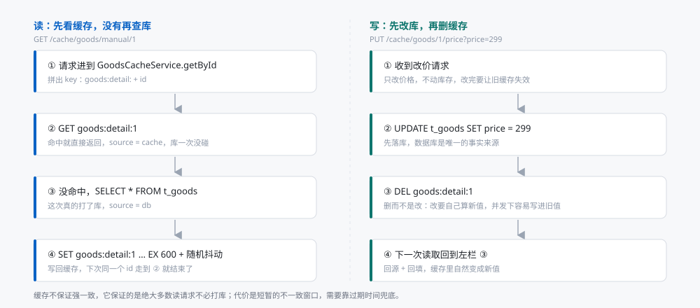
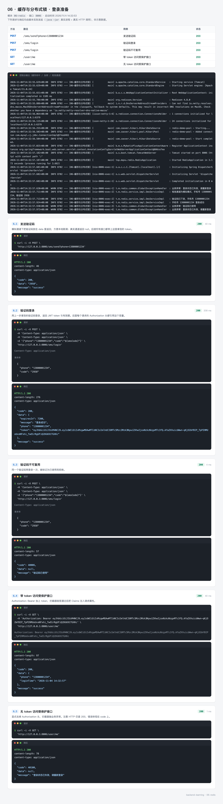
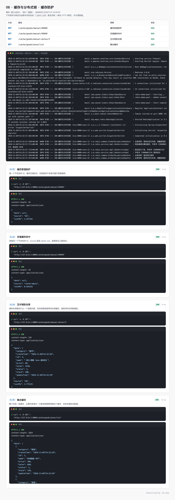
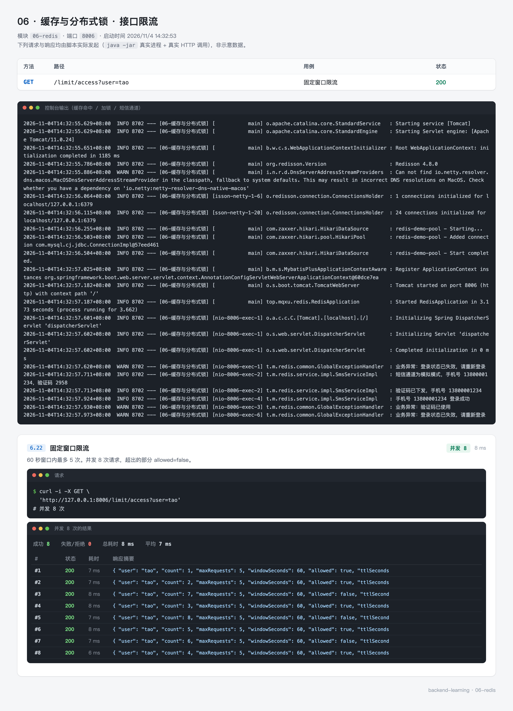

# 06 · 缓存与分布式锁 —— 让读更快，让写在并发下正确

前面五个模块，请求每来一次就打一次库。商品详情这种读多写少的数据，这样做很浪费：同一个 id 一秒被查一千次，数据库就要执行一千次一模一样的 SELECT。

这一篇做两件事：把热数据放进 Redis，让大部分读请求不再碰库；在必须碰库的写路径上，用锁保证并发时不写错。

所有代码都在 `06-redis` 模块里，接口可以直接用 curl 打。

---

## 0. 先看结果

三个命令先把项目跑起来：

```bash
# 1. 启动 Redis（已有 Redis 可跳过）
docker run -d --name redis-demo -p 6379:6379 redis:7-alpine --requirepass abc123

# 2. 启动模块
mvn -pl 06-redis spring-boot:run

# 3. 连续请求两次同一个商品
curl "http://127.0.0.1:8006/cache/goods/manual/1"
curl "http://127.0.0.1:8006/cache/goods/manual/1"
```

两次返回的数据一样，但第二次末尾的 `source` 从 `db` 变成了 `cache`：

```json
{
  "data": { "id": 1, "name": "机械键盘 K87", "price": 399, "stock": 120 },
  "source": "cache",
  "costMs": 8.5
}
```

`source` 是这一篇最重要的字段。它告诉你这次请求到底走了哪条路：`db` 表示真查了库，`cache` 表示直接读 Redis，`cache-empty` 表示命中了一个"这条数据不存在"的标记，`db-fallback` 表示没抢到重建锁、退回去查了库。

这个模块一共有五组接口，对应五件事：

| 组 | 路径前缀 | 解决什么 | 实测截图 |
| --- | --- | --- | --- |
| 缓存写法 | `/cache/goods` | 手动缓存、注解缓存、改数据后怎么让缓存失效 | `06-redis-cache.webp` |
| 缓存防护 | `/cache/goods` | 穿透、击穿、雪崩三种失效场景 | `06-redis-protect.webp` |
| 分布式锁 | `/lock` | 20 个并发扣同一件库存，怎样不超卖 | `06-redis-lock.webp` |
| 接口限流 | `/limit` | 一分钟最多 5 次，第 6 次拒绝 | `06-redis-limit.webp` |
| 数据类型 | `/redis`、`/rank` | String、Hash、List、Set、ZSet 各自的用法 | `06-redis-datatype.webp` |

另外还有一组 `/sms` 与 `/user`，用验证码登录换 JWT，演示 Redis 存验证码的完整流程，截图在 `06-redis-auth.webp`。

### 这一节的路线

| 步骤 | 内容 | 对应小节 |
| --- | --- | --- |
| 1 | 想清楚缓存省掉的是什么、为什么写路径要删缓存 | 1 |
| 2 | 装 Redis、建库、确认能连上 | 2 |
| 3 | 建模块、配依赖 | 3 |
| 4 | 写配置，重点是两个容易失效的参数 | 4 |
| 5 | 建表灌数据 | 5 |
| 6 | 写代码：Template、CacheManager、缓存、锁、限流、登录 | 6 |
| 7 | 跑起来，逐条看真实响应 | 7 |
| 8 | 41 个测试与九道练习 | 7.8、8 |

---

## 1. 先把三个问题想清楚

代码不多，但如果这三个问题没想明白，配出来的缓存大概率是错的。

### 1.1 缓存省掉的不是时间，是数据库的活

新手常把缓存理解成"让接口变快"。更准确的说法是：**把本该由数据库承担的读请求，转移给内存**。

这两者的区别在于出问题时的表现。如果只是"变快"，缓存挂了顶多慢一点；而实际上一千个并发打到一个没有缓存的库上，库的连接池会先耗尽，然后整个服务不可用。所以缓存的真实价值是**削掉峰值**，让数据库只承受它扛得住的请求量。

由此推出一条规矩：**缓存里的数据可以旧，但不能成为唯一来源**。数据库永远是事实来源。任何时刻把 Redis 整个清空，系统应该还能正常工作，只是慢一阵。这条规矩决定了后面所有写法的方向。

### 1.2 写路径删缓存，而不是改缓存

改完数据库之后，缓存怎么处理？三种做法：

| 做法 | 问题 |
| --- | --- |
| 先删缓存，再改库 | 删完到改完之间，有请求进来会把旧值重新读进缓存，之后一直是旧值 |
| 先改库，再改缓存 | 两个并发写，A 先改库、B 后改库，但 B 先写缓存、A 后写缓存，缓存里留下 A 的旧值 |
| 先改库，再删缓存 | 只有极短的不一致窗口，下次读取自然回源 |

第三种是 Cache Aside 的标准做法，代码里也是这么写的：

```java
public boolean updatePrice(Long id, BigDecimal price) {
    Goods goods = new Goods();
    goods.setId(id);
    goods.setPrice(price);
    boolean updated = goodsMapper.updateById(goods) > 0;
    if (updated) {
        evict(id);          // 只删，不写新值
    }
    return updated;
}
```

"删"比"改"少一次计算，也少一次并发冲突的机会：删是一个幂等动作，谁先删谁后删结果都一样；而"改"要把新值算出来再写进去，算的过程中数据可能又变了。



### 1.3 分布式锁解决的是"多台机器"的问题

`synchronized` 只在同一个 JVM 里有效。服务部署两台，两台各有一个 JVM，各自的锁互不相干，20 个请求分到两台机器上，还是会有 10 个同时进临界区。

所以锁要放在一个所有实例都能看到的地方，Redis 就是最常见的选择。它的本质是一个约定：**谁能往 Redis 里写进这个 key，谁就拿到锁**。因为 Redis 的 `SET key value NX` 是原子的，二十个请求同时发，只有一个能成功。

---

## 2. 准备 Redis 与 MySQL

### 2.1 启动 Redis

用 Docker 最省事：

```bash
docker run -d --name redis-demo \
  -p 6379:6379 \
  redis:7-alpine \
  --requirepass abc123
```

本机已经装过 Redis 的话，确认一下版本和密码：

```bash
redis-cli -a abc123 ping
# PONG
```

`PONG` 就说明通了。如果是 `NOAUTH Authentication required`，说明密码没带上；如果是 `Connection refused`，说明服务没启动。

### 2.2 建库

模块和 05 共用 `backend_learning` 这个库。没建过的话：

```sql
CREATE DATABASE backend_learning DEFAULT CHARACTER SET utf8mb4 COLLATE utf8mb4_general_ci;
```

这张 `t_goods` 表由模块启动时自动创建，不用手工执行。

### 2.3 两个容易忽略的设置

**Redis 用单独的 db。** 配置里写的是 `database: 10`，不是默认的 0。原因是开发机上往往同时跑着别的项目，共用 db 0 时执行一次 `FLUSHDB` 会把别人的数据一起清掉。分一个 db 出来，实验怎么折腾都不影响别人。

**MySQL 的 `sql.init.mode` 要写 `always`。** MySQL 不是内嵌数据库，Spring Boot 默认不会为它执行 `schema.sql`。不写这个配置，表根本不会建，启动后第一次查询就是 `Table doesn't exist`。

---

## 3. 创建模块

### 3.1 POM

`06-redis/pom.xml` 的依赖部分：

```xml
<properties>
    <mybatis-plus.version>3.5.17</mybatis-plus.version>
    <redisson.version>4.8.0</redisson.version>
    <cloopen.version>1.0.4</cloopen.version>
    <jjwt.version>0.13.0</jjwt.version>
</properties>

<dependencies>
    <!-- Redis 客户端与 Spring Data Redis 抽象，底层默认用 Lettuce -->
    <dependency>
        <groupId>org.springframework.boot</groupId>
        <artifactId>spring-boot-starter-data-redis</artifactId>
    </dependency>

    <!-- Lettuce 的连接池参数由 commons-pool2 提供，缺了它池配置会静默失效 -->
    <dependency>
        <groupId>org.apache.commons</groupId>
        <artifactId>commons-pool2</artifactId>
    </dependency>

    <!-- 缓存抽象：Boot 4 把它拆成了独立模块，starter-data-redis 不再附带 -->
    <dependency>
        <groupId>org.springframework.boot</groupId>
        <artifactId>spring-boot-starter-cache</artifactId>
    </dependency>

    <!-- 分布式锁 -->
    <dependency>
        <groupId>org.redisson</groupId>
        <artifactId>redisson-spring-boot-starter</artifactId>
        <version>${redisson.version}</version>
    </dependency>

    <!-- 数据源，给缓存提供一个真实的数据库做对照 -->
    <dependency>
        <groupId>com.baomidou</groupId>
        <artifactId>mybatis-plus-spring-boot4-starter</artifactId>
        <version>${mybatis-plus.version}</version>
    </dependency>

    <dependency>
        <groupId>com.mysql</groupId>
        <artifactId>mysql-connector-j</artifactId>
        <scope>runtime</scope>
    </dependency>

    <!-- 短信 SDK，模拟模式下用不到，接真实通道时才走它 -->
    <dependency>
        <groupId>com.cloopen</groupId>
        <artifactId>java-sms-sdk</artifactId>
        <version>${cloopen.version}</version>
    </dependency>

    <!-- JWT：api 编译期用，impl 与 jackson 只在运行期需要 -->
    <dependency>
        <groupId>io.jsonwebtoken</groupId>
        <artifactId>jjwt-api</artifactId>
        <version>${jjwt.version}</version>
    </dependency>
    <dependency>
        <groupId>io.jsonwebtoken</groupId>
        <artifactId>jjwt-impl</artifactId>
        <version>${jjwt.version}</version>
        <scope>runtime</scope>
    </dependency>
    <dependency>
        <groupId>io.jsonwebtoken</groupId>
        <artifactId>jjwt-jackson</artifactId>
        <version>${jjwt.version}</version>
        <scope>runtime</scope>
    </dependency>
</dependencies>
```

三个地方值得单独说：

**`spring-boot-starter-cache` 要单独引。** Boot 3 里 `starter-data-redis` 会带上缓存抽象，Boot 4 把它拆出去了。不引这个依赖，`@Cacheable` 注解能编译通过（注解在 `spring-context` 里），但运行时不生效，方法每次都会执行，而且不会报错。这种"不报错的失效"最难查。

**`commons-pool2` 少了不会报错。** 配置里写了 `lettuce.pool.max-active: 8`，但没有这个依赖时，连接池参数会被忽略，Lettuce 退回单连接共享模式。高并发下表现是"配置没起作用"，而日志里什么提示都没有。

**Redisson 用 4.x。** 3.x 的自动配置绑的是 Boot 3 的 `RedisAutoConfiguration` 路径，在 Boot 4 上不生效，结果是 `RedissonClient` 注入失败。4.8.0 起自带 Boot 4 的自动配置。

### 3.2 目录结构

```
06-redis
├── pom.xml
└── src
    ├── main
    │   ├── java/top/mqxu/redis
    │   │   ├── RedisApplication.java
    │   │   ├── common/          Result、ErrorCode、BusinessException、
    │   │   │                    GlobalExceptionHandler、RedisCache、
    │   │   │                    RedisKeys、JwtUtils、CommonUtils
    │   │   ├── config/          RedisConfig、WebConfig、AuthInterceptor、
    │   │   │                    DemoProperties、SmsProperties、CloopenConfig
    │   │   ├── controller/      Cache、Lock、Limit、Rank、Redis、Sms、User
    │   │   ├── dto/             CacheResult、LoginRequest、LoginResponse、UserInfo
    │   │   ├── entity/          Goods
    │   │   ├── mapper/          GoodsMapper
    │   │   └── service/         GoodsService、GoodsCacheService、
    │   │                        GoodsSpringCacheService、StockService、
    │   │                        SmsService(impl)
    │   └── resources
    │       ├── application.yml
    │       ├── schema.sql
    │       └── data.sql
    └── test/java/top/mqxu/redis
        ├── GoodsCacheTest.java      13 个用例
        ├── LockAndLimitTest.java    10 个用例
        ├── RedisTypeOpsTest.java     9 个用例
        ├── PracticeTest.java         5 个用例
        └── HomeworkTest.java         4 个用例
```

分层的原则和前面几个模块一样：`controller` 只做参数接收和结果包装，`service` 写业务，`mapper` 只声明接口。

### 3.3 先编译一次

```bash
mvn -pl 06-redis -am compile
```

`-am` 表示连同依赖的父模块一起构建。第一次会下载 Redisson 与短信 SDK，慢一些。编译通过再往下写，比写完一堆再排查依赖问题省事。

---

## 4. 配置

### 4.1 application.yml 全文

```yaml
server:
  port: 8006

spring:
  application:
    name: 06-缓存与分布式锁

  data:
    redis:
      host: localhost
      port: 6379
      password: abc123
      database: 10
      timeout: 3s
      lettuce:
        pool:
          max-active: 8
          max-idle: 8
          min-idle: 2
          max-wait: 1s

  cache:
    type: redis
    redis:
      time-to-live: 10m
      cache-null-values: true
      key-prefix: "cache:"
      use-key-prefix: true
      enable-statistics: true

  datasource:
    driver-class-name: com.mysql.cj.jdbc.Driver
    url: jdbc:mysql://localhost:3306/backend_learning?useUnicode=true&characterEncoding=utf8&serverTimezone=Asia/Shanghai
    username: root
    password: 123456
    hikari:
      pool-name: redis-demo-pool
      maximum-pool-size: 10
      minimum-idle: 2
      connection-timeout: 3000

  sql:
    init:
      mode: always
      schema-locations: classpath:schema.sql
      data-locations: classpath:data.sql
      encoding: UTF-8

mybatis-plus:
  configuration:
    map-underscore-to-camel-case: true
    log-impl: org.apache.ibatis.logging.stdout.StdOutImpl
  global-config:
    banner: false
    db-config:
      id-type: auto
      table-underline: true

demo:
  cache:
    ttl: 10m
    null-ttl: 2m
    jitter-seconds: 30
  lock:
    wait-seconds: 3
    lease-seconds: 10
  limit:
    window-seconds: 60
    max-requests: 5

mqxu:
  jwt:
    secret: sms-login-demo-secret-key-please-replace-in-production-2026
    expire-seconds: 7200
  sms:
    mock-enabled: true
    code-expire-seconds: 300
    send-interval-seconds: 60
    send-daily-limit: 10
    max-fail-count: 5
    ccp:
      serverIp: app.cloopen.com
      port: 8883
      accountSId: 你的账号
      accountToken: 你的令牌
      appId: 你的应用 ID
      templateId: 1
```

### 4.2 逐段说明

**`spring.data.redis`**：连接信息。`timeout: 3s` 是命令超时，不是连接超时。默认值是 60 秒，缓存场景下这个值太长——Redis 卡住时，线程会跟着卡一分钟，接口全部超时。设成 2 到 3 秒，快速失败再由业务降级。

**`spring.cache.redis`**：注解缓存的参数。这一段的四个值，只有在**不自定义 CacheManager** 时才生效。第 6.2 节会自定义一个，所以这些值连同 `demo.cache.*` 一起在代码里又写了一遍。两处都保留是有意的：注解缓存由 `demo.cache.ttl` 控制，而 `spring.cache.*` 留给读者对照，注释里写明了哪边是生效的。

**`demo.*`**：本模块自己的业务参数，用 `@ConfigurationProperties` 绑定。放在一处便于调整，也避免 `@Value` 散落在各个类里。

**`mqxu.jwt.secret`**：签名密钥。真实项目里从环境变量注入，仓库里只放一个占位值。密钥长度不能少于 32 字节，`Keys.hmacShaKeyFor` 会检查。

**`mqxu.sms.mock-enabled`**：`true` 时不调用短信 SDK，验证码只写日志和 Redis，接口直接把验证码返回给调用方。`false` 时会真的调用容联云并扣费，本地调试别关。

### 4.3 一个参数为什么写两遍

`time-to-live: 10m` 和 `demo.cache.ttl: 10m` 是同一个值。原因是 `spring.cache.redis.*` 属于 Spring Boot 的自动配置，一旦我们自己定义了 `RedisCacheManager` bean，自动配置就退让了，这一段配置便没人读。

这不是 Boot 的 bug，而是"谁创建谁负责"：bean 由我们创建，参数自然由我们给。第 6.2 节的 `cacheManager` 方法里能看到 `entryTtl(properties.getCache().getTtl())`，读的就是 `demo.cache.ttl`。

---

## 5. 建表与初始数据

`schema.sql`：

```sql
DROP TABLE IF EXISTS t_goods;

CREATE TABLE t_goods
(
    id          BIGINT UNSIGNED NOT NULL AUTO_INCREMENT COMMENT '主键',
    name        VARCHAR(100)    NOT NULL COMMENT '商品名称',
    category    VARCHAR(32)     NOT NULL COMMENT '分类',
    price       DECIMAL(10, 2)  NOT NULL COMMENT '价格',
    stock       INT             NOT NULL DEFAULT 0 COMMENT '库存',
    sales       INT             NOT NULL DEFAULT 0 COMMENT '销量',
    status      TINYINT         NOT NULL DEFAULT 1 COMMENT '状态：1 上架，0 下架',
    create_time DATETIME        NOT NULL DEFAULT CURRENT_TIMESTAMP COMMENT '创建时间',
    update_time DATETIME        NOT NULL DEFAULT CURRENT_TIMESTAMP ON UPDATE CURRENT_TIMESTAMP COMMENT '更新时间',
    PRIMARY KEY (id),
    KEY idx_category (category)
) ENGINE = InnoDB
  DEFAULT CHARSET = utf8mb4 COMMENT ='商品表';
```

`data.sql` 灌了 10 条商品，销量各不相同，方便后面做排行榜：

```sql
INSERT INTO t_goods (id, name, category, price, stock, sales, status)
VALUES (1, '机械键盘 K87', '数码', 399.00, 120, 860, 1),
       (2, '人体工学椅 Pro', '家居', 1299.00, 45, 320, 1),
       (3, '《深入理解 Java 虚拟机》', '图书', 89.00, 200, 1520, 1),
       (4, '降噪耳机 X5', '数码', 899.00, 60, 640, 1),
       (5, '智能手环 5 代', '数码', 249.00, 300, 2100, 1),
       (6, '不锈钢保温杯', '家居', 79.00, 500, 4300, 1),
       (7, '跑鞋 轻量版', '运动', 469.00, 80, 275, 1),
       (8, '《代码整洁之道》', '图书', 69.00, 150, 980, 1),
       (9, '手冲咖啡豆 250g', '食品', 128.00, 90, 1760, 1),
       (10, '瑜伽垫 加厚', '运动', 159.00, 130, 510, 0);
```

`schema.sql` 第一行是 `DROP TABLE IF EXISTS`。这看起来危险，但它让每次启动都是干净状态——库存被并发实验扣成 0 之后，重启一次就恢复了。生产环境不会这么做，这里是为了教学可重复。

商品 1 的初始库存是 120，做并发实验前会先用 `/lock/reset` 重置成 10，方便观察差异。

---

## 6. 写代码

### 6.1 启动类

```java
@SpringBootApplication
@MapperScan("top.mqxu.redis.mapper")
@EnableConfigurationProperties({DemoProperties.class, SmsProperties.class})
public class RedisApplication {

    public static void main(String[] args) {
        SpringApplication.run(RedisApplication.class, args);
    }
}
```

`@EnableConfigurationProperties` 把两个 `@ConfigurationProperties` 类注册成 bean。不写这行，`DemoProperties` 注入时会报找不到 bean——除非类上再加 `@Component`，两种方式选一种，这里选显式声明，能一眼看出有哪些配置类。

### 6.2 RedisConfig：两个必须自己写的 bean

这个类是整篇最值得细看的地方。它只有两个 bean，但少了任何一个都会出问题，而且报错信息都不太直观。

```java
@Configuration
@EnableCaching
@RequiredArgsConstructor
public class RedisConfig {

    private static final String CACHE_PREFIX = "cache:";

    private final DemoProperties properties;

    private GenericJacksonJsonRedisSerializer jsonSerializer() {
        return GenericJacksonJsonRedisSerializer.builder()
                .enableDefaultTyping(BasicPolymorphicTypeValidator.builder()
                        .allowIfSubType("top.mqxu.")
                        .allowIfSubType("java.lang.")
                        .allowIfSubType("java.util.")
                        .allowIfSubType("java.math.")
                        .build())
                .enableSpringCacheNullValueSupport()
                .customize(builder -> builder.disable(DateTimeFeature.WRITE_DATES_AS_TIMESTAMPS))
                .build();
    }

    @Bean
    public RedisTemplate<String, Object> redisTemplate(RedisConnectionFactory connectionFactory) {
        RedisTemplate<String, Object> template = new RedisTemplate<>();
        template.setConnectionFactory(connectionFactory);

        StringRedisSerializer keySerializer = new StringRedisSerializer();
        GenericJacksonJsonRedisSerializer valueSerializer = jsonSerializer();

        template.setKeySerializer(keySerializer);
        template.setHashKeySerializer(keySerializer);
        template.setValueSerializer(valueSerializer);
        template.setHashValueSerializer(valueSerializer);
        return template;
    }

    @Bean
    public RedisCacheManager cacheManager(RedisConnectionFactory connectionFactory) {
        RedisCacheConfiguration config = RedisCacheConfiguration.defaultCacheConfig()
                .entryTtl(properties.getCache().getTtl())
                .computePrefixWith(name -> CACHE_PREFIX + name + "::")
                .serializeKeysWith(SerializationPair.fromSerializer(new StringRedisSerializer()))
                .serializeValuesWith(SerializationPair.fromSerializer(jsonSerializer()));

        RedisCacheWriter writer = RedisCacheWriter.create(connectionFactory,
                configurer -> configurer.immediateWrites().collectStatistics());

        return RedisCacheManager.builder(writer)
                .cacheDefaults(config)
                .build();
    }
}
```

#### 为什么 key 用 String，值用 JSON

`RedisTemplate` 默认的序列化器是 JDK 序列化。用它存一个 `Goods`，`redis-cli` 里看到的是这样：

```
"\xac\xed\x00\x05sr\x00\x1etop.mqxu.redis.entity.Goods..."
```

三个问题：读不出来（排查时只能靠猜）、Java 客户端之间能通但与其它语言不通、反序列化时类名或字段一改就报错。

换成 JSON 之后：

```
127.0.0.1:6379[10]> GET goods:detail:1
"{\"@class\":\"top.mqxu.redis.entity.Goods\",\"id\":1,\"name\":\"机械键盘 K87\",...}"
```

`@class` 是 `enableDefaultTyping` 写进去的类型信息。`RedisTemplate<String, Object>` 的泛型是 `Object`，读出来时不知道具体类型，靠这个字段还原成 `Goods`。

`BasicPolymorphicTypeValidator` 限制了允许反序列化的包名，只有列出来的前缀才认。不加限制的话，攻击者可以构造一个恶意类名，让服务端在反序列化时执行任意代码。

#### 为什么还需要 CacheManager

`RedisTemplate` 只服务于手写代码。`@Cacheable` 走的是 Spring 的缓存抽象，用的是 `CacheManager`，两者不共用配置。

不定义 `cacheManager` 时，Boot 会自动建一个，值用 JDK 序列化。而 `Goods` 没有实现 `Serializable`，第一次写缓存就抛：

```
java.lang.IllegalStateException: Cannot serialize value of type
    top.mqxu.redis.entity.Goods without a serializer
```

给实体加 `implements Serializable` 能让它不报错，但值又变回二进制了。所以这里自定义一个，复用同一个 JSON 序列化器。

#### `immediateWrites()` 是做什么的

这是 Spring Data Redis 4 的新行为。4.0 起，缓存写操作（`put`、`evict`、`clear`）默认是**延迟执行**的：方法调用返回时，命令可能还没发到 Redis。设计意图是提高吞吐，代价是"写完立刻读"可能读不到。

演示场景里这个特性非常容易误导人：调用 `evictAll()` 之后立刻 `redis-cli KEYS 'cache:goods::*'`，发现 key 还在，会以为缓存没清掉。所以这里显式打开立即写：

```java
RedisCacheWriter.create(connectionFactory,
        configurer -> configurer.immediateWrites().collectStatistics());
```

顺带用 `collectStatistics()` 打开了命中率统计，对应 `enable-statistics: true`。`cache.clear()` 这类操作要马上看到结果的地方，这个开关是必需的。

### 6.3 五种数据类型

Redis 的 key 都是字符串，区别在 value 的结构。选错类型，后面每一步都会别扭。`RedisController` 把五种类型各给了一组接口。

| 类型 | 结构 | 适合存 | 本模块的接口 |
| --- | --- | --- | --- |
| String | 单个值 | 缓存对象 JSON、计数器 | `/redis/string`、`/redis/counter/incr` |
| Hash | 一个 key 下多个字段 | 对象的多个属性、验证码 | `/redis/hash` |
| List | 有序、可重复 | 队列、最新动态 | `/redis/list` |
| Set | 无序、不重复 | 去重、交集 | `/redis/set`、`/redis/set/intersect` |
| ZSet | 带分数、自动排序 | 排行榜、延迟队列 | `/redis/zset`、`/rank/*` |

Hash 有个实际好处：只改一个字段时不用把整个对象读出来再写回去。验证码就存在 Hash 里：

```
sms:captcha:13800001234
  code   -> 7209
  status -> 0
```

`code` 是验证码，`status` 标记是否用过。用 String 存 JSON 也能实现，但改状态时要读整个 JSON、改字段、再写回，中间有一段竞态窗口。

`RedisController` 里 Hash 那个接口有一个易错点：

```java
@PostMapping("/hash")
public Map<Object, Object> putHash(@RequestParam String key, @RequestParam Map<String, String> fields) {
    // RequestParam 收到的 Map 里包含 key 这个参数本身，写进 hash 前先剔掉
    Map<String, String> values = new LinkedHashMap<>(fields);
    values.remove("key");
    stringRedisTemplate.opsForHash().putAll(key, values);
    return stringRedisTemplate.opsForHash().entries(key);
}
```

`@RequestParam Map<String, String>` 会把**所有**查询参数收进来，包括 `key` 自己。不剔除的话，Hash 里会多出一个 `key -> goods:1` 的字段。

### 6.4 手动缓存：Cache Aside 的完整写法

`GoodsCacheService` 是这一节的核心。读：

```java
public CacheResult<Goods> getById(Long id) {
    long start = System.nanoTime();
    String key = KEY_PREFIX + id;

    Object cached = redisTemplate.opsForValue().get(key);
    if (cached != null) {
        return fromCache(cached, start);
    }

    Goods goods = goodsMapper.selectById(id);
    cacheIt(key, goods);
    return new CacheResult<>(goods, "db", costMs(start));
}
```

四行代码，四个决定：

1. `KEY_PREFIX + id`：key 带业务前缀。不带前缀时，`1`、`2` 这样的裸 key 会和别的业务撞车，也没法按前缀批量清理。
2. `cached != null` 判断命中。注意这只能判断"有没有值"，不能判断值是不是空标记，所以下面 `fromCache` 里还要再分一次。
3. 未命中才查库。查库放在缓存判断之后，这是"缓存优先"的具象写法。
4. 查完回填。

回填的方法里藏着防穿透和防雪崩：

```java
private void cacheIt(String key, Goods goods) {
    if (goods == null) {
        redisTemplate.opsForValue().set(key, NULL_PLACEHOLDER, properties.getCache().getNullTtl());
        return;
    }
    redisTemplate.opsForValue().set(key, goods, ttlWithJitter());
}

private Duration ttlWithJitter() {
    long base = properties.getCache().getTtl().toSeconds();
    long jitter = ThreadLocalRandom.current().nextLong(properties.getCache().getJitterSeconds() + 1L);
    return Duration.ofSeconds(base + jitter);
}
```

查不到数据时写一个字符串 `"NULL"` 进去，过期时间 2 分钟（比正常值短）。这样下一次请求同一个不存在的 id，会命中这个标记直接返回，不再打库。

过期时间加随机抖动，范围是 600 到 630 秒。原因在 6.6 节讲。

### 6.5 注解缓存：少写代码，多记四条规则

`GoodsSpringCacheService` 用注解实现同样的功能，方法体里只有数据库操作：

```java
@Cacheable(cacheNames = "goods", key = "#id")
public Goods getById(Long id) {
    return goodsMapper.selectById(id);
}

@Cacheable(cacheNames = "goods", key = "'all'")
public List<Goods> listAll() {
    return goodsMapper.selectList(null);
}

@CachePut(cacheNames = "goods", key = "#id")
public Goods updatePrice(Long id, BigDecimal price) {
    Goods update = new Goods();
    update.setId(id);
    update.setPrice(price);
    if (goodsMapper.updateById(update) == 0) {
        return null;
    }
    return goodsMapper.selectById(id);
}

@CacheEvict(cacheNames = "goods", key = "#id")
public void evict(Long id) {
}

@Caching(evict = {
        @CacheEvict(cacheNames = "goods", key = "#id"),
        @CacheEvict(cacheNames = "goods", key = "'all'")
})
public void evictDetailAndList(Long id) {
}

@CacheEvict(cacheNames = "goods", allEntries = true)
public void evictAll() {
}
```

四个注解的分工：

| 注解 | 什么时候用 | 行为 |
| --- | --- | --- |
| `@Cacheable` | 查询 | 命中直接返回，方法体不执行 |
| `@CachePut` | 更新 | 方法体一定执行，返回值写进缓存 |
| `@CacheEvict` | 删除 | 默认方法执行后删缓存 |
| `@Caching` | 组合 | 一次做多个缓存操作 |

四条容易踩的规则：

**key 里的字符串要加单引号。** `key = "'all'"` 是字面量 `all`；写成 `key = "all"` 会被当成 SpEL 表达式，去找一个叫 `all` 的变量，运行时报错。

**同一个类内部调用不走代理。** `this.getById(1)` 不会触发缓存，因为调用没经过 Spring 生成的代理对象。要在同一个类里复用，得注入自己或者拆到另一个类。

**`@CacheEvict` 默认在方法执行后清。** 方法抛异常就不清了。需要"先清再执行"时加 `beforeInvocation = true`。

**列表缓存要单独维护。** `getById` 的 key 是 id，`listAll` 的 key 是 `all`，两者互不相干。改了某个商品，如果只清 id 对应的 key，`all` 里还是旧数据。所以有 `evictDetailAndList` 一次清两个。

`@Cacheable` 查不到时返回 `null`，配合 `cache-null-values` 把 null 也存起来，防穿透的效果和手写的空值标记一样，只是 key 里存的是 Spring 自己的 `NullValue` 包装。

### 6.6 三个失效场景，对应三处代码

这三个词经常被混着说，其实触发条件完全不同：

| 场景 | 触发条件 | 后果 | 代码里的应对 |
| --- | --- | --- | --- |
| 穿透 | 查一个**不存在**的 key | 每次都不命中，全部打库 | `cacheIt` 写 `"NULL"` 标记 |
| 击穿 | 某个**热点 key 刚好过期** | 瞬间大量请求同时回源 | `getByIdWithMutex` 抢锁重建 |
| 雪崩 | **大批 key 同时过期** 或 Redis 挂了 | 数据库被压垮 | `ttlWithJitter` 加随机抖动 |

穿透的应对在 `cacheIt` 里，前面已经看过。这里补一句它的局限：如果攻击者每次换一个不存在的 id，空值标记也帮不上忙，因为每个 id 都是新的。那种情况要靠布隆过滤器在入口处拦掉。

击穿的应对是互斥重建：

```java
public CacheResult<Goods> getByIdWithMutex(Long id) {
    long start = System.nanoTime();
    String key = KEY_PREFIX + id;

    Object cached = redisTemplate.opsForValue().get(key);
    if (cached != null) {
        return fromCache(cached, start);
    }

    String lockKey = REBUILD_LOCK_PREFIX + id;
    Boolean locked = stringRedisTemplate.opsForValue().setIfAbsent(lockKey, "1", Duration.ofSeconds(5));
    if (!Boolean.TRUE.equals(locked)) {
        // 没抢到锁，说明有别的请求正在重建，等一小会儿再读缓存
        sleepQuietly(80);
        Object retried = redisTemplate.opsForValue().get(key);
        if (retried != null) {
            return fromCache(retried, start);
        }
        return new CacheResult<>(goodsMapper.selectById(id), "db-fallback", costMs(start));
    }

    try {
        Object checked = redisTemplate.opsForValue().get(key);
        if (checked != null) {
            return fromCache(checked, start);
        }
        Goods goods = goodsMapper.selectById(id);
        cacheIt(key, goods);
        return new CacheResult<>(goods, "db", costMs(start));
    } finally {
        stringRedisTemplate.delete(lockKey);
    }
}
```

三处细节：

- 抢到锁后要**再查一次缓存**。从"发现没命中"到"拿到锁"之间，可能前一个持锁线程已经把值写进去了。
- 没抢到锁的请求等 80 毫秒再读，而不是直接查库。这一等就是它和"不加锁"的区别：二十个请求只有一个查库，其余的重读缓存。
- 锁的过期时间设 5 秒。如果重建过程中进程挂了，锁会自动释放，不会把商品永久锁死。

雪崩的应对就是那 30 秒的随机抖动。假设 1000 个商品在同一时刻被预热进缓存，TTL 都是 600 秒，那 600 秒后它们会同时失效，1000 个查询一起打到库上。加了抖动之后，过期时间散在 600 到 630 秒之间，压力被摊平。

### 6.7 分布式锁：从超卖现场开始

先看没有锁会发生什么。`StockService` 里有两个方法，逻辑一样，只是一个在读写之间停了 20 毫秒：

```java
public boolean deduct(Long id, int quantity) {
    Goods goods = goodsMapper.selectById(id);
    if (goods == null || goods.getStock() < quantity) {
        return false;
    }
    Goods update = new Goods();
    update.setId(id);
    update.setStock(goods.getStock() - quantity);
    return goodsMapper.updateById(update) > 0;
}

public boolean deductWithDelayedWindow(Long id, int quantity) {
    Goods goods = goodsMapper.selectById(id);
    if (goods == null || goods.getStock() < quantity) {
        return false;
    }
    sleepQuietly(20);        // 把并发窗口放大，方便复现
    Goods update = new Goods();
    update.setId(id);
    update.setStock(goods.getStock() - quantity);
    return goodsMapper.updateById(update) > 0;
}
```

问题出在"读—判断—写"这三步不是原子的。库存 10，两个线程同时读到 10，都判断 10 >= 1 成立，都算出 9，都写回 9。卖了 2 件，库存只减少了 1。

第 7.5 节的实测结果是：**20 个并发请求全部返回成功，库存从 10 变成 9**。20 件商品卖出去了，账面只扣了 1 件。

加锁的版本：

```java
public boolean deductWithLock(Long id, int quantity) {
    RLock lock = redissonClient.getLock(LOCK_PREFIX + id);
    try {
        boolean locked = lock.tryLock(properties.getLock().getWaitSeconds(),
                properties.getLock().getLeaseSeconds(), TimeUnit.SECONDS);
        if (!locked) {
            return false;
        }
        Goods goods = goodsMapper.selectById(id);
        if (goods == null || goods.getStock() < quantity) {
            return false;
        }
        Goods update = new Goods();
        update.setId(id);
        update.setStock(goods.getStock() - quantity);
        return goodsMapper.updateById(update) > 0;
    } catch (InterruptedException e) {
        Thread.currentThread().interrupt();
        return false;
    } finally {
        if (lock.isHeldByCurrentThread()) {
            lock.unlock();
        }
    }
}
```

`tryLock` 的两个参数分别管两件事：

- `waitSeconds = 3`：抢不到锁时最多等 3 秒。设 0 表示不等待、立刻返回失败。
- `leaseSeconds = 10`：拿到锁后 10 秒自动释放。这是防止持锁进程崩溃导致死锁的兜底。Redisson 还有看门狗机制，不指定 lease 时会每 10 秒自动续期，进程活着锁就一直有效；一旦指定了 lease，看门狗就不再续期。

锁的粒度是 `lock:goods:stock:{id}`，按商品分开。用一把全局锁也能保证正确，但所有商品的下单会串行执行，吞吐掉一个数量级。

### 6.8 手写一把锁：SETNX 与 Lua 解锁

Redisson 封得很好，但不看清里面的机制，遇到问题会无从下手。`LockController` 里有一版手写实现：

```java
private static final DefaultRedisScript<Long> UNLOCK_SCRIPT = new DefaultRedisScript<>(
        "if redis.call('get', KEYS[1]) == ARGV[1] then return redis.call('del', KEYS[1]) else return 0 end",
        Long.class);

@PostMapping("/buy/setnx")
public Map<String, Object> buyWithSetNx(@RequestParam Long id,
                                        @RequestParam(defaultValue = "1") int quantity) {
    String lockKey = SETNX_LOCK_PREFIX + id;
    String token = UUID.randomUUID().toString();
    Boolean locked = stringRedisTemplate.opsForValue()
            .setIfAbsent(lockKey, token, Duration.ofSeconds(10));
    if (!Boolean.TRUE.equals(locked)) {
        // 没抢到锁
        ...
        return busy;
    }
    try {
        return result(id, stockService.deduct(id, quantity), "setnx");
    } finally {
        stringRedisTemplate.execute(UNLOCK_SCRIPT, List.of(lockKey), token);
    }
}
```

三个关键点：

**加锁用 `setIfAbsent(key, value, ttl)`。** 它对应 Redis 的 `SET key value NX EX 10`，一条命令同时完成"不存在才写"和"设过期"。分成 `SETNX` 再 `EXPIRE` 两条命令的话，中间进程崩溃就会留下一个永不过期的锁。

**值的唯一性。** `token` 是随机 UUID，标记这把锁是谁加的。

**解锁必须用 Lua 比对。** 假设线程 A 加的锁 10 秒后自动过期了，此时线程 B 加锁成功。A 执行完业务去解锁，如果直接 `DEL`，删掉的是 B 的锁。用 Lua 把"比对 + 删除"合成一个原子操作，值对不上就不删。

这也是 Redisson 内部做的事，只是它还额外处理了可重入、续期、等待队列。

### 6.9 限流：一个计数器加一个窗口编号

```java
@GetMapping("/access")
public Map<String, Object> access(@RequestParam(defaultValue = "guest") String user) {
    int windowSeconds = properties.getLimit().getWindowSeconds();
    int maxRequests = properties.getLimit().getMaxRequests();

    long windowIndex = System.currentTimeMillis() / 1000 / windowSeconds;
    String key = "limit:access:" + user + ":" + windowIndex;

    Long count = stringRedisTemplate.opsForValue().increment(key);
    Long ttl = stringRedisTemplate.getExpire(key);
    if (ttl == null || ttl < 0) {
        stringRedisTemplate.expire(key, Duration.ofSeconds(windowSeconds));
    }
    ...
    result.put("allowed", count != null && count <= maxRequests);
    return result;
}
```

思路是把时间切成固定的窗口，每个窗口一个计数器。`windowIndex` 是当前时间除以窗口长度取整，比如 60 秒窗口下，14:20:00 到 14:20:59 会得到同一个编号。

key 里带窗口编号意味着**下一分钟自动换了新 key**，旧 key 靠过期时间回收，不需要定时清理。

过期时间的设置有个坑。直觉写法是"只在 count 等于 1 时设过期"：

```java
if (count != null && count == 1L) {
    stringRedisTemplate.expire(key, Duration.ofSeconds(windowSeconds));
}
```

并发下有问题：两个请求同时 `INCR`，一个拿到 1，另一个拿到 2，拿到 1 的那个还没执行 `EXPIRE` 时，如果进程崩了，这个 key 就永远没有过期时间，计数器永久累积，该用户之后一直被限流。

所以改成每次检查 TTL，发现没有过期时间就补一次。多一次网络往返，换来的是不会漏设。

固定窗口有个固有问题：窗口边界处会放过两倍的请求。窗口是 14:20:00–14:20:59，用户在 14:20:59 发 5 次，14:21:00 再发 5 次，两次都在各自窗口内合法，但实际是 1 秒内 10 次。要严格就得用滑动窗口（用 ZSet 存每次请求的时间戳），代价是内存占用高得多。

### 6.10 验证码登录：Redis 的四个 key

短信登录是 Redis 用得最典型的地方：验证码有时效、只能用一次、发送要限频。四种约束，四个 key。

`RedisKeys` 集中定义：

```java
public class RedisKeys {
    /** 验证码，Hash：code 是验证码，status 是 0 未使用 / 1 已使用 */
    public static String getSmsKey(String phone) {
        return "sms:captcha:" + phone;
    }

    /** 发送间隔，存在即代表还在冷却中 */
    public static String getSmsSendIntervalKey(String phone) {
        return "sms:send:interval:" + phone;
    }

    /** 当日发送次数 */
    public static String getSmsSendCountKey(String phone) {
        return "sms:send:count:" + phone;
    }

    /** 验证码连续输错次数 */
    public static String getSmsFailCountKey(String phone) {
        return "sms:fail:" + phone;
    }
}
```

发送流程在 `SmsServiceImpl.sendSms`：

```java
public String sendSms(String phone) {
    if (!CommonUtils.checkPhone(phone)) {
        throw new BusinessException(ErrorCode.PHONE_ERROR);
    }

    // 发送间隔：SET NX EX 只让一次请求占住这个 key
    String intervalKey = RedisKeys.getSmsSendIntervalKey(phone);
    Boolean acquired = redisCache.setIfAbsent(intervalKey, 1, smsProperties.getSendIntervalSeconds());
    if (!Boolean.TRUE.equals(acquired)) {
        throw new BusinessException(ErrorCode.PHONE_CODE_SEND_TOO_MANY);
    }

    // 当日条数
    Long sentToday = redisCache.increment(RedisKeys.getSmsSendCountKey(phone), SECONDS_PER_DAY);
    if (sentToday != null && sentToday > smsProperties.getSendDailyLimit()) {
        throw new BusinessException(ErrorCode.PHONE_CODE_SEND_LIMIT);
    }

    int code = CommonUtils.generateCode();

    // 先发短信，成功之后再写 Redis
    if (!send(phone, code)) {
        redisCache.delete(intervalKey);
        throw new BusinessException(ErrorCode.PHONE_CODE_SEND_FAILED);
    }

    Map<String, Object> value = new HashMap<>();
    value.put("code", String.valueOf(code));
    value.put("status", "0");
    redisCache.hMSet(RedisKeys.getSmsKey(phone), value, smsProperties.getCodeExpireSeconds());

    return smsProperties.isMockEnabled() ? String.valueOf(code) : null;
}
```

顺序值得注意：**先发短信，成功了再写 Redis**。反过来写的话，短信发送失败时 Redis 里留下了一个用户永远收不到的验证码，而冷却 key 还在，用户一分钟内不能重发。

验证在 `login` 里，五道检查：

| 顺序 | 检查 | 失败时的错误码 |
| --- | --- | --- |
| 1 | 手机号格式 | 40001 |
| 2 | 验证码非空 | 40003 |
| 3 | Hash 是否存在 | 40005（不存在或已过期） |
| 4 | 状态是否已使用 | 40006 |
| 5 | 验证码是否匹配 | 40004，连续错 5 次变 40010 |

第 4 步是"只能用一次"的实现。验证通过后不是删 key，而是把 `status` 改成 `1`：

```java
redisCache.hSet(redisKey, FIELD_STATUS, STATUS_USED, smsProperties.getCodeExpireSeconds());
```

不删是为了给重复提交一个明确的回复。删掉的话第二次提交只能报"验证码已过期"，用户会以为是自己输错了。

第 5 步的失败计数同样用 `INCR`：

```java
if (!inputCode.equals(cached.get(FIELD_CODE))) {
    Long failCount = redisCache.increment(
            RedisKeys.getSmsFailCountKey(phone), smsProperties.getCodeExpireSeconds());
    if (failCount != null && failCount >= smsProperties.getMaxFailCount()) {
        redisCache.delete(redisKey);
        redisCache.delete(RedisKeys.getSmsFailCountKey(phone));
        throw new BusinessException(ErrorCode.PHONE_CODE_ERROR_TOO_MANY);
    }
    throw new BusinessException(ErrorCode.PHONE_CODE_ERROR);
}
```

四位验证码只有 9000 种可能，不限次数的话几分钟就能穷举。错 5 次直接作废，逼用户重新获取。

登录成功后签发 JWT：

```java
String token = jwtUtils.create(phone);
return new LoginResponse(token, phone, jwtUtils.getExpireSeconds());
```

服务端不存 session，`/user/me` 的登录态完全靠 token 里的签名。拦截器负责验签：

```java
@Override
public boolean preHandle(HttpServletRequest request, HttpServletResponse response, Object handler) {
    if (HttpMethod.OPTIONS.matches(request.getMethod())) {
        return true;
    }
    String header = request.getHeader("Authorization");
    if (header == null || !header.startsWith("Bearer ")) {
        throw new BusinessException(ErrorCode.TOKEN_INVALID);
    }
    Claims claims = jwtUtils.parse(header.substring("Bearer ".length()));
    request.setAttribute(ATTR_CLAIMS, claims);
    return true;
}
```

`WebConfig` 里配置了哪些路径需要登录：

```java
registry.addInterceptor(authInterceptor)
        .addPathPatterns("/**")
        // 只有 /user/** 代表"登录后才有的接口"，其余都是可以直接观察的演示接口
        .excludePathPatterns("/sms/**", "/redis/**", "/cache/**",
                "/lock/**", "/limit/**", "/rank/**", "/error");
```

拦截 `/**` 再逐个放行，比只拦截 `/user/**` 安全：以后新增的接口默认是需要登录的，漏配的后果是"访问不了"，而不是"谁都能访问"。

`OPTIONS` 请求要放行。浏览器发跨域预检时不会带 `Authorization`，拦下来会导致所有跨域请求失败。

### 6.11 排行榜：ZSet 的典型用法

`RankController` 把商品的销量灌进 ZSet：

```java
@PostMapping("/warmup")
public Map<String, Object> warmUp() {
    List<Goods> goodsList = goodsService.listAll();
    for (Goods goods : goodsList) {
        stringRedisTemplate.opsForZSet()
                .add(SALES_RANK_KEY, String.valueOf(goods.getId()), goods.getSales());
    }
    ...
}

@PostMapping("/increase")
public Map<String, Object> increase(@RequestParam Long id,
                                    @RequestParam(defaultValue = "1") double delta) {
    Double score = stringRedisTemplate.opsForZSet()
            .incrementScore(SALES_RANK_KEY, String.valueOf(id), delta);
    ...
}

@GetMapping("/top")
public List<Map<String, Object>> top(@RequestParam(defaultValue = "5") int top) {
    Set<ZSetOperations.TypedTuple<String>> tuples =
            stringRedisTemplate.opsForZSet().reverseRangeWithScores(SALES_RANK_KEY, 0, top - 1L);
    ...
}
```

ZSet 的成员是商品 id，分数是销量。`incrementScore` 加分会自动把成员挪到正确位置，取前五名是 `reverseRangeWithScores(key, 0, 4)`，时间复杂度 O(log N + 5)。

用 MySQL 做同样的事要 `ORDER BY sales DESC LIMIT 5`，每次都要排序全表。数据量小时差别不明显，几十万行时差距就出来了。

排行榜的分数变化不需要同步回数据库。它是一个"参考数据"，丢了重新 warmup 一次就能恢复——这也符合 1.1 节那条规矩：缓存里的东西不能是唯一来源。

---

## 7. 运行与实测

### 7.1 启动

```bash
mvn -pl 06-redis spring-boot:run
```

启动日志里找这四行：

```
org.redisson.Version : Redisson 4.8.0
o.redisson.connection.ConnectionsHolder : 24 connections initialized for localhost/127.0.0.1:6379
com.zaxxer.hikari.pool.HikariPool : redis-demo-pool - Added connection ...
o.s.boot.tomcat.TomcatWebServer : Tomcat started on port 8006 (http) with context path '/'
```

第二行确认 Redisson 连上了 Redis，并且一次建了 24 条连接。没连上时它会在启动阶段抛 `RedisConnectionException`，不会等到第一次用锁才报错。

第三行里的 `redis-demo-pool` 是配置里 `hikari.pool-name` 指定的名字，看到它就说明数据源就绪。

先确认 Redis 里的数据是模块写的：

```bash
redis-cli -a abc123 -n 10 keys 'goods:*'
# (empty array)
redis-cli -a abc123 -n 10 keys 'cache:*'
# (empty array)
```

两个都是空说明还没人读过，符合预期。

### 7.2 登录准备

后四组接口不用登录，第一组（`/user/me`）需要。先拿一个 token：

```bash
# 发验证码，模拟模式会直接把验证码放在 data 里
curl -X POST "http://127.0.0.1:8006/sms/send?phone=13800001234"
# {"code":200,"data":"7209","message":"success"}

# 用验证码换 token
curl -X POST "http://127.0.0.1:8006/sms/login" \
  -H "Content-Type: application/json" \
  -d '{"phone":"13800001234","code":"7209"}'
```

返回：

```json
{
  "code": 200,
  "data": {
    "token": "eyAcmUejIaYGQjK8YGN8.zdVqfCKsMqLtIkuqAMInAVLlUYYuBqhiwIW8BBo0Zjo0...",
    "phone": "13800001234",
    "message": "登录成功",
    "expiresIn": 7200
  }
}
```

这一步的实测截图：



图里有五个请求，重点看两处：

- 第三个请求又提交了一次同样的验证码，返回 `40006 验证码已使用`。这说明状态标记生效了。
- 第五个请求去掉 `Authorization` 头，返回 `40100 登录状态已失效`。注意 HTTP 状态码仍是 200，错误码在响应体的 `code` 里。

### 7.3 缓存三种写法

```bash
curl "http://127.0.0.1:8006/cache/goods/db/1"
curl "http://127.0.0.1:8006/cache/goods/manual/1"
curl "http://127.0.0.1:8006/cache/goods/manual/1"
curl "http://127.0.0.1:8006/cache/goods/anno/2"
curl "http://127.0.0.1:8006/cache/goods/anno/2"
```


看三组 `source`：

| 请求 | source | 说明 |
| --- | --- | --- |
| `/db/1` | `db` | 每次都查库 |
| `/manual/1` 第一次 | `db` | 未命中，回源 |
| `/manual/1` 第二次 | `cache` | 命中，没碰库 |

`costMs` 这组数字在这里会让人困惑：实测回源那次 7 毫秒，命中那次 8.5 毫秒，缓存反而更慢；换个 id 再测，两次又都在 30 毫秒上下。原因是 Redis 和 MySQL 都在本机，网络那一跳的成本几乎为零，而 JIT 预热、连接池冷启动这些因素对耗时的影响比"走不走库"更大。真实的收益要看 `source`，不要看这几毫秒。把 Redis 放到另一台机器上，差距才会明显。

图里还能看到改价之后的行为：

```
PUT /cache/goods/2/price-anno?price=1199
GET /cache/goods/anno/2
```

第二次查询返回的价格是 1199，`costMs` 从 50 毫秒降到 2.4 毫秒，说明这次没有再查库。`@CachePut` 已经把新值写进 `cache:goods::2`，随后的 `@Cacheable` 直接命中了它。价格能从缓存里读出来，靠的是两个方法的 key 完全一致：`@CachePut` 写 `#id`，`@Cacheable` 也读 `#id`。

跑完这些请求，Redis 里就有了真实数据：

```bash
redis-cli -a abc123 -n 10 keys 'cache:goods::*'
# 1) "cache:goods::1"
# 2) "cache:goods::2"

redis-cli -a abc123 -n 10 get 'cache:goods::1'
# "{\"@class\":\"top.mqxu.redis.entity.Goods\",\"id\":1,\"name\":\"机械键盘 K87\",...}"
```

### 7.4 缓存防护

```bash
curl "http://127.0.0.1:8006/cache/goods/manual/99999"
curl "http://127.0.0.1:8006/cache/goods/manual/99999"
curl "http://127.0.0.1:8006/cache/goods/manual-mutex/3"
```



两次查不存在的 99999，`source` 从 `db` 变成 `cache-empty`，`costMs` 从 2.35 降到 0.55。第二次没有查库，命中的是那个 `"NULL"` 标记。

`manual-mutex/3` 返回 `source: db`，因为 3 号商品还没被缓存过。要观察互斥效果，得用并发工具同时打这个接口，单个 curl 看不出区别。

### 7.5 分布式锁

这一组要看的是库存数字，得按顺序来：

```bash
# 重置库存为 10
curl -X POST "http://127.0.0.1:8006/lock/reset?id=1&stock=10"

# 20 个并发请求，全部用无锁版本
seq 20 | xargs -P 20 -I{} curl -s -X POST "http://127.0.0.1:8006/lock/buy/no-lock?id=1&quantity=1"

# 看库存
curl "http://127.0.0.1:8006/lock/stock/1"
```


无锁的结果：

```
20 个请求全部返回 success: true
库存剩下 9
```

20 件卖出去了，账面只扣了 1 件。`stockLeft` 在这些响应里几乎都是 9，因为每个线程读到的都是同一个初始值。

加锁之后再跑一遍：

```
10 个请求成功，10 个返回 success: false
库存剩下 0
```

10 件库存卖完就停，没有超卖。后 10 个请求返回 `false` 是因为进入临界区后读到库存为 0，业务判断拦住了。

### 7.6 限流

```bash
curl "http://127.0.0.1:8006/limit/access?user=tao"
```

连续打 8 次（或者用 `xargs -P` 并发打），前 5 次 `allowed: true`，第 6 次开始 `allowed: false`：

```json
{
  "user": "tao",
  "count": 6,
  "maxRequests": 5,
  "windowSeconds": 60,
  "allowed": false,
  "ttlSeconds": 60
}
```



`ttlSeconds` 一直是 60 附近，说明计数器的过期时间被正确设置了。如果这个值是 `-1`，说明过期没设上，计数器会永久累积。

### 7.7 数据类型

```bash
curl -X POST "http://127.0.0.1:8006/redis/string?key=demo:name&value=hello"
curl "http://127.0.0.1:8006/redis/string?key=demo:name"
curl -X POST "http://127.0.0.1:8006/redis/hash?key=demo:user&name=张三&age=20"
curl -X POST "http://127.0.0.1:8006/redis/list?key=demo:queue&values=a,b,c"
curl -X POST "http://127.0.0.1:8006/redis/set?key=demo:tags&values=java,redis,java"
curl -X POST "http://127.0.0.1:8006/rank/warmup"
curl -X POST "http://127.0.0.1:8006/rank/increase?id=3&delta=800"
curl "http://127.0.0.1:8006/rank/top?top=5"
```


Set 那一条故意传了两个 `java`，返回的集合里只有一个，这是去重。排行榜那一条先用 `/rank/warmup` 把 10 条商品的销量灌进 ZSet，再给 3 号书加了 800 分，它的分数从 1520 变成 2320，名次从第 3 升到第 2——第 1 名的保温杯是 4300 分，还没被超过。

### 7.8 跑测试

41 个测试用例，五个类：

```bash
mvn -pl 06-redis test
```

| 测试类 | 用例数 | 覆盖什么 |
| --- | --- | --- |
| `GoodsCacheTest` | 13 | 手动缓存命中、空值标记、互斥重建、注解缓存五种操作、改价后的缓存失效 |
| `LockAndLimitTest` | 10 | 20 线程并发扣库存的对照、SETNX 抢锁失败、限流边界、排行榜名次 |
| `RedisTypeOpsTest` | 9 | 五种类型的接口，含 TTL、交集、ZSet 取前 N |
| `PracticeTest` | 5 | 随堂练习 1–5 的参考实现 |
| `HomeworkTest` | 4 | 课后练习 6–9 的参考实现 |

结果：

```
Tests run: 41, Failures: 0, Errors: 0, Skipped: 0
BUILD SUCCESS
```

三个类的写法值得看一下。

**`GoodsCacheTest` 每个用例前重建数据。** 缓存测试最容易互相污染：上一个用例把库存改成 0，下一个用例的断言就挂了。所以 `@BeforeEach` 里重跑建表脚本和清 key：

```java
@BeforeEach
void reset() throws SQLException {
    try (Connection connection = dataSource.getConnection()) {
        ScriptUtils.executeSqlScript(connection, new ClassPathResource("schema.sql"));
        ScriptUtils.executeSqlScript(connection, new ClassPathResource("data.sql"));
    }
    deleteKeys("goods:detail:*");
    deleteKeys("cache:goods*");
    deleteKeys("lock:goods:rebuild:*");
}
```

**`LockAndLimitTest` 用 CountDownLatch 制造真正的并发。** 用 `ExecutorService` 提交 20 个任务，然后让它们在同一起跑线上同时开始：

```java
private static final int THREADS = 20;
```

不这么做的话，任务是一个接一个执行的，读到的库存早就被前一个改过了，测不出并发问题。

**`RedisTypeOpsTest` 用独立的 key 前缀。** 所有 key 都带 `test:` 前缀，用例结束就删，不会碰到演示数据。这是写 Redis 测试的通用做法：别依赖库里现成的数据，自己造、自己清。

---

## 8. 练习

九道题，随堂五道只用单条命令，课后四道要组合多个知识点。每道题的参考实现在测试类里，跑一次就能看到结果。

### 8.1 随堂练习（约 20 分钟）

**练习 1：用 Hash 只改一个字段**

商品有 name、category、price 三个属性，现在只改价格。用 String 存 JSON 的话，要读出整个对象、改一个字段、再写回去；用 Hash 只需一条 `HSET`。

```java
stringRedisTemplate.opsForHash().putAll(key, Map.of(
        "name", "机械键盘 K87", "category", "数码", "price", "399.00"));
stringRedisTemplate.opsForHash().put(key, "price", "359.00");
```

验证点：改完之后 `name` 和 `category` 原样保留。参考实现 `PracticeTest#practice1UpdateSingleHashField`。

**练习 2：Set 求交集**

两个用户各自收藏了商品，求共同关注。`SINTER` 一次算完，不用把两个集合取到应用层再比对。

```java
stringRedisTemplate.opsForSet().add("practice:like:u1", "1", "2", "3");
stringRedisTemplate.opsForSet().add("practice:like:u2", "2", "3", "4");
Set<String> common = stringRedisTemplate.opsForSet()
        .intersect("practice:like:u1", "practice:like:u2");
// [2, 3]
```

参考实现 `PracticeTest#practice2IntersectLikes`。

**练习 3：观察 TTL 抖动**

写 10 个 key，基础 TTL 都是 10 分钟，每个加 0 到 30 秒的随机值，然后读回剩余时间。预期结果：至少出现两种不同的值。

```java
long ttlSeconds = Duration.ofMinutes(10).toSeconds()
        + ThreadLocalRandom.current().nextLong(31);
redisTemplate.opsForValue().set(key, "v", Duration.ofSeconds(ttlSeconds));
```

如果 10 个 key 的剩余时间完全一致，说明抖动没加上，雪崩的风险还在。参考实现 `PracticeTest#practice3TtlJitter`。

**练习 4：SETNX 做提交去重**

用户点"提交订单"时手抖点了两下，5 秒内只应该成功一次。

```java
Boolean first = stringRedisTemplate.opsForValue()
        .setIfAbsent("practice:submit:1001", "1", Duration.ofSeconds(5));
Boolean second = stringRedisTemplate.opsForValue()
        .setIfAbsent("practice:submit:1001", "1", Duration.ofSeconds(5));
// first = true, second = false
```

参考实现 `PracticeTest#practice4SubmitOnce`。

**练习 5：取排行榜上某人前后各一名**

已知某人在榜上排第 3，要取第 2、3、4 名。关键是 `reverseRank` 返回的是从 0 开始的下标，和展示用的名次差 1。

```java
Long rank = stringRedisTemplate.opsForZSet().reverseRank(key, "c");   // 2，即第 3 名
Set<String> neighbours = stringRedisTemplate.opsForZSet()
        .reverseRange(key, Math.max(0, rank - 1), rank + 1);
```

注意 `Math.max(0, rank - 1)`：第 1 名时 `rank - 1` 是 -1，Redis 会把负下标当成"从末尾倒数"，取出来的就不是相邻名次了。参考实现 `PracticeTest#practice5RankNeighbours`。

### 8.2 课后练习

**练习 6：购物车用 Hash 存**

key 是 `cart:{userId}`，field 是商品 id，value 是数量。加购、减购都用 `HINCRBY`，它本身是原子的，不需要先读再写。

```java
stringRedisTemplate.opsForHash().increment(key, "1", 2);    // 加 2 件
stringRedisTemplate.opsForHash().increment(key, "1", -3);   // 减 3 件，数量变成 0
```

数量减到 0 时，`HINCRBY` 只在 field 上留一个 `"0"`，不会自动删掉这一项，需要业务代码补一次 `HDEL`。如果直接把 0 留在购物车里，前端会显示一个数量为 0 的商品。参考实现 `HomeworkTest#homework6ShoppingCart`。

**练习 7：逻辑过期**

普通的 TTL 过期后 key 直接消失，下一个请求必须回源，这就是击穿的来源。逻辑过期换个思路：key 永不过期，把过期时间写在 value 里。

```java
Map<String, Object> wrapper = new LinkedHashMap<>();
wrapper.put("data", "旧值");
wrapper.put("expireAt", System.currentTimeMillis() - 1000);
redisTemplate.opsForValue().set(key, wrapper, Duration.ofMinutes(30));
```

读到 `expireAt` 已经过去时，先返回 `data` 里的旧值，再用 `SETNX` 抢一个重建标记，只放一个线程去查库回写。

它解决了击穿——所有请求都立刻有响应，没有一个在等；代价是这段时间里返回的是旧值，系统对外的一致性变弱了。适合商品详情、首页推荐这类"旧一点没关系"的数据，不适合库存、余额。参考实现 `HomeworkTest#homework7LogicalExpire`。

**练习 8：按接口维度限流，并返回剩余次数**

`/limit/access` 是按用户限流，这里改成按"接口 + 用户"限流，并且把剩余可用次数返回给前端，方便做倒计时提示。

```java
String key = "homework:limit:" + api + ":" + user + ":" + windowIndex;
Long count = stringRedisTemplate.opsForValue().increment(key);
item.put("remaining", Math.max(0L, maxRequests - count));
item.put("allowed", count != null && count <= maxRequests);
```

`remaining` 要用 `Math.max(0, ...)` 兜底，否则超限后会出现负数。参考实现 `HomeworkTest#homework8ApiLimitRemaining`。

**练习 9：复现"先删缓存再改库"的漏洞**

1.2 节说过这种顺序有问题，这里把它跑出来：

```java
// 1. 缓存里先放好旧值
redisTemplate.opsForValue().set(key, before, Duration.ofMinutes(10));

// 2. 先删缓存
redisTemplate.delete(key);

// 3. 删完到改完之间，另一个请求读到旧值并写回缓存
Goods readInWindow = goodsService.getFromDb(1L);
redisTemplate.opsForValue().set(key, readInWindow, Duration.ofMinutes(10));

// 4. 再更新库
goodsMapper.updateById(update);
```

跑完断言会发现：库里的价格已经加了 10，缓存里还是旧价格，而且会一直旧到 TTL 过期。这正是 Cache Aside 选择"先改库、再删缓存"的原因——把不一致的窗口从"整个改库耗时"缩短到"删缓存这一瞬间"。

参考实现 `HomeworkTest#homework9DeleteThenUpdateLeavesStaleCache`。

---

## 9. 常见问题

**`Cannot serialize value of type ... without a serializer`**

没定义 `RedisCacheManager`，或者定义了但没给它配 value 序列化器。用 6.2 节那份配置。给实体加 `implements Serializable` 也能消掉这个报错，但存进去是二进制。

**`@Cacheable` 不生效，方法每次都执行**

三个可能：没加 `@EnableCaching`；没引 `spring-boot-starter-cache`；在同一个类里自己调自己。前两个看配置文件，第三个看调用位置。

**清了缓存，`redis-cli` 里还能看到 key**

Spring Data Redis 4 的写操作默认延迟执行。用 `immediateWrites()` 打开立即写，见 6.2 节。

**`NOAUTH Authentication required`**

`application.yml` 里 `password` 没配或配错。Redis 6 之后默认开启了认证，`redis-cli` 不带 `-a` 也会报这个。

**`Table 'backend_learning.t_goods' doesn't exist`**

`spring.sql.init.mode` 不是 `always`。MySQL 不是内嵌库，Boot 默认不对它执行初始化脚本。

**Redisson 启动报 `Unable to connect to Redis server`**

`redisson-spring-boot-starter` 的版本和 Boot 不匹配，或者 Redis 地址配错。Boot 4 要用 4.x 的 Redisson，见 3.1 节。

**限流的 `ttlSeconds` 一直是 -1**

只在 `count == 1` 时设过期，并发下漏了。改成每次都检查 TTL，见 6.9 节。

**并发扣库存，成功次数比库存多**

"读—判断—写"不是原子的。加锁，或者用 `UPDATE t_goods SET stock = stock - ? WHERE id = ? AND stock >= ?` 让数据库自己保证。

---

## 10. 小结

| 知识点 | 一句话 |
| --- | --- |
| 缓存的定位 | 转移读请求，不是让接口变快；库永远是唯一来源 |
| Cache Aside | 读先缓存、写先更库再删缓存 |
| 序列化 | key 用 String，value 用带类型信息的 JSON |
| 穿透 | 缓存空值（短 TTL），或用布隆过滤器 |
| 击穿 | 互斥锁重建，或逻辑过期 |
| 雪崩 | TTL 加随机抖动，或多级缓存 |
| 分布式锁 | Redisson 的 `tryLock(wait, lease, unit)`，释放前校验持有者 |
| 限流 | `INCR` + 窗口编号 + TTL 兜底 |
| 验证码 | 间隔用 `SET NX EX`，一次性用状态字段，错误次数用计数器 |
| ZSet | 分数即排序，适合排行榜与延迟队列 |

下一篇 [07-schedule](07-schedule.md) 让任务按时间自动执行，把"每天凌晨跑一次"这类需求从人工操作变成系统行为。

> 本节遵循的规范：所有缓存必须设过期时间；空值缓存的 TTL 短于正常值；分布式锁必须在 `finally` 释放并校验持有者；验证码先发送后落库；Redis 密码与业务库分 db 隔离。
