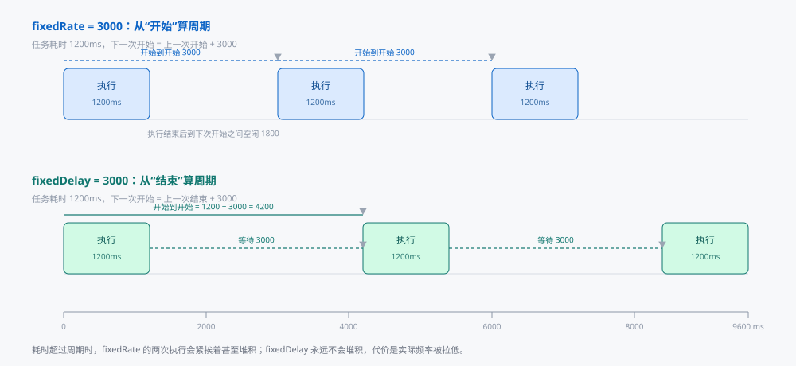
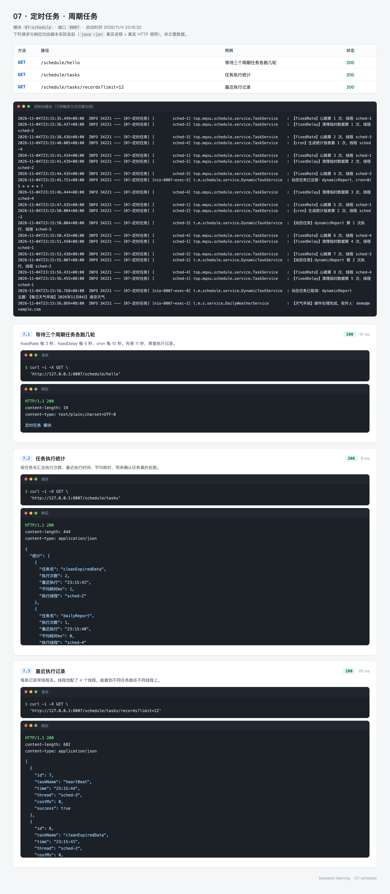
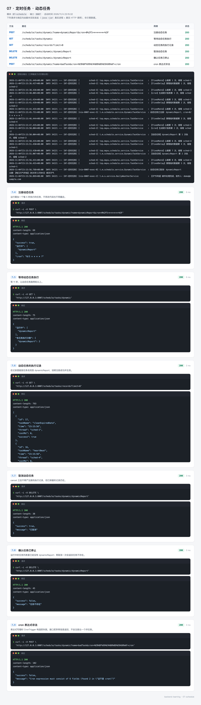
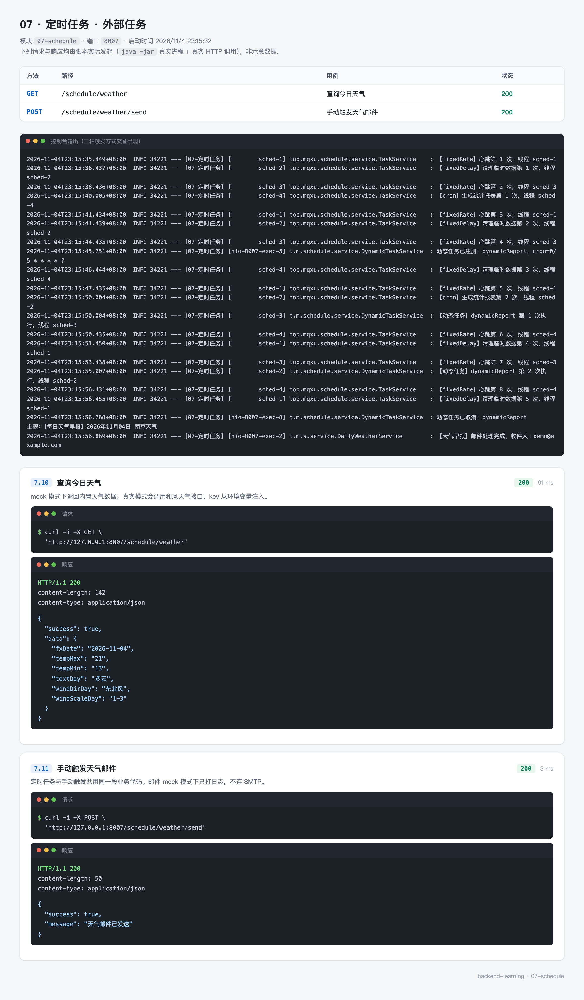

# 07 · 定时任务 —— 到点自己执行

有些活不需要等人点按钮：每天九点发一份天气早报、每五分钟清理一次过期数据、每月一号生成上个月的报表。这类需求统一叫定时任务，核心只有两个问题——**什么时候触发**，以及**触发之后怎么保证只执行一次**。

`07-schedule` 用四个任务把这两件事讲清楚：三个不同触发方式的周期任务，一个运行期才能决定要不要跑的动态任务，外加一条真实的"取天气、拼邮件、发出去"的链路。

这个模块不需要 MySQL 和 Redis，是前面七个里依赖最少的一个，也最适合单独跑一遍。

---

## 0. 先看结果

```bash
mvn -pl 07-schedule spring-boot:run
```

启动后什么都不用做，控制台会自己开始输出。下面是删掉进程号等固定前缀后的样子，只留时刻、线程与内容：

```
23:15:35.449 [sched-1] 【fixedRate】心跳第 1 次，线程 sched-1
23:15:36.437 [sched-2] 【fixedDelay】清理临时数据第 1 次，线程 sched-2
23:15:38.436 [sched-3] 【fixedRate】心跳第 2 次，线程 sched-3
23:15:40.005 [sched-4] 【cron】生成统计报表第 1 次，线程 sched-4
23:15:41.434 [sched-1] 【fixedRate】心跳第 3 次，线程 sched-1
23:15:41.439 [sched-2] 【fixedDelay】清理临时数据第 2 次，线程 sched-2
23:15:44.435 [sched-3] 【fixedRate】心跳第 4 次，线程 sched-3
23:15:50.004 [sched-2] 【cron】生成统计报表第 2 次，线程 sched-2
```

从时间戳能读出三种节奏：心跳每 3 秒（35、38、41、44），清理每 5 秒（36、41），报表每 10 秒（40、50）。线程名 `sched-1` 到 `sched-4` 轮流出现，说明调度线程池确实有四个线程在工作。

想查得更细，用接口：

```bash
curl "http://127.0.0.1:8007/schedule/tasks"
curl "http://127.0.0.1:8007/schedule/tasks/records?limit=12"
```

第一句返回每个任务执行了几次、最近一次几点、用的哪个线程：

```json
{
  "统计": [
    { "任务名": "cleanExpiredData", "执行次数": 2, "最近执行": "23:15:41", "平均耗时ms": 1, "执行线程": "sched-2" },
    { "任务名": "dailyReport", "执行次数": 1, "最近执行": "23:15:40", "平均耗时ms": 0, "执行线程": "sched-4" },
    { "任务名": "heartBeat", "执行次数": 4, "最近执行": "23:15:44", "平均耗时ms": 0, "执行线程": "sched-3" }
  ]
}
```

这个模块一共三组接口：

| 组 | 路径 | 内容 | 截图 |
| --- | --- | --- | --- |
| 周期任务 | `/schedule/tasks`、`/schedule/tasks/records` | 三类任务的执行统计与明细 | `07-schedule-periodic.webp` |
| 动态任务 | `/schedule/tasks/dynamic` | 运行期注册、查看、取消 | `07-schedule-dynamic.webp` |
| 外部任务 | `/schedule/weather` | 取天气、发邮件 | `07-schedule-weather.webp` |

### 这一节的路线

| 步骤 | 内容 | 对应小节 |
| --- | --- | --- |
| 1 | 三种触发方式的差别，以及什么时候会出问题 | 1 |
| 2 | 确认环境，这个模块不需要中间件 | 2 |
| 3 | 建模块，引三个依赖 | 3 |
| 4 | 配线程池与两个开关 | 4 |
| 5 | 写代码：三种触发、执行记录、动态任务、天气早报 | 5 |
| 6 | 跑起来看日志与接口 | 6 |
| 7 | 14 个测试 | 7 |
| 8 | 练习 | 8 |

---

## 1. 三种触发方式

### 1.1 从时间轴上看差别

`fixedRate` 和 `fixedDelay` 都接受一个毫秒数，看起来很像，但计时的起点不同：

- `fixedRate`：从**上一次开始执行**算起。任务耗时 1.2 秒、周期 3 秒，那两次开始之间固定隔 3 秒，任务结束后空 1.8 秒。
- `fixedDelay`：从**上一次执行结束**算起。同样耗时 1.2 秒、周期 3 秒，两次开始之间就是 1.2 + 3 = 4.2 秒。



差别只在任务耗时不等于零的时候才显现。如果任务是空跑，两者看起来完全一样——这也是很多人以为它们没区别的原因。

### 1.2 耗时超过周期时会怎样

假设周期 3 秒，任务要跑 5 秒：

| 方式 | 行为 | 后果 |
| --- | --- | --- |
| `fixedRate` | 第一次 0 到 5 秒，第二次本该在 3 秒开始，已经过点了，于是紧接着在 5 秒开始 | 执行一个接一个，永不空闲；线程池里堆积 |
| `fixedDelay` | 第一次 0 到 5 秒，第二次在 5 + 3 = 8 秒开始 | 永远不堆积，代价是实际频率被拉低 |

选哪种取决于业务能不能接受"漏跑"：

- 心跳、指标上报、缓存预热用 `fixedRate`。这类任务要求"按固定节奏发生"，宁可晚一点也要保持密度。
- 清理临时数据、同步一批文件用 `fixedDelay`。这类任务跑完才能开始下一轮，堆起来只会互相打架。

### 1.3 cron 的六个字段

`cron` 按日历规则触发，适合"每天几点""每周一""每月一号"这种需求。Spring 的 cron 是六位（也可以写七位，最后一位是年）：

```
┌───────────── 秒 (0-59)
│ ┌─────────── 分 (0-59)
│ │ ┌───────── 时 (0-23)
│ │ │ ┌─────── 日 (1-31)
│ │ │ │ ┌───── 月 (1-12)
│ │ │ │ │ ┌─── 周 (0-7，0 和 7 都是周日)
│ │ │ │ │ │
* * * * * *
```

常用写法：

| 表达式 | 含义 |
| --- | --- |
| `0/10 * * * * ?` | 每 10 秒 |
| `0 0/5 * * * ?` | 每 5 分钟 |
| `0 22 9 * * ?` | 每天 9:22 |
| `0 0 2 * * ?` | 每天凌晨 2 点 |
| `0 0 9 ? * MON-FRI` | 周一到周五 9 点 |
| `0 0 0 1 * ?` | 每月 1 号零点 |

六个特殊字符：

| 字符 | 作用 | 例子 |
| --- | --- | --- |
| `*` | 任意值 | 秒位写 `*` 表示每秒 |
| `?` | 不指定 | 日和周只能有一个是 `?` |
| `,` | 枚举 | `MON,WED,FRI` |
| `-` | 范围 | `9-17` 表示 9 点到 17 点 |
| `/` | 步长 | `0/10` 表示从 0 开始每 10 |
| `L` `W` `#` | 最后一天、最近工作日、第几个周几 | `6#3` 表示第三个周六 |

`?` 是最容易搞错的一个。日和周这两个字段互斥：写了"每月 1 号"就不能再限定"周几"，否则两个条件矛盾。所以习惯上前者写日、周位写 `?`。

### 1.4 两台机器会跑两遍

`@Scheduled` 是进程内的调度。服务部署两台，两台各有一个调度器，同一个任务在同一时刻各执行一次——发两份邮件、扣两次库存。

这个问题不会在单机开发时暴露，上线才出现。常见的三种处理：

| 做法 | 代价 |
| --- | --- |
| 用 Redis 分布式锁，抢到才执行 | 需要额外依赖，锁的过期时间要大于任务耗时 |
| 引入 ShedLock | 一个专门的库，注解式加锁，本质还是分布式锁 |
| 把定时任务拆成单独的部署单元，只跑一个实例 | 部署结构变复杂，但最彻底 |

小项目用第一种就够，代码和 06 的 `tryLock` 一样，只是锁的 key 换成任务名。

---

## 2. 准备环境

这个模块不需要 MySQL 和 Redis。确认两件事：

```bash
java -version
# openjdk version "17.0.x"

mvn -v
# Apache Maven 3.9.x
```

邮件和天气默认都是模拟模式（`email.mock: true`、`weather.mock: true`），不配任何密钥就能完整跑通：天气返回内置数据，邮件只打日志。

要接真实服务时，配三个环境变量，不要把密钥写进仓库：

```bash
export MAIL_USERNAME=你的邮箱@qq.com
export MAIL_PASSWORD=SMTP授权码
export WEATHER_API_KEY=和风天气的key
```

然后把 `weather.mock` 与 `email.mock` 改成 `false`。QQ 邮箱的授权码不是登录密码，要在邮箱设置里单独生成。

---

## 3. 创建模块

### 3.1 POM

```xml
<properties>
    <okhttp.version>4.12.0</okhttp.version>
    <fastjson2.version>2.0.65</fastjson2.version>
</properties>

<dependencies>
    <!-- HTTP 客户端，用来调第三方天气接口 -->
    <dependency>
        <groupId>com.squareup.okhttp3</groupId>
        <artifactId>okhttp</artifactId>
        <version>${okhttp.version}</version>
    </dependency>

    <!-- 发邮件 -->
    <dependency>
        <groupId>org.springframework.boot</groupId>
        <artifactId>spring-boot-starter-mail</artifactId>
    </dependency>

    <!-- 解析天气接口返回的 JSON -->
    <dependency>
        <groupId>com.alibaba.fastjson2</groupId>
        <artifactId>fastjson2</artifactId>
        <version>${fastjson2.version}</version>
    </dependency>
</dependencies>
```

三个依赖各自对应一段链路：`okhttp` 取数据，`fastjson2` 解析，`spring-boot-starter-mail` 发信。

`spring-boot-starter-web` 不用写，父 POM 已经统一引了 `spring-boot-starter-webmvc`，所有模块共用。

### 3.2 目录结构

```
07-schedule
├── pom.xml
└── src
    ├── main
    │   ├── java/top/mqxu/schedule
    │   │   ├── ScheduleApplication.java
    │   │   ├── controller
    │   │   │   ├── ScheduleController.java   # 任务查询与动态任务管理
    │   │   │   └── WeatherController.java    # 天气查询与手动发信
    │   │   └── service
    │   │       ├── TaskService.java          # 三种触发方式
    │   │       ├── TaskExecutionRecorder.java# 执行记录
    │   │       ├── DynamicTaskService.java   # 运行期注册任务
    │   │       └── DailyWeatherService.java  # 天气早报
    │   └── resources/application.yml
    └── test/java/top/mqxu/schedule
        ├── CronTriggerTest.java              # 4 个用例，纯单元
        ├── TaskExecutionRecorderTest.java    # 3 个用例，纯单元
        └── ScheduleIntegrationTest.java      # 7 个用例，真实调度
```

---

## 4. 配置

```yaml
server:
  port: 8007

spring:
  application:
    name: 07-定时任务

  task:
    scheduling:
      pool:
        size: 4
      thread-name-prefix: sched-

  mail:
    host: smtp.qq.com
    port: 587
    username: ${MAIL_USERNAME:}
    password: ${MAIL_PASSWORD:}
    properties:
      mail:
        smtp:
          auth: true
          starttls:
            enable: true
            required: true

weather:
  api:
    key: ${WEATHER_API_KEY:}
    city: 101190101
    url: https://devapi.qweather.com/v7/weather/3d
  mock: true
  cron: "0 22 9 * * ?"

email:
  recipients: ${MAIL_TO:demo@example.com}
  mock: true
```

### 4.1 线程池默认只有一个线程

`spring.task.scheduling.pool.size` 不配时是 1。一个线程意味着所有任务排队：心跳占着线程跑 5 秒，清理任务就得等 5 秒，本来该 5 秒一次的变成 8 秒一次。

配成 4 之后，日志里的线程名会在 `sched-1` 到 `sched-4` 之间轮流出现。线程数不是越大越好，按"同时可能有多少个任务在跑"来定，一般 4 到 8 够用。

`thread-name-prefix` 是排查问题的关键。默认线程名是 `scheduling-1`，和 Tomcat 的 `http-nio-8007-exec-1` 混在日志里不好认；改成 `sched-` 之后，一眼能看出这条日志来自调度器。

### 4.2 密钥与执行时间

`${MAIL_USERNAME:}` 的冒号后面是默认值。冒号留空表示"环境变量没有就用空字符串"，这样本地不配也能启动——邮件走模拟模式，根本不会用到账号。

如果写成 `${MAIL_USERNAME}` 不带冒号，环境变量缺失时启动会直接失败：`Could not resolve placeholder`。

`weather.cron` 控制天气早报的执行时间，代码里用 `@Scheduled(cron = "${weather.cron:0 22 9 * * ?}")` 引用。放在配置里的好处是改时间不用重新编译，也不用翻代码找那一行注解。

### 4.3 两个开关的意义

`weather.mock` 和 `email.mock` 让外部依赖变成可关闭的。好处有三个：

- 本地开发不用申请天气 API 的 key，也不用配 SMTP
- 自动化测试可以稳定断言返回值，不会因为对方接口抖动而失败
- 演示时不用担心真的发出邮件、消耗额度

接真实服务时只改配置，业务代码一行不动。这也是把 `sendEmail` 拆成"判断模式 + 真正发送"两段的原因。

---

## 5. 写代码

### 5.1 启动类

```java
@SpringBootApplication
@EnableScheduling
public class ScheduleApplication {
    public static void main(String[] args) {
        SpringApplication.run(ScheduleApplication.class, args);
    }
}
```

`@EnableScheduling` 是开关。不写它，`@Scheduled` 注解的方法编译通过、启动不报错，但永远不会执行。这是新手最常卡住的地方——代码看起来全对，日志里什么都没有。

### 5.2 三种触发方式

```java
@Slf4j
@Service
@RequiredArgsConstructor
public class TaskService {

    private final TaskExecutionRecorder recorder;

    private final AtomicInteger heartBeatTimes = new AtomicInteger();
    private final AtomicInteger cleanTimes = new AtomicInteger();
    private final AtomicInteger reportTimes = new AtomicInteger();

    @Scheduled(fixedRate = 3000, initialDelay = 1000)
    public void heartBeat() {
        LocalDateTime start = LocalDateTime.now();
        int times = heartBeatTimes.incrementAndGet();
        log.info("【fixedRate】心跳第 {} 次，线程 {}", times, Thread.currentThread().getName());
        recorder.record("heartBeat", start, 0, true);
    }

    @Scheduled(fixedDelay = 5000, initialDelay = 2000)
    public void cleanExpiredData() {
        LocalDateTime start = LocalDateTime.now();
        long begin = System.currentTimeMillis();
        int times = cleanTimes.incrementAndGet();
        log.info("【fixedDelay】清理临时数据第 {} 次，线程 {}", times, Thread.currentThread().getName());
        recorder.record("cleanExpiredData", start, System.currentTimeMillis() - begin, true);
    }

    @Scheduled(cron = "0/10 * * * * ?")
    public void dailyReport() {
        LocalDateTime start = LocalDateTime.now();
        int times = reportTimes.incrementAndGet();
        log.info("【cron】生成统计报表第 {} 次，线程 {}", times, Thread.currentThread().getName());
        recorder.record("dailyReport", start, 0, true);
    }
}
```

三个方法各自演示一种触发方式。`initialDelay` 只在第一次触发前生效，给应用留出启动完成的时间；不写的话，任务可能在容器还没就绪时就开始跑。

三个方法都没有参数、返回值都是 `void`——`@Scheduled` 修饰的方法必须如此。加了参数编译能过，但启动时报：

```
java.lang.IllegalStateException: Encountered invalid @Scheduled method 'xxx':
Only no-arg methods may be annotated with @Scheduled
```

日志里带上线程名，是为了验证线程池配置真的生效。如果所有日志都是 `sched-1`，说明 `pool.size` 没配上，或者任务执行太快，一个线程就够了。

### 5.3 执行记录器：让"跑没跑"可查

日志只能人眼看，接口要能查。`TaskExecutionRecorder` 把每次执行的时间、耗时、线程名留下来：

```java
@Component
public class TaskExecutionRecorder {

    private static final int CAPACITY = 200;

    private final ConcurrentLinkedDeque<Execution> records = new ConcurrentLinkedDeque<>();

    private final AtomicLong seq = new AtomicLong();

    public void record(String taskName, LocalDateTime startTime, long costMs, boolean success) {
        records.addFirst(new Execution(
                seq.incrementAndGet(), taskName, startTime.format(FMT),
                Thread.currentThread().getName(), costMs, success));
        while (records.size() > CAPACITY) {
            records.pollLast();
        }
    }

    public List<Execution> recent(int limit) {
        return records.stream().limit(limit).toList();
    }

    public record Execution(long id, String taskName, String time, String thread, long costMs, boolean success) {
    }
}
```

三处设计值得说：

**用 `ConcurrentLinkedDeque` 而不是 `ArrayList`。** 调度线程在写、HTTP 线程在读，普通集合会抛 `ConcurrentModificationException`。`addFirst` 加在头部，取最近的记录时不用排序。

**有容量上限。** 3 秒一次的任务一天要跑近三万次，不设上限内存会一直涨。200 条够看最近的执行情况，要长期留存应该写数据库或者日志系统。

**用 record 定义返回值。** 执行记录是个纯数据载体，用 record 一行写完，还自带 `equals` 和 `hashCode`。

`stats()` 按任务名分组，算出执行次数、最近一次时间、平均耗时：

```java
public List<Map<String, Object>> stats() {
    Map<String, List<Execution>> grouped = records.stream()
            .collect(Collectors.groupingBy(Execution::taskName, LinkedHashMap::new, Collectors.toList()));

    List<Map<String, Object>> result = new ArrayList<>();
    grouped.forEach((name, list) -> {
        Map<String, Object> item = new LinkedHashMap<>();
        item.put("任务名", name);
        item.put("执行次数", list.size());
        item.put("最近执行", list.get(0).time());
        item.put("平均耗时ms", Math.round(list.stream().mapToLong(Execution::costMs).average().orElse(0)));
        item.put("执行线程", list.get(0).thread());
        result.add(item);
    });
    result.sort(Comparator.comparing(m -> String.valueOf(m.get("任务名"))));
    return result;
}
```

用 `LinkedHashMap` 收集分组结果是为了保持插入顺序，最后再按任务名排序，让接口返回的顺序稳定——否则每次刷新顺序都在变，没法比对。

### 5.4 动态任务：不重启也能加一个

`@Scheduled` 的周期是编译期写死的，运行时想加一个"用户自定义的提醒"做不到。这种场景要用 `TaskScheduler` 手动注册：

```java
@Service
@RequiredArgsConstructor
public class DynamicTaskService {

    private final TaskScheduler taskScheduler;
    private final TaskExecutionRecorder recorder;

    /** 任务名 -> 已注册的调度句柄，取消时要用它 */
    private final Map<String, ScheduledFuture<?>> running = new ConcurrentHashMap<>();
    private final Map<String, AtomicInteger> counters = new ConcurrentHashMap<>();

    public Set<String> register(String name, String cron) {
        if (running.containsKey(name)) {
            throw new IllegalArgumentException("任务已存在：" + name);
        }
        CronTrigger trigger = new CronTrigger(cron);
        AtomicInteger counter = counters.computeIfAbsent(name, k -> new AtomicInteger());

        ScheduledFuture<?> future = taskScheduler.schedule(() -> {
            LocalDateTime start = LocalDateTime.now();
            long begin = System.currentTimeMillis();
            int times = counter.incrementAndGet();
            log.info("【动态任务】{} 第 {} 次执行，线程 {}", name, times, Thread.currentThread().getName());
            recorder.record(name, start, System.currentTimeMillis() - begin, true);
        }, trigger);

        running.put(name, future);
        log.info("动态任务已注册：{}，cron={}", name, cron);
        return running.keySet();
    }

    public boolean cancel(String name) {
        ScheduledFuture<?> future = running.remove(name);
        if (future == null) {
            return false;
        }
        future.cancel(false);
        return true;
    }
}
```

`running` 这个 Map 是核心。注册时把 `ScheduledFuture` 存起来，取消时用它调 `cancel`。没有这个句柄，任务一旦注册就再也停不下来。

`new CronTrigger(cron)` 在构造时就会校验表达式。写错了立刻抛 `IllegalArgumentException`，而不是等调度器下一轮尝试时才发现。控制器捕获这个异常并返回 `success: false`，避免 500：

```java
try {
    result.put("success", true);
    result.put("运行中", dynamicTaskService.register(name, cron));
} catch (IllegalArgumentException e) {
    result.put("success", false);
    result.put("message", e.getMessage());
}
```

实际返回的错误信息很具体：

```json
{
  "success": false,
  "message": "Cron expression must consist of 6 fields (found 2 in \"这不是 cron\")"
}
```

`future.cancel(false)` 的参数表示"不打断正在执行的那一次"。传 `true` 会给线程发中断信号，任务里的 IO 操作可能抛 `InterruptedException`，收尾逻辑来不及执行。取消任务一般是"这一轮跑完就别再跑了"，用 `false`。

动态任务只存在内存里，重启就没了。生产上要把注册信息存到数据库，启动时读出来重新注册——这一条留作练习。

### 5.5 天气早报：一条完整的外部链路

这是模块里唯一有真实业务意义的任务：每天 9:22 查天气、拼邮件、发出去。三个环节都做了"可关闭"处理。

```java
@Scheduled(cron = "${weather.cron:0 22 9 * * ?}")
public void sendDailyWeather() {
    boolean ok = sendWeatherEmail();
    log.info("【天气早报】定时任务执行完成，结果 {}", ok ? "成功" : "失败");
}

public boolean sendWeatherEmail() {
    try {
        JSONObject todayWeather = getTodayWeather();
        if (todayWeather == null) {
            log.error("【天气早报】获取天气数据失败");
            return false;
        }
        String subject = String.format("【每日天气早报】%s 南京天气", ...);
        String content = String.format("""
                日期：%s
                天气：%s
                温度：%s℃ ~ %s℃
                风向：%s
                风力：%s 级
                提示：出门请根据天气增减衣物，注意交通安全。""", ...);

        sendEmail(subject, content);
        return true;
    } catch (Exception e) {
        log.error("【天气早报】执行失败", e);
        return false;
    }
}
```

整个方法被 `try-catch` 包住。定时任务里抛出的异常不会有人接，只会打一行堆栈，然后任务继续按周期跑——如果每次都失败，日志会被刷满。捕获之后返回布尔值，调用方（定时任务或手动接口）都能拿到明确结果。

取数据的部分：

```java
private String getWeatherData() throws IOException {
    if (weatherMock) {
        log.info("天气接口处于模拟模式，返回内置数据");
        return """
                {"code":"200","daily":[
                  {"fxDate":"%s","tempMax":"21","tempMin":"13","textDay":"多云",
                   "windDirDay":"东北风","windScaleDay":"1-3"}
                ]}""".formatted(LocalDate.now());
    }

    String requestUrl = String.format("%s?location=%s&key=%s", weatherApiUrl, cityId, weatherApiKey);
    Request request = new Request.Builder().url(requestUrl).build();
    try (Response response = okHttpClient.newCall(request).execute()) {
        if (response.isSuccessful() && response.body() != null) {
            return response.body().string();
        }
        log.warn("天气接口返回异常状态码：{}", response.code());
        return null;
    }
}
```

模拟数据里 `fxDate` 用 `LocalDate.now()` 填充，所以接口返回的永远是"今天"，测试可以稳定断言。

真实调用用的是 OkHttp 的同步 API。放在定时任务里没问题，因为调度线程本来就在等结果；如果在 Web 请求里调，要换成 `enqueue` 的异步方式，否则会占住 Tomcat 线程。

发信的部分用 `email.mock` 分流：

```java
private void sendEmail(String subject, String content) {
    if (emailMock) {
        log.info("邮件通道处于模拟模式\n主题：{}\n{}", subject, content);
        return;
    }
    SimpleMailMessage message = new SimpleMailMessage();
    message.setFrom(fromEmail);
    message.setTo(toEmails);
    message.setSubject(subject);
    message.setText(content);
    mailSender.send(message);
}
```

`SimpleMailMessage` 只支持纯文本。要发 HTML 邮件得换成 `MimeMessage` + `MimeMessageHelper`，多两行代码。

### 5.6 控制器

`ScheduleController` 提供四类操作：统计、记录、注册、取消。`WeatherController` 提供天气查询和手动发信。

手动发信的接口不是为了替代定时任务，而是为了验证：不用等到明天九点，现在就能确认整条链路通不通。`sendWeatherEmail()` 被定时任务和接口共用，逻辑只有一份。

---

## 6. 运行与实测

### 6.1 启动

```bash
mvn -pl 07-schedule spring-boot:run
```

启动日志里确认两行：

```
Tomcat started on port 8007 (http) with context path '/'
Started ScheduleApplication in 1.054 seconds
```

然后什么都不做，盯着控制台。1 秒后心跳第一次，2 秒后清理第一次，10 秒内报表第一次。

### 6.2 周期任务

等 11 秒，让三类任务都跑过几轮，然后查统计：

```bash
curl "http://127.0.0.1:8007/schedule/tasks"
curl "http://127.0.0.1:8007/schedule/tasks/records?limit=12"
```



截图里能读出三件事：

**执行次数按周期比例增长。** 同样 11 秒，心跳 4 次（3 秒一次）、清理 2 次（5 秒一次）、报表 1 次（10 秒一次）。数字对得上周期，说明调度器工作正常。

**线程名是交替的。** `heartBeat` 用了 sched-1、sched-3、sched-4，`cleanExpiredData` 用了 sched-2。四个线程轮流接任务，这是 `pool.size: 4` 生效的直接证据。如果全是 sched-1，就该去查配置了。

**`dailyReport` 对齐的是自然时间。** cron 是 `0/10 * * * * ?`，它在每个整十秒触发，而不是"启动后第 10 秒"。启动时间 23:15:34，第一次执行在 23:15:40。

### 6.3 动态任务

```bash
# 注册，每 5 秒一次（cron 里的空格要 URL 编码成 %20）
curl -X POST "http://127.0.0.1:8007/schedule/tasks/dynamic?name=dynamicReport&cron=0/5%20*%20*%20*%20*%20?"

# 等 11 秒后查执行次数
curl "http://127.0.0.1:8007/schedule/tasks/dynamic"

# 取消
curl -X DELETE "http://127.0.0.1:8007/schedule/tasks/dynamic/dynamicReport"

# 再取消一次
curl -X DELETE "http://127.0.0.1:8007/schedule/tasks/dynamic/dynamicReport"
```



四个响应串起来看：

```json
// 注册
{ "success": true, "运行中": ["dynamicReport"], "cron": "0/5 * * * * ?" }

// 11 秒后
{ "运行中": ["dynamicReport"], "各任务执行次数": { "dynamicReport": 2 } }

// 第一次取消
{ "success": true, "message": "已取消" }

// 第二次取消
{ "success": false, "message": "任务不存在" }
```

11 秒里跑了 2 次。cron 是 `0/5 * * * * ?`，对齐的是自然时间的整 5 秒，注册之后要等下一个 5 的倍数才第一次触发；11 秒的观察窗口里出现 2 次或 3 次都正常，取决于注册那一刻离下一个触发点有多远。第二次取消返回失败是对的——`running.remove(name)` 返回 null，说明这个任务已经不在注册表里了。

curl 里的 cron 表达式必须 URL 编码，`?` 和空格在 URL 里有特殊含义。不编码的话，Tomcat 可能把后面的内容截掉，收到的 cron 只剩一半。

### 6.4 天气早报

```bash
curl "http://127.0.0.1:8007/schedule/weather"
curl -X POST "http://127.0.0.1:8007/schedule/weather/send"
```



查询返回：

```json
{
  "success": true,
  "data": {
    "fxDate": "2026-11-04",
    "tempMax": "21",
    "tempMin": "13",
    "textDay": "多云",
    "windDirDay": "东北风",
    "windScaleDay": "1-3"
  }
}
```

发信返回 `{"success": true, "message": "天气邮件已发送"}`，但实际没连 SMTP——`email.mock: true` 时只往日志里写一段：

```
【天气早报】邮件通道处于模拟模式
主题：【每日天气早报】2026年11月04日 南京天气
日期：2026-11-04
天气：多云
温度：13℃ ~ 21℃
...
```

要真的发出去，把 `email.mock` 改成 `false`，再配好 `MAIL_USERNAME` 和 `MAIL_PASSWORD`（QQ 邮箱的 SMTP 授权码）。

---

## 7. 写测试

14 个用例，三个类，按"要不要启动 Spring"分开：

| 测试类 | 用例数 | 类型 | 测什么 |
| --- | --- | --- | --- |
| `CronTriggerTest` | 4 | 纯单元 | cron 解析、下次触发时间、非法表达式 |
| `TaskExecutionRecorderTest` | 3 | 纯单元 | 倒序返回、分组统计、容量上限 |
| `ScheduleIntegrationTest` | 7 | 集成 | 任务真的触发、动态任务增删、天气与邮件 |

```bash
mvn -pl 07-schedule test
```

```
Tests run: 14, Failures: 0, Errors: 0, Skipped: 0
BUILD SUCCESS
```

### 7.1 不启动 Spring 也能测 cron

`CronTrigger` 只依赖一个"上一次执行时间"，可以直接构造：

```java
private Instant next(String cron, Instant last) {
    SimpleTriggerContext context = new SimpleTriggerContext(last, last, last);
    return new CronTrigger(cron, ZoneId.systemDefault()).nextExecution(context);
}

@Test
@DisplayName("每天 9:22 一次：当天 10 点触发后，下一次是第二天 9:22")
void dailyAtNineTwentyTwo() {
    Instant next = next("0 22 9 * * ?", at(10, 0, 0));

    ZonedDateTime time = next.atZone(ZoneId.systemDefault());
    assertThat(time.getHour()).isEqualTo(9);
    assertThat(time.getMinute()).isEqualTo(22);
    assertThat(time.getDayOfMonth()).isEqualTo(5);
}
```

`SimpleTriggerContext` 的三个参数分别是上次计划时间、上次实际时间、上次完成时间。三个都传同一个值，就得到"从这一刻起下一次什么时候触发"。

时区要显式传。不传时用 JVM 默认时区，在 CI 上（通常是 UTC）算出来的小时数会和本地开发不一致。

非法表达式用 `assertThatThrownBy` 断言：

```java
assertThatThrownBy(() -> new CronTrigger("0/10 * * * *"))
        .isInstanceOf(IllegalArgumentException.class);
```

这条用例的价值在于确认"写错的表达式会立刻失败"。如果构造时不校验，要等到第一次触发才报错，那时候可能已经在生产上跑了一周。

### 7.2 执行记录器的边界

除了正常的增删查，重点测容量上限：

```java
@Test
@DisplayName("只保留最近 200 条，超出的从尾部丢弃")
void keepsAtMostCapacity() {
    for (int i = 0; i < 210; i++) {
        recorder.record("flood", LocalDateTime.now(), i, true);
    }

    List<TaskExecutionRecorder.Execution> all = recorder.recent(1000);

    assertThat(all).hasSize(200);
    assertThat(all.get(0).id()).isEqualTo(210);
    assertThat(all.get(199).id()).isEqualTo(11);
}
```

录 210 条，最早的那 10 条（id 1 到 10）应该被丢掉，剩下的从 id 11 到 210。这条用例同时验证了"新的在前"和"超限从尾部丢"两个行为。

### 7.3 集成测试里的等待

定时任务的测试绕不开等待。想验证"任务真的按周期跑了"，只能让它跑：

```java
@Test
@DisplayName("三种触发方式都会自行执行：等 11 秒，三类任务的记录都出现")
void allThreeTriggersFire() throws InterruptedException {
    // heartBeat 3 秒、cleanExpiredData 5 秒、dailyReport 10 秒，
    // 等 11 秒能保证三类任务各至少跑一次
    Thread.sleep(11_000);

    List<TaskExecutionRecorder.Execution> records = recorder.recent(200);

    assertThat(records).extracting(TaskExecutionRecorder.Execution::taskName)
            .contains("heartBeat", "cleanExpiredData", "dailyReport");
}
```

这个类是整套测试里最慢的，15 秒左右。可以做两处优化，但都有代价：

- 把周期改短（比如 1 秒、2 秒、3 秒），等待时间能压到 4 秒。代价是测试里跑的不是生产用的周期。
- 用 `@MockitoBean` 替换 `TaskScheduler`，验证"注册了几次"。代价是测不到真正的触发。

这里选择保留真实周期，因为定时任务最容易出问题的地方恰恰是"配置写了但没生效"，mock 掉调度器就测不出这个问题。

`@SpringBootTest` 启动的上下文里，三个周期任务会一直跑，可能干扰其它用例。所以断言时不看总数，只看"包含哪些任务名"，具体次数留给人工观察。

---

## 8. 练习

**练习 1：改周期，从日志验证**

把 `heartBeat` 的周期从 3 秒改成 5 秒，`cleanExpiredData` 从 5 秒改成 3 秒，重启后看日志。预期：心跳变慢、清理变快，`/schedule/tasks` 里的执行次数比例反过来。

**练习 2：写一个工作日早八的 cron**

要求周一到周五 8:00 执行，周末不跑。写完后用 `CronTriggerTest` 里的方式验证：从周五 9 点算起，下一次应该是下周一 8 点。

提示：日位写 `?`，周位写 `MON-FRI`。

**练习 3：让动态任务能持久化**

现在的动态任务存在内存里，重启就丢。改成注册时写进一张表（或 Redis），启动时读出来重新注册。

需要处理两件事：应用启动完成之后再注册（用 `ApplicationRunner`），以及任务已经被取消时要把记录删掉，否则重启会把它又注册回来。

**练习 4：多实例只跑一次**

把服务启动两个实例（端口 8007 和 8008），观察日志——同一个任务会在两个实例上各执行一次。

用 06 学过的 Redisson 锁解决：任务开头 `tryLock("lock:job:" + taskName, 0, 30, SECONDS)`，抢不到就直接返回。想清楚锁的过期时间该设多长，以及任务执行超过这个时间会怎样。

**练习 5：给任务加失败重试**

`sendWeatherEmail()` 失败时只返回 false，不会重试。改成失败后隔 30 秒重试一次，最多重试 3 次。

提示：不要在 `@Scheduled` 方法里 `Thread.sleep`，那会占住调度线程。用 `taskScheduler.schedule(..., Instant.now().plusSeconds(30))` 注册一次性任务。

---

## 9. 常见问题

**`@Scheduled` 方法不执行**

三个可能：启动类没加 `@EnableScheduling`；方法不是 `public`；方法有参数或返回值不是 `void`。前两个不报错，第三个启动时抛异常。

**所有任务都在同一个线程里跑**

`spring.task.scheduling.pool.size` 没配，默认是 1。改成 4 之后看日志里的线程名是否变化。

**cron 表达式报 `Cron expression must consist of 6 fields`**

字段数量不对。Spring 用六位（秒 分 时 日 月 周），Linux 的 crontab 是五位（分 时 日 月 周），两者不能混用。从 crontab 抄过来的表达式要在最前面补一个秒位。

**动态任务注册成功但不执行**

先确认 cron 是否对齐了当前时间。`0 0 9 * * ?` 每天只执行一次，注册完当然看不到动静，要等到第二天九点。调试时用 `0/5 * * * * ?` 这种高频表达式。

**`Could not resolve placeholder 'MAIL_USERNAME'`**

配置里写了 `${MAIL_USERNAME}` 但没给默认值，环境变量又没设。改成 `${MAIL_USERNAME:}`，或者导出环境变量。

**任务执行了两次**

单机情况下检查是不是重复注册了（比如 `@Scheduled` 和动态注册各来了一次）。多实例部署则是 1.4 节说的问题，需要分布式锁。

**邮件发送超时卡住整个调度器**

SMTP 连接默认没有超时限制。在 `spring.mail.properties.mail.smtp` 下加 `connectiontimeout`、`timeout`、`writetimeout`，各设 5000 毫秒。不加的话，SMTP 服务器不响应时，调度线程会一直挂着。

---

## 10. 小结

| 知识点 | 一句话 |
| --- | --- |
| 开关 | `@EnableScheduling` 不加，注解全都不生效 |
| `fixedRate` | 从上次**开始**算，耗时超过周期会堆积 |
| `fixedDelay` | 从上次**结束**算，永不堆积但频率会被拉低 |
| `cron` | 六位：秒 分 时 日 月 周，日和周互斥用 `?` |
| 线程池 | 默认 1 个线程，配 `spring.task.scheduling.pool.size` |
| 动态任务 | `TaskScheduler` + `CronTrigger`，用 `ScheduledFuture` 取消 |
| 执行记录 | 内存队列 + 容量上限，生产应落库 |
| 外部依赖 | 用 `mock` 开关隔离，本地与测试都不依赖外部服务 |
| 多实例 | 会重复执行，需要分布式锁或独立部署 |

下一篇 [08-security](08-security.md) 处理"谁能访问"的问题：认证、授权、过滤器链，以及 JWT 在没有 session 的情况下怎么维持登录态。

> 本节遵循的规范：定时任务方法无参、返回 void；cron 表达式放配置不写死；外部依赖必须有可关闭的 mock 开关；任务内捕获异常并记录结果；多实例部署必须处理重复执行。
