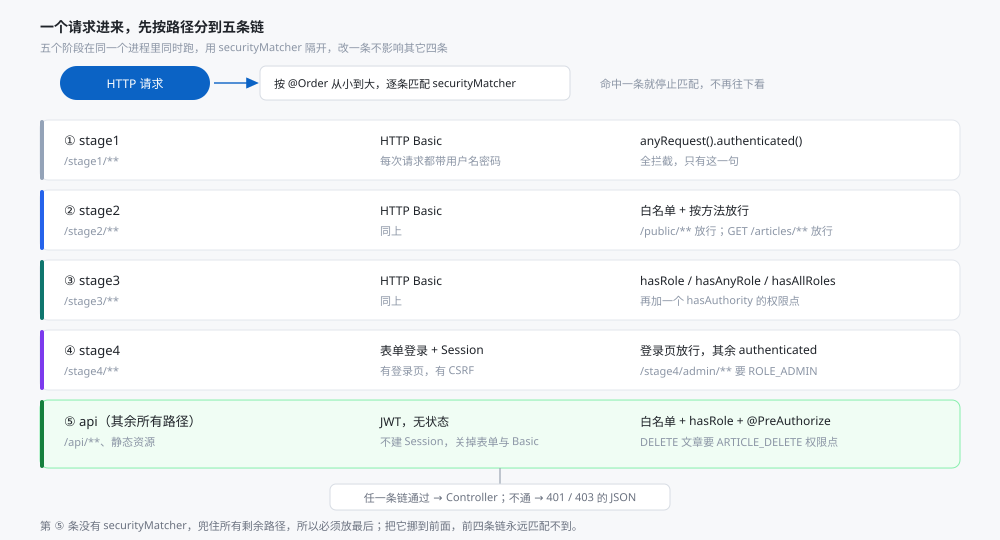
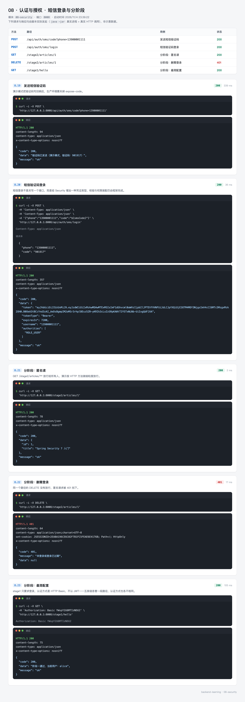

# 08 · 认证与授权 —— 谁在访问，能访问什么

加一个 `spring-boot-starter-security` 依赖，所有接口立刻变成 401，浏览器弹出登录框。这是很多人第一次接触 Spring Security 的体验——知道它管用，但不知道它怎么管用。

这一篇把它拆开：先分清认证与授权，再看一个请求进来会经过哪些关卡，最后用五条独立的过滤器链把"全拦截 → 白名单 → 角色 → 表单登录 → JWT"五个阶段放在同一个进程里同时跑。改一条链不影响其它四条，五个阶段可以互相印证。

`08-security` 用到 MySQL（存账号与角色）和 Redis（存短信验证码）。Redis 可以关掉，改成内存实现，2.3 节说明。

---

## 0. 先看结果

登录拿 token：

```bash
curl -X POST "http://127.0.0.1:8008/api/auth/login" \
  -H "Content-Type: application/json" \
  -d '{"username":"alice","password":"123456"}'
```

```json
{
  "code": 200,
  "data": {
    "token": "eyJhbGciOiJIUzUxMiJ9...",
    "tokenType": "Bearer",
    "expiresIn": 7200,
    "username": "alice",
    "authorities": ["ARTICLE_DELETE", "ROLE_USER", "FACTOR_PASSWORD"]
  }
}
```

拿 token 访问业务接口：

```bash
TOKEN=<上一步的 token>

curl "http://127.0.0.1:8008/api/hello" -H "Authorization: Bearer $TOKEN"
# {"code":200,"data":{"message":"你好，alice","authorities":[...]},"message":"ok"}

curl "http://127.0.0.1:8008/api/hello"
# {"code":401,"message":"未登录或登录已过期","data":null}

curl "http://127.0.0.1:8008/api/admin/dashboard" -H "Authorization: Bearer $TOKEN"
# {"code":403,"message":"没有访问权限","data":null}
```

同一个 token，`/api/hello` 能进，`/api/admin/dashboard` 被拒——前者只要求登录（认证），后者要求管理员角色（授权）。这就是这一篇要讲的两件事。

`authorities` 里的 `FACTOR_PASSWORD` 不是我们配的权限，是 Spring Security 7 自动加的认证因子，6.4 节解释。

三组接口对应三张截图：

| 组 | 覆盖 | 截图 |
| --- | --- | --- |
| 登录与鉴权 | 密码登录、token、匿名访问、账号禁用与锁定 | `08-security-auth.webp` |
| 角色与权限 | hasRole、hasAnyRole、hasAllRoles、hasAuthority | `08-security-rbac.webp` |
| 短信登录与分阶段 | 短信验证码换 token、stage1/2 的路径规则 | `08-security-stage.webp` |

### 这一节的路线

| 步骤 | 内容 | 对应小节 |
| --- | --- | --- |
| 1 | 认证与授权的区别，请求经过哪些关卡 | 1 |
| 2 | 准备 MySQL 与 Redis | 2 |
| 3 | 建模块、配依赖 | 3 |
| 4 | 配密钥、验证码存储、CORS | 4 |
| 5 | 建表，准备六个不同状态的账号 | 5 |
| 6 | 写代码：五条链、JWT、短信登录、表单登录 | 6 |
| 7 | 跑起来，逐条看 401 / 403 | 7 |
| 8 | 26 个测试 | 8 |

---

## 1. 认证与授权是两件事

### 1.1 一条链上的六道关卡

请求进到 Controller 之前，要穿过一串过滤器。对新手来说，记住三个位置就够：

| 位置 | 干什么 | 出问题时 |
| --- | --- | --- |
| `CorsFilter` | 判断这个来源的跨域请求允不允许 | 浏览器报 `Failed to fetch`，连响应体都拿不到 |
| 认证过滤器（`JwtAuthenticationFilter` 或 `BasicAuthenticationFilter`） | 解析凭证，把身份写进 `SecurityContext` | 401，`message` 是"未登录" |
| `AuthorizationFilter` | 按配置的规则判断这个身份能不能访问这个路径 | 403，`message` 是"没有访问权限" |

401 与 403 的区别就在这里：401 是"我没认出你是谁"，403 是"认出来了，但你不能进"。混用会让前端没法处理——401 应该跳登录页，403 应该提示无权限。

### 1.2 五条链：一个进程里同时演示五个阶段

教科书通常是一条链从简单改到复杂，改一次重启一次。这里换成五条链并存，用 `securityMatcher` 按路径隔开：



规则是**从上往下匹配、命中即停**。`@Order` 小的先匹配，第 ⑤ 条没有 `securityMatcher`，兜住所有剩余路径，所以必须放最后。把它挪到前面，前四条链永远匹配不到。

这样切的好处是五个阶段可以同时验证，不用改配置重启；代价是配置类会变长，读的时候要时刻记得"这个请求走的是哪条链"。

---

## 2. 准备环境

### 2.1 MySQL 与 Redis

```bash
mysql -h127.0.0.1 -P3306 -uroot -p123456 -e "show databases;"
redis-cli -a abc123 ping
# PONG
```

数据库沿用 `backend_learning`，两张表由 `schema.sql` 在启动时创建。

### 2.2 Redis 用独立的 db

配置里写的是 `database: 11`，和 06-redis 的 10 分开。验证码的 key 前缀是 `sms:`，如果不分库，两个模块的 `sms:*` 会互相干扰——06 里也有短信登录。

### 2.3 不想装 Redis 也可以

把 `mqxu.security.sms.store` 改成 `memory`，验证码改存进程内的 `ConcurrentHashMap`：

```yaml
mqxu:
  security:
    sms:
      store: memory
```

代价是重启即失效、多实例不共享。只适合跑通链路，不能上生产。

两个实现都实现了同一个 `SmsCodeService` 接口，用 `@ConditionalOnProperty` 二选一装配，`SmsCodeAuthenticationProvider` 完全不知道底层是哪个。

---

## 3. 创建模块

```xml
<properties>
    <mybatis-plus.version>3.5.17</mybatis-plus.version>
    <jjwt.version>0.13.0</jjwt.version>
</properties>

<dependencies>
    <!-- 加上这个依赖，所有接口默认被锁住 -->
    <dependency>
        <groupId>org.springframework.boot</groupId>
        <artifactId>spring-boot-starter-security</artifactId>
    </dependency>

    <!-- 登录接口用 @Valid / @Pattern 校验参数 -->
    <dependency>
        <groupId>org.springframework.boot</groupId>
        <artifactId>spring-boot-starter-validation</artifactId>
    </dependency>

    <!-- 验证码存 Redis。sms.store=memory 时改用内存实现，不连 Redis 也能跑 -->
    <dependency>
        <groupId>org.springframework.boot</groupId>
        <artifactId>spring-boot-starter-data-redis</artifactId>
    </dependency>

    <dependency>
        <groupId>org.apache.commons</groupId>
        <artifactId>commons-pool2</artifactId>
    </dependency>

    <!-- 账号与角色存在 MySQL -->
    <dependency>
        <groupId>com.baomidou</groupId>
        <artifactId>mybatis-plus-spring-boot4-starter</artifactId>
        <version>${mybatis-plus.version}</version>
    </dependency>

    <dependency>
        <groupId>com.mysql</groupId>
        <artifactId>mysql-connector-j</artifactId>
        <scope>runtime</scope>
    </dependency>

    <!-- JWT：api 编译期用，impl 与 jackson 只在运行期需要 -->
    <dependency>
        <groupId>io.jsonwebtoken</groupId>
        <artifactId>jjwt-api</artifactId>
        <version>${jjwt.version}</version>
    </dependency>
    <dependency>
        <groupId>io.jsonwebtoken</groupId>
        <artifactId>jjwt-impl</artifactId>
        <version>${jjwt.version}</version>
        <scope>runtime</scope>
    </dependency>
    <dependency>
        <groupId>io.jsonwebtoken</groupId>
        <artifactId>jjwt-jackson</artifactId>
        <version>${jjwt.version}</version>
        <scope>runtime</scope>
    </dependency>
</dependencies>
```

`spring-boot-starter-security` 一加进来，Boot 就会生成一个随机密码并打印在启动日志里，所有请求都要先登录。这个默认行为由"容器里有没有 `UserDetailsService`"决定，5.3 节的 `DbUserDetailsService` 一旦存在，默认用户就不再生成。

目录：

```
08-security
└── src
    ├── main/java/top/mqxu/security
    │   ├── config        SecurityConfig、CorsConfig、SecurityProperties
    │   ├── common        Result、ErrorCode、BusinessException、GlobalExceptionHandler
    │   ├── controller    Auth（密码登录）、SmsAuth（短信登录）、Api（业务）、Stage（分阶段）
    │   ├── dto           LoginRequest、LoginResponse、SmsLoginRequest、UserInfo
    │   ├── entity        SysUser、SysRole
    │   ├── mapper        SysUserMapper、SysRoleMapper
    │   ├── security      JwtService、JwtAuthenticationFilter、RequestTraceFilter、
    │   │                 JsonAuthenticationEntryPoint、JsonAccessDeniedHandler
    │   ├── service       DbUserDetailsService、PhoneUserDetailsService、UserAssembler
    │   └── sms           SmsCodeService、Redis/InMemory 实现、Provider、Token
    ├── main/resources    application.yml、schema.sql、data.sql、static/
    └── test/java/top/mqxu/security
        ├── JwtServiceTest.java           4 个用例
        ├── SysRoleTest.java              3 个用例
        ├── InMemorySmsCodeTest.java      5 个用例
        └── SecurityIntegrationTest.java  14 个用例
```

---

## 4. 配置

```yaml
server:
  port: 8008

spring:
  application:
    name: 08-认证与授权

  datasource:
    driver-class-name: com.mysql.cj.jdbc.Driver
    url: jdbc:mysql://localhost:3306/backend_learning?useUnicode=true&characterEncoding=utf8&serverTimezone=Asia/Shanghai
    username: root
    password: 123456
    hikari:
      pool-name: security-demo-pool
      maximum-pool-size: 10
      minimum-idle: 2
      connection-timeout: 3000

  sql:
    init:
      mode: always
      schema-locations: classpath:schema.sql
      data-locations: classpath:data.sql
      encoding: UTF-8

  data:
    redis:
      host: localhost
      port: 6379
      password: abc123
      database: 11
      timeout: 3s

mqxu:
  security:
    jwt:
      secret: 3f2b8d1e7c9a4f6b0d5e8a2c7f1b9d4e6a3c8f2b5d7e9a1c4f6b8d2e5a7c9f1b
      expire-minutes: 120
    sms:
      store: redis
      expose-code: true
      code-ttl: 5m
      send-interval: 60s
      max-fail-count: 5
      auto-register: true
    cors:
      allowed-origins:
        - http://localhost:5173
        - http://localhost:3000
        - http://127.0.0.1:5173

logging:
  level:
    org.springframework.security: INFO
```

### 4.1 密钥长度决定算法

`Keys.hmacShaKeyFor` 会按字节数选算法：32 字节以下是 HS256，48 字节是 HS384，64 字节及以上是 HS512。密钥太短会直接抛 `WeakKeyException`，不会静默降级。

上面这串是 64 个十六进制字符，UTF-8 下每个字符 1 字节，正好 64 字节。真实项目从环境变量注入：

```yaml
secret: ${JWT_SECRET}
```

不要把密钥写进仓库。别人拿到密钥就能伪造任意用户的 token。

### 4.2 两个演示开关

`expose-code: true` 会把验证码写在响应里，本地 curl 不用去日志里翻。生产必须改 `false`，否则任何人发一次码就能拿到验证码。

`auto-register: true` 让没注册过的手机号首次短信登录时自动建号。真实业务要在发码前校验手机号是否已注册，否则知道手机号就能建号。

### 4.3 排查 Security 问题的开关

```yaml
logging:
  level:
    org.springframework.security: DEBUG
```

DEBUG 会在每个请求上打印经过了哪些过滤器。TRACE 更细，能看到"是谁拒绝的"——`AuthorizationFilter` 拒绝、`CsrfFilter` 拒绝还是 `ExceptionTranslationFilter` 转发的。遇到"明明配了 permitAll 还是 401"，先打开这个。

---

## 5. 建表与账号

### 5.1 两张表

```sql
CREATE TABLE sec_user
(
    id          BIGINT PRIMARY KEY AUTO_INCREMENT,
    username    VARCHAR(64)  NOT NULL UNIQUE COMMENT '登录名，密码登录用它',
    phone       VARCHAR(20) DEFAULT NULL UNIQUE COMMENT '手机号，短信登录用它',
    password    VARCHAR(128) NOT NULL COMMENT '带算法前缀的密文，如 {bcrypt}$2a$10$...',
    nickname    VARCHAR(64) DEFAULT NULL,
    enabled     BOOLEAN      NOT NULL DEFAULT TRUE COMMENT 'false 时登录抛 DisabledException',
    locked      BOOLEAN      NOT NULL DEFAULT FALSE COMMENT 'true 时登录抛 LockedException',
    create_time DATETIME     NOT NULL DEFAULT CURRENT_TIMESTAMP
) ENGINE = InnoDB DEFAULT CHARSET = utf8mb4 COMMENT '账号';

CREATE TABLE sec_role
(
    id         BIGINT PRIMARY KEY AUTO_INCREMENT,
    user_id    BIGINT      NOT NULL,
    role_code  VARCHAR(64) NOT NULL,
    grant_type VARCHAR(8)  NOT NULL DEFAULT 'ROLE',
    UNIQUE KEY uk_user_role (user_id, role_code),
    KEY idx_user (user_id)
) ENGINE = InnoDB DEFAULT CHARSET = utf8mb4 COMMENT '账号的角色与权限点';
```

`enabled` 和 `locked` 是两个不同的状态：禁用是"这个账号不允许登录"，锁定是"这个账号被临时冻结"。业务上处理方式不同，所以分两列存。

`grant_type` 决定 `role_code` 要不要补 `ROLE_` 前缀，6.3 节讲。

### 5.2 六个账号的分工

| 账号 | 角色 | 状态 | 用来验证 |
| --- | --- | --- | --- |
| alice | USER + `ARTICLE_DELETE` 权限点 | 正常 | 普通用户、细粒度权限 |
| bob | ADMIN + AUDITOR | 正常 | `hasRole`、`hasAllRoles` 放行 |
| carol | ADMIN | 正常 | `hasAllRoles` 拒绝（少一个角色） |
| dave | USER | 禁用 | 禁用账号登录被拒 |
| frank | USER | 锁定 | 锁定账号登录被拒 |
| erin | AUDITOR | 正常 | `hasAnyRole` 放行 |

密码都是 `123456`，存的是同一段 BCrypt 密文。

### 5.3 密码为什么带 `{bcrypt}` 前缀

```sql
'{bcrypt}$2a$10$C4766jheAQ0QhL3Jslfq2uyXheKoxcnXkS6lemAhqJEY40a7pLvdW'
```

大括号里的 `bcrypt` 是算法标识，后面的部分是密文。`PasswordEncoderFactories.createDelegatingPasswordEncoder()` 会按前缀选校验算法，所以同一个库里可以混着存 `{bcrypt}`、`{noop}`、`{sha256}` 的密文——迁移算法时不用一次性改完所有账号。

`{noop}` 是明文，只在自动化建号时用（短信用户那串随机 UUID），转成正式账号时再换。

要手工生成一个 `{bcrypt}` 密文，可以用单元测试跑一次：

```java
System.out.println(PasswordEncoderFactories.createDelegatingPasswordEncoder().encode("123456"));
```

每次生成的结果不同，因为 BCrypt 自带随机盐。校验时盐从密文里读，不需要单独存。

---

## 6. 写代码

### 6.1 认证器与密码编码器

```java
@Bean
public AuthenticationManager authenticationManager(
        @Qualifier("dbUserDetailsService") UserDetailsService dbUserDetailsService,
        @Qualifier("phoneUserDetailsService") UserDetailsService phoneUserDetailsService,
        PasswordEncoder passwordEncoder,
        SmsCodeService smsCodeService) {

    DaoAuthenticationProvider passwordProvider =
            new DaoAuthenticationProvider(dbUserDetailsService);
    passwordProvider.setPasswordEncoder(passwordEncoder);

    SmsCodeAuthenticationProvider smsProvider =
            new SmsCodeAuthenticationProvider(smsCodeService, phoneUserDetailsService);

    return new ProviderManager(passwordProvider, smsProvider);
}
```

`ProviderManager` 里挂了两个 Provider，各自声明"我认哪种凭证"：`DaoAuthenticationProvider` 认用户名密码，`SmsCodeAuthenticationProvider` 认手机号验证码。`authenticate()` 时按 `supports()` 挑一个，顺序无所谓。

容器里有两个 `UserDetailsService`，按类型注入会报 `NoUniqueBeanDefinitionException`，所以用 `@Qualifier` 指定 Bean 名。

注意 `new DaoAuthenticationProvider(dbUserDetailsService)`——Security 7 把 `setUserDetailsService` 改成了构造器参数，老教程里无参构造加 setter 的写法已经不能用了。

### 6.2 五条链：从全拦截到分阶段

**第一条，全拦截。**

```java
@Bean
@Order(1)
public SecurityFilterChain stage1FilterChain(HttpSecurity http,
                                             AuthenticationManager authenticationManager) {
    http
            .securityMatcher("/stage1/**")
            .authorizeHttpRequests(auth -> auth.anyRequest().authenticated())
            .httpBasic(Customizer.withDefaults())
            .csrf(csrf -> csrf.disable())
            .exceptionHandling(ex -> ex
                    .authenticationEntryPoint(new JsonAuthenticationEntryPoint())
                    .accessDeniedHandler(new JsonAccessDeniedHandler()))
            .authenticationManager(authenticationManager);
    return http.build();
}
```

`anyRequest().authenticated()` 是全部规则里最宽的一条，必须放最后——`authorizeHttpRequests` 内部也是从上往下匹配，先写的规则先生效。

**第二条，白名单。**

```java
.authorizeHttpRequests(auth -> auth
        .requestMatchers("/stage2/public/**").permitAll()
        .requestMatchers(HttpMethod.GET, "/stage2/articles/**").permitAll()
        .anyRequest().authenticated())
```

同一个路径，GET 放行、DELETE 不放行。`requestMatchers(HttpMethod.GET, ...)` 把方法也纳入匹配条件，这是"读公开、写受保护"最直接的写法。

**第三条，角色与权限点。**

```java
.authorizeHttpRequests(auth -> auth
        .requestMatchers("/stage3/admin/**").hasRole("ADMIN")
        .requestMatchers("/stage3/ops/**").hasAnyRole("ADMIN", "AUDITOR")
        .requestMatchers("/stage3/audit/**").hasAllRoles("ADMIN", "AUDITOR")
        .requestMatchers(HttpMethod.DELETE, "/stage3/articles/**")
        .hasAuthority("ARTICLE_DELETE")
        .anyRequest().authenticated())
```

四个方法的区别：

| 方法 | 含义 | 参数要不要 `ROLE_` |
| --- | --- | --- |
| `hasRole("ADMIN")` | 具备这个角色 | 不要，框架自动补 |
| `hasAnyRole("ADMIN","AUDITOR")` | 具备其中任意一个 | 不要 |
| `hasAllRoles("ADMIN","AUDITOR")` | 必须同时具备 | 不要 |
| `hasAuthority("ARTICLE_DELETE")` | 具备这个权限字符串 | 要写完整 |

`hasAllRoles` 是 Security 7 新增的。在它之前要表达"同时具备两个角色"，得写 `hasRole('ADMIN') and hasRole('AUDITOR')`。

**第四条，表单登录。** 传统 Web 那一套，6.7 节单独讲。

**第五条，前后端分离。**

```java
@Bean
@Order(5)
public SecurityFilterChain apiFilterChain(HttpSecurity http,
                                          AuthenticationManager authenticationManager,
                                          JwtService jwtService,
                                          RequestTraceFilter requestTraceFilter) {
    http
            .authorizeHttpRequests(auth -> auth
                    .requestMatchers(HttpMethod.OPTIONS, "/**").permitAll()
                    .requestMatchers("/", "/index.html", "/error",
                            "/css/**", "/js/**", "/favicon.ico").permitAll()
                    .requestMatchers("/api/auth/login", "/api/auth/sms/**",
                            "/api/public/**").permitAll()
                    .requestMatchers("/api/admin/**").hasRole("ADMIN")
                    .requestMatchers(HttpMethod.DELETE, "/api/articles/**")
                    .hasAuthority("ARTICLE_DELETE")
                    .anyRequest().authenticated())

            .sessionManagement(session -> session
                    .sessionCreationPolicy(SessionCreationPolicy.STATELESS))

            .formLogin(form -> form.disable())
            .httpBasic(basic -> basic.disable())
            .logout(logout -> logout.disable())
            .csrf(csrf -> csrf.disable())

            .exceptionHandling(ex -> ex
                    .authenticationEntryPoint(new JsonAuthenticationEntryPoint())
                    .accessDeniedHandler(new JsonAccessDeniedHandler()))

            .cors(Customizer.withDefaults())

            .addFilterBefore(new JwtAuthenticationFilter(jwtService),
                    UsernamePasswordAuthenticationFilter.class)
            .addFilterBefore(requestTraceFilter, AuthorizationFilter.class)

            .authenticationManager(authenticationManager);
    return http.build();
}
```

四处需要解释：

**`OPTIONS` 必须放行。** 浏览器的跨域预检不带 `Authorization`，拦住它就等于所有跨域请求都失败，而且失败在预检阶段，业务代码一行都不会执行。

**`/error` 必须放行。** Spring MVC 的参数校验失败会 forward 到 `/error`，如果它需要登录，400 会被覆盖成 401，前端看到的是"未登录"而不是"参数错了"。

**关掉 `formLogin`、`httpBasic`、`logout`。** 这三个默认开着，会在 `AuthorizationFilter` 之前直接返回 302 或弹登录框，压根走不到你配的规则。无状态 API 里必须显式 disable。

**`addFilterBefore` 的位置有讲究。** JWT 过滤器放在 `UsernamePasswordAuthenticationFilter` 之前，保证授权判断时上下文里已经有身份。`RequestTraceFilter` 放在 `AuthorizationFilter` 之前，才能读到真实用户名；放得比认证过滤器还早，读到的永远是 `anonymous`。

### 6.3 角色与权限点：`ROLE_` 前缀从哪来

`hasRole("ADMIN")` 实际比对的是 `ROLE_ADMIN`。库里存的是 `ADMIN`，前缀在实体类里补：

```java
public String toAuthority() {
    return TYPE_PERM.equals(grantType) ? roleCode : "ROLE_" + roleCode;
}
```

`grant_type` 是 `ROLE` 就补前缀，是 `PERM` 就原样返回。这一行 if 很容易写错，写错的后果是静默的：`hasRole` 永远不通过，日志里只有一行 403，看不出原因。

三种典型组合：

| 库里的值 | `toAuthority()` 结果 | `hasRole("ADMIN")` | `hasAuthority("ADMIN")` |
| --- | --- | --- | --- |
| `ADMIN` / ROLE | `ROLE_ADMIN` | 通过 | 不通过 |
| `ADMIN` / PERM | `ADMIN` | 不通过 | 通过 |
| `ROLE_ADMIN` / PERM | `ROLE_ADMIN` | 通过 | 通过 |

最后一行说明：`hasRole` 和 `hasAuthority` 的区别只在"要不要补前缀"，最终比对的都是同一个字符串。

装配权限在 `UserAssembler` 里，密码登录和短信登录共用：

```java
public UserDetails toUserDetails(SysUser user) {
    return User.withUsername(user.getUsername())
            .password(user.getPassword())
            .authorities(authoritiesOf(user.getId()))
            .disabled(!Boolean.TRUE.equals(user.getEnabled()))
            .accountLocked(Boolean.TRUE.equals(user.getLocked()))
            .build();
}
```

`.disabled()` 和 `.accountLocked()` 是账号状态的来源。`DaoAuthenticationProvider` 会在校验密码之前检查这两个标记，禁用抛 `DisabledException`，锁定抛 `LockedException`。

### 6.4 JWT：签发、解析，以及那个多出来的 `FACTOR_PASSWORD`

```java
public String generate(String username, List<String> authorities) {
    Instant now = Instant.now();
    return Jwts.builder()
            .subject(username)
            .claim(CLAIM_AUTHORITIES, authorities)
            .issuedAt(Date.from(now))
            .expiration(Date.from(now.plus(expire)))
            .signWith(key)
            .compact();
}

public Claims parse(String token) throws JwtException {
    return Jwts.parser()
            .verifyWith(key)
            .build()
            .parseSignedClaims(token)
            .getPayload();
}
```

payload 里三段信息：`sub` 是用户名，`authorities` 是权限列表，`iat` 与 `exp` 是时间。**payload 只是 Base64 编码，不是加密**——任何人拿到 token 都能解开看到内容。所以不要往里面塞密码、手机号、身份证。

签名的意义是防篡改，不是防偷看。

`parse` 里 `verifyWith` 会做三件事：验签名、验有效期、验结构。任何一项不通过都抛 `JwtException` 的子类：

| 异常 | 原因 |
| --- | --- |
| `SignatureException` | 签名对不上（换过密钥或被篡改） |
| `ExpiredJwtException` | 过了 `exp` |
| `MalformedJwtException` | 不是三段式结构 |

过滤器里不需要逐个捕获，接住 `JwtException` 就够了：

```java
String header = request.getHeader(HttpHeaders.AUTHORIZATION);

if (header == null || !header.startsWith(BEARER_PREFIX)) {
    chain.doFilter(request, response);
    return;
}

try {
    Claims claims = jwtService.parse(header.substring(BEARER_PREFIX.length()));
    List<?> raw = claims.get(JwtService.CLAIM_AUTHORITIES, List.class);
    List<GrantedAuthority> authorities = raw == null ? List.of()
            : raw.stream().map(String::valueOf)
              .<GrantedAuthority>map(SimpleGrantedAuthority::new).toList();

    Authentication authentication = UsernamePasswordAuthenticationToken.authenticated(
            claims.getSubject(), null, authorities);

    SecurityContext context = SecurityContextHolder.createEmptyContext();
    context.setAuthentication(authentication);
    SecurityContextHolder.setContext(context);

} catch (JwtException | IllegalArgumentException e) {
    SecurityContextHolder.clearContext();
}

chain.doFilter(request, response);
```

三个设计决定：

**验签失败不直接返回 401，而是清空上下文继续放行。** 由后面的 `AuthorizationFilter` 统一拒绝。这样"未登录"的错误响应只有一份实现（`JsonAuthenticationEntryPoint`），不会出现"过滤器返回一个格式、授权层返回另一个格式"。

**新建 context 再整体塞进去。** 直接 `getContext().setAuthentication(...)` 在部分容器里会串线程，因为 `SecurityContextHolder` 默认是 `ThreadLocal` 策略，而线程会被复用。`createEmptyContext()` 加 `setContext()` 是官方推荐写法。

**`BEARER_PREFIX` 带空格。** `Bearer ` 和 `Bearer` 是两个不同的字符串，少一个空格就解析不出 token，症状是"明明带了 token 还是 401"。

#### `FACTOR_PASSWORD` 是什么

登录后返回的权限列表里有三项，其中 `FACTOR_PASSWORD` 不是 `sec_role` 里的数据，是 Spring Security 7 自动加的**认证因子**（`FactorGrantedAuthority`，`since 7.0`）。

它的作用是记录"这次认证用了哪种方式"：密码是 `FACTOR_PASSWORD`，一次性令牌是 `FACTOR_OTT`，OAuth2 授权码是 `FACTOR_AUTHORIZATION_CODE`，OIDC 是 `FACTOR_BEARER`。

加它的位置在 `AbstractUserDetailsAuthenticationProvider`：密码校验通过、构造认证结果时，往 authorities 里追加一个。

由此带来一个用法：可以写 `hasAuthority("FACTOR_PASSWORD")` 限定"必须用密码登录才能做这件事"，比如改密码、绑手机号。短信登录进来的用户也有权限，但没有这个因子，会被挡住。这比"再查一次数据库看用户有没有设置密码"省事。

它不影响 `hasRole`：`hasRole("PASSWORD")` 找的是 `ROLE_PASSWORD`，和 `FACTOR_PASSWORD` 不是一回事。

如果不需要这个能力，忽略它即可，但不要在日志或前端把它当成业务权限展示。

### 6.5 统一 401 / 403

两个类，各管一段：

```java
public class JsonAuthenticationEntryPoint implements AuthenticationEntryPoint {
    @Override
    public void commence(HttpServletRequest request, HttpServletResponse response,
                         AuthenticationException authException) throws IOException {
        response.setStatus(HttpServletResponse.SC_UNAUTHORIZED);
        response.setContentType(MediaType.APPLICATION_JSON_VALUE);
        response.setCharacterEncoding(StandardCharsets.UTF_8.name());
        response.getWriter().write("""
                {"code":401,"message":"未登录或登录已过期","data":null}""");
    }
}
```

```java
public class JsonAccessDeniedHandler implements AccessDeniedHandler {
    @Override
    public void handle(HttpServletRequest request, HttpServletResponse response,
                       AccessDeniedException accessDeniedException) throws IOException {
        response.setStatus(HttpServletResponse.SC_FORBIDDEN);
        // ...
    }
}
```

默认的 `AuthenticationEntryPoint` 会按 `Accept` 协商：浏览器请求 302 跳登录页，API 请求 401 加 `WWW-Authenticate` 头。前后端分离下两种都不能用——302 前端拿到的是 HTML 登录页，`WWW-Authenticate` 会让浏览器弹出原生账号密码框。

**不写 `WWW-Authenticate`** 这一点要单独记住。它的本意是告诉浏览器"该用哪种认证方式"，副作用是浏览器会弹出登录框，把 API 的 401 变成一个用户看不懂的对话框。

还有第三个地方会产生错误响应：`@PreAuthorize` 拒绝时抛的是 `AuthorizationDeniedException`，它在 Controller 调用栈里抛出，走不到 `ExceptionTranslationFilter`，所以 `JsonAccessDeniedHandler` 接不到。不处理的话会被兜底成 500。

```java
@ExceptionHandler(AccessDeniedException.class)
public ResponseEntity<Result<Void>> handleAccessDenied(AccessDeniedException e) {
    log.warn("方法级鉴权拒绝：{}", e.getMessage());
    return ResponseEntity.status(HttpStatus.FORBIDDEN).body(Result.fail(ErrorCode.FORBIDDEN));
}
```

所以错误响应实际上有三处实现：过滤器链的 401、过滤器链的 403、Controller 层的异常。三处都要写，少一处就会出现格式不一致。

#### 默认消息是英文，要换掉

`DaoAuthenticationProvider` 抛的 `BadCredentialsException`，消息是 `Bad credentials`；`DisabledException` 是 `User is disabled`。直接透给前端，用户看到的是英文。

```java
String message = "Bad credentials".equals(e.getMessage())
        ? ErrorCode.BAD_CREDENTIALS.getMessage()
        : e.getMessage();
```

短信登录的 Provider 自己写了中文消息（"验证码错误或已过期"），保留原样；密码登录用默认英文，换成中文。两种入口各说各的原因，都留了判断。

账号状态的四个异常同样要换：

```java
String message = e instanceof DisabledException ? "账号已被禁用"
        : e instanceof LockedException ? "账号已被锁定"
        : e instanceof AccountExpiredException ? "账号已过期"
        : "登录凭证已过期";
```

### 6.6 短信登录：不是新写一个登录接口

很多人第一次做短信登录，会在 Controller 里写一段"查验证码 → 查用户 → 生成 token"，绕过 Security。这样能做出来，但所有的授权规则、账号状态检查、`@PreAuthorize` 都要重写一遍。

正确做法是给 Security **增加一种凭证类型**，三样东西：

| 组件 | 作用 |
| --- | --- |
| `SmsCodeAuthenticationToken` | 表达"手机号 + 验证码"这种凭证 |
| `SmsCodeAuthenticationProvider` | 认这种凭证，校验验证码、查人、检查账号状态 |
| `PhoneUserDetailsService` | 按手机号查人 |

Token 有两个构造器，对应"登录前"和"登录后"：

```java
/** 登录前：前端提交的手机号与验证码 */
public SmsCodeAuthenticationToken(String phone, String code) {
    super((Collection<? extends GrantedAuthority>) null);
    this.principal = phone;
    this.credentials = code;
    setAuthenticated(false);
}

/** 认证成功后由 Provider 创建 */
public SmsCodeAuthenticationToken(Object principal,
                                  Collection<? extends GrantedAuthority> authorities) {
    super(authorities);
    this.principal = principal;
    this.credentials = null;
    super.setAuthenticated(true);
}
```

`super(null)` 必须强转成 `Collection`。Security 7 的 `AbstractAuthenticationToken` 有两个接收集合的构造器，直接写 `super(null)` 编译器无法判断选哪个，报 `reference to ... is ambiguous`。

Provider 里最容易被忽略的一段是账号状态检查：

```java
UserDetails user = phoneUserDetailsService.loadUserByUsername(phone);

// 账号状态检查必须自己做：DaoAuthenticationProvider 是替密码登录做的，不会替这里做
if (!user.isEnabled()) {
    throw new DisabledException("账号已被禁用");
}
if (!user.isAccountNonLocked()) {
    throw new LockedException("账号已被锁定");
}
if (!user.isAccountNonExpired()) {
    throw new AccountExpiredException("账号已过期");
}
if (!user.isCredentialsNonExpired()) {
    throw new CredentialsExpiredException("凭证已过期");
}
```

漏掉这一段，被禁用或锁定的账号照样能靠短信登进来。这是自己写 Provider 最容易出的漏洞，因为密码登录那条路框架已经替你做了，很容易以为短信这条路也有。

首次登录自动建号在 `PhoneUserDetailsService` 里：

```java
if (user == null) {
    if (!autoRegister) {
        throw new UsernameNotFoundException("手机号未注册：" + mask(phone));
    }
    user = register(phone);
}
```

建号时密码列存 `{noop}` 加一个随机 UUID，任何人都猜不到，等于这个账号只能用短信进。真实业务要在发码前就校验手机号是否已注册，否则任何知道手机号的人都能建号。

短信的两步接口都很薄：

```java
@PostMapping("/code")
public Result<String> sendCode(@RequestParam
        @Pattern(regexp = "^1[3-9]\\d{9}$", message = "手机号格式不正确") String phone) {
    String code = smsCodeService.sendCode(phone);
    return Result.ok(exposeCode
            ? "验证码已发送（演示模式，验证码：" + code + "）"
            : "验证码已发送");
}

@PostMapping("/login")
public Result<LoginResponse> login(@Valid @RequestBody SmsLoginRequest request) {
    Authentication authentication = authenticationManager.authenticate(
            new SmsCodeAuthenticationToken(request.phone(), request.code()));
    // 生成 token，和密码登录完全一样
}
```

`@RequestParam` 上的 `@Pattern` 需要类上有 `@Validated` 才生效，漏了它校验不会执行。

### 6.7 表单登录与 CSRF

第四条链演示传统 Web 的登录方式：有登录页、有 Session、有 CSRF token。

```java
.formLogin(form -> form
        .loginPage("/stage4/login.html")
        .loginProcessingUrl("/stage4/login")
        .defaultSuccessUrl("/stage4/me", false)
        .failureUrl("/stage4/login.html?error")
        .permitAll())
.logout(logout -> logout
        .logoutUrl("/stage4/logout")
        .logoutSuccessUrl("/stage4/login.html?logout")
        .invalidateHttpSession(true)
        .deleteCookies("JSESSIONID"))
.csrf(csrf -> csrf
        .csrfTokenRepository(CookieCsrfTokenRepository.withHttpOnlyFalse())
        .csrfTokenRequestHandler(new CsrfTokenRequestAttributeHandler()))
```

四个地方容易踩：

**`loginPage` 和 `loginProcessingUrl` 不能同址。** 都设成 `/stage4/login` 的话，Security 会把处理登录的 POST 也当成"渲染登录页"的请求，形成死循环。这里用静态页 `login.html` 当页面，用 `/stage4/login` 当提交地址。

**`loginProcessingUrl` 和 `logoutUrl` 要放行。** 它们由 Security 自己的过滤器处理，但也要过 `authorizeHttpRequests`。不放行，登录请求会被"必须先登录"拦住。

**`defaultSuccessUrl(url, false)` 的第二个参数。** 传 `false` 表示"总是跳这里"，传 `true` 表示"跳回登录前想访问的页面"。API 场景通常用 `false`，因为不存在"登录前想访问的页面"。

**CSRF 的 token 处理方式。** 默认的 `XorCsrfTokenRequestAttributeHandler` 会把 token 做 XOR 掩码，表单里拿到的值和 Cookie 里的值不是同一个字符串，手工比对永远对不上。表单场景用不做掩码的 `CsrfTokenRequestAttributeHandler`，两边都是 36 字符的裸 UUID。

CSRF 只对"用 Cookie 携带凭证"的场景有意义。第 ⑤ 条链用 `Authorization` 头传 token，浏览器不会自动带上，所以直接 `csrf.disable()`。

### 6.8 CORS 必须挂在 Security 上

```java
@Bean
public CorsConfigurationSource corsConfigurationSource(SecurityProperties properties) {
    CorsConfiguration config = new CorsConfiguration();
    config.setAllowedOriginPatterns(properties.getCors().getAllowedOrigins());
    config.setAllowedMethods(List.of("GET", "POST", "PUT", "PATCH", "DELETE", "OPTIONS"));
    config.setAllowedHeaders(List.of("Authorization", "Content-Type",
            "X-Requested-With", "X-XSRF-TOKEN"));
    config.setExposedHeaders(List.of("Authorization", "Content-Disposition"));
    config.setAllowCredentials(false);
    config.setMaxAge(Duration.ofHours(1));

    UrlBasedCorsConfigurationSource source = new UrlBasedCorsConfigurationSource();
    source.registerCorsConfiguration("/api/**", config);
    return source;
}
```

然后在链上 `.cors(Customizer.withDefaults())`，让 Security 去容器里找这个 bean。

只写 `WebMvcConfigurer.addCorsMappings` 或者只在 Controller 上写 `@CrossOrigin` 是不够的。Security 的过滤器链在最外层，请求在 `AuthorizationFilter` 就被 401 拦下了，根本走不到 MVC，401 响应上也就不会有 CORS 头。浏览器看到没有 `Access-Control-Allow-Origin`，会把整个响应丢掉，前端只看到 `TypeError: Failed to fetch`——连"401"都看不到。

`allowedOriginPatterns` 和 `allowedOrigins` 的区别：前者支持通配（`http://localhost:*`），且响应里回显具体来源；后者不支持通配，写 `*` 时也不能和 `allowCredentials(true)` 一起用。

`exposedHeaders` 不写，JS 读不到响应头里的 `Authorization` 与 `Content-Disposition`（下载文件名）。

---

## 7. 运行与实测

### 7.1 启动

```bash
mvn -pl 08-security spring-boot:run
```

启动日志里找这两行：

```
Tomcat started on port 8008 (http) with context path '/'
Started SecurityApplication in 3.046 seconds
```

**没有** "Using generated security password" 这一行，说明 `DbUserDetailsService` 已经被拾取，默认用户不再生成。

### 7.2 登录与鉴权

```bash
# 登录
curl -X POST "http://127.0.0.1:8008/api/auth/login" \
  -H "Content-Type: application/json" \
  -d '{"username":"alice","password":"123456"}'

# 匿名访问受保护接口
curl "http://127.0.0.1:8008/api/hello"

# 带 token
curl "http://127.0.0.1:8008/api/hello" -H "Authorization: Bearer $TOKEN"
```


图里有八个请求，几种失败各自的样子：

| 场景 | 状态码 | 响应体 |
| --- | --- | --- |
| 不带 token | 401 | `{"code":401,"message":"未登录或登录已过期"}` |
| 密码错误 | 401 | `{"code":401,"message":"用户名或密码错误"}` |
| 账号禁用 | 403 | `{"code":403,"message":"账号已被禁用"}` |
| 账号锁定 | 403 | `{"code":403,"message":"账号已被锁定"}` |

密码错和账号不可用要分开：前者是"你输错了"，后者是"你该去找管理员"。混成一个 401，用户会一直重试密码。

### 7.3 角色与权限

```bash
# 三个账号各拿一个 token
curl -X POST "http://127.0.0.1:8008/api/auth/login" -H "Content-Type: application/json" \
  -d '{"username":"bob","password":"123456"}'

# 管理员接口
curl "http://127.0.0.1:8008/api/admin/dashboard" -H "Authorization: Bearer $BOB_TOKEN"

# hasAllRoles：carol 只有 ADMIN
curl "http://127.0.0.1:8008/stage3/audit/logs" -H "Authorization: Basic $(echo -n carol:123456 | base64)"

# hasAuthority：只有 alice 有 ARTICLE_DELETE
curl -X DELETE "http://127.0.0.1:8008/api/articles/1001" -H "Authorization: Bearer $ALICE_TOKEN"
```


四个结论：

- `hasRole("ADMIN")`：alice 403，bob 200
- `hasAllRoles("ADMIN","AUDITOR")`：carol 只有 ADMIN，403；bob 两个都有，200
- `hasAnyRole("ADMIN","AUDITOR")`：erin 只有 AUDITOR，也能进
- `hasAuthority("ARTICLE_DELETE")`：alice 200，bob 403——bob 是管理员，但没有这个权限点

最后一条最能说明角色与权限点的区别：管理员不是万能的，权限点可以精确到"能不能删文章"。

### 7.4 短信登录与分阶段

```bash
# 发码，演示模式会回显验证码
curl -X POST "http://127.0.0.1:8008/api/auth/sms/code?phone=13900001111"
# {"code":200,"data":"验证码已发送（演示模式，验证码：964518）"}

# 用验证码登录
curl -X POST "http://127.0.0.1:8008/api/auth/sms/login" \
  -H "Content-Type: application/json" \
  -d '{"phone":"13900001111","code":"964518"}'

# stage2：GET 放行，DELETE 要登录
curl "http://127.0.0.1:8008/stage2/articles/1"
curl -X DELETE "http://127.0.0.1:8008/stage2/articles/1"

# stage1：全拦截
curl "http://127.0.0.1:8008/stage1/hello"
curl "http://127.0.0.1:8008/stage1/hello" -H "Authorization: Basic $(echo -n alice:123456 | base64)"
```



`stage2` 的第一个请求 200，第二个 401——同一个路径，方法不同，规则不同。`stage1` 那两个请求证明 Basic 认证可用。

---

## 8. 写测试

26 个用例，四个类：

| 测试类 | 用例数 | 类型 | 覆盖 |
| --- | --- | --- | --- |
| `JwtServiceTest` | 4 | 纯单元 | 签发解析、篡改、过期、换密钥 |
| `SysRoleTest` | 3 | 纯单元 | `ROLE_` 前缀、权限点原样、`grant_type` 为空 |
| `InMemorySmsCodeTest` | 5 | 纯单元 | 一次性、错误次数、发送间隔、过期、前导零 |
| `SecurityIntegrationTest` | 14 | 集成 | 五条链的真实行为 |

```bash
mvn -pl 08-security test
```

```
Tests run: 26, Failures: 0, Errors: 0, Skipped: 0
BUILD SUCCESS
```

### 8.1 篡改 token 的用例有个坑

第一版是这样写的：把 token 最后一个字符改掉，断言验签失败。

```java
String tampered = token.substring(0, token.length() - 1) + "A";
```

结果测试挂了——验签居然通过了。

原因在 Base64url 编码：签名是 64 字节（HS512），编码成 86 个字符，最后一个字符只有 2 位有效，其余 4 位是填充。改这个字符可能只改到填充位，解码后的字节完全一样，签名当然还是对的。

改成动签名段第一个字符：

```java
int signatureStart = token.lastIndexOf('.') + 1;
char original = token.charAt(signatureStart);
String tampered = token.substring(0, signatureStart)
        + (original == 'A' ? 'B' : 'A')
        + token.substring(signatureStart + 1);
```

这条用例的价值在于确认"改一个字节就失效"。如果只断言"正常 token 能解析"，等于没测到签名。

### 8.2 短信测试要清 Redis

验证码和发送冷却都存在 Redis 里，上一轮跑测试留下的 `sms:limit:13900001111` 会让这一轮发码直接 429。

```java
@BeforeEach
void clearSmsKeys() {
    Set<String> keys = redis.keys("sms:*");
    if (keys != null && !keys.isEmpty()) {
        redis.delete(keys);
    }
}
```

`keys` 命令在 Redis 里是 O(N)，只适合测试环境。生产代码里用 `SCAN`。

内存实现的测试不用清，每个用例 new 一个新对象就行。但发送间隔要调到毫秒级，否则测一次等一分钟：

```java
properties.getSms().setSendInterval(Duration.ofMillis(50));
properties.getSms().setMaxFailCount(3);
```

### 8.3 集成测试怎么造 Basic 认证

前四条链用 HTTP Basic，测试里手工拼头：

```java
private String basic(String username) {
    return "Basic " + Base64.getEncoder()
            .encodeToString((username + ":" + PASSWORD).getBytes(StandardCharsets.UTF_8));
}

mockMvc.perform(get("/stage1/hello").header(HttpHeaders.AUTHORIZATION, basic("alice")))
        .andExpect(status().isOk());
```

不要用 `httpBasic()` 的 RequestPostProcessor——它依赖容器里的 `AuthenticationManager` 配置，在五条链并存的情况下行为不好预测。手工拼 `Authorization` 头最直接，也更接近真实客户端。

### 8.4 断言权限列表不要依赖顺序

```java
// 错：顺序取决于数据库返回顺序，不稳定
.andExpect(jsonPath("$.data.authorities[0]").value("ROLE_USER"));

// 对：只关心包含什么
.andExpect(jsonPath("$.data.authorities", hasItem("ROLE_USER")))
.andExpect(jsonPath("$.data.authorities", hasItem("ARTICLE_DELETE")));
```

`sec_role` 表没有 `ORDER BY`，InnoDB 返回顺序不保证。实际跑出来 alice 的第一个权限是 `ARTICLE_DELETE` 而不是 `ROLE_USER`，按位置断言就会偶发失败。

---

## 9. 练习

**练习 1：加一条 `/stage5/**` 链**

要求：用 JWT 认证，`/stage5/admin/**` 要 ADMIN，其余登录即可。

提示：`securityMatcher("/stage5/**")`，`@Order(6)`。但第 ⑤ 条没有 matcher，会兜住所有路径，所以要么把第 ⑤ 条改成匹配 `/api/**`，要么把新链的 Order 调到 ⑤ 之前。

**练习 2：让 token 支持"主动失效"**

现在 token 一旦签发，到期之前都有效，改了密码也拦不住。加一个黑名单：签发时把 `jti` 写进 Redis，登出时加入黑名单，JWT 过滤器里查一次。

提示：`Jwts.builder().id(UUID.randomUUID().toString())` 生成 `jti`，过滤器里读 `claims.getId()`。

**练习 3：限制同一账号的并发登录**

同一个账号在新设备登录时，把旧 token 踢掉。思路是 Redis 里存 `user:token:{username}`，登录时覆盖，过滤器里比对。

**练习 4：把 `@PreAuthorize` 用在 Service 上**

现在方法级权限写在 Controller。改成写在 Service 方法上，验证两点：Controller 直接调用 Service 时权限还生效吗？同类内部调用呢？

提示：Spring 的 AOP 代理只拦截外部调用，同类内部调用不走代理，注解会失效。

**练习 5：给短信接口加图形验证码**

现在 `POST /api/auth/sms/code` 只校验手机号格式，被脚本刷会一直发短信。加一步图形验证码：先取图，提交图上的码和手机号，都对了才发。

提示：图形验证码存 Redis，key 用 `captcha:{uuid}`，校验通过立刻删。

---

## 10. 常见问题

**加了 Security 依赖后所有接口 401**

正常，默认全拦截。写一个 `SecurityFilterChain` bean 配 `permitAll`，或者实现 `UserDetailsService` 换掉默认用户。

**启动日志里有 "Using generated security password"**

容器里没有 `UserDetailsService`。实现一个，或者配 `spring.security.user.name/password`。

**`hasRole("ADMIN")` 永远不通过**

库里存的是 `ADMIN`，没有补 `ROLE_` 前缀。检查 `toAuthority()`。

**配置了 `permitAll` 还是 401**

三个可能：请求被更靠前的链匹配走了；`permitAll` 写在了 `anyRequest()` 之后；路径写错（`/api/public/**` 匹配不到 `/api/public` 本身，要写成 `/api/public` 和 `/api/public/**` 两条）。

打开 `logging.level.org.springframework.security=DEBUG` 看实际匹配了哪条链。

**跨域请求失败，控制台只有 `Failed to fetch`**

CORS 没挂在 Security 上，401 响应没有 CORS 头，浏览器把整个响应丢了。见 6.8 节。

**`@PreAuthorize` 不生效**

启动类或配置类少了 `@EnableMethodSecurity`。不加它，注解不报错、不执行，请求直接进方法。

**登录成功但跳到了登录页**

`defaultSuccessUrl` 的第二个参数传了 `true`，Security 会跳回"登录前访问的地址"，而那个地址可能又是登录页。改成 `false`。

**CSRF token 校验一直失败**

用了默认的 XOR handler，表单里的值和 Cookie 里的值不一样。表单场景换成 `CsrfTokenRequestAttributeHandler`，见 6.7 节。

**`SmsCodeAuthenticationToken` 编译报 "reference to ... is ambiguous"**

`super(null)` 有两个重载，必须强转：`super((Collection<? extends GrantedAuthority>) null)`。

---

## 11. 小结

| 知识点 | 一句话 |
| --- | --- |
| 认证 vs 授权 | 401 是没认出你是谁，403 是认出来了但不让进 |
| 多链 | `securityMatcher` 分段，命中即停，兜底链放最后 |
| `hasRole` | 比对 `ROLE_ADMIN`，前缀由代码补 |
| `hasAuthority` | 原样比对，适合细粒度权限点 |
| `hasAllRoles` | Security 7 新增，要求同时具备 |
| JWT | 三段 Base64，签名防篡改不防偷看 |
| 认证因子 | Security 7 自动加 `FACTOR_PASSWORD`，可用于限定登录方式 |
| 短信登录 | 新增 `AuthenticationProvider`，不是新写登录接口 |
| 统一响应 | 过滤器链两处 + Controller 一处，三处都要写 |
| 默认消息 | `Bad credentials` 等英文要转成中文 |
| CORS | 必须挂 Security 层，否则 401 上没有 CORS 头 |
| CSRF | 只对 Cookie 带凭证的场景有意义 |

下一篇 [09-file](09-file.md) 处理文件上传下载：大小与类型校验、存储抽象、防路径穿越。

> 本节遵循的规范：密码只存带算法前缀的密文；token 密钥从环境变量注入；401 与 403 语义分开；过滤器链与 Controller 的错误响应格式一致；自定义 Provider 必须自己检查账号状态；生产环境关掉验证码回显。
