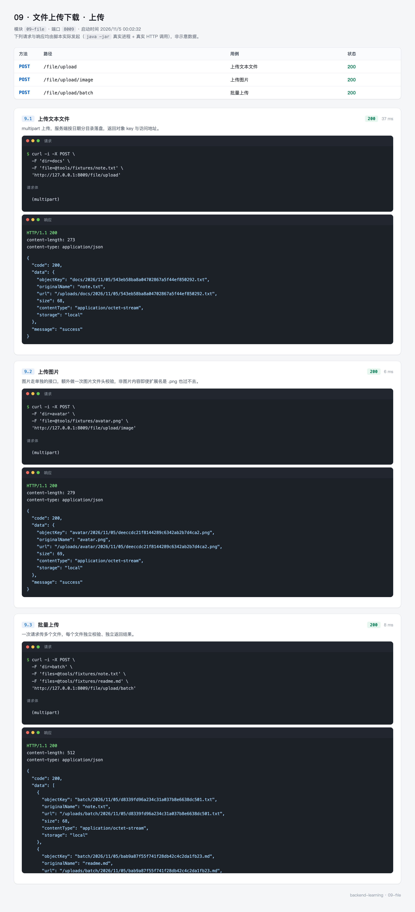
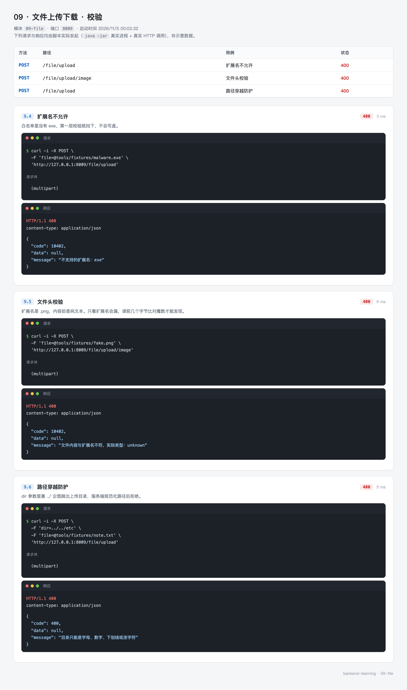
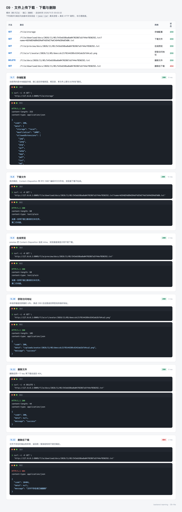

# 09 · 文件上传下载 —— 收得进来，也防得住

文件上传看起来只是"收一个 `MultipartFile`，存到磁盘"。真做起来，一半的代码在处理三件不那么直观的事：

- **怎么判断一个文件到底是什么**。扩展名和请求头里的 `Content-Type` 都由客户端决定，改个名字就能绕过。
- **怎么保证存进去的路径不会跑到意料之外**。客户端能构造 key，`../` 拼进去就能读到系统文件。
- **怎么让"换存储"这件事只改配置不改代码**。今天存本地，明天切 OSS，业务层不该知道。

`09-file` 用 17 个 Java 文件把这些处理掉，同时提供本地磁盘与阿里云 OSS 两种存储，用一行配置切换。这个模块不需要 MySQL 和 Redis，下载下来就能跑。

---

## 0. 先看结果

```bash
mvn -pl 09-file spring-boot:run

# 上传一个文本文件
curl -X POST "http://127.0.0.1:8009/file/upload?dir=docs" -F "file=@note.txt"
```

```json
{
  "code": 200,
  "data": {
    "objectKey": "docs/2026/11/04/bdab85345f114969ad739985b647dc81.txt",
    "originalName": "note.txt",
    "url": "/uploads/docs/2026/11/04/bdab85345f114969ad739985b647dc81.txt",
    "size": 68,
    "contentType": "application/octet-stream",
    "storage": "local"
  }
}
```

三个字段值得注意：

- `objectKey` 是**服务器生成的**，不是客户端传的。原始文件名只保留在 `originalName` 里，落盘用 UUID。这样两个用户上传同名的 `note.txt` 不会互相覆盖，也避免了文件名里的特殊字符带来的麻烦。
- `url` 能直接在浏览器打开（本地存储配了静态资源映射）。
- `contentType` 是 `application/octet-stream`，因为我们上传时没告诉服务端类型。这个字段来自请求，客户端给什么就是什么，**不能作为安全判断依据**。

拿到 key 之后：

```bash
# 下载（弹出保存框）
curl -OJ "http://127.0.0.1:8009/file/download/docs/2026/11/04/bdab85345f114969ad739985b647dc81.txt"

# 预览（浏览器里直接打开）
curl "http://127.0.0.1:8009/file/preview/docs/2026/11/04/bdab85345f114969ad739985b647dc81.txt"

# 删除
curl -X DELETE "http://127.0.0.1:8009/file/docs/2026/11/04/bdab85345f114969ad739985b647dc81.txt"
```

三组接口对应三张截图：

| 组 | 覆盖 | 截图 |
| --- | --- | --- |
| 上传 | 单文件、图片、批量 | `09-file-upload.webp` |
| 校验 | 扩展名、文件头、路径穿越 | `09-file-validate.webp` |
| 下载与删除 | 存储配置、下载、预览、取地址、删除 | `09-file-download.webp` |

### 这一节的路线

| 步骤 | 内容 | 对应小节 |
| --- | --- | --- |
| 1 | 上传请求的真实结构，为什么要多层校验 | 1 |
| 2 | 确认环境，这个模块不需要中间件 | 2 |
| 3 | 建模块、配依赖 | 3 |
| 4 | 配大小上限与类型白名单 | 4 |
| 5 | 写代码：存储抽象、六道校验、流式下载 | 5 |
| 6 | 跑起来，看各种失败返回什么 | 6 |
| 7 | 21 个测试 | 7 |

---

## 1. 上传请求长什么样

### 1.1 multipart 不是一个"文件参数"

用 `-F` 提交时，请求体不是 JSON，而是被切成了多段：

```
POST /file/upload?dir=docs HTTP/1.1
Content-Type: multipart/form-data; boundary=----WebKitFormBoundary7MA4YWxkTrZu0gW

------WebKitFormBoundary7MA4YWxkTrZu0gW
Content-Disposition: form-data; name="file"; filename="note.txt"
Content-Type: text/plain

这是一份用于接口测试的文本文件。
------WebKitFormBoundary7MA4YWxkTrZu0gW--
```

`boundary` 是分隔符，服务端靠它把每一段切开。`filename` 和那一段的 `Content-Type` 都是**客户端自己写的**，所以它们只能作为参考：

| 依据 | 谁决定 | 能不能伪造 |
| --- | --- | --- |
| 扩展名 | 客户端 | 能，改个名字就行 |
| 段内的 `Content-Type` | 客户端 | 能，curl 加 `-F "file=@a.exe;type=image/png"` 就改了 |
| 文件头的前几个字节 | 文件本身 | 不能，除非重新编码整个文件 |

这就是为什么要读文件头。名字叫 `photo.png`、声明 `image/png`，只要内容是 `MZ` 开头，它就是个 Windows 可执行文件。

### 1.2 六道关卡


前三道在进业务之前，后三道在写盘之前。第一道由 Tomcat 执行，请求体超过 `max-file-size` 时连接器直接拒绝，Controller 一行都不会执行——所以这个异常没法在业务代码里 catch，只能靠全局异常处理器。

后面五道在 `FileService` 里，失败时抛 `BusinessException`，由同一个处理器转成统一 JSON。

---

## 2. 准备环境

这个模块没有外部依赖，确认 JDK 与 Maven 就能跑：

```bash
java -version
mvn -v
```

不需要 MySQL、Redis、OSS 账号。默认 `file.storage-type: local`，文件落在模块启动目录下的 `uploads/`。

要看文件是否真的写进去了：

```bash
ls -R uploads/
# uploads/docs/2026/11/04/bdab85345f114969ad739985b647dc81.txt
```

`uploads/` 应该在 `.gitignore` 里。上传的测试文件不该进版本库。

---

## 3. 创建模块

```xml
<properties>
    <aliyun-oss.version>3.18.5</aliyun-oss.version>
</properties>

<dependencies>
    <!-- 参数校验 -->
    <dependency>
        <groupId>org.springframework.boot</groupId>
        <artifactId>spring-boot-starter-validation</artifactId>
    </dependency>

    <!-- 阿里云 OSS，只有 file.storage-type=oss 时才真正被创建出来 -->
    <dependency>
        <groupId>com.aliyun.oss</groupId>
        <artifactId>aliyun-sdk-oss</artifactId>
        <version>${aliyun-oss.version}</version>
    </dependency>
</dependencies>
```

依赖只有两个。`spring-boot-starter-webmvc` 由父 POM 统一引入，`MultipartFile`、`StreamingResponseBody` 都在里面。

`aliyun-sdk-oss` 即使不切到 OSS 也会被下载，但不影响启动——`AliyunOssConfig` 上有 `@ConditionalOnProperty`，本地模式下这个类不会被加载，`OSS` 客户端也不会创建。

目录：

```
09-file
└── src
    ├── main/java/top/mqxu/file
    │   ├── config      FileProperties、StorageType、LocalResourceConfig、AliyunOssConfig
    │   ├── common      Result、ErrorCode、BusinessException、GlobalExceptionHandler
    │   ├── controller  FileController
    │   ├── dto         FileUploadResult
    │   ├── service     FileService
    │   ├── storage     StorageService、LocalStorageService、AliyunOssStorageService、StoredObject
    │   └── support     FileTypeDetector
    ├── main/resources  application.yml
    └── test/java/top/mqxu/file
        ├── support/FileTypeDetectorTest.java   7 个用例
        └── FileApiTest.java                    14 个用例
```

---

## 4. 配置

```yaml
server:
  port: 8009

spring:
  application:
    name: 09-file 文件上传下载
  servlet:
    multipart:
      max-file-size: 10MB      # 单个文件上限
      max-request-size: 50MB   # 单次请求总容量，批量上传要留够

file:
  storage-type: local
  max-file-size: 10MB
  date-pattern: yyyy/MM/dd
  allowed-extensions: jpg,jpeg,png,gif,webp,bmp,pdf,txt,md,csv,doc,docx,xls,xlsx,ppt,pptx,zip
  local:
    base-dir: ./uploads
    url-prefix: /uploads
  oss:
    endpoint: https://oss-cn-hangzhou.aliyuncs.com
    access-key-id: ${OSS_ACCESS_KEY_ID:}
    access-key-secret: ${OSS_ACCESS_KEY_SECRET:}
    bucket-name: ${OSS_BUCKET:}
    dir: files
    domain:
```

### 4.1 两个 10MB 不是重复

`spring.servlet.multipart.max-file-size` 和 `file.max-file-size` 都写着 10MB，看着像重复配置，其实作用点不同：

| 配置 | 谁读 | 什么时候生效 | 超出后的后果 |
| --- | --- | --- | --- |
| `spring.servlet.multipart.max-file-size` | Tomcat 的 multipart 解析器 | 解析请求体时，Controller 之前 | 抛 `MaxUploadSizeExceededException` |
| `file.max-file-size` | `FileService` | 拿到 `MultipartFile` 之后 | 抛 `BusinessException(FILE_TOO_LARGE)` |

第一道是硬限制，防的是"把服务器内存打满"。第二道是业务限制，方便按业务调整——比如图片接口允许 5MB、文档接口允许 20MB，那就不能用同一个容器参数。

两个值保持一致最省心。第二道比第一道小，容器那道永远不会触发；比第一道大，容器会先拦，业务提示就没机会说出口。

### 4.2 `max-request-size` 要留给批量

单文件 10MB、一次最多传 5 个，总容量至少要 50MB。`max-request-size` 小于这个数，批量上传会在第三个文件时失败，而单个文件都没超限——排查起来很费劲。

### 4.3 白名单只写扩展名，不写 MIME

`allowed-extensions` 里全是小写扩展名，没有 `image/png` 这种 MIME。原因是 MIME 由客户端给，不可信；扩展名虽然也能伪造，但和文件头一比对就能识破，是个可用的第一层筛子。

---

## 5. 写代码

### 5.1 存储抽象：一个接口，两个实现

上层只认这个接口：

```java
public interface StorageService {

    String type();

    void write(String objectKey, MultipartFile file);

    StoredObject read(String objectKey);

    boolean exists(String objectKey);

    void delete(String objectKey);

    String url(String objectKey);

    /** 带有效期的临时地址。本地存储没有签名机制，直接返回 url */
    default String presignedUrl(String objectKey, Duration ttl) {
        return url(objectKey);
    }
}
```

`read` 返回 `StoredObject` 而不是 `byte[]`，这是有意为之：

```java
public record StoredObject(String objectKey, long size, String contentType, InputStream stream)
        implements Closeable {

    public static final String DEFAULT_CONTENT_TYPE = "application/octet-stream";

    @Override
    public void close() throws IOException {
        stream.close();
    }
}
```

一个 10MB 的文件读成 `byte[]` 要占 10MB 堆内存，十个并发就是 100MB。返回流之后，下载走的是"边读边写"，内存占用只跟缓冲区大小有关。

`implements Closeable` 是提醒调用方：用完必须关，否则本地会泄漏文件句柄，OSS 会一直占着连接。

两个实现靠条件装配二选一：

```java
@Service
@ConditionalOnProperty(prefix = "file", name = "storage-type", havingValue = "local", matchIfMissing = true)
public class LocalStorageService implements StorageService { ... }

@Service
@ConditionalOnProperty(prefix = "file", name = "storage-type", havingValue = "oss")
public class AliyunOssStorageService implements StorageService { ... }
```

`matchIfMissing = true` 表示"配置里没写这个键时也算命中"，所以新环境不配 `storage-type` 也能启动，默认本地存储。

`FileService` 注入的是接口，切换存储时它一行都不用改。

### 5.2 校验：三层，缺一不可

```java
private void validate(MultipartFile file) {
    if (file == null || file.isEmpty()) {
        throw new BusinessException(ErrorCode.FILE_EMPTY);
    }
    if (file.getSize() > properties.getMaxFileSize().toBytes()) {
        throw new BusinessException(ErrorCode.FILE_TOO_LARGE,
                "文件不能超过 " + properties.getMaxFileSize().toMegabytes() + "MB");
    }
    String extension = extensionOf(file);
    if (!properties.getAllowedExtensions().contains(extension)) {
        throw new BusinessException(ErrorCode.FILE_TYPE_NOT_ALLOWED, "不支持的扩展名：" + extension);
    }
    String realType = FileTypeDetector.detect(file);
    if (FileTypeDetector.isExecutable(realType)) {
        throw new BusinessException(ErrorCode.FILE_TYPE_NOT_ALLOWED, "不允许上传可执行文件");
    }
    // 图片类的扩展名必须和文件头对得上，防止 a.png 实际是个 exe
    if (FileTypeDetector.isImageExtension(extension) && !FileTypeDetector.isImageType(realType)) {
        throw new BusinessException(ErrorCode.FILE_TYPE_NOT_ALLOWED,
                "文件内容与扩展名不符，实际类型：" + realType);
    }
}
```

四处设计：

**先判空再判大小。** `isEmpty()` 对 0 字节文件返回 true，直接给"文件为空"，比"大小为 0 不超过 10MB"更清楚。

**扩展名从原始文件名的最后一段取。**

```java
private String extensionOf(MultipartFile file) {
    String originalName = file.getOriginalFilename();
    if (!StringUtils.hasText(originalName) || !originalName.contains(".")) {
        return "";
    }
    // 浏览器在某些系统上会带上完整路径，只取最后一段
    String name = originalName.substring(originalName.lastIndexOf('/') + 1);
    return name.substring(name.lastIndexOf('.') + 1).toLowerCase();
}
```

老版本 IE 和一些客户端会把完整路径塞进 `filename`，比如 `C:\Users\a\Desktop\note.txt`。直接取最后一个点之后的部分，遇到这种就能正确得到 `txt`。

**可执行文件单独拦一道。** 白名单里没有 `exe`，理论上到不了这一步。但白名单是配置项，运维改错了就漏了；文件头这一层是代码兜底，不看配置。

**图片要做一致性校验。** 白名单里有 `png`、`jpg`，攻击者可以把 `shell.jsp` 改名成 `shell.png` 传上来。如果服务器或 OSS 配错了 MIME 类型，这个文件可能被当脚本执行。做了"扩展名是图片 → 文件头也必须是图片"的检查，这条路就断了。

`FileTypeDetector` 只读前 12 个字节：

```java
private static final int HEAD_LENGTH = 12;

public static String detect(MultipartFile file) {
    byte[] head = new byte[HEAD_LENGTH];
    int length;
    try (InputStream in = file.getInputStream()) {
        length = in.readNBytes(head, 0, HEAD_LENGTH);
    } catch (IOException e) {
        throw new BusinessException(ErrorCode.STORAGE_ERROR, "读取文件头失败");
    }
    return detect(head, length);
}
```

识别规则按魔数匹配：

| 类型 | 字节 | 含义 |
| --- | --- | --- |
| jpeg | `FF D8 FF` | JPEG 起始标记 |
| png | `89 50 4E 47` | PNG 签名 |
| gif | `47 49 46 38` | `GIF8` |
| pdf | `25 50 44 46` | `%PDF` |
| zip | `50 4B 03 04` | `PK..`，docx/xlsx/pptx 都是它 |
| exe | `4D 5A` | `MZ`，Windows 可执行文件 |
| elf | `7F 45 4C 46` | Linux 可执行文件 |

**`PK` 开头的一律算 zip。** docx、xlsx、pptx 本质都是 zip 包，靠前 12 个字节区分不出来。要精确判断得读 zip 里的目录结构，代价大且容易出漏洞（zip bomb），所以这里只做"不是可执行文件"这一层保证。

**读 12 个字节不是读全部。** 用 `readNBytes(head, 0, 12)` 而不是 `readAllBytes`，避免为了看文件头把整个文件读进内存。

### 5.3 key 的生成：目录可控，文件名不可控

```java
private static final Pattern DIR_PATTERN = Pattern.compile("^[a-zA-Z0-9_-]{1,32}$");

private String buildObjectKey(MultipartFile file, String dir) {
    String folder = StringUtils.hasText(dir) ? dir.trim() : DEFAULT_DIR;
    if (!DIR_PATTERN.matcher(folder).matches()) {
        throw new BusinessException(ErrorCode.BAD_REQUEST, "目录只能是字母、数字、下划线或连字符");
    }
    DateTimeFormatter formatter = properties.dateFormatter();
    String date = LocalDate.now().format(formatter);
    return folder + "/" + date + "/" + UUID.randomUUID().toString().replace("-", "") + "." + extensionOf(file);
}
```

key 的结构是 `目录/年/月/日/UUID.扩展名`，例如 `docs/2026/11/04/bdab85345f114969ad739985b647dc81.txt`。

**`dir` 参数是客户端传的，必须校验。** 正则只允许字母、数字、下划线、连字符，长度 1 到 32。这样 `../`、`/etc`、`a/b` 都进不来。这是防路径穿越的第一道，落地时的 `resolve` 是第二道。

**日期分目录**有三个好处：单个目录不会堆几万个文件（部分文件系统的目录项检索会变慢）；按日期清理很方便（删一个月前的目录就行）；出问题时看路径就知道是哪天传的。

**文件名用 UUID，不用原名。** 原名可能重名、可能含空格和特殊字符、可能超长、可能带 `..`。UUID 去掉了连字符，32 个十六进制字符，不会有任何歧义。

原始文件名没有丢，存在 `FileUploadResult.originalName` 里，下载时可以作为默认文件名返回。

### 5.4 路径穿越：`normalize` 之后还要 `startsWith`

key 是客户端能构造的——下载、删除接口的 `{*key}` 直接把 URL 里的路径传进来。不做检查，请求 `/file/download/../../etc/passwd` 就能读到系统文件。

```java
private Path resolve(String objectKey) {
    Path base = Paths.get(properties.getLocal().getBaseDir()).toAbsolutePath().normalize();
    Path target = base.resolve(objectKey).normalize();
    if (!target.startsWith(base) || target.equals(base)) {
        throw new BusinessException(ErrorCode.BAD_REQUEST, "非法的文件路径");
    }
    return target;
}
```

三行代码，两个容易写错的地方：

**`normalize()` 必须在 `resolve` 之后。** 先 normalize base 再 resolve，`../../` 仍然会生效。只有把拼好的结果整体 normalize，`..` 才会被消解掉，才能用 `startsWith` 判断最终位置。

**`equals(base)` 也要拒。** `objectKey` 为空或全是 `../` 时，normalize 之后正好等于 base 目录本身。这时 `startsWith` 是 true，但返回一个目录给下载接口没有意义，应该拒掉。

一个例子：

| objectKey | resolve().normalize() | 结果 |
| --- | --- | --- |
| `docs/2026/11/04/a.txt` | `<base>/docs/2026/11/04/a.txt` | 通过 |
| `../../etc/passwd` | `/etc/passwd` | 不以 base 开头，拒 |
| `docs/../../etc/passwd` | `/etc/passwd` | 拒 |
| `.` | `<base>` | 等于 base，拒 |

Windows 上还要注意盘符和大小写，`startsWith` 对大小写敏感。跨平台部署时用 `Path` 的 `equals`/`startsWith` 而不是字符串比较，能避开大部分坑。

### 5.5 下载：流式输出与中文文件名

```java
private ResponseEntity<StreamingResponseBody> stream(StoredObject object, String fileName, boolean attachment) {
    ContentDisposition disposition = (attachment ? ContentDisposition.attachment() : ContentDisposition.inline())
            .filename(fileName, StandardCharsets.UTF_8)
            .build();
    StreamingResponseBody body = out -> {
        // 用完必须关，否则本地文件句柄和 OSS 连接都会泄漏
        try (object) {
            object.stream().transferTo(out);
        }
    };
    return ResponseEntity.ok()
            .header(HttpHeaders.CONTENT_DISPOSITION, disposition.toString())
            .contentType(MediaType.parseMediaType(object.contentType()))
            .contentLength(object.size())
            .body(body);
}
```

**用 `StreamingResponseBody` 而不是 `byte[]`。** 后者要把整个文件读进内存再写出去；前者由 Spring 在响应阶段调用 lambda，用 `transferTo` 边读边写，缓冲区只有几 KB。

**`filename(name, UTF_8)` 处理中文名。** 直接拼 `filename="报告.pdf"` 在部分浏览器上会乱码，因为 HTTP 头默认按 ISO-8859-1 解析。这个方法会生成 RFC 5987 的 `filename*=UTF-8''...` 形式，现代浏览器都认。

**`attachment` 与 `inline` 的区别。** 下载用 `attachment`，浏览器弹保存框；预览用 `inline`，浏览器尝试直接打开（图片、PDF 有效，其他类型仍会下载）。

**`try (object)` 不能省。** `StoredObject` 实现了 `Closeable`，用 try-with-resources 保证流被关掉。少这一句，本地存储会慢慢耗尽文件句柄，OSS 会占满连接池——症状是"跑一段时间后所有下载都卡住"。

路径变量用 `{*key}`：

```java
@GetMapping("/download/{*key}")
public ResponseEntity<StreamingResponseBody> download(@PathVariable String key, ...) {
    String objectKey = normalizeKey(key);
    ...
}
```

普通的 `{key}` 匹配不到带斜杠的路径。`{*key}` 会把剩余部分整个捕获，**包括开头的斜杠**，所以 `normalizeKey` 要去掉：

```java
private String normalizeKey(String key) {
    String objectKey = key.startsWith("/") ? key.substring(1) : key;
    if (!StringUtils.hasText(objectKey)) {
        throw new IllegalArgumentException("文件 key 不能为空");
    }
    return objectKey;
}
```

### 5.6 切到 OSS 只需要改配置

```yaml
file:
  storage-type: oss
  oss:
    endpoint: https://oss-cn-hangzhou.aliyuncs.com
    access-key-id: ${OSS_ACCESS_KEY_ID:}
    access-key-secret: ${OSS_ACCESS_KEY_SECRET:}
    bucket-name: ${OSS_BUCKET:}
```

`AliyunOssConfig` 会在启动时校验四个必填项，缺一个就抛出明确的错误：

```java
private void requireText(String value, String key) {
    if (value == null || value.isBlank()) {
        throw new IllegalStateException(
                "storage-type 设为 oss，但 " + key + " 没有配置；换成本地存储请把 file.storage-type 改成 local");
    }
}
```

比"启动成功、上传时报 NullPointerException"好排查得多。

三个实现细节值得看：

**写入时显式设 `Content-Length` 和 `Content-Disposition`。**

```java
ObjectMetadata metadata = new ObjectMetadata();
metadata.setContentLength(file.getSize());
if (file.getContentType() != null) {
    metadata.setContentType(file.getContentType());
}
// 显式告诉浏览器按下载处理，避免上传的 html 被 OSS 域名直接渲染成页面
metadata.setContentDisposition("attachment");
```

不设 `Content-Length` 时 SDK 会走 chunked 上传，某些场景下会失败。`attachment` 是防 XSS：如果有人传了个 `.html`，访问 OSS 地址时浏览器直接渲染，就是一个挂在你的域名下的钓鱼页。

**读的时候把 `NoSuchKey` 翻译成业务异常。**

```java
catch (OSSException e) {
    if (NO_SUCH_KEY.equals(e.getErrorCode())) {
        throw new BusinessException(ErrorCode.FILE_NOT_FOUND);
    }
    throw new BusinessException(ErrorCode.STORAGE_ERROR, "读取对象存储失败");
}
```

不翻译的话，OSS 的异常会一路冒到全局处理器，变成 500。文件不存在应该是 404。

**预签名地址带有效期。**

```java
@Override
public String presignedUrl(String objectKey, Duration ttl) {
    Date expiration = new Date(System.currentTimeMillis() + ttl.toMillis());
    return ossClient.generatePresignedUrl(bucket(), fullKey(objectKey), expiration).toString();
}
```

bucket 设为私有读时，直接拼的 URL 访问会被拒。预签名地址把"允许访问"编码进查询参数，过期自动失效。适合给前端临时展示、给第三方限时下载。

本地存储没有签名机制，`presignedUrl` 的默认实现直接返回 `url`。接口签名一致，行为按存储能力降级。

### 5.7 全局异常：容器抛的与业务抛的

```java
@ExceptionHandler(BusinessException.class)
public ResponseEntity<Result<Void>> handleBusiness(BusinessException e) {
    ErrorCode errorCode = e.getErrorCode();
    // 用异常自己的消息：业务层常会补一句更具体的提示
    return ResponseEntity.status(errorCode.getHttpStatus())
            .body(Result.fail(errorCode.getCode(), e.getMessage()));
}

@ExceptionHandler(MaxUploadSizeExceededException.class)
public ResponseEntity<Result<Void>> handleMaxUploadSize(MaxUploadSizeExceededException e) {
    return build(ErrorCode.FILE_TOO_LARGE);
}
```

`BusinessException` 那个分支必须用 `e.getMessage()`，不能只用 `errorCode`。业务层经常补一句更具体的话：

| 场景 | 只用 errorCode | 用 e.getMessage() |
| --- | --- | --- |
| 扩展名不对 | 文件类型不支持 | 不支持的扩展名：exe |
| 伪装图片 | 文件类型不支持 | 文件内容与扩展名不符，实际类型：unknown |
| 目录非法 | 参数错误 | 目录只能是字母、数字、下划线或连字符 |

右边这三句能直接告诉用户"该怎么改"，左边只能让用户猜。

`MaxUploadSizeExceededException` 单独处理，是因为它在容器解析请求体时抛出，**进不了 Controller**。Spring Boot 会把它兜进 MVC 的异常流程，所以 `@RestControllerAdvice` 仍能接住；自己写在 Filter 里抛的异常就没这个待遇了。

`ErrorCode` 里把业务码与 HTTP 状态分开：

```java
FILE_TOO_LARGE(10403, 413, "文件超过大小限制"),
```

`code` 给前端做判断（`10403` 就提示"换个文件"），`httpStatus` 给监控和网关统计（413 是标准的"请求体过大"）。两者不必相同，但语义要对得上。

---

## 6. 运行与实测

### 6.1 上传

仓库里的 `tools/fixtures/` 放着几个测试文件：一份文本、一份真实 PNG、一份伪装成 PNG 的文本、一个假的 exe。下面直接拿它们做请求。

```bash
# 文本
curl -X POST "http://127.0.0.1:8009/file/upload?dir=docs" \
  -F "file=@tools/fixtures/note.txt"

# 图片
curl -X POST "http://127.0.0.1:8009/file/upload/image?dir=avatar" \
  -F "file=@tools/fixtures/avatar.png"

# 批量
curl -X POST "http://127.0.0.1:8009/file/upload/batch?dir=batch" \
  -F "files=@tools/fixtures/note.txt" -F "files=@tools/fixtures/readme.md"
```



批量上传的返回是一个数组，每个元素的 `objectKey` 各不相同。中途有一个不合格，前面已经写进去的会被删掉：

```java
public List<FileUploadResult> uploadBatch(MultipartFile[] files, String dir) {
    List<FileUploadResult> results = new ArrayList<>(files.length);
    try {
        for (MultipartFile file : files) {
            results.add(upload(file, dir));
        }
        return results;
    } catch (RuntimeException e) {
        results.forEach(r -> storageService.delete(r.objectKey()));
        throw e;
    }
}
```

没有这段回滚，用户传 5 个文件、第 3 个失败，前 2 个已经落盘但没有任何记录，就成了垃圾文件。

### 6.2 校验

```bash
# 扩展名不在白名单
curl -X POST "http://127.0.0.1:8009/file/upload" -F "file=@tools/fixtures/malware.exe"

# 伪装成 png 的文本
curl -X POST "http://127.0.0.1:8009/file/upload/image" \
  -F "file=@tools/fixtures/fake.png;type=image/png"

# 目录带 ../
curl -X POST "http://127.0.0.1:8009/file/upload?dir=../evil" \
  -F "file=@tools/fixtures/note.txt"
```



三个返回都带上具体原因：

```json
{"code":10402,"message":"不支持的扩展名：exe"}
{"code":10402,"message":"文件内容与扩展名不符，实际类型：unknown"}
{"code":400,"message":"目录只能是字母、数字、下划线或连字符"}
```

第二条最值得注意：`fake.png` 的扩展名合法、请求头也声明了 `image/png`，但内容是一段中文文本，文件头识别成 `unknown`，和 `png` 对不上，被拒。

### 6.3 下载与删除

```bash
# 存储配置
curl "http://127.0.0.1:8009/file/storage"

# 下载
curl -OJ "http://127.0.0.1:8009/file/download/docs/2026/11/04/bdab85345f114969ad739985b647dc81.txt"

# 预览
curl "http://127.0.0.1:8009/file/preview/docs/2026/11/04/bdab85345f114969ad739985b647dc81.txt"

# 取访问地址
curl "http://127.0.0.1:8009/file/url/avatar/2026/11/04/43a9f3c9dd044b81b1e23c4924168ef4.png?expireMinutes=30"

# 删除，再下载
curl -X DELETE "http://127.0.0.1:8009/file/docs/2026/11/04/bdab85345f114969ad739985b647dc81.txt"
curl "http://127.0.0.1:8009/file/download/docs/2026/11/04/bdab85345f114969ad739985b647dc81.txt"
```



删除后再下载返回：

```json
{"code":10404,"message":"文件不存在或已被删除"}
```

HTTP 状态是 404，不是 500。这一点靠的是 `LocalStorageService.read` 里先判 `isRegularFile`，再抛 `BusinessException(FILE_NOT_FOUND)`。

用 curl 下载时加 `-OJ`，它会按 `Content-Disposition` 里的文件名保存。中文名也能正确落地，因为响应头用的是 RFC 5987 编码。

---

## 7. 写测试

21 个用例，两个类：

| 测试类 | 用例数 | 类型 | 覆盖 |
| --- | --- | --- | --- |
| `FileTypeDetectorTest` | 7 | 纯单元 | 12 种魔数、短文件、图片判断口径 |
| `FileApiTest` | 14 | 集成 | 上传下载删除、五类校验、批量回滚、静态映射 |

```bash
mvn -pl 09-file test
```

```
Tests run: 21, Failures: 0, Errors: 0, Skipped: 0
BUILD SUCCESS
```

### 7.1 测试文件写到 target 下

```java
@SpringBootTest(properties = "file.local.base-dir=target/test-uploads")
@AutoConfigureMockMvc
class FileApiTest {
```

覆盖 `base-dir` 有两个好处：不污染仓库里的 `uploads/`；`mvn clean` 顺手就清掉了。

每个用例前清空目录，避免上一个用例的文件影响"批量回滚"这类断言：

```java
@BeforeEach
void clean() throws IOException {
    Path base = Paths.get(properties.getLocal().getBaseDir()).toAbsolutePath().normalize();
    if (!Files.exists(base)) {
        return;
    }
    try (Stream<Path> walk = Files.walk(base)) {
        walk.sorted(Comparator.reverseOrder())
                .filter(p -> !p.equals(base))
                .forEach(p -> {
                    try {
                        Files.deleteIfExists(p);
                    } catch (IOException ignored) {
                    }
                });
    }
}
```

倒序删除是关键：`Files.walk` 先返回父目录再返回子项，正序删会因为"目录非空"失败。

### 7.2 用 MockMultipartFile 造文件

```java
MockMultipartFile real = new MockMultipartFile("file", "dot.png", "image/png", PNG);
mockMvc.perform(multipart("/file/upload/image").file(real))
        .andExpect(status().isOk());

MockMultipartFile fake = new MockMultipartFile("file", "fake.png", "image/png",
        "这不是 PNG，只是一段文本".getBytes(StandardCharsets.UTF_8));
mockMvc.perform(multipart("/file/upload/image").file(fake))
        .andExpect(status().isBadRequest())
        .andExpect(jsonPath("$.code").value(10402));
```

两个文件的扩展名、声明的内容类型完全一样，只有字节不同——这正是"为什么要读文件头"的最小复现。

1x1 的 PNG 直接写 Base64，不用往仓库里放二进制文件：

```java
private static final byte[] PNG = java.util.Base64.getDecoder().decode(
        "iVBORw0KGgoAAAANSUhEUgAAAAEAAAABCAYAAAAfFcSJAAAADUlEQVR42mP8z8AAAwAB/gEBQ7X7AAAAAElFTkSuQmCC");
```

### 7.3 断言 key 的格式

```java
.andExpect(jsonPath("$.data.objectKey").value(
        org.hamcrest.Matchers.matchesPattern("docs/\\d{4}/\\d{2}/\\d{2}/[0-9a-f]{32}\\.txt")));
```

`objectKey` 里含 UUID 和当天日期，无法写死。用正则断言结构，既验证了"目录、日期、扩展名都对"，又不会因为换一天而失败。

### 7.4 路径穿越在两层各测一次

MockMvc 里用编码后的点：

```java
// 点编码、斜杠保留：这样请求还能匹配到 /file/download/{*key}，
// key 解出来是 ../../etc/passwd，交给 service 的 resolve 拦
mockMvc.perform(get("/file/download/%2E%2E/%2E%2E/etc/passwd"))
        .andExpect(status().is4xxClientError());
```

如果写成 `..%2F..%2F`（斜杠也编码），Spring 会把整个路径解码再规范化，请求根本匹配不到 `/file/download/**`，直接 404——测的就不是 `resolve` 了。

`resolve` 本身单独测一次更直接：

```java
assertThatThrownBy(() -> fileService.read("../../etc/passwd"))
        .isInstanceOf(BusinessException.class)
        .hasMessageContaining("非法的文件路径");
```

这条断言同时确认了异常类型和提示语。提示语变了会失败，正好保护了 5.7 节那个"别吞掉业务消息"的约定。

---

## 8. 练习

**练习 1：给上传接口加"每用户配额"**

现在的限制只有单文件大小，一个用户反复上传能把磁盘塞满。加一个配额：每个用户最多 100MB，超出时返回 413。

提示：需要一张表记录每个用户已用空间，或者每次上传时统计目录大小。想清楚删除文件时怎么减回去。

**练习 2：实现分片上传**

大文件（比如 500MB 的视频）不能用一次 multipart 传。改成：先调"初始化"拿到 uploadId，再分片上传，最后调"合并"。

提示：分片存成 `{uploadId}/part-{index}`，合并时按序号拼接。要处理"某个分片重复上传"与"合并到一半失败"。

**练习 3：把文件头识别扩成可配置**

现在 `FileTypeDetector` 是硬编码的 if 链。改成从配置文件读"扩展名 → 魔数"的映射，加新类型不用改代码。

提示：用 `Map<String, byte[]>`，注意 docx 这类"同一个魔数对应多个扩展名"的情况。

**练习 4：给图片生成缩略图**

上传图片时同时生成一张 200px 宽的缩略图，key 是 `{原名}_thumb.{ext}`，列表页只加载缩略图。

提示：用 `ImageIO.read` + `Graphics2D`，注意 `ImageIO` 对 webp 不支持，需要额外依赖。

**练习 5：实现断点续传下载**

现在下载是全量流。改成支持 `Range` 请求：客户端带 `Range: bytes=100-` 时只返回后半段，配合 206 状态码。

提示：`StreamingResponseBody` 里先 `skip(n)`，响应头加 `Content-Range`，状态码用 `HttpStatus.PARTIAL_CONTENT`。

---

## 9. 常见问题

**上传时 413，但文件明明没超过配置**

`spring.servlet.multipart.max-file-size` 和 `max-request-size` 是两个限制。批量上传时单个文件都合规，总量超了 `max-request-size` 也会 413。见 4.2 节。

**`MultipartFile` 为 null**

表单字段名对不上。`@RequestParam("file")` 要求字段名是 `file`，前端传的是 `upload` 就收不到。批量接口的字段名是 `files`。

**中文文件名乱码**

两处都要注意：响应头里用 `ContentDisposition.filename(name, StandardCharsets.UTF_8)`；接收时 `MultipartFile.getOriginalFilename()` 在部分容器上需要 `server.servlet.encoding.charset=UTF-8` 配合。

**下载大文件时内存暴涨**

用 `byte[]` 接了整个文件。改成 `StreamingResponseBody` + `transferTo`，见 5.5 节。

**OSS 上传报 `RequestTimeTooSkewed`**

服务器时间与阿里云差了超过 15 分钟。校时（`ntpdate` 或容器同步宿主机时间）。

**OSS 地址访问返回 403**

bucket 是私有读。要么把 bucket 改成公共读（不推荐），要么用 `/file/url/{key}` 拿预签名地址。

**传上去的 html 在浏览器里被直接打开**

OSS 那边没设 `Content-Disposition: attachment`，或者本地存储的静态映射没限制类型。前者在 `write` 里设，后者建议单独用一个下载域名。

**删除后目录还在**

本地实现里有 `removeEmptyParents`，会往上清理空目录直到 base。如果目录还在，说明里面还有别的文件，正常。

**`{*key}` 拿到的 key 开头多一个斜杠**

`{*key}` 会把路径开头的 `/` 一起捕获。用 `normalizeKey` 去掉，见 5.5 节。

**错误提示只有一句"文件类型不支持"，看不出哪里错了**

异常处理器只传了 `errorCode`，把业务层的 `e.getMessage()` 丢了。见 5.7 节。

---

## 10. 小结

| 知识点 | 一句话 |
| --- | --- |
| 校验分层 | 容器限大小、业务限类型、文件头验真身 |
| 扩展名 | 从原始文件名最后一段取，小写比对 |
| 文件头 | 读前 12 字节，认魔数；`PK` 开头一律当 zip |
| 可执行文件 | 白名单之外再加一道文件头兜底 |
| key 生成 | 目录正则 + 日期分层 + UUID，不用原始文件名 |
| 路径穿越 | `resolve` 之后 `normalize`，再 `startsWith(base)` |
| 流式下载 | `StreamingResponseBody` + try-with-resources 关流 |
| 中文文件名 | `ContentDisposition.filename(name, UTF_8)` |
| 存储抽象 | 接口 + `@ConditionalOnProperty` 二选一实现 |
| 预签名 | 私有 bucket 的限时访问地址，本地实现降级为普通 url |
| 批量上传 | 中途失败要回滚已写入的文件 |

下一篇 [10-doc](10-doc.md) 用 springdoc 从代码生成接口文档，让文档跟着代码走。

> 本节遵循的规范：扩展名与文件头必须同时校验；key 由服务端生成，客户端传的目录要过正则；落盘前确认路径在根目录内；下载用流不用 `byte[]`；业务异常的具体提示不能在路上被吞掉。
