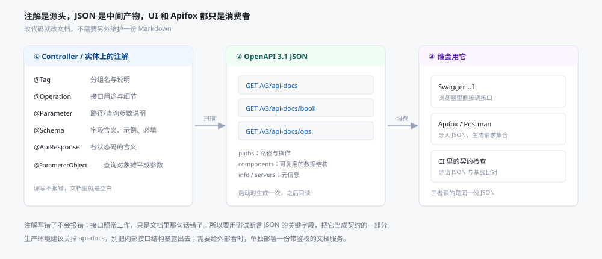
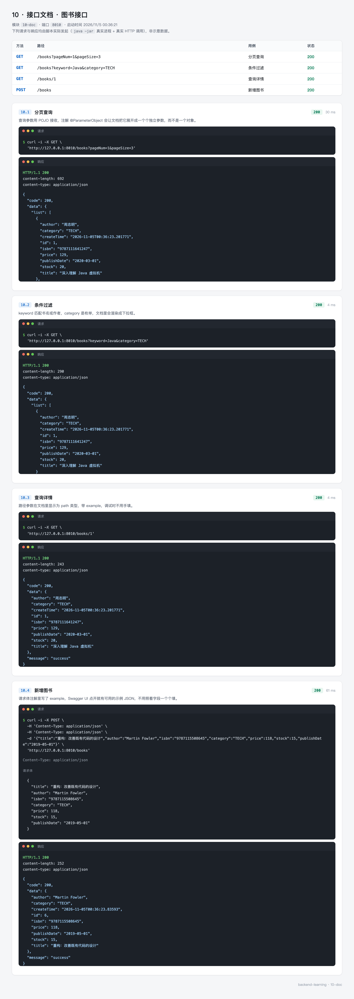
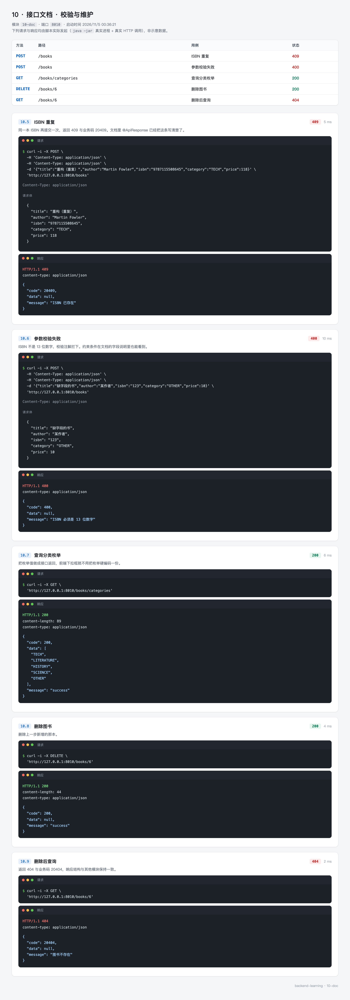
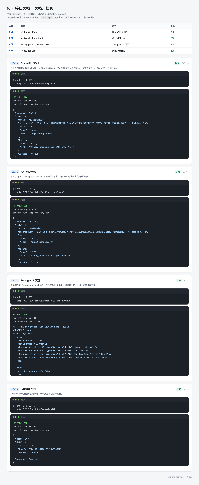

# 10 · 接口文档 —— 让文档跟着代码一起变

接口文档最常见的死法有三种：写在 Word 里，三个月后没人更新；写成 Markdown 放仓库，改代码的人忘了改；用注释写，注释和代码各自演化。

这三种的共同问题是**文档和代码是两份东西**。只要有两份，就一定会分叉。

这一篇换一种做法：文档从代码生成。注解写在代码旁边，改代码时顺手就改了；生成出来的是一份标准 OpenAPI JSON，Swagger UI、Apifox、Postman 都读它。

`10-doc` 一共 14 个 Java 文件，一个图书的增删改查，重点全在注解怎么写、分组怎么划、以及怎么用测试守住文档。

---

## 0. 先看结果

```bash
mvn -pl 10-doc spring-boot:run
```

浏览器打开：

```
http://127.0.0.1:8010/swagger-ui.html
```

页面上是八个接口，按"图书管理"和"运维接口"分成两组，右上角可以切换。每个接口点开有参数说明、请求体示例、各状态码的含义，还能直接点 Try it out 发请求。

同样的内容换一种格式：

```bash
curl "http://127.0.0.1:8010/v3/api-docs" | head -40
```

```json
{
  "openapi": "3.1.0",
  "info": {
    "title": "图书管理接口",
    "version": "1.0.0",
    "description": "这是 10-doc 模块的示例文档。...",
    "contact": { "name": "mqxu", "email": "mqxu@example.com" }
  },
  "servers": [
    { "url": "http://127.0.0.1:8010", "description": "本地开发" },
    { "url": "https://api.example.com", "description": "生产环境" }
  ],
  "paths": { ... },
  "components": { ... }
}
```

这份 JSON 就是文档的全部。UI 是它的一种渲染，Apifox 是另一种。

三组接口对应三张截图：

| 组 | 覆盖 | 截图 |
| --- | --- | --- |
| 图书接口 | 分页、条件过滤、详情、新增 | `10-doc-book.webp` |
| 校验与维护 | ISBN 重复、参数校验、分类枚举、删除 | `10-doc-rules.webp` |
| 文档元信息 | OpenAPI JSON、分组 JSON、Swagger UI、运维接口 | `10-doc-openapi.webp` |

### 这一节的路线

| 步骤 | 内容 | 对应小节 |
| --- | --- | --- |
| 1 | 为什么要从代码生成，链路是什么 | 1 |
| 2 | 确认环境 | 2 |
| 3 | 建模块，选对 springdoc 版本 | 3 |
| 4 | 配路径、排序、分组 | 4 |
| 5 | 写注解：元信息、控制器、实体、枚举 | 5 |
| 6 | 跑起来看 UI 与 JSON | 6 |
| 7 | 18 个测试，把 JSON 当契约 | 7 |
| 8 | 导入 Apifox | 8 |

---

## 1. 文档为什么要从代码生成

### 1.1 一条链，三个消费者



链路上有三段：

| 段 | 谁负责 | 出错的后果 |
| --- | --- | --- |
| 注解 | 写接口的人 | 文档里那句话错了，接口照常工作 |
| 生成 JSON | springdoc，启动时扫一次 | 版本不匹配，整个文档打不开 |
| 消费 | Swagger UI、Apifox、CI | 只是显示问题，不影响接口 |

中间那段最关键：只要注解写对了，JSON 就是对的；JSON 对了，所有消费者都对。

第一段有个反直觉的地方：**注解写错不会报错**。`@Operation(summary = "查询图书")` 写到别的方法上，编译通过、接口正常，只有文档里那句话错了。所以第 7 节会用测试断言 JSON 的关键字段——把文档当契约测。

### 1.2 为什么不用 knife4j

knife4j 是国人做的 Swagger UI 增强，界面比原生好看，中文支持也好。但它 4.5.0 依赖的是 springdoc 2.x，而 springdoc 2.x 只支持 Spring Boot 3。在 Boot 4 上，`/doc.html` 打不开，控制台报 `NoClassDefFoundError`。

三种选择：

| 方案 | 状态 |
| --- | --- |
| knife4j 4.5.0 + springdoc 2.x | Boot 4 上不兼容 |
| knife4j 4.6.0（如果发布） | 需要等它跟进 springdoc 3.x |
| springdoc 3.2.0 + 原生 Swagger UI | 本模块用的方案 |

原生 UI 不如 knife4j 精致，但功能不缺：分组切换、请求示例、认证配置、离线 JSON 都有。这一篇的重点是文档内容而不是皮肤，所以选兼容性更好的那个。

---

## 2. 准备环境

不需要 MySQL、Redis、OSS。确认 JDK 与 Maven：

```bash
java -version
mvn -v
```

图书数据存在内存的 `ConcurrentHashMap` 里，启动时灌 5 本，重启恢复。这一篇的注意力应该放在注解上，不该被数据层分散。

---

## 3. 创建模块

```xml
<properties>
    <!-- 3.x 是适配 Spring Boot 4 的版本线；2.x 只支持 Boot 3 -->
    <springdoc.version>3.2.0</springdoc.version>
</properties>

<dependencies>
    <dependency>
        <groupId>org.springframework.boot</groupId>
        <artifactId>spring-boot-starter-validation</artifactId>
    </dependency>

    <!-- 注解扫描 + Swagger UI 一起带进来 -->
    <dependency>
        <groupId>org.springdoc</groupId>
        <artifactId>springdoc-openapi-starter-webmvc-ui</artifactId>
        <version>${springdoc.version}</version>
    </dependency>
</dependencies>
```

`starter-webmvc-ui` 这个 artifact 同时带了三样东西：

- `springdoc-openapi-starter-common`：扫描注解、生成 OpenAPI 模型
- `swagger-ui`：前端页面（webjar 形式，不需要 Node 构建）
- `swagger-annotations`：`@Operation`、`@Schema` 这些注解

只想要 JSON 不要 UI 的话，换成 `springdoc-openapi-starter-webmvc-api`，体积小一些。

版本线要对上：

| Spring Boot | springdoc |
| --- | --- |
| 3.x | 2.x |
| 4.x | 3.x |

用错版本的症状是启动失败或 `/v3/api-docs` 返回 500，异常信息里通常是 `NoSuchMethodError` 或 `ClassNotFoundException`——springdoc 2.x 调的 `ControllerAdviceBean` 构造器在 Boot 4 里签名变了。

目录：

```
10-doc
└── src
    ├── main/java/top/mqxu/doc
    │   ├── DocApplication.java
    │   ├── common      Result、PageResult、ErrorCode、BusinessException、GlobalExceptionHandler
    │   ├── config      OpenApiConfig
    │   ├── controller  BookController、OpsController
    │   ├── dto         BookCreateRequest、BookQuery
    │   ├── entity      Book、Category
    │   └── service     BookService
    ├── main/resources  application.yml
    └── test/java/top/mqxu/doc
        ├── OpenApiDocumentTest.java   10 个用例，测文档内容
        └── BookApiTest.java            8 个用例，测接口行为
```

---

## 4. 配置

```yaml
server:
  port: 8010

springdoc:
  api-docs:
    # 原始 OpenAPI JSON 的地址，Apifox / Postman 导入的就是它
    path: /v3/api-docs
    enabled: true
  swagger-ui:
    # 页面地址：/swagger-ui.html
    path: /swagger-ui.html
    # alpha 按字母排，method 按请求方法排
    tags-sorter: alpha
    operations-sorter: method
    # 默认展开所有接口，不用一个个点开
    doc-expansion: list
  group-configs:
    - group: book
      display-name: 图书业务
      paths-to-match: /books/**
    - group: ops
      display-name: 运维接口
      paths-to-match: /ops/**,/actuator/**
```

### 4.1 三个排序与展开参数

`tags-sorter: alpha` 按标签名字母序排。默认顺序是扫描顺序，即类的加载顺序，改个包名就可能变。接口多了以后，字母序至少是稳定的。

`operations-sorter: method` 在一个标签内部按 HTTP 方法排：GET、POST、PUT、DELETE 依次。另一种可选值是 `alpha`，按接口路径排。CRUD 接口按方法排更符合阅读习惯。

`doc-expansion: list` 让每个接口默认展开参数列表。默认是 `none`，所有接口都折叠着，要点开才能看到参数——接口一多，找东西很费劲。

### 4.2 分组的两种写法

配置里这份 `group-configs` 和 `OpenApiConfig` 里的 `GroupedOpenApi` bean 表达的是同一件事：

```java
@Bean
public GroupedOpenApi bookGroup() {
    return GroupedOpenApi.builder()
            .group("book")
            .displayName("图书业务")
            .pathsToMatch("/books/**")
            .build();
}
```

两种写法选一种就够了。本模块两处都写了，是为了对照着看——读配置能快速知道有几个组，读 bean 能看清 `GroupedOpenApi` 还有哪些可调项（比如 `.packagesToScan()`、`.pathsToExclude()`）。

`paths-to-match` 支持通配和逗号分隔的多个模式。`/ops/**,/actuator/**` 表示这个组收录两类路径。

分组的意义：

- Swagger UI 右上角出现下拉框，可以在组之间切换，几十个接口不会挤在一页
- 每组有独立的 JSON 地址 `/v3/api-docs/{group}`，可以只把某个组导给某个团队
- 运维接口和业务接口分开，避免把 `/actuator` 里的内部信息暴露给前端同学

---

## 5. 写代码

### 5.1 文档元信息

```java
@Bean
public OpenAPI bookOpenAPI() {
    return new OpenAPI()
            .info(new Info()
                    .title("图书管理接口")
                    .version("1.0.0")
                    .description("""
                            这是 10-doc 模块的示例文档。
                            <p>
                            文档由代码注解生成，改代码即改文档，不需要额外维护一份 Markdown。
                            """)
                    .contact(new Contact().name("mqxu").email("mqxu@example.com"))
                    .license(new License().name("MIT").url("https://opensource.org/licenses/MIT")))
            .servers(List.of(
                    new Server().url("http://127.0.0.1:8010").description("本地开发"),
                    new Server().url("https://api.example.com").description("生产环境")))
            .externalDocs(new ExternalDocumentation()
                    .description("模块教程")
                    .url("https://github.com/mqxu/backend-learning"));
}
```

`description` 里可以写 HTML，Swagger UI 会渲染。写 `<p>` 分段、`<ul>` 列点都行。

`servers` 的作用是 UI 右上角的"服务器"下拉框。有两项时，前端同学可以直接切到本地或测试环境发请求，不用改代码里的 baseUrl。

### 5.2 控制器上的三个注解

```java
@Tag(name = "图书管理", description = "图书的增删改查、分页与分类查询")
@RestController
@RequestMapping("/books")
public class BookController {

    @Operation(
            summary = "分页查询图书",
            description = "支持按关键字（书名或作者）与分类过滤。两个条件都可省略，不传即查全部。"
    )
    @ApiResponses({
            @ApiResponse(responseCode = "200", description = "查询成功"),
            @ApiResponse(responseCode = "400", description = "分页参数非法",
                    content = @Content(schema = @Schema(implementation = Result.class)))
    })
    @GetMapping
    public Result<PageResult<Book>> page(@ParameterObject BookQuery query) {
        return Result.ok(bookService.page(query));
    }
}
```

`@Tag` 是分组标签，同一个 Tag 的接口在 UI 里归到一块。一个类一个 Tag 最常见；接口多的大类可以在方法上用 `@Operation(tags = {...})` 再细分。

`summary` 是一行标题，`description` 是展开后的详细说明。summary 控制在 15 字以内，能在列表里完整显示。

`@ApiResponse` 列出可能的响应码。写它的价值不在 UI 展示，而在**约定**：前端看到 409 就知道要处理"ISBN 已存在"，而不是等上线后遇到 500 再来问。

`content = @Content(schema = ...)` 指定响应体的结构。不写的话，springdoc 会按方法的返回类型推断——这里返回 `Result<PageResult<Book>>`，会生成一个嵌套的泛型结构，读起来比较绕，所以显式指定成 `Result` 更清晰。

### 5.3 参数：路径、查询、请求体

**路径参数**：

```java
@GetMapping("/{id}")
public Result<Book> getById(
        @Parameter(description = "图书 ID", example = "1", required = true)
        @PathVariable Long id) {
    return Result.ok(bookService.getById(id));
}
```

`example` 很重要。UI 里点 Try it out 时会预填这个值，测试的人不用自己想一个 ID 填进去。

**查询参数用对象接时，必须加 `@ParameterObject`**：

```java
@GetMapping
public Result<PageResult<Book>> page(@ParameterObject BookQuery query) {
```

不加这个注解，文档里会把整个 `BookQuery` 显示成一个对象参数（叫 `query`），而不是 `pageNum`、`pageSize`、`keyword`、`category` 四个独立参数。后果是前端照着文档拼请求时会拼成 `?query={"pageNum":1}`，服务端收不到。

加了 `@ParameterObject` 之后，四个字段被摊平成四个 query 参数，每个带自己的说明和默认值。

**请求体给一份示例**：

```java
@PostMapping
public Result<Book> create(
        @io.swagger.v3.oas.annotations.parameters.RequestBody(
                description = "图书信息，除库存外都是必填",
                required = true,
                content = @Content(examples = @ExampleObject(name = "标准示例", value = """
                        {
                          "title": "重构：改善既有代码的设计",
                          "author": "Martin Fowler",
                          "isbn": "9787115508645",
                          "category": "TECH",
                          "price": 118.00,
                          "stock": 15,
                          "publishDate": "2019-05-01"
                        }""")))
        @Valid @RequestBody BookCreateRequest request) {
```

注意这里用的是 `io.swagger.v3.oas.annotations.parameters.RequestBody`，不是 Spring 的 `org.springframework.web.bind.annotation.RequestBody`。两个类同名，写错 import 会导致注解不生效——不报错，只是文档里没有示例。

给一份能直接复制的示例，比让调用方去猜字段格式省很多沟通。日期写 `2019-05-01` 还是 `2019/05/01`，枚举写 `TECH` 还是 `tech`，看示例一眼就明白。

### 5.4 实体上的 `@Schema`

```java
@Data
@Schema(description = "图书信息")
public class Book {

    @Schema(description = "主键", example = "1", accessMode = Schema.AccessMode.READ_ONLY)
    private Long id;

    @Schema(description = "书名", example = "深入理解 Java 虚拟机", requiredMode = Schema.RequiredMode.REQUIRED)
    private String title;

    @Schema(description = "单价，单位元，保留两位小数", example = "129.00")
    private BigDecimal price;

    @Schema(description = "创建时间，由服务端写入", accessMode = Schema.AccessMode.READ_ONLY)
    private LocalDateTime createTime;
}
```

三个属性各有用途：

| 属性 | 作用 | 不写的后果 |
| --- | --- | --- |
| `description` | 字段说明 | UI 里只显示字段名 |
| `example` | 示例值 | Try it out 时要手填 |
| `requiredMode` | 是否必填 | 看不出哪些字段可以省 |
| `accessMode = READ_ONLY` | 只读，前端不该提交 | 调用方把 `id`、`createTime` 也传上来 |

`READ_ONLY` 在 JSON 里体现为 `"readOnly": true`，前端代码生成工具看到这个标记，生成的类型定义里就不会有它。

`price` 的说明写了"单位元，保留两位小数"。这类信息代码里看不出来，但对调用方很关键——是分还是元，差一百倍。

### 5.5 枚举

```java
@Schema(description = "图书分类")
public enum Category {

    @Schema(description = "计算机与技术") TECH,
    @Schema(description = "文学") LITERATURE,
    @Schema(description = "历史") HISTORY,
    @Schema(description = "科普") SCIENCE,
    @Schema(description = "其他") OTHER
}
```

每个枚举值加 `@Schema`，UI 里就是带说明的下拉框；不加的话，只显示裸的 `TECH`、`LITERATURE`，调用方得猜每个值是什么意思。

一个实测发现：**枚举不会生成独立的 schema**，而是内联在用到它的字段上。`Book.category` 那个字段在 JSON 里长这样：

```json
"category": {
  "type": "string",
  "description": "分类",
  "enum": ["TECH", "LITERATURE", "HISTORY", "SCIENCE", "OTHER"],
  "example": "TECH"
}
```

所以第 7 节的测试断言的是 `components.schemas.Book.properties.category.enum`，而不是 `components.schemas.Category.enum`。后者根本不存在。

另一个做法是提供一个"查全部分类"的接口：

```java
@Operation(summary = "查询全部分类", description = "枚举值，前端下拉框直接用这个接口的返回渲染")
@GetMapping("/categories")
public Result<List<Category>> categories() {
    return Result.ok(bookService.categories());
}
```

实测返回：

```json
{"code":200,"data":["TECH","LITERATURE","HISTORY","SCIENCE","OTHER"],"message":"success"}
```

前端拿这个数组渲染下拉框，比在代码里硬编码枚举值可靠。

### 5.6 校验注解会进文档

```java
public class BookCreateRequest {

    @NotBlank(message = "书名不能为空")
    @Size(max = 100, message = "书名不能超过 100 字")
    @Schema(description = "书名", example = "深入理解 Java 虚拟机", requiredMode = Schema.RequiredMode.REQUIRED)
    private String title;

    @NotBlank(message = "ISBN 不能为空")
    @Pattern(regexp = "^\\d{13}$", message = "ISBN 必须是 13 位数字")
    @Schema(description = "13 位 ISBN", example = "9787111641247", requiredMode = Schema.RequiredMode.REQUIRED)
    private String isbn;
}
```

`@NotBlank`、`@NotNull`、`@Size`、`@Min` 这些校验注解会被 springdoc 读出来，转成 schema 上的约束：

| 校验注解 | 文档里的表现 |
| --- | --- |
| `@NotNull` / `@NotBlank` | 进入 `required` 列表 |
| `@Size(max = 100)` | `maxLength: 100` |
| `@Min(0)` | `minimum: 0` |
| `@Pattern` | `pattern` 字段 |

这意味着校验规则只需要写一遍。改 `@Size(max = 200)` 之后，文档自动跟着变，不会出现"文档说 100 字、实际允许 200 字"的情况。

`@Schema` 里的 `requiredMode` 和 `@NotBlank` 有重叠。两个都写不冲突，`@Schema` 更明确，`@NotBlank` 才真正做校验——只写 `@Schema(requiredMode = REQUIRED)` 不会拦请求，它只是告诉文档"这个字段应该必填"。

### 5.7 一个演示 500 的接口

```java
@Operation(summary = "触发未预期异常", description = "演示 500 响应的结构，生产环境不会保留这种接口")
@GetMapping("/boom")
@ResponseStatus(HttpStatus.INTERNAL_SERVER_ERROR)
public Result<Void> boom() {
    throw new BusinessException(ErrorCode.INTERNAL_ERROR);
}
```

它的作用是把 500 的响应体也放进文档，让调用方知道"出错时返回的是 `{code,message,data}`，不是 HTML 错误页"。

生产环境不该有这种接口，但"500 的响应长什么样"应该写进文档。

---

## 6. 运行与实测

### 6.1 业务接口

```bash
# 分页
curl "http://127.0.0.1:8010/books?pageNum=1&pageSize=3"

# 条件过滤
curl "http://127.0.0.1:8010/books?keyword=Java&category=TECH"

# 详情
curl "http://127.0.0.1:8010/books/1"

# 新增
curl -X POST "http://127.0.0.1:8010/books" \
  -H "Content-Type: application/json" \
  -d '{"title":"重构：改善既有代码的设计","author":"Martin Fowler","isbn":"9787115508645","category":"TECH","price":118.00,"stock":15,"publishDate":"2019-05-01"}'
```



分页返回的是统一结构：

```json
{
  "code": 200,
  "data": {
    "list": [ { "id": 1, "title": "深入理解 Java 虚拟机", "category": "TECH", "price": 129 } ],
    "total": 5,
    "pageNum": 1,
    "pageSize": 3
  },
  "message": "success"
}
```

### 6.2 校验与维护

```bash
# ISBN 重复
curl -X POST "http://127.0.0.1:8010/books" \
  -H "Content-Type: application/json" \
  -d '{"title":"重复的书","author":"某人","isbn":"9787111641247","category":"TECH","price":10.00}'

# 参数校验失败
curl -X POST "http://127.0.0.1:8010/books" \
  -H "Content-Type: application/json" \
  -d '{"title":"书名","author":"某人","isbn":"123","category":"TECH","price":10.00}'

# 分类枚举
curl "http://127.0.0.1:8010/books/categories"

# 删除，再查
curl -X DELETE "http://127.0.0.1:8010/books/6"
curl "http://127.0.0.1:8010/books/6"
```



三种失败的状态码分得很清楚：

| 场景 | HTTP | 业务码 | 说明 |
| --- | --- | --- | --- |
| ISBN 重复 | 409 | 20409 | 冲突，不是参数错 |
| 参数格式错 | 400 | 400 | 请求本身不合法 |
| 删除后查询 | 404 | 20404 | 资源不存在 |

`20409` 这种业务码是项目自己定的五位数，不能直接当 HTTP 状态用——HTTP 状态码最大 599。所以 `GlobalExceptionHandler` 里有一个映射：

```java
private int toHttpStatus(ErrorCode errorCode) {
    return switch (errorCode) {
        case BOOK_NOT_FOUND -> 404;
        case BOOK_ISBN_DUPLICATED -> 409;
        case BAD_REQUEST -> 400;
        case NOT_FOUND -> 404;
        default -> 500;
    };
}
```

业务码给前端做分支判断，HTTP 状态给网关和监控统计。两者语义要对应，值可以不同。

### 6.3 文档本身

```bash
# 完整文档
curl "http://127.0.0.1:8010/v3/api-docs"

# 只看图书分组
curl "http://127.0.0.1:8010/v3/api-docs/book"

# 只看运维分组
curl "http://127.0.0.1:8010/v3/api-docs/ops"

# UI 页面
curl -I "http://127.0.0.1:8010/swagger-ui/index.html"
```



实测体积（解压后）：完整文档 15.6KB，图书分组 14.7KB。差的那 1KB 就是 `/ops/health` 那一个接口。

截图里 `content-length` 显示 8769，那是 gzip 压缩后的大小；curl 不自动解压时看到的是这个值，加上 `--compressed` 才是 15.6KB。

分组文档的 `info` 和 `servers` 与完整文档相同——分组只过滤 `paths`，元信息是共享的。

---

## 7. 写测试

18 个用例，两个类，分工明确：

| 测试类 | 用例数 | 测什么 |
| --- | --- | --- |
| `OpenApiDocumentTest` | 10 | 文档里有没有该有的东西 |
| `BookApiTest` | 8 | 接口的行为对不对 |

```bash
mvn -pl 10-doc test
```

```
Tests run: 18, Failures: 0, Errors: 0, Skipped: 0
BUILD SUCCESS
```

### 7.1 为什么文档也要测

注解写错不报错，这是它最大的问题。`@Operation(summary = "查询图书")` 写到别的方法上，编译通过、接口正常，文档里那句话就错了，而且没人会发现。

所以断言 JSON 里的关键字段：

```java
@Test
@DisplayName("接口说明来自 @Operation，不是方法名")
void summaryComesFromAnnotation() throws Exception {
    mockMvc.perform(get("/v3/api-docs/book"))
            .andExpect(jsonPath("$['paths']['/books']['get']['summary']").value("分页查询图书"))
            .andExpect(jsonPath("$['paths']['/books']['post']['summary']").value("新增图书"));
}
```

`$['paths']['/books']['get']` 这种写法是因为 key 里含斜杠，不能用点号。JsonPath 的方括号写法对任何字符都安全。

再比如"必填字段有没有标对"：

```java
.andExpect(jsonPath("$.components.schemas.BookCreateRequest.required")
        .value(hasItem("title")))
.andExpect(jsonPath("$.components.schemas.BookCreateRequest.required")
        .value(hasItem("isbn")))
```

以后有人把 `@NotBlank` 从 `isbn` 上删了，这条会失败——正好挡住"校验规则变了、文档没跟上"。

### 7.2 分组要单独测

完整文档里有 `/books` 也有 `/ops/health`，分组文档应该只有自己那部分：

```java
@Test
@DisplayName("book 分组只收 /books 下的接口")
void bookGroupIsolated() throws Exception {
    mockMvc.perform(get("/v3/api-docs/book"))
            .andExpect(jsonPath("$.paths").value(hasKey("/books")))
            .andExpect(jsonPath("$.paths").value(not(hasKey("/ops/health"))));
}
```

`paths-to-match` 写错（比如写成 `/book/**` 少个 s）时，分组文档会变成空的，UI 里切过去一片空白。这条用例能立刻发现。

### 7.3 `@ParameterObject` 的效果可以断言

```java
@Test
@DisplayName("@ParameterObject 把查询对象摊平成独立参数")
void queryObjectFlattened() throws Exception {
    mockMvc.perform(get("/v3/api-docs/book"))
            .andExpect(jsonPath("$['paths']['/books']['get']['parameters'][*].name")
                    .value(hasItem("pageNum")))
            .andExpect(jsonPath("$['paths']['/books']['get']['parameters'][*].name")
                    .value(hasItem("keyword")));
}
```

去掉 `@ParameterObject` 再跑，这两条会失败——参数变成了一个叫 `query` 的对象。这是最值得用测试守住的一处，因为它的错误表现很隐蔽：文档里参数还在，只是形式不对，肉眼扫一遍不一定看得出来。

### 7.4 一个 Jackson 的坑

测试里从响应体取 `id` 时，第一版这样写：

```java
return String.valueOf(JsonPath.read(body, "$.data.id"));
```

运行时报 `ClassCastException: Integer cannot be cast to char[]`。

原因是 `JsonPath.read` 是泛型方法 `<T> T read(...)`，而 `String.valueOf` 有 `char[]` 和 `Object` 两个重载。编译器推断 `T = char[]`，于是把返回的 `Integer` 强转成 `char[]`。

改成先落到 `Object`：

```java
Object id = JsonPath.read(body, "$.data.id");
return String.valueOf(id);
```

这类问题只在运行期炸，编译完全正常。遇到"看起来不该错的泛型报错"，先怀疑重载推断。

---

## 8. 导出到 Apifox

Swagger UI 适合开发时点着玩，团队协作用 Apifox 或 Postman 更合适。导入的是同一份 JSON。

**方式一：按 URL 导入（推荐）**

Apifox 里选“项目设置 → 导入数据 → OpenAPI/Swagger → URL 导入”，填：

```
http://127.0.0.1:8010/v3/api-docs
```

选"定时同步"，之后每次启动服务，Apifox 会自动拉最新文档。改代码、重启、文档就更新了。

**方式二：按文件导入**

```bash
curl -o openapi.json "http://127.0.0.1:8010/v3/api-docs"
```

把 `openapi.json` 拖进 Apifox。适合 CI 里导出后归档，或者给不方便访问内网的人。

**方式三：按分组导入**

```
http://127.0.0.1:8010/v3/api-docs/book
http://127.0.0.1:8010/v3/api-docs/ops
```

只导自己关心的那部分。前端只需要 book 组，运维只需要 ops 组。

导入后 Apifox 会把 `@Tag` 变成目录、`@Operation.summary` 变成接口名、`@Schema.example` 变成请求示例、`@ApiResponse` 变成响应定义。写注解时多花的那点时间，在这里省回来了。

仓库里已经导出了两份可直接导入的文件：`docs/apifox/10-doc.openapi.json` 与合并版 `docs/apifox/all.openapi.json`。

---

## 9. 练习

**练习 1：给已有的模块补文档**

挑 09-file 或 08-security，加上 springdoc 依赖和基本注解，跑起来看 UI 里缺什么。

预期会发现两个问题：`MultipartFile` 参数显示成一个没有说明的对象；统一响应 `Result<T>` 的泛型在文档里成了一个笼统的 schema。前者要加 `@RequestPart` 或 `@Parameter`，后者要显式写 `content = @Content(schema = ...)`。

**练习 2：加一个鉴权配置**

第 08 模块的接口需要 Bearer token。在 OpenApiConfig 里加：

```java
.components(new Components().addSecuritySchemes("bearer",
        new SecurityScheme().type(SecurityScheme.Type.HTTP).scheme("bearer").bearerFormat("JWT")))
```

再在需要鉴权的接口上标 `@SecurityRequirement(name = "bearer")`。跑起来看 UI 右上角是不是多了一个 Authorize 按钮。

**练习 3：把文档校验接进 CI**

现在文档测试是手跑的。改成 CI 里的一步：导出 `openapi.json`，与仓库里的基线文件做 JSON diff，变了就失败并提示"接口契约有变更，请确认是否需要通知调用方"。

提示：diff 前要先排序 key，否则顺序变化也会触发失败。

**练习 4：给接口加废弃标记**

`@Operation(deprecated = true)` 会让 UI 给接口打上删除线。给 `/books/boom` 加上，观察 UI 和 JSON 里的变化。

**练习 5：限制文档的访问**

生产环境不该暴露文档。三种做法：`springdoc.api-docs.enabled=false` 完全关掉；用 Spring Security 给 `/v3/api-docs/**` 加登录；或者单独部署一个文档服务，只在内网可达。

选一种实现，并说明为什么生产环境不建议公开文档。

---

## 10. 常见问题

**`/v3/api-docs` 返回 404**

`springdoc.api-docs.enabled` 是 false，或者依赖引错（引成了 `-api` 而不是 `-ui`，UI 页面就没了；引成了别的组件的 starter，路径可能不同）。

**启动报 `NoSuchMethodError` 或 `ClassNotFoundException`**

springdoc 版本与 Boot 不匹配。Boot 4 要用 springdoc 3.x，见第 3 节。

**`/doc.html` 打不开**

那是 knife4j 的路径，原生 springdoc 的 UI 在 `/swagger-ui.html`（会跳转到 `/swagger-ui/index.html`）。

**文档里参数显示成一个对象，不是独立的几个**

查询参数用对象接时漏了 `@ParameterObject`。见 5.3 节，这是最容易漏的一个注解。

**请求体没有示例**

用了 Spring 的 `@RequestBody` 而不是 swagger 的 `@RequestBody`。两个类同名，注意 import。或者干脆用 `@Schema(example = ...)` 写在 DTO 上。

**枚举在文档里只有裸值，没有说明**

枚举值上没加 `@Schema(description = ...)`。见 5.5 节。

**分组文档是空的**

`paths-to-match` 写错了。注意是完整路径前缀，`/books/**` 不能写成 `/book/**`。用 7.2 节的测试守住。

**中文在 UI 里乱码**

`server.servlet.encoding.charset=UTF-8` 没配，或者响应头里的 charset 不对。Boot 默认是 UTF-8，乱码通常是反向代理那边转了一次码。

**生产环境要不要开文档**

默认不开。文档暴露的是内部接口结构，攻击者拿到能省很多探测工作。需要给外部看时，单独部署一份带鉴权的，或者导出静态 JSON 放到内部文档站。

---

## 11. 小结

| 知识点 | 一句话 |
| --- | --- |
| 版本线 | Boot 4 用 springdoc 3.x，2.x 只支持 Boot 3 |
| 链路 | 注解 → OpenAPI JSON → UI / Apifox / CI |
| `@Tag` | 分组，UI 里按它分块 |
| `@Operation` | 接口标题与详细说明 |
| `@ParameterObject` | 查询对象摊平成独立参数，漏了就变成对象 |
| `@Schema` | 字段说明、示例、必填、只读 |
| `readOnly` | 告诉前端不要提交这个字段 |
| 枚举 | 每个值加 `@Schema`；枚举内联在字段上，不单独建 schema |
| 校验注解 | 自动进文档，规则只写一遍 |
| 分组 | `paths-to-match` 划范围，每组独立 JSON |
| 契约测试 | 断言 JSON 关键字段，挡住"改了代码忘了改文档" |
| 生产 | 关掉 `api-docs`，或加鉴权 |

下一篇 [11-test](11-test.md) 讲测试：单元、切片、集成三种粒度，以及怎么用 JaCoCo 看覆盖率。

> 本节遵循的规范：接口必须写 `@Operation` 的 summary；查询对象必须加 `@ParameterObject`；响应码用 `@ApiResponse` 列全；文档字段的示例值要是能直接复制的；生产环境不公开 api-docs。
