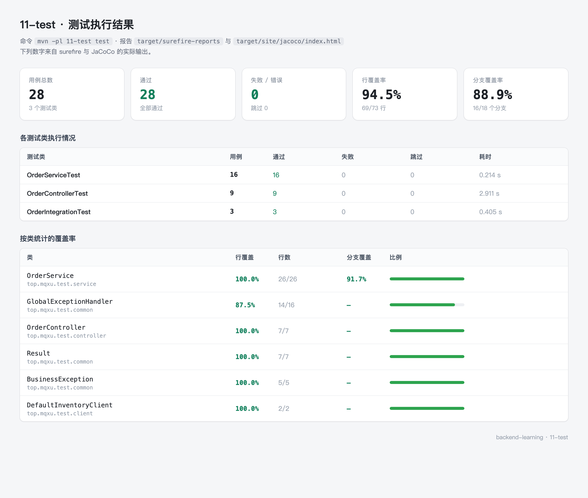
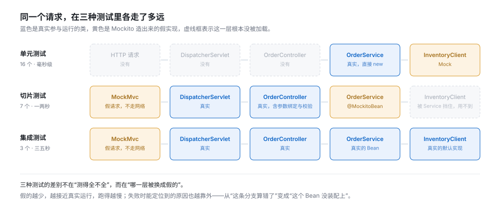
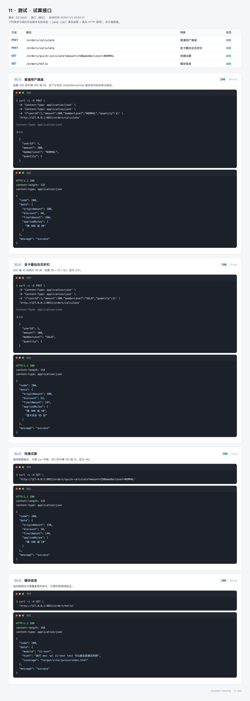
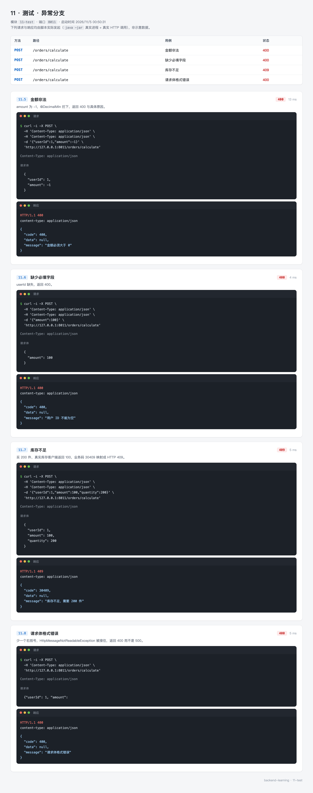

# 11 · 测试 —— 让机器替你验证

手测能发现的问题，永远是"你想到的那个"。

改完优惠券规则，你把 300 元的订单试了一遍，优惠 40，应付 260，对。但 99.99 元呢？金卡叠加满减呢？金额传 0 呢？买 200 件但库存只有 100 件呢？这些你未必想得到，想到了也未必每次都试。

测试就是把这些"试一遍"写成代码。写完之后，改任何一行业务代码，跑一条命令，几秒钟内所有曾经验证过的场景会重新验证一遍。

这一篇讲的不是"怎么让覆盖率达到 100%"，而是三个更实际的问题：一条规则该由哪一层测试来守、依赖外部服务时怎么测、覆盖率报告里那些没被执行的代码要不要管。

`11-test` 是一个订单试算模块，业务规则故意做得简单——满减、会员折扣、库存校验，一共几十行。简单的规则才好把注意力放在测试本身。

---

## 0. 先看结果

```bash
mvn -pl 11-test test
```

```
[INFO] Tests run: 9, Failures: 0, Errors: 0, Skipped: 0 -- in 订单接口（Web 层切片）
[INFO] Tests run: 3, Failures: 0, Errors: 0, Skipped: 0 -- in 订单接口（集成测试）
[INFO] Tests run: 10, Failures: 0, Errors: 0, Skipped: 0 -- in 边界与异常
[INFO] Tests run: 3, Failures: 0, Errors: 0, Skipped: 0 -- in 满减规则
[INFO] Tests run: 3, Failures: 0, Errors: 0, Skipped: 0 -- in 会员规则
[INFO] Tests run: 0, Failures: 0, Errors: 0, Skipped: 0 -- in 订单试算规则
[INFO] Tests run: 28, Failures: 0, Errors: 0, Skipped: 0
[INFO] Total time:  5.805 s
```

28 个用例，5.8 秒。同一台机器上启动一次 `11-test` 应用要 1 秒左右，这套测试多出来的时间是启动 Web 上下文的那几秒。

耗时数字每次会有几百毫秒的浮动，不用逐位对照。

倒数第二行那个 `Tests run: 0 —— in 订单试算规则` 不是问题，后面 5.4 节会解释。

跑完打开覆盖率报告：

```
open 11-test/target/site/jacoco/index.html
```

把测试结果和覆盖率画在一起是这样的：



五张卡片：28 个用例、全部通过、0 失败、行覆盖 94.5%、分支覆盖 88.9%。这些数字全部来自 surefire 与 JaCoCo 的真实输出，没有一个是估的。

接口本身也在跑，两张截图：

| 组 | 覆盖 | 截图 |
| --- | --- | --- |
| 试算接口 | 普通用户、金卡、快捷试算、模块信息 | `11-test-calc.webp` |
| 异常分支 | 金额非法、缺字段、库存不足、JSON 格式错 | `11-test-errors.webp` |

### 这一节的路线

| 步骤 | 内容 | 对应小节 |
| --- | --- | --- |
| 1 | 三种测试各管什么，为什么不能只有一种 | 1 |
| 2 | 确认环境，能在 IDE 里点着跑 | 2 |
| 3 | 建模块，看懂 starter-test 和 JaCoCo 插件 | 3 |
| 4 | 写被测代码：订单试算 | 4 |
| 5 | 写单元测试：16 个用例覆盖全部分支 | 5 |
| 6 | 写切片测试：只启 Web 层，测参数与异常映射 | 6 |
| 7 | 写集成测试：真实装配，验证链路通不通 | 7 |
| 8 | 跑起来，只看一个类、只看一个方法 | 8 |
| 9 | 读覆盖率报告，判断哪些缺口该补 | 9 |

---

## 1. 三种测试，区别在哪

### 1.1 一张图看清

同一个 HTTP 请求，在三种测试里走过的路完全不一样：



三行的差别只在"哪一层被换成假的"：

- **单元测试**：`new OrderService(mock)`，没有 Spring，没有 HTTP。链路上只有 `OrderService` 是真的，它依赖的 `InventoryClient` 是 Mockito 造的。
- **切片测试**：Spring 只装配 Web 层。`DispatcherServlet`、`OrderController`、参数解析、校验、异常处理全是真的，`OrderService` 被 `@MockitoBean` 换成假的。再往下的 `InventoryClient` 压根没被加载——因为真的 `OrderService` 都不在。
- **集成测试**：全部是真的。请求从 `MockMvc` 进来，一路走到真实的 `DefaultInventoryClient`，返回 100 件库存。

看这张图能得出一个实用结论：**想测什么，就选能把那一层变真的测试**。

| 想验证的事 | 该用哪种 |
| --- | --- |
| 满 300 减 40 这条规则算得对不对 | 单元测试 |
| 金额传 -1 会不会被拦下、返回什么文案 | 切片测试 |
| 忘了给 `OrderService` 加 `@Service`，应用还能不能起来 | 集成测试 |
| 库存不足时业务码 30409 会不会变成 HTTP 409 | 切片测试 |

### 1.2 一个具体场景：库存不足怎么测

"库存不足"这条分支，手测的成本是这样的：先找到一件库存少于 5 件的商品，或者想办法把库存改小，再下单买 5 件，看返回什么。测完还得把库存改回去，否则影响下一个测的人。

写成单元测试是两行：

```java
when(inventoryClient.availableStock(anyLong())).thenReturn(2);
OrderResult ignored = orderService.calculate(new OrderRequest(1L, new BigDecimal("100.00"), "NORMAL", 5));
```

第二行会抛异常，所以实际要写成 `assertThatThrownBy`。但重点是第一行——库存有多少，由测试说了算，不需要真的去改数据库。

这就是 Mockito 存在的理由：**把"外部世界的状态"变成"测试里的一个参数"**。

### 1.3 分层不是比例规定

网上常见的说法是"单元测试占 70%、集成测试占 10%"，这个比例没有依据，不同的项目差得很远。真正有用的是两条判断：

**第一，越往下越便宜。** 单元测试毫秒级，一个类写 20 个用例毫无压力；集成测试要起容器，写完 20 个类整个套件就跑不动了，没人愿意在提交前跑一遍。

**第二，越往上越能发现"接错"的问题。** 单元测试全绿、集成测试一跑就报 `NoSuchBeanDefinitionException`，这种事很常见——每个零件单独都对，装起来不对。这类问题只有集成测试能发现。

所以本模块的分布是 16 + 9 + 3：规则的分支用单元测试穷举，Web 层的六种失败路径用切片测试，三条关键链路用集成测试。

### 1.4 Mockito 只做三件事

新手容易把 Mockito 想复杂。它主要就三个用法：

```java
// 1. 造返回值：这个方法被调用时返回什么
when(client.availableStock(anyLong())).thenReturn(2);

// 2. 造异常：模拟下游超时、报错
when(client.availableStock(anyLong())).thenThrow(new RuntimeException("超时"));

// 3. 验证调用：这个方法被调了几次、传了什么参数
verify(client, times(1)).availableStock(anyLong());
```

第 3 条是 Mockito 最有价值的地方。有些规则光看结果看不出来，比如"库存只查一次"——查一次和查三次，返回的 `OrderResult` 完全一样，只有 `verify` 能守住。

---

## 2. 准备环境

### 2.1 版本

```bash
java -version
```

```
openjdk version "21.0.12.1" 2026-08-18 LTS
OpenJDK Runtime Environment (build 21.0.12.1+1-LTS)
OpenJDK 64-Bit Server VM (build 21.0.12.1+1-LTS, mixed mode, sharing)
```

```bash
mvn -v
```

```
Apache Maven 3.9.11 (3e54c93a704957b63ee3494413a2b544fd3d825b)
Java version: 21.0.12.1, vendor: BellSoft
```

本文所有输出都在 Java 21 + Maven 3.9.11 + Spring Boot 4.1.1 上跑出来。Boot 4 要求 Java 17 以上，21 是当前的主推版本。

### 2.2 在 IDE 里跑单个测试

命令行跑整个套件适合提交前，写测试的过程中更适合在 IDE 里点。IDEA 里方法名左边会出现绿色三角，点一下只跑这一个方法，改一行代码再点一次，两秒出结果。

如果三角没出现，通常是两个原因：`src/test/java` 目录没被标记成 Test Sources Root；或者 POM 里 `spring-boot-starter-test` 的 `<scope>` 写成了 `compile`（应该去掉 scope 或写 `test`，IDEA 靠它识别测试依赖）。

### 2.3 两个容易卡住的地方

**控制台中文乱码**。`@DisplayName("满 300 减 40")` 在报告里显示成问号，是输出编码问题。IDEA 里在 Help → Edit Custom VM Options 加 `-Dfile.encoding=UTF-8`，Maven 命令行加同样的参数：

```bash
mvn -pl 11-test test -Dfile.encoding=UTF-8
```

**`mvn test` 一个测试都没跑**。看输出里有没有 `Tests are skipped`。父 POM 或 IDE 生成的配置里可能出现 `<skipTests>true</skipTests>`，也可能是命令里带了 `-DskipTests`。这个参数会静默跳过所有测试、构建照样成功，CI 上最容易出事——测试全"通过"，其实是没跑。

---

## 3. 创建模块

### 3.1 目录结构

```
11-test
├── pom.xml
└── src
    ├── main
    │   ├── java/top/mqxu/test
    │   │   ├── TestApplication.java
    │   │   ├── client
    │   │   │   ├── InventoryClient.java          接口
    │   │   │   └── DefaultInventoryClient.java   默认实现，固定返回 100
    │   │   ├── common
    │   │   │   ├── Result.java
    │   │   │   ├── BusinessException.java
    │   │   │   └── GlobalExceptionHandler.java
    │   │   ├── controller/OrderController.java
    │   │   ├── dto
    │   │   │   ├── OrderRequest.java
    │   │   │   └── OrderResult.java
    │   │   └── service/OrderService.java
    │   └── resources/application.yml
    └── test/java/top/mqxu/test
        ├── service/OrderServiceTest.java        16 个用例，单元测试
        ├── controller/OrderControllerTest.java   9 个用例，切片测试
        └── OrderIntegrationTest.java             3 个用例，集成测试
```

主代码 9 个类，测试代码 3 个类。真实项目里这个比例不会这么整齐——往往是测试代码比主代码多。

测试类的包路径要和被测类对应：`OrderService` 在 `top.mqxu.test.service`，测试就放在 `src/test/java/top/mqxu/test/service/OrderServiceTest.java`。这样包级私有的方法也能测到，而且 IDE 里两个类可以互相跳转。

### 3.2 POM 全文

```xml
<?xml version="1.0" encoding="UTF-8"?>
<project xmlns="http://maven.apache.org/POM/4.0.0"
         xmlns:xsi="http://www.w3.org/2001/XMLSchema-instance"
         xsi:schemaLocation="http://maven.apache.org/POM/4.0.0 http://maven.apache.org/xsd/maven-4.0.0.xsd">
    <modelVersion>4.0.0</modelVersion>
    <parent>
        <groupId>top.mqxu</groupId>
        <artifactId>backend-learning</artifactId>
        <version>0.0.1-SNAPSHOT</version>
    </parent>

    <artifactId>11-test</artifactId>

    <dependencies>
        <dependency>
            <groupId>org.springframework.boot</groupId>
            <artifactId>spring-boot-starter-validation</artifactId>
        </dependency>
        <!-- JUnit 5 + Mockito + AssertJ + MockMvc，本模块的主角 -->
        <dependency>
            <groupId>org.springframework.boot</groupId>
            <artifactId>spring-boot-starter-test</artifactId>
            <scope>test</scope>
        </dependency>
    </dependencies>

    <build>
        <plugins>
            <!-- 覆盖率报告：执行 mvn test 后看 target/site/jacoco/index.html -->
            <plugin>
                <groupId>org.jacoco</groupId>
                <artifactId>jacoco-maven-plugin</artifactId>
                <version>0.8.16</version>
                <executions>
                    <execution>
                        <id>prepare-agent</id>
                        <goals>
                            <goal>prepare-agent</goal>
                        </goals>
                    </execution>
                    <execution>
                        <id>report</id>
                        <phase>test</phase>
                        <goals>
                            <goal>report</goal>
                        </goals>
                    </execution>
                </executions>
            </plugin>
        </plugins>
    </build>
</project>
```

只有两个依赖，比前面几篇都少。版本号全部来自父 POM 的 `dependencyManagement`，这里不写。

### 3.3 `spring-boot-starter-test` 里到底有什么

这一个依赖带进来十几个库，常用的六个：

| 库 | 提供什么 | 本篇用在哪 |
| --- | --- | --- |
| JUnit 5 | `@Test`、`@BeforeEach`、`@Nested`、`@ParameterizedTest` | 全部测试 |
| Mockito | `mock()`、`when()`、`verify()` | 单元测试造库存客户端 |
| AssertJ | `assertThat()` 链式断言 | 全部断言的写法 |
| Spring Test | `MockMvc`、`@SpringBootTest`、`@MockitoBean` | 切片与集成测试 |
| JsonPath | `jsonPath("$.data.finalAmount")` | 切片测试断言 JSON |
| Hamcrest | `hasItem()`、`containsInAnyOrder()` 等匹配器 | 配合 JsonPath 用 |

不需要一个个引——starter 的好处就是版本对齐，自己引容易撞上 Mockito 和 Byte Buddy 的版本不兼容。

JaCoCo 插件配了两个 execution，各自的作用：

| execution | 绑定的阶段 | 做什么 |
| --- | --- | --- |
| `prepare-agent` | `initialize` | 给 surefire 的 JVM 挂一个 agent，运行时记录哪些行被执行过 |
| `report` | `test` | 把 `.exec` 二进制记录读出来，生成 HTML / CSV / XML 报告 |

少了第一个，报告会提示 "Skipping JaCoCo execution due to missing execution data file"，覆盖率显示 0。

### 3.4 Boot 4 把测试的包路径挪了

这一条最容易卡住初学者：照着网上的 Boot 3 教程写，`import` 全部标红。

Boot 4 把测试相关的类按技术栈拆成了独立模块，包名跟着变：

| 类 | Boot 3 的包 | Boot 4 的包 |
| --- | --- | --- |
| `@WebMvcTest` | `org.springframework.boot.test.autoconfigure.web.servlet` | `org.springframework.boot.webmvc.test.autoconfigure` |
| `@AutoConfigureMockMvc` | `org.springframework.boot.test.autoconfigure.web.servlet` | `org.springframework.boot.webmvc.test.autoconfigure` |
| `TestRestTemplate` | `org.springframework.boot.test.web.client` | `org.springframework.boot.resttestclient` |
| `@MockBean` | `org.springframework.boot.test.mock.mockito` | 已删除，换 `@MockitoBean` |

注意前两行：`@WebMvcTest` 和 `@AutoConfigureMockMvc` 现在在同一个包里，不再是"主注解在 web.servlet、附加注解在 autoconfigure"那种分法。

`@MockitoBean` 不是 Boot 的类，是 Spring Framework 的，包名是 `org.springframework.test.context.bean.override.mockito.MockitoBean`。它比 `@MockBean` 多一个能力：在 `@SpringBootTest` 里也能用，可以只替换某一个 Bean，其余保持真实。

查这类"到底在哪个包"的问题，最可靠的办法是把 jar 下下来看，比搜索快也准：

```bash
unzip -l ~/.m2/repository/org/springframework/boot/spring-boot-webmvc-test/4.1.1/spring-boot-webmvc-test-4.1.1.jar | grep WebMvcTest
```

```
org/springframework/boot/webmvc/test/autoconfigure/WebMvcTest.class
```

包路径直接印在输出里。

### 3.5 第一次编译

模块里只有 `TestApplication` 的时候，编译就能过：

```bash
mvn -pl 11-test -q compile
```

没有任何输出就是成功。如果报"找不到符号 `spring-boot-starter-validation`"，检查父 POM 里有没有引 `spring-boot-dependencies`——依赖版本全靠它管。

---

## 4. 写被测代码

测试要有东西可测。先把订单试算写出来。

### 4.1 业务规则

规则故意写得简单，因为这一篇的主角是测试，不是业务：

| 规则 | 条件 | 优惠 |
| --- | --- | --- |
| 满 300 减 40 | 金额 ≥ 300 | 减 40 |
| 满 100 减 10 | 100 ≤ 金额 < 300 | 减 10 |
| 金卡折扣 | `memberLevel` 为 `GOLD` | 满减之后再打 95 折 |
| 最低金额 | 任何情况 | 应付不低于 0.01 |

两个满减取其一，不叠加。这条规则带来一个值得测的点：300 元的时候是减 40，不是减 50。

金卡的计算顺序也值得注意。300 元金卡：先减 40 得 260，再按 260 打 95 折省 13，合计优惠 53，应付 247。如果顺序反过来（先打折再满减），结果是 300 × 0.95 = 285，减 40 得 245——差 2 元。测试要能钉住这个顺序。

### 4.2 `OrderRequest`

```java
package top.mqxu.test.dto;

import jakarta.validation.constraints.DecimalMin;
import jakarta.validation.constraints.Min;
import jakarta.validation.constraints.NotNull;

import java.math.BigDecimal;

public record OrderRequest(
        @NotNull(message = "用户 ID 不能为空") Long userId,
        @NotNull(message = "金额不能为空")
        @DecimalMin(value = "0.01", message = "金额必须大于 0") BigDecimal amount,
        String memberLevel,
        @Min(value = 1, message = "数量至少为 1") Integer quantity) {

    public OrderRequest {
        if (memberLevel == null || memberLevel.isBlank()) {
            memberLevel = "NORMAL";
        }
        if (quantity == null) {
            quantity = 1;
        }
    }
}
```

`record` 是 Java 16 起的语法，一个构造器就把四个字段、getter、`equals`、`hashCode` 全带上了。测试里 `new OrderRequest(1L, new BigDecimal("300.00"), "GOLD", 1)` 一行就能造请求，比 setter 一个个调省事。

`public OrderRequest { ... }` 这个没有参数列表的构造器叫**紧凑构造器**。它在正式赋值之前执行，用来补默认值：`memberLevel` 传 `null` 或空串就当 `NORMAL`，`quantity` 传 `null` 就当 1。

这里有个细节值得提前知道：紧凑构造器里给参数重新赋值，**赋的是会被存进字段的值**。所以 `memberLevel = "NORMAL"` 这一行是有效的，不用写 `this.memberLevel = ...`（record 的字段是 final，紧凑构造器里也写不了 `this.`）。

三层校验分工不同：

| 层 | 拦什么 | 触发时机 |
| --- | --- | --- |
| `@NotNull` / `@DecimalMin` | 值为空、越界 | 控制器上加了 `@Valid` 才生效 |
| 紧凑构造器 | 缺省值 | 每次 `new` 都执行 |
| `OrderService` 里的判断 | 金额 ≤ 0、库存不足 | 无条件执行 |

`@Valid` 只在 Controller 那一层生效。单元测试直接 `new OrderService` 调 `calculate`，注解完全不起作用——所以 `OrderService` 里那句金额判断不是多余的，它是最后一层防线。

### 4.3 `OrderResult`

```java
package top.mqxu.test.dto;

import java.math.BigDecimal;
import java.util.List;

public record OrderResult(BigDecimal originAmount,
                          BigDecimal discount,
                          BigDecimal finalAmount,
                          List<String> appliedRules) {
}
```

`appliedRules` 是给前端展示"已优惠 40 元"用的，也给测试提供了额外的断言点。断言 `appliedRules` 比只断言金额更能说明"哪条规则生效了"。

### 4.4 `InventoryClient`

```java
package top.mqxu.test.client;

public interface InventoryClient {

    /**
     * 查询某件商品的可售库存
     *
     * @param productId 商品 ID
     * @return 可售数量
     */
    int availableStock(Long productId);
}
```

```java
package top.mqxu.test.client;

import org.springframework.stereotype.Component;

@Component
public class DefaultInventoryClient implements InventoryClient {

    @Override
    public int availableStock(Long productId) {
        return 100;
    }
}
```

真实环境里这是一次远程调用（HTTP 或 RPC）。这里用接口加一个固定返回 100 的实现，让应用能独立跑起来。

**为什么要抽接口，而不是直接在 `OrderService` 里 `new` 一个实现？** 因为 Mockito 只能 mock 接口和 non-final 类。更实际的原因是：依赖注入让 `OrderService` 不知道库存从哪来，测试才能替换掉它。如果 `OrderService` 里写死 `new DefaultInventoryClient()`，单元测试就只能真的去调它。

### 4.5 `OrderService`

```java
package top.mqxu.test.service;

import lombok.RequiredArgsConstructor;
import org.springframework.stereotype.Service;
import top.mqxu.test.client.InventoryClient;
import top.mqxu.test.common.BusinessException;
import top.mqxu.test.dto.OrderRequest;
import top.mqxu.test.dto.OrderResult;

import java.math.BigDecimal;
import java.math.RoundingMode;
import java.util.ArrayList;
import java.util.List;

@Service
@RequiredArgsConstructor
public class OrderService {

    private static final BigDecimal THRESHOLD_HIGH = new BigDecimal("300");
    private static final BigDecimal THRESHOLD_LOW = new BigDecimal("100");
    private static final BigDecimal FULL_CUT_HIGH = new BigDecimal("40");
    private static final BigDecimal FULL_CUT_LOW = new BigDecimal("10");
    private static final BigDecimal GOLD_RATE = new BigDecimal("0.05");
    private static final BigDecimal MIN_AMOUNT = new BigDecimal("0.01");

    private final InventoryClient inventoryClient;

    public OrderResult calculate(OrderRequest request) {
        if (request.amount() == null || request.amount().compareTo(BigDecimal.ZERO) <= 0) {
            throw BusinessException.amountInvalid();
        }

        // 库存校验依赖外部服务，测试里由 mock 决定返回值
        int stock = inventoryClient.availableStock(1L);
        if (stock < request.quantity()) {
            throw BusinessException.stockNotEnough(request.quantity());
        }

        List<String> rules = new ArrayList<>();
        BigDecimal discount = BigDecimal.ZERO;

        if (request.amount().compareTo(THRESHOLD_HIGH) >= 0) {
            discount = FULL_CUT_HIGH;
            rules.add("满 300 减 40");
        } else if (request.amount().compareTo(THRESHOLD_LOW) >= 0) {
            discount = FULL_CUT_LOW;
            rules.add("满 100 减 10");
        }

        if ("GOLD".equalsIgnoreCase(request.memberLevel())) {
            BigDecimal afterCut = request.amount().subtract(discount);
            discount = discount.add(afterCut.multiply(GOLD_RATE));
            rules.add("金卡会员 95 折");
        }

        discount = discount.setScale(2, RoundingMode.HALF_UP);
        BigDecimal finalAmount = request.amount().subtract(discount).max(MIN_AMOUNT).setScale(2, RoundingMode.HALF_UP);
        return new OrderResult(request.amount(), discount, finalAmount, rules);
    }
}
```

四十来行，但里面有五个分支点，正好是测试要覆盖的目标：

| 位置 | 分支数 | 怎么测 |
| --- | --- | --- |
| `amount == null \|\| ≤ 0` | 4 | 传 null、传 0、传 -1 |
| `stock < quantity` | 2 | mock 返回 2，买 5 件 |
| `amount >= 300` | 2 | 299.99 与 300.00 |
| `amount >= 100` | 2 | 99.99 与 100.00 |
| `GOLD` | 2 | `GOLD`、`gold`、`NORMAL` |

`setScale(2, RoundingMode.HALF_UP)` 出现两次。第一次把优惠金额定到两位小数，第二次定应付金额。不写的话，`260 × 0.05 = 13.00` 没问题，但某些金额会算出 `13.333333333` 这样的值，序列化成 JSON 时前端会看到一长串小数。

`max(MIN_AMOUNT)` 是保底：0.01 元买一单，没有优惠，应付还是 0.01。

### 4.6 `OrderController`

```java
package top.mqxu.test.controller;

import jakarta.validation.Valid;
import lombok.RequiredArgsConstructor;
import org.springframework.web.bind.annotation.GetMapping;
import org.springframework.web.bind.annotation.PostMapping;
import org.springframework.web.bind.annotation.RequestBody;
import org.springframework.web.bind.annotation.RequestMapping;
import org.springframework.web.bind.annotation.RequestParam;
import org.springframework.web.bind.annotation.RestController;
import top.mqxu.test.common.Result;
import top.mqxu.test.dto.OrderRequest;
import top.mqxu.test.dto.OrderResult;
import top.mqxu.test.service.OrderService;

import java.math.BigDecimal;
import java.util.LinkedHashMap;
import java.util.Map;

@RestController
@RequestMapping("/orders")
@RequiredArgsConstructor
public class OrderController {

    private final OrderService orderService;

    @PostMapping("/calculate")
    public Result<OrderResult> calculate(@Valid @RequestBody OrderRequest request) {
        return Result.ok(orderService.calculate(request));
    }

    @GetMapping("/quick-calculate")
    public Result<OrderResult> quickCalculate(@RequestParam BigDecimal amount,
                                             @RequestParam(defaultValue = "NORMAL") String memberLevel) {
        return Result.ok(orderService.calculate(new OrderRequest(1L, amount, memberLevel, 1)));
    }

    @GetMapping("/hello")
    public Result<Map<String, Object>> hello() {
        Map<String, Object> data = new LinkedHashMap<>();
        data.put("module", "11-test");
        data.put("hint", "执行 mvn -pl 11-test test 可以跑全部测试用例");
        data.put("coverage", "target/site/jacoco/index.html");
        return Result.ok(data);
    }
}
```

三个接口，`@Valid` 只有一个。`quick-calculate` 走查询参数，拼成 `OrderRequest` 直接传给 Service，校验注解在这里不生效——所以金额传 0 会由 Service 抛业务异常，返回 409 而不是 400。

这个不一致不是 bug，是刻意留的：它让 `quick-calculate` 成为"Service 层兜底校验"的活例子。9.3 节会拿它和 `calculate` 对比。

### 4.7 统一响应与异常

```java
package top.mqxu.test.common;

import lombok.Data;

@Data
public class Result<T> {

    private Integer code;
    private String message;
    private T data;

    private Result(Integer code, String message, T data) {
        this.code = code;
        this.message = message;
        this.data = data;
    }

    public static <T> Result<T> ok(T data) {
        return new Result<>(200, "success", data);
    }

    public static <T> Result<T> fail(Integer code, String message) {
        return new Result<>(code, message, null);
    }
}
```

```java
package top.mqxu.test.common;

import lombok.Getter;

@Getter
public class BusinessException extends RuntimeException {

    private final int code;

    public BusinessException(int code, String message) {
        super(message);
        this.code = code;
    }

    public static BusinessException stockNotEnough(int required) {
        return new BusinessException(30409, "库存不足，需要 " + required + " 件");
    }

    public static BusinessException amountInvalid() {
        return new BusinessException(30400, "金额必须大于 0");
    }
}
```

两个静态工厂方法，把"业务码 + 提示文案"打包在一起。好处是测试可以直接断言 `BusinessException.stockNotEnough(5)`，不用记 30409 这个数字——但这个数字又必须固定，因为它是前后端约定的一部分。

```java
package top.mqxu.test.common;

import lombok.extern.slf4j.Slf4j;
import org.springframework.http.ResponseEntity;
import org.springframework.http.converter.HttpMessageNotReadableException;
import org.springframework.web.bind.MethodArgumentNotValidException;
import org.springframework.web.bind.annotation.ExceptionHandler;
import org.springframework.web.bind.annotation.RestControllerAdvice;

@Slf4j
@RestControllerAdvice
public class GlobalExceptionHandler {

    @ExceptionHandler(BusinessException.class)
    public ResponseEntity<Result<Void>> handleBusiness(BusinessException e) {
        log.warn("业务异常：{}", e.getMessage());
        // 业务码 30409 的后三位就是 HTTP 状态：30409 % 1000 = 409
        int http = e.getCode() % 1000;
        return ResponseEntity.status(http).body(Result.fail(e.getCode(), e.getMessage()));
    }

    @ExceptionHandler(MethodArgumentNotValidException.class)
    public ResponseEntity<Result<Void>> handleValid(MethodArgumentNotValidException e) {
        String msg = e.getBindingResult().getFieldErrors().stream()
                .findFirst()
                .map(err -> err.getDefaultMessage())
                .orElse("参数校验失败");
        return ResponseEntity.badRequest().body(Result.fail(400, msg));
    }

    @ExceptionHandler(HttpMessageNotReadableException.class)
    public ResponseEntity<Result<Void>> handleNotReadable(HttpMessageNotReadableException e) {
        return ResponseEntity.badRequest().body(Result.fail(400, "请求体格式错误"));
    }

    @ExceptionHandler(Exception.class)
    public ResponseEntity<Result<Void>> handleOther(Exception e) {
        log.error("系统异常", e);
        return ResponseEntity.status(500).body(Result.fail(500, "系统繁忙，请稍后再试"));
    }
}
```

四个处理器，对应四类失败：

| 异常 | 谁抛的 | HTTP | 业务码 |
| --- | --- | --- | --- |
| `BusinessException` | Service | 业务码取后三位 | 30400 / 30409 |
| `MethodArgumentNotValidException` | `@Valid` 校验失败 | 400 | 400 |
| `HttpMessageNotReadableException` | JSON 解析失败 | 400 | 400 |
| `Exception` | 其他所有 | 500 | 500 |

`e.getCode() % 1000` 这一行是整个异常设计的核心：业务码 30409 的后三位 409 就是 HTTP 状态。这样前端拿到响应时，HTTP 状态码可以给监控和网关用（409 就是冲突），业务码可以给页面用（30409 具体表示库存不足）。

`getFieldErrors().stream().findFirst()` 只取第一条校验错误。多条同时失败时（比如 userId 和 amount 都没传），返回哪一条不确定——这是简化处理，正式的校验错误应该全部返回，前端逐个标红。

这张表是**第一版**，只覆盖了走 JSON 请求体的接口。`quick-calculate` 走查询参数，它的烂输入不在这个范围里，6.4 节写测试时会碰到，到时候再补两个处理器。

### 4.8 第一次跑起来

代码写完，先启动确认能跑：

```bash
mvn -pl 11-test spring-boot:run
```

```bash
curl "http://127.0.0.1:8011/orders/quick-calculate?amount=300"
```

```json
{"code":200,"message":"success","data":{"originAmount":300,"discount":40,"finalAmount":260,"appliedRules":["满 300 减 40"]}}
```

能返回这个就说明装配没问题。接下来写测试。

---

## 5. 写单元测试

单元测试的写法有一条主线：**准备好输入 → 调用 → 断言输出**。

### 5.1 第一个测试

新建 `src/test/java/top/mqxu/test/service/OrderServiceTest.java`：

```java
package top.mqxu.test.service;

import org.junit.jupiter.api.Test;
import top.mqxu.test.client.InventoryClient;
import top.mqxu.test.dto.OrderRequest;
import top.mqxu.test.dto.OrderResult;

import java.math.BigDecimal;

import static org.assertj.core.api.Assertions.assertThat;
import static org.mockito.ArgumentMatchers.anyLong;
import static org.mockito.Mockito.mock;
import static org.mockito.Mockito.when;

class OrderServiceTest {

    @Test
    void discountAt300() {
        InventoryClient client = mock(InventoryClient.class);
        when(client.availableStock(anyLong())).thenReturn(100);
        OrderService orderService = new OrderService(client);

        OrderResult result = orderService.calculate(
                new OrderRequest(1L, new BigDecimal("300.00"), "NORMAL", 1));

        assertThat(result.discount()).isEqualByComparingTo("40.00");
        assertThat(result.finalAmount()).isEqualByComparingTo("260.00");
    }
}
```

三行准备、一行调用、两行断言。跑一下：

```bash
mvn -pl 11-test test -Dtest=OrderServiceTest
```

绿色的 `Tests run: 1, Failures: 0` 就说明这条路走通了。

### 5.2 把准备抽到 `@BeforeEach`

上面那个测试如果写十遍，`mock` 和 `when` 就要重复十遍。而且每个用例都新建一次 mock 是必要的——如果共用同一个 mock，上一个用例 `thenReturn(2)` 的设置会带到下一个用例，排查起来很难。

`@BeforeEach` 正好做这件事：

```java
    private InventoryClient inventoryClient;

    private OrderService orderService;

    @BeforeEach
    void setUp() {
        // 每个用例都拿一个新的 mock，避免用例之间互相影响
        inventoryClient = mock(InventoryClient.class);
        orderService = new OrderService(inventoryClient);
        // 默认给足库存，个别用例再覆盖
        when(inventoryClient.availableStock(anyLong())).thenReturn(100);
    }
```

字段不能声明成 `static`，也不能在构造器里初始化——`@BeforeEach` 保证每个测试方法执行前都跑一次，这样才干净。

默认给 100 件库存是个实用技巧：绝大多数用例不关心库存，只关心金额计算。把"正常库存"设成默认值，个别关心库存的用例再 `when(...).thenReturn(2)` 覆盖。

### 5.3 `BigDecimal` 的断言要用 `isEqualByComparingTo`

这两行结果完全不同：

```java
assertThat(new BigDecimal("260.00")).isEqualTo(new BigDecimal("260"));      // 失败
assertThat(new BigDecimal("260.00")).isEqualByComparingTo(new BigDecimal("260"));  // 通过
```

`BigDecimal` 的 `equals` 连 `scale` 一起比。`260.00` 的 scale 是 2，`260` 的 scale 是 0，数值相同但不是同一个对象意义上的相等。

`isEqualByComparingTo` 底层用 `compareTo`，只比数值。写金额断言一律用它。

同理，构造 `BigDecimal` 要用字符串：`new BigDecimal("0.1")` 是精确的 0.1，`new BigDecimal(0.1)` 会带上 `0.1000000000000000055511151231257827` 这样的尾巴。金额计算里这个差别是致命的。

### 5.4 用 `@Nested` 分组

16 个用例平铺在一个类里，报告上拉下来一长条，看不出结构。按业务含义分组：

```java
@DisplayName("订单试算规则")
class OrderServiceTest {

    @Nested
    @DisplayName("满减规则")
    class FullCutRules {
        // 3 个用例
    }

    @Nested
    @DisplayName("会员规则")
    class MemberRules {
        // 3 个用例
    }

    @Nested
    @DisplayName("边界与异常")
    class EdgeCases {
        // 10 个用例
    }
}
```

`surefire` 报告里会按这三个组分别统计，一眼能看出"会员规则"那块只有 3 个用例。

这解释了一开始那个疑问：`Tests run: 0 —— in 订单试算规则`。外层类自己一个 `@Test` 都没有，全是 `@Nested` 内部类带过去的，所以外层计数是 0，实际用例在三个内部分组里。

注意 `@Nested` 内部类不能是 `static`。它是非静态内部类，可以直接访问外层的 `orderService` 与 `inventoryClient` 字段。

### 5.5 参数化测试：边界值一次穷举

满减的两个分界点是 100 和 300。手写六个用例很啰嗦：

```java
@ParameterizedTest(name = "金额 {0} 最终应付 {1}")
@CsvSource({
        "0.02, 0.02",
        "99.99, 99.99",
        "100.00, 90.00",
        "299.99, 289.99",
        "300.00, 260.00",
        "1000.00, 960.00"
})
@DisplayName("多组金额的应付结果")
void finalAmountMatrix(String amount, String expected) {
    OrderResult result = orderService.calculate(
            new OrderRequest(1L, new BigDecimal(amount), "NORMAL", 1));

    assertThat(result.finalAmount()).isEqualByComparingTo(expected);
}
```

一个方法，六组数据。报告里显示成六条独立用例，失败时会明确告诉你 `金额 299.99 最终应付 289.99` 这一条挂了。

选的六个值都在分界点附近：

| 金额 | 想验证什么 |
| --- | --- |
| 0.02 | 最小可用金额，不触发优惠 |
| 99.99 | 差一分钱到 100，不该有优惠 |
| 100.00 | 刚好到 100，减 10 |
| 299.99 | 差一分钱到 300，还是减 10 |
| 300.00 | 刚好到 300，减 40 |
| 1000.00 | 远超阈值，仍然只减 40 |

`@CsvSource` 的参数用 `String` 接收，方法里再转 `BigDecimal`。直接声明成 `BigDecimal` 也能跑，但 `0.02` 这种值走的是"字符串转 BigDecimal"的路径，用 `String` 接更明确。

`name = "金额 {0} 最终应付 {1}"` 里的 `{0}`、`{1}` 对应参数下标，报告里每条用例名都不一样，看报告时不用去数第几行。

### 5.6 断言异常

"金额为 0 要抛业务异常"这类用例，不能用 try-catch：

```java
@Test
@DisplayName("金额为 0 抛业务异常")
void zeroAmount() {
    assertThatThrownBy(() -> orderService.calculate(
            new OrderRequest(1L, BigDecimal.ZERO, "NORMAL", 1)))
            .isInstanceOf(BusinessException.class)
            .hasMessageContaining("金额必须大于 0");
}
```

`assertThatThrownBy` 接一个 lambda。如果 lambda 没抛异常，测试失败；抛了别的类型也失败；抛对了类型但文案不对还是失败。三层都比对，比 `assertThrows` 只检查类型更严。

一个容易忽略的点：`assertThatThrownBy` 的 lambda 里如果有多行，只有**最后抛出的**那个异常会被捕获。前面几行如果有副作用（比如改了数据库），测试跑完不会回滚——这类测试要么加 `@Transactional`，要么只做纯计算。

### 5.7 `verify`：验证行为

"库存只查一次"这条规则，结果上完全看不出来。查一次和查三次，返回的 `OrderResult` 一模一样：

```java
@Test
@DisplayName("库存够时不会抛异常，且只查一次库存")
void stockQueriedOnce() {
    orderService.calculate(new OrderRequest(1L, new BigDecimal("100.00"), "NORMAL", 1));

    verify(inventoryClient, times(1)).availableStock(anyLong());
}
```

`verify` 检查的是"这个 mock 的方法被调了几次、参数是什么"。常用变体：

| 写法 | 含义 |
| --- | --- |
| `verify(client).availableStock(1L)` | 调过一次，且参数是 1L |
| `verify(client, times(2))` | 调过两次 |
| `verify(client, never())` | 从没调过 |
| `verify(client, atLeastOnce())` | 至少一次 |

`verify(client).availableStock(1L)` 这种简写里，参数是**精确匹配**——传 `1L` 就只认 `1L`，传 `anyLong()` 才匹配任意值。这一点新手常踩：写了 `verify(client).availableStock(1L)`，但代码里传的是 `productId` 变量，值对了也能过；值错了一位就会失败，而失败信息只会说"想要 1L 但实际是 2L"，得回头看代码。

### 5.8 完整的单元测试

```java
package top.mqxu.test.service;

import org.junit.jupiter.api.BeforeEach;
import org.junit.jupiter.api.DisplayName;
import org.junit.jupiter.api.Nested;
import org.junit.jupiter.api.Test;
import org.junit.jupiter.params.ParameterizedTest;
import org.junit.jupiter.params.provider.CsvSource;
import top.mqxu.test.client.InventoryClient;
import top.mqxu.test.common.BusinessException;
import top.mqxu.test.dto.OrderRequest;
import top.mqxu.test.dto.OrderResult;

import java.math.BigDecimal;

import static org.assertj.core.api.Assertions.assertThat;
import static org.assertj.core.api.Assertions.assertThatThrownBy;
import static org.mockito.ArgumentMatchers.anyLong;
import static org.mockito.Mockito.mock;
import static org.mockito.Mockito.times;
import static org.mockito.Mockito.verify;
import static org.mockito.Mockito.when;

@DisplayName("订单试算规则")
class OrderServiceTest {

    private InventoryClient inventoryClient;

    private OrderService orderService;

    @BeforeEach
    void setUp() {
        inventoryClient = mock(InventoryClient.class);
        orderService = new OrderService(inventoryClient);
        when(inventoryClient.availableStock(anyLong())).thenReturn(100);
    }

    @Nested
    @DisplayName("满减规则")
    class FullCutRules {

        @Test
        @DisplayName("不满 100 不优惠")
        void noDiscountBelow100() {
            OrderResult result = orderService.calculate(
                    new OrderRequest(1L, new BigDecimal("99.00"), "NORMAL", 1));

            assertThat(result.discount()).isEqualByComparingTo("0.00");
            assertThat(result.finalAmount()).isEqualByComparingTo("99.00");
            assertThat(result.appliedRules()).isEmpty();
        }

        @Test
        @DisplayName("满 100 减 10")
        void discountAt100() {
            OrderResult result = orderService.calculate(
                    new OrderRequest(1L, new BigDecimal("100.00"), "NORMAL", 1));

            assertThat(result.discount()).isEqualByComparingTo("10.00");
            assertThat(result.finalAmount()).isEqualByComparingTo("90.00");
            assertThat(result.appliedRules()).containsExactly("满 100 减 10");
        }

        @Test
        @DisplayName("满 300 减 40，与满 100 不叠加")
        void discountAt300() {
            OrderResult result = orderService.calculate(
                    new OrderRequest(1L, new BigDecimal("300.00"), "NORMAL", 1));

            assertThat(result.discount()).isEqualByComparingTo("40.00");
            assertThat(result.appliedRules()).containsExactly("满 300 减 40");
        }
    }

    @Nested
    @DisplayName("会员规则")
    class MemberRules {

        @Test
        @DisplayName("金卡在满减之后再打 95 折")
        void goldMemberExtraDiscount() {
            // 300 - 40 = 260，260 * 5% = 13，合计优惠 53，应付 247
            OrderResult result = orderService.calculate(
                    new OrderRequest(1L, new BigDecimal("300.00"), "GOLD", 1));

            assertThat(result.discount()).isEqualByComparingTo("53.00");
            assertThat(result.finalAmount()).isEqualByComparingTo("247.00");
            assertThat(result.appliedRules()).contains("满 300 减 40", "金卡会员 95 折");
        }

        @Test
        @DisplayName("会员等级大小写不敏感")
        void memberLevelIgnoreCase() {
            OrderResult result = orderService.calculate(
                    new OrderRequest(1L, new BigDecimal("200.00"), "gold", 1));

            assertThat(result.appliedRules()).contains("金卡会员 95 折");
        }

        @Test
        @DisplayName("普通会员不享受额外折扣")
        void normalMemberNoExtra() {
            OrderResult result = orderService.calculate(
                    new OrderRequest(1L, new BigDecimal("200.00"), "NORMAL", 1));

            assertThat(result.appliedRules()).doesNotContain("金卡会员 95 折");
        }
    }

    @Nested
    @DisplayName("边界与异常")
    class EdgeCases {

        @ParameterizedTest(name = "金额 {0} 最终应付 {1}")
        @CsvSource({
                "0.02, 0.02",
                "99.99, 99.99",
                "100.00, 90.00",
                "299.99, 289.99",
                "300.00, 260.00",
                "1000.00, 960.00"
        })
        @DisplayName("多组金额的应付结果")
        void finalAmountMatrix(String amount, String expected) {
            OrderResult result = orderService.calculate(
                    new OrderRequest(1L, new BigDecimal(amount), "NORMAL", 1));

            assertThat(result.finalAmount()).isEqualByComparingTo(expected);
        }

        @Test
        @DisplayName("金额为 0 抛业务异常")
        void zeroAmount() {
            assertThatThrownBy(() -> orderService.calculate(
                    new OrderRequest(1L, BigDecimal.ZERO, "NORMAL", 1)))
                    .isInstanceOf(BusinessException.class)
                    .hasMessageContaining("金额必须大于 0");
        }

        @Test
        @DisplayName("库存不足抛业务异常")
        void stockNotEnough() {
            when(inventoryClient.availableStock(anyLong())).thenReturn(2);

            assertThatThrownBy(() -> orderService.calculate(
                    new OrderRequest(1L, new BigDecimal("100.00"), "NORMAL", 5)))
                    .isInstanceOf(BusinessException.class)
                    .hasMessageContaining("库存不足");
        }

        @Test
        @DisplayName("库存够时不会抛异常，且只查一次库存")
        void stockQueriedOnce() {
            orderService.calculate(new OrderRequest(1L, new BigDecimal("100.00"), "NORMAL", 1));

            verify(inventoryClient, times(1)).availableStock(anyLong());
        }

        @Test
        @DisplayName("金额极小时不低于 0.01")
        void minimumAmount() {
            OrderResult result = orderService.calculate(
                    new OrderRequest(1L, new BigDecimal("0.01"), "NORMAL", 1));

            assertThat(result.finalAmount()).isEqualByComparingTo("0.01");
        }
    }
}
```

12 个方法，其中参数化那个跑出 6 条，合计 16 个用例。

跑一遍：

```bash
mvn -pl 11-test test -Dtest=OrderServiceTest
```

```
[INFO] Tests run: 10, Failures: 0, Errors: 0, Skipped: 0 -- in 边界与异常
[INFO] Tests run: 3, Failures: 0, Errors: 0, Skipped: 0 -- in 满减规则
[INFO] Tests run: 3, Failures: 0, Errors: 0, Skipped: 0 -- in 会员规则
[INFO] Tests run: 16, Failures: 0, Errors: 0, Skipped: 0
```

0.3 秒。这就是单元测试的价值：改一行规则，0.3 秒后知道有没有弄坏什么。

---

## 6. 写切片测试

单元测试测完了 `OrderService`，但它不知道"金额传 -1 时 HTTP 返回什么"。

这中间隔着一整套 Web 层：参数绑定、`@Valid` 校验、异常映射、JSON 序列化。这些也全都会出错，而且出错的方式比业务逻辑更隐蔽——业务算错了一眼能看出来，`@Valid` 忘写了、异常没映射对，接口返回 500 而没人发现。

### 6.1 `@WebMvcTest` 装配了什么

```java
@WebMvcTest(OrderController.class)
class OrderControllerTest {
}
```

加了这个注解，Spring 只启动 Web 那一层：

| 启动 | 不启动 |
| --- | --- |
| `@Controller` / `@RestController` | `@Service`、`@Component` |
| `@ControllerAdvice`（异常处理） | `@Repository`、数据库相关 |
| `Filter`、`Interceptor` | 自定义 `@Configuration` 里的业务 Bean |
| `HttpMessageConverter`（Jackson） | 定时任务、消息队列 |

"不启动"是关键：`OrderService` 不在容器里，而 `OrderController` 构造器要它。所以不加 `@MockitoBean` 的话，启动直接报错：

```
Parameter 0 of constructor in top.mqxu.test.controller.OrderController required a bean of type
'top.mqxu.test.service.OrderService' that could not be found.
```

这条报错在初学阶段出现频率很高，看到 "required a bean ... that could not be found" 就知道是切片测试缺 mock。

### 6.2 `@MockitoBean`

```java
    @Autowired
    private MockMvc mockMvc;

    @MockitoBean
    private OrderService orderService;
```

`@MockitoBean` 做两件事：造一个 `OrderService` 的 mock，注册进容器，顶替真实实现；如果有同名 Bean 已存在，直接替换。

它和 `@MockBean` 的区别：

| 项 | `@MockBean`（Boot 3） | `@MockitoBean`（Boot 4 / Framework 7） |
| --- | --- | --- |
| 来源 | Spring Boot | Spring Framework |
| 包 | `org.springframework.boot.test.mock.mockito` | `org.springframework.test.context.bean.override.mockito` |
| Boot 4 是否可用 | 已删除 | 可用 |
| 用在哪 | 只能测试类字段 | 测试类字段、`@SpringBootTest` 里的单个 Bean |

`@MockitoBean` 有一组兄弟注解，按需选用：

| 注解 | 作用 |
| --- | --- |
| `@MockitoBean` | 完全替换，所有方法返回默认值（null / 0 / false） |
| `@MockitoSpyBean` | 包一层 spy，真实方法照常执行，可以只覆盖其中几个 |
| `@TestBean` | 用自己写的方法造一个 Bean 替换 |

### 6.3 第一个切片测试

```java
    @Test
    @DisplayName("正常试算返回 200 与计算结果")
    void calculateOk() throws Exception {
        given(orderService.calculate(any())).willReturn(new OrderResult(
                new BigDecimal("300.00"), new BigDecimal("53.00"),
                new BigDecimal("247.00"), List.of("满 300 减 40", "金卡会员 95 折")));

        mockMvc.perform(post("/orders/calculate")
                        .contentType(MediaType.APPLICATION_JSON)
                        .content("""
                                {"userId": 1, "amount": 300.00, "memberLevel": "GOLD", "quantity": 1}"""))
                .andDo(print())
                .andExpect(status().isOk())
                .andExpect(jsonPath("$.code").value(200))
                .andExpect(jsonPath("$.data.finalAmount").value(247.00))
                .andExpect(jsonPath("$.data.appliedRules.length()").value(2));
    }
```

逐段看：

- `given(...).willReturn(...)` 是 BDD 风格的 `when(...).thenReturn(...)`，两种写法等价，BDD 写法读起来更像"假设……就返回……"。
- `mockMvc.perform(post("/orders/calculate"))` 发一个假请求。它不走网络、不占端口，但会真的经过 `DispatcherServlet`、真的做参数绑定与 JSON 反序列化。
- `.content(""" ... """)` 是 Java 15 的文本块，写 JSON 不用转义引号。注意文本块结尾的 `"""` 必须单独一行。
- `.andDo(print())` 把请求和响应打到控制台。断言失败时第一件事就是看这个输出。
- `jsonPath("$.data.appliedRules.length()")` 断言数组长度。`$.data.appliedRules[0]` 取第一个元素，`.length()` 取长度，看需求用。

`andDo(print())` 的输出长这样：

```
MockHttpServletRequest:
      HTTP Method = POST
      Request URI = /orders/calculate
       Parameters = {}
          Body = {"userId": 1, "amount": 300.00, "memberLevel": "GOLD", "quantity": 1}

MockHttpServletResponse:
           Status = 200
    Content type = application/json
            Body = {"code":200,"message":"success","data":{...}}
```

三层信息：请求方法路径、请求体、响应状态与响应体。断言 `jsonPath` 取不到值的时候，九成是路径写错，对着这里的 `Body` 看一眼就能改对。

### 6.4 六种失败路径

正常路径只有一种，失败路径有六种，每种都要有对应用例：

| 失败 | 触发 | 期望 | 测的是 |
| --- | --- | --- | --- |
| 数值越界 | `amount: -1` | 400 | `@DecimalMin` 是否生效 |
| 缺必填字段 | 不传 `userId` | 400 | `@NotNull` 是否生效 |
| 业务异常 | Service 抛 `BusinessException` | 409 | 业务码到 HTTP 的映射 |
| JSON 语法错 | 少一个右括号 | 400 | `HttpMessageNotReadableException` 有没有接 |
| 查询参数类型错 | `?amount=abc` | 400 | `MethodArgumentTypeMismatchException` 有没有接 |
| 缺查询参数 | 不传 `amount` | 400 | `MissingServletRequestParameterException` 有没有接 |

前两个是校验注解的验证：

```java
    @Test
    @DisplayName("参数校验失败返回 400 与具体原因")
    void calculateBadRequest() throws Exception {
        mockMvc.perform(post("/orders/calculate")
                        .contentType(MediaType.APPLICATION_JSON)
                        .content("""
                                {"userId": 1, "amount": -1}"""))
                .andExpect(status().isBadRequest())
                .andExpect(jsonPath("$.code").value(400))
                .andExpect(jsonPath("$.message").value("金额必须大于 0"));
    }
```

断言的文案 `"金额必须大于 0"` 和 `OrderRequest` 上的 `message` 一字不差。这两处是耦合的——改注解里的文案，测试就会红。这正是想要的效果：文案是给用户看的，改了就该有人确认。

第三个测异常映射：

```java
    @Test
    @DisplayName("业务异常按业务码映射成 409")
    void calculateStockNotEnough() throws Exception {
        given(orderService.calculate(any())).willThrow(BusinessException.stockNotEnough(5));

        mockMvc.perform(post("/orders/calculate")
                        .contentType(MediaType.APPLICATION_JSON)
                        .content("""
                                {"userId": 1, "amount": 100, "quantity": 5}"""))
                .andExpect(status().isConflict())
                .andExpect(jsonPath("$.code").value(30409));
    }
```

`status().isConflict()` 就是 409。这一条是整组里最有价值的：Service 抛的是业务码 30409，`GlobalExceptionHandler` 算 `30409 % 1000` 得 409，`ResponseEntity.status(409)` 才是真正的 HTTP 状态。任何一环断了，这条测试都会红。

`willThrow` 也能用 `thenThrow` 写，效果一样。用 `willThrow` 的好处是可以接一个异常实例，而不是 `thenThrow(new BusinessException(...))` 那样每次都得 new。

第四个测 JSON 解析：

```java
    @Test
    @DisplayName("请求体不是合法 JSON 返回 400")
    void calculateBrokenJson() throws Exception {
        mockMvc.perform(post("/orders/calculate")
                        .contentType(MediaType.APPLICATION_JSON)
                        .content("{\"userId\": 1, \"amount\": "))
                .andExpect(status().isBadRequest());
    }
```

这个用例的意义在于：不接 `HttpMessageNotReadableException` 的话，解析失败会落到兜底的 `Exception` 分支，返回 500。前端看到 500 会以为是服务端崩了，实际是请求格式错了。

这条用例只断言了 400，没断言 message。因为 `HttpMessageNotReadableException` 的 message 里带着一大段 Jackson 的解析细节（`Unexpected end-of-input at [Source: ...]`），不适合直接给用户看，所以处理器里返回了固定文案"请求体格式错误"。要断言也可以：

```java
.andExpect(jsonPath("$.message").value("请求体格式错误"));
```

后两个是写这一节时才发现要补的。`quick-calculate` 的金额走查询参数，`@RequestParam BigDecimal amount`——传 `abc` 进来时，Spring 要把它转成 `BigDecimal`，转不了就抛 `MethodArgumentTypeMismatchException`。不传这个参数，抛的是 `MissingServletRequestParameterException`。

这两种异常都不在 `GlobalExceptionHandler` 的四个处理器覆盖范围内，会落到兜底的 `Exception` 分支，返回 500：

```bash
curl "http://127.0.0.1:8011/orders/quick-calculate?amount=abc"
```

```json
{"code":500,"data":null,"message":"系统繁忙，请稍后再试"}
```

日志里躺着真正的异常：

```
MethodArgumentTypeMismatchException: Method parameter 'amount': Failed to convert value of type
'java.lang.String' to required type 'java.math.BigDecimal'
```

客户端传错参数、服务端报"系统繁忙"，这就是把 500 当垃圾桶用的后果。补两个处理器：

```java
    @ExceptionHandler(MethodArgumentTypeMismatchException.class)
    public ResponseEntity<Result<Void>> handleTypeMismatch(MethodArgumentTypeMismatchException e) {
        log.warn("参数类型错误：{} = {}", e.getName(), e.getValue());
        return ResponseEntity.badRequest().body(Result.fail(400, "参数 " + e.getName() + " 格式不正确"));
    }

    @ExceptionHandler(MissingServletRequestParameterException.class)
    public ResponseEntity<Result<Void>> handleMissingParam(MissingServletRequestParameterException e) {
        return ResponseEntity.badRequest().body(Result.fail(400, "缺少参数 " + e.getParameterName()));
    }
```

对应的两条用例：

```java
    @Test
    @DisplayName("查询参数类型不对返回 400 而不是 500")
    void quickCalculateBadType() throws Exception {
        mockMvc.perform(get("/orders/quick-calculate").param("amount", "abc"))
                .andExpect(status().isBadRequest())
                .andExpect(jsonPath("$.code").value(400))
                .andExpect(jsonPath("$.message").value("参数 amount 格式不正确"));
    }

    @Test
    @DisplayName("缺必填查询参数返回 400")
    void quickCalculateMissingParam() throws Exception {
        mockMvc.perform(get("/orders/quick-calculate"))
                .andExpect(status().isBadRequest())
                .andExpect(jsonPath("$.code").value(400))
                .andExpect(jsonPath("$.message").value("缺少参数 amount"));
    }
```

这两条用例值得单独说一句：它们不是"写测试的时候顺手补的"，是**先手动发了一次请求发现不对，才回头改的代码**。写测试的过程本身就是一次代码审查——把每个入口的每种烂输入都试一遍，一定会撞上几个平时想不到的。

### 6.5 完整的切片测试

```java
package top.mqxu.test.controller;

import org.junit.jupiter.api.DisplayName;
import org.junit.jupiter.api.Test;
import org.springframework.beans.factory.annotation.Autowired;
import org.springframework.boot.webmvc.test.autoconfigure.WebMvcTest;
import org.springframework.http.MediaType;
import org.springframework.test.context.bean.override.mockito.MockitoBean;
import org.springframework.test.web.servlet.MockMvc;
import top.mqxu.test.common.BusinessException;
import top.mqxu.test.dto.OrderResult;
import top.mqxu.test.service.OrderService;

import java.math.BigDecimal;
import java.util.List;

import static org.mockito.ArgumentMatchers.any;
import static org.mockito.BDDMockito.given;
import static org.springframework.test.web.servlet.request.MockMvcRequestBuilders.get;
import static org.springframework.test.web.servlet.request.MockMvcRequestBuilders.post;
import static org.springframework.test.web.servlet.result.MockMvcResultHandlers.print;
import static org.springframework.test.web.servlet.result.MockMvcResultMatchers.jsonPath;
import static org.springframework.test.web.servlet.result.MockMvcResultMatchers.status;

@WebMvcTest(OrderController.class)
@DisplayName("订单接口（Web 层切片）")
class OrderControllerTest {

    @Autowired
    private MockMvc mockMvc;

    @MockitoBean
    private OrderService orderService;

    @Test
    @DisplayName("正常试算返回 200 与计算结果")
    void calculateOk() throws Exception {
        given(orderService.calculate(any())).willReturn(new OrderResult(
                new BigDecimal("300.00"), new BigDecimal("53.00"),
                new BigDecimal("247.00"), List.of("满 300 减 40", "金卡会员 95 折")));

        mockMvc.perform(post("/orders/calculate")
                        .contentType(MediaType.APPLICATION_JSON)
                        .content("""
                                {"userId": 1, "amount": 300.00, "memberLevel": "GOLD", "quantity": 1}"""))
                .andDo(print())
                .andExpect(status().isOk())
                .andExpect(jsonPath("$.code").value(200))
                .andExpect(jsonPath("$.data.finalAmount").value(247.00))
                .andExpect(jsonPath("$.data.appliedRules.length()").value(2));
    }

    @Test
    @DisplayName("参数校验失败返回 400 与具体原因")
    void calculateBadRequest() throws Exception {
        mockMvc.perform(post("/orders/calculate")
                        .contentType(MediaType.APPLICATION_JSON)
                        .content("""
                                {"userId": 1, "amount": -1}"""))
                .andExpect(status().isBadRequest())
                .andExpect(jsonPath("$.code").value(400))
                .andExpect(jsonPath("$.message").value("金额必须大于 0"));
    }

    @Test
    @DisplayName("缺少必填字段返回 400")
    void calculateMissingField() throws Exception {
        mockMvc.perform(post("/orders/calculate")
                        .contentType(MediaType.APPLICATION_JSON)
                        .content("""
                                {"amount": 100}"""))
                .andExpect(status().isBadRequest())
                .andExpect(jsonPath("$.message").value("用户 ID 不能为空"));
    }

    @Test
    @DisplayName("业务异常按业务码映射成 409")
    void calculateStockNotEnough() throws Exception {
        given(orderService.calculate(any())).willThrow(BusinessException.stockNotEnough(5));

        mockMvc.perform(post("/orders/calculate")
                        .contentType(MediaType.APPLICATION_JSON)
                        .content("""
                                {"userId": 1, "amount": 100, "quantity": 5}"""))
                .andExpect(status().isConflict())
                .andExpect(jsonPath("$.code").value(30409));
    }

    @Test
    @DisplayName("请求体不是合法 JSON 返回 400")
    void calculateBrokenJson() throws Exception {
        mockMvc.perform(post("/orders/calculate")
                        .contentType(MediaType.APPLICATION_JSON)
                        .content("{\"userId\": 1, \"amount\": "))
                .andExpect(status().isBadRequest());
    }

    @Test
    @DisplayName("模块信息接口返回提示")
    void hello() throws Exception {
        mockMvc.perform(get("/orders/hello"))
                .andExpect(status().isOk())
                .andExpect(jsonPath("$.data.module").value("11-test"));
    }

    @Test
    @DisplayName("快捷试算走查询参数")
    void quickCalculate() throws Exception {
        given(orderService.calculate(any())).willReturn(new OrderResult(
                new BigDecimal("100.00"), new BigDecimal("10.00"),
                new BigDecimal("90.00"), List.of("满 100 减 10")));

        mockMvc.perform(get("/orders/quick-calculate")
                        .param("amount", "100")
                        .param("memberLevel", "NORMAL"))
                .andExpect(status().isOk())
                .andExpect(jsonPath("$.data.finalAmount").value(90.00));
    }

    @Test
    @DisplayName("查询参数类型不对返回 400 而不是 500")
    void quickCalculateBadType() throws Exception {
        mockMvc.perform(get("/orders/quick-calculate").param("amount", "abc"))
                .andExpect(status().isBadRequest())
                .andExpect(jsonPath("$.code").value(400))
                .andExpect(jsonPath("$.message").value("参数 amount 格式不正确"));
    }

    @Test
    @DisplayName("缺必填查询参数返回 400")
    void quickCalculateMissingParam() throws Exception {
        mockMvc.perform(get("/orders/quick-calculate"))
                .andExpect(status().isBadRequest())
                .andExpect(jsonPath("$.code").value(400))
                .andExpect(jsonPath("$.message").value("缺少参数 amount"));
    }
}
```

9 个用例，跑 3 秒左右。慢在启动 Web 上下文，不在用例本身。

---

## 7. 写集成测试

单元测试和切片测试各有一个盲区：

- 单元测试不知道 `OrderService` 有没有被注册成 Bean。
- 切片测试里 `OrderService` 是假的，不知道真实的规则接上 Web 层之后还对不对。

集成测试补的就是这一段：容器完整启动，所有 Bean 是真的，请求从 `MockMvc` 进来一路走到真实的 `DefaultInventoryClient`。

### 7.1 两个注解

```java
@SpringBootTest
@AutoConfigureMockMvc
@DisplayName("订单接口（集成测试）")
class OrderIntegrationTest {
}
```

`@SpringBootTest` 启动完整容器，等价于 `SpringApplication.run()` 但不监听端口。`@AutoConfigureMockMvc` 补上 `MockMvc`——没有它，容器起来了但没有发请求的工具。

### 7.2 用 `MockMvc` 还是真实端口

`@SpringBootTest` 的 `webEnvironment` 有三个值：

| 值 | 行为 | 适合 |
| --- | --- | --- |
| `MOCK`（默认） | 不启动 Tomcat，用 MockMvc 模拟 | 绝大多数情况 |
| `RANDOM_PORT` | 启动 Tomcat，随机端口 | 要测真实 HTTP、真实过滤器 |
| `DEFINED_PORT` | 启动 Tomcat，用配置里的端口 | 少用，容易和本地跑的实例撞端口 |

本模块用默认的 `MOCK`。理由：`MockMvc` 走的是同一套 `DispatcherServlet`、同样的过滤器链、同样的消息转换器，覆盖面几乎一样，但省掉了端口绑定和网络往返。

什么时候必须用 `RANDOM_PORT`：要测真实的连接超时、要测 `Filter` 里对 `ServletRequest` 的原始操作、要用 `TestRestTemplate` 发真实 HTTP。用 `RANDOM_PORT` 时 `MockMvc` 就不需要了，直接用 `TestRestTemplate`：

```java
@SpringBootTest(webEnvironment = SpringBootTest.WebEnvironment.RANDOM_PORT)
@AutoConfigureTestRestTemplate
class OrderHttpTest {

    @Autowired
    private TestRestTemplate restTemplate;
}
```

注意 `@AutoConfigureTestRestTemplate` 和 `TestRestTemplate` 在 Boot 4 都换了包（`org.springframework.boot.resttestclient`），这也是本篇不用它的一个附带好处——少踩一个坑。

### 7.3 完整的集成测试

```java
package top.mqxu.test;

import org.junit.jupiter.api.DisplayName;
import org.junit.jupiter.api.Test;
import org.springframework.beans.factory.annotation.Autowired;
import org.springframework.boot.test.context.SpringBootTest;
import org.springframework.boot.webmvc.test.autoconfigure.AutoConfigureMockMvc;
import org.springframework.http.MediaType;
import org.springframework.test.web.servlet.MockMvc;

import static org.springframework.test.web.servlet.request.MockMvcRequestBuilders.get;
import static org.springframework.test.web.servlet.request.MockMvcRequestBuilders.post;
import static org.springframework.test.web.servlet.result.MockMvcResultMatchers.jsonPath;
import static org.springframework.test.web.servlet.result.MockMvcResultMatchers.status;

@SpringBootTest
@AutoConfigureMockMvc
@DisplayName("订单接口（集成测试）")
class OrderIntegrationTest {

    @Autowired
    private MockMvc mockMvc;

    @Test
    @DisplayName("完整链路：请求 → Service → 响应")
    void calculateThroughRealStack() throws Exception {
        mockMvc.perform(post("/orders/calculate")
                        .contentType(MediaType.APPLICATION_JSON)
                        .content("""
                                {"userId": 1, "amount": 300.00, "memberLevel": "GOLD", "quantity": 1}"""))
                .andExpect(status().isOk())
                .andExpect(jsonPath("$.code").value(200))
                .andExpect(jsonPath("$.data.originAmount").value(300.00))
                .andExpect(jsonPath("$.data.discount").value(53.00))
                .andExpect(jsonPath("$.data.finalAmount").value(247.00))
                .andExpect(jsonPath("$.data.appliedRules.length()").value(2));
    }

    @Test
    @DisplayName("快捷试算接口可用")
    void quickCalculate() throws Exception {
        mockMvc.perform(get("/orders/quick-calculate")
                        .param("amount", "150")
                        .param("memberLevel", "NORMAL"))
                .andExpect(status().isOk())
                .andExpect(jsonPath("$.data.finalAmount").value(140.00));
    }

    @Test
    @DisplayName("真实库存客户端返回 100，买 200 件会被拒")
    void stockNotEnoughThroughRealClient() throws Exception {
        mockMvc.perform(post("/orders/calculate")
                        .contentType(MediaType.APPLICATION_JSON)
                        .content("""
                                {"userId": 1, "amount": 100, "quantity": 200}"""))
                .andExpect(status().isConflict())
                .andExpect(jsonPath("$.code").value(30409));
    }
}
```

第一个用例和切片测试里的 `calculateOk` 几乎一样，只是断言更全：`originAmount`、`discount`、`finalAmount`、`appliedRules` 全查一遍。因为这一次算出来的数字是真的由 `OrderService` 算的，写全了才有意义。

第三个用例最有意思：它不 mock 任何东西，靠的是 `DefaultInventoryClient` 固定返回 100。买 200 件必然被拒。如果哪天有人把 `DefaultInventoryClient` 改成返回 1000，这条测试就会红——这正是它该做的。

三个用例，0.5 秒。比切片测试还快，原因在下一节。

### 7.4 为什么集成测试比切片测试还快

实测数据：

| 测试类 | 用例 | 耗时 |
| --- | --- | --- |
| `OrderControllerTest`（切片） | 9 | 2.911 s |
| `OrderIntegrationTest`（集成） | 3 | 0.405 s |
| `OrderServiceTest`（单元） | 16 | 0.214 s |

集成测试"启动完整容器"却只用 0.5 秒，看着不合理。原因是 surefire 报的 `Time elapsed` 包含类级别的准备工作，而**第一个执行的测试类要承担 JVM 预热**：类加载、JIT 编译、Spring 自己的类解析，这些一次性开销全落在它头上。

`OrderControllerTest` 按执行顺序排在前面，替后面的类付了这笔钱。把两个类换个顺序跑，数字会反过来。

所以这组数字不能当"哪种测试更快"的证据。真正稳定的对比是单元测试：0.214 秒跑 16 个用例，平均每个 13 毫秒，没有 Spring、没有 IO，跟外面跑多少次无关。

`@SpringBootTest` 的上下文默认会被缓存。同一个 JVM 里，配置相同的测试类共用同一个容器，第二个类几乎不花启动时间。一旦某个类加了 `@DirtiesContext`（标记容器被弄脏、下次重建），或者用了不同的 `@MockitoBean` 组合，缓存失效，下一个类又要重新起一遍。这就是"别随便用 `@DirtiesContext`"的原因。

---

## 8. 运行与实测

### 8.1 跑全部

```bash
mvn -pl 11-test test
```

```
[INFO] Tests run: 9, Failures: 0, Errors: 0, Skipped: 0 -- in 订单接口（Web 层切片）
[INFO] Tests run: 3, Failures: 0, Errors: 0, Skipped: 0 -- in 订单接口（集成测试）
[INFO] Tests run: 10, Failures: 0, Errors: 0, Skipped: 0 -- in 边界与异常
[INFO] Tests run: 3, Failures: 0, Errors: 0, Skipped: 0 -- in 满减规则
[INFO] Tests run: 3, Failures: 0, Errors: 0, Skipped: 0 -- in 会员规则
[INFO] Tests run: 0, Failures: 0, Errors: 0, Skipped: 0 -- in 订单试算规则
[INFO] Tests run: 28, Failures: 0, Errors: 0, Skipped: 0
[INFO] Total time:  5.805 s
```

### 8.2 只跑一个类、一个方法

```bash
# 只跑一个类
mvn -pl 11-test test -Dtest=OrderServiceTest

# 只跑一个方法
mvn -pl 11-test test -Dtest=OrderServiceTest#discountAt300

# 只跑一个 @Nested 内部类里的方法，用 $ 分隔
mvn -pl 11-test test -Dtest='OrderServiceTest$MemberRules'

# 按方法名模式匹配
mvn -pl 11-test test -Dtest='OrderServiceTest#*Member*'
```

`-Dtest` 里的 `$` 在 shell 里有特殊含义，必须加引号，否则 zsh 会把它当成变量展开，命令变成 `OrderServiceTest` 后面跟空字符串。

`-Dtest` 指定的类名找不到时，surefire 会直接失败并提示 `No tests were executed!`，不是静默跳过——这一点比 `-DskipTests` 安全。

### 8.3 接口实测

测试是"在代码里验证"，实际启动发一次真请求是"在运行时验证"。两者对照着看，能确认测试断言的东西和真实行为一致。

```bash
mvn -pl 11-test spring-boot:run
```

三个正常请求：



| # | 请求 | 返回 |
| --- | --- | --- |
| 11.1 | 普通用户 300 元 | 优惠 40，应付 260 |
| 11.2 | 金卡 300 元 | 优惠 53，应付 247 |
| 11.3 | 快捷试算 150 元 | 优惠 10，应付 140 |
| 11.4 | `/orders/hello` | 模块信息与测试提示 |

11.2 的数字和 `OrderServiceTest#goldMemberExtraDiscount` 断言的一模一样：53 和 247。这说明单元测试算的和真实跑的一致。

四个失败请求：



| # | 请求 | HTTP | 业务码 | message |
| --- | --- | --- | --- | --- |
| 11.5 | 金额 -1 | 400 | 400 | 金额必须大于 0 |
| 11.6 | 缺 `userId` | 400 | 400 | 用户 ID 不能为空 |
| 11.7 | 买 200 件，库存 100 | 409 | 30409 | 库存不足，需要 200 件 |
| 11.8 | JSON 少右括号 | 400 | 400 | 请求体格式错误 |

11.7 那一行值得多看两眼：HTTP 状态是 409，响应体里的 `code` 是 30409。两个数字同时出现，前者给监控和网关，后者给前端判断具体原因。

### 8.4 一个额外的观察

4.6 节说 `quick-calculate` 不走校验。发一个金额为 0 的请求验证：

```bash
curl "http://127.0.0.1:8011/orders/quick-calculate?amount=0"
```

```json
{"code":30400,"data":null,"message":"金额必须大于 0"}
```

HTTP 400，业务码 30400。

和 11.5 那个 `POST /orders/calculate` 传 -1 对比：

| 入口 | 谁拦下的 | HTTP | 业务码 |
| --- | --- | --- | --- |
| `POST /calculate` | `@Valid` + `@DecimalMin` | 400 | 400 |
| `GET /quick-calculate` | `OrderService` 里的判断 | 400 | 30400 |

HTTP 状态一样，业务码不一样。这就是分层返回业务码的意义：状态码告诉网关"这是一次客户端错误"，业务码告诉前端"具体错在哪一层"。

这里有个容易算错的地方：30400 映射成 400，不是 409。`GlobalExceptionHandler` 里算的是 `e.getCode() % 1000`，30400 的后三位是 400；30409 的后三位才是 409。写这一节时我第一版把两者当成同一个结果，实际跑了一遍才发现。

再验证 6.4 节补的两个处理器：

```bash
# 参数类型错
curl -o /dev/null -w "%{http_code}\n" "http://127.0.0.1:8011/orders/quick-calculate?amount=abc"

# 缺必填参数
curl -o /dev/null -w "%{http_code}\n" "http://127.0.0.1:8011/orders/quick-calculate"
```

两条都是 400。补处理器之前，这两条都是 500。

这就是为什么 4.2 节说 Service 里那句金额判断不是多余的——它也顺带说明了另一件事：一个接口有多少种烂输入，只有真的每种都发一遍才知道。

---

## 9. 覆盖率怎么读

### 9.1 报告在哪

```bash
open 11-test/target/site/jacoco/index.html
```

同一份数据的 CSV 版本在 `target/site/jacoco/jacoco.csv`，可以用脚本汇总，也可以接进 CI 的看板。

### 9.2 四列指标

| 指标 | 本篇实测 | 含义 |
| --- | --- | --- |
| 指令覆盖 | 95.4%（349/366） | 字节码指令被执行的比例，最细 |
| 分支覆盖 | 88.9%（16/18） | `if` / `switch` 的每个分支是否都走过 |
| 行覆盖 | 94.5%（69/73） | 源码行被执行的比例，最常看 |
| 复杂度覆盖 | 88.6%（31/35） | 圈复杂度被覆盖的比例 |

四个人看四个数，容易被绕晕。实际判断只看两个：**行覆盖**看"有没有整块代码没测"，**分支覆盖**看"`if` 的另一条路走没走过"。

### 9.3 哪四行没覆盖

按类统计：

| 类 | 行覆盖 | 行数 | 分支覆盖 |
| --- | --- | --- | --- |
| `OrderService` | 100.0% | 26/26 | 91.7% |
| `OrderController` | 100.0% | 7/7 | — |
| `Result` | 100.0% | 7/7 | — |
| `BusinessException` | 100.0% | 5/5 | — |
| `OrderResult` | 100.0% | 1/1 | — |
| `OrderRequest` | 100.0% | 6/6 | 83.3% |
| `DefaultInventoryClient` | 100.0% | 2/2 | — |
| `GlobalExceptionHandler` | 87.5% | 14/16 | — |
| `TestApplication` | 33.3% | 1/3 | — |

九行加起来 69 行覆盖、73 行总计，与顶部的 94.5% 对得上。

两个缺口：

**`TestApplication` 少 2 行**。那是 `main` 方法里的 `SpringApplication.run(...)`。测试从不调用 `main`，它由 Maven 插件或 `java -jar` 调用。这个缺口不用管，配了排除规则也行：

```xml
<plugin>
    <groupId>org.jacoco</groupId>
    <artifactId>jacoco-maven-plugin</artifactId>
    <configuration>
        <excludes>
            <exclude>**/*Application.class</exclude>
        </excludes>
    </configuration>
</plugin>
```

**`GlobalExceptionHandler` 少 2 行**。是 `handleOther` 那两行——兜底的 `Exception` 分支。没覆盖的原因是：已知异常都被前面五个处理器接走了，兜底分支得故意造一个没人处理的异常才能触发。

这条缺口值得补吗？看你怎么想。它的价值是确认"真的崩了的时候返回的是 500 和统一 JSON，而不是 Boot 默认的错误页"。写起来也不难：

```java
    @Test
    @DisplayName("未预期异常返回 500 与统一结构")
    void unexpectedError() throws Exception {
        given(orderService.calculate(any())).willThrow(new IllegalStateException("boom"));

        mockMvc.perform(post("/orders/calculate")
                        .contentType(MediaType.APPLICATION_JSON)
                        .content("""
                                {"userId": 1, "amount": 100}"""))
                .andExpect(status().isInternalServerError())
                .andExpect(jsonPath("$.code").value(500))
                .andExpect(jsonPath("$.message").value("系统繁忙，请稍后再试"));
    }
```

这条留作练习（10.2 节练习 4）。补完行覆盖会从 94.5% 涨到 97.3%。

### 9.4 覆盖率的分支缺口更值得看

`OrderService` 行覆盖 100%，分支覆盖只有 91.7%——12 个分支走了 11 个。少的是哪一个？

```java
if (request.amount() == null || request.amount().compareTo(BigDecimal.ZERO) <= 0) {
```

`amount == null` 为真的那条路从来没走过。所有测试都传了非 null 的金额，`@NotNull` 在 Web 层就把它拦住了。

这条分支要不要补？两种判断：

- **补**：Service 可能被别的入口调用（定时任务、消息消费者），那时没有 `@Valid`，防御性判断就是唯一防线。
- **不补**：Service 只被 Controller 调用，`@NotNull` 已经保证了。补了也只是重复验证同一件事。

无论哪个判断，前提都是"你知道这条分支没被覆盖，以及为什么"。这就是覆盖率报告的正确用法——**它不是用来证明代码没问题的，而是用来告诉你哪里可能有问题**。

### 9.5 覆盖率证明不了什么

一行代码被执行过，不等于它被正确验证过。三种典型情况：

**断言写错。** `assertThat(result.finalAmount()).isEqualByComparingTo("247.00")` 如果写成 `"247"`，测试还是过（因为 `isEqualByComparingTo` 只比数值），但 `"246.00"` 也会过——如果你不小心写的是 `"246.00"`，测试红了，你会去改测试而不是查代码。前者是运气，后者更糟。

**没有断言。** 一个只调用不判断的测试，覆盖率照样算满。这类测试在代码里很常见，尤其"跑一遍不报错就行"的写法。

**分支组合没穷举。** 两个独立的 `if`，各有真假两条路，覆盖 4 条分支不等于覆盖 4 种组合。`OrderService` 里"满 300"和"金卡"就是这样：单独测过，但"299.99 + 金卡"这个组合没测过——它的结果和 300 元金卡差 30 元。

所以别拿覆盖率当 KPI。一个团队开始考核覆盖率，得到的是大量没有断言的空测试。

---

## 10. 练习

### 10.1 随堂练习（约 15 分钟）

**练习 1：删掉 `@Valid`，看哪几条用例变红**

把 `OrderController.calculate` 的参数注解 `@Valid` 去掉，跑：

```bash
mvn -pl 11-test test -Dtest=OrderControllerTest
```

预期：`calculateBadRequest` 和 `calculateMissingField` 两条变红，其余五条还是绿的。

这个练习的价值是看清"哪一层在拦"。去掉 `@Valid` 之后，`amount: -1` 会一路走到 `OrderService`，被那句 `compareTo(ZERO) <= 0` 拦下，返回 409 而不是 400。测试红了，红的是状态码和文案，不是"没拦住"。

**练习 2：给"满 500 减 80"先写测试**

先加一个测试，断言 500 元普通用户最终应付 420：

```java
@Test
@DisplayName("满 500 减 80")
void discountAt500() {
    OrderResult result = orderService.calculate(
            new OrderRequest(1L, new BigDecimal("500.00"), "NORMAL", 1));

    assertThat(result.discount()).isEqualByComparingTo("80.00");
    assertThat(result.finalAmount()).isEqualByComparingTo("420.00");
}
```

跑一次，红。再去 `OrderService` 里加规则，再跑，绿。

这就是测试驱动开发的一个完整循环：先让测试红，再让它绿。顺序反过来的话，你会先写实现再"凑"一个测试，那个测试大概率只是在描述你已经写好的代码，发现不了任何问题。

注意加完规则后，`finalAmountMatrix` 里 `1000.00 → 960.00` 那条会红——因为 1000 元现在该减 80 了。这正是参数化测试的好处：改规则会立刻暴露所有受影响的用例。

**练习 3：把库存改成 0，看哪些用例变红**

在 `OrderServiceTest.setUp` 里把 `thenReturn(100)` 改成 `thenReturn(0)`，跑测试。

预期：所有买 1 件的用例都会抛"库存不足"，红一大片。这个练习说明 `@BeforeEach` 里的默认值有多重要——它决定了"正常情况"是什么，改一个字影响全部用例。

### 10.2 课后练习

**练习 4：补上兜底异常分支**

按 9.3 节给的代码，在 `OrderControllerTest` 里加 `unexpectedError`。跑完看覆盖率：行覆盖应该从 94.5% 涨到 97.3%，`GlobalExceptionHandler` 从 87.5% 到 100%。

有个细节要注意：`willThrow(new IllegalStateException("boom"))` 之后，Spring 会把异常交给 `@ExceptionHandler(Exception.class)`，`handleOther` 里有一行 `log.error("系统异常", e)`，控制台会打一整段堆栈。这是正常的，不是测试失败。

**练习 5：覆盖 `amount == null` 那条分支**

在 `EdgeCases` 里加：

```java
@Test
@DisplayName("金额为 null 抛业务异常")
void nullAmount() {
    assertThatThrownBy(() -> orderService.calculate(
            new OrderRequest(1L, null, "NORMAL", 1)))
            .isInstanceOf(BusinessException.class)
            .hasMessageContaining("金额必须大于 0");
}
```

跑完 `OrderService` 的分支覆盖应该到 100%。然后回答一个问题：这条测试在三层校验里属于哪一层？它证明了什么、没证明什么？

**练习 6：给"299.99 + 金卡"补一条组合用例**

9.5 节说这个组合没测过。算一下预期值再写断言：299.99 落在"满 100 减 10"区间，减完 289.99，再打 95 折省 14.4995，合计优惠 24.4995，四舍五入 24.50，应付 275.49。

写完跑一遍，如果和你算的不一样，先怀疑自己的算术，再怀疑代码。

**练习 7：用 `@ParameterizedTest` 重写三条会员用例**

现在 `MemberRules` 里三个方法分别是 `GOLD`、`gold`、`NORMAL`。用一个 `@CsvSource` 合成一个方法：

```java
@ParameterizedTest(name = "等级 {0} 是否命中金卡折扣：{1}")
@CsvSource({"GOLD, true", "gold, true", "Gold, true", "NORMAL, false", "null, false"})
```

`null` 那条要用 `@NullSource` 或者 `@CsvSource(nullValues = "null")`，试一下哪种能跑通。

**练习 8：给 `quick-calculate` 补两条切片测试**

第一条，金额为 0：

```java
mockMvc.perform(get("/orders/quick-calculate").param("amount", "0"))
        .andExpect(status().isBadRequest())
        .andExpect(jsonPath("$.code").value(30400));
```

注意断的是 `isBadRequest()`，不是 `isConflict()`——30400 的后三位是 400。写之前先自己按 `e.getCode() % 1000` 算一遍，再跑，验证算得对不对。

第二条，`memberLevel` 传一个不存在的等级：

```java
mockMvc.perform(get("/orders/quick-calculate")
                .param("amount", "300")
                .param("memberLevel", "DIAMOND"))
        .andExpect(status().isOk());
```

跑完会发现：`DIAMOND` 既不报错，也不打折，被静默当成普通用户处理了。

这个行为要改吗？两种看法都站得住：接口宽容一点，前端传错等级不影响用户下单；严格一点，未知等级该抛业务异常，否则前端把 `GOLD` 拼成 `GOLD ` 也没人发现，用户以为打了折其实没打。

没有标准答案，但要能说清选哪种、为什么。想改成严格的，动手改 `OrderService`，看看哪些老用例会跟着变红。

---

## 11. 常见问题

| 现象 | 原因 | 解决 |
| --- | --- | --- |
| `程序包 org.springframework.boot.test.autoconfigure.web.servlet 不存在` | Boot 4 改了包路径 | `@WebMvcTest` 与 `@AutoConfigureMockMvc` 都用 `org.springframework.boot.webmvc.test.autoconfigure` |
| `找不到符号 @MockBean` | Boot 4 已删除 | 换 `@MockitoBean`，包 `org.springframework.test.context.bean.override.mockito` |
| `@WebMvcTest` 启动报缺 Bean | 控制器依赖的 Service 不在容器里 | 加 `@MockitoBean` 补上 |
| `@Nested` 类编译报错 | 写成了 `static class` | 去掉 `static` |
| 报告里出现 `Tests run: 0` 的类 | 这个类只有 `@Nested`，自己没用例 | 正常现象，看内部类的统计 |
| `BigDecimal` 断言总是失败 | 用了 `isEqualTo`，比了 scale | 换 `isEqualByComparingTo` |
| `jsonPath` 取不到值 | 路径少了 `$.` 或层级写错 | 加 `andDo(print())` 看实际响应体 |
| 覆盖率一直是 0 | 没执行 `prepare-agent` | 检查 jacoco 插件有没有 `prepare-agent` 这个 execution |
| `mvn test` 显示全部跳过 | 命令或配置里带了 `skipTests` | 去掉 `-DskipTests`，检查 POM 的 `<skipTests>` |
| 中文测试名在报告里是问号 | 输出编码不是 UTF-8 | 加 `-Dfile.encoding=UTF-8` |
| 集成测试很慢 | 每个类都重建了容器 | 去掉 `@DirtiesContext`；不同 `@MockitoBean` 组合会导致缓存失效 |
| `-Dtest=OrderServiceTest$MemberRules` 没匹配到 | shell 把 `$` 展开了 | 加引号：`-Dtest='OrderServiceTest$MemberRules'` |
| 切片测试里 Service 返回 null 导致 NPE | `@MockitoBean` 默认所有方法返回 null | 用 `given(...).willReturn(...)` 明确给返回值 |
| `verify` 说"想要 1 次实际 0 次" | 方法根本没被调用，或被调用的参数不匹配 | 检查是否走了异常提前返回的分支 |
| 参数传错值返回 500 而不是 400 | `MethodArgumentTypeMismatchException` 没人接，落到兜底分支 | 加对应的 `@ExceptionHandler` |
| 少传查询参数返回 500 | `MissingServletRequestParameterException` 没人接 | 同上，或用 `@RequestParam(required = false)` 自行判断 |

---

## 12. 小结

| 知识点 | 一句话 |
| --- | --- |
| 三种测试的分界 | 看"哪一层被换成假的"，不是看代码行数 |
| 单元测试 | 直接 `new`，依赖全 mock，毫秒级，用于穷举分支 |
| 切片测试 | 只启 Web 层，Service 用 `@MockitoBean`，测参数与异常映射 |
| 集成测试 | 完整容器，验证 Bean 装配与真实链路 |
| `@BeforeEach` | 每个用例重建被测对象，默认值决定"正常情况" |
| `BigDecimal` 断言 | 一律 `isEqualByComparingTo`，构造一律用字符串 |
| `@ParameterizedTest` | 边界值一表打尽，改规则时能一次暴露全部受影响用例 |
| `verify` | 验证"调用了几次"，补上结果断言看不到的规则 |
| JaCoCo 行覆盖 | 找"整块没测"的代码；分支覆盖找"另一条路没走" |
| 覆盖率的天花板 | 执行过 ≠ 验证过，断言写错照样 100% |
| Boot 4 变化 | 测试包路径重排，`@MockBean` 换成 `@MockitoBean` |
| `-Dtest` | 跑单个类、单个方法、单个 `@Nested`，写测试时最常用 |

下一节 [12-actuator](12-actuator.md) 把应用的运行状态暴露出来：健康检查怎么判断"能不能接流量"、自定义指标怎么加、Prometheus 怎么抓。

> 本节遵循的做法：一个测试只验证一件事；断言用 AssertJ；外部依赖一律 mock；`@DisplayName` 写业务含义而不是方法名；边界值用参数化；覆盖率先看缺口，再谈数字。
