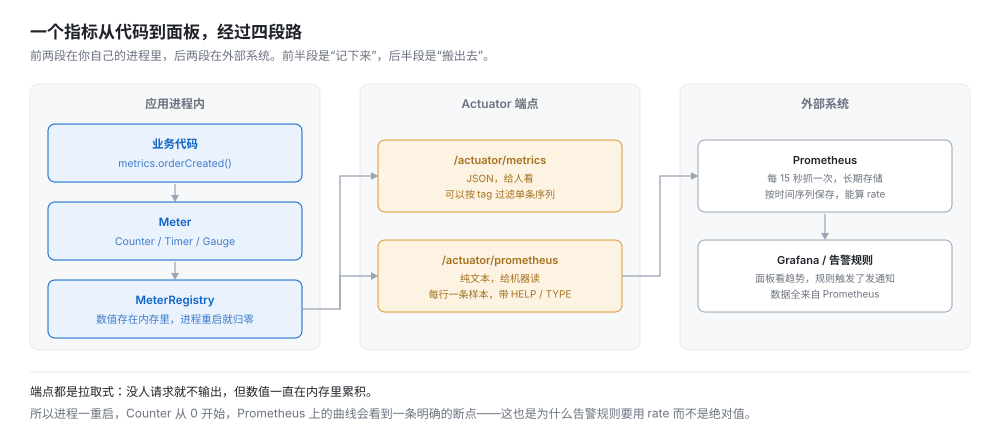
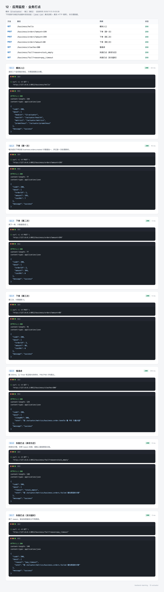
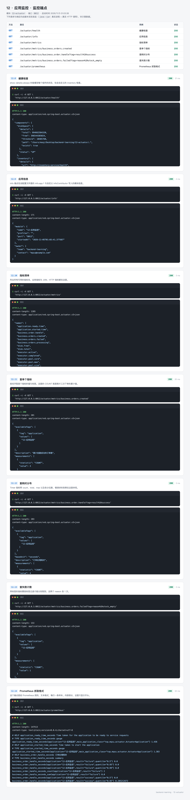

# 12 · 应用监控 —— 上线之后靠什么知道它还好不好

本地跑的时候，出问题看控制台就行。上线之后控制台没人看，日志要主动去搜，用户报障时你只知道"打不开"。

监控要解决的是三个具体问题：**它现在能不能接流量、它刚才出了多少错、它慢在哪一步**。这三个问题分别对应健康检查、计数器、耗时分布。

`12-actuator` 一共 6 个 Java 文件，业务代码只是陪衬——那三个接口存在的意义是产生指标。重点在于：指标怎么定义、健康检查怎么判断、导出的名字为什么和代码里写的不一样。

---

## 0. 先看结果

```bash
mvn -pl 12-actuator spring-boot:run
```

应用起来之后，先看健康检查：

```bash
curl "http://127.0.0.1:8012/actuator/health"
```

```json
{
  "status": "UP",
  "components": {
    "diskSpace": { "status": "UP", "details": { "total": 994662584320, "free": 396582363136, "threshold": 10485760 } },
    "inventory": {
      "status": "UP",
      "details": { "url": "http://inventory-service/health", "latencyMs": 0, "checkedAt": 1793811379607 }
    },
    "livenessState": { "status": "UP" },
    "ping": { "status": "UP" },
    "readinessState": { "status": "UP" },
    "ssl": { "status": "UP" }
  }
}
```

`inventory` 那一项是自己加的，其余是内置的。这一份 JSON 能回答"这个实例现在能不能接流量"，而且能说清是哪一环出了问题。

再看指标：

```bash
curl "http://127.0.0.1:8012/actuator/metrics/business.orders.created"
```

```json
{
  "name": "business.orders.created",
  "description": "累计创建成功的订单数",
  "measurements": [{ "statistic": "COUNT", "value": 3 }],
  "availableTags": [{ "tag": "application", "values": ["12-应用监控"] }]
}
```

最后是给机器读的格式：

```bash
curl "http://127.0.0.1:8012/actuator/prometheus" | grep business_orders
```

```
# HELP business_orders_total 累计创建成功的订单数
# TYPE business_orders_total counter
business_orders_total{application="12-应用监控"} 3.0
# HELP business_orders_failed_total
# TYPE business_orders_failed_total counter
business_orders_failed_total{application="12-应用监控",reason="stock_empty"} 1.0
```

同一个计数器，代码里叫 `business.orders.created`，导出成了 `business_orders_total`。这里少了一个词，7.6 节会专门解释，因为按想象写 PromQL 一定会错。

三组实测对应三张截图：

| 组 | 覆盖 | 截图 |
| --- | --- | --- |
| 业务打点 | 三次下单、一次慢请求、两次失败 | `12-actuator-business.png` |
| 监控端点 | 健康检查、info、指标清单、单指标、Prometheus | `12-actuator-endpoint.png` |

### 这一节的路线

| 步骤 | 内容 | 对应小节 |
| --- | --- | --- |
| 1 | 健康检查与指标各回答什么问题 | 1 |
| 2 | 确认环境 | 2 |
| 3 | 建模块，看清两个依赖 | 3 |
| 4 | 配暴露范围、详情、全局标签 | 4 |
| 5 | 写四种仪表、健康检查、info | 5 |
| 6 | 跑起来，看 UP 与 DOWN、看指标变化 | 6 |
| 7 | 15 个测试，把指标行为钉住 | 7 |
| 8 | 接 Prometheus，写三条 PromQL | 8 |

---

## 1. 健康检查与指标各回答什么问题

### 1.1 一个指标要走四段路



前两段在你自己的进程里：调用打点方法，数值记在 `MeterRegistry` 的内存里。后两段在外部系统：端点把内存里的值导出来，Prometheus 定期抓走。

这张图能解释几个一开始想不通的现象：

- **为什么重启后计数从 0 开始？** 因为数值只存在内存里，没有持久化。Prometheus 那边的曲线会看到一个明确的断点，这也是告警规则要用 `rate` 而不是绝对值的原因。
- **为什么没人访问就"没有数据"？** 端点是拉取式的。但数值一直在累积，只是没人来读。
- **为什么改完指标名，Grafana 面板就空了？** 因为名字是导出时计算的，代码里的名字和导出后的名字不是一回事。

### 1.2 健康检查回答"能不能接流量"

`/actuator/health` 是给**调度方**看的，不是给人看的。Kubernetes 的 liveness / readiness 探针、Nginx 的 upstream 检查、负载均衡的健康探测，全都读这个端点。

判断依据只有一个：HTTP 状态码。

| 整体状态 | HTTP | 谁会因此做事 |
| --- | --- | --- |
| `UP` | 200 | 继续往这个实例转发流量 |
| `DOWN` | 503 | 把它从转发列表里摘掉，或者重启它 |
| `OUT_OF_SERVICE` | 503 | 主动摘流量，但不重启 |

这一点很多人第一次碰到会困惑：健康检查失败时返回的是 **503**，不是 200 加一个 `status: DOWN` 的 body。实测确认过，8.2 节有输出。

响应体里的 `components` 是给人排查用的。看到 `inventory` 是 DOWN，就知道是下游库存服务不通，而不是自己的数据库出了问题。

### 1.3 指标回答"出了什么问题"

一次故障的排查顺序通常是：先看有没有报错、再看是不是变慢、最后定位到哪个环节。

指标按这三件事分成三类：

| 想知道 | 用哪种仪表 | 本模块的指标 |
| --- | --- | --- |
| 出了多少次错 | Counter（只增不减） | `business.orders.failed` |
| 处理了多少单 | Counter | `business.orders.created` |
| 慢不慢，慢在哪 | Timer（耗时分布） | `business.order.handle` |
| 现在有多少在排队 | Gauge（瞬时值） | `business.orders.processing` |

Counter 和 Gauge 的区别容易被忽略：Counter 适合算"速率"（每秒多少次），Gauge 适合看"当前水位"（现在有几个线程在跑）。用 Counter 表示"当前数量"是错的，因为它不能减。

### 1.4 这三种仪表在 Micrometer 里对应什么

Micrometer 是 Spring Boot 用的指标门面，它把不同监控系统的概念统一了：

| Micrometer | Prometheus 里是什么 | 数据长什么样 |
| --- | --- | --- |
| `Counter` | counter | `xxx_total` 一条累加值 |
| `Gauge` | gauge | 一条瞬时值 |
| `Timer` | summary 或 histogram | 取决于怎么配 |
| `DistributionSummary` | summary 或 histogram | 记录数值分布，不限于时间 |

Timer 导出成 summary 还是 histogram，是本篇最值得弄清的一件事，7.6 节用实测数据对比。

---

## 2. 准备环境

### 2.1 版本

```bash
java -version
```

```
openjdk version "21.0.12.1" 2026-08-18 LTS
```

```bash
mvn -v
```

```
Apache Maven 3.9.11 (3e54c93a704957b63ee3494413a2b544fd3d825b)
```

Spring Boot 4.1.1，Micrometer 1.17.1，Prometheus 客户端 1.7.0。这三个版本都由父 POM 管，不用自己写。

### 2.2 需要一个能发请求的工具

`curl` 就够。健康检查与 info 是 GET，业务打点里下单是 POST，Postman 或 IDEA 的 HTTP Client 也行。

### 2.3 不用装 Prometheus

这一节只讲到"应用把指标导出成什么格式"。装 Prometheus 与 Grafana 是 8.1 节的事，跑通本模块不需要它们。

---

## 3. 创建模块

### 3.1 目录结构

```
12-actuator
├── pom.xml
└── src
    ├── main
    │   ├── java/top/mqxu/actuator
    │   │   ├── ActuatorApplication.java
    │   │   ├── common/Result.java
    │   │   ├── controller/BusinessController.java
    │   │   ├── health/InventoryHealthIndicator.java
    │   │   ├── info/AppInfoContributor.java
    │   │   └── metrics/BusinessMetrics.java
    │   └── resources/application.yml
    └── test/java/top/mqxu/actuator
        ├── ActuatorEndpointTest.java          7 个用例，端点层
        ├── health/InventoryHealthIndicatorTest.java   2 个用例
        ├── info/AppInfoContributorTest.java           1 个用例
        └── metrics/BusinessMetricsTest.java           5 个用例
```

主代码 6 个类。`BusinessMetrics` 是核心，其余都是围绕它产生的指标做展示。

### 3.2 POM

```xml
<?xml version="1.0" encoding="UTF-8"?>
<project xmlns="http://maven.apache.org/POM/4.0.0"
         xmlns:xsi="http://www.w3.org/2001/XMLSchema-instance"
         xsi:schemaLocation="http://maven.apache.org/POM/4.0.0 http://maven.apache.org/xsd/maven-4.0.0.xsd">
    <modelVersion>4.0.0</modelVersion>
    <parent>
        <groupId>top.mqxu</groupId>
        <artifactId>backend-learning</artifactId>
        <version>0.0.1-SNAPSHOT</version>
    </parent>

    <artifactId>12-actuator</artifactId>

    <dependencies>
        <!-- 健康检查、指标、端点 -->
        <dependency>
            <groupId>org.springframework.boot</groupId>
            <artifactId>spring-boot-starter-actuator</artifactId>
        </dependency>

        <!-- 把指标导出成 Prometheus 能抓取的文本格式，版本由父 POM 管理 -->
        <dependency>
            <groupId>io.micrometer</groupId>
            <artifactId>micrometer-registry-prometheus</artifactId>
        </dependency>

        <!-- JUnit 5 + AssertJ + MockMvc，用来测指标与端点 -->
        <dependency>
            <groupId>org.springframework.boot</groupId>
            <artifactId>spring-boot-starter-test</artifactId>
            <scope>test</scope>
        </dependency>
    </dependencies>
</project>
```

### 3.3 两个依赖的分工

`spring-boot-starter-actuator` 提供三样东西：端点（`/actuator/*`）、健康检查的判定逻辑、Micrometer 的自动配置。

`micrometer-registry-prometheus` 是**导出器**。Actuator 只负责把指标记在内存里，导出成什么格式取决于注册表实现：

| 注册表实现 | 谁引的 | 输出 |
| --- | --- | --- |
| `SimpleMeterRegistry` | Actuator 自带 | 没有 HTTP 输出，只能代码里读 |
| `PrometheusMeterRegistry` | 本模块的第二个依赖 | `/actuator/prometheus` 的文本 |

不引第二个依赖，`/actuator/metrics` 照样能用，但 `/actuator/prometheus` 会 404。这是排错时第一个要看的。

### 3.4 第一次编译

```bash
mvn -pl 12-actuator -q compile
```

没有输出就是成功。

---

## 4. 配置

`application.yml` 全文：

```yaml
server:
  port: 8012

spring:
  application:
    name: 12-应用监控

# Actuator 的配置全在 management 下
management:
  endpoints:
    web:
      exposure:
        # 默认只暴露 health，其余要显式开；生产上按需开，别用 "*"
        include: health,info,metrics,prometheus
      base-path: /actuator
  endpoint:
    health:
      # always 才会显示各组件详情，默认只在未认证时显示 UP/DOWN
      show-details: always
      show-components: always
    metrics:
      enabled: true
  metrics:
    tags:
      # 给所有指标打上应用名，多个服务共用一个 Prometheus 时靠它区分
      application: ${spring.application.name}
    distribution:
      percentiles-histogram:
        # 打开直方图，Prometheus 才能算 P95 / P99
        http.server.requests: true

# /actuator/info 显示的内容，键名随意，结构会原样输出
info:
  app:
    name: backend-learning
    module: 12-actuator
    version: 1.0.0
    description: 健康检查、指标采集与 Prometheus 对接示例
```

### 4.1 `exposure.include` 是最容易漏的一行

Actuator 有二十多个端点，默认只通过 HTTP 暴露 `health` 一个。这是刻意的设计——`/actuator/env` 能读出全部配置，`/actuator/heapdump` 能导出整个堆内存，`/actuator/shutdown` 能关掉应用。任何一个暴露在公网都是事故。

所以要用哪个就写哪个。这一行没配，访问任何端点都是 404，且报错信息只说"not found"，不会提示"你没开这个端点"。

想看全部端点有哪些（只在本地或者开了认证的环境里做）：

```bash
curl "http://127.0.0.1:8012/actuator" | python3 -m json.tool
```

生产上常见的做法是用 `exclude` 反向排除，或者干脆用 `include: health` 只留健康检查，指标走独立的端口：

```yaml
management:
  server:
    port: 8013     # 管理端点单独一个端口，只在容器网络里可达
```

### 4.2 两个 `show-*` 不是重复

```yaml
  endpoint:
    health:
      show-details: always
      show-components: always
```

它们控制的是响应里两层不同的东西：

| 配置 | 控制什么 | 关掉之后 |
| --- | --- | --- |
| `show-components` | `components` 这个字段本身 | 只剩 `{"status":"UP"}` |
| `show-details` | 每个组件里的 `details` | 保留 components 与各自状态，但没有 `url`、`latencyMs` 这些细节 |

默认值都是 `never`（未认证时），所以不配的话只能看到整体的 UP/DOWN。对外暴露的健康检查应该保持默认——`details` 里可能带数据库地址、磁盘路径，泄露的是基础设施信息。要看细节就开在管理端口上，用内网访问。

### 4.3 全局标签 `application`

```yaml
  metrics:
    tags:
      application: ${spring.application.name}
```

给所有指标加一个 `application` 标签。一个 Prometheus 抓十个服务时，`sum(rate(business_orders_total[5m]))` 会跨服务加总，加上 `by (application)` 才分得清是谁。

实测生成的样本长这样：

```
business_orders_total{application="12-应用监控"} 3.0
```

注意标签值是中文的应用名。Prometheus 允许标签值用 UTF-8，但 Grafana 的图例、告警模板里显示中文会有编码问题。生产上更稳的写法是英文的服务名，中文只放在显示层。

### 4.4 `percentiles-histogram` 只对 `http.server.requests` 生效

```yaml
    distribution:
      percentiles-histogram:
        http.server.requests: true
```

这一行让 Spring MVC 的请求耗时以直方图形式导出，Prometheus 里会出现 `http_server_requests_seconds_bucket` 序列，能用 `histogram_quantile` 算任意分位数。

它**只管 `http.server.requests`**，不管你自己定义的 Timer。业务 Timer 想走直方图，要在代码里调 `publishPercentileHistogram()`，7.6 节讲。

实测数据：这一个开关让 Prometheus 输出里多了 **621 行** `_bucket` 样本。为什么这么多——`http.server.requests` 本身带 `uri`、`method`、`status`、`outcome`、`exception` 五个标签，每个组合又乘上十几个 `le` 桶。上线前最好先算一下序列数量，不然 Prometheus 的内存会被吃掉。

---

## 5. 写代码

### 5.1 四种仪表怎么定义

```java
package top.mqxu.actuator.metrics;

import io.micrometer.core.instrument.Counter;
import io.micrometer.core.instrument.MeterRegistry;
import io.micrometer.core.instrument.Timer;
import org.springframework.stereotype.Component;

import java.time.Duration;
import java.util.concurrent.atomic.AtomicInteger;

@Component
public class BusinessMetrics {

    private final MeterRegistry registry;

    /** 下单成功次数 */
    private final Counter ordersCreated;

    /** 当前处理中的订单数，Gauge 每次抓取时读它的当前值 */
    private final AtomicInteger processing = new AtomicInteger();

    public BusinessMetrics(MeterRegistry registry) {
        this.registry = registry;
        this.ordersCreated = Counter.builder("business.orders.created")
                .description("累计创建成功的订单数")
                .register(registry);
        registry.gauge("business.orders.processing", processing);
    }

    public void orderCreated() {
        ordersCreated.increment();
    }

    public void orderFailed(String reason) {
        registry.counter("business.orders.failed", "reason", reason).increment();
    }

    public void recordHandle(long millis, String result) {
        Timer.builder("business.order.handle")
                .description("订单处理耗时")
                .tag("result", result)
                .publishPercentiles(0.5, 0.95, 0.99)
                .register(registry)
                .record(Duration.ofMillis(millis));
    }

    public void enter() {
        processing.incrementAndGet();
    }

    public void leave() {
        processing.decrementAndGet();
    }
}
```

四种仪表，四种建法：

| 仪表 | 建法 | 特点 |
| --- | --- | --- |
| Counter | `Counter.builder(...).register(registry)`，存成字段 | 复用同一个实例，避免每次查注册表 |
| Counter（带标签） | `registry.counter(name, "reason", reason)` | 每次调用现查，标签值变了就是新序列 |
| Gauge | `registry.gauge(name, atomicInteger)` | 绑定一个原子对象，抓取时读它的当前值 |
| Timer | `Timer.builder(...).register(registry).record(...)` | 建完立即记录一次 |

**Gauge 的写法最容易出错。** 常见的错误写法是 `registry.gauge("xxx", 0)`——传一个数字进去，得到的是一个固定值 0，之后怎么改都不变。正确做法是传一个**对象引用**，Micrometer 每次抓取时回调它的 `value()`：

```java
AtomicInteger processing = new AtomicInteger();
registry.gauge("business.orders.processing", processing);
```

这样 `enter()` 里 `incrementAndGet()` 之后，下一次抓取读到的是新值。

**Counter 带标签的那条**，每次调用都 `registry.counter(...)`，看起来像每次都新建。实际上 Micrometer 按 `name + tags` 查注册表，同组合返回同一个实例，只是省了字段。测了一下，一万次调用只产生一个 Meter。

**Timer 每次都 builder 也同理**：`result=success` 和 `result=failure` 是两个 Meter，各自独立统计。

`publishPercentiles(0.5, 0.95, 0.99)` 让 Timer 在应用侧算分位数。这个选择有代价，7.6 节展开。

### 5.2 自定义健康检查

```java
package top.mqxu.actuator.health;

import lombok.extern.slf4j.Slf4j;
import org.springframework.beans.factory.annotation.Value;
import org.springframework.boot.health.contributor.Health;
import org.springframework.boot.health.contributor.HealthIndicator;
import org.springframework.stereotype.Component;

import java.util.concurrent.ThreadLocalRandom;

@Slf4j
@Component("inventory")
public class InventoryHealthIndicator implements HealthIndicator {

    @Value("${demo.inventory.healthy:true}")
    private boolean healthy;

    @Value("${demo.inventory.url:http://inventory-service/health}")
    private String url;

    @Override
    public Health health() {
        long start = System.currentTimeMillis();
        if (!healthy) {
            return Health.down()
                    .withDetail("url", url)
                    .withDetail("reason", "连接超时")
                    .build();
        }
        long cost = System.currentTimeMillis() - start;
        return Health.up()
                .withDetail("url", url)
                .withDetail("latencyMs", cost)
                .withDetail("checkedAt", System.currentTimeMillis())
                .build();
    }
}
```

三个要点：

**Bean 名字就是组件名。** `@Component("inventory")` 决定了响应里叫 `inventory`。不写名字的话，默认是 `inventoryHealthIndicator`，会变成一个很长的键。

**Boot 4 换了包。** `Health` 与 `HealthIndicator` 都在 `org.springframework.boot.health.contributor` 下。Boot 3 的 `org.springframework.boot.actuate.health` 在 4 里没有了，照旧教程写会编译失败。

**`withDetail` 是给排查用的。** 只报 UP/DOWN 能知道"出问题了"，但不知道"哪一环"。带上 `url` 和 `latencyMs`，看健康检查的人能直接判断是下游慢还是网络不通。

一个需要提前想清楚的问题：健康检查里**要不要真的去调下游**。真调最准确，但如果下游超时 30 秒，你的健康检查也要卡 30 秒，探针会先超时。这里的实现是假的（直接返回），真实项目里要么设短超时（1 到 2 秒），要么用最近一次调用的结果做缓存，别让健康检查变成一个阻塞点。

### 5.3 InfoContributor

```java
package top.mqxu.actuator.info;

import lombok.RequiredArgsConstructor;
import org.springframework.boot.actuate.info.Info;
import org.springframework.boot.actuate.info.InfoContributor;
import org.springframework.core.env.Environment;
import org.springframework.stereotype.Component;

import java.time.LocalDateTime;
import java.util.LinkedHashMap;
import java.util.Map;

@Component
@RequiredArgsConstructor
public class AppInfoContributor implements InfoContributor {

    private final Environment environment;

    @Override
    public void contribute(Info.Builder builder) {
        Map<String, Object> module = new LinkedHashMap<>();
        module.put("name", environment.getProperty("spring.application.name", "unknown"));
        module.put("profiles", String.join(",", environment.getActiveProfiles()));
        module.put("port", environment.getProperty("server.port"));
        module.put("startedAt", LocalDateTime.now().toString());

        Map<String, Object> owner = new LinkedHashMap<>();
        owner.put("team", "backend-learning");
        owner.put("contact", "mqxu@example.com");

        builder.withDetail("module", module).withDetail("owner", owner);
    }
}
```

`/actuator/info` 拼的是两部分：`application.yml` 里 `info:` 段的静态内容，加上所有 `InfoContributor` 动态写进去的内容。

用途很直接：线上有五个实例，想知道某个 IP 跑的是哪个版本、哪个 profile、什么时候启动的，curl 一下比登服务器查进程快得多。加上 `spring-boot-maven-plugin` 的 `build-info` 目标，还能自动带进 Git 提交号和构建时间。

这里用 `LocalDateTime.now()` 有两个问题，属于简化处理的代价：

- 它是**每次请求时**算的，不是启动时间。同一台机器 curl 两次，`startedAt` 会不一样。
- 没有时区信息，跨时区部署时读的人要靠猜。

要看真实的启动时间，用 `ManagementFactory.getRuntimeMXBean().getStartTime()`，或者直接读内置的 `process.start.time` 指标。

### 5.4 产生指标的接口

```java
package top.mqxu.actuator.controller;

import lombok.RequiredArgsConstructor;
import lombok.extern.slf4j.Slf4j;
import org.springframework.web.bind.annotation.GetMapping;
import org.springframework.web.bind.annotation.PostMapping;
import org.springframework.web.bind.annotation.RequestMapping;
import org.springframework.web.bind.annotation.RequestParam;
import org.springframework.web.bind.annotation.RestController;
import top.mqxu.actuator.common.Result;
import top.mqxu.actuator.metrics.BusinessMetrics;

import java.util.LinkedHashMap;
import java.util.Map;
import java.util.concurrent.atomic.AtomicLong;

@Slf4j
@RestController
@RequestMapping("/business")
@RequiredArgsConstructor
public class BusinessController {

    private final BusinessMetrics metrics;

    private final AtomicLong idGenerator = new AtomicLong();

    @PostMapping("/orders")
    public Result<Map<String, Object>> create(@RequestParam(defaultValue = "100") long amount) {
        long start = System.currentTimeMillis();
        metrics.enter();
        try {
            long id = idGenerator.incrementAndGet();
            metrics.orderCreated();
            metrics.recordHandle(System.currentTimeMillis() - start, "success");

            Map<String, Object> data = new LinkedHashMap<>();
            data.put("orderId", id);
            data.put("amount", amount);
            data.put("costMs", System.currentTimeMillis() - start);
            return Result.ok(data);
        } finally {
            metrics.leave();
        }
    }

    @GetMapping("/slow")
    public Result<Map<String, Object>> slow(@RequestParam(defaultValue = "200") long ms) throws InterruptedException {
        long start = System.currentTimeMillis();
        Thread.sleep(ms);
        metrics.recordHandle(System.currentTimeMillis() - start, "success");

        Map<String, Object> data = new LinkedHashMap<>();
        data.put("sleepMs", ms);
        data.put("note", "到 /actuator/metrics/business.order.handle 看 P95 与最大值");
        return Result.ok(data);
    }

    @GetMapping("/fail")
    public Result<Map<String, Object>> fail(@RequestParam(defaultValue = "stock_empty") String reason) {
        long start = System.currentTimeMillis();
        metrics.orderFailed(reason);
        metrics.recordHandle(System.currentTimeMillis() - start, "failure");
        log.warn("模拟下单失败，原因：{}", reason);

        Map<String, Object> data = new LinkedHashMap<>();
        data.put("reason", reason);
        data.put("note", "到 /actuator/metrics/business.orders.failed 看各原因的计数");
        return Result.ok(data);
    }

    @GetMapping("/hello")
    public Result<Map<String, Object>> hello() {
        Map<String, Object> data = new LinkedHashMap<>();
        data.put("module", "12-actuator");
        data.put("health", "/actuator/health");
        data.put("metrics", "/actuator/metrics");
        data.put("prometheus", "/actuator/prometheus");
        return Result.ok(data);
    }
}
```

`enter()` / `leave()` 包在 `try` / `finally` 里。如果放在 `try` 之外，方法抛异常时 `leave` 不执行，Gauge 会一直往上加，永远不回落——这种"只增不减的 Gauge"在监控上看就是一条只升不降的线，比没有指标更误导人。

`recordHandle` 在 `finally` 外面、业务逻辑里面，所以异常路径不会记录耗时。想记录失败耗时，要挪到 `finally` 里，并把 `result` 参数按成功失败分开传。

`slow` 接口里 `Thread.sleep(ms)` 是故意拖慢，让 Timer 有足够大的样本撑起 P95。真实场景里对应的是慢 SQL、慢下游调用。

---

## 6. 运行与实测

### 6.1 打点

```bash
mvn -pl 12-actuator spring-boot:run
```

按顺序发七个请求：

```bash
# 三次下单
curl -X POST "http://127.0.0.1:8012/business/orders?amount=199"
curl -X POST "http://127.0.0.1:8012/business/orders?amount=399"
curl -X POST "http://127.0.0.1:8012/business/orders?amount=88"

# 一次 300ms 慢请求
curl "http://127.0.0.1:8012/business/slow?ms=300"

# 两次不同原因的失败
curl "http://127.0.0.1:8012/business/fail?reason=stock_empty"
curl "http://127.0.0.1:8012/business/fail?reason=pay_timeout"
```



返回体里的 `costMs` 是第一单 7 毫秒、后面两单 0 毫秒——第一次请求包含了 JIT 预热和连接初始化的开销。这个数字不影响指标，只是说明为什么"第一次总是慢"。

### 6.2 健康检查：UP 与 503

这一组端点对应下面这张实测截图，包含健康检查、info、指标清单、单个指标与 Prometheus 输出：



正常启动时 `UP`，HTTP 200。想看到 DOWN，用命令行参数覆盖配置：

```bash
mvn -pl 12-actuator spring-boot:run \
  -Dspring-boot.run.arguments="--demo.inventory.healthy=false"
```

```bash
curl -i "http://127.0.0.1:8012/actuator/health"
```

```
HTTP/1.1 503
Content-Type: application/vnd.spring-boot.actuator.v3+json

{"status":"DOWN","components":{"inventory":{"status":"DOWN","details":{"url":"http://inventory-service/health","reason":"连接超时"}},...}}
```

三个细节：

- 状态码变成 503，不是 200。调度方靠这个判断。
- 整体 `status` 是 DOWN，因为有一个组件挂了。健康检查的聚合规则是"最差的那个决定整体"。
- `inventory` 里带着 `reason`，直接说明了原因。

`--demo.inventory.healthy=false` 这种写法只在演示时用。生产上这个值应该来自配置中心或者环境变量，不要写死。

### 6.3 info

```bash
curl "http://127.0.0.1:8012/actuator/info"
```

```json
{
  "module": {
    "name": "12-应用监控",
    "profiles": "",
    "port": "8012",
    "startedAt": "2026-11-05T00:56:19.623215"
  },
  "owner": {
    "team": "backend-learning",
    "contact": "mqxu@example.com"
  }
}
```

`profiles` 是空字符串，因为启动时没指定 profile。这个字段在排查"为什么这个实例读到了测试库"时特别有用。

`application.yml` 里 `info.app` 那段没有出现在响应里——因为 `info` 端点默认只显示 `InfoContributor` 贡献的内容，`info.*` 静态属性需要显式开：

```yaml
management:
  info:
    env:
      enabled: true
```

开了之后会多出这一段（实测）：

```json
"app": {
  "name": "backend-learning",
  "module": "12-actuator",
  "version": "1.0.0",
  "description": "健康检查、指标采集与 Prometheus 对接示例"
}
```

这一点容易踩：配了 `info:` 却看不到，以为是格式问题，其实是开关没开。

### 6.4 指标清单与单个指标

```bash
curl "http://127.0.0.1:8012/actuator/metrics"
```

```json
{
  "names": [
    "application.ready.time",
    "application.started.time",
    "business.order.handle",
    "business.orders.created",
    "business.orders.failed",
    "business.orders.processing",
    "disk.free",
    "disk.total",
    "executor.active",
    "...",
    "jvm.memory.used",
    "jvm.threads.live",
    "process.cpu.usage",
    "system.cpu.usage"
  ]
}
```

一共 57 个。绝大多数是免费的：JVM 内存与线程、CPU、磁盘、日志事件数、HTTP 请求耗时。这些不需要写一行代码。

这个数字随环境变化（有没有 SSL、有没有数据源、跑了多久都会影响），不用对死。

按名字查单个：

```bash
curl "http://127.0.0.1:8012/actuator/metrics/business.orders.created"
```

```json
{
  "name": "business.orders.created",
  "description": "累计创建成功的订单数",
  "measurements": [{ "statistic": "COUNT", "value": 3 }],
  "availableTags": [{ "tag": "application", "values": ["12-应用监控"] }]
}
```

`value: 3` 和三次下单对得上。`availableTags` 列出这个指标有哪些标签、各有哪些值——这是查指标时最有用的字段，能知道有哪些维度可以过滤。

### 6.5 一个 Timer，三条序列

Timer 加了 `result` 标签，一个指标名下就有多条序列。三种查法看到的东西完全不同。

不带 `tag`：

```bash
curl "http://127.0.0.1:8012/actuator/metrics/business.order.handle"
```

```json
{
  "availableTags": [
    { "tag": "result", "values": ["failure", "success"] },
    { "tag": "application", "values": ["12-应用监控"] }
  ],
  "measurements": [
    { "statistic": "COUNT", "value": 6.0 },
    { "statistic": "TOTAL_TIME", "value": 0.305 },
    { "statistic": "MAX", "value": 0.305 }
  ]
}
```

`COUNT 6` 是 success 的 4 次加 failure 的 2 次。

带 `tag=result:success`：

```json
{
  "availableTags": [{ "tag": "application", "values": ["12-应用监控"] }],
  "measurements": [
    { "statistic": "COUNT", "value": 4 },
    { "statistic": "TOTAL_TIME", "value": 0.301 },
    { "statistic": "MAX", "value": 0.301 }
  ]
}
```

`COUNT 4` 是三次下单加一次慢请求。注意 `availableTags` 里 **`result` 不见了**——用了某个标签过滤之后，它就不再出现在可选值列表里。这不是 bug，是"已经过滤掉的维度不再列出来"。第一次看到会以为标签丢了。

带 `tag=result:failure`：

```json
{
  "measurements": [
    { "statistic": "COUNT", "value": 2.0 },
    { "statistic": "TOTAL_TIME", "value": 0.0 },
    { "statistic": "MAX", "value": 0.0 }
  ]
}
```

两次失败，总耗时 0。

### 6.6 Prometheus 输出与名字转换

```bash
curl "http://127.0.0.1:8012/actuator/prometheus" | grep -E "^# |^business"
```

```
# HELP business_order_handle_seconds 订单处理耗时
# TYPE business_order_handle_seconds summary
business_order_handle_seconds{application="12-应用监控",result="failure",quantile="0.5"} 0.0
business_order_handle_seconds{application="12-应用监控",result="failure",quantile="0.95"} 0.0
business_order_handle_seconds{application="12-应用监控",result="failure",quantile="0.99"} 0.0
business_order_handle_seconds_count{application="12-应用监控",result="failure"} 2
business_order_handle_seconds_sum{application="12-应用监控",result="failure"} 0.0
business_order_handle_seconds{application="12-应用监控",result="success",quantile="0.5"} 0.0
business_order_handle_seconds{application="12-应用监控",result="success",quantile="0.95"} 0.0
business_order_handle_seconds_count{application="12-应用监控",result="success"} 4
business_order_handle_seconds_sum{application="12-应用监控",result="success"} 0.305
# HELP business_order_handle_seconds_max 订单处理耗时
# TYPE business_order_handle_seconds_max gauge
business_order_handle_seconds_max{application="12-应用监控",result="failure"} 0.0
business_order_handle_seconds_max{application="12-应用监控",result="success"} 0.305
# HELP business_orders_total 累计创建成功的订单数
# TYPE business_orders_total counter
business_orders_total{application="12-应用监控"} 3.0
# HELP business_orders_failed_total
# TYPE business_orders_failed_total counter
business_orders_failed_total{application="12-应用监控",reason="pay_timeout"} 1.0
business_orders_failed_total{application="12-应用监控",reason="stock_empty"} 1.0
# HELP business_orders_processing
# TYPE business_orders_processing gauge
business_orders_processing{application="12-应用监控"} 0.0
```

四个现象，每个都会让人查半天。

**第一，点号变成下划线。** `business.orders.created` → `business_orders_created`。Prometheus 的指标名只允许字母、数字、下划线，Micrometer 自动转换。

**第二，计数器多出 `_total`，但 `created` 不见了。** 代码里叫 `business.orders.created`，导出成了 `business_orders_total`；而 `business.orders.failed` 导出成了 `business_orders_failed_total`，`failed` 保留着。

差别在 `created` 这个词。Prometheus 的数据模型里 `_created` 是保留后缀（表示"这个序列的创建时间戳"），客户端在做名字规范化时会把它去掉，然后再由 counter 类型追加 `_total`。所以 `business_orders_created` 变成了 `business_orders_total`。

这个行为不是文档里明写的，是实测发现的。防范办法很简单：**写完指标名，先去 `/actuator/prometheus` 里 `grep` 一下，按实际输出写 PromQL**。凭代码里的名字去猜，十个有八个猜错。

**第三，Timer 导出成了 summary，不是 histogram。** 因为代码里用的是 `publishPercentiles(...)`。summary 的分位数是：

```
business_order_handle_seconds{quantile="0.95"} 0.301989888
```

而 histogram 的分位数要用 `histogram_quantile` 在 Prometheus 侧算，序列名是 `xxx_bucket`，带 `le` 标签。两者不通用：对 summary 用 `histogram_quantile` 会返回 NaN，对 histogram 用 `quantile="0.95"` 会查不到。

本模块里 `http.server.requests` 配了 `percentiles-histogram: true`，所以它是 histogram（实测 621 行 `_bucket` 样本）。同一个应用里两种类型并存，写 PromQL 时要分清。

**第四，分位数会"归零"，但 `_sum` 不会。** 上面这段输出里，`result="success"` 的 `quantile="0.95"` 是 0.0，但 `_sum` 是 0.305——300 毫秒那次慢请求明明记录过。

原因是 Micrometer 的百分位用的是**环形缓冲区**：默认 3 个桶、每个桶 20 秒，滚动窗口总共 1 分钟。那次慢请求在 1 分钟前，已经滚出窗口，所以分位数重新回到当前窗口的样本——四次调用里三次是 0 毫秒、一次是刚才的慢请求，P95 落不到慢的那个上。

`_count` 和 `_sum` 是累计值，不滚动，所以还在。

这意味着：**summary 的 quantile 只反映最近一分钟，`_count` / `_sum` 反映全生命周期**。看板上的 P95 曲线会随时间来回跳，不是数据坏了。

### 6.7 `processing` 永远是 0

`business.orders.processing` 的值是 0.0，尽管刚下过单。

不是没记上，是抓得太晚。`enter()` 和 `leave()` 之间只隔了几微秒，等你 curl `/actuator/prometheus` 的时候请求早就结束了。

Gauge 只有在"被抓取的那一刻"读当前值。想看它变化，得有并发或者休眠：并发发 100 个 `slow` 请求，同时在另一个终端反复查，才能看到非零值。

这类"太快看不到"的 Gauge 在实践中意义有限。真正有用的是队列长度、连接池占用这种会持续存在的量。

---

## 7. 写测试

指标和端点都能测，而且值得测：改一个指标名忘了改看板、打点方法忘了在 Controller 里调，这些都不报错，只是面板上少一条线。

### 7.1 `SimpleMeterRegistry` 测打点

```java
package top.mqxu.actuator.metrics;

import io.micrometer.core.instrument.Counter;
import io.micrometer.core.instrument.Gauge;
import io.micrometer.core.instrument.Timer;
import io.micrometer.core.instrument.simple.SimpleMeterRegistry;
import org.junit.jupiter.api.BeforeEach;
import org.junit.jupiter.api.DisplayName;
import org.junit.jupiter.api.Test;

import java.util.concurrent.TimeUnit;

import static org.assertj.core.api.Assertions.assertThat;

@DisplayName("业务指标")
class BusinessMetricsTest {

    private SimpleMeterRegistry registry;

    private BusinessMetrics metrics;

    @BeforeEach
    void setUp() {
        registry = new SimpleMeterRegistry();
        metrics = new BusinessMetrics(registry);
    }

    @Test
    @DisplayName("下单计数每次加一")
    void counterIncrements() {
        metrics.orderCreated();
        metrics.orderCreated();

        Counter counter = registry.get("business.orders.created").counter();
        assertThat(counter.count()).isEqualTo(2.0);
    }

    @Test
    @DisplayName("失败计数按 reason 分成独立序列")
    void failedCounterTaggedByReason() {
        metrics.orderFailed("stock_empty");
        metrics.orderFailed("stock_empty");
        metrics.orderFailed("pay_timeout");

        assertThat(registry.get("business.orders.failed").tag("reason", "stock_empty").counter().count())
                .isEqualTo(2.0);
        assertThat(registry.get("business.orders.failed").tag("reason", "pay_timeout").counter().count())
                .isEqualTo(1.0);
        // 两个 reason 是两条序列，不是一条加总的
        assertThat(registry.get("business.orders.failed").counters()).hasSize(2);
    }

    @Test
    @DisplayName("耗时记录进 Timer，次数、总时长、最大值都对")
    void timerRecordsDuration() {
        metrics.recordHandle(100, "success");
        metrics.recordHandle(300, "success");

        Timer timer = registry.get("business.order.handle").tag("result", "success").timer();
        assertThat(timer.count()).isEqualTo(2);
        assertThat(timer.totalTime(TimeUnit.MILLISECONDS)).isEqualTo(400.0);
        assertThat(timer.max(TimeUnit.MILLISECONDS)).isEqualTo(300.0);
    }

    @Test
    @DisplayName("成功与失败分成两条 Timer 序列")
    void timerSplitByResult() {
        metrics.recordHandle(10, "success");
        metrics.recordHandle(20, "failure");

        assertThat(registry.get("business.order.handle").tag("result", "success").timer().count())
                .isEqualTo(1);
        assertThat(registry.get("business.order.handle").tag("result", "failure").timer().count())
                .isEqualTo(1);
    }

    @Test
    @DisplayName("处理中的订单数随 enter / leave 变化")
    void gaugeTracksProcessing() {
        Gauge gauge = registry.get("business.orders.processing").gauge();
        assertThat(gauge.value()).isZero();

        metrics.enter();
        metrics.enter();
        assertThat(gauge.value()).isEqualTo(2.0);

        metrics.leave();
        assertThat(gauge.value()).isEqualTo(1.0);
    }
}
```

`SimpleMeterRegistry` 是 Micrometer 自带的内存实现，行为和 `PrometheusMeterRegistry` 一致，只是不做文本导出。用它测打点逻辑，不用起 Spring，整套 5 个用例跑 0.13 秒。

`registry.get(name).tag(k, v)` 是按标签定位到具体那条序列。`registry.get(name).counters()` 返回该指标名下的全部序列——用来断言"确实是两条，不是一条"。

如果没有这条断言，`reason` 标签写错（比如漏了 `.tag(...)`）也测不出来：单看 `stock_empty` 那条还是 2 次，只是它和 `pay_timeout` 混成了一条。

### 7.2 健康检查的两个分支

```java
package top.mqxu.actuator.health;

import org.junit.jupiter.api.DisplayName;
import org.junit.jupiter.api.Test;
import org.springframework.boot.health.contributor.Health;
import org.springframework.boot.health.contributor.Status;
import org.springframework.test.util.ReflectionTestUtils;

import static org.assertj.core.api.Assertions.assertThat;

@DisplayName("库存健康检查")
class InventoryHealthIndicatorTest {

    private final InventoryHealthIndicator indicator = new InventoryHealthIndicator();

    @Test
    @DisplayName("依赖正常时返回 UP，并带上判断依据")
    void upWithDetails() {
        ReflectionTestUtils.setField(indicator, "healthy", true);
        ReflectionTestUtils.setField(indicator, "url", "http://inventory-service/health");

        Health health = indicator.health();

        assertThat(health.getStatus()).isEqualTo(Status.UP);
        assertThat(health.getDetails())
                .containsKeys("url", "latencyMs", "checkedAt")
                .containsEntry("url", "http://inventory-service/health");
    }

    @Test
    @DisplayName("依赖不通时返回 DOWN，并说明原因")
    void downWithReason() {
        ReflectionTestUtils.setField(indicator, "healthy", false);
        ReflectionTestUtils.setField(indicator, "url", "http://inventory-service/health");

        Health health = indicator.health();

        assertThat(health.getStatus()).isEqualTo(Status.DOWN);
        assertThat(health.getDetails()).containsEntry("reason", "连接超时");
    }
}
```

这个类的两个字段是 `@Value` 注入的，没有构造器。要测两个分支，只能设字段。三条路：

| 做法 | 代价 |
| --- | --- |
| `ReflectionTestUtils.setField` | 一行，但字段名改了就编译不过运行才报错 |
| 起 `@SpringBootTest` 加 `@TestPropertySource` | 每次都要起容器，为了两个分支不值 |
| 把字段改成构造器注入 | 代码更干净，但要改生产代码 |

这里选第一条。如果字段名改了，测试会报 `IllegalArgumentException: Could not find field`，比静默失效好。

### 7.3 InfoContributor 用 `MockEnvironment`

```java
package top.mqxu.actuator.info;

import org.junit.jupiter.api.DisplayName;
import org.junit.jupiter.api.Test;
import org.springframework.boot.actuate.info.Info;
import org.springframework.mock.env.MockEnvironment;

import java.util.Map;

import static org.assertj.core.api.Assertions.assertThat;

@DisplayName("应用信息")
class AppInfoContributorTest {

    @Test
    @DisplayName("塞进去的模块信息与负责人信息都在")
    @SuppressWarnings("unchecked")
    void contributesModuleAndOwner() {
        MockEnvironment environment = new MockEnvironment()
                .withProperty("spring.application.name", "12-应用监控")
                .withProperty("server.port", "8012");
        AppInfoContributor contributor = new AppInfoContributor(environment);

        Info.Builder builder = new Info.Builder();
        contributor.contribute(builder);
        Info info = builder.build();

        assertThat(info.getDetails()).containsKeys("module", "owner");

        Map<String, Object> module = (Map<String, Object>) info.getDetails().get("module");
        assertThat(module)
                .containsEntry("name", "12-应用监控")
                .containsEntry("port", "8012")
                .containsKey("startedAt");

        Map<String, Object> owner = (Map<String, Object>) info.getDetails().get("owner");
        assertThat(owner).containsEntry("team", "backend-learning");
    }
}
```

`MockEnvironment` 比 `Mockito.mock(Environment.class)` 好用：它有真的 `getProperty` 实现，能返回刚设进去的值，不用一个个 `when`。

`Info.Builder` 是 public 构造器，`build()` 之后 `getDetails()` 就是拼好的 Map，直接断言。

### 7.4 端点层测试

```java
package top.mqxu.actuator;

import io.micrometer.core.instrument.MeterRegistry;
import org.junit.jupiter.api.DisplayName;
import org.junit.jupiter.api.Test;
import org.springframework.beans.factory.annotation.Autowired;
import org.springframework.boot.test.context.SpringBootTest;
import org.springframework.boot.webmvc.test.autoconfigure.AutoConfigureMockMvc;
import org.springframework.test.web.servlet.MockMvc;

import static org.assertj.core.api.Assertions.assertThat;
import static org.hamcrest.Matchers.containsString;
import static org.springframework.test.web.servlet.request.MockMvcRequestBuilders.get;
import static org.springframework.test.web.servlet.request.MockMvcRequestBuilders.post;
import static org.springframework.test.web.servlet.result.MockMvcResultMatchers.content;
import static org.springframework.test.web.servlet.result.MockMvcResultMatchers.jsonPath;
import static org.springframework.test.web.servlet.result.MockMvcResultMatchers.status;

@SpringBootTest
@AutoConfigureMockMvc
@DisplayName("监控端点")
class ActuatorEndpointTest {

    @Autowired
    private MockMvc mockMvc;

    @Autowired
    private MeterRegistry registry;

    @Test
    @DisplayName("健康检查里有自定义的 inventory 组件与判断依据")
    void healthHasInventoryComponent() throws Exception {
        mockMvc.perform(get("/actuator/health"))
                .andExpect(status().isOk())
                .andExpect(jsonPath("$.status").value("UP"))
                .andExpect(jsonPath("$.components.inventory.status").value("UP"))
                .andExpect(jsonPath("$.components.inventory.details.url").exists())
                .andExpect(jsonPath("$.components.ping.status").value("UP"));
    }

    @Test
    @DisplayName("info 端点带上 InfoContributor 写的信息")
    void infoHasCustomDetails() throws Exception {
        mockMvc.perform(get("/actuator/info"))
                .andExpect(status().isOk())
                .andExpect(jsonPath("$.module.name").value("12-应用监控"))
                .andExpect(jsonPath("$.owner.team").value("backend-learning"));
    }

    @Test
    @DisplayName("打三次下单，计数器正好加三")
    void counterGrowsByThree() throws Exception {
        // 指标是容器级单例，别的用例可能已经打过点，所以断言差值而不是绝对值
        double before = registry.get("business.orders.created").counter().count();

        for (int i = 0; i < 3; i++) {
            mockMvc.perform(post("/business/orders").param("amount", "100"))
                    .andExpect(status().isOk());
        }

        double after = registry.get("business.orders.created").counter().count();
        assertThat(after - before).isEqualTo(3.0);
    }

    @Test
    @DisplayName("metrics 端点按名字能查到单个指标")
    void metricByName() throws Exception {
        mockMvc.perform(post("/business/orders")).andExpect(status().isOk());

        mockMvc.perform(get("/actuator/metrics/business.orders.created"))
                .andExpect(status().isOk())
                .andExpect(jsonPath("$.name").value("business.orders.created"))
                .andExpect(jsonPath("$.measurements[0].statistic").value("COUNT"))
                .andExpect(jsonPath("$.measurements[0].value").isNumber());
    }

    @Test
    @DisplayName("metrics 清单里能看到四个自定义指标")
    void metricListContainsBusinessMetrics() throws Exception {
        // business.orders.failed 是懒注册的：没打过一次失败点，它不会出现在清单里。
        // 这也是"指标查不到"最常见的原因——不是配置错了，是还没产生过数据。
        mockMvc.perform(get("/business/fail").param("reason", "stock_empty"))
                .andExpect(status().isOk());

        mockMvc.perform(get("/actuator/metrics"))
                .andExpect(status().isOk())
                .andExpect(jsonPath("$.names").isArray())
                .andExpect(content().string(containsString("business.orders.created")))
                .andExpect(content().string(containsString("business.order.handle")))
                .andExpect(content().string(containsString("business.orders.failed")))
                .andExpect(content().string(containsString("business.orders.processing")));
    }

    @Test
    @DisplayName("prometheus 端点输出文本格式，计数器名带 _total")
    void prometheusTextFormat() throws Exception {
        mockMvc.perform(post("/business/orders")).andExpect(status().isOk());

        mockMvc.perform(get("/actuator/prometheus"))
                .andExpect(status().isOk())
                .andExpect(content().string(containsString("# TYPE business_orders_total counter")))
                .andExpect(content().string(containsString("business_orders_total{")))
                .andExpect(content().string(containsString("# TYPE business_orders_processing gauge")));
    }

    @Test
    @DisplayName("没写进 exposure.include 的端点访问不到")
    void unexposedEndpointIs404() throws Exception {
        // env、beans、configprops 这些都能读配置和 Bean 信息，默认不暴露，这里也没开
        mockMvc.perform(get("/actuator/env"))
                .andExpect(status().isNotFound());
    }
}
```

7 个用例，跑 1.9 秒。

`counterGrowsByThree` 那一条的注释是关键：指标是容器级单例，测试类之间会互相影响。如果断言 `count == 3`，单独跑这个类能过，全量跑就挂——因为别的用例已经打过点了。断言差值才稳。

最后一条 `unexposedEndpointIs404` 测的是配置而不是代码。它防的是"某次改动把 `include` 写成了 `*`"——那种改动在 review 里很容易被当成无害的调试残留放过。

### 7.5 一个真实的失败：指标是懒注册的

`metricListContainsBusinessMetrics` 的第一版没有那行 `/business/fail` 调用，直接查清单，结果：

```
Expected: a string containing "business.orders.failed"
     but: was "{"names":["application.ready.time",...,"business.orders.created",
              "business.orders.processing",...]}"
```

清单里没有 `business.orders.failed`。

原因：`registry.counter("business.orders.failed", "reason", reason)` 是在 `orderFailed()` 里调用的，一次都没调过，这个 Meter 就从来没被创建过。而 `business.orders.created` 在构造器里就注册了，所以一直在。

指标是**懒注册**的。这一条对应的正是线上最常见的困惑："我在代码里明明写了这个指标，为什么 Prometheus 里查不到？"——因为那条分支从来没被走过。

修法就是先在测试里打一次点，再查清单。这也让测试更贴近真实：指标只有在业务真的跑到那个分支之后才存在。

### 7.6 跑一遍

```bash
mvn -pl 12-actuator test
```

```
[INFO] Tests run: 5, Failures: 0, Errors: 0, Skipped: 0, Time elapsed: 0.130 s -- in 业务指标
[INFO] Tests run: 7, Failures: 0, Errors: 0, Skipped: 0, Time elapsed: 1.929 s -- in 监控端点
[INFO] Tests run: 2, Failures: 0, Errors: 0, Skipped: 0, Time elapsed: 0.005 s -- in 库存健康检查
[INFO] Tests run: 1, Failures: 0, Errors: 0, Skipped: 0, Time elapsed: 0.002 s -- in 应用信息
[INFO] Tests run: 15, Failures: 0, Errors: 0, Skipped: 0
```

15 个用例。8 个纯单元（5 + 2 + 1），7 个端点集成。

---

## 8. 接 Prometheus 与告警

### 8.1 抓取配置

`prometheus.yml`：

```yaml
scrape_configs:
  - job_name: 'backend-learning'
    metrics_path: '/actuator/prometheus'
    scrape_interval: 15s
    static_configs:
      - targets: ['host.docker.internal:8012']
```

Prometheus 在容器里、应用在宿主机时，用 `host.docker.internal`。同一个 Docker 网络里直接用服务名。

`scrape_interval: 15s` 意味着：Grafana 上的曲线是 15 秒一个点；`rate(xxx[1m])` 至少有 4 个采样点，才不算太抖。

### 8.2 三条 PromQL

按 6.6 节实测的**真实名字**写：

```promql
# 每秒下单数
rate(business_orders_total{application="12-应用监控"}[1m])

# 失败率
sum(rate(business_orders_failed_total[5m]))
  / sum(rate(business_orders_total[5m]))

# 分原因看失败
sum by (reason) (rate(business_orders_failed_total[5m]))
```

注意第一行用的是 `business_orders_total`，不是 `business_orders_created_total`。这就是 6.6 节说的名字转换。

耗时那条要看类型。本模块的 Timer 是 summary：

```promql
# summary 的分位数直接用标签取
business_order_handle_seconds{result="success", quantile="0.95"}
```

如果换成 histogram（代码里加 `publishPercentileHistogram()`），写法完全不同：

```promql
histogram_quantile(0.95,
  sum by (le) (rate(business_order_handle_seconds_bucket{result="success"}[5m])))
```

两种写法不能混用。对 summary 用 `histogram_quantile`，结果是 NaN，而且不会报错——面板上就是一条平线，很难发现。

### 8.3 summary 与 histogram 怎么选

| 维度 | summary（`publishPercentiles`） | histogram（`publishPercentileHistogram`） |
| --- | --- | --- |
| 分位数在哪算 | 应用进程内 | Prometheus 查询时 |
| 序列数量 | 少（每个分位数一条） | 多（每个 le 桶一条） |
| 多实例聚合 | **不能**，各算各的 | 能，`sum by (le)` 之后算 |
| 时间窗口 | 跟随应用侧的环形缓冲，会滚动 | 跟随 PromQL 的 `[5m]`，可任意指定 |
| 适用 | 单实例排查、快速看趋势 | 集群级 SLO、告警规则 |

关键差别是第三行：五个实例各报一个 P95，你没法把它们平均成"整体 P95"。要算整体分位数，必须用 histogram。

本模块用 summary 是为了演示方便，生产上做告警一般用 histogram。

### 8.4 一条告警规则

```yaml
groups:
  - name: business
    rules:
      - alert: HighFailRate
        expr: |
          sum(rate(business_orders_failed_total[5m]))
            / sum(rate(business_orders_total[5m])) > 0.05
        for: 2m
        labels:
          severity: warning
        annotations:
          summary: "下单失败率超过 5%"
          description: "最近 5 分钟失败率 {{ $value | humanizePercentage }}"

      - alert: SlowOrderHandle
        expr: |
          histogram_quantile(0.95,
            sum by (le) (rate(business_order_handle_seconds_bucket[5m]))) > 0.5
        for: 5m
        labels:
          severity: warning
```

`for: 2m` 是必要条件。没有它，一次抖动就发告警，值班的人会被淹没。加了之后要求持续 2 分钟才触发。

第二条用了 `_bucket`，所以要求指标是 histogram。对本模块的 summary 指标，这条规则会静默失效——返回空，永远不触发。又是一个"不报错但不对"的地方。

---

## 9. 练习

### 9.1 随堂练习（约 15 分钟）

**练习 1：把 `demo.inventory.healthy` 设成 false 再启动**

```bash
mvn -pl 12-actuator spring-boot:run \
  -Dspring-boot.run.arguments="--demo.inventory.healthy=false"
```

```bash
curl -i "http://127.0.0.1:8012/actuator/health" | head -3
```

预期第一行是 `HTTP/1.1 503`，body 里 `status` 是 DOWN，`inventory` 带 `reason`。

再试一件事：把 `show-details` 改成 `never` 重启，看响应少了什么。会只剩 `{"status":"DOWN"}`——连哪个组件挂了都看不出来。

**练习 2：把 `processing` 抓到非零**

一个终端里并发打慢请求：

```bash
for i in $(seq 1 20); do
  curl -s "http://127.0.0.1:8012/business/slow?ms=3000" >/dev/null &
done
```

另一个终端里反复查：

```bash
while true; do
  curl -s "http://127.0.0.1:8012/actuator/metrics/business.orders.processing" \
    | python3 -c "import sys,json;print(json.load(sys.stdin)['measurements'][0]['value'])"
  sleep 1
done
```

应该能看到 0 变成 20 附近，然后慢慢回落。这是 Gauge 唯一能体现价值的时候。

**练习 3：打开 `env` 端点，看能读到什么**

在 `application.yml` 的 `include` 里加上 `env`，重启后：

```bash
curl "http://127.0.0.1:8012/actuator/env" | head -40
```

会看到全部配置项，包括数据库密码（默认会被 `******` 遮住，但结构、key、其他值全在）。看完把 `env` 去掉——这就是为什么默认不暴露。

### 9.2 课后练习

**练习 4：加一个 `DistributionSummary` 统计订单金额**

Counter 只能数次数，金额分布要看 `DistributionSummary`：

```java
registry.summary("business.order.amount", "level", memberLevel).record(amount);
```

在 `create` 里调用它，然后对比 `/actuator/metrics/business.order.amount` 的 `COUNT`、`TOTAL`、`MAX` 三个 statistic，和 `Timer` 的有什么不同。

再想一想：金额用 `DistributionSummary` 合适，还是直接用 `Counter` 按区间分桶更合适？

**练习 5：给健康检查加超时**

现在的 `health()` 是立即返回的。改成真的发一次 HTTP 请求（可以用 `RestClient`），然后回答：

- 下游 30 秒才超时，探针的 `timeoutSeconds` 是 1 秒，会发生什么？
- 每次都真调下游，QPS 100 的服务每分钟多出多少请求？
- 缓存上一次结果 10 秒，能解决哪个问题、引入什么新问题？

**练习 6：把 Timer 改成 histogram，对比序列数量**

在 `recordHandle` 里把 `publishPercentiles(0.5, 0.95, 0.99)` 换成 `publishPercentileHistogram()`，重启后：

```bash
curl -s "http://127.0.0.1:8012/actuator/prometheus" | grep -c business_order_handle_seconds_bucket
```

记下这个数字，再对比改之前的 summary 序列数。然后回答：如果这个指标有 10 个标签维度、每个维度 5 个值，直方图会产生多少条序列？

**练习 7：让 `startedAt` 变成真的启动时间**

现在 `AppInfoContributor` 里用的是 `LocalDateTime.now()`，每次请求都在变。改成启动时固定：

```java
private final long startedAt = ManagementFactory.getRuntimeMXBean().getStartTime();
```

验证方式：连续 curl 两次 `/actuator/info`，`startedAt` 应该完全一样。

**练习 8：用 Actuator 的 `loggers` 端点改日志级别**

在 `include` 里加上 `loggers`，然后：

```bash
# 查当前级别
curl "http://127.0.0.1:8012/actuator/loggers/top.mqxu"

# 改成 DEBUG
curl -X POST "http://127.0.0.1:8012/actuator/loggers/top.mqxu" \
  -H "Content-Type: application/json" \
  -d '{"configuredLevel":"DEBUG"}'
```

不用重启就能开调试日志。这条在生产上救过很多次急，但它是写操作，暴露出去等于给了别人改日志级别的权限。

---

## 10. 常见问题

| 现象 | 原因 | 解决 |
| --- | --- | --- |
| `/actuator/prometheus` 404 | 缺 `micrometer-registry-prometheus` | 补依赖 |
| 所有端点都 404 | `exposure.include` 没配 | 显式列出要开的端点 |
| health 只有 `{"status":"UP"}` | `show-details` / `show-components` 是 `never` | 设成 `always`，且只在管理端口上开 |
| 自定义健康检查不出现 | Bean 名冲突，或类不在扫描路径 | 检查 `@Component("xxx")` 与包位置 |
| 某个指标查不到 | 懒注册，那条分支没执行过 | 先触发一次，或改成构造器里预创建 |
| `info` 里看不到 `info.*` 配置 | `management.info.env.enabled` 没开 | 加 `management.info.env.enabled: true` |
| 指标名和代码里不一样 | 点转下划线，`_created` 被吃掉，counter 加 `_total` | 去 `/actuator/prometheus` 里 grep 实际名字 |
| `histogram_quantile` 返回 NaN | 该指标是 summary 不是 histogram | 改代码用 `publishPercentileHistogram()`，或直接取 `quantile` 标签 |
| P95 曲线忽高忽低 | summary 的分位数是滚动窗口（默认 1 分钟） | 属正常；要稳定就换 histogram |
| 健康检查很慢，探针超时 | `health()` 里真调了下游且没设超时 | 设 1 到 2 秒超时，或缓存结果 |
| 容器刚启动就被打流量 | 只有 liveness 没有 readiness | 两个都配，K8s 里绑不同路径 |
| 内存一直涨 | 标签值是无限集合（如 userId） | 换成枚举值，或去掉该标签 |
| `HealthIndicator` 编译失败 | Boot 4 换了包 | 用 `org.springframework.boot.health.contributor` |
| Prometheus 抓不到 | 目标地址不对，或容器网络不通 | 在 Prometheus 的 `/targets` 页面看抓取状态 |

---

## 11. 小结

| 知识点 | 一句话 |
| --- | --- |
| 健康检查 | 给调度方看，DOWN 时返回 503，不是 200 |
| 端点暴露 | 默认只有 health，用哪个显式开哪个，别用 `*` |
| Counter | 只增不减，用来算速率 |
| Gauge | 绑定对象引用，抓取时读当前值；传数字进去是错的 |
| Timer | 记录次数、总时长、最大值，比分位数可靠 |
| 指标懒注册 | 分支没走过，Meter 就不存在，清单里查不到 |
| 名字转换 | 点转下划线，`_created` 会被吃掉，需要 grep 确认 |
| summary 与 histogram | 前者分位数在应用侧、会滚动、不能跨实例聚合 |
| 分位数滚动 | summary 的 quantile 只反映最近一分钟，`_sum` 是全程 |
| `SimpleMeterRegistry` | 测打点逻辑不用起容器，0.13 秒跑 5 个用例 |
| 断言差值 | 指标是容器级单例，测试之间会累加 |
| Boot 4 变化 | `HealthIndicator` 移到 `org.springframework.boot.health.contributor` |

下一节 [13-deploy](13-deploy.md) 讲部署：多阶段 Docker 构建、Compose 编排、CI 流水线，以及容器里怎么让 JVM 正确使用内存限额。

> 本节遵循的做法：指标名以实际导出为准，不凭代码里的名字猜；健康检查必带判断依据；统一用枚举值做标签；测试断言差值而非绝对值；配置里的每个开关都能说出关掉它会怎样。
