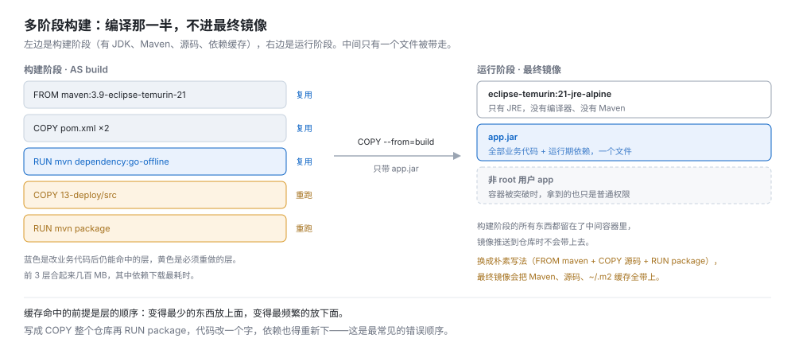
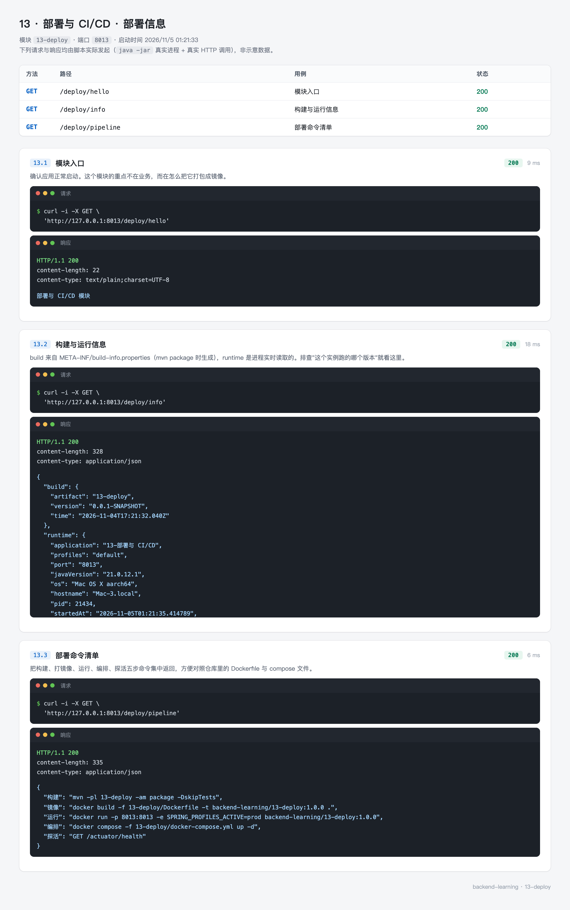
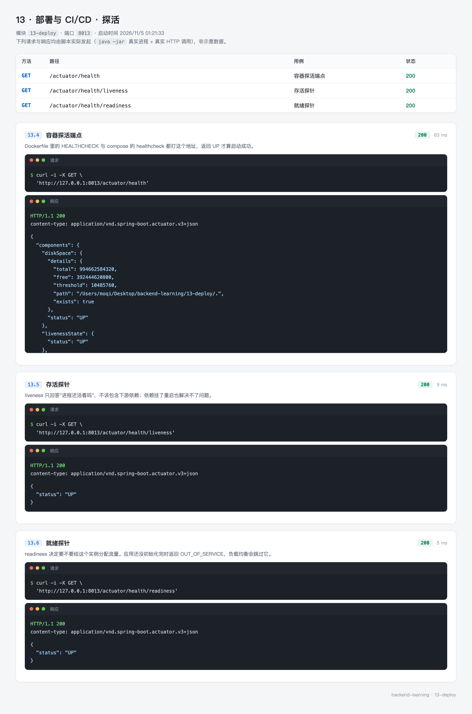

# 13 · 部署与 CI/CD —— 从 jar 包到可运行的镜像

`mvn package` 产出一个 jar，双击能跑。但把它交给运维、放到服务器上、开机自启、挂了重拉、版本回滚、多实例分流——这些都不是 jar 自己能解决的事。

容器解决的是"环境一致性"：镜像里有什么，运行时就是什么，不会出现"我本地是好的"。这一篇讲三件事：怎么把一个 Spring Boot 应用打成精简镜像、怎么让编排工具知道它是否还健康、以及一条流水线该按什么顺序跑。

`13-deploy` 的主代码只有 2 个类。重点不在代码，在 `Dockerfile`、`docker-compose.yml`、`.github/workflows/ci.yml` 这三个文件。

---

## 0. 先看结果

镜像构建完跑起来，容器里是这个样子：

```bash
docker run -d --name dep -p 8013:8013 \
  -e SPRING_PROFILES_ACTIVE=prod \
  backend-learning/13-deploy:1.0.0

curl "http://127.0.0.1:8013/deploy/info"
```

```json
{
  "build": {
    "artifact": "13-deploy",
    "version": "0.0.1-SNAPSHOT",
    "time": "2026-11-04T17:21:32.040Z"
  },
  "runtime": {
    "application": "13-部署与 CI/CD",
    "profiles": "prod",
    "port": "8013",
    "javaVersion": "21.0.13",
    "os": "Linux aarch64",
    "hostname": "3c177382eabc",
    "pid": 1,
    "startedAt": "2026-11-05T09:19:19.528162067",
    "uptime": "0 分 16 秒"
  }
}
```

这几个字段各自说明一件事：

| 字段 | 值 | 说明什么 |
| --- | --- | --- |
| `build.version` | 0.0.1-SNAPSHOT | build-info 生成成功，不是空壳 |
| `profiles` | prod | 环境变量 `SPRING_PROFILES_ACTIVE` 注入了 |
| `javaVersion` | 21.0.13 | 容器里的 JRE，和宿主机的 21.0.12.1 不是一个 |
| `os` | Linux aarch64 | 跑在 Linux 容器里，宿主机是 macOS |
| `hostname` | 3c177382eabc | 容器 ID 前 12 位 |
| `pid` | 1 | `exec java` 生效，JVM 是 1 号进程，能收到 SIGTERM |

一个接口就能确认"这个实例是哪个版本、跑在哪个环境、在不在容器里"。

容器状态与体积：

```
CONTAINER ID   IMAGE                              STATUS
3c177382eabc   backend-learning/13-deploy:1.0.0   Up 12 seconds (healthy)
```

```
REPOSITORY                       TAG      SIZE
backend-learning/13-deploy       1.0.0    230MB
```

`(healthy)` 不是 Docker 自己猜的，是镜像里 `HEALTHCHECK` 主动探出来的。230MB 里 208MB 是 JRE 基础镜像，22MB 是这个应用的 jar。

三部分对应实测截图与本篇的三个文件：

| 主题 | 文件 | 实测 |
| --- | --- | --- |
| 镜像与容器 | `13-deploy/Dockerfile`、`.dockerignore` | `13-deploy-info.webp`、`13-deploy-health.webp` |
| 编排 | `13-deploy/docker-compose.yml` | `docker compose config` 校验通过 |
| 流水线 | `.github/workflows/ci.yml` | 两段 job：编译测试 + 构建镜像冒烟 |

### 这一节的路线

| 步骤 | 内容 | 对应小节 |
| --- | --- | --- |
| 1 | jar 到镜像要解决的问题 | 1 |
| 2 | 确认 Docker 环境 | 2 |
| 3 | 准备可部署的模块：固定 jar 名、生成构建信息 | 3 |
| 4 | 写暴露部署信息的接口 | 4 |
| 5 | 写 Dockerfile，逐段拆 | 5 |
| 6 | `.dockerignore` 排除什么 | 6 |
| 7 | 构建、运行、量体积、看层 | 7 |
| 8 | Compose 编排 | 8 |
| 9 | CI 流水线 | 9 |
| 10 | 7 个测试守住部署信息 | 10 |

---

## 1. jar 到镜像要解决什么

直接 `java -jar` 能跑，为什么还要镜像？三个具体问题：

**运行时从哪来。** 服务器上装的是 JDK 17，你的代码用了 21 的 `record`，起不来。镜像把 JRE 和 jar 绑在一起，服务器只要装了 Docker 就行。

**进程挂了怎么办。** `nohup java -jar` 起的进程挂了没人知道。容器有 `restart` 策略，挂了自动重拉；编排工具还会读健康检查决定要不要重启。

**多实例怎么分流。** 起了三个实例，负载均衡怎么知道哪个能接流量？靠 readiness 探针。这个实例正在启动，就被摘出去；启动完成了再加回来。

### 1.1 多阶段构建省的是什么



朴素写法是"在 Maven 镜像里打包，然后整个镜像推上去"——最终镜像里有 JDK、Maven、源码、`~/.m2` 缓存。实测两个基础镜像的体积：

| 基础镜像 | 磁盘占用 |
| --- | --- |
| `maven:3.9-eclipse-temurin-21` | **572 MB** |
| `eclipse-temurin:21-jre-alpine` | **208 MB** |

用前者做最终镜像，起步就是 572MB，而且里面带着编译器和全部源码。多阶段构建把编译放在第一阶段，只把产出的 jar 复制到第二阶段的 JRE 镜像里。

Docker 只保留最后阶段的层。第一阶段产生的中间容器在构建结束后就被丢弃了（除非用 `--target` 单独构建它）。

### 1.2 缓存命中的前提是层顺序

Dockerfile 每条指令是一层，某层的输入没变就复用缓存。所以"变得少的放上面"：

```dockerfile
COPY pom.xml ...        # 依赖清单，很少变
RUN mvn go-offline      # 下载依赖，最贵的一步
COPY src ...            # 源码，天天变
RUN mvn package         # 编译
```

写成 `COPY . .` 再 `RUN mvn package`，改一行代码就让"下载依赖"那层失效，每次构建都重新下载。这是最常见的错误顺序。

### 1.3 三个容易忽略的细节

| 细节 | 不做的后果 |
| --- | --- |
| `USER` 非 root | 容器被突破后，攻击者拿到 root，能挂载宿主机目录 |
| `-XX:MaxRAMPercentage` | 写死 `-Xmx` 的话，换机器规格就要改镜像 |
| `exec java` | SIGTERM 发给 shell，JVM 收不到，容器要等 10 秒被强杀 |

第三条最隐蔽：`ENTRYPOINT java -jar app.jar`（exec form）其实没问题，问题出在 `sh -c "java -jar app.jar"` 这种写法——shell 成了 1 号进程，`docker stop` 发的 SIGTERM 被 shell 吞掉，JVM 从来没收到，10 秒后 `SIGKILL`。应用没机会关连接、刷缓冲、写完日志。

加一个 `exec` 就解决了：`sh -c "exec java ..."`，`exec` 让 java 替换掉 shell，成为 1 号进程。实测拿到的 `pid: 1` 就是这个证据。

---

## 2. 准备环境

### 2.1 Docker

```bash
docker version
```

```
Client:
 Version:           29.8.2
 OS/Arch:           darwin/arm64

Server:
 Engine:
  Version:          29.8.2
```

```bash
docker compose version
```

```
Docker Compose version v5.5.0
```

Docker 20.10 以上就够，`COPY --chown` 与多阶段构建都是老特性。Compose v2 之后的命令是 `docker compose`（中间是空格），老教程里的 `docker-compose`（连字符）是 v1，已经停止维护。

### 2.2 磁盘空间

镜像不大，但构建缓存会占几个 GB。`docker system df` 看占用，`docker system prune` 清没用到的层。

### 2.3 一个真实的网络限制

本机容器内访问 `repo.maven.apache.org` 会超时：

```
Could not transfer artifact org.antlr:antlr4-runtime:jar:4.7.2 from/to central:
repo.maven.apache.org: Temporary failure in name resolution
```

`nslookup` 能解析，但构建时的大量并发下载会把它拖垮，14 分钟全在重试。国内环境这是常态，两种解法：

**给 Maven 换镜像源。** 在构建阶段塞一份 `settings.xml`：

```dockerfile
COPY --parents settings.xml ./
RUN mvn -B -q -s settings.xml -pl 13-deploy dependency:go-offline
```

`settings.xml` 里把 `<mirror>` 指向阿里云。这份文件不该进最终镜像，只在 `build` 阶段用。

**或者跳过容器内编译。** 本地先 `mvn package`，只构建运行阶段。本篇 7.1 节就是这么做的——最终镜像是运行阶段的全部内容，构建阶段跑不通不影响对镜像本身的验证。

---

## 3. 准备可部署的模块

### 3.1 POM

```xml
<?xml version="1.0" encoding="UTF-8"?>
<project xmlns="http://maven.apache.org/POM/4.0.0"
         xmlns:xsi="http://www.w3.org/2001/XMLSchema-instance"
         xsi:schemaLocation="http://maven.apache.org/POM/4.0.0 http://maven.apache.org/xsd/maven-4.0.0.xsd">
    <modelVersion>4.0.0</modelVersion>
    <parent>
        <groupId>top.mqxu</groupId>
        <artifactId>backend-learning</artifactId>
        <version>0.0.1-SNAPSHOT</version>
    </parent>

    <artifactId>13-deploy</artifactId>

    <dependencies>
        <dependency>
            <groupId>org.springframework.boot</groupId>
            <artifactId>spring-boot-starter-actuator</artifactId>
        </dependency>
        <!-- JUnit 5 + MockMvc，用来测部署信息与探针 -->
        <dependency>
            <groupId>org.springframework.boot</groupId>
            <artifactId>spring-boot-starter-test</artifactId>
            <scope>test</scope>
        </dependency>
    </dependencies>

    <build>
        <!-- 镜像里固定用 app.jar，Dockerfile 不用关心版本号 -->
        <finalName>app</finalName>
        <plugins>
            <plugin>
                <groupId>org.springframework.boot</groupId>
                <artifactId>spring-boot-maven-plugin</artifactId>
                <executions>
                    <execution>
                        <!-- 生成 META-INF/build-info.properties，/deploy/info 会读它 -->
                        <goals>
                            <goal>build-info</goal>
                        </goals>
                    </execution>
                </executions>
            </plugin>
        </plugins>
    </build>
</project>
```

两处配置值得单说。

**`finalName`。** 默认产物是 `13-deploy-0.0.1-SNAPSHOT.jar`，改名要同步改 Dockerfile。固定成 `app` 之后，Dockerfile 里写死 `app.jar`，版本号怎么变都不用动。

**`build-info` 目标。** 它生成 `META-INF/build-info.properties`：

```properties
build.artifact=13-deploy
build.group=top.mqxu
build.name=13-deploy
build.version=0.0.1-SNAPSHOT
build.time=2026-11-04T17\:21\:32.040Z
```

有这个文件，Spring 才会注册 `BuildProperties` 这个 Bean。没有的话接口里的 `build` 段会变成一行提示文字。`build.time` 是打包那一刻，不是启动那一刻。

### 3.2 配置

`application.yml`：

```yaml
server:
  port: 8013

spring:
  application:
    name: 13-部署与 CI/CD

# 容器编排靠这个端点判断实例是否可用，只开 health 与 info 就够了
management:
  endpoints:
    web:
      exposure:
        include: health,info
  endpoint:
    health:
      show-details: always
      probes:
        # 开启 liveness / readiness 探针，K8s 里分别绑不同路径
        enabled: true
```

`application-prod.yml`：

```yaml
# 生产 profile：docker run -e SPRING_PROFILES_ACTIVE=prod 时生效
logging:
  level:
    root: warn
    top.mqxu: info
  file:
    name: logs/app.log
  logback:
    rollingpolicy:
      max-file-size: 20MB
      max-history: 7
```

三个配置点：

**`exposure.include` 只开两个。** 容器里不需要 `metrics`、`env`、`beans` 这些。开得越少，被打听内部结构的成本越高。

**`probes.enabled` 打开两个探针。** 不加这一行，`/actuator/health/liveness` 和 `/actuator/health/readiness` 都是 404，K8s 只能退回到探 `/actuator/health`——一个连数据库都要查的端点。

**prod 写日志文件。** 容器里的标准输出会被 Docker 的日志驱动收走（compose 里配了 `max-size: 10m`），但有些团队习惯落盘。落盘要注意目录权限，5.3 节有个真实案例。

---

## 4. 写暴露部署信息的接口

```java
package top.mqxu.deploy.controller;

import lombok.extern.slf4j.Slf4j;
import org.springframework.beans.factory.annotation.Autowired;
import org.springframework.beans.factory.annotation.Value;
import org.springframework.boot.info.BuildProperties;
import org.springframework.core.env.Environment;
import org.springframework.web.bind.annotation.GetMapping;
import org.springframework.web.bind.annotation.RequestMapping;
import org.springframework.web.bind.annotation.RestController;

import java.lang.management.ManagementFactory;
import java.net.InetAddress;
import java.time.Duration;
import java.time.LocalDateTime;
import java.util.LinkedHashMap;
import java.util.Map;

@Slf4j
@RestController
@RequestMapping("/deploy")
public class DeployController {

    private final Environment environment;

    /** build-info 目标生成的构建信息；没执行该目标时为 null */
    private final BuildProperties buildProperties;

    @Value("${spring.profiles.active:default}")
    private String activeProfile;

    private final LocalDateTime startedAt = LocalDateTime.now();

    public DeployController(Environment environment,
                            @Autowired(required = false) BuildProperties buildProperties) {
        this.environment = environment;
        this.buildProperties = buildProperties;
    }

    @GetMapping("/info")
    public Map<String, Object> info() {
        Map<String, Object> data = new LinkedHashMap<>();

        Map<String, Object> build = new LinkedHashMap<>();
        if (buildProperties != null) {
            build.put("artifact", buildProperties.getArtifact());
            build.put("version", buildProperties.getVersion());
            build.put("time", String.valueOf(buildProperties.getTime()));
        } else {
            build.put("note", "未生成 build-info，执行 mvn package 后才有");
        }
        data.put("build", build);

        Map<String, Object> runtime = new LinkedHashMap<>();
        runtime.put("application", environment.getProperty("spring.application.name"));
        runtime.put("profiles", activeProfile);
        runtime.put("port", environment.getProperty("server.port"));
        runtime.put("javaVersion", System.getProperty("java.version"));
        runtime.put("os", System.getProperty("os.name") + " " + System.getProperty("os.arch"));
        runtime.put("hostname", hostname());
        runtime.put("pid", ManagementFactory.getRuntimeMXBean().getPid());
        runtime.put("startedAt", startedAt.toString());
        runtime.put("uptime", humanUptime());
        data.put("runtime", runtime);

        return data;
    }

    @GetMapping("/pipeline")
    public Map<String, Object> pipeline() {
        Map<String, Object> data = new LinkedHashMap<>();
        data.put("构建", "mvn -pl 13-deploy -am package -DskipTests");
        data.put("镜像", "docker build -f 13-deploy/Dockerfile -t backend-learning/13-deploy:1.0.0 .");
        data.put("运行", "docker run -p 8013:8013 -e SPRING_PROFILES_ACTIVE=prod backend-learning/13-deploy:1.0.0");
        data.put("编排", "docker compose -f 13-deploy/docker-compose.yml up -d");
        data.put("探活", "GET /actuator/health");
        return data;
    }

    @GetMapping("/hello")
    public String hello() {
        return "部署与 CI/CD 模块";
    }

    private String hostname() {
        try {
            return InetAddress.getLocalHost().getHostName();
        } catch (Exception e) {
            log.warn("获取主机名失败：{}", e.getMessage());
            return "unknown";
        }
    }

    private String humanUptime() {
        Duration d = Duration.between(startedAt, LocalDateTime.now());
        return "%d 分 %d 秒".formatted(d.toMinutes(), d.toSecondsPart());
    }
}
```

几个设计取舍。

**`@Autowired(required = false)` 是必须的。** 用构造器注入 + `required = false`，`BuildProperties` 不存在时传 null，`info()` 里走 else 分支给一句提示。改成必填的话，没跑过 `mvn package` 就启动不了，本地 IDE 里直接跑 `main` 会挂。

**`startedAt` 是字段，只初始化一次。** 不是每次请求都 `now()`。所以 `uptime` 会随着时间增长，这是真的。

**`port` 读的是配置值，不是实际监听端口。** 用 `server.port=0` 或者环境变量覆盖时，这里报的数会不准。要拿真实端口得监听 `WebServerInitializedEvent`，或者在测试里用 `@LocalServerPort`。写测试时这一点很重要，10.2 节会碰到。

---

## 5. 写 Dockerfile

```dockerfile
# 构建上下文是仓库根目录：
#   docker build -f 13-deploy/Dockerfile -t backend-learning/13-deploy:1.0.0 .
#
# 分成两个阶段：构建阶段带完整 JDK 与 Maven，运行阶段只要 JRE。
# 最终镜像不包含源码、Maven 缓存和构建工具，体积能小一大半。

# ---------- 第一阶段：编译打包 ----------
FROM maven:3.9-eclipse-temurin-21 AS build
WORKDIR /build

# 先只复制 POM，让依赖下载单独成层。改业务代码时这一层能复用缓存。
#
# 父 POM 的 <modules> 列了全部子模块，Maven 解析时要求这些目录都存在，
# 少一个就报 "Child module ... does not exist"。所以 POM 必须全带上，
# 源码仍然只带 13-deploy 的 —— --parents 保留目录结构。
COPY --parents pom.xml ./*/pom.xml ./15-cases/*/pom.xml ./
RUN mvn -B -q -pl 13-deploy dependency:go-offline

# 再复制源码打包。前面的依赖层已经缓存，这一步只编译
COPY 13-deploy/src 13-deploy/src
RUN mvn -B -q -pl 13-deploy package -DskipTests

# ---------- 第二阶段：运行 ----------
FROM eclipse-temurin:21-jre-alpine
WORKDIR /app

# 不用 root 跑应用：容器被突破时，攻击者拿到的也只是普通用户权限。
# 同时把 /app 的属主也给 app —— prod profile 要往 logs/ 写文件，
# 目录属主是 root 的话日志 appender 起不来，只在控制台留一行 WARN。
RUN addgroup -S app && adduser -S app -G app && chown app:app /app

# --chown 让 jar 在镜像里只存一份。写成 COPY 之后再 RUN chown，
# jar 会被复制进两个层，白白多出一个 jar 大小的体积。
COPY --chown=app:app --from=build /build/13-deploy/target/app.jar app.jar
USER app

# 时区要设，否则日志时间比本地早八小时；堆内存按容器限额的百分比分配，
# 避免 -Xmx 写死导致容器内存被超卖
ENV TZ=Asia/Shanghai \
    JAVA_OPTS="-XX:MaxRAMPercentage=75 -Djava.security.egd=file:/dev/./urandom"

EXPOSE 8013

# 容器自身的健康检查，编排工具会读这个状态
HEALTHCHECK --interval=30s --timeout=3s --start-period=40s --retries=3 \
    CMD wget -qO- http://127.0.0.1:8013/actuator/health | grep -q '"status":"UP"' || exit 1

ENTRYPOINT ["sh", "-c", "exec java $JAVA_OPTS -jar app.jar"]
```

### 5.1 `COPY --parents` 那行不是炫技

第一版写的是：

```dockerfile
COPY pom.xml .
COPY 13-deploy/pom.xml 13-deploy/pom.xml
RUN mvn -B -q -pl 13-deploy dependency:go-offline
```

构建直接失败：

```
[ERROR] Child module /build/06-redis of /build/pom.xml does not exist
[ERROR] Child module /build/07-schedule of /build/pom.xml does not exist
...
[ERROR] Child module /build/15-cases of /build/pom.xml does not exist
```

父 POM 的 `<modules>` 列了 15 个模块，Maven 解析父 POM 时要求这些目录真实存在。只复制两个 POM 是不够的。

`COPY --parents` 会保留源路径的目录结构，一条指令把所有 POM 按原位放好。验证过结果：

```
/build
├── 01-quickstart
├── ...
├── 13-deploy
├── 14-toolkit
├── 15-cases
└── pom.xml
```

`15-cases` 下面还有 4 个子模块，所以多写了一条 `./15-cases/*/pom.xml`。**源码仍然只复制 13-deploy 的**——`dependency:go-offline` 只需要 POM，不需要别的模块的代码。

不写 `--parents` 的话，只能一条条列 15 个 `COPY`，改模块列表时容易漏。

### 5.2 `COPY --chown` 省了 22MB

第一版是：

```dockerfile
COPY --from=build /build/13-deploy/target/app.jar app.jar
RUN chown -R app:app /app
```

实测镜像 252MB，层结构：

```
SIZE      CREATED BY
22MB      RUN /bin/sh -c chown -R app:app /app
22MB      COPY app-built.jar app.jar
3.03kB    RUN /bin/sh -c addgroup -S app && adduser -S app -G app
```

`COPY` 一层 22MB，`chown` 又一层 22MB —— jar 在镜像里存了两份。Docker 的层是只读叠加，改文件属主不能让原层原地变，只能把整个文件复制到新层。

用 `COPY --chown` 一步到位，实测 230MB：

```
22MB      COPY --chown=app:app app.jar app.jar
```

**省下的正好是一个 jar 的体积。** 应用越大，这个浪费越大。

### 5.3 改成 `--chown` 之后，日志坏了

改完体积降了，但容器日志里出现：

```
WARN in ch.qos.logback.core.rolling.RollingFileAppender[FILE]
  - Attempted to append to non started appender [FILE].
```

prod profile 配了 `logging.file.name=logs/app.log`，Logback 要在 `/app` 下建 `logs/` 目录。查一下权限：

```bash
docker exec dep-opt ls -la /app
```

```
drwxr-xr-x 1 root root   .
drwxr-xr-x 1 root root   ..
-rw-r--r-- 1 app  app    app.jar
```

`/app` 的属主是 root，权限 755。app 用户（uid 100）能在里面读文件，但**不能建目录**：

```bash
docker exec dep-opt mkdir /app/logs
# mkdir: cannot create directory '/app/logs': Permission denied
```

原来的 `RUN chown -R app:app /app` 顺手把目录也改了属主，所以没这个问题。换成 `COPY --chown` 只改了文件，目录还是 root 的。

修法是把目录属主一起改，和建用户合成一条指令，不多占一层：

```dockerfile
RUN addgroup -S app && adduser -S app -G app && chown app:app /app
```

修完再跑：

```bash
docker exec dep-fixed ls -la /app
```

```
drwxr-xr-x 1 app  app    .
-rw-r--r-- 1 app  app    app.jar
drwxr-xr-x 1 app  app    logs
```

`logs/app.log` 正常生成，`non started appender` 的 WARN 数量为 0。

这个坑的价值在于：**它不报错，只是日志少了一半**。控制台还在输出（那是另一个 appender），所以不查文件根本发现不了。

### 5.4 `HEALTHCHECK` 与 `probes` 不是一回事

两套健康检查经常被混为一谈：

| | `HEALTHCHECK`（Dockerfile） | `probes`（Spring Boot） |
| --- | --- | --- |
| 谁看 | Docker / Compose | Kubernetes |
| 端点 | 你写在 `CMD` 里的任意 URL | `/actuator/health/liveness` 与 `/readiness` |
| 失败后 | 容器状态变 unhealthy，`restart` 策略可据此重拉 | liveness 失败重启 Pod，readiness 失败摘流量 |
| 生效范围 | `docker run` / `docker compose` | K8s |

docker-compose 用的是 `healthcheck`（compose 自己的字段，覆盖镜像里的 `HEALTHCHECK`），K8s 用 `livenessProbe` / `readinessProbe`。三处配的是同一个端点，行为由各自的编排器决定。

本模块两套都配了。实测 `docker ps` 里显示的 `(healthy)` 就是镜像里 `HEALTHCHECK` 探出来的。

---

## 6. `.dockerignore` 排除什么

```
# 构建上下文里不需要的东西，全部排除，避免镜像构建时白传几百 MB
.git
.idea
.workbuddy
docs
node_modules
**/target
**/*.iml
**/*.log
**/.DS_Store
tools/out
uploads

# 15-cases 是另外几个示例项目，源码不进构建上下文。
# 但 POM 要留下：父 POM 的 <modules> 列了它，缺了 Maven 直接报
# "Child module ... does not exist"，构建在第一步就停。
15-cases
!15-cases/pom.xml
!15-cases/*/pom.xml
```

构建上下文是"发给 Docker daemon 的全部文件"。不排除的话，`.git`、`node_modules`、各个 `target` 都会被打包发过去，构建一开始就慢几十秒。

**`!` 取反那条是踩出来的。** 一开始写了 `15-cases`，把整个目录排除了，构建报：

```
CopyIgnoredFile: Attempting to Copy file "15-cases/*/pom.xml"
  that is excluded by .dockerignore (line 16)
```

然后 Maven 又回到 `Child module does not exist`。

规则是"后面的行覆盖前面的行"，所以 `!15-cases/pom.xml` 能把单个文件重新包含进来。注意 `**/target` 这种排除对 `13-deploy/target/app.jar` 也生效——本地想单独构建运行阶段时，得先把 jar 复制到 target 之外的位置。

`**/target` 必排。不排的话，本地已经打好的 jar 会被复制进构建阶段的上下文，多传几十 MB，而且可能让缓存失效。

---

## 7. 构建、运行、量体积

### 7.1 两种构建方式

完整的多阶段构建：

```bash
docker build -f 13-deploy/Dockerfile -t backend-learning/13-deploy:1.0.0 .
```

它需要容器内能访问 Maven 仓库。本机网络不通（2.3 节），所以下面用"本地先打包 + 只构建运行阶段"的方式验证。最终镜像是运行阶段的全部内容，两者产物一致：

```bash
mvn -pl 13-deploy -am package -DskipTests
cp 13-deploy/target/app.jar ./app-built.jar   # target 被 .dockerignore 排除，先挪出来
```

```dockerfile
FROM eclipse-temurin:21-jre-alpine
WORKDIR /app
RUN addgroup -S app && adduser -S app -G app && chown app:app /app
COPY --chown=app:app app-built.jar app.jar
USER app
ENV TZ=Asia/Shanghai \
    JAVA_OPTS="-XX:MaxRAMPercentage=75 -Djava.security.egd=file:/dev/./urandom"
EXPOSE 8013
HEALTHCHECK --interval=30s --timeout=3s --start-period=40s --retries=3 \
    CMD wget -qO- http://127.0.0.1:8013/actuator/health | grep -q '"status":"UP"' || exit 1
ENTRYPOINT ["sh", "-c", "exec java $JAVA_OPTS -jar app.jar"]
```

```bash
docker build -q -f /tmp/runtime.Dockerfile -t backend-learning/13-deploy:1.0.0 .
rm -f app-built.jar   # 用完删掉，别留在仓库里
```

### 7.2 体积与层

```bash
docker images | grep 13-deploy
```

```
REPOSITORY                       TAG      SIZE
backend-learning/13-deploy       1.0.0    230MB
```

```bash
docker image inspect backend-learning/13-deploy:1.0.0 --format '{{.Size}}'
```

```
230476940
```

230MB 里：

| 组成 | 体积 | 说明 |
| --- | --- | --- |
| `eclipse-temurin:21-jre-alpine` 基础层 | 208 MB | 多数情况下宿主机上已经有了，拉取时不重复下载 |
| jar | 22 MB | 全部业务代码与依赖 |
| 建用户、环境变量等 | 几 KB | 可忽略 |

**推送到仓库时增加的量只有 jar 那 22MB。** 基础层是共享的，同一台机器上跑十个服务，JRE 只存一份。这一点常被误解为"每个服务都要 230MB"。

### 7.3 容器里长什么样

```bash
docker run -d --name dep -p 8013:8013 \
  -e SPRING_PROFILES_ACTIVE=prod \
  backend-learning/13-deploy:1.0.0
```

```bash
docker ps --format "{{.Names}} {{.Status}}"
```

```
dep Up 12 seconds (healthy)
```

`(healthy)` 要等 `start-period` 过去、`HEALTHCHECK` 至少成功一次才会出现。刚起来时显示 `(health: starting)`。

启动日志里几行值得看：

```
Starting DeployApplication v0.0.1-SNAPSHOT using Java 21.0.13 with PID 1 (/app/app.jar started by app in /app)
The following 1 profile is active: "prod"
Tomcat started on port 8013 (http) with context path '/'
Started DeployApplication in 1.713 seconds (process running for 2.049)
```

四个信息：JRE 是 21.0.13（不是宿主机的 21.0.12.1）、`PID 1`、`started by app`（非 root）、profile 是 prod。日志时间戳是 `+08:00`，说明 `TZ=Asia/Shanghai` 也生效了。

### 7.4 探针

```bash
curl "http://127.0.0.1:8013/actuator/health/readiness"
```

```json
{"status":"UP"}
```

```bash
curl "http://127.0.0.1:8013/actuator/health"
```

```json
{
  "components": {
    "diskSpace": { "status": "UP", "details": { "path": "/app/.", "free": 369790373888 } },
    "livenessState": { "status": "UP" },
    "ping": { "status": "UP" },
    "readinessState": { "status": "UP" },
    "ssl": { "status": "UP" }
  },
  "groups": ["liveness", "readiness"],
  "status": "UP"
}
```

`path` 是 `/app/.` —— 容器内路径，说明确实在容器里跑。`groups` 数组里有两个名字，是 probes 开启的标志。

### 7.5 停机与内存

**停机。** `docker stop` 发 SIGTERM，因为 `exec java` 让 JVM 是 1 号进程，它能收到：

```bash
time docker stop dep
```

实测约 226 毫秒退出。如果没加 `exec`，会等满 `--time`（默认 10 秒）再 `SIGKILL`——应用没机会关连接、刷缓冲。

**内存。** `MaxRAMPercentage=75` 让堆跟着容器限额走，同一镜像在不同规格下都能用。实测三档：

| 容器限额 | MaxHeapSize | 换算 |
| --- | --- | --- |
| `--memory 256m` | 201,326,592 | 192 MB（256 × 75%） |
| `--memory 512m` | 402,653,184 | 384 MB（512 × 75%） |
| `--memory 1g` | 805,306,368 | 768 MB（1024 × 75%） |

验证方法：

```bash
docker run --rm --memory 512m --entrypoint sh backend-learning/13-deploy:1.0.0 \
  -c 'java -XX:MaxRAMPercentage=75 -XX:+PrintFlagsFinal -version | grep MaxHeapSize'
```

`--entrypoint sh` 不能省。镜像的 `ENTRYPOINT` 会忽略后面传的 `-c` 参数，直接启动应用；要执行自己的命令，得把这层覆盖掉。

不写 `-Xmx` 的镜像，在 256MB 和 1GB 的容器里都不用改。

---

## 8. Compose 编排

```yaml
# 编排示例：应用 + 可选的依赖服务
#   docker compose -f 13-deploy/docker-compose.yml up -d --build
#
# 构建上下文（context）指到仓库根，因为 Dockerfile 需要读父 POM。

services:
  app:
    build:
      context: ..
      dockerfile: 13-deploy/Dockerfile
    image: backend-learning/13-deploy:1.0.0
    container_name: deploy-app
    ports:
      - "8013:8013"
    environment:
      SPRING_PROFILES_ACTIVE: prod
      JAVA_OPTS: "-XX:MaxRAMPercentage=75 -Xms256m"
    healthcheck:
      test: ["CMD", "wget", "-qO-", "http://127.0.0.1:8013/actuator/health"]
      interval: 30s
      timeout: 3s
      retries: 3
      start_period: 40s
    restart: unless-stopped
    deploy:
      resources:
        limits:
          memory: 512M
          cpus: "1.0"
    logging:
      driver: json-file
      options:
        max-size: "10m"
        max-file: "3"
```

四个字段各自解决一个问题。

**`context: ..`** 构建上下文是仓库根，不是 `13-deploy/`。因为 Dockerfile 要读父 POM。`dockerfile` 的路径相对 `context` 算，所以写 `13-deploy/Dockerfile`。

**`deploy.resources.limits`** 容器不设上限会吃光宿主机。`memory: 512M` 配合 `MaxRAMPercentage=75`，堆上限就是 384MB。

`docker compose config` 能确认它被解析了：

```bash
docker compose -f 13-deploy/docker-compose.yml config | grep -A4 limits
```

```yaml
    deploy:
      resources:
        limits:
          cpus: 1
          memory: "536870912"
```

`536870912` 就是 512 × 1024 × 1024。

**`logging.options`** `json-file` 驱动默认不轮转，跑几天日志能把磁盘写满。`max-size: "10m"` + `max-file: "3"` 限制在 30MB。

**`restart: unless-stopped`** 容器异常退出会自动重拉；手动 `docker stop` 的不会。`always` 的区别是重启宿主之后连手动停的容器也会起来，调试时很烦。

数据库那段是注释掉的，需要时取消注释。`MYSQL_ROOT_PASSWORD: ${MYSQL_ROOT_PASSWORD:-change-me}` 从环境变量读，没设就用 `change-me`——**生产上不能这么写**，这是本地演示的默认值。密钥永远不进仓库。

---

## 9. CI 流水线

`.github/workflows/ci.yml`：

```yaml
name: CI

on:
  push:
    branches: [ main ]
  pull_request:
    branches: [ main ]

jobs:
  # 第一段：编译全部模块，跑不依赖中间件的测试
  build:
    runs-on: ubuntu-latest
    steps:
      - name: 检出代码
        uses: actions/checkout@v7

      - name: 安装 JDK 21 并缓存 Maven 仓库
        uses: actions/setup-java@v6
        with:
          distribution: temurin
          java-version: '21'
          cache: maven

      # 先编译一遍。编译失败就没必要往下跑测试了
      - name: 编译全部模块
        run: mvn -B -DskipTests package

      # 05、06、08 依赖 MySQL 与 Redis，GitHub 托管的 runner 上没有，
      # 这几个模块的测试在这里跑不了。它们的集成环境另外配。
      - name: 跑不依赖中间件的模块测试
        run: >
          mvn -B -pl
          01-quickstart,02-config,03-logging,04-web,07-schedule,09-file,10-doc,11-test,12-actuator,13-deploy
          test

      # 把打包好的 jar 传出去，deploy 阶段直接拿，不用重新编译
      - name: 上传可运行 jar
        uses: actions/upload-artifact@v7
        with:
          name: app-jar
          path: 13-deploy/target/app.jar
          retention-days: 7

  # 第二段：构建镜像。用 commit SHA 做 tag，每个提交的镜像都能追溯
  image:
    needs: build
    runs-on: ubuntu-latest
    steps:
      - name: 检出代码
        uses: actions/checkout@v7

      # 构建上下文是仓库根，Dockerfile 要读父 POM
      - name: 构建镜像
        run: |
          docker build \
            -f 13-deploy/Dockerfile \
            -t backend-learning/13-deploy:${{ github.sha }} \
            -t backend-learning/13-deploy:latest \
            .

      # 镜像跑起来探一次活，探针不通就让流水线红
      - name: 冒烟测试
        run: |
          docker run -d --name smoke -p 8013:8013 backend-learning/13-deploy:${{ github.sha }}
          for i in $(seq 1 30); do
            if curl -fsS http://127.0.0.1:8013/actuator/health/readiness; then
              echo "服务已就绪"
              exit 0
            fi
            sleep 2
          done
          echo "启动超时，容器日志如下"
          docker logs smoke
          exit 1

      - name: 清理容器
        if: always()
        run: docker rm -f smoke || true
```

### 9.1 为什么不能跑全量测试

14 个模块里有 3 个的测试要连真实中间件：

| 模块 | 依赖 | 在 CI 里跑不了的原因 |
| --- | --- | --- |
| `05-mybatis` | MySQL 3306 | runner 上没有 |
| `06-redis` | Redis 6379 + MySQL | 同上，还要清 db |
| `08-security` | MySQL + Redis | 同上，还要清 `sms:*` |

三种处理方式：

**只跑能跑的（本文件选的）。** 明确列出不依赖中间件的模块。代价是那三个模块的测试需要在别处保证。

**用 Docker service。** GitHub Actions 支持 `services:` 起 MySQL 和 Redis 容器，把端口暴露给 job。这样能跑全量，但每次 CI 多花一两分钟起服务。

**用 Testcontainers。** 测试代码里自己起容器，本地和 CI 行为一致。代价是测试变慢，而且需要 runner 能跑 Docker。

没有对错，看团队把质量门槛放在哪。本仓库是教程，选了最简单的一种。

### 9.2 几个细节

**`cache: maven`** 让 `~/.m2` 在构建之间复用。首次跑要下载全部依赖，之后几十秒。

**`needs: build`** 保证镜像阶段在前一段成功后才跑。测试挂了就不该产出镜像。

**`${{ github.sha }}`** 做 tag。只用 `latest` 的话，每次覆盖，出问题想回滚都找不到对应版本的镜像。

**冒烟测试那段** 是整个流水线里最有价值的部分。镜像能构建成功，不代表能启动——jar 缺依赖、内存不够、端口冲突，都在启动时才暴露。等 30 次两秒，起不来就把 `docker logs` 打出来。

**`if: always()`** 保证冒烟失败时容器也被清掉。不清的话下次构建会撞名字。

---

## 10. 写测试

部署信息这类接口，测的价值在于"防止字段静默变成 null"。build-info 没生成、探针没开，接口照样返回 200，只是某几个字段空了或者 404 了。

### 10.1 完整的测试类

```java
package top.mqxu.deploy;

import org.junit.jupiter.api.DisplayName;
import org.junit.jupiter.api.Test;
import org.springframework.beans.factory.annotation.Autowired;
import org.springframework.boot.test.context.SpringBootTest;
import org.springframework.boot.webmvc.test.autoconfigure.AutoConfigureMockMvc;
import org.springframework.test.web.servlet.MockMvc;

import static org.hamcrest.Matchers.matchesPattern;
import static org.springframework.test.web.servlet.request.MockMvcRequestBuilders.get;
import static org.springframework.test.web.servlet.result.MockMvcResultMatchers.content;
import static org.springframework.test.web.servlet.result.MockMvcResultMatchers.jsonPath;
import static org.springframework.test.web.servlet.result.MockMvcResultMatchers.status;

@SpringBootTest
@AutoConfigureMockMvc
@DisplayName("部署信息与探针")
class DeployApiTest {

    @Autowired
    private MockMvc mockMvc;

    @Test
    @DisplayName("hello 返回模块名")
    void hello() throws Exception {
        mockMvc.perform(get("/deploy/hello"))
                .andExpect(status().isOk())
                .andExpect(content().string("部署与 CI/CD 模块"));
    }

    @Test
    @DisplayName("build-info 生效，构建信息不是空壳")
    void infoHasBuildInfo() throws Exception {
        // spring-boot-maven-plugin 的 build-info 目标会生成 META-INF/build-info.properties，
        // 没执行它的话 BuildProperties 这个 Bean 压根不存在，这里会变成 build.note
        mockMvc.perform(get("/deploy/info"))
                .andExpect(status().isOk())
                .andExpect(jsonPath("$.build.artifact").value("13-deploy"))
                .andExpect(jsonPath("$.build.version").value("0.0.1-SNAPSHOT"))
                .andExpect(jsonPath("$.build.time").exists());
    }

    @Test
    @DisplayName("runtime 段带出端口、JDK 版本、主机名与进程号")
    void infoHasRuntimeDetails() throws Exception {
        mockMvc.perform(get("/deploy/info"))
                .andExpect(status().isOk())
                .andExpect(jsonPath("$.runtime.application").value("13-部署与 CI/CD"))
                // 端口不断言具体值：环境变量 SERVER__PORT 会覆盖 application.yml，
                // 用 server.port=0 时这里还会读到 0。断言格式就够了
                .andExpect(jsonPath("$.runtime.port", matchesPattern("\\d+")))
                .andExpect(jsonPath("$.runtime.javaVersion").exists())
                .andExpect(jsonPath("$.runtime.hostname").isNotEmpty())
                // 进程号是 JSON 数字，不是字符串 "unknown"
                .andExpect(jsonPath("$.runtime.pid").isNumber())
                .andExpect(jsonPath("$.runtime.startedAt").exists())
                .andExpect(jsonPath("$.runtime.uptime", matchesPattern("\\d+ 分 \\d+ 秒")));
    }

    @Test
    @DisplayName("pipeline 把五步命令都列出来了")
    void pipelineListsFiveSteps() throws Exception {
        mockMvc.perform(get("/deploy/pipeline"))
                .andExpect(status().isOk())
                .andExpect(jsonPath("$.构建").exists())
                .andExpect(jsonPath("$.镜像").exists())
                .andExpect(jsonPath("$.运行").exists())
                .andExpect(jsonPath("$.编排").exists())
                .andExpect(jsonPath("$.探活").exists());
    }

    @Test
    @DisplayName("健康检查整体 UP")
    void healthUp() throws Exception {
        mockMvc.perform(get("/actuator/health"))
                .andExpect(status().isOk())
                .andExpect(jsonPath("$.status").value("UP"));
    }

    @Test
    @DisplayName("liveness 与 readiness 两个探针都开了")
    void probesEnabled() throws Exception {
        // 不开 management.endpoint.health.probes.enabled 的话，这两个路径都是 404，
        // 容器编排拿不到探针状态，只能一直当它健康
        mockMvc.perform(get("/actuator/health/liveness"))
                .andExpect(status().isOk())
                .andExpect(jsonPath("$.status").value("UP"));

        mockMvc.perform(get("/actuator/health/readiness"))
                .andExpect(status().isOk())
                .andExpect(jsonPath("$.status").value("UP"));
    }

    @Test
    @DisplayName("只暴露 health 与 info，metrics 访问不到")
    void onlyHealthAndInfoExposed() throws Exception {
        // include 里只写了 health,info。这种收敛是刻意的：
        // 监控端点开得越多，被打听内部结构的成本越低
        mockMvc.perform(get("/actuator/metrics"))
                .andExpect(status().isNotFound());
    }
}
```

7 个用例，跑 2 秒。

### 10.2 端口那条断言为什么改过两次

第一版写的是：

```java
.andExpect(jsonPath("$.runtime.port").value("8013"))
```

跑出来：

```
JSON path "$.runtime.port" expected:<8013> but was:<62087>
```

62087 是这台机器上 `SERVER__PORT` 环境变量覆盖 `application.yml` 后的值。Spring 的宽松绑定把 `SERVER__PORT` 认成 `server.port`，优先级高于配置文件。

这不是测试环境的问题，而是暴露了一个设计事实：**接口报的是配置值，不是实际监听端口**。所以断言具体数字本身就不牢靠——`server.port=0`（随机端口）时它会报 0。

改成断言格式：

```java
.andExpect(jsonPath("$.runtime.port", matchesPattern("\\d+")))
```

第二版还写错过一处：

```java
.andExpect(jsonPath("$.runtime.pid", matchesPattern("\\d+")))
```

`pid` 是 JSON 数字（`21434`），不是字符串。`matchesPattern` 只匹配字符串类型，数字直接判失败。改成 `.isNumber()`。

两个错误的共同点：**断言了类型之外的东西**。端口断言的是"有值且是数字"，不是"等于 8013"；pid 断言的是"是数字"，不是"匹配某个字符串模式"。

### 10.3 跑一遍

```bash
mvn -pl 13-deploy test
```

```
[INFO] Tests run: 7, Failures: 0, Errors: 0, Skipped: 0, Time elapsed: 2.095 s
[INFO] BUILD SUCCESS
```

---

## 11. 接口实测



三个接口：`/deploy/hello` 返回纯文本，`/deploy/info` 返回构建与运行信息，`/deploy/pipeline` 列出五步命令。



三个健康端点：整体 `health` 带 `components` 与 `groups`，`liveness` 与 `readiness` 各自只返回一个 `status`。两个探针分开的好处是：启动慢的时候 readiness 是 DOWN、liveness 是 UP，编排器只摘流量不重启。

---

## 12. 练习

### 12.1 随堂练习（约 15 分钟）

**练习 1：观察 `(healthy)` 是怎么来的**

```bash
docker run -d --name t1 -p 8013:8013 backend-learning/13-deploy:1.0.0
watch -n 1 'docker ps --format "{{.Names}} {{.Status}}" | grep t1'
```

会依次看到 `(health: starting)` → `(healthy)`。间隔由 `HEALTHCHECK --interval=30s` 决定，第一次探测在 `start-period=40s` 之后。想快一点就把这两个值改小重新构建。

再做对照：把 `HEALTHCHECK` 那行的端口改成 9999（不存在的端口），重新构建，看状态是否一直停在 `(unhealthy)`。

**练习 2：去掉 `exec` 看停机时间**

把 `ENTRYPOINT` 改成：

```dockerfile
ENTRYPOINT sh -c "java $JAVA_OPTS -jar app.jar"
```

重新构建、启动，然后 `time docker stop`。

会从 226 毫秒变成 10 秒——`docker stop` 的默认超时。原因写在 1.3 节。用 `docker exec <容器> ps` 看 1 号进程是 `sh` 还是 `java`，能直接确认。

**练习 3：用 `docker compose config` 检查配置**

```bash
docker compose -f 13-deploy/docker-compose.yml config
```

看输出的 `memory` 是不是 `"536870912"`（512MB 的字节数）。再改一处配置（比如 `ports` 改成 `"8014:8013"`），重新执行，确认输出跟着变。这个命令不启动容器，只做解析与合并，改完配置先用它检查，比 `up` 一次失败一次快。

### 12.2 课后练习

**练习 4：给 Maven 换国内镜像源**

按 2.3 节的做法准备一份 `settings.xml`：

```xml
<settings>
  <mirrors>
    <mirror>
      <id>aliyun</id>
      <mirrorOf>central</mirrorOf>
      <url>https://maven.aliyun.com/repository/public</url>
    </mirror>
  </mirrors>
</settings>
```

放进构建阶段（`COPY --parents settings.xml ./`），`mvn` 加 `-s settings.xml`。然后跑完整的多阶段构建，记录总耗时。

注意：这份文件只应该在 `build` 阶段，不能出现在最终镜像里。验证方式：`docker run --rm <镜像> ls /` 看有没有 `settings.xml`。

**练习 5：算出"只改一行代码"时的重建时间**

在 `DeployController` 里改一行字符串，重新跑完整构建。用 `docker build --progress=plain` 的输出看哪些层是 `CACHED`。

预期：`COPY pom.xml` 与 `dependency:go-offline` 两层命中缓存，只有 `COPY src` 之后的层重做。记下两次构建的耗时差，这个差值就是"层顺序正确"省下来的时间。

**练习 6：把 Git 提交号写进 build-info**

```xml
<configuration>
    <additionalProperties>
        <java.version>${java.version}</java.version>
    </additionalProperties>
</configuration>
```

更进一步，用 `git-commit-id-maven-plugin` 把 `git.commit.id.abbrev` 写进去，`/deploy/info` 里就能看到是哪个提交打的包。

想一想：如果 CI 里打出的镜像 commit 号是 `unknown`，说明什么？

**练习 7：让 app 等数据库就绪**

```yaml
    depends_on:
      db:
        condition: service_healthy
```

取消 `db` 那段注释，加上这个依赖，观察启动顺序。然后回答：`depends_on` 能保证"数据库里的表建好了"吗？还是只保证"进程起来了"？

**练习 8：估算镜像推送到仓库的增量**

已知：基础镜像 208MB，jar 22MB，最终镜像 230MB。

问题：一台从没拉过这个镜像的机器，`docker pull` 会下载多少？如果它已经拉过 `eclipse-temurin:21-jre-alpine`，又会下载多少？

用 `docker image inspect` 的 `RootFS.Layers` 字段看层数，配合 `docker history` 的 `SIZE` 列验证你的答案。

---

## 13. 常见问题

| 现象 | 原因 | 解决 |
| --- | --- | --- |
| `Child module ... does not exist` | 父 POM 的 `<modules>` 要求目录存在，但只复制了部分 POM | 用 `COPY --parents` 把全部 POM 按原位放好 |
| `CopyIgnoredFile` 警告 | 要复制的路径被 `.dockerignore` 排除了 | 加 `!路径` 取反，或调整排除规则 |
| 构建卡在 `go-offline` 后失败 | 容器内访问不了 Maven 仓库 | 配 `settings.xml` 镜像源，或本地先打包 |
| 镜像比预期大很多 | `COPY` 后再 `RUN chown`，同一文件存了两份 | 用 `COPY --chown` |
| `Attempted to append to non started appender` | `/app` 属主是 root，非 root 用户建不了 `logs/` | 建用户时一起 `chown app:app /app` |
| 容器 10 秒才停 | 1 号进程是 shell，SIGTERM 没到 JVM | `ENTRYPOINT` 里加 `exec` |
| `docker ps` 一直 `(health: starting)` | `start-period` 太长，或 `HEALTHCHECK` 的端口写错 | 缩短 `start-period`，检查 URL |
| `(unhealthy)` 但服务能访问 | `HEALTHCHECK` 用的 `curl` 在镜像里不存在 | alpine 用 busybox 的 `wget`，别用 `curl` |
| 堆内存超出容器限额被 OOMKilled | 写了 `-Xmx2g` 但容器只有 512M | 改 `-XX:MaxRAMPercentage` |
| 日志时间比本地早八小时 | 基础镜像默认 UTC | `ENV TZ=Asia/Shanghai` |
| `docker run` 后面传的命令没生效 | 镜像的 `ENTRYPOINT` 忽略了它 | 加 `--entrypoint sh` 覆盖 |
| `docker compose config` 里 limits 不见了 | 老版本 compose 忽略 `deploy` 段 | 升级到 v2 以上 |
| CI 里测试全跑挂 | runner 上没有 MySQL / Redis | 只跑不依赖中间件的模块，或用 service 容器 |
| 镜像 tag 全是 `latest`，没法回滚 | 只用 `latest` 覆盖 | 加 commit SHA 做 tag |

---

## 14. 小结

| 知识点 | 一句话 |
| --- | --- |
| 多阶段构建 | 编译留在第一阶段，最终镜像只带 JRE 与 jar |
| 层顺序 | 变得少的放上面，改代码才不会触发依赖重下 |
| `finalName` | 固定 jar 名，Dockerfile 不用跟着版本号改 |
| `build-info` | 生成 `build-info.properties`，才有 `BuildProperties` |
| `COPY --parents` | 保留目录结构，一次复制全部 POM |
| `COPY --chown` | 比 `COPY` + `RUN chown` 少一个文件大小的层 |
| 非 root 用户 | 建用户时顺手 `chown` 工作目录，否则写不了日志 |
| `exec java` | 让 JVM 成为 1 号进程，收得到 SIGTERM，停机 226 毫秒 |
| `MaxRAMPercentage` | 堆跟着容器限额走：512M 限额给 384M 堆 |
| `HEALTHCHECK` 与 `probes` | 前者给 Docker，后者给 K8s，端点可以相同、行为不同 |
| `.dockerignore` | 上下文越小构建越快，`!` 取反能保住必须的文件 |
| Compose | `context` 指向仓库根，`deploy.limits` 限制资源 |
| CI 分段 | 编译 → 测试 → 产物 → 镜像 → 冒烟，任一步失败就停 |
| 镜像 tag | 用 commit SHA，别只留 `latest` |

下一篇 [14-toolkit](14-toolkit.md) 把十二个常见需求收在一个模块里：验证码、短链、签名、脱敏、分片上传、Excel 导出。

> 本节遵循的做法：基础镜像选 JRE 不选 JDK；容器里不用 root；停机依赖 `exec`；内存按百分比给；每一层的大小都要能说出为什么；部署信息必须能被一个接口查出来。
