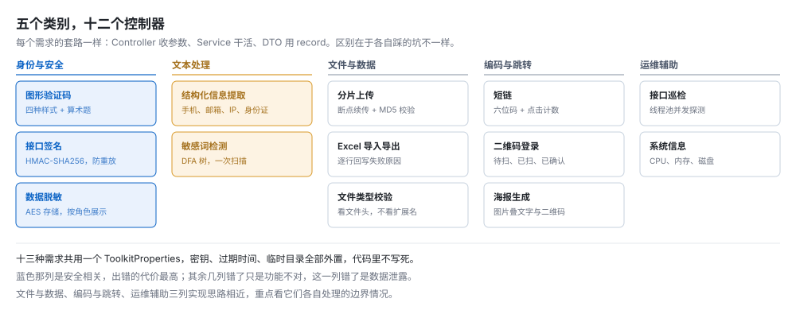
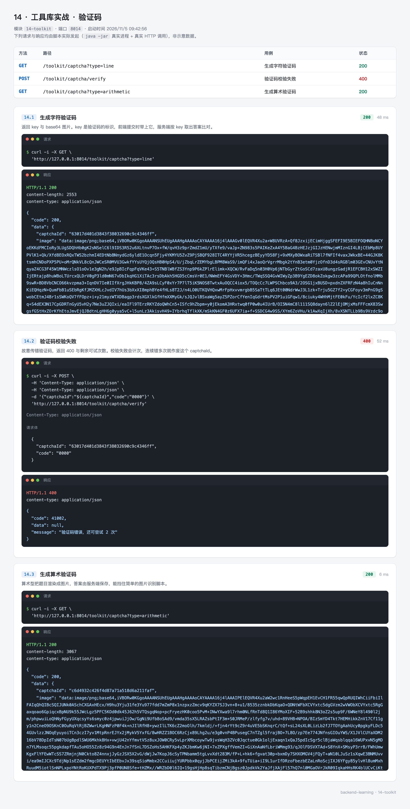
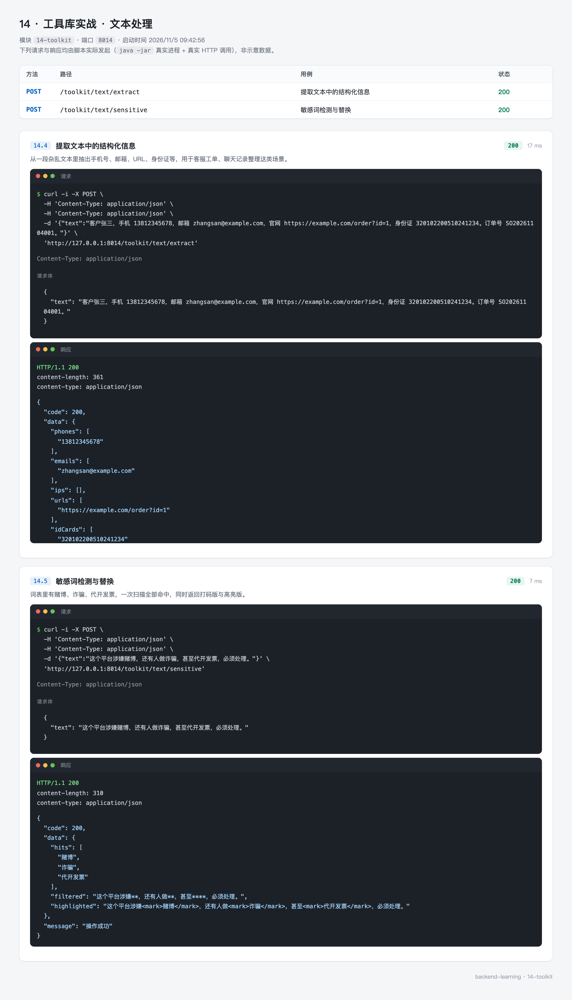
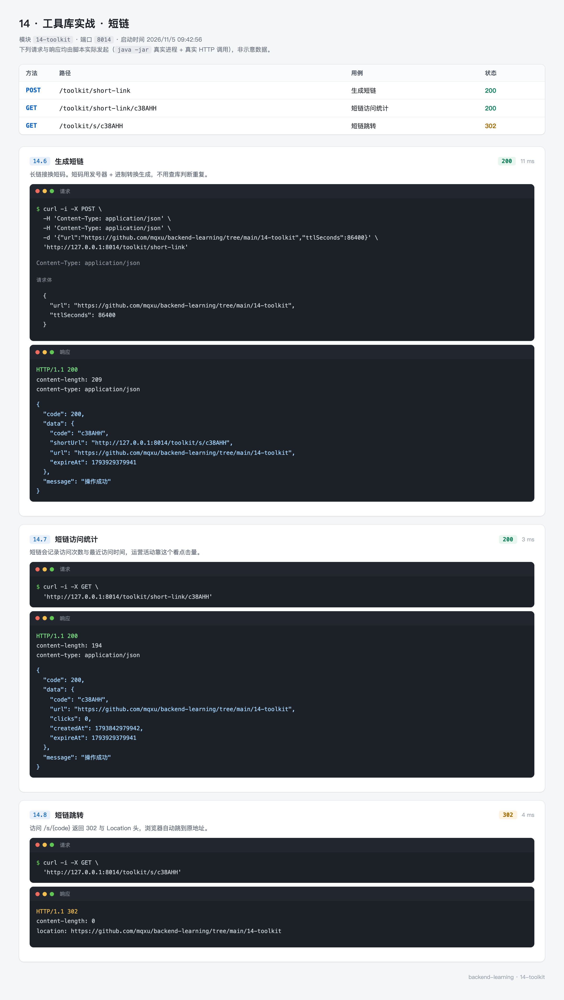
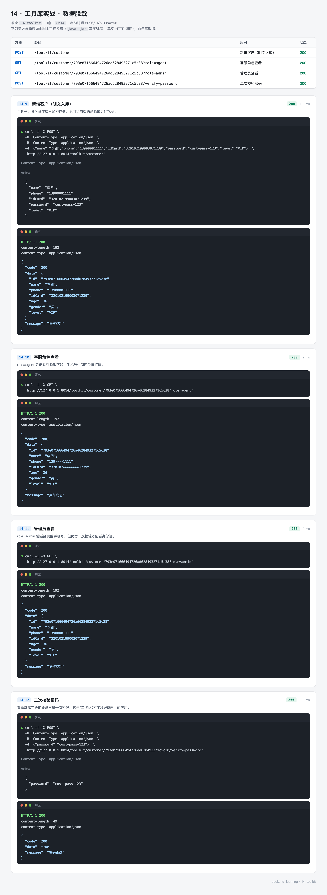
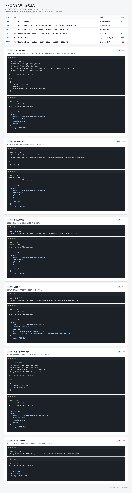
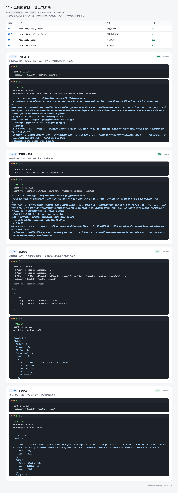

# 14 · 工具库实战 —— 十三种常见需求，一次做完

几乎每个后台项目都会遇到这些："加个图形验证码"、"这个链接太长发不出去"、"对接方要签名"、"手机号不能明文存"、"文件太大要分片"、"把订单导成 Excel"。

每次都重新写一遍，每次都要重新查一遍 API。更麻烦的是安全问题——脱敏规则少写一位、签名比较用了 `equals`、验证码校验完没删，这些漏洞不会让程序报错，只会让数据慢慢漏出去。

`14-toolkit` 把这十三种需求收在一个模块里，共用一个配置、一套错误码。它的价值不在代码量，在于每个需求都挑了对应的坑：验证码的"用一次就废"、短链的"字符集不能有 O 和 0"、签名的"常量时间比较"、身份证的"里面藏着一个伪手机号"。

这是正文的最后一篇。前面的模块各讲一个主题，这一篇反过来——十三个小主题挤在一起，每个只讲最关键的那一点。

---

## 0. 先看结果

```bash
mvn -pl 14-toolkit spring-boot:run
```

```bash
# 生成验证码
curl "http://127.0.0.1:8014/toolkit/captcha?type=line"

# 短链
curl -X POST "http://127.0.0.1:8014/toolkit/short-link" \
  -H "Content-Type: application/json" \
  -d '{"url":"https://github.com/mqxu/backend-learning/tree/main/14-toolkit"}'
```

```json
{
  "code": 200,
  "data": {
    "code": "c38AHH",
    "shortUrl": "http://127.0.0.1:8014/toolkit/s/c38AHH",
    "url": "https://github.com/mqxu/backend-learning/tree/main/14-toolkit",
    "expireAt": 1794447681059
  },
  "message": "操作成功"
}
```

短码是随机生成的，每次跑都不一样，上面这组只是某一次的结果。

十三个需求分成五类：



实测覆盖 22 个用例，分六组截图：

| 组 | 覆盖 | 截图 |
| --- | --- | --- |
| 验证码 | 字符验证码、算术验证码、校验失败 | `14-toolkit-captcha.webp` |
| 文本处理 | 结构化信息提取、敏感词检测与替换 | `14-toolkit-text.webp` |
| 短链 | 生成、统计、302 跳转 | `14-toolkit-shortlink.webp` |
| 数据脱敏 | 明文入库、客服视角、管理员视角、密码校验 | `14-toolkit-sensitive.webp` |
| 分片上传 | 初始化、上传、查状态、合并、缺片拒绝 | `14-toolkit-chunk.webp` |
| 导出与巡检 | Excel 导出、模板下载、接口巡检、系统信息 | `14-toolkit-export.webp` |

### 这一节的路线

| 步骤 | 内容 | 对应小节 |
| --- | --- | --- |
| 1 | 十三个需求的共同结构 | 1 |
| 2 | 依赖：一个 Hutool 加四个"可选" | 2 |
| 3 | 图形验证码：用一次就废 | 3 |
| 4 | 文本提取与敏感词 | 4 |
| 5 | 短链：字符集与冲突 | 6 |
| 6 | 接口签名：四道闸 | 7 |
| 7 | 数据脱敏：加密存、按角色给 | 8 |
| 8 | 分片上传：三段流程 | 9 |
| 9 | Excel 与巡检 | 10、11 |
| 10 | 38 个测试 | 12 |

---

## 1. 十三个需求的共同结构

### 1.1 一个 Controller、一个 Service、一个 record

十三个需求，十三个 Controller，代码形状几乎一样：

```java
@RestController
@RequestMapping("/toolkit/xxx")
@RequiredArgsConstructor
public class XxxController {

    private final XxxService service;

    @PostMapping
    public Result<XxxResponse> handle(@RequestBody XxxRequest request) {
        return Result.ok(service.handle(request));
    }
}
```

请求和响应用 `record`：

```java
public record CaptchaResponse(String captchaId, String image, long expireSeconds,
                              String type, String code) {
}
```

没有 setter、没有 Lombok 注解、没有 builder。四个字段就是四个参数，`new CaptchaResponse(id, img, 60, "line", code)` 一行造出来。DTO 只做数据搬运，不需要可变。

### 1.2 配置全部外置

十三个需求共用一个 `ToolkitProperties`，前缀 `toolkit`：

```yaml
toolkit:
  # 各案例的临时文件目录，启动时自动创建
  work-dir: ${java.io.tmpdir}/toolkit-demo
  captcha:
    expire-seconds: 60
    # 练习环境打开，响应里会带答案，方便 curl 直接验证；线上必须设成 false
    debug-code: true
  qr-login:
    expire-seconds: 120
  short-link:
    expire-seconds: 604800
    base-url: http://127.0.0.1:8014
  sign:
    app-id: toolkit-demo
    app-secret: 3f2a9c1e5b7d4086a1c3e5f7092b4d68
    tolerance-seconds: 300
  crypto:
    aes-key: 4f8b2d6a1c9e3570
  chunk:
    chunk-size: 1048576
    expire-seconds: 3600
  inspect:
    timeout-millis: 3000
    max-concurrency: 8
```

对应一个 `@ConfigurationProperties` 类，内部用静态类分组：

```java
@Data
@Component
@ConfigurationProperties(prefix = "toolkit")
public class ToolkitProperties {

    private String workDir;

    private Captcha captcha = new Captcha();
    private QrLogin qrLogin = new QrLogin();
    private ShortLink shortLink = new ShortLink();
    private Sign sign = new Sign();
    private Crypto crypto = new Crypto();
    private Chunk chunk = new Chunk();
    private Inspect inspect = new Inspect();

    @Data
    public static class Captcha {
        private long expireSeconds = 60;
        private boolean debugCode = false;
    }
    // ...
}
```

三个细节：

**每个字段都有默认值。** `new Captcha()` 一开始就存在，yml 里少写一段也不会 NPE。默认值同时也是"不配置时行为如何"的文档。

**`work-dir` 用 `${java.io.tmpdir}`。** 本地是 `/var/folders/...`，容器里是 `/tmp`，不用改配置。分片、Excel、海报都往这个目录写。

**密钥写在 yml 里是演示。** `app-secret` 和 `aes-key` 明晃晃地在仓库里，这在真实项目里是事故。正确做法是环境变量或者配置中心，第 13 篇讲过 `docker run -e`。这里为了 curl 能直接跑通才写死，教程里每次提到都会标注。

### 1.3 错误码按案例分段

`ErrorCode` 是一个枚举，码值从 41001 起，每十位一个案例：

```java
public enum ErrorCode {

    SUCCESS(200, "操作成功"),

    BAD_REQUEST(40000, "请求参数不合法"),
    NOT_FOUND(40400, "资源不存在"),
    INTERNAL_ERROR(50000, "服务器内部错误"),

    // 案例 1：验证码
    CAPTCHA_NOT_FOUND(41001, "验证码不存在或已过期"),
    CAPTCHA_WRONG(41002, "验证码错误"),
    CAPTCHA_USED(41003, "验证码已使用"),

    // 案例 2：扫码登录
    QR_NOT_FOUND(41011, "二维码不存在或已过期"),
    QR_STATE_CONFLICT(41012, "二维码状态不允许该操作"),

    // 案例 4：短链
    SHORT_LINK_NOT_FOUND(41021, "短链不存在或已过期"),

    // 案例 5：Excel
    EXCEL_READ_FAILED(41031, "Excel 解析失败"),
    EXCEL_EMPTY(41032, "Excel 没有数据行"),
    // ...
}
```

HTTP 状态的映射很粗：

```java
private HttpStatus httpStatus(int code) {
    return switch (code) {
        case 40400 -> HttpStatus.NOT_FOUND;
        case 40500 -> HttpStatus.METHOD_NOT_ALLOWED;
        case 41300 -> HttpStatus.PAYLOAD_TOO_LARGE;
        case 41500 -> HttpStatus.UNSUPPORTED_MEDIA_TYPE;
        case 50000 -> HttpStatus.INTERNAL_SERVER_ERROR;
        default -> HttpStatus.BAD_REQUEST;
    };
}
```

41xxx 段全部落到 400。这是刻意的：**业务码负责精确，HTTP 状态负责分类**。

| 层 | 谁看 | 精度 |
| --- | --- | --- |
| HTTP 状态 | 网关、监控、日志聚合 | 4xx 还是 5xx，谁的责任 |
| 业务码 | 前端、接口文档 | 41002 是"验证码错"，41003 是"已用过" |

如果每个业务码都对应一个 HTTP 状态，HTTP 那套标准状态码根本不够用，而且网关会把 41002 当成未知状态处理。

### 1.4 存储都在内存里

十三个需求没有连数据库，全都用 `ConcurrentHashMap` 或 Hutool 的 `TimedCache`：

| 需求 | 存哪 | 重启后 |
| --- | --- | --- |
| 验证码 | `TimedCache<String, AbstractCaptcha>` | 全丢，用户重新点一次 |
| 短链 | `TimedCache<String, ShortLink>` | 全丢，短链失效 |
| 签名 nonce | `TimedCache<String, Boolean>` | 全丢，重放窗口重新开始 |
| 客户数据 | `ConcurrentHashMap<String, Customer>` | 全丢 |
| 分片会话 | `TimedCache<String, ChunkSession>` + 磁盘 | 会话丢，磁盘分片留下垃圾 |

**生产环境这些都要换 Redis。** 内存存的三个问题：

- 多实例部署时各存各的，A 实例发的验证码 B 实例验不了
- 重启就丢，正在进行的上传全部中断
- 内存会涨，`TimedCache` 靠定时清理，突发流量下清理跟不上

换 Redis 的改动不大，把 `TimedCache` 换成 `StringRedisTemplate` 加 TTL 就行。教程里用内存版是为了少依赖一个中间件，但每个类的注释都写明了这一点。

---

## 2. 准备环境

### 2.1 依赖

```xml
<properties>
    <hutool.version>5.8.48</hutool.version>
    <zxing.version>3.5.3</zxing.version>
    <poi.version>5.5.1</poi.version>
    <oshi.version>6.6.2</oshi.version>
</properties>

<dependencies>
    <dependency>
        <groupId>org.springframework.boot</groupId>
        <artifactId>spring-boot-starter-validation</artifactId>
    </dependency>

    <!-- Hutool 全部工具类 -->
    <dependency>
        <groupId>cn.hutool</groupId>
        <artifactId>hutool-all</artifactId>
        <version>${hutool.version}</version>
    </dependency>

    <!-- 二维码：Hutool 中为 optional 依赖，必须单独引入 -->
    <dependency>
        <groupId>com.google.zxing</groupId>
        <artifactId>core</artifactId>
        <version>${zxing.version}</version>
    </dependency>
    <dependency>
        <groupId>com.google.zxing</groupId>
        <artifactId>javase</artifactId>
        <version>${zxing.version}</version>
    </dependency>

    <!-- Excel：Hutool 的 poi 模块不打包 POI，需单独引入 -->
    <dependency>
        <groupId>org.apache.poi</groupId>
        <artifactId>poi-ooxml</artifactId>
        <version>${poi.version}</version>
    </dependency>

    <!-- 系统信息：Hutool 中为 provided 依赖 -->
    <dependency>
        <groupId>com.github.oshi</groupId>
        <artifactId>oshi-core</artifactId>
        <version>${oshi.version}</version>
    </dependency>

    <!-- JUnit 5 + AssertJ，用来测各工具类 -->
    <dependency>
        <groupId>org.springframework.boot</groupId>
        <artifactId>spring-boot-starter-test</artifactId>
        <scope>test</scope>
    </dependency>
</dependencies>
```

### 2.2 为什么引了 Hutool 还要引四个别的

`hutool-all` 不是"什么都有"。它的二维码、Excel、系统信息三个模块把底层库声明成了 `optional` 或 `provided`：

| Hutool 模块 | 底层依赖 | 声明方式 | 不引会怎样 |
| --- | --- | --- | --- |
| `hutool-extra` 的二维码 | zxing | optional | `NoClassDefFoundError: com/google/zxing/...` |
| `hutool-poi` | Apache POI | provided | 编译能过，运行报 `NoClassDefFoundError` |
| `hutool-system` | oshi | provided | 同上 |

`optional` 和 `provided` 的意思是"我不替你传递"，用的人自己引。这是库作者为了不让所有使用者都被迫下载几十 MB 的 POI 做的取舍。

**报错时机是运行期，不是编译期。** 编译时 Hutool 的类都在，只是它内部调用的类不在。错误栈会指向 Hutool 的某个方法，看起来像 Hutool 的 bug，实际是缺依赖。

### 2.3 版本都核实过

| 库 | 版本 | 说明 |
| --- | --- | --- |
| Hutool | 5.8.48 | 5.8.x 是稳定分支，6.x 还在 alpha |
| zxing | 3.5.3 | core + javase 必须同版本 |
| POI | 5.5.1 | 5.x 支持 `.xlsx`，4.x 已停止维护 |
| oshi | 6.6.2 | 6.x 要求 Java 8+ |

zxing 的两个包版本必须一致，`core` 提供编解码，`javase` 提供 `BufferedImage` 的桥接。混版本会出现 `NoSuchMethodError`。

---

## 3. 图形验证码

### 3.1 四种样式加一种算术题

```java
public CaptchaResponse create(String type) {
    String style = StrUtil.blankToDefault(type, "line");
    AbstractCaptcha captcha = switch (style) {
        case "circle" -> CaptchaUtil.createCircleCaptcha(120, 40, 4, 8);
        case "shear" -> CaptchaUtil.createShearCaptcha(120, 40, 4, 2);
        case "gif" -> CaptchaUtil.createGifCaptcha(120, 40, 4);
        case "math" -> new LineCaptcha(120, 40, new MathGenerator(1), 2);
        default -> CaptchaUtil.createLineCaptcha(120, 40, 4, 2);
    };

    String captchaId = IdUtil.fastSimpleUUID();
    cache.put(captchaId, captcha);

    // GIF 是多帧图，Base64 前缀是 gif，其余都是 png
    String image = "data:image/" + ("gif".equals(style) ? "gif" : "png")
            + ";base64," + captcha.getImageBase64();

    return new CaptchaResponse(captchaId, image,
            properties.getCaptcha().getExpireSeconds(), style,
            debugAnswer(style, captcha));
}
```

四种样式的区别只在干扰：

| 类型 | 干扰方式 | 识别难度 |
| --- | --- | --- |
| `line` | 几条干扰线 | 低 |
| `circle` | 空心圆点 | 中 |
| `shear` | 字符错切变形 | 高 |
| `gif` | 多帧闪烁 | 高，但体积大 |
| `math` | 算术题 | 不是识别难度，是让人算 |

`math` 的实现是 `new LineCaptcha(120, 40, new MathGenerator(1), 2)` —— 第三个参数把默认的字符生成器换成算术题生成器，`1` 表示一位数运算。

返回值三样：`captchaId` 给前端，下次校验时带回来；`image` 是 `data:` 开头的 Base64，前端直接塞进 ``，不用再发一次请求；`expireSeconds` 让前端能显示倒计时。

Base64 前缀要区分 GIF 和 PNG。写死 `data:image/png` 的话，GIF 图在部分浏览器里渲染不出来（内容与 MIME 不符）。

### 3.2 校验：用一次就废

```java
public void verify(String captchaId, String code) {
    if (StrUtil.isBlank(captchaId)) {
        throw new BusinessException(ErrorCode.CAPTCHA_NOT_FOUND);
    }
    AbstractCaptcha captcha = cache.get(captchaId, false);
    if (captcha == null) {
        throw new BusinessException(ErrorCode.CAPTCHA_NOT_FOUND);
    }
    if (StrUtil.isBlank(code)) {
        throw new BusinessException(ErrorCode.CAPTCHA_WRONG, "请输入验证码");
    }

    if (captcha.verify(code)) {
        cache.remove(captchaId);
        failures.remove(captchaId);
        return;
    }

    int count = failures.merge(captchaId, 1, Integer::sum);
    if (count >= MAX_FAILURES) {
        cache.remove(captchaId);
        failures.remove(captchaId);
        throw new BusinessException(ErrorCode.CAPTCHA_USED, "错误次数过多，验证码已失效");
    }
    throw new BusinessException(ErrorCode.CAPTCHA_WRONG,
            "验证码错误，还可尝试 " + (MAX_FAILURES - count) + " 次");
}
```

三个必须做对的地方：

**验证成功后立刻 `cache.remove`。** 不删的话同一个验证码可以反复用，等于没有验证码。攻击者只要人工过一次，之后就能拿这个 id 无限提交。

**错误计数只在失败时加，且三次作废。** 不加限制的话，4 位数字验证码最多 10000 次就能暴力破解，脚本几分钟跑完。

**作废时要连 `failures` 一起清。** 只清 cache 不清计数器，`failures` 这个 Map 会一直涨，而且新生成的 id 万一撞上旧 key（概率极低但存在），会一开始就带着失败次数。

`cache.get(captchaId, false)` 的第二个参数是 `isUpdateLastAccess`。传 `false` 表示读一次不刷新过期时间——否则用户每次输错都让有效期往后延，永远不过期。

### 3.3 算术验证码的答案要算出来

```java
private String debugAnswer(String style, AbstractCaptcha captcha) {
    if (!properties.getCaptcha().isDebugCode()) {
        return null;
    }
    String raw = captcha.getCode();
    if (!"math".equals(style)) {
        return raw;
    }
    return String.valueOf((int) Calculator.conversion(StrUtil.removeSuffix(raw, "=")));
}
```

`captcha.getCode()` 对字符验证码返回"ABCD"，对算术验证码返回"3*7="（带等号）。用户提交的是"21"，所以要先把等号去掉、算出结果，调试开关返回的才是能直接提交的值。

这个 `debug-code` 开关是给本地 curl 用的。线上必须关——打开就等于把答案印在响应里，验证码完全失效。

### 3.4 实测



三组：字符验证码（`image` 是几千字符的 Base64）、校验失败（返回"还可尝试 2 次"）、算术验证码（`code` 是算好的数字）。

失败用例的状态码是 400，业务码 41002。前端看到 41002 就知道是"验证码输错了"，可以只刷新验证码那一块，不用重绘整个表单。

---

## 4. 文本处理

### 4.1 提取五种信息并打码

```java
private static final Pattern PHONE = Pattern.compile("1[3-9]\\d{9}");
private static final Pattern EMAIL = Pattern.compile("[\\w.+-]+@[\\w-]+(\\.[\\w-]+)+");
private static final Pattern IP = Pattern.compile("\\b(?:\\d{1,3}\\.){3}\\d{1,3}\\b");
private static final Pattern URL =
        Pattern.compile("https?://[\\w\\-._~:/?#\\[\\]@!$&'()*+,;=%]+");
private static final Pattern ID_CARD = Pattern.compile("\\b\\d{17}[\\dXx]\\b");
```

五个正则，各自对应一种"写进日志会出事"的数据。提取出来之后原文要打码，规则各不相同：

| 类型 | 打码后的样子 | 保留什么 |
| --- | --- | --- |
| 手机号 | `138****5678` | 前 3 后 4，够人工核对 |
| 邮箱 | `z*******@example.com` | 域名，能看出是哪家 |
| 身份证 | `320102********1234` | 前 6 后 4，地区码与末位 |
| IP | `192.168.*.*` | 前两段，能定位到网段 |
| 链接 | `https://example.com/***` | 协议与域名，路径全抹 |

保留哪些位不是随意的。手机号留前后是为了客服能核对，邮箱留域名是为了判断是不是内部邮箱，IP 留前两段是为了追查网段。全打码看起来最安全，但排障时一点用都没有。

### 4.2 一个真实的缺陷：身份证里藏着伪手机号

第一版实现是五个正则都从原文匹配：

```java
List<String> idCards = ReUtil.findAllGroup0(ID_CARD, source);
List<String> phones = ReUtil.findAllGroup0(PHONE, source);
```

写测试的时候挂了：

```
expecting empty but was: ["19900307123"]
```

输入是"身份证 320102199003071239 请核对"，`phones` 里却冒出一个手机号。

原因：身份证 `320102199003071239` 的中间一段是 `19900307123`，恰好 11 位，第 2 位是 9，完全符合 `1[3-9]\d{9}`。

| 位置 | 内容 |
| --- | --- |
| 身份证 | `320102` `19900307` `1239` |
| 中间 11 位 | `1` `9` `900307123` → `19900307123` |

修法是先把身份证遮掉再找别的：

```java
List<String> idCards = ReUtil.findAllGroup0(ID_CARD, source);

// 先把身份证占掉，再去找其它字段。
// 18 位身份证里可能藏着 11 位的"伪手机号"：320102199003071239 中间的
// 19900307123 完全符合 1[3-9]\d{9}，不先遮住就会被当成手机号提取出来。
String withoutIdCard = source;
for (String value : idCards) {
    withoutIdCard = withoutIdCard.replace(value, "#".repeat(value.length()));
}

List<String> phones = ReUtil.findAllGroup0(PHONE, withoutIdCard);
List<String> emails = ReUtil.findAllGroup0(EMAIL, withoutIdCard);
List<String> urls = ReUtil.findAllGroup0(URL, withoutIdCard);
List<String> ips = ReUtil.findAllGroup0(IP, withoutIdCard);
```

**多个正则扫同一段文本，一定会有互相干扰。** 顺序和预处理都要想：长的先处理（身份证 18 位在手机号 11 位之前），能遮掉的就先遮掉。

打码那一段本来就是这个顺序（先身份证再手机号），所以 `maskedText` 一直是对的，只有 `phones` 这个列表脏了。这类"主流程对、副产品错"的问题最难发现——页面上看不出来，只有接口字段里多了一条。

### 4.3 敏感词用 DFA 树

五个词，用正则也能做。词表涨到五千个就崩了——每个词一个正则，一段话要扫五千遍。

DFA（确定有限自动机）把词表建成一棵树，一次扫描命中全部：

```java
private static final List<String> SENSITIVE_WORDS =
        List.of("暴力", "赌博", "诈骗", "违禁品", "代开发票");

@PostConstruct
void init() {
    SensitiveUtil.init(SENSITIVE_WORDS);
}

public SensitiveResult filter(String text) {
    String source = StrUtil.nullToEmpty(text);

    List<String> hits = SensitiveUtil.getFoundAllSensitive(source).stream()
            .map(FoundWord::getWord)
            .distinct()
            .toList();

    String filtered = SensitiveUtil.sensitiveFilter(source, true, new SensitiveProcessor() {
        @Override
        public String process(FoundWord word) {
            return "*".repeat(word.getWord().length());
        }
    });
    String highlighted = SensitiveUtil.sensitiveFilter(source, true, new SensitiveProcessor() {
        @Override
        public String process(FoundWord word) {
            return "<mark>" + word.getWord() + "</mark>";
        }
    });

    return new SensitiveResult(hits, filtered, highlighted);
}
```

"赌博"和"代开发票"两个字、四个字，树的深度不同，但扫描只看一遍文本。复杂度是 O(文本长度)，与词表大小无关。

两个输出：`filtered` 用等长星号盖住（**长度不变**，前端排版不会跳），`highlighted` 用 `<mark>` 包起来（后台审核页面直接渲染就能看到红底）。

`distinct()` 是必要的。同一句话里出现三次"赌博"，`getFoundAllSensitive` 会返回三个 `FoundWord`，前端不需要看重复项。

### 4.4 实测



提取那条：原文里五个字段全部被找出并打码，`phones`、`emails`、`urls`、`idCards` 各自成数组。注意 `ips` 是空的——输入里没有 IP。

敏感词那条：三个词全部命中，`filtered` 里对应位置变成星号，`highlighted` 里包着 `<mark>`。

---

## 5. 短链

### 5.1 字符集去掉容易看混的

```java
/**
 * 去掉容易看混的 0O1lI
 */
private static final String ALPHABET =
        "23456789abcdefghjkmnpqrstuvwxyzABCDEFGHJKMNPQRSTUVWXYZ";
private static final int CODE_LENGTH = 6;
```

标准 Base62 是 `0-9a-zA-Z`，62 个字符。去掉 `0O1lI` 之后剩 57 个。

6 位的组合数是 57^6 ≈ 343 亿，够用很久。

去掉这几个字符的理由是抄写场景：短链经常被印在纸上、念在电话里、手打进浏览器。`0` 和 `O`、`1` 和 `l` 和 `I` 在小字号下几乎不可分辨。

代价是每 62 个字符少 5 个，组合数少了约 20%。这个损失可以接受。

### 5.2 冲突处理

```java
private String allocateCode() {
    for (int i = 0; i < MAX_RETRY; i++) {
        String code = RandomUtil.randomString(ALPHABET, CODE_LENGTH);
        if (!cache.containsKey(code)) {
            return code;
        }
    }
    throw new BusinessException(ErrorCode.INTERNAL_ERROR, "短码分配失败，请重试");
}
```

随机生成，撞了就重试，五次都不行就报错。343 亿的空间里撞上的概率极低，五次全撞基本说明缓存已经满了。

另一种做法是发号器：维护一个自增 ID，转成 62 进制。好处是绝不冲突，坏处是短码可预测——别人能把你的短链从头到尾扫一遍。随机生成没有这个问题。

### 5.3 计数与过期

```java
public String resolve(String code) {
    ShortLink link = cache.get(code, false);
    if (link == null) {
        throw new BusinessException(ErrorCode.SHORT_LINK_NOT_FOUND);
    }
    link.getClicks().incrementAndGet();
    return link.getUrl();
}
```

`clicks` 是 `AtomicLong`，不是 `long`。短链的访问是并发的，`link.setClicks(link.getClicks() + 1)` 会丢计数。

解析和统计分开：`/toolkit/s/{code}` 返回 302 跳转，`/toolkit/short-link/{code}` 返回统计 JSON。前者给浏览器用，后者给管理后台用。

实测短链跳转返回 302，`Location` 头指向原地址。截图里那一条响应体是空的，因为 302 不需要 body。

### 5.4 实测



三组：生成（返回 `code`、`shortUrl`、原 `url`、过期时间戳）、统计（`clicks` 是 0，因为统计请求在跳转之前）、跳转（302，响应体为空）。

`expireAt` 是毫秒时间戳。前端要显示"还有 6 天过期"，拿它减去当前时间就行，不用解析日期字符串。

---

## 6. 接口签名

### 6.1 规范串

```java
private String canonical(String appId, String timestamp, String nonce, String body) {
    return appId + "\n" + timestamp + "\n" + nonce + "\n" + body;
}
```

四段用换行拼接。换行符不是随便选的——如果用 `&` 或 `|` 拼接，攻击者可以在 body 里塞分隔符构造出另一组参数。换行符在 HTTP 头里不合法，在 JSON 里会被转义，构造不出歧义。

### 6.2 四道闸

```java
public void verify(String appId, String timestamp, String nonce, String sign, String body) {
    if (StrUtil.hasBlank(appId, timestamp, nonce, sign)) {
        throw new BusinessException(ErrorCode.SIGN_MISSING);
    }
    if (!properties.getSign().getAppId().equals(appId)) {
        throw new BusinessException(ErrorCode.SIGN_INVALID, "appId 不存在");
    }

    long ts = Convert.toLong(timestamp, 0L);
    long now = System.currentTimeMillis() / 1000;
    if (Math.abs(now - ts) > properties.getSign().getToleranceSeconds()) {
        throw new BusinessException(ErrorCode.SIGN_EXPIRED,
                "请求时间与服务器相差超过 " + properties.getSign().getToleranceSeconds() + " 秒");
    }

    String expected = SecureUtil.hmac(HmacAlgorithm.HmacSHA256,
                    properties.getSign().getAppSecret())
            .digestHex(canonical(appId, timestamp, nonce, StrUtil.nullToEmpty(body)));

    // 常量时间比较，避免通过响应时间猜签名
    boolean matched = MessageDigest.isEqual(
            expected.getBytes(StandardCharsets.UTF_8),
            sign.getBytes(StandardCharsets.UTF_8));
    if (!matched) {
        throw new BusinessException(ErrorCode.SIGN_INVALID);
    }

    String nonceKey = appId + ":" + nonce;
    if (nonceCache.containsKey(nonceKey)) {
        throw new BusinessException(ErrorCode.SIGN_REPLAY);
    }
    nonceCache.put(nonceKey, Boolean.TRUE);
}
```

四道闸，每道挡一种攻击：

| 闸 | 挡什么 | 不做会怎样 |
| --- | --- | --- |
| appId 白名单 | 未授权的调用方 | 谁都能调，签名等于没做 |
| 时间窗 ±300 秒 | 重放旧请求 | 截获一次请求就能反复用 |
| HMAC 校验 | 篡改参数 | 改金额、改收款账号都能过 |
| nonce 去重 | 窗口内的重放 | 300 秒内可以重复提交同一个请求 |

**第二道和第四道解决的不是同一个问题。** 时间窗只管"很久以前的请求"，300 秒内的重放它管不了。所以要 nonce：同一个 appId + nonce 只能用一次，用过的记在缓存里，有效期取时间窗的两倍。

### 6.3 常量时间比较

```java
boolean matched = MessageDigest.isEqual(
        expected.getBytes(StandardCharsets.UTF_8),
        sign.getBytes(StandardCharsets.UTF_8));
```

不能用 `expected.equals(sign)`。

`String.equals` 在发现第一个不同字符时就返回 false。攻击者可以构造大量候选签名，测量响应时间——耗时长的说明前缀对得更多，逐位逼近就能猜出正确签名。

`MessageDigest.isEqual` 无论内容是否相同，都比较完所有字节，耗时不泄露信息。

这是密码学里的常识，但业务代码里经常被写成 `equals`。它的危害是"看不出来"：功能完全正常，只有专门做时序攻击才能发现。

### 6.4 实测

签名接口不在 22 个用例里——它要两步，先生成再校验，脚本里的变量替换表达不了。手动跑。

第一步，让服务端算一个签名：

```bash
curl -X POST "http://127.0.0.1:8014/toolkit/sign/demo" \
  -H "Content-Type: application/json" \
  -d '{"body":"{\"amount\":100}"}'
```

```json
{
  "code": 200,
  "data": {
    "appId": "toolkit-demo",
    "timestamp": "1793842894",
    "nonce": "isqX5bTsjVOE",
    "body": "{\"amount\":100}",
    "canonical": "toolkit-demo\n1793842894\nisqX5bTsjVOE\n{\"amount\":100}",
    "sign": "1c95d15b0343921a2e66217d81d5762ed30db9f1291df3cde601495078bd22c9"
  },
  "message": "操作成功"
}
```

`canonical` 里那几个 `\n` 是真实的换行，打印出来是四行。这一步等价于"调用方用密钥自己算一遍"，演示时让服务端代劳，省得手写脚本。

第二步，把四个值放进请求头，body 原样发回去：

```bash
curl -X POST "http://127.0.0.1:8014/toolkit/sign/order" \
  -H "X-App-Id: toolkit-demo" \
  -H "X-Timestamp: 1793842894" \
  -H "X-Nonce: isqX5bTsjVOE" \
  -H "X-Sign: 1c95d15b0343921a2e66217d81d5762ed30db9f1291df3cde601495078bd22c9" \
  -H "Content-Type: application/json" \
  -d '{"amount":100}'
```

```json
{"code":200,"data":{"accepted":true,"appId":"toolkit-demo","requestBody":"{\"amount\":100}"},"message":"签名校验通过"}
```

同一个 nonce 再发一次：

```json
{"code":41054,"data":null,"message":"重复请求"}
```

`41054` 对应 `SIGN_REPLAY`。第三次、第四次都一样——nonce 缓存的有效期是时间窗的两倍（600 秒），这段时间内这个 nonce 作废了。

注意 `-d '{"amount":100}'` 必须与签名时的 body 一字不差。多一个空格、少一个引号，HMAC 结果就完全不同。

---

## 7. 数据脱敏

### 7.1 两种加密，用途完全不同

```java
@PostConstruct
void init() {
    String key = properties.getCrypto().getAesKey();
    if (StrUtil.isBlank(key) || key.getBytes(StandardCharsets.UTF_8).length != 16) {
        throw new IllegalStateException("toolkit.crypto.aes-key 必须是 16 位字符串");
    }
    aes = SecureUtil.aes(key.getBytes(StandardCharsets.UTF_8));
}
```

手机号和身份证用 **AES 可逆加密**，密码用 **BCrypt 不可逆哈希**。区别在于"业务需不需要读回原文"：

| 数据 | 算法 | 为什么 |
| --- | --- | --- |
| 手机号 | AES-128 | 发短信、客服核对，必须能解密 |
| 身份证 | AES-128 | 算年龄、性别，必须能解密 |
| 密码 | BCrypt | 永远不需要知道原文，只需要验证"是不是同一个" |

**密码用 AES 是严重错误。** 密钥一旦泄露，所有密码原文都出来了。而且运营人员能直接看到用户密码，这是合规红线。

**手机号用 BCrypt 也不行。** 哈希之后没法发短信了。

AES 密钥长度校验放在 `@PostConstruct` 里，启动就崩。不校验的话，第一次加密才报错，报的还是加密库的内部错误（`InvalidKeyException: Invalid AES key length`），排查时容易怀疑到别处。

### 7.2 按角色决定看到什么

```java
private CustomerView toView(Customer customer, String role) {
    String phone = aes.decryptStr(customer.getPhoneEncrypted());
    String idCard = aes.decryptStr(customer.getIdCardEncrypted());

    int age = IdcardUtil.getAgeByIdCard(idCard);
    String gender = IdcardUtil.getGenderByIdCard(idCard) == 1 ? "男" : "女";

    boolean full = "admin".equalsIgnoreCase(role);
    return new CustomerView(
            customer.getId(),
            customer.getName(),
            full ? phone : DesensitizedUtil.mobilePhone(phone),
            full ? idCard : DesensitizedUtil.idCardNum(idCard, 6, 4),
            age,
            gender,
            customer.getLevel());
}
```

**解密之后才脱敏**，不是先脱敏再存。存储层永远是密文，展示层按角色裁剪。

年龄和性别是从身份证算出来的，脱敏不影响——前 6 位是地区码，第 7-14 位是生日，第 17 位是性别，这些刚好都在保留的位数里。

`admin` 看明文，其他角色看脱敏。实际项目里角色判断应该走权限系统，不该在 Service 里写死字符串。

### 7.3 密码校验

```java
public boolean verifyPassword(String id, String rawPassword) {
    Customer customer = find(id);
    return BCrypt.checkpw(StrUtil.nullToEmpty(rawPassword), customer.getPasswordHash());
}
```

`BCrypt.checkpw` 从哈希里取出盐，用同样的盐算一遍，再比对。同一个密码每次哈希结果都不同（盐随机），所以不能拿两次哈希比。

`StrUtil.nullToEmpty` 兜住 null。传 null 进 `checkpw` 会抛 `IllegalArgumentException`，接口返回 500，而实际只是"密码没传"。

### 7.4 实测



四组：新增客户（返回明文，因为创建者是管理员）、客服查看（`139****1111`、`320102********1239`）、管理员查看（完整值）、密码校验（`true`）。

同一个 id，两个角色，返回的 JSON 只差两个字段。这个对比是这一节最值得看的地方。

---

## 8. 分片上传

### 8.1 三段流程

```java
public ChunkInitResponse init(ChunkInitRequest request) {
    String fileName = safeName(request.fileName());
    int total = request.totalChunks() == null ? 0 : request.totalChunks();
    if (total <= 0) {
        throw new BusinessException(ErrorCode.BAD_REQUEST, "totalChunks 必须大于 0");
    }

    String uploadId = IdUtil.fastSimpleUUID();
    FileUtil.mkdir(chunkDir(uploadId));

    ChunkSession session = new ChunkSession(uploadId, fileName, total,
            properties.getChunk().getChunkSize(), request.md5());
    cache.put(uploadId, session);

    return new ChunkInitResponse(uploadId, session.getChunkSize(), total,
            uploadedIndexes(session));
}
```

初始化返回三样：`uploadId`（后续所有请求都要带）、`chunkSize`（每一片多大，默认 1MB）、`uploaded`（已经传了哪些片，新上传时是空数组）。

`uploaded` 是断点续传的关键。断网重连后前端重新 init，服务端扫一遍磁盘返回已传的分片，前端跳过这些直接传剩下的。

### 8.2 断点续传不是靠记录，是靠扫磁盘

```java
private List<Integer> uploadedIndexes(ChunkSession session) {
    File[] parts = chunkDir(session.getUploadId())
            .listFiles((d, name) -> name.endsWith(".part"));
    if (parts == null || parts.length == 0) {
        return List.of();
    }
    return Arrays.stream(parts)
            .map(FileUtil::mainName)
            .map(Integer::parseInt)
            .sorted()
            .toList();
}
```

没有单独维护"已上传列表"，直接看目录里有哪些 `.part` 文件。

好处是不会不一致：写文件成功但更新列表失败的情况不存在，因为只有一个数据源。坏处是每次查询要读一次目录，分片很多时会有 IO 开销（几百个文件以内可以忽略）。

### 8.3 缺片时合并被拒

```java
public ChunkMergeResponse merge(String uploadId) {
    ChunkSession session = get(uploadId);
    List<Integer> uploaded = uploadedIndexes(session);
    if (uploaded.size() < session.getTotalChunks()) {
        throw new BusinessException(ErrorCode.CHUNK_NOT_COMPLETE,
                "还缺 " + (session.getTotalChunks() - uploaded.size()) + " 片");
    }
    // ...
}
```

实测返回 400、业务码 41042、"还缺 2 片"。

不检查会怎样：按 `0..totalChunks-1` 依次读文件，缺哪个就抛 `FileNotFoundException`，而且前面几片已经写进目标文件了——留下一个残缺文件，还得手动删。

### 8.4 合并后校验 MD5

```java
String md5 = DigestUtil.md5Hex(target);
if (StrUtil.isNotBlank(session.getMd5()) && !md5.equalsIgnoreCase(session.getMd5())) {
    FileUtil.del(target);
    throw new BusinessException(ErrorCode.CHUNK_MERGE_FAILED,
            "MD5 校验失败，文件可能在传输中损坏");
}
```

前端算好整个文件的 MD5 传上来，合并后服务端再算一遍。不一致就删掉文件报错。

校验失败要 `del(target)`。不删的话，磁盘上留着一个坏文件，用户重传时文件名是新的（`fileId_fileName`），永远不会被覆盖，越积越多。

`StrUtil.isNotBlank(session.getMd5())` 的判断很关键：前端可以不传 MD5（省一次全文件扫描），这时跳过校验。传了就一定要校验。

### 8.5 文件名要挡住路径穿越

```java
private String safeName(String fileName) {
    if (StrUtil.isBlank(fileName)) {
        throw new BusinessException(ErrorCode.BAD_REQUEST, "fileName 不能为空");
    }
    // 只留文件名本身，去掉浏览器或攻击者塞进来的路径部分
    String name = FileUtil.getName(fileName);
    if (StrUtil.isBlank(name) || name.contains("..")) {
        throw new BusinessException(ErrorCode.BAD_REQUEST, "文件名不合法");
    }
    return name;
}
```

`fileName` 传 `../../etc/passwd` 的话，`FileUtil.getName` 只取最后一段 `passwd`。再检查一次有没有 `..`，双重保险。

合并后的文件名是 `fileId_fileName`，`fileId` 是 UUID，所以真正的文件名只影响后缀那段，路径部分已经被剥掉了。

### 8.6 实测



七组：初始化（`totalChunks: 1`，因为测试文件只有 68 字节）、上传分片、查状态（`uploaded: [0]`、`missing: []`）、合并（返回 `md5` 与下载地址）、另开一个两片的上传、缺片合并被拒（400 / 41042）。

合并返回的 `md5` 是 `5e08942543a66e709e0102db11d9222a`，与 init 时传的值一致。这是校验通过的证据。

---

## 9. Excel 导入导出

### 9.1 导出带样式

```java
public byte[] export() {
    List<Map<String, Object>> rows = demoData();
    try (ExcelWriter writer = ExcelUtil.getWriter(true);
         ByteArrayOutputStream out = new ByteArrayOutputStream()) {

        writer.renameSheet("订单");
        writer.writeHeadRow(HEADERS);
        styleHeader(writer);
        writer.write(rows, false);

        // 金额列保留两位小数
        CellStyle moneyStyle = writer.getWorkbook().createCellStyle();
        moneyStyle.setDataFormat(writer.getWorkbook().createDataFormat().getFormat("#,##0.00"));
        writer.setColumnStyleIfHasData(3, 1, moneyStyle);
        // ...
    }
}
```

`ExcelUtil.getWriter(true)` 的 `true` 表示生成 `.xlsx`（xlsx 格式），不传是 `.xls`。

表头样式、金额格式、状态列的下拉选项都是 POI 原生 API。Hutool 的 `ExcelWriter` 包装了大部分常用操作，但下拉验证（`DataValidation`）这类还是要直接写 POI。

`setColumnStyleIfHasData(3, 1, moneyStyle)` 三个参数：列号、从第几行开始（1 表示跳表头）、样式。金额不设格式的话，`1234.5` 会显示成 `1234.5` 而不是 `1,234.50`。

### 9.2 导入逐行校验

```java
for (int i = 0; i < rows.size(); i++) {
    OrderRow row = rows.get(i);
    if (isBlankRow(row)) {
        continue;
    }
    total++;
    // Excel 第 1 行是表头，数据从第 2 行开始
    int lineNo = i + 2;
    String message = validate(row, seenOrderNos);
    if (message == null) {
        success++;
    } else {
        errors.add(new ImportResult.RowError(lineNo, row.getOrderNo(), message));
    }
}

String errorFileUrl = errors.isEmpty() ? null : writeErrorReport(errors);
return new ImportResult(total, success, errors.size(), errors, errorFileUrl);
```

关键设计：**一行失败不影响其他行**，全部跑完之后汇总，还生成一份标红的错误明细文件。

`lineNo = i + 2` 是因为 `rows` 从 0 开始，而 Excel 用户看到的行号从 1 开始，且第 1 行是表头。这个 `+2` 很容易写错成 `+1`，写错之后错误提示的行号全部偏移一行，用户按提示去改会改错行。

`seenOrderNos` 用来查文件内部的重复订单号。文件内的重复和数据库里的重复是两回事，前者只能在本文件范围内判断。

### 9.3 实测



Excel 导出和模板下载返回的是二进制，截图里显示成乱码（`PK` 开头，那是 zip 的文件头，`.xlsx` 本质是一个 zip 包）。这是正常的——用 `curl -O` 存成文件再用 Excel 打开就正常了。

巡检那条：两个地址，都返回 200，耗时分别是 1242ms 和 43ms。`avgCostMs` 是 642，正好是两者的平均。

---

## 10. 接口巡检

```java
public InspectSummary inspect(List<String> urls) {
    // ...
    int concurrency = Math.min(targets.size(),
            Math.max(1, properties.getInspect().getMaxConcurrency()));
    ExecutorService pool = ThreadUtil.newExecutor(concurrency);
    List<InspectResult> results = new ArrayList<>();

    try {
        List<Future<InspectResult>> futures = new ArrayList<>();
        for (String url : targets) {
            futures.add(pool.submit(() -> probe(url)));
        }
        for (Future<InspectResult> future : futures) {
            try {
                results.add(future.get());
            } catch (Exception e) {
                results.add(new InspectResult("unknown", 0, 0, false, e.getMessage()));
            }
        }
    } finally {
        pool.shutdown();
    }
    // ...
}
```

三个设计点：

**并发数取 `min(地址数, 配置上限)`。** 10 个地址、上限 8，就开 8 个线程，不是 10 个。地址只有 2 个就开 2 个，不浪费。

**`finally` 里 `shutdown`。** 不关的话线程池会一直活着，时间长了内存泄漏。

**单个任务的异常不影响整体。** `future.get()` 抛异常时补一条 `ok=false` 的记录，不会让整个巡检失败。

`probe` 里每个请求都有 `timeout(3000)`。不设超时的话，一个不响应的地址会把整个巡检卡住，其他地址全部排队等。

排序是按耗时倒序，最慢的排最前面——巡检的目的是找问题，慢的就是问题。

---

## 11. 系统信息

用 oshi 读 CPU、内存、磁盘、JVM：

```json
{
  "cpu": {
    "model": "Apple M1 Max ... 10 physical CPU core(s) ...",
    "cores": 10,
    "usage": 16
  },
  "memory": {
    "total": 34359738368,
    "used": ...
  }
}
```

`total` 是字节数，34359738368 = 32GB。前端要显示成"32 GB"得自己除。后端不做格式化，是因为不同前端想要的单位不一样（有的是 MB，有的是 GB 带两位小数）。

这个接口的意义和第 12 篇的 `/actuator/metrics` 重叠。区别是：Actuator 给监控系统用（Prometheus 格式），这个是给人看的（JSON，带 CPU 型号这种描述性字段）。

---

## 12. 写测试

十三个需求，挑了五个能纯单元测的，共 38 个用例：

| 测试类 | 用例 | 测什么 |
| --- | --- | --- |
| `CaptchaServiceTest` | 7 | 生成、Base64 前缀、一次作废、三次作废、算术题答案 |
| `ShortLinkServiceTest` | 7 | 字符集、无歧义字符、计数、非法 URL、自定义 TTL |
| `SignServiceTest` | 7 | 规范串格式、有效签名、重放、篡改、超窗、未知 appId |
| `SensitiveDataServiceTest` | 8 | 密文入库、BCrypt、两种角色、密码校验、密钥长度 |
| `TextServiceTest` | 9 | 五类提取、身份证不误伤、脱敏格式、敏感词替换 |

全部是纯单元测试，不起 Spring 容器，跑完 0.1 秒到 1 秒。

### 12.1 怎么造被测对象

这些 Service 都只依赖 `ToolkitProperties`，直接 new：

```java
@BeforeEach
void setUp() {
    properties = new ToolkitProperties();
    properties.getCaptcha().setExpireSeconds(60);
    properties.getCaptcha().setDebugCode(true);

    service = new CaptchaService(properties);
    service.init();
}

@AfterEach
void tearDown() {
    service.destroy();
}
```

**每个用例前重建，用例后销毁。** 这些 Service 在 `@PostConstruct` 里建 `TimedCache` 和定时清理线程。不调 `destroy()` 的话，`schedulePrune` 的线程会一直挂着，38 个用例就是 38 个线程。

`init()` 和 `destroy()` 是包级私有方法，测试放在同一个包（`top.mqxu.toolkit.service`）下就能直接调。

### 12.2 一个真实的断言错误

`TextServiceTest` 里 IP 脱敏那条，第一版写：

```java
assertThat(result.maskedText()).contains("192.168.**.**");
```

跑出来：

```
Expecting actual:
  "邮箱 z*******@example.com，IP 192.168.*.*，文档 https://example.com/***"
to contain:
  "192.168.**.**"
```

实际是 `192.168.*.*`，每段一个星号，不是两个。

看实现：

```java
private String maskIp(String ip) {
    return ip.replaceAll("^(\\d{1,3}\\.\\d{1,3})\\.\\d{1,3}\\.\\d{1,3}$", "$1.*.*");
}
```

替换成 `.*.*` —— 每段一个星号，与段的长度无关。这是对的：`192.168.1.100` 和 `192.168.100.200` 打码后应该长得一样，否则星号数量会泄露 IP 的位数。

断言改过来就好。**测试写错和代码写错要分清**：这里代码是对的，是我想当然地以为"每个数字换成两个星号"。

### 12.3 跑一遍

```bash
mvn -pl 14-toolkit test
```

```
[INFO] Tests run: 9, Failures: 0, Errors: 0, Skipped: 0 -- in 文本处理
[INFO] Tests run: 7, Failures: 0, Errors: 0, Skipped: 0 -- in 接口签名
[INFO] Tests run: 7, Failures: 0, Errors: 0, Skipped: 0 -- in 短链
[INFO] Tests run: 7, Failures: 0, Errors: 0, Skipped: 0 -- in 图形验证码
[INFO] Tests run: 8, Failures: 0, Errors: 0, Skipped: 0 -- in 敏感数据
[INFO] Tests run: 38, Failures: 0, Errors: 0, Skipped: 0
```

38 个用例，最慢的 `SensitiveDataServiceTest` 用 0.9 秒——BCrypt 每次哈希故意算得慢，这是它的安全设计。

---

## 13. 练习

### 13.1 随堂练习（约 20 分钟）

**练习 1：关掉验证码的调试开关**

把 `toolkit.captcha.debug-code` 改成 `false` 重启，再生成验证码，`code` 字段应该变成 null。

然后写一个测试验证这件事：

```java
@Test
@DisplayName("调试开关关掉时响应里没有答案")
void debugOffHidesAnswer() {
    properties.getCaptcha().setDebugCode(false);
    // ...
}
```

再想想：既然关掉之后就测不了校验流程了，测试该怎么写？

**练习 2：看签名的时间窗到底卡在哪一秒**

```bash
# 差 300 秒，刚好在窗口边缘
TS=$(( $(date +%s) - 300 ))
curl -X POST "http://127.0.0.1:8014/toolkit/sign/demo" \
  -H "Content-Type: application/json" -d "{\"timestamp\":$TS}"

# 差 301 秒，应该被拒
```

用 demo 返回的 `sign` 去调 `/toolkit/sign/order`，对比两次结果。注意 `Math.abs(now - ts) > 300` 用的是大于号，正好 300 秒能过。

**练习 3：把一个手机号从明文追到密文再追回来**

```bash
# 存一个客户
curl -X POST "http://127.0.0.1:8014/toolkit/customer" \
  -H "Content-Type: application/json" \
  -d '{"name":"测试","phone":"13800001111","idCard":"320102199003071239","password":"123456"}'

# 看存储层
curl "http://127.0.0.1:8014/toolkit/customer/<id>/raw"
```

`raw` 里能看到 Base64 的密文和 `$2a$` 开头的 BCrypt 哈希。把密文丢进任何 Base64 解码工具，得到的是一串二进制——AES 加密后的字节，不是明文。

### 13.2 课后练习

**练习 4：把验证码换成 Base64 之外的返回方式**

现在 `image` 是几千字符的 Base64，响应体很大。改成返回一个 URL，图片单独用一个接口提供：

```java
@GetMapping(value = "/{captchaId}/image", produces = MediaType.IMAGE_PNG_VALUE)
public byte[] image(@PathVariable String captchaId) { ... }
```

然后回答：前端显示一张图，从"一次 Base64"变成"两次请求"，好处和坏处分别是什么？

**练习 5：给短链加访问日志**

现在只记总点击数。改成记最近 10 次访问的时间与 `User-Agent`：

```java
private final Deque<AccessLog> recent = new ConcurrentLinkedDeque<>();
```

超过 10 条就丢最旧的。想一想：为什么不直接把所有访问都存下来？

**练习 6：让分片上传支持"秒传"**

前端在 init 之前先算文件 MD5，服务端如果发现这个 MD5 已经传过，直接返回已有的 `fileId`，不用再传。

需要改两处：init 时按 MD5 查一次；合并成功后把 MD5 和 fileId 的映射存起来。想清楚：什么情况下秒传是危险的？（提示：别人上传的文件，你能秒传成功，说明你知道它的 MD5）

**练习 7：给敏感词加白名单**

"代开发票"是敏感词，但"发票"不是。现在输入"我要开发票"不会命中，输入"代开发票"会命中。

加一个白名单，让"某医院代开发票窗口"这种正常表述不被误伤。想一想：白名单应该按词匹配还是按上下文匹配？按上下文匹配需要什么？

**练习 8：把内存存储换成 Redis**

挑一个最简单的（短链），把 `TimedCache` 换成 `StringRedisTemplate`：

```java
stringRedisTemplate.opsForValue().set("short:" + code, json, ttl, TimeUnit.SECONDS);
```

然后回答三个问题：`clicks` 这个计数器在 Redis 里怎么更新才不会丢？多实例部署时 `allocateCode` 的"检查是否已存在"还可靠吗？如果不可靠，应该换成什么命令？

---

## 14. 常见问题

| 现象 | 原因 | 解决 |
| --- | --- | --- |
| `NoClassDefFoundError: com/google/zxing/...` | Hutool 把 zxing 声明成 optional | 单独引 `zxing:core` 与 `javase` |
| 运行报 `NoClassDefFoundError: org/apache/poi/...` | Hutool 的 poi 模块不传递 POI | 单独引 `poi-ooxml` |
| 二维码生成了但是空白 | 只引了 `core`，缺 `javase` 的 `BufferedImage` 桥接 | 两个都引，版本一致 |
| 验证码永远校验不过 | 前端把 `captchaId` 丢了，或者服务重启过 | 检查请求体里有没有带 id |
| 验证码可以重复用 | 校验成功后忘了 `cache.remove` | 成功即删 |
| 算术验证码总错 | 前端提交的是"3*7="，应该提交"21" | 提交前先算，或者用 `debug-code` 看答案 |
| 短链跳转 404 | 用了 `@RestController` 但返回的是字符串而不是 `ResponseEntity` | 302 要显式设置状态与 `Location` 头 |
| 签名校验一直失败 | body 有一处空格差异，或者 JSON 字段顺序变了 | 签名用的 body 必须与发送的完全一致 |
| 签名通过但重复提交也过了 | 没做 nonce 去重 | 加 nonce 缓存，有效期取时间窗两倍 |
| 密钥长度报错 | AES 要 16 / 24 / 32 字节 | 用 16 位字符串 |
| 密码校验总是 false | 存的是明文或者 MD5，不是 BCrypt | 确认 `BCrypt.hashpw` 与 `checkpw` 配对 |
| 分片合并报文件不存在 | 缺片，或者分片目录被清理过 | 先查 `/status` 看 `missing` |
| 合并后文件损坏 | 分片顺序错，或者没做 MD5 校验 | 按 index 顺序拼接，合并后校验 MD5 |
| Excel 导入行号对不上 | `lineNo` 少加了表头那一行 | 用 `i + 2` |
| 导出中文乱码 | 响应头没设 `Content-Disposition` 与字符集 | 用 `URLEncoder` 处理文件名 |
| 巡检卡住很久 | 没设 `timeout` | 每个请求加超时 |

---

## 15. 小结

### 15.1 这一篇的要点

| 需求 | 关键点 |
| --- | --- |
| 验证码 | 成功即删、三次作废、算术题要算结果 |
| 文本提取 | 多正则互相干扰，长的先遮住 |
| 敏感词 | DFA 一次扫描，复杂度与词表大小无关 |
| 短链 | 字符集去掉 0O1lI，随机生成不可预测 |
| 签名 | 四道闸 + 常量时间比较 |
| 脱敏 | 可逆的用 AES，不可逆的用 BCrypt，按角色裁剪 |
| 分片 | 扫磁盘判断已传，缺片拒合并，合并后校验 MD5 |
| Excel | 逐行校验，行号 `i + 2` |
| 巡检 | 并发数取 min，单任务异常不影响整体 |

### 15.2 十四个模块放在一起看

写到这里，正文的十四个模块走完了。回看一下它们各自解决了什么问题：

| 模块 | 解决的问题 | 一句话 |
| --- | --- | --- |
| 01 快速入门 | 一个请求怎么进来、怎么出去 | 参数绑定与自动序列化 |
| 02 配置管理 | 配置散落各处 | 外置、分层、按环境覆盖 |
| 03 日志 | 出问题查不到线索 | 级别、MDC 链路、脱敏 |
| 04 Web 进阶 | 统一响应与横切逻辑 | Filter 挡在 Servlet 前，Interceptor 在 Handler 前 |
| 05 数据访问 | 手写 SQL 太多 | MyBatis-Plus 的条件构造与分页 |
| 06 缓存 | 数据库扛不住 | Cache Aside + 三大问题 + 分布式锁 |
| 07 定时任务 | 到点要干活 | 三种触发方式 + 动态增删 |
| 08 认证授权 | 谁能访问什么 | 过滤器链 + JWT + RBAC |
| 09 文件 | 上传下载的边界 | 三层校验 + 路径穿越 |
| 10 接口文档 | 文档和代码分叉 | 从注解生成 OpenAPI |
| 11 测试 | 改代码不敢发布 | 单元 / 切片 / 集成三层 |
| 12 监控 | 上线后不知道状态 | 健康检查 + 指标 + Prometheus |
| 13 部署 | 环境不一致 | 多阶段镜像 + 探针 + CI |
| 14 工具库 | 重复造轮子 | 十三个需求的坑 |

如果只能记住三件事：

**边界比功能重要。** 每个模块真正难的不是"怎么实现"，而是"什么情况下会出错"——文件名的 `../`、身份证里的伪手机号、`COPY` 之后 `chown` 让 jar 存两份。功能写完只是开始。

**不确定就去跑一遍。** 这一系列教程里，几乎每一篇都有"我以为是这样，实测发现不是"的地方：`@MockBean` 被删了、`business.orders.created` 导出成 `business_orders_total`、health DOWN 返回 503、`30400` 映射成 400 不是 409。文档会滞后，版本会变，跑一遍最可靠。

**配置里每个开关都要能说出关掉它会怎样。** `show-details: always` 会泄露磁盘路径，`debug-code: true` 会把验证码答案印在响应里，`include: "*"` 会让 `/actuator/env` 可读。写配置时想一下"这个值如果被试出来，损失是什么"。

> 本节遵循的做法：每个需求都写清"不这么做会怎样"；密钥只用演示值并标注；错误码按案例分段、HTTP 状态保持粗粒度；能纯单元测的就不起容器；断言失败先分清是代码错还是测试错。
