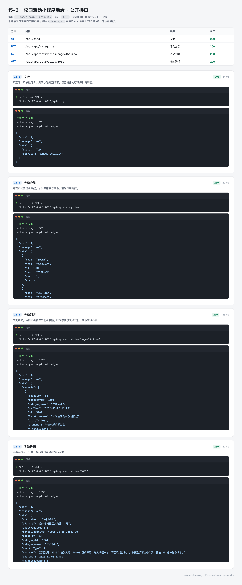
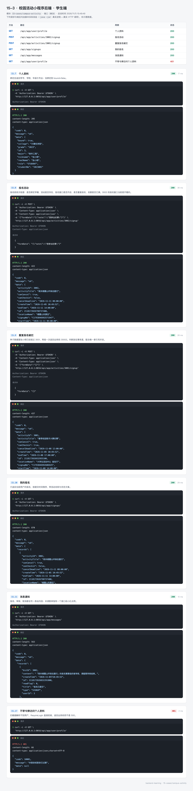
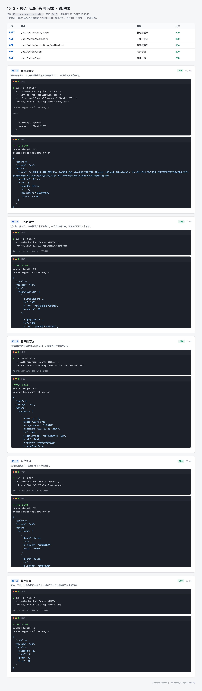
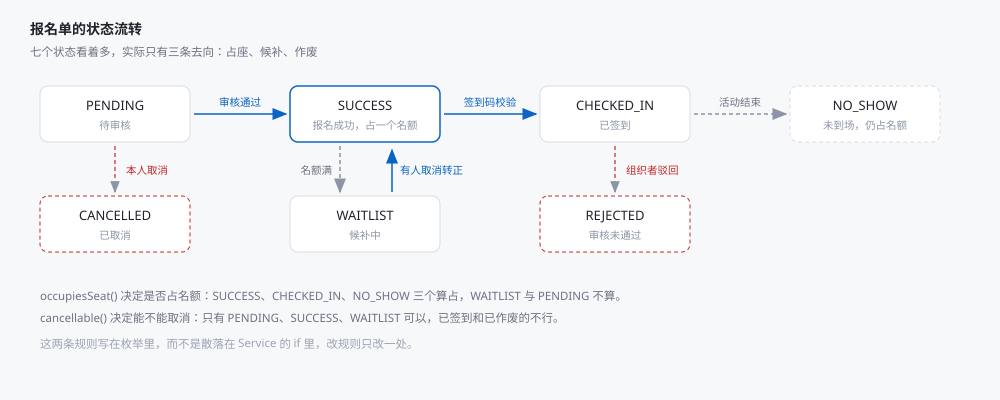
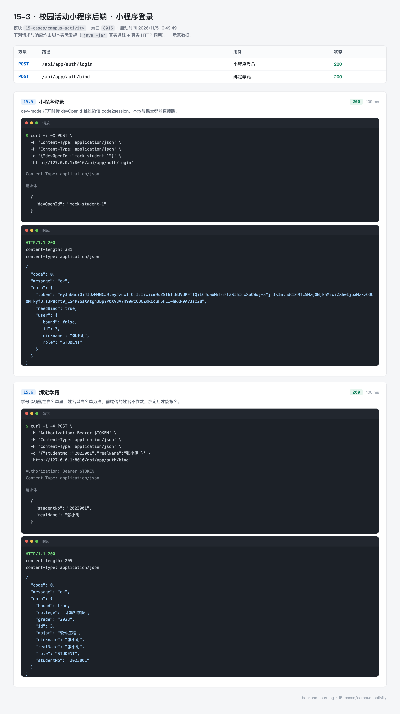

# 15-3 校园活动小程序：一个后端，三个入口

> 后端在 `15-cases/campus-activity/server`，小程序在 `app/`，管理后台在 `admin/`。
> 这个案例的难点不在接口数量，而在「同一套数据要给三种人看，每种人看到的东西不一样」。

## 0. 先看结果

学生打开小程序，看到的是活动列表：



登录、绑学籍、报名之后，能在「我的报名」里看到记录：



团委老师打开管理后台，看到的是待审核、用户和日志：



三条命令：

```bash
# 建库并导入演示数据（推荐做法：用 README 里的两条 mysql 命令）
mysql -uroot -p123456 -e "CREATE DATABASE IF NOT EXISTS campus_activity DEFAULT CHARSET utf8mb4"
cd 15-cases/campus-activity/server
mvn spring-boot:run
```

后端端口 8016，管理后台 5173，小程序用 HBuilderX 或 `npm run dev:mp-weixin` 编译到微信开发者工具。

## 1. 三个入口，一套数据

| 入口 | 使用者 | 关心什么 | 认证方式 |
| --- | --- | --- | --- |
| 小程序端 `/api/app/**` | 学生 | 找活动、报名、签到、看消息 | 微信登录换 token |
| 组织者接口 `/api/org/**` | 学生会、社团 | 发活动、看报名、审核、核销 | 同小程序，角色为 ORGANIZER |
| 管理端 `/api/admin/**` | 团委 | 审核活动、管账号、看日志 | 账号密码登录 |

三个入口共用一套 `sys_user`、一套 `activity`，区别在角色和可见字段。

举个具体的：同一个活动，学生看到的是「还剩 12 个名额」，组织者看到的是「已报名 38 人，待审核 6 人」，团委看到的是「状态：待审核，提交人：计院学生会」。

这不是靠三套接口实现的，而是靠三个 Controller 各自组装 VO。

```
controller/
├── app/      6 个控制器，面向学生
├── admin/    4 个控制器，面向团委
├── org/      1 个控制器，面向组织者
└── PingController.java
```

83 个 Java 文件、38 个接口，按职责分层：

| 包 | 文件数 | 职责 |
| --- | --- | --- |
| `entity` / `mapper` | 12 + 12 | 十二张表 |
| `dto` | 10 | 入参，带校验注解 |
| `vo` | 9 | 出参，按入口裁剪字段 |
| `service` | 8 | 业务规则 |
| `security` | 4 | 拦截器、`@RequireLogin`、令牌 |
| `common` | 8 | 统一响应、错误码、分页、用户上下文 |
| `enums` | 2 | 活动状态、报名状态 |
| `job` | 1 | 定时把活动从「已发布」推到「进行中」「已结束」 |

## 2. 十二张表

分成四组看：

**账号与身份**

```
sys_user           账号（open_id、角色、组织）
student_profile    学籍（学号、学院、年级、专业）
student_whitelist  学籍白名单（先有名单，才能绑定）
organization       组织（学生会、社团）
org_member         组织成员
```

**活动**

```
activity           活动（时间、地点、名额、状态、签到方式）
activity_category  分类
```

**报名与签到**

```
activity_signup    报名单（状态、报名表单答案）
activity_checkin   签到记录
activity_favorite  收藏
```

**消息与审计**

```
sys_notice         站内信
audit_record       操作日志
```

几个设计上的取舍：

**学籍白名单是独立表。** 学生用微信登录后，`sys_user` 里只有 openid 和昵称。要报名必须先「绑定学籍」——输入学号 + 姓名，与白名单比对。这样能保证「只有本校学生能报名」，而不需要接学校的统一身份认证。

**组织用单独的成员表。** 一个人可能既在学生会又在社团，`org_member` 是多对多。活动的 `org_id` 指向组织，不指向人——人走了，活动还在。

**审计日志独立成表。** 审核、下架、改角色都写一条，排查「谁把这条活动下架了」时有据可查。

## 3. 报名单的七个状态

这是整个案例最值得画图的部分：



七个状态，实际只有三条去向：

- **占座**：`SUCCESS` → `CHECKED_IN` → `NO_SHOW`
- **候补**：`WAITLIST` →（有人取消）→ `SUCCESS`
- **作废**：`CANCELLED` / `REJECTED`

两条规则写在枚举里，不散落在 Service 的 if 中：

```java
public enum SignupStatus {

    PENDING(0, "待审核"),
    SUCCESS(1, "报名成功"),
    WAITLIST(2, "候补中"),
    CHECKED_IN(3, "已签到"),
    CANCELLED(4, "已取消"),
    REJECTED(5, "审核未通过"),
    NO_SHOW(6, "未到场");

    /** 是否占用活动名额 */
    public boolean occupiesSeat() {
        return this == SUCCESS || this == CHECKED_IN || this == NO_SHOW;
    }

    /** 是否可以取消 */
    public boolean cancellable() {
        return this == PENDING || this == SUCCESS || this == WAITLIST;
    }
}
```

`occupiesSeat()` 直接决定剩余名额怎么算：

```java
int remaining = activity.getCapacity() - activity.getSignedCount();
```

`NO_SHOW` 也占名额——他没来，但那个位置确实被占用了，不能算成空位放给别人。这个细节在实际活动管理里很重要。

`cancellable()` 决定「取消报名」按钮能不能点。已签到和已作废的不能取消，否则会出现「签到之后又取消」这种无法解释的数据。

## 4. 登录：两种人，两条路

### 4.1 小程序端

正常流程是：小程序调 `wx.login()` 拿 code → 后端用 code 换 openid → 查或建 `sys_user` → 签发令牌。

开发时没有真实微信环境，所以有个开关：

```yaml
campus:
  # dev-mode=true 时允许用 mock openid 登录，不调用微信接口
  dev-mode: true
  wechat:
    app-id: ${WX_APPID:}
    app-secret: ${WX_SECRET:}
```

打开时，可以直接传 `devOpenId`：

```bash
curl -X POST http://127.0.0.1:8016/api/app/auth/login \
  -H 'Content-Type: application/json' \
  -d '{"devOpenId":"mock-student-1"}'
```

```json
{
  "code": 0,
  "message": "ok",
  "data": {
    "token": "...",
    "needBind": true,
    "user": { "id": 3, "nickname": "张小明", "role": "STUDENT", "bound": false }
  }
}
```

`needBind: true` 是关键：登录成功不等于能报名。前端看到这个字段，跳绑定页。

**这个开关上线前必须关。** 打开时任何人都能伪造 openid 冒充别人。代码里它由配置控制，配置由环境变量控制，生产环境不设置就是 `false`。

### 4.2 管理端

账号密码登录，和 15-2 类似，但更轻——只用了 `spring-security-crypto` 的 BCrypt，没有引入完整的 Spring Security：

```bash
curl -X POST http://127.0.0.1:8016/api/admin/auth/login \
  -H 'Content-Type: application/json' \
  -d '{"username":"admin","password":"Admin@123"}'
```

两种登录签发的是同一种令牌，载荷里带角色。拦截器只负责解析，具体权限由 `@RequireLogin` 与业务判断决定。

## 5. 绑定学籍：白名单先行

登录只拿到 openid，绑定之后才有学号与学院。这一步的请求与响应：



```java
public UserVO bind(Long userId, BindRequest request) {
    StudentWhitelist whitelist = whitelistMapper.selectOne(Wrappers.<StudentWhitelist>lambdaQuery()
            .eq(StudentWhitelist::getStudentNo, request.studentNo()));
    if (whitelist == null) {
        throw new BizException(ResultCode.STUDENT_NO_NOT_FOUND);
    }

    StudentProfile exist = profileMapper.selectOne(Wrappers.<StudentProfile>lambdaQuery()
            .eq(StudentProfile::getStudentNo, request.studentNo()));
    if (exist != null && !exist.getUserId().equals(userId)) {
        throw new BizException(ResultCode.STUDENT_NO_BOUND);
    }
    ...
}
```

三个判断，对应三种真实情况：

| 判断 | 含义 | 为什么需要 |
| --- | --- | --- |
| 白名单不存在 | 不是本校学生 | 防止校外人员报名 |
| 学号已被别人绑定 | 有人冒用 | 一个学号只能绑一个微信 |
| 已经绑过自己 | 重复提交 | 幂等，直接成功 |

姓名以白名单为准，前端传的 `realName` 不参与落库：

```java
profile.setRealName(whitelist.getRealName());
```

如果以用户填的为准，谁都能叫「张小明」。

## 6. 报名：五道检查

```java
public SignupVO signup(LoginUser user, Long activityId, SignupRequest request) {
    // 1. 绑学籍了吗
    if (profile == null) {
        throw new BizException(ResultCode.NEED_BIND);
    }
    // 2. 活动存在吗
    Activity activity = activityMapper.selectById(activityId);
    if (activity == null) {
        throw new BizException(ResultCode.ACTIVITY_NOT_FOUND);
    }
    // 3. 报名窗口开了吗
    if (!activity.signupOpen(now)) {
        throw new BizException(ResultCode.ACTIVITY_NOT_OPEN, "报名尚未开始");
    }
    // 4. 是不是已经报过
    if (existing != null) {
        throw new BizException(ResultCode.SIGNUP_REPEATED);
    }
    // 5. 还有名额吗
    if (remaining <= 0) {
        // 开了候补就进候补，没开就直接拒绝
        ...
    }
}
```

顺序有讲究：先检查最便宜的（内存里的 profile），再查库，最后做可能失败的写操作。

第五步的两种结果：

```java
if (remaining > 0) {
    status = activity.auditRequired() ? PENDING : SUCCESS;
} else if (activity.waitlistEnabled()) {
    status = WAITLIST;
} else {
    throw new BizException(ResultCode.SIGNUP_FULL);
}
```

`auditRequired` 是活动级的开关：讲座类活动报名即通过，外出类活动需要组织者审核。

### 6.1 并发下的名额

两个请求同时看到「还剩 1 个」怎么办？

这个案例用的是「乐观更新 + 影响行数判断」：

```java
int updated = activityMapper.update(null, Wrappers.<Activity>lambdaUpdate()
        .eq(Activity::getId, activityId)
        .lt(Activity::getSignedCount, activity.getCapacity())
        .setSql("signed_count = signed_count + 1"));
if (updated == 0) {
    throw new BizException(ResultCode.SIGNUP_FULL);
}
```

`WHERE signed_count < capacity` 是关键：数据库在更新时会加行锁，两个请求串行执行，第二个的 `signed_count` 已经等于 capacity，条件不成立，更新 0 行，抛「名额已满」。

不需要 `SELECT ... FOR UPDATE`，也不需要分布式锁。单库单表的场景，条件更新是最简单可靠的方案。

### 6.2 候补转正

有人取消时，如果开了候补，自动把队首转正：

```java
public void promoteWaitlist(Long activityId) {
    Signup waitlist = signupMapper.selectOne(Wrappers.<Signup>lambdaQuery()
            .eq(Signup::getActivityId, activityId)
            .eq(Signup::getStatus, SignupStatus.WAITLIST.getCode())
            .orderByAsc(Signup::getCreatedAt)
            .last("LIMIT 1"));
    if (waitlist != null) {
        waitlist.setStatus(SignupStatus.SUCCESS.getCode());
        signupMapper.updateById(waitlist);
        noticeSender.send(waitlist.getUserId(), "你已候补转正");
    }
}
```

按报名时间排队，先进先出。转正后发一条站内信，否则学生不知道自己已经能去了。

## 7. 签到：二维码不落库

这个设计值得单独讲。

传统做法是把签到码存库，学生扫码后比对。问题是：二维码截图转发出去，谁都能签。

这个案例用**时间片 + HMAC**：

```java
public String generate(Long activityId) {
    long slice = currentSlice();
    return activityId + "." + slice + "." + sign(activityId, slice);
}

/** 校验通过返回活动 ID，失败抛业务异常 */
public Long verify(String token) {
    String[] parts = token.trim().split("\\.");
    if (parts.length != 3) {
        throw new BizException(ResultCode.CHECKIN_TOKEN_INVALID);
    }
    Long activityId = Long.valueOf(parts[0]);
    long slice = Long.parseLong(parts[1]);
    // 超出容忍窗口直接拒绝
    ...
}
```

三个字段拼起来：

| 段 | 内容 | 作用 |
| --- | --- | --- |
| 1 | 活动 id | 知道是哪个活动 |
| 2 | 时间片编号 | 每 30 秒加一 |
| 3 | `HMAC-SHA256(活动id + 时间片, 密钥)` | 防伪造 |

服务端只保存密钥，不保存码。验证时用同样的算法重算一遍，比对签名。

配置：

```yaml
checkin:
  secret: campus-checkin-demo-secret-2026
  slice-seconds: 30      # 二维码轮换周期
  tolerance-slices: 2    # 接受最近 2 个时间片
  open-before-minutes: 30
  close-after-minutes: 30
```

容忍 2 个时间片，意味着签到窗口是 90 秒（当前片 + 前两片）。截图转发给同学，90 秒后就失效了。

同时还有活动级的窗口：活动开始前 30 分钟到结束后 30 分钟才能签到。两个限制叠加，代签的成本就很高了。

## 8. 管理端：审核与日志

活动不是组织者发布就对学生可见，中间有审核：

```
DRAFT(草稿) → PENDING(待审核) → PUBLISHED(已发布) → ONGOING(进行中) → FINISHED(已结束)
                     ↓
                 REJECTED(已驳回)
```

`ActivityStatusJob` 定时把到时间的活动往前推：

```java
@Scheduled(fixedDelay = 60_000)
public void advance() {
    // 到了开始时间的 PUBLISHED → ONGOING
    // 过了结束时间的 ONGOING → FINISHED
}
```

每分钟跑一次，不用人工点。

每次审核、下架、改角色都写一条 `audit_record`：

```java
auditService.record(operatorId, "AUDIT_ACTIVITY", activityId, "通过，备注：场地已确认");
```

日志表的价值在事后：学生投诉「我的活动被下架了」，能查到是谁、什么时候、为什么。

## 9. 接口一览

| 分组 | 代表接口 | 说明 |
| --- | --- | --- |
| 公开 | `GET /api/ping` | 探活，不查库 |
| 公开 | `GET /api/app/categories` | 分类 |
| 公开 | `GET /api/app/activities` | 列表分页 |
| 公开 | `GET /api/app/activities/{id}` | 详情 |
| 小程序 | `POST /api/app/auth/login` | 微信登录 |
| 小程序 | `POST /api/app/auth/bind` | 绑学籍 |
| 小程序 | `POST /api/app/activities/{id}/signup` | 报名 |
| 小程序 | `GET /api/app/signups` | 我的报名 |
| 小程序 | `POST /api/app/checkin` | 扫码签到 |
| 小程序 | `GET /api/app/messages` | 站内信 |
| 组织者 | `POST /api/org/activities` | 发活动 |
| 组织者 | `POST /api/org/activities/{id}/signups/audit` | 审核报名 |
| 管理端 | `GET /api/admin/dashboard` | 工作台 |
| 管理端 | `GET /api/admin/activities/audit-list` | 待审核 |
| 管理端 | `GET /api/admin/users` | 用户 |
| 管理端 | `GET /api/admin/logs` | 操作日志 |

## 10. 实测

### 10.1 匿名看列表

```
GET /api/app/activities?page=1&size=3
```

```json
{
  "code": 0,
  "message": "ok",
  "data": {
    "records": [
      {
        "id": 3001,
        "title": "春季校园歌手大赛初赛",
        "categoryName": "文体活动",
        "orgName": "计算机学院学生会",
        "startTime": "2026-11-08 14:00",
        "locationName": "大学生活动中心 报告厅",
        "capacity": 50,
        "signedCount": 1,
        "signupOpen": true,
        "status": 3,
        "statusLabel": "已发布"
      }
    ]
  }
}
```

注意 `code` 是 0 而不是 200——这个模块的约定是 0 表示成功。同一个仓库里三种成功码（200、0、无 code），是历史原因，接手时先确认。

### 10.2 重复报名

```json
{ "code": 30002, "message": "你已报名该活动" }
```

HTTP 200。和 15-2 一样，业务错误放在 200 里。

### 10.3 未登录

```
GET /api/app/user/profile
```

```json
{ "code": 10001, "message": "未登录或登录已过期" }
```

HTTP 401。这里业务码与状态码是对齐的。

## 11. 测试

```bash
cd 15-cases/campus-activity/server
mvn test
```

```
Tests run: 5, Failures: 0, Errors: 0, Skipped: 0
BUILD SUCCESS
```

五个冒烟用例，覆盖入口与鉴权：

| 用例 | 验证 |
| --- | --- |
| `ping` | 不查库、不校验身份 |
| `categories` | 分类按 sort 升序 |
| `activities` | 分页结构与状态文案 |
| `profileRequiresLogin` | 未登录 401 + 业务码 10001 |
| `loginWithDevOpenId` | dev 登录后能访问个人资料 |

`campus-activity` 的业务规则比另外两个案例复杂（名额、候补、审核、签到），完整的端到端验证靠 `scripts/smoke.sh`：

```bash
cd 15-cases/campus-activity
bash scripts/smoke.sh
```

脚本按「登录 → 绑定 → 报名 → 签到 → 取消」的顺序调接口，比单元测试更接近真实使用。

## 12. 两个前端

### 12.1 小程序 `app/`

uni-app + Vue3 + TypeScript，一套代码编译到微信小程序和 H5。

```bash
cd 15-cases/campus-activity/app
npm install
npm run dev:mp-weixin     # 产物在 dist/dev/mp-weixin，用微信开发者工具打开
```

### 12.2 管理后台 `admin/`

Vue3 + Vite + Element Plus：

```bash
cd 15-cases/campus-activity/admin
npm install
npm run dev
```

访问 `http://127.0.0.1:5173`，账号 `admin` / `Admin@123`。

两个前端都不带 `node_modules`，第一次要先 `npm install`。

## 13. 练习

**练习 1：给报名加「取消后不可再报」的规则**

现在取消后还能再报。加一条规则：取消过的活动不能再报，除非组织者手动恢复。想清楚这条规则存在哪（报名单上标记，还是单独一张黑名单表）。

**练习 2：候补转正的通知**

现在转正时发一条站内信。如果学生没打开小程序，站内信看不到。设计一个方案：转正后 10 分钟没确认，自动释放名额给下一位。需要哪些字段、哪些定时任务？

**练习 3：签到码的时钟偏移**

`tolerance-slices: 2` 允许客户端时钟慢 60 秒。如果学生手机时间快 5 分钟会怎样？改一下 `verify`，让服务端只用自己的时间，不接受客户端传的时间片。

**练习 4：管理端的权限细分**

现在只有 `ADMIN` 一个角色。加一个「只读审计员」：能看活动、看用户、看日志，但不能审核、不能改角色。想清楚是加角色，还是加权限点。

## 14. 常见问题

| 现象 | 原因 | 处理 |
| --- | --- | --- |
| 启动报 `Unknown database 'campus_activity'` | 库没建 | 先执行 `CREATE DATABASE` |
| 表是空的 | 没导入 `db/schema.sql` 与 `db/data.sql` | 按 README 两条命令导入 |
| 登录返回「开发模式需要传 devOpenId」 | `dev-mode: true` 但没传 openid | 传 `devOpenId`，或关掉 dev-mode 配真实微信参数 |
| 报名返回「请先绑定学籍」 | 登录了但没绑定 | 先调 `/api/app/auth/bind` |
| 报名返回「报名尚未开始」 | 活动的 `signup_start_time` 在未来 | 种子数据按当天生成，换一个活动试 |
| 签到码无效 | 二维码超过 90 秒 | 重新生成 |
| 小程序连不上后端 | 手机不能访问 `127.0.0.1` | 改成局域网 IP，并在微信开发者工具里关掉域名校验 |

## 15. 小结

这个案例有三个值得带走的设计：

**入口分开，数据合一。** 三套 Controller、一套表和一套 Service。可见字段的差异在 VO 层处理，不在 SQL 里写三份。

**状态机写在枚举里。** `occupiesSeat()` 和 `cancellable()` 是业务规则，放在枚举上，所有调用方共用一份，改规则只改一处。

**名额用条件更新。** `WHERE signed_count < capacity` 加影响行数判断，比锁简单，也比「先查再改」可靠。

到这里，15-cases 的三个案例就齐了：

| 案例 | 侧重 | 技术点 |
| --- | --- | --- |
| 知乎 | 内容与关系 | 批量查询、事务计数、投票状态机 |
| 任务批改 | 权限 | 三道关、Spring Security、越权防护 |
| 校园活动 | 业务流转 | 多入口、状态机、并发名额、动态签到码 |

三个案例合起来，覆盖了从「能跑」到「能上线」之间最常见的那几类问题。
