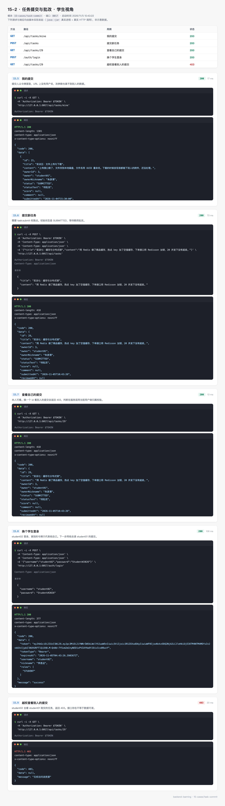
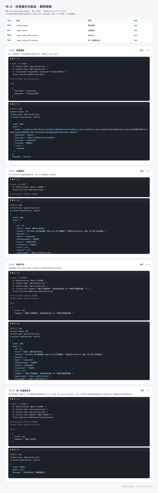
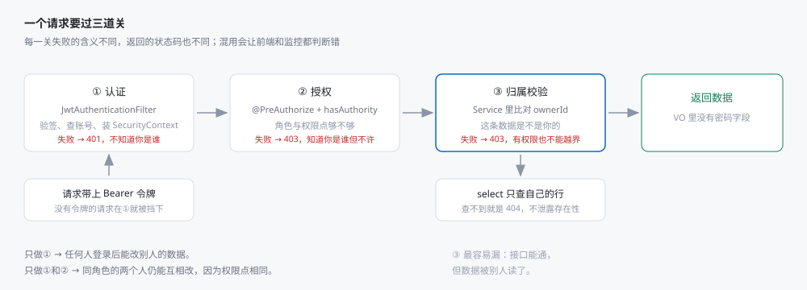

# 15-2 任务提交与批改：三道关与越权防护

> 代码在 `15-cases/task-commit`，前端在 `15-cases/task-commit/web`。
> 这个案例讲的是权限：学生交、教师批、管理员管账号。重点不是「怎么登录」，而是「登录之后能做什么、不能做什么」。

## 0. 先看结果

学生看到的是自己的提交和分数：



教师看到的是全部提交，可以打分写评语：



三条命令跑起来：

```bash
mvn -pl 15-cases/task-commit spring-boot:run
node tools/run-cases.mjs 15-cases/task-commit
```

第一次启动会自动建表灌数据：14 个账号、28 条提交，其中 11 条待批改。学生页和教师页打开就有内容，不是空表。

## 1. 这个案例要解决什么

需求本身很简单：学生交任务，教师批改，管理员管账号。但「谁能做什么」这件事，比接口数量难得多。

三条真实发生过的越权路径：

| 路径 | 现象 | 防线 |
| --- | --- | --- |
| 学生 A 拿到学生 B 的提交 id，直接调详情接口 | 能看到同学的内容 | 归属校验：比对 ownerId |
| 学生调 `/admin/users` | 能看到全部账号 | 角色校验：`hasRole('ADMIN')` |
| 前端隐藏了「批改」按钮，学生直接调接口 | 能给自己打分 | 权限点校验：`hasAuthority('task:review')` |

三条路径对应三道关，缺一不可：



这篇就按这三关讲。

## 2. 技术选型

| 组件 | 版本 | 说明 |
| --- | --- | --- |
| Spring Boot | 4.1.1 | |
| Spring Security | 7.x | 随 Boot 4 引入 |
| MyBatis-Plus | 3.5.17 | 需要 `mybatis-plus-spring-boot4-starter` |
| jjwt | 0.13.0 | 签发与解析 token |
| MySQL | 8.0+ | 与 05-mybatis 共库，表加 `sec_` 前缀 |

和 15-1 的知乎案例相比，这里选择用完整的 Spring Security。两个案例放在一起看，能对比出「自己写一百行」和「用框架配五条链」的差别。

表有四张：

```
sec_user       账号（password 存 BCrypt 密文，enabled 控制停用）
sec_role       角色（STUDENT / TEACHER / ADMIN）
sec_user_role  用户与角色的关联
sec_task       提交的任务（owner_id 指向 sec_user）
```

## 3. 角色与权限点

```java
public enum Role {

    STUDENT(Set.of("task:submit", "task:read")),
    TEACHER(Set.of("task:review", "task:read")),
    ADMIN(Set.of("user:read", "user:write", "task:read", "task:review"));

    private final Set<String> permissions;

    public String authority() {
        // hasRole("ADMIN") 实际比对的是 ROLE_ADMIN，前缀由 Security 补
        return "ROLE_" + name();
    }

    public static List<String> authorities(Collection<Role> roles) {
        return roles.stream()
                .flatMap(role -> Stream.concat(Stream.of(role.authority()), role.permissions().stream()))
                .distinct()
                .toList();
    }
}
```

**角色给人看，权限点给接口用。** 接口上写 `hasAuthority('task:review')`，不写 `hasAnyRole('TEACHER','ADMIN')`。

好处是将来多一类人（比如教务），只需要加一个角色、配好权限点，接口代码一行都不用改。如果接口写死了角色名，每加一类人就要改一遍所有相关接口。

登录返回的 `authorities` 是摊平后的：

```json
{
  "username": "teacher01",
  "nickname": "陶老师",
  "roles": ["TEACHER"],
  "authorities": ["ROLE_TEACHER", "task:review", "task:read"],
  "enabled": true
}
```

## 4. 第一关：认证

### 4.1 过滤器链

```java
@Bean
public SecurityFilterChain securityFilterChain(HttpSecurity http,
                                               JwtTokenService jwtTokenService,
                                               UserDetailsService userDetailsService,
                                               RestAuthenticationEntryPoint authenticationEntryPoint,
                                               RestAccessDeniedHandler accessDeniedHandler) throws Exception {
    JwtAuthenticationFilter jwtFilter = new JwtAuthenticationFilter(jwtTokenService, userDetailsService);
    http
            // 纯 Bearer 令牌、无 cookie 会话，可以关掉 CSRF；一旦改回 session 认证必须重新打开
            .csrf(AbstractHttpConfigurer::disable)
            .cors(Customizer.withDefaults())
            .httpBasic(AbstractHttpConfigurer::disable)
            .formLogin(AbstractHttpConfigurer::disable)
            .logout(AbstractHttpConfigurer::disable)
            .sessionManagement(session -> session.sessionCreationPolicy(SessionCreationPolicy.STATELESS))
            // 规则按从具体到宽泛排列，anyRequest 必须放最后
            .authorizeHttpRequests(auth -> auth
                    .requestMatchers("/auth/login", "/public/**", "/error").permitAll()
                    .requestMatchers("/admin/**").hasRole("ADMIN")
                    .requestMatchers("/api/tasks/**").authenticated()
                    .anyRequest().authenticated())
            .exceptionHandling(handler -> handler
                    .authenticationEntryPoint(authenticationEntryPoint)
                    .accessDeniedHandler(accessDeniedHandler))
            .addFilterBefore(jwtFilter, UsernamePasswordAuthenticationFilter.class);
    return http.build();
}
```

四个「关掉」都有理由：

| 关掉 | 原因 |
| --- | --- |
| `csrf` | 用 Bearer 令牌、没有 cookie 会话，CSRF 攻击无法携带身份。改回 session 认证必须重新打开 |
| `httpBasic` | 不需要浏览器弹窗，令牌走请求头 |
| `formLogin` | 不需要登录页，登录是 `/auth/login` 接口 |
| `logout` | 无状态，服务端没有 session 可清，登出是前端删 token |

`sessionCreationPolicy(STATELESS)` 同样重要：不创建 session，避免「令牌 + 会话」两套身份同时存在。

**规则的顺序不能乱。** `requestMatchers` 从上往下匹配，命中即停。`anyRequest()` 必须放最后，否则它会把后面的规则全部吃掉。

### 4.2 令牌过滤器

```java
@Override
protected void doFilterInternal(HttpServletRequest request, HttpServletResponse response,
                                FilterChain filterChain) throws ServletException, IOException {
    String token = resolveToken(request);
    if (token != null && SecurityContextHolder.getContext().getAuthentication() == null) {
        authenticate(request, token);
    }
    filterChain.doFilter(request, response);
}

private void authenticate(HttpServletRequest request, String token) {
    try {
        String username = tokenService.parseUsername(token);
        UserDetails user = userDetailsService.loadUserByUsername(username);
        UsernamePasswordAuthenticationToken authentication =
                new UsernamePasswordAuthenticationToken(user, null, user.getAuthorities());
        authentication.setDetails(new WebAuthenticationDetailsSource().buildDetails(request));
        SecurityContextHolder.getContext().setAuthentication(authentication);
    } catch (JwtException | UsernameNotFoundException e) {
        SecurityContextHolder.clearContext();
        log.debug("令牌校验未通过：{}", e.getMessage());
    }
}
```

**令牌无效时不在这里写响应**，只清空上下文放行。后面的授权判断会拒绝匿名请求，由 `RestAuthenticationEntryPoint` 统一返回 401。

如果这里自己写 401，会出现两种响应格式：过滤器写的和 EntryPoint 写的。前端要为同一种错误写两套解析。

### 4.3 为什么每次请求都回库查一次

`authenticate` 里调了 `loadUserByUsername`，也就是每次请求都查一次 `sec_user` 与 `sec_user_role`。

看起来浪费，但换来两个能力：

- **停用立即生效。** 管理员把某个账号 `enabled = 0`，下一个请求就登不进来，不用等 token 过期。
- **改角色立即生效。** 把学生升成教师，权限马上变化。

代价是每个请求多一次数据库查询。真要优化，可以加一层短 TTL 的缓存（比如 60 秒），而不是把角色塞进 token。

## 5. 第二关：授权

### 5.1 URL 级与方法级

`SecurityConfig` 里的 `requestMatchers` 是 URL 级，`@PreAuthorize` 是方法级。两层同时用：

```java
@RestController
@RequestMapping("/api/tasks")
public class TaskController {

    @PreAuthorize("hasAuthority('task:submit')")
    @PostMapping
    public Result<TaskView> submit(...) { ... }

    @PreAuthorize("hasAuthority('task:review')")
    @GetMapping
    public Result<List<TaskView>> all() { ... }

    @PreAuthorize("hasAuthority('task:review')")
    @PostMapping("/{id}/review")
    public Result<TaskView> review(...) { ... }
}
```

URL 级负责「这一组接口谁能进」，方法级负责「这个方法谁能调」。同一组里不同方法权限不同时，方法级是唯一能表达的方式。

`/admin/users` 两层都写了：

```java
@PreAuthorize("hasRole('ADMIN')")
@RestController
@RequestMapping("/admin/users")
public class UserAdminController {

    @PreAuthorize("hasAuthority('user:write')")
    @PostMapping
    public Result<UserProfile> create(...) { ... }
}
```

类上的 `hasRole('ADMIN')` 管整组，方法上的 `user:write` 只管新增。这样将来加一个「只读审计员」角色时，给它 `user:read` 就能看列表，但没有 `user:write` 就建不了账号。

### 5.2 401 与 403 不能混

```
GET /api/tasks/mine        没有令牌        → 401，不知道你是谁
GET /admin/users           学生令牌        → 403，知道你是谁，但不许
```

两个状态由两个不同的处理器输出：

| 处理器 | 触发时机 | 状态 |
| --- | --- | --- |
| `RestAuthenticationEntryPoint` | 匿名访问需要认证的资源 | 401 |
| `RestAccessDeniedHandler` | 已认证但权限不足 | 403 |

如果都返回 401，前端会误以为「登录过期了」，把用户踢回登录页——但他其实已经登录了，只是没权限。反过来如果都返回 403，前端不会去刷新令牌，用户会一直卡在「没有权限」。

## 6. 第三关：归属校验

前两关只回答「你是谁」和「你的角色够不够」，回答不了「这条数据是不是你的」。

```java
private boolean canView(TaskRow row, SecurityUser viewer) {
    if (row.getOwnerId().equals(viewer.id())) {
        return true;
    }
    return viewer.authorities().contains("task:review");
}
```

两个学生角色相同、权限点相同，A 能看 B 的提交吗？前两关都会放行。必须在 Service 里用当前用户和数据的归属比一次。

详情接口：

```java
@GetMapping("/{id}")
public Result<TaskView> detail(@PathVariable Long id,
                               @AuthenticationPrincipal SecurityUser user) {
    return Result.ok(taskService.detail(id, user));
}
```

`@AuthenticationPrincipal` 把 `SecurityContext` 里的用户直接注入方法参数，不用再 `SecurityContextHolder.getContext()` 取一次。

测试里专门有一条：

```java
@Test
@DisplayName("越权查看别人的提交返回 403")
void cannotViewOthersTask() throws Exception {
    // student01 提交的任务，用 student02 的令牌去读
    mockMvc.perform(get("/api/tasks/" + taskId)
                    .header("Authorization", "Bearer " + otherToken))
            .andExpect(status().isForbidden());
}
```

## 7. 业务错误的两种约定

这个模块的业务异常统一返回 HTTP 200，真正的错误放在 `code` 里：

```java
@ExceptionHandler(BusinessException.class)
public ResponseEntity<Result<Void>> handleBusiness(BusinessException e) {
    HttpStatus status = switch (e.getErrorCode()) {
        case FORBIDDEN -> HttpStatus.FORBIDDEN;
        case UNAUTHORIZED -> HttpStatus.UNAUTHORIZED;
        default -> HttpStatus.OK;
    };
    return ResponseEntity.status(status).body(Result.fail(e.getErrorCode()));
}
```

所以「重复批改」是这样的：

```
POST /api/tasks/29/review   →   HTTP 200
{"code":30012,"message":"该任务已批改，不能重复批改"}
```

而 15-1 的知乎案例是另一种约定：业务码映射真实 HTTP 状态，`40400` → 404。

两种约定都有道理：

| 约定 | 优点 | 缺点 |
| --- | --- | --- |
| 业务错误放 200 | 前端只判断 code，不用处理 HTTP 状态；网关不会把业务失败算成错误率 | 监控看不出错误率；日志里 200 满天飞 |
| 业务码映射状态码 | 监控与告警准确；HTTP 语义正确 | 前端要处理两套判断；某些业务失败确实不该算 5xx |

选择哪一种要看团队。关键是**一个项目里只用一种**——混着来，前端永远在猜。

同一个仓库里两种约定并存，是历史原因，不是推荐做法。教程保留这个差异，是因为它是真实的：接手别人的项目时，第一件事就是搞清楚它用的是哪一种。

## 8. 数据库与种子数据

```sql
CREATE TABLE sec_user
(
    id         BIGINT UNSIGNED NOT NULL AUTO_INCREMENT,
    username   VARCHAR(50)     NOT NULL,
    password   VARCHAR(100)    NOT NULL COMMENT 'BCrypt 密文，不可逆',
    nickname   VARCHAR(50)     NOT NULL,
    enabled    TINYINT         NOT NULL DEFAULT 1,
    created_at DATETIME        NOT NULL DEFAULT CURRENT_TIMESTAMP,
    PRIMARY KEY (id),
    UNIQUE KEY uk_user_username (username)
) ENGINE = InnoDB;
```

14 个账号，密码都是 BCrypt 密文：

| 账号 | 密码 | 角色 |
| --- | --- | --- |
| admin | Admin#2026 | ADMIN |
| teacher01 / teacher02 | Teacher#2026 | TEACHER |
| student01 – student10 | Student#2026 | STUDENT |
| guest | Guest#2026 | STUDENT（已停用） |

停用的账号用来演示 `enabled = 0`：登录返回 30002，不是密码错。

数据初始化：

```yaml
spring:
  sql:
    init:
      mode: always
      schema-locations: classpath:schema.sql
      data-locations: classpath:data.sql
      encoding: UTF-8
```

`mode: always` 意味着**每次启动都会删表重建**。这在教学环境里是优点（每次都是干净数据），在生产环境是灾难。上线前必须改成 `never`。

## 9. 接口一览

| 方法 | 路径 | 权限 | 说明 |
| --- | --- | --- | --- |
| POST | `/auth/login` | 放行 | 换令牌 |
| GET | `/auth/me` | 已认证 | 刷新页面后恢复身份 |
| POST | `/api/tasks` | `task:submit` | 学生提交，提交人从令牌取 |
| GET | `/api/tasks/mine` | 已认证 | 只返回自己的 |
| GET | `/api/tasks/{id}` | 本人或 `task:review` | 越权 403 |
| GET | `/api/tasks` | `task:review` | 教师看全部 |
| POST | `/api/tasks/{id}/review` | `task:review` | 批改打分 |
| GET | `/admin/users` | ADMIN | 账号列表 |
| POST | `/admin/users` | ADMIN + `user:write` | 新增账号 |
| DELETE | `/admin/users/{username}` | ADMIN | 删除，禁止删自己 |
| GET | `/public/ping` | 放行 | 对比放行效果 |

自测顺序（16 个用例都在这条链上）：

```bash
# 1. 免认证接口
curl -s http://127.0.0.1:8017/public/ping

# 2. 不带令牌
curl -i http://127.0.0.1:8017/api/tasks/mine        # 401

# 3. 学生登录
TOKEN=$(curl -s -X POST http://127.0.0.1:8017/auth/login \
  -H 'Content-Type: application/json' \
  -d '{"username":"student01","password":"Student#2026"}' | jq -r .data.token)

# 4. 我的提交
curl -s http://127.0.0.1:8017/api/tasks/mine -H "Authorization: Bearer $TOKEN"

# 5. 越权看别人的
curl -i http://127.0.0.1:8017/api/tasks/29 -H "Authorization: Bearer $OTHER"   # 403

# 6. 学生访问管理接口
curl -i http://127.0.0.1:8017/admin/users -H "Authorization: Bearer $TOKEN"   # 403
```

## 10. 测试

```bash
mvn -pl 15-cases/task-commit test
```

```
Tests run: 22, Failures: 0, Errors: 0, Skipped: 0
BUILD SUCCESS
```

22 个用例覆盖的是「权限矩阵」，不是「接口能通」：

| 场景 | 期望 |
| --- | --- |
| 免登录访问 `/public/ping` | 200 |
| 无令牌访问受保护接口 | 401 |
| 学生看自己的提交 | 200 |
| 学生看别人的提交 | 403 |
| 学生提交任务 | 200 |
| 教师看全部提交 | 200 |
| 教师批改 | 200 |
| 重复批改 | 200 + code 30012 |
| 学生访问 `/admin/users` | 403 |
| 管理员访问 `/admin/users` | 200 |
| 停用账号登录 | code 30002 |
| 密码错误 | code 30001 |

这种测试写法叫「权限矩阵测试」：横轴是角色，纵轴是接口，每个格子写期望。接口加一个，矩阵加一行，很容易发现漏测的格子。

## 11. 练习

**练习 1：加一个「助教」角色**

助教能看全部提交、能批改，但不能管账号。加一个 `ASSISTANT` 角色，配 `task:read` 与 `task:review`，验证：

- 能调 `GET /api/tasks`
- 能调 `POST /api/tasks/{id}/review`
- 调 `/admin/users` 返回 403

这道题的考点是：不改任何 Controller 代码，只加枚举和一条数据。

**练习 2：让停用立即生效**

现在每次请求都回库查用户，停用已经立即生效。如果把 `loadUserByUsername` 改成从 token 里读角色，停用要等多久才生效？怎么在「少查一次库」和「立即生效」之间做取舍？

**练习 3：给提交加截止时间**

`sec_task` 加一列 `deadline`，提交时校验「已过截止时间返回业务错误」。想清楚：截止时间放在活动/课程上，还是每条任务上？

**练习 4：把业务错误改成映射真实状态码**

把 `TASK_ALREADY_REVIEWED` 映射成 HTTP 409，同步改测试。然后评价：改完之后，前端的判断逻辑是变简单了还是变复杂了？

## 12. 常见问题

| 现象 | 原因 | 处理 |
| --- | --- | --- |
| 所有请求都 401，包括登录 | 登录路径没加进 `permitAll` | 检查 `requestMatchers("/auth/login")` |
| 登录成功但下一请求 401 | 请求头没带 `Bearer ` 前缀 | 过滤器只认 `Bearer xxx` |
| 明明是管理员却 403 | 用了 `hasRole("ROLE_ADMIN")` | `hasRole` 会自动补前缀，写 `"ADMIN"` |
| `@PreAuthorize` 不生效 | 没开 `@EnableMethodSecurity` | 启动类或配置类加注解 |
| 停用账号还能登录 | 只查了密码没查 `enabled` | `UserDetails.isEnabled()` 返回 false |
| 启动后数据被清空 | `sql.init.mode: always` | 生产改成 `never` |
| 前端登录后立刻跳回登录页 | 401 和 403 混用 | 401 才刷新令牌，403 提示无权限 |

## 13. 小结

三道关的分工：

| 关 | 回答的问题 | 失败 | 写在哪 |
| --- | --- | --- | --- |
| 认证 | 你是谁 | 401 | 过滤器 + EntryPoint |
| 授权 | 你的角色够不够 | 403 | `requestMatchers` + `@PreAuthorize` |
| 归属 | 这条数据是不是你的 | 403 | Service 里比对 ownerId |

第三关最容易被漏掉，因为前两关通过时，接口「看起来是通的」。只有拿两个同角色的账号互相访问，才会发现问题。

下一篇 `15-3` 是校园活动小程序，重点在另一件事：同一个后端要服务小程序、管理后台、组织者三种入口，以及一个有七个状态的报名单怎么流转。
