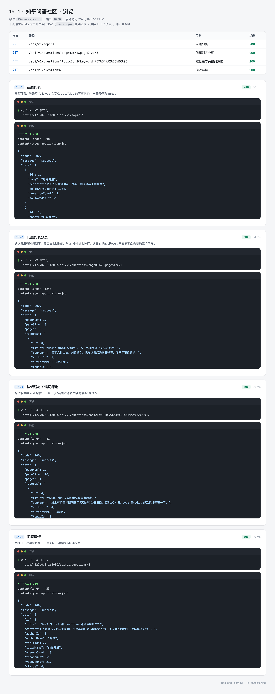
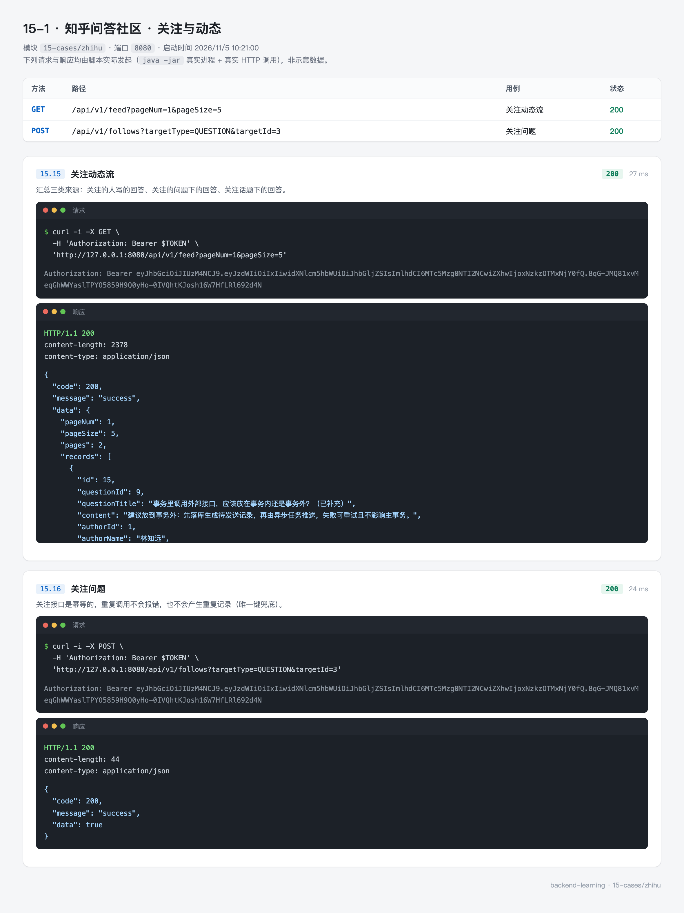
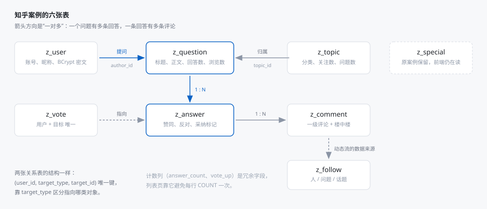
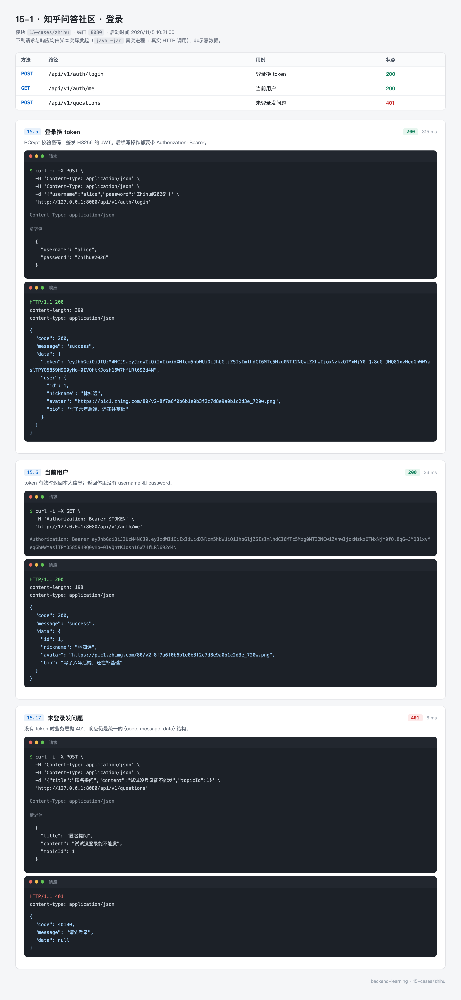
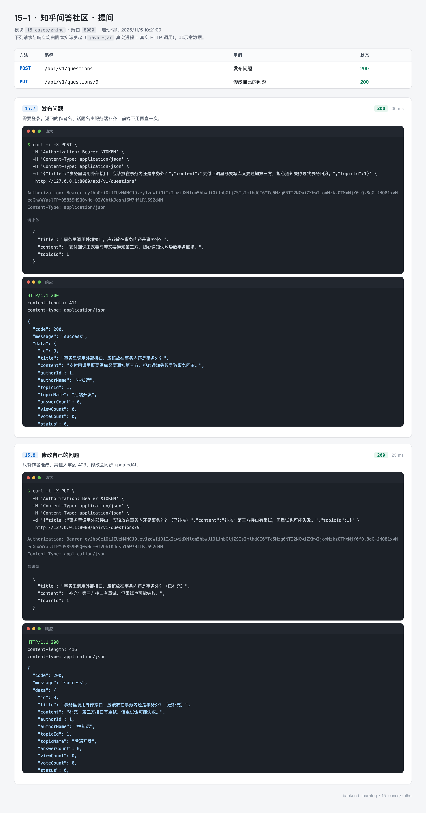
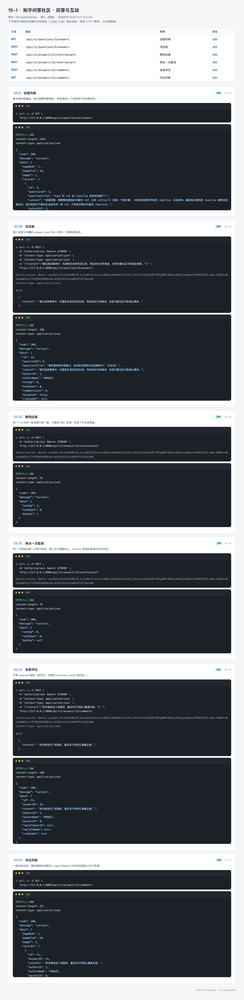

# 15-1 知乎问答社区：从一张表扩成一个能用的社区

> 代码在 `15-cases/zhihu`，前端在 `15-cases/zhihu/web`。
> 本篇讲的是把「只有一个专栏列表接口」的示例，扩成一套完整的问答社区：登录、提问、回答、评论、投票、关注、动态流。

## 0. 先看结果

启动之后，一个匿名用户可以浏览问题列表：



登录之后可以提问、回答、投票、评论，动态流里能看到关注的人的新回答：



三条命令把它跑起来：

```bash
mysql -uroot -p123456 -e "CREATE DATABASE IF NOT EXISTS zhihu DEFAULT CHARSET utf8mb4"
mvn -pl 15-cases/zhihu spring-boot:run
node tools/run-cases.mjs 15-cases/zhihu
```

第一次启动会自动执行 `schema.sql` 与 `data.sql`，建 8 张表、灌 5 个用户、6 个话题、8 个问题、14 条回答。不用手工导 SQL。

58 个 Java 文件、23 个接口，按职责分成九个包：

| 包 | 文件数 | 职责 |
| --- | --- | --- |
| `common` | 6 | 统一响应、错误码、分页结果、当前用户、异常处理 |
| `config` | 2 | Web 配置（跨域、拦截器、密码编码器）、分页插件 |
| `security` | 2 | JWT 签发解析、认证拦截器 |
| `entity` | 8 | 八张表的实体 |
| `mapper` | 8 | 八个 `BaseMapper`，CRUD 由框架提供 |
| `dto` | 5 | 入参，带校验注解 |
| `vo` | 8 | 出参 record，实体不出 service |
| `service` | 10 | 认证、问题、回答、评论、社交、话题、用户、批量查名字、专栏 |
| `controller` | 8 | 按资源划分的 23 个端点 |

## 1. 这个案例要解决什么

原来的知乎示例只有一张 `t_special` 表和一条 `GET /api/v1/special/all`。它能演示「MyBatis-Plus 查列表」，但离一个真实社区差得远：没有用户，没有内容之间的关系，也没有任何写操作。

真实的问答社区，最小的闭环是这条链路：

1. 用户注册、登录，拿到身份；
2. 提一个问题，归到某个话题下；
3. 别人回答，提问者可以采纳其中一条；
4. 读者给回答投票，票数决定排序；
5. 读者在回答下评论，评论可以回复评论；
6. 关注感兴趣的人、问题、话题，首页按关注关系推内容。

这六步里，藏着后端最常见的几类问题：

| 要解决的问题 | 对应的技术点 |
| --- | --- |
| 谁在操作 | JWT 认证、拦截器、ThreadLocal 传递当前用户 |
| 列表不能慢 | 分页插件、冗余计数列、批量查名字避免 N+1 |
| 写操作不能半途而废 | 事务、计数与主记录同生共死 |
| 一个人只能投一票 | 唯一索引 + 先查后改的三种分支 |
| 首页要有内容 | 用关注关系拼动态流，多条件 OR 查询 |

所以这个案例的重点不是「接口多」，而是每个接口背后都有一个必须想清楚的问题。

## 2. 领域模型

八张表，六张是核心，两张是关系表：



### 2.1 为什么主键用自增

`z_user` 到 `z_comment` 都是 `BIGINT AUTO_INCREMENT`。生产环境里分布式系统常用雪花 ID，但这个案例是单库单实例，自增主键有两个好处：种子数据能写死 id，测试断言稳定；调试时看 id 就知道先后。

`z_special` 是原案例的表，主键不是自增，保留原结构是为了前端不用改。

### 2.2 冗余计数列

`z_question.answer_count`、`z_answer.vote_up`、`z_answer.comment_count` 都是冗余字段——它们可以由明细表算出来，但存了一份。

原因在列表页：一页 10 个问题，如果每行都去 `SELECT COUNT(*) FROM z_answer WHERE question_id = ?`，就是 10 次子查询。数据量一大，列表页会先于详情页垮掉。

代价是写入时要同步维护。这个案例的做法是：**插入明细和更新计数放在同一个事务里**，后面 8.2 节会看到。

### 2.3 关系表统一形状

`z_vote` 和 `z_follow` 的结构几乎一样：

```sql
UNIQUE KEY uk_vote (user_id, target_type, target_id)
UNIQUE KEY uk_follow (user_id, target_type, target_id)
```

用 `target_type` 区分指向哪类对象（`ANSWER` / `QUESTION` / `USER` / `TOPIC`），一张表管住所有组合。

这比「每类对象建一张关联表」省事，代价是失去了外键约束——数据库不会帮你保证 `target_id` 真的存在，只能在业务层 `checkTargetExists` 里做。这个取舍在中小项目里很常见。

唯一键是这套设计的安全网：并发下两个请求同时插入同一条投票，第二个会被数据库拒绝，不会出现「一个人两票」。

## 3. 环境准备

| 组件 | 版本 | 说明 |
| --- | --- | --- |
| JDK | 21 | Boot 4 要求 17 以上 |
| Spring Boot | 4.1.1 | 仓库统一版本 |
| MyBatis-Plus | 3.5.17 | 必须用 `mybatis-plus-spring-boot4-starter` |
| MySQL | 8.0+ | 本机 3306 |

建库：

```bash
mysql -uroot -p123456 -e "CREATE DATABASE IF NOT EXISTS zhihu DEFAULT CHARSET utf8mb4"
```

不需要手工建表，应用启动时 `spring.sql.init` 会执行 `schema.sql` 与 `data.sql`。

## 4. 工程结构

```
15-cases/zhihu
├── pom.xml
├── src/main/java/top/mqxu/zhihu
│   ├── ZhihuApplication.java
│   ├── common/         Result、ErrorCode、PageResult、UserContext、GlobalExceptionHandler
│   ├── config/         WebConfig、MybatisPlusConfig
│   ├── security/       JwtService、AuthInterceptor
│   ├── entity/         User、Topic、Question、Answer、Comment、Vote、Follow、Special
│   ├── mapper/         八个 BaseMapper
│   ├── dto/            五个入参对象，带校验注解
│   ├── vo/             八个出参 record
│   ├── service/        十个业务类
│   └── controller/     八个控制器
├── src/main/resources
│   ├── application.yml
│   ├── schema.sql
│   └── data.sql
└── web/                Vue3 前端，调用 /api/v1/special/all
```

### 4.1 POM

```xml
<properties>
    <mybatis-plus.version>3.5.17</mybatis-plus.version>
    <jjwt.version>0.13.0</jjwt.version>
</properties>

<dependencies>
    <dependency>
        <groupId>com.baomidou</groupId>
        <artifactId>mybatis-plus-spring-boot4-starter</artifactId>
        <version>${mybatis-plus.version}</version>
    </dependency>
    <dependency>
        <groupId>com.mysql</groupId>
        <artifactId>mysql-connector-j</artifactId>
        <scope>runtime</scope>
    </dependency>
    <dependency>
        <groupId>com.baomidou</groupId>
        <artifactId>mybatis-plus-jsqlparser</artifactId>
        <version>${mybatis-plus.version}</version>
    </dependency>
    <dependency>
        <groupId>org.springframework.boot</groupId>
        <artifactId>spring-boot-starter-validation</artifactId>
    </dependency>
    <dependency>
        <groupId>org.springframework.security</groupId>
        <artifactId>spring-security-crypto</artifactId>
    </dependency>
    <dependency>
        <groupId>io.jsonwebtoken</groupId>
        <artifactId>jjwt-api</artifactId>
        <version>${jjwt.version}</version>
    </dependency>
    <dependency>
        <groupId>io.jsonwebtoken</groupId>
        <artifactId>jjwt-impl</artifactId>
        <version>${jjwt.version}</version>
        <scope>runtime</scope>
    </dependency>
    <dependency>
        <groupId>io.jsonwebtoken</groupId>
        <artifactId>jjwt-jackson</artifactId>
        <version>${jjwt.version}</version>
        <scope>runtime</scope>
    </dependency>
</dependencies>
```

三个容易踩的点：

**`mybatis-plus-jsqlparser` 必须单独引。** 3.5.9 起分页插件用到的 SQL 解析器被拆成了独立构件，只引 starter 会在启动时报 `ClassNotFoundException: PaginationInnerInterceptor`。

**`spring-security-crypto` 只是密码工具。** 引它不会带来过滤器链，`@PreAuthorize` 之类的东西都没有——这里只要 `BCryptPasswordEncoder`。认证是 `security` 包里的自定义拦截器做的。

**jjwt 的三个构件缺一不可。** `api` 编译期用，`impl` 与 `jackson` 运行期用；只引 `api` 会在签发时抛 `Unable to find an implementation`。

### 4.2 配置

```yaml
server:
  port: 8080

spring:
  datasource:
    url: jdbc:mysql://127.0.0.1:3306/zhihu?useUnicode=true&characterEncoding=utf8&serverTimezone=Asia/Shanghai&useSSL=false&allowPublicKeyRetrieval=true
    username: ${MYSQL_USERNAME:root}
    password: ${MYSQL_PASSWORD:123456}
  sql:
    init:
      mode: always
      schema-locations: classpath:schema.sql
      data-locations: classpath:data.sql
      encoding: UTF-8

mybatis-plus:
  configuration:
    map-underscore-to-camel-case: true
  global-config:
    db-config:
      id-type: auto
      logic-delete-field: deleted
      logic-delete-value: 1
      logic-not-delete-value: 0

app:
  jwt:
    secret: ${JWT_SECRET:zhihu-case-demo-secret-key-please-change-in-production}
    expire-hours: 24
```

`mode: always` 是必须的。MySQL 不是内嵌库，Boot 默认只在嵌入式数据库上执行脚本，不写这一行数据永远不会导入。

`logic-delete-field: deleted` 让 `@TableLogic` 字段全局生效：`questionMapper.deleteById(id)` 实际执行的是 `UPDATE z_question SET deleted = 1`，之后所有查询都会自动带上 `deleted = 0`。

## 5. 统一响应与异常

### 5.1 三个字段

```java
@Data
@NoArgsConstructor
@AllArgsConstructor
public class Result<T> {

    private Integer code;
    private String message;
    private T data;

    public static <T> Result<T> ok(T data) {
        return new Result<>(200, "success", data);
    }

    public static <T> Result<T> fail(ErrorCode errorCode, String message) {
        return new Result<>(errorCode.getCode(), message, null);
    }
}
```

前端只写一套解析：先看 HTTP 状态，再看 `code`，`data` 里有就给页面。

### 5.2 业务码与 HTTP 状态对齐

```java
public enum ErrorCode {
    BAD_REQUEST(40000, HttpStatus.BAD_REQUEST, "请求参数有误"),
    UNAUTHORIZED(40100, HttpStatus.UNAUTHORIZED, "请先登录"),
    FORBIDDEN(40300, HttpStatus.FORBIDDEN, "没有权限执行该操作"),
    NOT_FOUND(40400, HttpStatus.NOT_FOUND, "内容不存在"),
    CONFLICT(40900, HttpStatus.CONFLICT, "数据冲突"),
    INTERNAL(50000, HttpStatus.INTERNAL_SERVER_ERROR, "服务器开小差了");
}
```

约定是「业务码的后三位就是 HTTP 状态」：`40400` → 404，`40100` → 401。日志里看到一个码，就知道该返回什么状态。

这样 HTTP 状态可以给网关和监控用（统计 5xx 比例），业务码可以给页面用（提示具体哪错了）。

### 5.3 异常翻译

业务层只管抛：

```java
throw new BusinessException(ErrorCode.FORBIDDEN, "只能修改自己提的问题");
```

`GlobalExceptionHandler` 统一翻译成 HTTP 状态与响应体：

```java
@ExceptionHandler(BusinessException.class)
public ResponseEntity<Result<Void>> handleBusiness(BusinessException e) {
    ErrorCode errorCode = e.getErrorCode();
    return ResponseEntity.status(errorCode.getHttpStatus())
            .body(Result.fail(errorCode, e.getMessage()));
}
```

还额外接了四种「框架抛的、但本质是客户端错误」的异常：

| 异常 | 场景 | 不接的后果 |
| --- | --- | --- |
| `MethodArgumentNotValidException` | `@Valid` 校验失败 | 兜底成 500 |
| `HttpMessageNotReadableException` | 请求体 JSON 语法错 | 兜底成 500 |
| `MissingServletRequestParameterException` | 少传必填查询参数 | 兜底成 500 |
| `MethodArgumentTypeMismatchException` | `?id=abc` 传了非数字 | 兜底成 500 |

这四种都是客户端的问题，返回 500 会让监控误判成服务故障，也会让前端拿不到「哪里错了」。

## 6. 登录与鉴权

### 6.1 为什么不引 Spring Security

08 篇和 15-2 用的是完整的 Spring Security：过滤器链、`@PreAuthorize`、方法级鉴权。这个案例故意换一条路——**只用 `BCryptPasswordEncoder`，认证自己写**。

理由是教学上的互补：看完两篇，会知道「有框架」和「没框架」分别是什么样子。真实项目里，如果只需要「登录发 token、请求验 token」，自己写一百行比配五条过滤器链更直观。

### 6.2 签发

```java
public JwtService(@Value("${app.jwt.secret}") String secret,
                  @Value("${app.jwt.expire-hours:24}") long expireHours) {
    // HS256 要求密钥不短于 256 bit；短了 jjwt 会直接抛异常，这是好事，别绕过
    this.key = Keys.hmacShaKeyFor(secret.getBytes(StandardCharsets.UTF_8));
    this.ttl = Duration.ofHours(expireHours);
}

public String createToken(Long userId, String username) {
    Date now = new Date();
    return Jwts.builder()
            .subject(String.valueOf(userId))
            .claim("username", username)
            .issuedAt(now)
            .expiration(new Date(now.getTime() + ttl.toMillis()))
            .signWith(key)
            .compact();
}
```

`subject` 存用户 id，不放角色。角色会变，token 有效期 24 小时，把角色写进去意味着改了权限要等一天才生效。每次请求按 id 回库查一次（这个案例简化成直接信任 id），是更常见的选择。

### 6.3 解析失败返回 null

```java
public Long parseUserId(String token) {
    try {
        Claims claims = Jwts.parser()
                .verifyWith(key)
                .build()
                .parseSignedClaims(token)
                .getPayload();
        return Long.valueOf(claims.getSubject());
    } catch (Exception e) {
        log.debug("token 解析失败：{}", e.getMessage());
        return null;
    }
}
```

过期、签名不对、格式错，三种情况一律返回 null。对外的表现都是「你没登录」，没必要区分——区分了反而给攻击者信息。

### 6.4 拦截器只解析，不拦截

```java
@Component
@RequiredArgsConstructor
public class AuthInterceptor implements HandlerInterceptor {

    private static final String BEARER = "Bearer ";

    private final JwtService jwtService;

    @Override
    public boolean preHandle(HttpServletRequest request, HttpServletResponse response, Object handler) {
        String header = request.getHeader("Authorization");
        if (header != null && header.startsWith(BEARER)) {
            Long userId = jwtService.parseUserId(header.substring(BEARER.length()));
            if (userId != null) {
                UserContext.set(userId);
            }
        }
        return true;
    }

    @Override
    public void afterCompletion(HttpServletRequest request, HttpServletResponse response,
                                Object handler, Exception ex) {
        // 不清理的话，线程被复用时会把这个用户带给下一个请求
        UserContext.clear();
    }
}
```

注意 `preHandle` 永远返回 `true`。拦截器不判断「这个接口要不要登录」，因为一旦要判断，就得维护一份白名单，而且列表、详情这类「登录与否都能看，只是返回内容不同」的接口很难表达。

判断交给业务层：

```java
public static Long requireUserId() {
    Long userId = CURRENT_USER.get();
    if (userId == null) {
        throw new BusinessException(ErrorCode.UNAUTHORIZED);
    }
    return userId;
}
```

读接口用 `UserContext.get()`，可能是 null（游客），用来决定「要不要带上我的投票状态」；写接口用 `requireUserId()`，没登录直接 401。

`afterCompletion` 里的 `clear()` 不能省。Tomcat 的线程是复用的，清晚了，下一个请求会拿到上一个用户的身份——这种 bug 在并发测试里才会暴露，本地单线程点页面永远遇不到。

### 6.5 密码

```java
@Bean
public BCryptPasswordEncoder passwordEncoder() {
    return new BCryptPasswordEncoder();
}
```

BCrypt 每次加密带随机盐，同一个密码两次算出来的密文不一样，但 `matches` 都能通过。所以库里存的是密文，也没法「解密找回密码」——忘记密码只能重置。

登录时用户名不存在和密码错误返回同一句话：

```java
if (user == null || !passwordEncoder.matches(request.getPassword(), user.getPassword())) {
    throw new BusinessException(ErrorCode.UNAUTHORIZED, "用户名或密码错误");
}
```

不要写「该用户不存在」——那是在帮攻击者枚举账号。

## 7. 问题列表：三个容易被忽略的细节



### 7.1 条件要用 and 包住

```java
LambdaQueryWrapper<Question> wrapper = new LambdaQueryWrapper<>();
if (topicId != null) {
    wrapper.eq(Question::getTopicId, topicId);
}
if (StringUtils.hasText(keyword)) {
    // 条件用 and 包起来，否则会和前面的 topic 条件变成 OR，把别的分类也带出来
    wrapper.and(w -> w.like(Question::getTitle, keyword)
            .or().like(Question::getContent, keyword));
}
```

如果不加 `.and()`，生成的 SQL 是：

```sql
WHERE topic_id = 3 AND title LIKE '%索引%' OR content LIKE '%索引%'
```

`AND` 优先级高于 `OR`，实际等价于 `(topic_id = 3 AND title LIKE ...) OR (content LIKE ...)`——第二个条件会把所有话题的内容都捞出来。

测试里专门有一条 `topicAndKeywordCombineWithAnd`：在前端话题（id=2）下搜「Redis」，期望 0 条。不加 `and` 就会搜到数据库话题里的那条。

### 7.2 三种排序

```java
switch (sort == null ? "latest" : sort) {
    case "hot" -> wrapper.orderByDesc(Question::getViewCount)
            .orderByDesc(Question::getAnswerCount);
    case "unanswered" -> wrapper.eq(Question::getAnswerCount, 0)
            .orderByDesc(Question::getCreatedAt);
    default -> wrapper.orderByDesc(Question::getCreatedAt);
}
```

`unanswered` 不只是排序，它附加了一个过滤条件（回答数等于 0）。把它写在排序分支里，是因为「待回答」本身就是一种列表视图，不需要单独开接口。

### 7.3 批量查名字，避免 N+1

列表返回 10 个问题，每个都要显示作者昵称和话题名。最直接的写法是遍历时逐条查：

```java
// 不要这样写
for (Question q : questions) {
    vo.setAuthorName(userMapper.selectById(q.getAuthorId()).getNickname());
}
```

10 条问题就是 20 次查询。这叫 N+1：一次查列表，N 次查关联。

这个案例收口到一个 `LookupService`：

```java
public Map<Long, String> nicknames(Collection<Long> userIds) {
    if (userIds == null || userIds.isEmpty()) {
        return Map.of();
    }
    return userMapper.selectByIds(userIds).stream()
            .collect(Collectors.toMap(User::getId, User::getNickname));
}
```

一次 `IN` 查询，回来在内存里拼成 Map。调用方：

```java
private List<QuestionVO> toVOs(List<Question> questions) {
    if (questions.isEmpty()) {
        return List.of();
    }
    List<Long> authorIds = questions.stream().map(Question::getAuthorId).distinct().toList();
    List<Long> topicIds = questions.stream().map(Question::getTopicId).distinct().toList();
    List<Long> ids = questions.stream().map(Question::getId).toList();

    Map<Long, String> authors = lookupService.nicknames(authorIds);
    Map<Long, String> topics = lookupService.topicNames(topicIds);
    Long current = UserContext.get();
    Set<Long> followed = lookupService.myFollowTargets(current, "QUESTION", ids);
    Map<Long, Integer> votes = lookupService.myVotes(current, "QUESTION", ids);

    return questions.stream()
            .map(q -> QuestionVO.of(q,
                    authors.get(q.getAuthorId()),
                    topics.get(q.getTopicId()),
                    followed.contains(q.getId()),
                    votes.get(q.getId())))
            .collect(Collectors.toList());
}
```

一个 10 条的列表，总共 5 次查询（主查询 + 作者 + 话题 + 关注 + 投票），与页大小无关。

### 7.4 匿名也要能看

`followed` 和 `myVote` 依赖当前用户。游客没有用户，`LookupService` 里判断 `userId == null` 直接返回空 Map，VO 里的 `followed` 恒为 false、`myVote` 恒为 null。

不需要为游客单独写一套接口，也不需要给拦截器加白名单。

## 8. 回答：事务与计数



### 8.1 事务边界

```java
@Transactional
public AnswerVO create(Long questionId, String content) {
    Long userId = UserContext.requireUserId();
    Question question = questionService.require(questionId);
    if (question.getStatus() != null && question.getStatus() == 1) {
        throw new BusinessException(ErrorCode.CONFLICT, "该问题已关闭，不能再回答");
    }

    Answer answer = new Answer();
    answer.setQuestionId(questionId);
    answer.setAuthorId(userId);
    answer.setContent(content);
    answer.setVoteUp(0);
    answer.setVoteDown(0);
    answer.setCommentCount(0);
    answer.setAccepted(0);
    answerMapper.insert(answer);

    // 冗余计数同步加一，与插入放在同一个事务里
    questionMapper.update(null, new LambdaUpdateWrapper<Question>()
            .eq(Question::getId, questionId)
            .setSql("answer_count = answer_count + 1, updated_at = NOW()"));
    return toVOs(List.of(answer)).get(0);
}
```

两件事要么都成，要么都不成。如果插入成功、计数失败，列表页会显示「0 个回答」，但点进去有一条——用户会以为系统坏了。

### 8.2 计数用 SQL 自增

```java
.setSql("answer_count = answer_count + 1, updated_at = NOW()")
```

不要写成：

```java
// 并发下会丢更新
question.setAnswerCount(question.getAnswerCount() + 1);
questionMapper.updateById(question);
```

「读出来加一再写回」在两个请求同时到达时会互相覆盖：两个人都读到 3，都写 4，实际应该有 5。`SET x = x + 1` 交给数据库执行，InnoDB 的行锁保证不会丢。

### 8.3 采纳只有一个

```java
@Transactional
public AnswerVO accept(Long answerId) {
    Long userId = UserContext.requireUserId();
    Answer answer = require(answerId);
    Question question = questionService.require(answer.getQuestionId());
    if (!question.getAuthorId().equals(userId)) {
        throw new BusinessException(ErrorCode.FORBIDDEN, "只有提问者可以采纳回答");
    }

    // 先把同问题下的其他回答全部取消采纳，再把这一条置 1
    answerMapper.update(null, new LambdaUpdateWrapper<Answer>()
            .eq(Answer::getQuestionId, answer.getQuestionId())
            .set(Answer::getAccepted, 0));
    answerMapper.update(null, new LambdaUpdateWrapper<Answer>()
            .eq(Answer::getId, answerId)
            .set(Answer::getAccepted, 1));
    answer.setAccepted(1);
    return toVOs(List.of(answer)).get(0);
}
```

先全部清零再置一，两条更新在同一个事务里。反过来的话，如果只把新的置 1 不清旧的，会出现两个「已采纳」。

## 9. 互动：投票、评论、关注、动态流



### 9.1 投票的三种分支

一个人对一条回答只有一票。点「赞同」→ 再点「赞同」→ 点「反对」，这是三个不同的动作：

```java
Vote existing = voteMapper.selectOne(new LambdaQueryWrapper<Vote>()
        .eq(Vote::getUserId, userId)
        .eq(Vote::getTargetType, type)
        .eq(Vote::getTargetId, targetId));

Integer myVote;
if (existing == null) {
    if (value != 0) {
        // 没投过 → 新增
        ...
        applyCounter(type, targetId, value, 1);
        myVote = value;
    } else {
        myVote = null;
    }
} else if (existing.getValue() == value) {
    // 再点一次同一个按钮：取消
    voteMapper.deleteById(existing.getId());
    applyCounter(type, targetId, existing.getValue(), -1);
    myVote = null;
} else {
    // 改票：先撤销旧票，再记新票
    applyCounter(type, targetId, existing.getValue(), -1);
    existing.setValue(value);
    voteMapper.updateById(existing);
    applyCounter(type, targetId, value, 1);
    myVote = value;
}
```

第一版这里写错了：`Integer myVote = value == 0 ? null : value;`，取消时仍返回 1，前端按钮不会变回未选中。测试 `voteTogglesAndSwitches` 就是靠第二次点赞期望 `myVote` 不存在才发现的。

`applyCounter` 同样用 SQL 自增：

```java
String column = value == 1 ? "vote_up" : "vote_down";
answerMapper.update(null, new LambdaUpdateWrapper<Answer>()
        .eq(Answer::getId, targetId)
        .setSql(column + " = GREATEST(" + column + " + (" + delta + "), 0)"));
```

`GREATEST(..., 0)` 兜底，防止某种异常路径把计数减成负数。

### 9.2 评论的父级校验

```java
if (parentId > 0) {
    Comment parent = commentMapper.selectById(parentId);
    if (parent == null || !Objects.equals(parent.getAnswerId(), answerId)) {
        throw new BusinessException(ErrorCode.BAD_REQUEST, "父评论不属于这条回答");
    }
    if (replyToUserId == null) {
        replyToUserId = parent.getAuthorId();
    }
}
```

只校验父评论存在是不够的：把 A 回答下的评论 id 传到 B 回答的接口里，父子关系就串了。必须同时校验 `answerId` 一致。

没指定回复谁时，默认回复父评论作者——这是评论区的默认行为，前端不用额外传。

### 9.3 动态流

三类来源，拼成一个按时间倒序的列表：

```java
List<Long> authorIds = followTargets(userId, "USER");
List<Long> questionIds = new ArrayList<>(followTargets(userId, "QUESTION"));
List<Long> topicIds = followTargets(userId, "TOPIC");
if (!topicIds.isEmpty()) {
    // 关注话题 → 话题下的问题 → 这些问题的回答
    List<Question> questions = questionMapper.selectList(new LambdaQueryWrapper<Question>()
            .in(Question::getTopicId, topicIds)
            .orderByDesc(Question::getCreatedAt)
            .last("LIMIT 200"));
    questions.forEach(q -> questionIds.add(q.getId()));
}
if (authorIds.isEmpty() && questionIds.isEmpty()) {
    return PageResult.empty(pageNum, pageSize);
}

LambdaQueryWrapper<Answer> wrapper = new LambdaQueryWrapper<>();
wrapper.and(w -> {
    if (!authorIds.isEmpty()) {
        w.in(Answer::getAuthorId, authorIds);
    }
    if (!questionIds.isEmpty()) {
        if (!authorIds.isEmpty()) {
            w.or();
        }
        w.in(Answer::getQuestionId, questionIds);
    }
});
wrapper.orderByDesc(Answer::getCreatedAt);
```

`LIMIT 200` 是一个必要的保护：关注了 50 个话题，每个话题上千个问题，`IN` 列表会长到 SQL 解析都慢。截断到最近 200 个问题，对动态流够用。

一个关注都没有时直接返回空页，不发查询。

## 10. 运行实测

### 10.1 匿名浏览

```
GET /api/v1/questions?pageNum=1&pageSize=3
```

```json
{
  "code": 200,
  "message": "success",
  "data": {
    "records": [
      {
        "id": 8,
        "title": "Redis 缓存和数据库不一致，先删缓存还是先更新库？",
        "authorId": 1,
        "authorName": "林知远",
        "topicName": "数据库",
        "answerCount": 1,
        "viewCount": 933,
        "voteCount": 18,
        "createdAt": "2026-11-04 10:08:53",
        "followed": false,
        "myVote": null
      }
    ],
    "total": 8,
    "pageNum": 1,
    "pageSize": 3,
    "pages": 3
  }
}
```

`pages` 是 3：8 条数据，每页 3 条，向上取整。这是 `PageResult.of` 里算的，不是 MyBatis-Plus 的 `getPages()`——两边的计算规则要统一在一处。

### 10.2 未登录发问题

```json
{
  "code": 40100,
  "message": "请先登录",
  "data": null
}
```

HTTP 401。这是 `UserContext.requireUserId()` 抛出来的，不是拦截器。

### 10.3 详情浏览数

连续两次 `GET /api/v1/questions/1`，`viewCount` 从 328 变成 329，再变成 330。每次打开都加一，用 `SET view_count = view_count + 1`。

## 11. 测试

22 个用例，分三个类：

| 测试类 | 用例 | 类型 | 覆盖 |
| --- | --- | --- | --- |
| `JwtServiceTest` | 5 | 纯单元 | 签发解析、篡改签名、换密钥、过期、乱字符串 |
| `QuestionApiTest` | 8 | 集成 | 分页、筛选、详情、404、未登录、发布、越权、校验 |
| `AnswerApiTest` | 8 | 集成 | 采纳排序、计数同步、采纳权限、投票三态、评论增删、动态流 |
| `SpecialServiceTest` | 1 | 集成 | 原案例的专栏列表仍可用 |

```bash
mvn -pl 15-cases/zhihu test
```

```
Tests run: 22, Failures: 0, Errors: 0, Skipped: 0
BUILD SUCCESS
```

集成测试类上都有 `@Transactional`：

```java
@SpringBootTest
@AutoConfigureMockMvc
@Transactional
class QuestionApiTest {
```

每个用例结束回滚，跑一百遍也不会污染演示数据。注意这里的回滚能生效，是因为 MockMvc 与业务代码在同一个线程、同一个事务里；如果换成本机端口 + 真实 HTTP（`webEnvironment = RANDOM_PORT`），事务就跨不过去了。

### 11.1 一个测试用例的写法

```java
@Test
@DisplayName("同一个按钮点两次等于取消，换按钮等于改票")
void voteTogglesAndSwitches() throws Exception {
    String token = login("alice");

    mockMvc.perform(post("/api/v1/answers/2/vote").param("value", "1")
                    .header("Authorization", "Bearer " + token))
            .andExpect(jsonPath("$.data.voteUp").value(19))
            .andExpect(jsonPath("$.data.myVote").value(1));

    mockMvc.perform(post("/api/v1/answers/2/vote").param("value", "1")
                    .header("Authorization", "Bearer " + token))
            .andExpect(jsonPath("$.data.voteUp").value(18))
            .andExpect(jsonPath("$.data.myVote").doesNotExist());

    mockMvc.perform(post("/api/v1/answers/2/vote").param("value", "-1")
                    .header("Authorization", "Bearer " + token))
            .andExpect(jsonPath("$.data.voteUp").value(18))
            .andExpect(jsonPath("$.data.voteDown").value(1))
            .andExpect(jsonPath("$.data.myVote").value(-1));
}
```

三次请求串起来测一个状态机。单看第一次「点赞成功」是测不出取消逻辑的。

### 11.2 JWT 篡改怎么测

```java
@Test
@DisplayName("改掉签名段一个字符就失效")
void tamperedTokenReturnsNull() {
    String token = jwtService.createToken(42L, "alice");
    // 改签名段的第一个字符，改末尾可能只动到 Base64 的填充位
    int signatureStart = token.lastIndexOf('.') + 1;
    char original = token.charAt(signatureStart);
    String tampered = token.substring(0, signatureStart)
            + (original == 'A' ? 'B' : 'A')
            + token.substring(signatureStart + 1);

    assertThat(jwtService.parseUserId(tampered)).isNull();
}
```

改末尾字符不一定失效——Base64url 的最后一位可能只落在填充位上，解码后字节没变，验签照样通过。这条注释是踩过之后补的。

## 12. 前端

`web/` 是一个 Vite + Vue3 + TypeScript 的小页面，只调 `GET /api/v1/special/all`，用来验证原有接口没被改坏：

```ts
const fetchAll = (): any => axios.get(`http://localhost:8080/api/v1/special/all`)
    .then((res) => {
      list.value = res.data.data as Special[]
    })
```

返回结构从 `{code, msg, data}` 改成了 `{code, message, data}`，`data` 没变，所以前端不用动。

```bash
cd 15-cases/zhihu/web
npm install
npm run dev
```

后端端口必须是 8080，前端写死了。

## 13. 练习

**练习 1：给问题列表加「只看未回答」的标签页**

`sort=unanswered` 已经有了，但前端没有入口。加一个 tab，切换时把 `sort` 传过去，观察列表变化。

**练习 2：回答列表支持「按时间」与「按票数」切换**

`AnswerService.page` 的 `sort` 参数已经支持 `latest` 和 `vote`。给它补一个测试，断言两种排序下第一条回答的 id 不同。

**练习 3：给问题也做投票**

`z_question.vote_count` 这一列现在是种子数据写死的，`SocialService.vote` 的 `QUESTION` 分支只加不减。把它补完整，并加一条测试：同一个人给问题点赞两次，计数回到原值。

**练习 4：动态流加入「关注话题下的新问题」**

现在动态流只推回答。如果关注的话题下有人提了新问题，也应该出现在流里。想一想：返回体是 `AnswerVO`，新问题怎么塞进去？要不要改成统一的 `FeedItemVO`？

这道题没有标准答案，重点是能不能说清「改返回结构」对前端的影响。

**练习 5：给列表加缓存**

问题列表是典型的读多写少。引入 Spring Cache，给 `page` 加 `@Cacheable`，key 用 `topicId + keyword + sort + pageNum`。然后想办法：有人发新问题时，怎么让缓存失效？

## 14. 常见问题

| 现象 | 原因 | 处理 |
| --- | --- | --- |
| 启动报 `Table 'zhihu.z_user' doesn't exist` | 库没建，或 `sql.init.mode` 没写 `always` | 建库、补配置 |
| 分页不生效，永远返回全表 | 没注册 `MybatisPlusInterceptor` | 检查 `MybatisPlusConfig` |
| 列表里作者名全是 null | `LookupService` 的 `IN` 查询没命中 | 确认 `author_id` 与 `z_user.id` 对得上 |
| 登录成功但写接口还是 401 | 请求头没带 `Bearer ` 前缀 | 拦截器只认 `Bearer xxx` |
| 并发下计数偶尔少一 | 用了「读出来加一再写回」 | 改 `SET x = x + 1` |
| 同一用户出现两条投票 | 没有唯一索引，或并发插入没捕获异常 | 加 `uk_vote` 唯一键 |
| 评论的父级串到别的回答 | 只校验了父评论存在 | 同时校验 `answerId` |
| 时间显示成 `2026-11-04T10:08:53` | `LocalDateTime` 默认走 ISO 格式 | 在 VO 字段上加 `@JsonFormat` |

## 15. 小结

这个案例从一张表扩到八张表，真正值得记住的不是接口数量，而是四件事：

**认证与授权分开。** 拦截器只解析身份，不决定能不能访问。要不要登录由业务层说，这样「游客也能看、登录了看得更多」的接口不用维护白名单。

**计数与明细同事务。** 冗余计数是性能换来的，代价是每次写都要维护。维护的动作必须和明细在同一个事务里。

**列表查询要数清 SQL 条数。** 一页 10 条，如果背后是 20 次查询，接口能跑但撑不住。`LookupService` 这类批量查询的收口，比任何缓存都先做。

**状态变化要测全。** 投票有「投、取消、改票」三种，采纳有「自己、别人」两种，评论有「一级、楼中楼」两种。只测正向路径，上线就会被用户点出来。

下一篇 `15-2` 是任务提交与批改，重点在另一条路线：用 Spring Security 的五条过滤器链做认证授权，以及「接口能通但数据被别人读了」这种越权怎么防。
